# Complete Requisition, RFQ, Quotation, Order, and Receipt Flow

Procurement owns materials, requisition approval rules, requisitions, RFQs, quotations, purchase orders, and receipts. Approval runtime stays in `omni-workflow`; Procurement does not depend on Flowable.

> Screenshots in this guide come from the WP006 real main-chain acceptance environment (fixture `wp006-real-chain-v1`): two WP005 base materials → requisition PR-1-1 approved through the real workflow (10000 CNY) → RFQ-1-1 with quotations from two real suppliers → comparison and award → purchase order PO-1-1 → three receipts with two quality states. All captures are read-only, taken by `omni-frontend/e2e-docs/flows/wp006-visual.flows.spec.ts` in four locales (68 tests, all passed), with no data writes.

## 1. End-to-End Flow

```text
Maintain Materials → Configure Approval Rules → Create and Approve Requisition → Create RFQ
→ Invite Suppliers → Receive and Compare Quotations → Create Order → Supplier Confirms → Receive Goods
```

Each stage has an independent state machine. Never skip prerequisites by changing database status.

### Screenshot

#### Figure 1 `procurement-overview-en-US`: Procurement overview

- Prerequisites: log in as a procurement administrator with the `procurement:overview:list` permission
- Actor: procurement administrator
- Action: open Procurement → Overview
- Expected result: the main area shows the "Procurement Overview" title with amounts grouped per currency; the real chain shows one fully received order and confirmed purchase commitment CNY 9000.0000

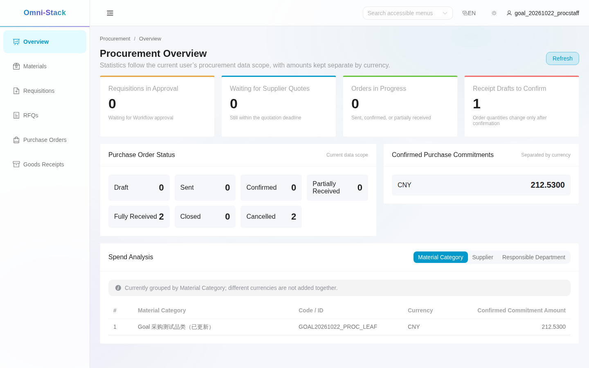

## 2. Materials

Categories and materials are tenant-shared master data. A material defines code, name, category, unit, asset-management flag, and default asset quantity semantics. Check references before deletion.

Only accepted asset-managed receipt lines emit asset candidates. `assetQuantity` is an exact positive integer; monetary and quantity values follow explicit decimal precision contracts.

### Screenshot

#### Figure 2 `procurement-material-list-en-US`: Material catalog list

- Prerequisites: log in as a procurement administrator with material catalog view permission
- Actor: procurement administrator
- Action: open Procurement → Material Catalog
- Expected result: the list shows both real WP005 base materials (one asset-managed, one not)

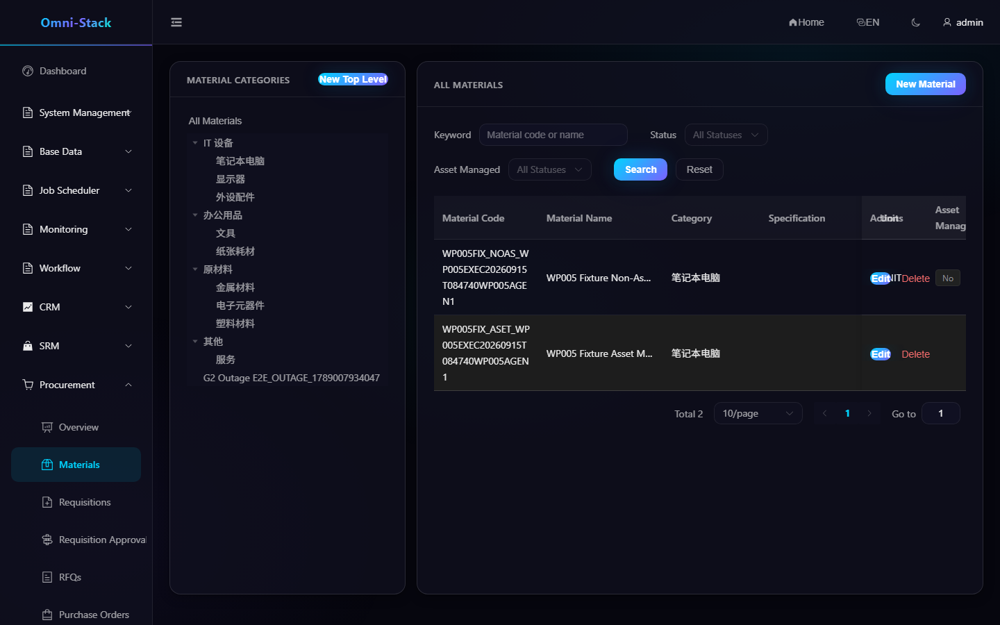

#### Figure 3 `procurement-forbidden-403-en-US`: Forbidden access

- Prerequisites: log in as an employee without procurement permissions
- Actor: employee
- Action: open the material catalog route directly
- Expected result: a 403 forbidden page is shown instead of an empty list; no data leaks

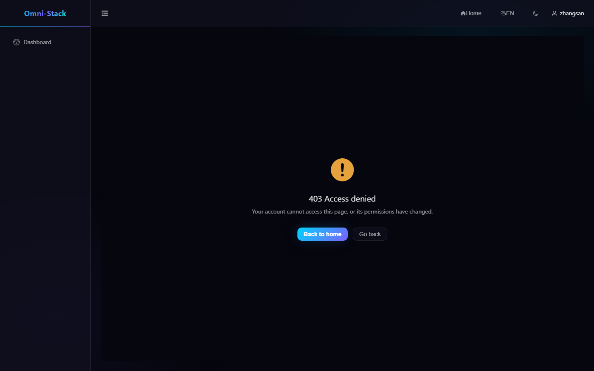

## 3. Requisition Approval Rules

The business-oriented UI asks users to:

1. Select a category or default scope.
2. Define an inclusive minimum and exclusive maximum amount.
3. Select a current published procurement approval flow.
4. Preview the actual approval path.
5. Test a category and amount against the server resolver.
6. Resolve coverage gaps or conflicts before enabling.

Deactivation and deletion show newly uncovered scope. The server owns matching logic; the frontend never duplicates it.

### Screenshot

#### Figure 4 `procurement-approval-rules-en-US`: Approval rules entry

- Prerequisites: log in as a procurement administrator with `procurement:approval-route:list`
- Actor: procurement administrator
- Action: open Procurement → Requisition Approval Rules
- Expected result: the main area shows the "Requisition Approval Rules" title, the real LAPTOP three-amount-range rules, the match tester, and coverage risk cards

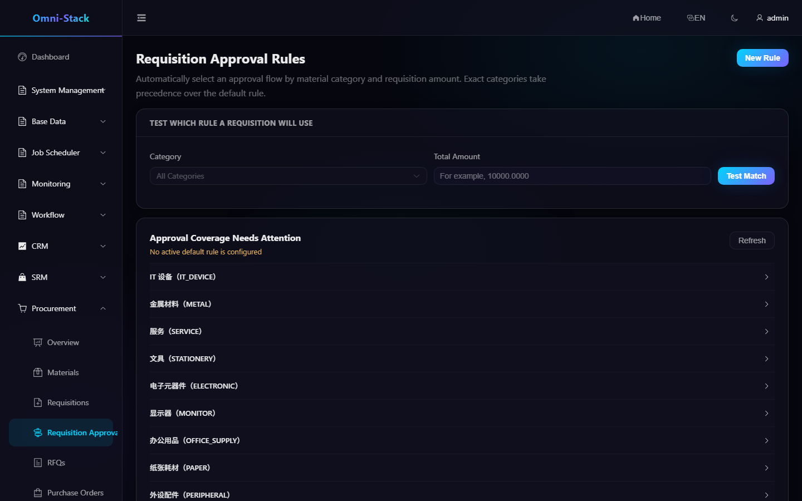

#### Figure 5 `procurement-approval-rules-mobile-en-US`: 390×844 responsive

- Prerequisites: same as Figure 4
- Actor: procurement administrator
- Action: open the same page at 390×844
- Expected result: the page renders without horizontal scroll and core copy stays intact

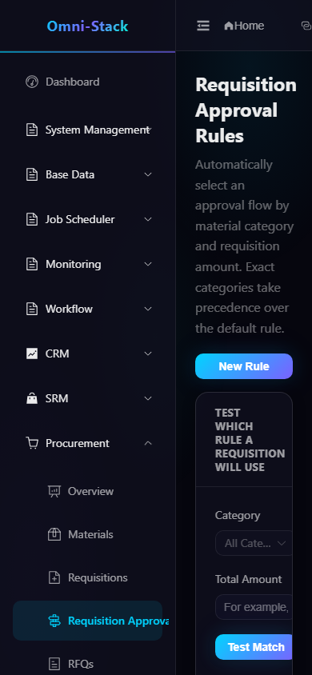

#### Figure 6 `procurement-approval-rules-tablet-en-US`: 1024×768 responsive

- Prerequisites: same as Figure 4
- Actor: procurement administrator
- Action: open the same page at 1024×768
- Expected result: adaptive layout with all entry points available

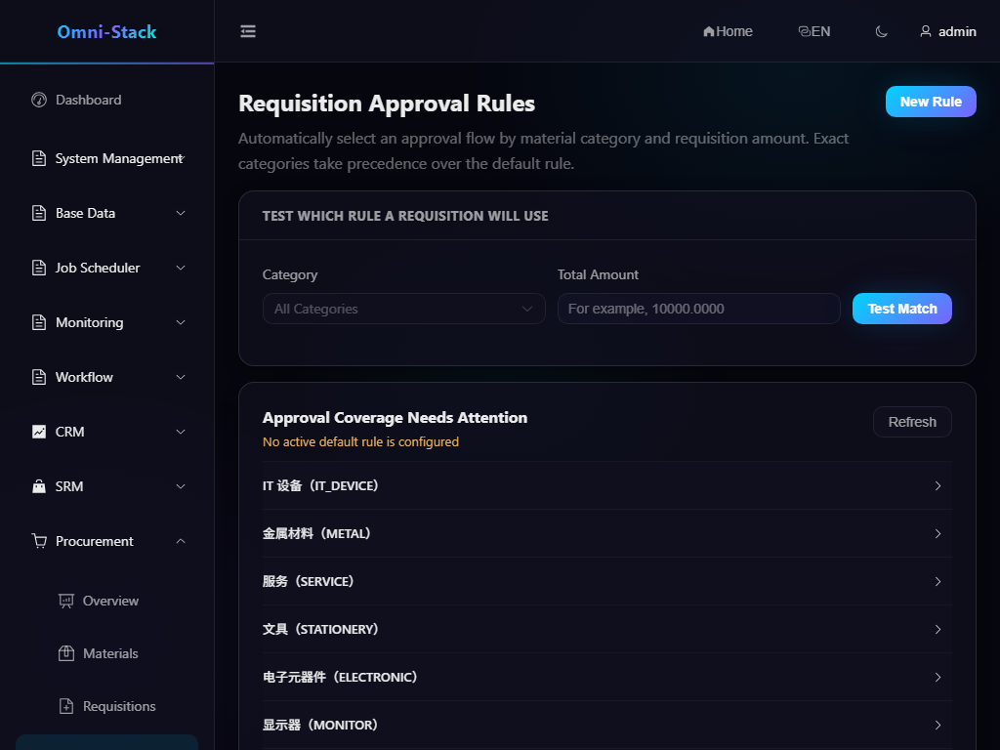

#### Figure 7 `procurement-rule-match-success-en-US`: Match tester success

- Prerequisites: same as Figure 4
- Actor: procurement administrator
- Action: in the match tester, pick category "笔记本电脑" (Laptop) and amount 5000 to trigger the server-side preview (read-only resolution, no object created)
- Expected result: MATCHED on WP006FIX-LAPTOP-small (0 ≤ x < 10000) with the real approval path displayed

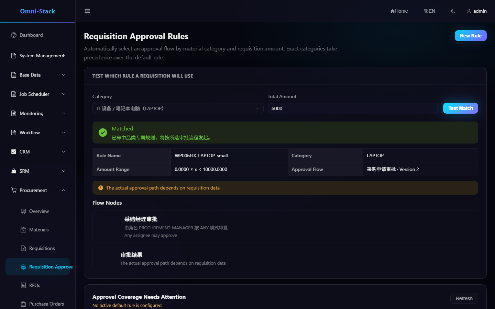

## 4. Requisitions

A draft contains requester, unit, purpose, and lines. Submission locks critical fields and starts Workflow using a persistent idempotent start request. A `START_FAILED` record can be retried without creating a second process. Approval, rejection, withdrawal, and cancellation follow domain rules.

In this acceptance environment, requisition PR-1-1 (10000 CNY) was approved through the real workflow (APPROVED) with approval comment "WP006 main chain approval".

### Screenshot

#### Figure 8 `procurement-requisition-list-en-US`: Requisition list

- Prerequisites: log in as a procurement administrator
- Actor: procurement administrator
- Action: open Procurement → Requisitions
- Expected result: the list shows real PR-1-1 (APPROVED)

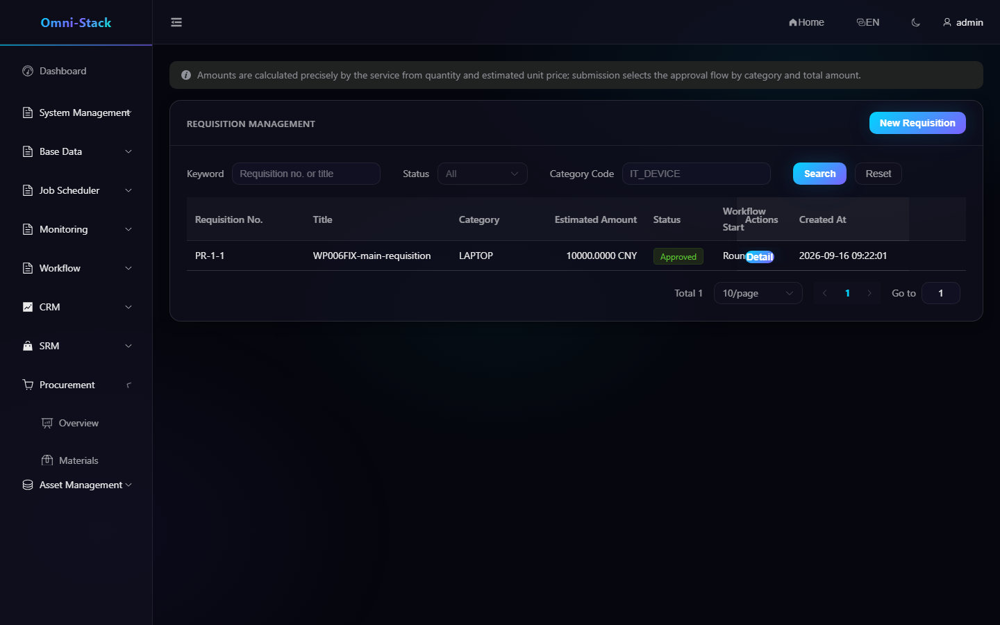

#### Figure 9 `procurement-requisition-detail-en-US`: Requisition detail drawer

- Prerequisites: same as Figure 8
- Actor: procurement administrator
- Action: open the PR-1-1 "Detail" drawer
- Expected result: the drawer shows the approval attempt, the Workflow process instance ID, and lines

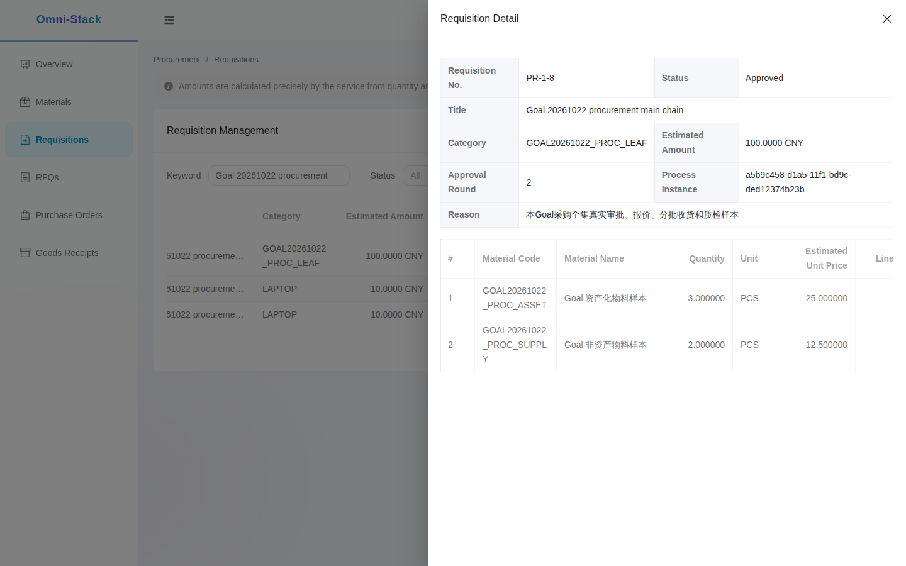

## 5. RFQ and Quotations

Create an RFQ from approved demand, invite active suppliers, and send it. Portal quotations arrive through reliable messaging and are consumed idempotently by event ID. Comparison covers price, tax, delivery, and notes. Confirm currency, tax basis, deadline, and supplier eligibility before award.

In this acceptance environment, RFQ-1-1 was sent to two real suppliers and received quotations; the award result is winning quotation #2 / v1. After award the compare entry closes and the detail drawer presents the quotation receipt and award result as an award snapshot.

### Screenshot

#### Figure 10 `procurement-rfq-list-en-US`: RFQ list

- Prerequisites: log in as a procurement administrator
- Actor: procurement administrator
- Action: open Procurement → RFQ
- Expected result: the list shows real RFQ-1-1 (AWARDED)

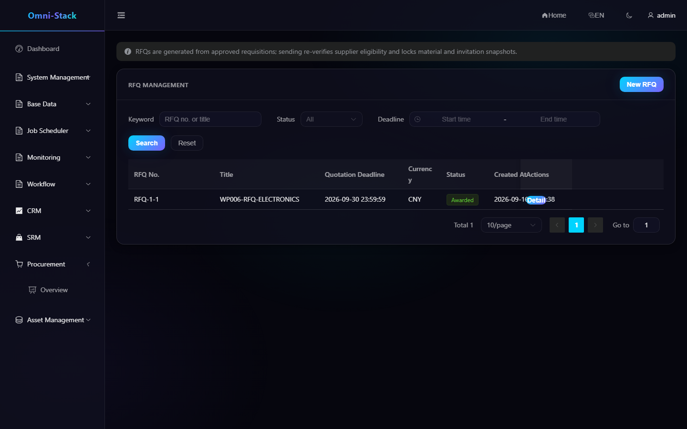

#### Figure 11 `procurement-rfq-detail-award-en-US`: RFQ detail with award snapshot

- Prerequisites: same as Figure 10
- Actor: procurement administrator
- Action: open the RFQ-1-1 "Detail" drawer
- Expected result: two suppliers' quotation IDs and the winning quotation #2 / v1 (comparison semantics and award snapshot share this figure)

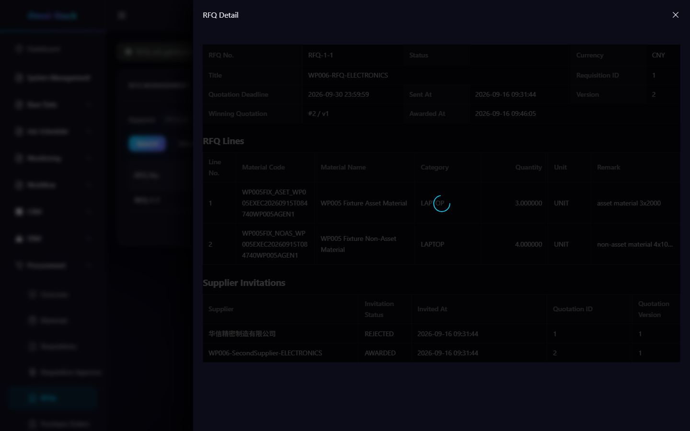

#### Figure 12 `procurement-portal-quotation-record-en-US`: Portal quotation record

- Prerequisites: log in as the winning supplier account (supplier2)
- Actor: supplier
- Action: open Supplier Portal → RFQ Quotations tab
- Expected result: this round's real quotation record RFQ-1-1 (current quote CNY 9000, awarded)

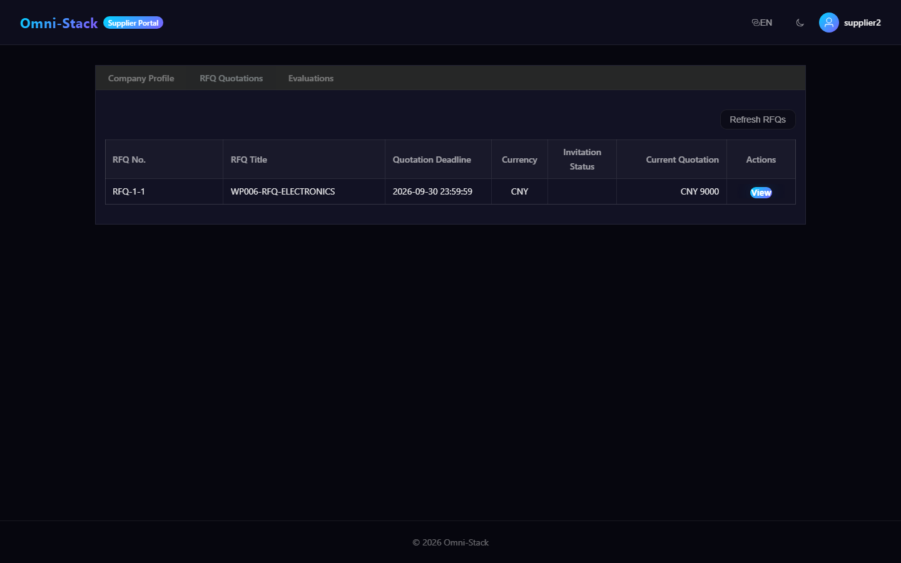

## 6. Purchase Orders

An awarded quotation produces a draft order, then sent, supplier-confirmed, partially received, fully received, or cancelled states. After sending, supplier and commercial terms are protected. Cancellation checks existing receipts.

In this acceptance environment, PO-1-1 (9000 CNY) has both lines fully received (RECEIVED).

### Screenshot

#### Figure 13 `procurement-purchase-order-list-en-US`: Purchase order list

- Prerequisites: log in as a procurement administrator
- Actor: procurement administrator
- Action: open Procurement → Purchase Orders
- Expected result: the list shows real PO-1-1 (RECEIVED)

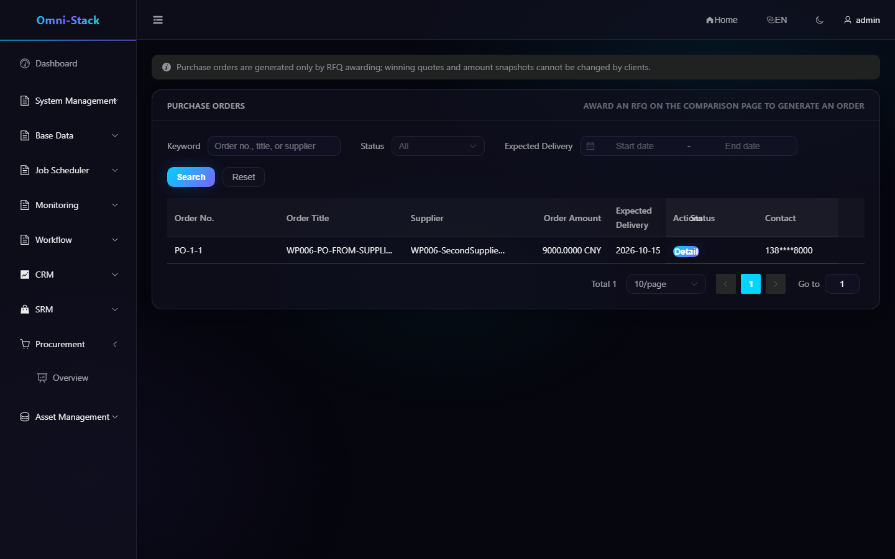

#### Figure 14 `procurement-purchase-order-detail-en-US`: Order detail tracker

- Prerequisites: same as Figure 13
- Actor: procurement administrator
- Action: open the PO-1-1 detail (order tracker)
- Expected result: two line rows show ordered/received quantities and amounts

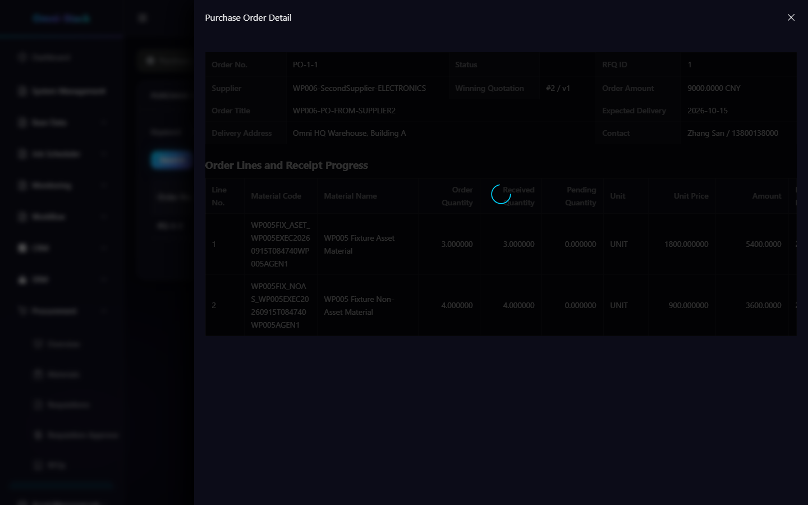

## 7. Goods Receipt

Each receipt line records the actual received quantity, quality status, and asset quantity. Asset candidate events are published only when `qualityStatus=PASS`, the material has `assetManaged=true`, and the asset quantity is an exact positive integer. Duplicate submission, message redelivery, and Asset backfill must remain idempotent. After completion, verify order and receipt status in the Procurement overview and the actual card results in the Asset ledger.

This acceptance environment produced three real receipts (GR-1-1 / GR-1-2 / GR-1-3); GR-1-2 shows both real quality states (one line FAIL, one line PASS).

### Screenshot

#### Figure 15 `procurement-goods-receipt-list-en-US`: Goods receipt list

- Prerequisites: log in as a procurement administrator
- Actor: procurement administrator
- Action: open Procurement → Goods Receipts
- Expected result: the list shows three real receipts GR-1-1 / GR-1-2 / GR-1-3

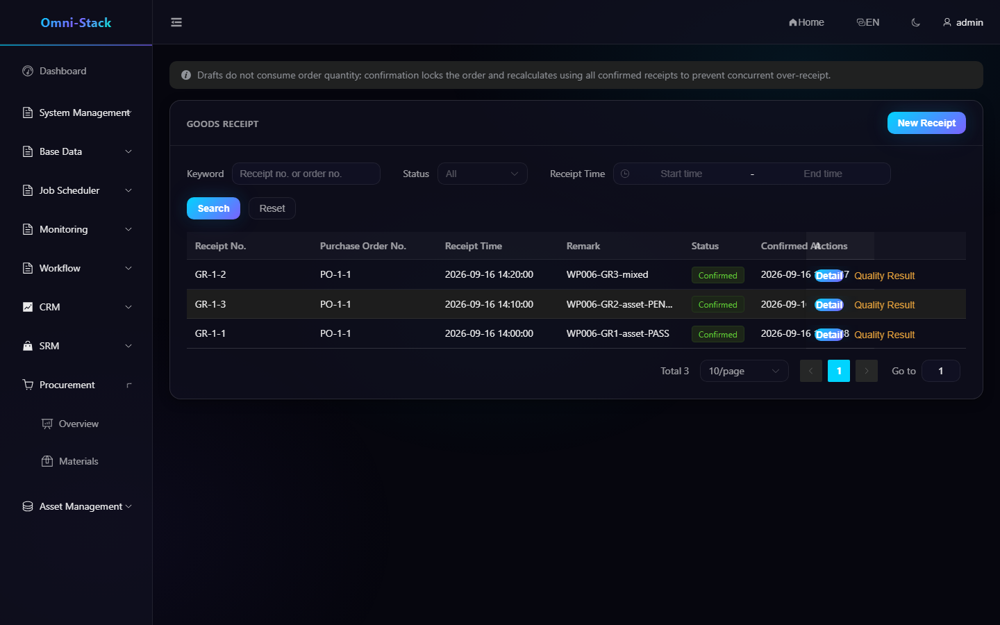

#### Figure 16 `procurement-goods-receipt-detail-quality-en-US`: Receipt detail with quality states

- Prerequisites: same as Figure 15
- Actor: procurement administrator
- Action: open the GR-1-2 detail drawer
- Expected result: real quality results (material1 line FAIL, material2 line PASS) with asset-management flags

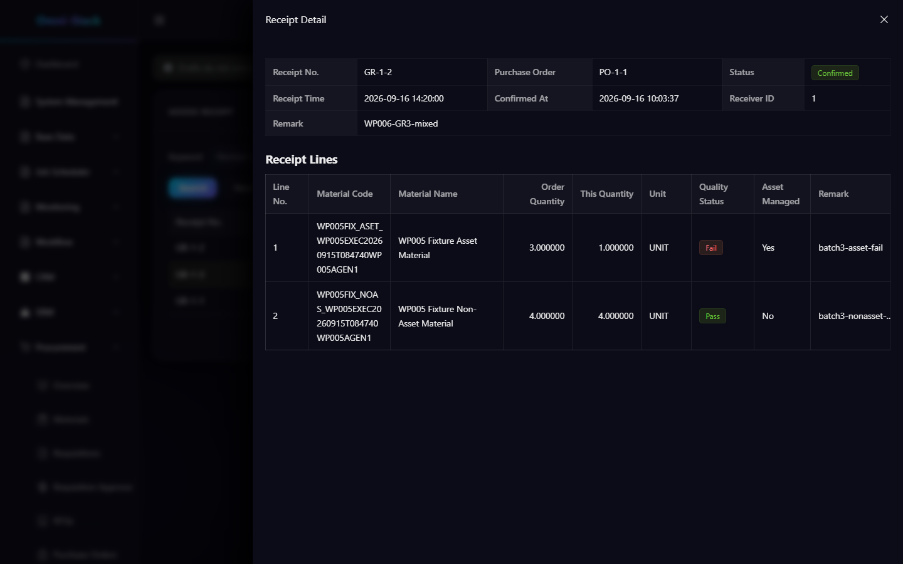

## 8. Permissions and Diagnostics

Procurement administrators manage master data and rules; requesters manage visible requisitions; buyers own RFQ/orders/receipts; suppliers see only their Portal invitations and quotations.

When a supplier account opens a procurement admin route directly, the frontend route guard enforces role-domain isolation and redirects back to the supplier portal; the admin UI is never leaked.

### Screenshot

#### Figure 17 `procurement-supplier-domain-isolation-en-US`: Supplier role-domain isolation

- Prerequisites: log in as a supplier account
- Actor: supplier
- Action: open a procurement admin route directly
- Expected result: the route guard redirects back to the supplier portal; no admin UI content appears

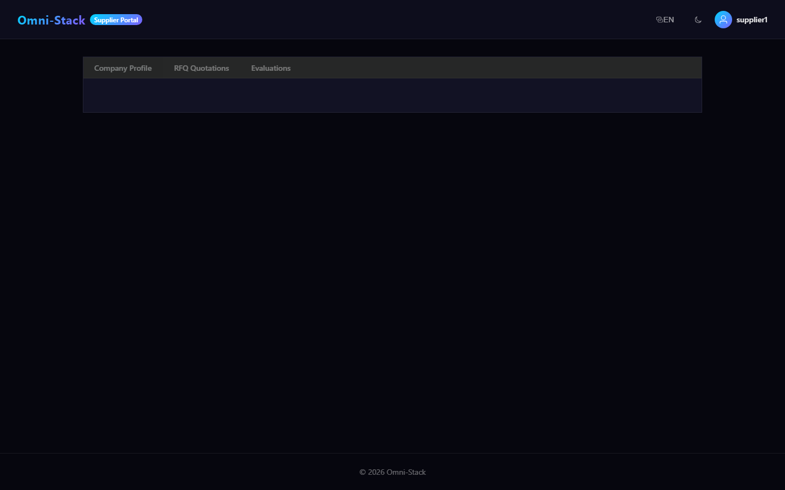

Correlate document number, Workflow instance, Outbox message, Inbox event, and Trace ID. See the [Procurement Design](../design/procurement-design.en.md).
