# Reproduce procurement and receipts from an empty business environment

Baseline: main fc165e3 and this documentation branch. Use supply-chain or full. Complete [startup](quick-start.en.md), [SRM admission](srm-flow.en.md), and [teaching data](../wiki/data-and-fixtures.en.md). The successful business records come from the independent local Docker teaching run on 2026-10-09: requisition approval, two supplier quotes, award, two receipt batches and two source-linked asset cards. Read-only checks on 2026-10-12 reused those records. This review checks documentation, current source and existing evidence without rerunning the business flow; historical results do not establish integrated acceptance of current artifacts.

Acceptance follows the [authorized AI review policy](../adr/0003-authorized-ai-translation-review.md): actual AI semantic approval is sufficient; human translation review is not required. The [current review scope](../reference/evidence/procurement-guide-review-2026-10-17.json) separates source, original images and historical execution. The old run used cached base images after registry DNS/authentication failures; it did not prove the formal production base-image build.

## 1. Prepare identities, categories and a run sheet

Use one teaching tenant. The default is tenant 1; verify it instead of applying it to another environment. Formal seeds provide categories, currency and roles, not this guide's requisitions, quotes, orders or receipts.

| Identity | Preparation and responsibility |
|---|---|
| Bootstrap administrator | Create teaching users/roles/organizations through formal pages; configure model and routing rule |
| Requester | PROCUREMENT_STAFF with a primary organization; creates their own requisition |
| Procurement manager/approver | PROCUREMENT_MANAGER in the requester's primary organization; appears in the actual candidate preview |
| Suppliers A and B | SRM invitation, Portal registration and enrollment Saga, then admission; both APPROVED with SUPPLIER and active Portal association |
| Asset administrator/recipient | Continue the [asset guide](asset-flow.en.md); allocation and acceptance use their own identities |

The default procurement model uses PROCUREMENT_MANAGER + START_USER_PRIMARY_UNIT + SAME_UNIT. SUPER_ADMIN functional permissions do not automatically make a user an approval candidate. Check candidate resolution before starting an instance.

Choose a unique `WIKI-{run-id}` prefix. Keep a run sheet outside Git: tenant, identities, organizations, material IDs, rule/model version, requisition ID/number/version, RFQ/line IDs, quote IDs/versions, PO/line IDs, GR/line IDs and asset IDs. Refresh version after each response. Use returned IDs, never numbers copied from historical screenshots.

The manager identity used on October 12 held USER, PROCUREMENT_MANAGER, ASSET_MANAGER, TEAM_LEADER and WIKI_20261009A_WORKFLOW_DESIGNER. Evidence concerns that identity's effective permissions, not an isolated single-role experiment.

## 2. Create two teaching materials

Open Procurement → Material Catalog. As procurement manager, create a run-owned category with an uppercase-letter/digit code such as `WIKICAT{run}`. Record its actual categoryId/categoryCode. Put **both materials in this same teaching category**; mixed categories in one requisition return 409. Give both admitted teaching suppliers this categoryCode so category-filtered options find them. Leave other suppliers intact.

| Record | materialCode/name prefix | Unit | assetManaged | Quantity | Estimated unit price |
|---|---|---|---|---|---|
| A | WIKI-{run-id}-A / teaching device | PCS | true | 3 | 1000.0000 |
| B | WIKI-{run-id}-B / teaching accessory | PCS | false | 10 | 100.0000 |

Use ACTIVE. Refresh and find exactly one record per code. See the [material API](../../omni-frontend/src/api/procurement-material.ts). Prices/quantities are decimal strings; the requisition total is CNY 4000.0000. The teaching category is shared for this example; asset creation also depends on assetManaged and quality.

## 3. Publish the model and enable a routing rule

Find procurement-approval under process models and inspect its current published version first. Standard bootstrap normally publishes required business models. Reuse a valid published version; for changes, edit a new draft, inspect candidates, validate and publish a new version. Roles, primary organization and Workflow organization scopes are separate settings; verify candidate bindings in [teaching data](../wiki/data-and-fixtures.en.md).

Create a run-owned rule for the actual teaching category and `[0, 10000)` using the current published version. Try the actual categoryCode and 4000: expect MATCHED, model AVAILABLE and correct candidates. Inspect coverage before enabling. Check range/version before reusing a rule; preserve other configurations. Resolve overlaps or gaps using actual analysis.

Match preview checks rule/model availability without starting approval or proving that the current user is an actual candidate; verify eligibility against the requester's primary organization. First access to an uninitialized tenant may idempotently create default configuration and categories. The old tenant's read-only receipt does not guarantee zero writes for every new tenant.

## 4. Create and submit the requisition as requester

1. Create WIKI-{run-id}-PR under requisitions with A/B and the quantities/prices above.
2. Save: expect DRAFT, CNY 4000.0000; record returned ID/number/version.
3. Submit: expect submission/approval progression and eventually workflowStartStatus=STARTED; record processInstanceId.
4. The actual manager opens their pending task, checks lines/amount and approves. Wait for procurement detail to become APPROVED.

A submit response does not prove cross-service approval completion. Only when status=SUBMITTED and workflowStartStatus=FAILED, diagnose model, candidates and MQ/Workflow, refresh detail and retry start with the current version. The service reuses the original approval attempt, request and model snapshot. Do not resubmit or create another requisition to hide an uncertain outcome.

Use separate run-owned records to exercise rejection and withdrawal/cancellation. Expect REJECTED after the real candidate rejects; cancel only when the current state permits it. Continue the main chain with the approved requisition, not the rejected one.

## 5. Send an RFQ and obtain two independent quotes

1. Create WIKI-{run-id}-RFQ from the APPROVED requisition; choose a future deadline and the two admitted suppliers.
2. Check DRAFT, source, currency and lines; send and expect SENT.
3. Each supplier opens only their invitation under Supplier Portal → RFQ/Quotation, fills line prices, delivery days and validity, then submits.
4. Supplier A quotes A=950.0000/B=100.0000, total 3850.0000. Supplier B quotes A=900.0000/B=80.0000, total 3500.0000.
5. Refresh comparison until both actual quotationId/version values and correct CNY totals appear. Portal success precedes asynchronous procurement consumption.

Use this RFQ's returned line IDs. Suppliers cannot inspect each other's invitations or quotes. Expired/cancelled states reject new quotes; never edit database state to bypass them.

## 6. Award and record order confirmation

Select supplier B's current quote version, enter a teaching delivery address and fictional contact, and award. The `award` response contains both RFQ and a new PO: expect AWARDED, PO=DRAFT and 3500.0000. Record the returned PO instead of creating a duplicate order. Supply the current `rfqVersion`, selected `quotationId` and its `quotationVersion` together. After a stale-version conflict, reconcile existing award/PO side effects before deciding what to do next.

Send the PO: expect SENT. **Current code records supplier confirmation through the authorized procurement management page**. After obtaining the business confirmation, procurement staff confirm it and expect CONFIRMED. The Supplier Portal supports quotations and currently has no separate PO confirmation button. The action requires procurement:purchase-order:confirm and row visibility.

## 7. Receive in two batches and check quality/card creation

Create two draft receipts using returned poLineId values; each saved receipt must also be confirmed. Date-times use `yyyy-MM-dd HH:mm:ss`.

| Batch | A received/quality | B received/quality | Expected |
|---|---|---|---|
| GR-1 | 1 / FAIL | 10 / PASS | PARTIAL_RECEIVED; neither line creates cards |
| GR-2 | 2 / PASS | No more B in this batch | RECEIVED; two cards from accepted A quantity |

FAIL counts toward cumulative received quantity but produces no asset candidates. Non-asset B produces no cards even with PASS. A receipt request carries receivedQuantity/qualityStatus; do not manufacture the event's assetQuantity. Cumulative receipts cannot exceed ordered quantity.

Find exactly two cards by this run's source, not total database count. If delayed, correlate GR, Outbox and Inbox and inspect relay/consumer. Controlled replay of the same event must retain the same two cards; creating another receipt is not an idempotency test. Continue allocation, acceptance, return and transfer/disposal in the [asset guide](asset-flow.en.md).

## 8. Required failure and recovery checks

| Scenario | Boundary and recovery |
|---|---|
| Mixed categories in one requisition | 409; use one category or separate requisitions |
| Employee without procurement authority | 403/unavailable action without data disclosure; an empty list alone is not evidence of access denial |
| Supplier requests admin route/another invitation | Domain redirect or API refusal; own Portal remains usable |
| Reuse stale version | Conflict; refresh and inspect the previous side effect before another command |
| Approval rejection/start failure | Business and Workflow state agree; use permitted revision/retry-start |
| Quote after deadline/cancellation | Refused; a new business needs a new RFQ |
| Over-receipt/fractional asset quantity | Validation refusal; use legal remaining quantities |
| MQ failure/redelivery | Preserve failure/retry evidence; recovery creates no duplicate quote/order/card |

After a create timeout, query the unique business key first. Not all create APIs accept requestId. Reuse requestId for Saga retries; apply each other command's version/idempotency contract.

## 9. Cleanup, diagnosis and screenshots

Delete drafts through formal APIs; use permitted rejection, withdrawal or cancellation for submitted records. Retain traceable terminal states for received/card-created chains. List exact run-owned objects and why any cannot be removed. Keep seeds, existing users' data and volumes.

Correlate requisition, processInstanceId, RFQ, quote, PO, GR, Outbox/Inbox and Trace ID. See [source debugging](../wiki/source-debugging.en.md) and [procurement design](../design/procurement-design.en.md).

### Real screenshots from this run

These are real historical records from the independent local Docker project on 2026-10-09. [Provenance](../reference/evidence/supply-chain-2026-10-09.json) binds ordinary roles, source digest, runtime images, tests and PNG SHA values. Its 48 images were inspected in 12 original-resolution four-locale contact sheets; this page uses 28 of them. That method is not an individual opening of every original. Scroll wide tables to see hidden columns. Images prove visible fields; business results require dated API assertions and do not establish a current rerun.

Approved requisition: as the procurement operator, open this run's detail and verify Approved, CNY 4000 and both material quantities.

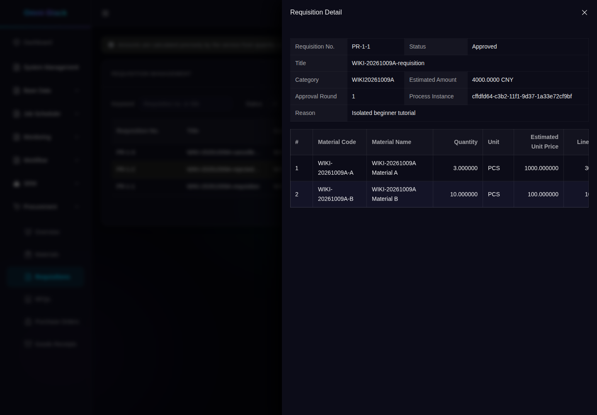

Rejected requisition: open the separate rejected request and check its state and retained original process instance.

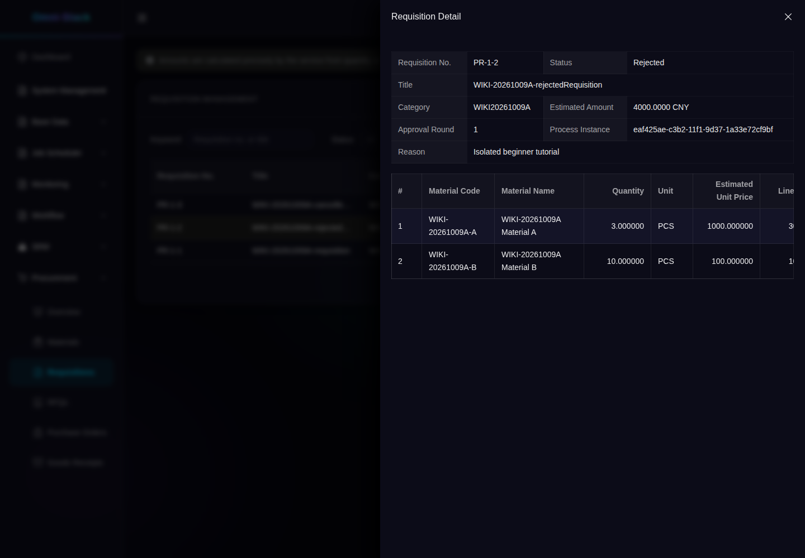

Cancelled draft: verify Cancelled without an approval start. This does not imply that any running approval can be cancelled locally.

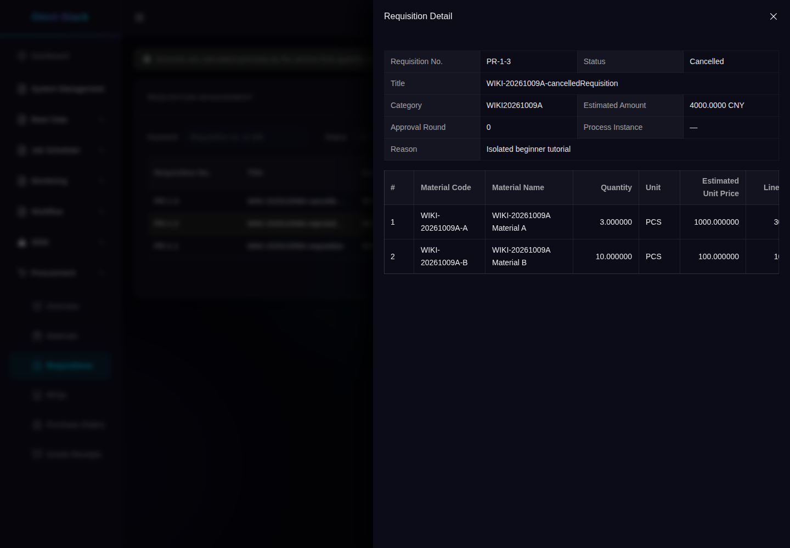

Awarded RFQ: open details and verify Vendor D won, Vendor C did not, and the quotation versions match.

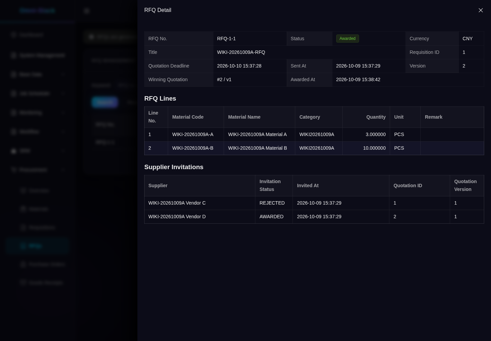

Received order: open the linked PO and verify CNY 3500, both lines fully received and zero pending quantity.

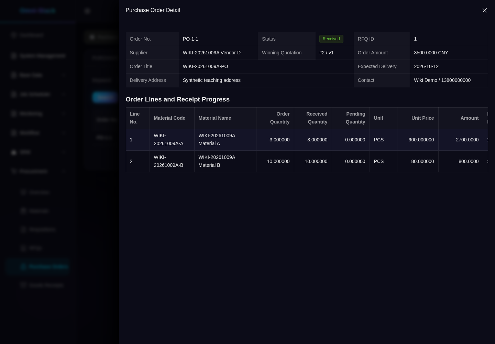

First receipt: A quantity 1 is FAIL and asset-managed; B quantity 10 is PASS and not asset-managed. Source queries establish that no cards were created; this image alone does not.

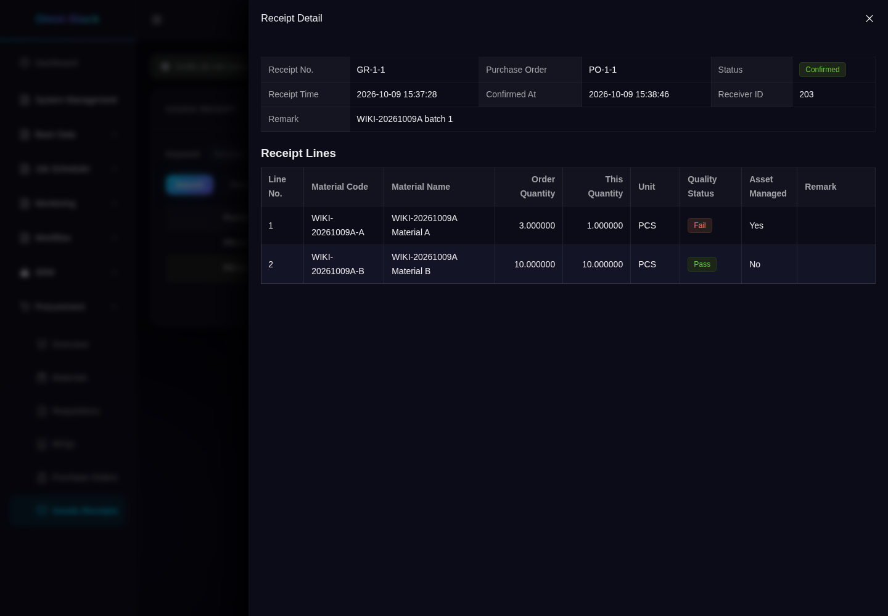

Second receipt: A quantity 2 is PASS and asset-managed. Then query that GR source and verify exactly two cards.

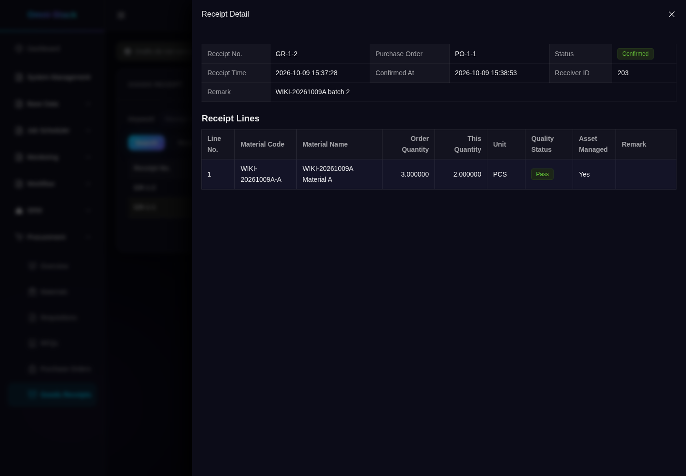

## 10. Recheck materials, rule matching and the overview

After the independent teaching chain above, use an ordinary procurement manager in the same tenant. The [read-only receipt from 2026-10-12](../reference/evidence/procurement-readonly-2026-10-12.json) reused this run's objects without recreating requisitions, orders or receipts. In a new environment, use your recorded category and names, not IDs copied from screenshots.

1. Select the teaching category in Material Catalog, then search your material prefix. Expect exactly A and B, both ACTIVE, with assetManaged true and false respectively. Searching only the prefix can also find a negative-case category with that prefix.
2. Select the same category in the requisition rule tester, enter `4000`, and click Test. Expect MATCHED, your active rule and an AVAILABLE model. This run matched rule 1 and model version 2. `POST /api/procurement/approval-route/match-preview` is a read-only evaluation and creates no process instance.
3. Check the overview for this actor's data scope. This run has CNY 3500.0000 committed through the received order and zero in all four pending counters. A new environment displays its own data; the pictured amount is not a seed value.

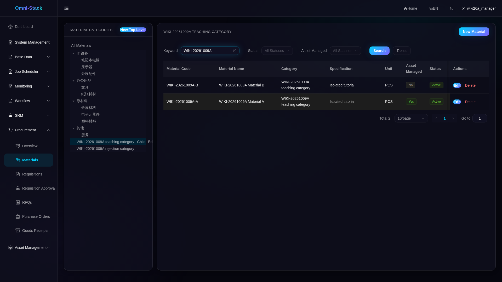

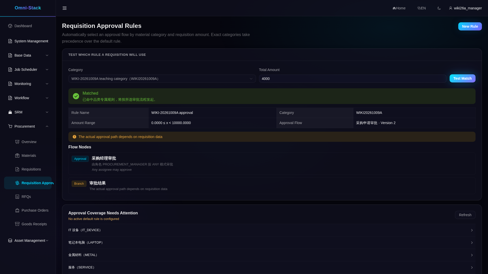

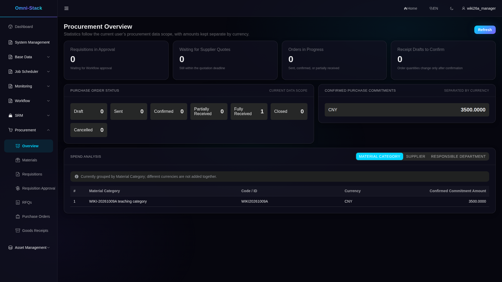

At 390×844 the sidebar starts collapsed. Click the header menu to open it, click again to close it, then use the category, amount and Test controls. Repeat the same evaluation at 1024×768. All 12 real evaluations across four languages and three viewports matched, with no page-wide horizontal overflow.

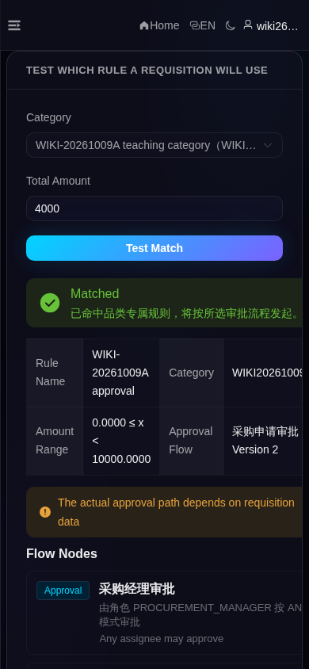

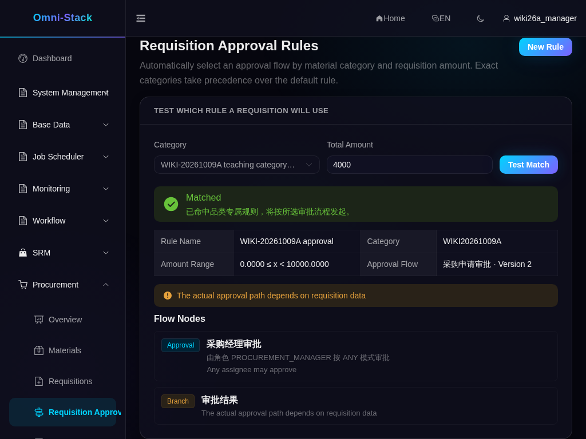

Scroll within the mobile result table to see all columns. The original image proves the amount, usable Test button and matched result; real response assertions verify the model version. Some long English sidebar labels are clipped. In Japanese/Korean tablet captures, scrolling to the tester leaves part of the heading under the fixed header. These images prove the visible controls and results. Existing category, model, node names and raw server diagnostics may remain Chinese business data; localized UI labels are separate. Visual inspection covers readability; actual AI semantic review is sufficient for the four-language documents under the authorization above.

## 11. Check each supplier's records after award

Compare and award only while the RFQ is SENT. Once AWARDED, the comparison action is hidden and `GET /api/procurement/rfq/{id}/comparison` returns HTTP 200 with business code 409. Do not reset status or award again to obtain a screenshot.

As procurement manager, open RFQ details and inspect the retained quotation IDs, versions and winner. In this run Vendor C has #1/v1 and invitation outcome REJECTED; Vendor D has #2/v1 and AWARDED. The winning quotation is #2/v1. This image proves retained results, not a live UI comparison or award click.

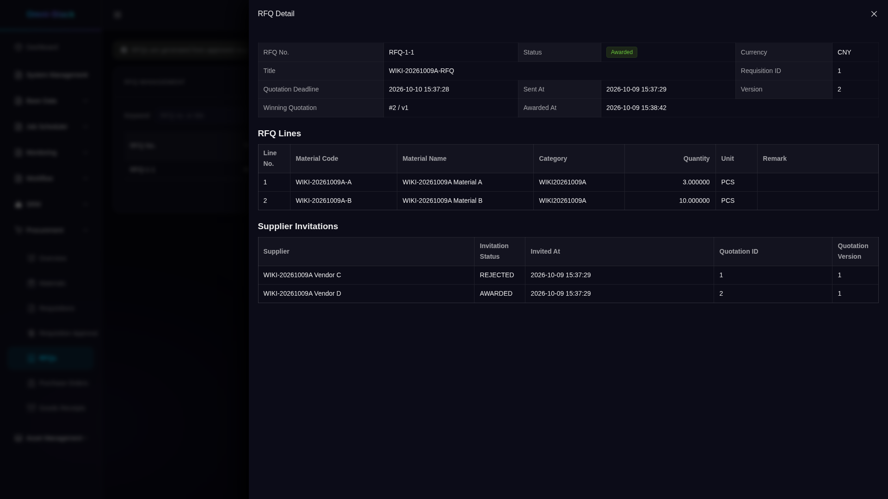

Log in to the portal separately as suppliers C and D, open RFQ Quotations and find your own quotation for this RFQ. C totals CNY 3850; D totals CNY 3500. View opens read-only details; close them to check the list amount and invitation outcome. Do not resubmit a closed RFQ. Losing the award does not hide the supplier's own history.

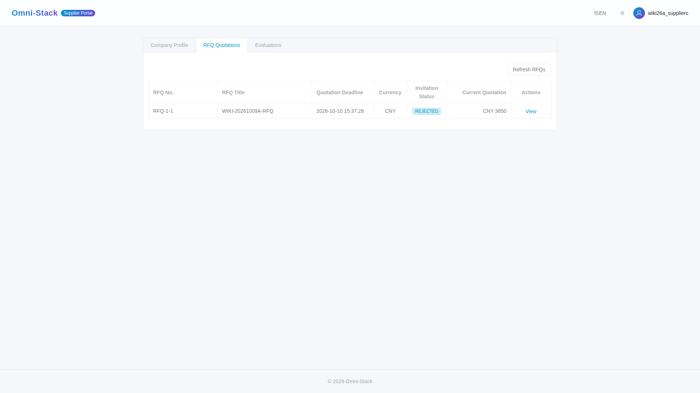

The [read-only receipt](../reference/evidence/procurement-quotation-2026-10-12.json) binds ordinary roles, versions, totals and original image digests. Real responses and detail-control assertions verify line prices; public list images prove visible totals and outcomes. Supplier images use the product's native light-theme button. Long Japanese headers wrap within their columns. Of 31 individually reviewed originals, 12 are published, 7 incomplete-paint images excluded and 12 readable but redundant details retained privately. No business write was replayed. The review of those 31 originals took place on 2026-10-12. The current review scope separately lists 20 newly inspected originals and the other 40 that were not reopened.
