# 購買申請、RFQ、見積、注文、入荷の完全フロー

Procurement は品目、購買申請承認ルール、申請、RFQ、見積、発注、入荷を所有します。承認実行は `omni-workflow` にあり、Procurement は Flowable に依存しません。

> 本ガイドのスクリーンショットは WP006 実主チェーン検収環境（fixture `wp006-real-chain-v1`）から取得しました：WP005 実物料 2 件 → 購買申請 PR-1-1 の実ワークフロー承認（10000 CNY）→ RFQ-1-1 の 2 社実見積 → 比較と内定 → 発注 PO-1-1 → 3 伝票の入荷と 2 状態の検品。すべての撮影は参照のみで、`omni-frontend/e2e-docs/flows/wp006-visual.flows.spec.ts` により 4 言語で実撮影（68 テスト全合格）、データ書き込みはありません。

## 1. エンドツーエンド

```text
品目保守 → 承認ルール設定 → 購買申請と承認 → RFQ 作成
→ サプライヤー招待 → 見積受信と比較 → 発注 → 確認 → 入荷
```

各段階に独立した状態機械があり、DB 状態変更で前提を飛ばしません。

### スクリーンショット

#### 図 1 `procurement-overview-ja-JP`：調達概要

- 前提条件：`procurement:overview:list` 権限を持つ調達管理者としてログイン
- 操作者：調達管理者
- 操作：「調達実行管理 → 調達概要」を開く
- 期待結果：メイン領域に「調達概要」タイトルと通貨別集計が表示され、実チェーンでは入荷完了発注 1 件・確定購入コミットメント CNY 9000.0000

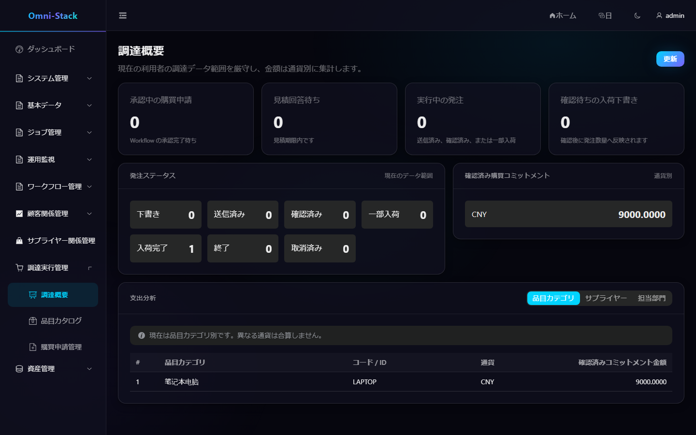

## 2. 品目

カテゴリと品目はテナント共有マスタです。コード、名称、カテゴリ、単位、資産管理フラグ、資産数量の意味を持ちます。削除前に参照を確認します。合格した資産管理品目だけが資産候補を生成し、`assetQuantity` は正確な正整数です。

### スクリーンショット

#### 図 2 `procurement-material-list-ja-JP`：品目カタログ一覧

- 前提条件：品目カタログ参照権限を持つ調達管理者としてログイン
- 操作者：調達管理者
- 操作：「調達実行管理 → 品目カタログ」を開く
- 期待結果：一覧に WP005 の実物料 2 件（資産管理あり・なし各 1）を表示

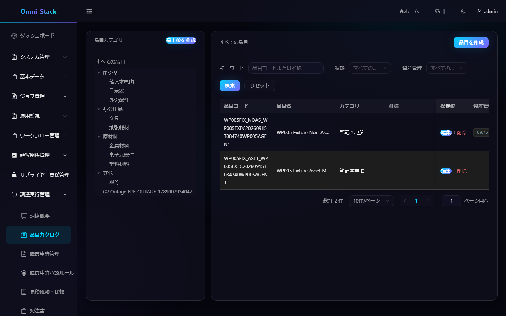

#### 図 3 `procurement-forbidden-403-ja-JP`：権限なしアクセス拒否

- 前提条件：調達権限のない一般従業員としてログイン
- 操作者：一般従業員
- 操作：品目カタログルートへ直接アクセス
- 期待結果：空の一覧ではなく 403 拒否ページを表示し、データを漏らさない

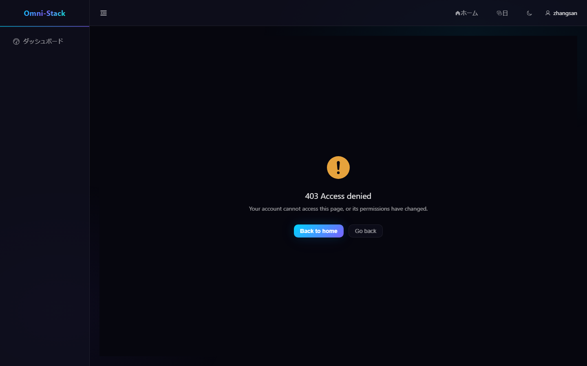

## 3. 購買申請承認ルール

カテゴリ/既定範囲、下限を含み上限を含まない金額区間、現在公開中の購買承認フローを選びます。実経路を確認し、「試算」でカテゴリと金額をサーバー解析器へ渡します。カバレッジの欠落や競合を解消して有効化します。停止・削除前には新しい欠落範囲を表示します。

### スクリーンショット

#### 図 4 `procurement-approval-rules-ja-JP`：承認ルール入口

- 前提条件：`procurement:approval-route:list` を持つ調達管理者としてログイン
- 操作者：調達管理者
- 操作：「調達実行管理 → 購買申請承認ルール」を開く
- 期待結果：メイン領域に「購買申請承認ルール」タイトル、実際の LAPTOP 3 金額帯ルール、試算テスター、カバレッジリスクカードが表示される

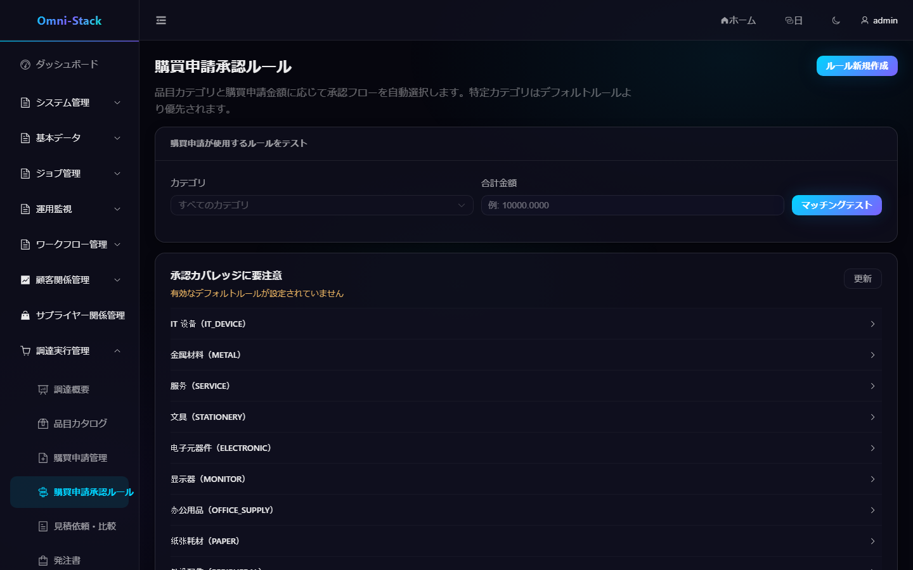

#### 図 5 `procurement-approval-rules-mobile-ja-JP`：390×844 レスポンシブ

- 前提条件：図 4 と同じ
- 操作者：調達管理者
- 操作：390×844 で同画面を開く
- 期待結果：横向スクロールなしで核心文言が完全に表示される

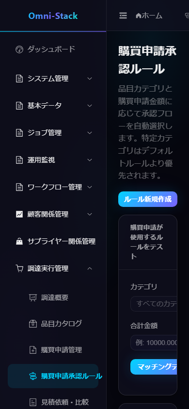

#### 図 6 `procurement-approval-rules-tablet-ja-JP`：1024×768 レスポンシブ

- 前提条件：図 4 と同じ
- 操作者：調達管理者
- 操作：1024×768 で同画面を開く
- 期待結果：レイアウトが適応し、機能入口が完全

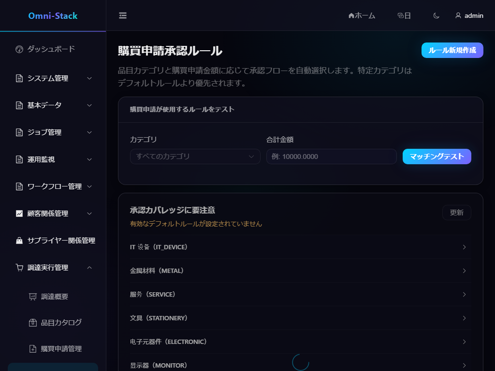

#### 図 7 `procurement-rule-match-success-ja-JP`：試算成功

- 前提条件：図 4 と同じ
- 操作者：調達管理者
- 操作：試算テスターでカテゴリ「ノートパソコン」・金額 5000 を入力しサーバー試算を実行（参照のみの解析、オブジェクト作成なし）
- 期待結果：MATCHED で WP006FIX-LAPTOP-small（0 ≤ x < 10000）と実際の承認経路を表示

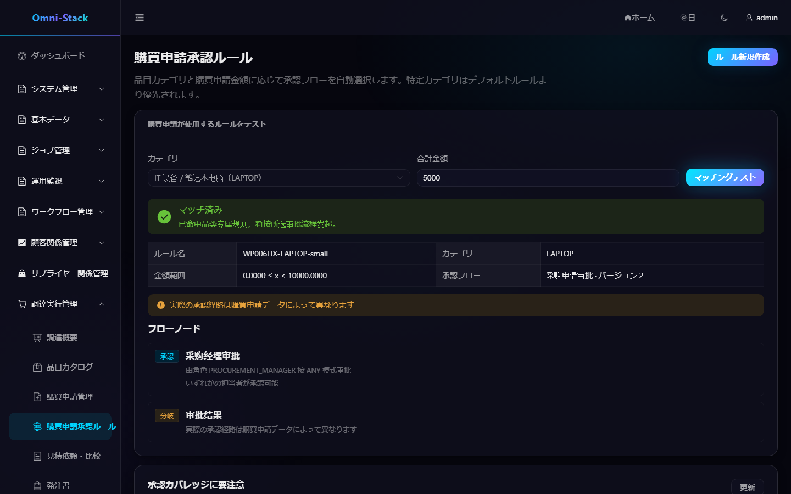

## 4. 購買申請

草稿は申請者、組織、目的、明細を持ちます。送信後は重要項目を固定し、永続的な冪等開始要求で Workflow を開始します。`START_FAILED` は二重プロセスを作らず再試行できます。承認、拒否、取下げ、取消はドメイン規則に従います。

本検収環境の購買申請 PR-1-1（10000 CNY）は実 Workflow で承認されました（APPROVED、承認コメント WP006 main chain approval）。

### スクリーンショット

#### 図 8 `procurement-requisition-list-ja-JP`：購買申請一覧

- 前提条件：調達管理者としてログイン
- 操作者：調達管理者
- 操作：「調達実行管理 → 購買申請」を開く
- 期待結果：一覧に実際の PR-1-1（APPROVED）を表示

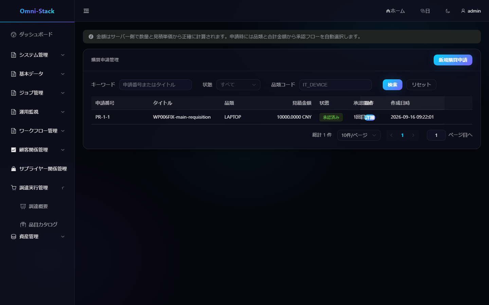

#### 図 9 `procurement-requisition-detail-ja-JP`：購買申請詳細ドロワー

- 前提条件：図 8 と同じ
- 操作者：調達管理者
- 操作：PR-1-1 行の「詳細」ドロワーを開く
- 期待結果：承認 attempt、Workflow プロセスインスタンス ID、明細を表示

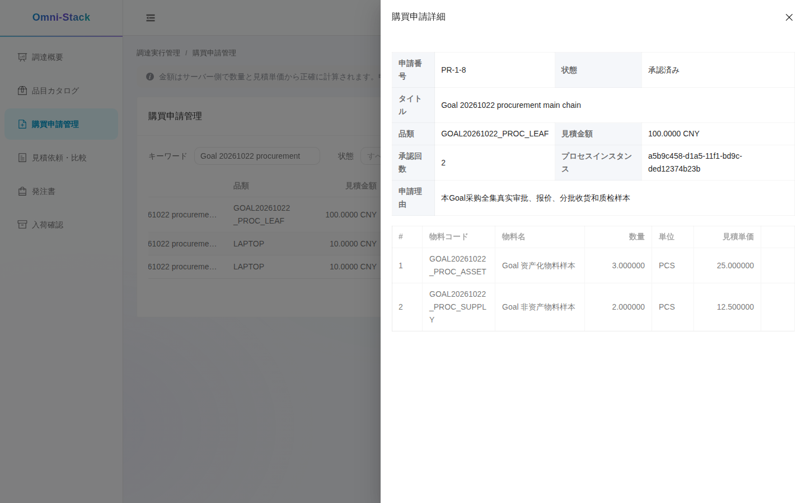

## 5. RFQ と見積

承認済み需要から RFQ を作り、有効なサプライヤーへ送信します。Portal の見積は信頼性メッセージで届き、イベント ID で冪等に処理します。価格、税、納期、備考を比較し、通貨、税込基準、締切、資格を確認して採用します。

本検収環境の RFQ-1-1 は 2 社の実サプライヤーへ送信され見積を受領し、落札見積は #2 / v1 です。内定後は比較入口が非表示になり、詳細ドロワーは見積受領と比較内定結果を内定スナップショットとして表示します。

### スクリーンショット

#### 図 10 `procurement-rfq-list-ja-JP`：RFQ 一覧

- 前提条件：調達管理者としてログイン
- 操作者：調達管理者
- 操作：「調達実行管理 → 見積依頼」を開く
- 期待結果：一覧に実際の RFQ-1-1（内定済み）を表示

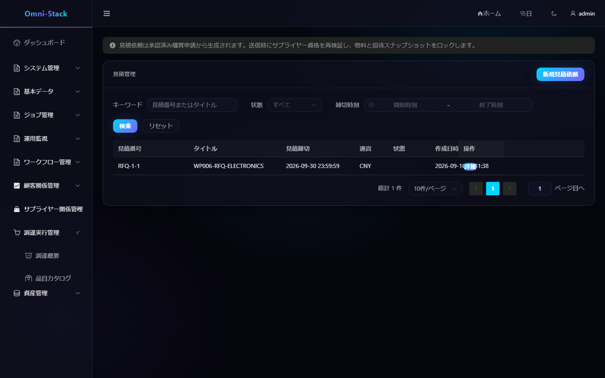

#### 図 11 `procurement-rfq-detail-award-ja-JP`：RFQ 詳細と内定スナップショット

- 前提条件：図 10 と同じ
- 操作者：調達管理者
- 操作：RFQ-1-1 行の「詳細」ドロワーを開く
- 期待結果：2 社の見積 ID と落札見積 #2 / v1（比較の意味面と内定スナップショットを同一図で表示）

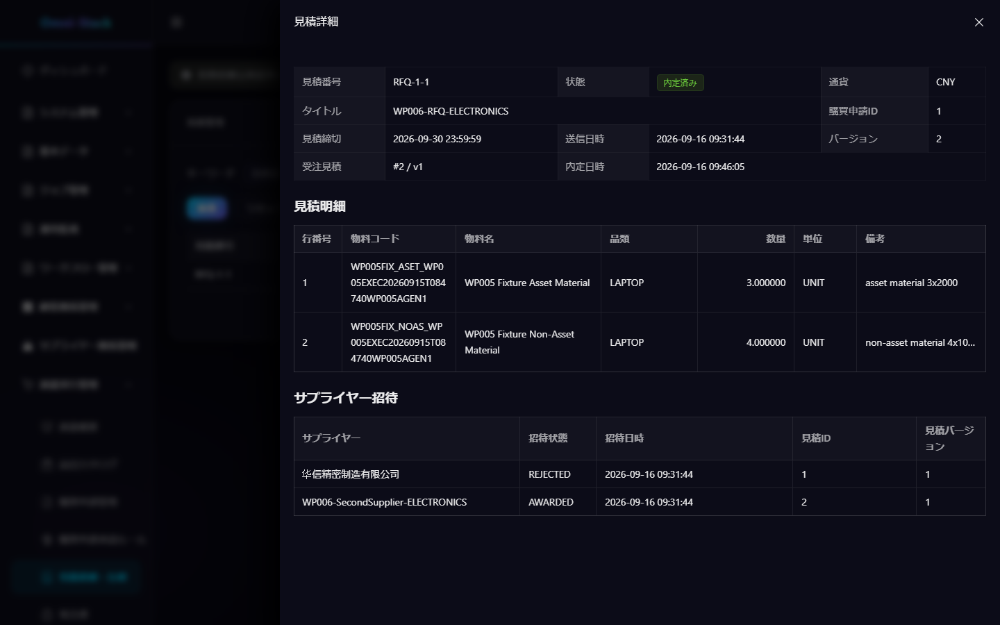

#### 図 12 `procurement-portal-quotation-record-ja-JP`：ポータル見積記録

- 前提条件：落札サプライヤーアカウント（supplier2）でログイン
- 操作者：サプライヤー
- 操作：「サプライヤーポータル → 見積回答」タブを開く
- 期待結果：今回の実際の見積記録 RFQ-1-1（現在 CNY 9000・内定済み）を表示

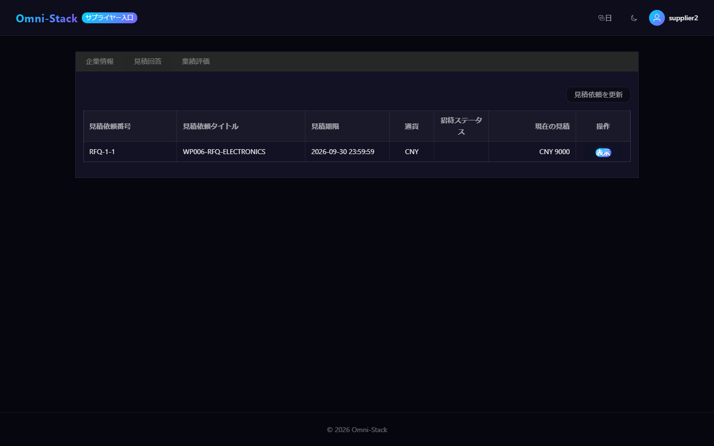

## 6. 発注

採用結果から草稿、送信、サプライヤー確認、一部入荷、全入荷、取消へ進みます。送信後の主要条件を保護し、取消時は既存入荷を確認します。

本検収環境の PO-1-1（9000 CNY）は 2 明細とも発注数量どおり入荷完了（RECEIVED）です。

### スクリーンショット

#### 図 13 `procurement-purchase-order-list-ja-JP`：発注書一覧

- 前提条件：調達管理者としてログイン
- 操作者：調達管理者
- 操作：「調達実行管理 → 発注書」を開く
- 期待結果：一覧に実際の PO-1-1（入荷済み）を表示

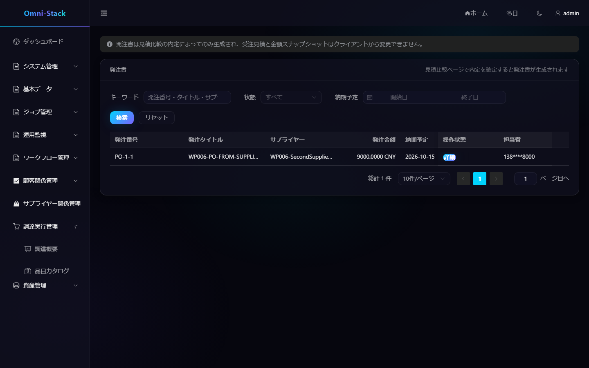

#### 図 14 `procurement-purchase-order-detail-ja-JP`：注文詳細トラッカー

- 前提条件：図 13 と同じ
- 操作者：調達管理者
- 操作：PO-1-1 詳細（注文トラッカー）を開く
- 期待結果：2 明細行に発注数量・入荷数量・金額を表示

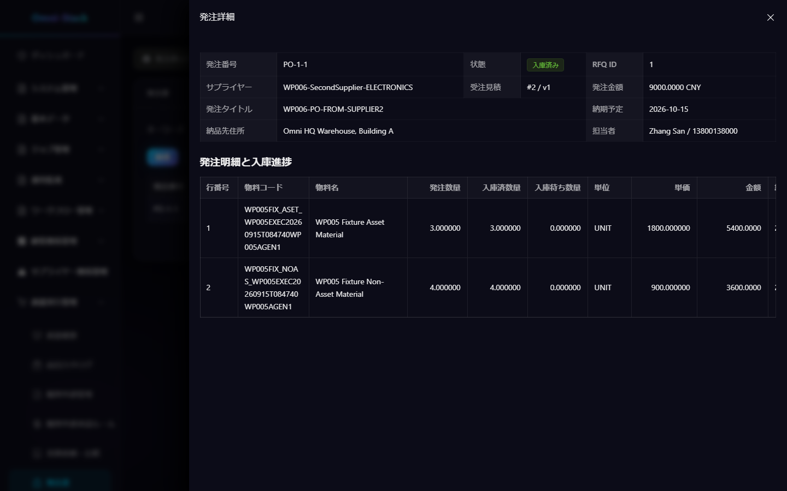

## 7. 入荷

受入伝票は実収数量・品質ステータス・資産数量を明細ごとに記録します。`qualityStatus=PASS`、物料が `assetManaged=true`、資産数量が正確な正整数の場合にのみ資産候補イベントを発行します。重複送信・メッセージ再配信・Asset バックフィルは冪等に保たれます。完了後は調達概要で発注と入荷状態を確認し、資産台帳で実際の建カード結果を確認します。

本検収環境は 3 つの実入荷伝票（GR-1-1 / GR-1-2 / GR-1-3）を生成し、GR-1-2 は実際の検品 2 状態（1 行不良・1 行合格）を示します。

### スクリーンショット

#### 図 15 `procurement-goods-receipt-list-ja-JP`：入荷一覧

- 前提条件：調達管理者としてログイン
- 操作者：調達管理者
- 操作：「調達実行管理 → 入庫管理」を開く
- 期待結果：一覧に実際の 3 伝票 GR-1-1 / GR-1-2 / GR-1-3 を表示

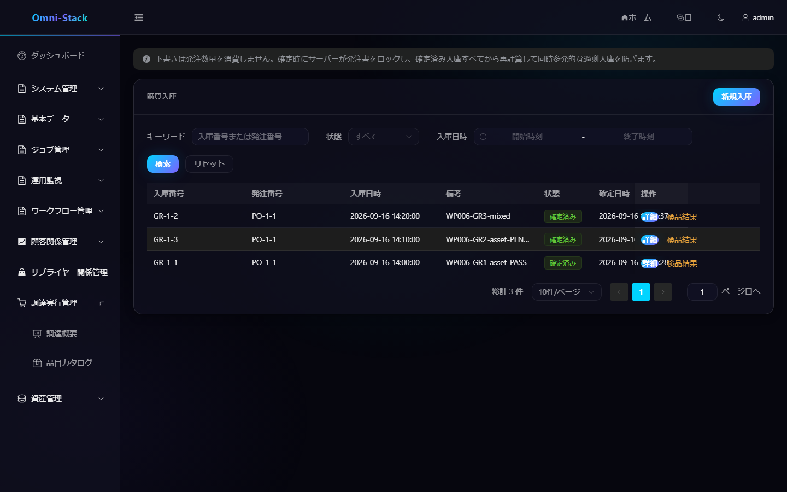

#### 図 16 `procurement-goods-receipt-detail-quality-ja-JP`：入荷詳細と検品 2 状態

- 前提条件：図 15 と同じ
- 操作者：調達管理者
- 操作：GR-1-2 詳細ドロワーを開く
- 期待結果：material1 行不良・material2 行合格の実際の検品結果と資産管理フラグ

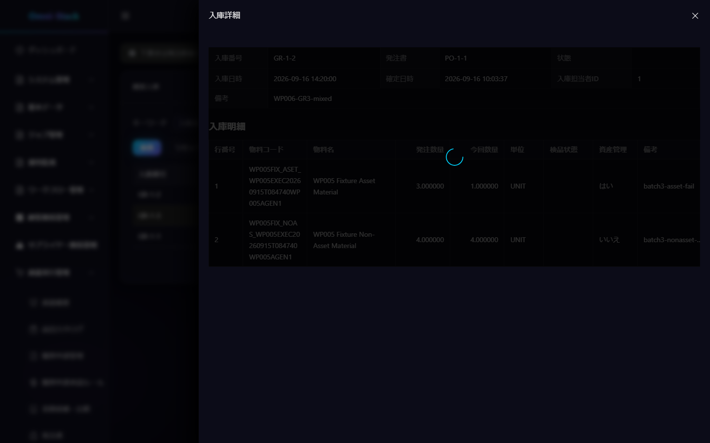

## 8. 権限と調査

管理者はマスタとルール、申請者は可視申請、購買担当は RFQ/注文/入荷、サプライヤーは自社 Portal 情報だけを扱います。

サプライヤーアカウントが調達管理ルートへ直接アクセスすると、フロントのルートガードが役割ドメイン分離によりサプライヤーポータルへリダイレクトし、管理 UI は漏れません。

### スクリーンショット

#### 図 17 `procurement-supplier-domain-isolation-ja-JP`：サプライヤー役割ドメイン分離

- 前提条件：サプライヤーアカウントでログイン
- 操作者：サプライヤー
- 操作：調達管理ルートへ直接アクセス
- 期待結果：ルートガードがサプライヤーポータルへリダイレクトし、管理 UI は表示されない

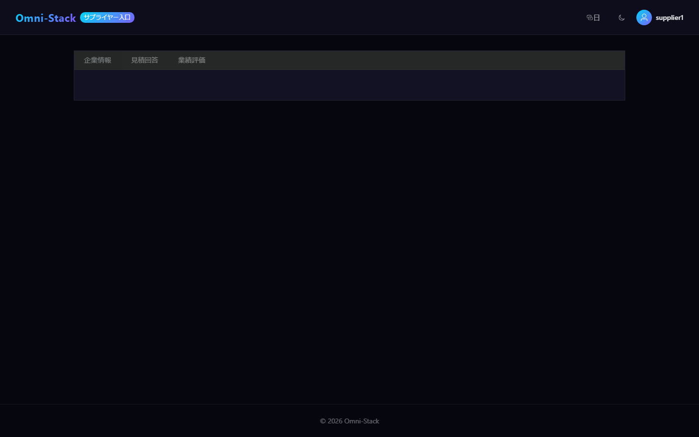

文書番号、Workflow、Outbox、Inbox、Trace ID を関連付けます。[Procurement 設計](../design/procurement-design.jp.md)を参照してください。
