# 空の業務環境から購買と入荷を再現する

対象基準：main fc165e3 と今回の文書ブランチ。supply-chain または full が必要です。[起動](quick-start.jp.md)、[SRM 審査](srm-flow.jp.md)、[教材データ](../wiki/data-and-fixtures.jp.md)を先に確認してください。業務の成功記録は 2026-10-09 の独立したローカル Docker 教材実行によるもので、申請承認、二社の見積、落札、二回の入荷、出所付き資産カード二枚の確認を含みます。2026-10-12 の読取確認は同じ記録を再利用しました。今回行うのは文書・現在のソース・既存証拠のレビューであり、業務の再実行ではありません。過去の結果は現在の成果物の統合受入れ完了を証明しません。

受入れは[承認済み AI レビュー方針](../adr/0003-authorized-ai-translation-review.md)に従い、実際の AI 意味レビュー合格で満たします。人による翻訳レビューは必須ではありません。[今回のレビュー範囲](../reference/evidence/procurement-guide-review-2026-10-17.json)ではソース・原画像・過去実行を区別します。過去の実行はイメージレジストリの DNS/認証失敗後にキャッシュ済みベースイメージを利用しており、正式な本番ベースイメージのビルド成功は証明していません。

## 1. 利用者、分類、実行記録を準備する

教材用の同一テナントを使用します。既定値は 1 ですが、別環境では必ず確認してください。正式 seed が提供するのは分類・通貨・ロールであり、本手順の申請・見積・発注・入荷ではありません。

| 利用者 | 準備と役割 |
|---|---|
| 初期管理者 | 正式なユーザー・ロール・組織画面で教材用 ID と審査モデル・ルールを準備 |
| 申請者 | PROCUREMENT_STAFF と主組織を設定し、自分の申請を作成 |
| 購買責任者・承認者 | PROCUREMENT_MANAGER、申請者と同じ主組織、実際の候補者プレビューに表示 |
| 取引先 A・B | SRM 招待、Portal 登録、入会 Saga と審査を完了。APPROVED、SUPPLIER、有効な Portal 関連が必要 |
| 資産管理者・利用者 | [資産ガイド](asset-flow.jp.md)へ進む。割当と受領はそれぞれの ID で実施 |

標準購買モデルの候補設定は PROCUREMENT_MANAGER + START_USER_PRIMARY_UNIT + SAME_UNIT です。SUPER_ADMIN の機能権限だけで承認候補者にはなりません。インスタンス開始前に候補者を確認します。

固有の `WIKI-{run-id}` を選び、Git の外に記録表を保存します。テナント・ID・組織・品目 ID・ルール/モデル版・申請 ID/番号/version・RFQ/行 ID・見積 ID/版・PO/行 ID・GR/行 ID・資産 ID を記録してください。応答ごとに version を更新し、過去画像の ID を転記しません。

10 月 12 日のマネージャーは USER、PROCUREMENT_MANAGER、ASSET_MANAGER、TEAM_LEADER、WIKI_20261009A_WORKFLOW_DESIGNER を同時に持っていました。証拠が示すのはその実際の権限であり、単一ロールのみを付与した分離実験ではありません。

## 2. 二種類の教材用品目を作る

購買 → 品目一覧で購買責任者が今回専用の分類を作成します。コードは `WIKICAT{run}` など大文字英数字にし、実際の categoryId/categoryCode を記録します。**両品目を同じ教材分類**に置きます。異なる分類の混在は 409 です。審査済み教材用取引先二社にもこの categoryCode を設定し、分類指定の候補検索で見つけられるようにします。他人の取引先は上書きしません。

| 品目 | materialCode / 名前の接頭辞 | 単位 | assetManaged | 数量 | 見積単価 |
|---|---|---|---|---|---|
| A | WIKI-{run-id}-A / 教材用機器 | PCS | true | 3 | 1000.0000 |
| B | WIKI-{run-id}-B / 教材用付属品 | PCS | false | 10 | 100.0000 |

ACTIVE で作成し、更新後に各コードが一件ずつであることを確認します。[品目 API](../../omni-frontend/src/api/procurement-material.ts)を参照してください。価格と数量は十進文字列で、申請合計は CNY 4000.0000 です。教材分類は本例で共通ですが、資産作成には assetManaged と検品結果も必要です。

## 3. 審査モデルを公開してルールを有効にする

プロセスモデルで procurement-approval の現在の公開版を先に確認します。標準初期化は通常、必須業務モデルを公開します。有効な公開版はそのまま記録し、変更時のみ新しい下書きの候補設定を確認・検証して新版を公開します。ロール、主組織、Workflow 組織スコープは別設定です。[教材データ](../wiki/data-and-fixtures.jp.md)で候補者の関連付けを確認します。

実際の教材 categoryCode、`[0, 10000)`、現在の公開版で専用ルールを作ります。実際の categoryCode/4000 を試算し、MATCHED、モデル AVAILABLE、候補者の一致を確認してからカバレッジ分析と有効化を行います。既存ルールは範囲と版を確認し、他人の設定を上書きしません。重複や空白は実際の分析に従って処理します。

一致試算は規則とモデルの利用可能性を確認するもので、承認を開始せず、現在のユーザーの実候補資格も証明しません。申請者の主組織に基づいて資格を確認してください。未初期化テナントへの初回アクセスでは、既定設定と分類を冪等に作成する場合があります。過去テナントの読取記録から、すべての新規テナントで書込みがゼロだとは判断できません。

## 4. 申請者が作成し、承認を受ける

1. WIKI-{run-id}-PR を A/B と上表の数量・単価で作成します。
2. 下書き保存で DRAFT、CNY 4000.0000 を確認し、返却 ID/番号/version を記録します。
3. 提出後は審査への遷移と最終的な workflowStartStatus=STARTED を確認し、processInstanceId を保存します。
4. 実際の購買責任者が自分の保留タスクを開き、明細・金額を確認して承認します。購買詳細が APPROVED になるまで待ちます。

提出応答だけでサービス間審査完了とは判断しません。status=SUBMITTED かつ workflowStartStatus=FAILED の場合に限り、モデル・候補・MQ/Workflow を調査し、詳細を更新して最新 version で起動を再試行します。元の承認試行・リクエスト・モデルスナップショットを再利用します。結果不明の申請を再提出したり、別申請で隠したりしないでください。

否決と撤回/取消は別の教材記録で練習します。実候補者の否決後に REJECTED を確認し、取消は現在の状態で許された操作だけを使用します。本流の RFQ は承認済み申請から作成します。

## 5. RFQ を送り、二社が別々に見積する

1. APPROVED 申請から WIKI-{run-id}-RFQ を作り、未来の期限と審査済み二社を選択します。
2. DRAFT、元申請、通貨、明細を確認して送信し、SENT を確認します。
3. 各社は Supplier Portal の RFQ/見積で自社の招待だけを開き、行単価・納期日数・有効期限を入力して提出します。
4. A 社は A=950.0000/B=100.0000、合計 3850.0000。B 社は A=900.0000/B=80.0000、合計 3500.0000 とします。
5. 購買比較画面を更新し、二つの実 quotationId/version と CNY 合計が届くまで待ちます。Portal 成功と購買側の非同期消費は別段階です。

今回返却された RFQ 行 ID を使用します。他社の招待・見積は閲覧できません。期限切れや取消後の見積は拒否され、DB 状態を変更して回避しません。

## 6. 落札と発注確認を記録する

B 社の現在の見積版を選び、教材用の配送先と架空連絡先を記入して落札処理を行います。`award` 応答は RFQ と新しい PO の両方を返します。RFQ=AWARDED、PO=DRAFT、3500.0000 を確認して、その PO を記録し、重複発注を作成しません。最新の `rfqVersion`、選択した `quotationId` とその `quotationVersion` を同時に指定します。旧版の競合時は、既存の落札・PO の副作用を照合してから次の操作を決めてください。

PO 送信後は SENT です。**現実装では購買管理画面で取引先確認を記録します**。業務上の確認を取得してから権限のある購買担当者が「確認」を実行し、CONFIRMED を確認します。Portal は見積を担当し、独立した PO 確認ボタンはありません。必要権限は procurement:purchase-order:confirm で、行のデータ範囲も適用されます。

## 7. 二回に分けて入荷し、検品と資産を確認する

返却 poLineId から二つの入荷下書きを作成し、保存後にそれぞれ確認します。日時形式は `yyyy-MM-dd HH:mm:ss` です。

| 回 | A 実収/検品 | B 実収/検品 | 期待結果 |
|---|---|---|---|
| GR-1 | 1 / FAIL | 10 / PASS | PARTIAL_RECEIVED。どちらも資産カードなし |
| GR-2 | 2 / PASS | この回は B を追加しない | RECEIVED。合格した A から二枚のカード |

FAIL も累積実収に数えますが資産候補にはなりません。非資産化 B は PASS でも資産カードを生成しません。入荷要求は receivedQuantity と qualityStatus を送り、イベントの assetQuantity を偽造しません。累積実収は発注数量を超えられません。

台帳で今回の出所から二枚のカードを検索し、全 DB の件数で判断しません。遅延時は GR・Outbox・Inbox を関連付けて relay/consumer を調査します。同一イベントを管理された検証環境で再送しても二枚のままであることを検証します。新しい入荷を作る操作は冪等性試験ではありません。その後は[資産ガイド](asset-flow.jp.md)で割当・受領・返却・移管/処分へ進みます。

## 8. 必須の失敗と復旧確認

| 条件 | 境界と復旧 |
|---|---|
| 申請内の分類混在 | 409。同じ分類にするか申請を分ける |
| 購買権限のない従業員 | 403/操作不可。データを漏らさない。空一覧だけでは権限拒否の証拠になりません |
| 取引先の管理ルート/他社招待アクセス | ドメイン転送または API 拒否。自社 Portal は利用可能 |
| 古い version の再利用 | 競合。更新して前回副作用を確認してから次の命令を判断 |
| 審査否決/起動失敗 | 業務と Workflow が一致。許された修正/retry-start |
| 期限/取消後の見積 | 拒否。新しい業務は新 RFQ |
| 過剰入荷/資産数量の小数 | 検証拒否。合法な残数量を使用 |
| MQ 失敗/再送 | 失敗・再試行証拠を残し、見積/発注/カードを重複させない |

作成タイムアウト時は固有業務キーで先に検索します。全作成 API が requestId を受けるわけではありません。Saga 再試行は元の requestId を使い、他命令は個別の版・冪等契約に従います。

## 9. 片付け、調査、画像

下書きは正式削除 API、提出後は許された否決・撤回・取消を使います。入荷/資産カード生成済みは追跡可能な終状態を残します。今回の正確な対象と削除できない理由を列挙し、seed・他人のデータ・volume は残します。

申請・processInstanceId・RFQ・見積・PO・GR・Outbox/Inbox・Trace ID を関連付けます。[ソース調査](../wiki/source-debugging.jp.md)と[購買設計](../design/procurement-design.jp.md)を参照してください。

### 今回の実画面

以下は 2026-10-09 の独立したローカル Docker 環境の実記録です。[出典](../reference/evidence/supply-chain-2026-10-09.json)に一般ロール、ソースハッシュ、実行イメージ、テスト、PNG の SHA を記録しています。全 48 枚は原解像度の四言語コンタクトシート 12 組で確認され、本ページではそのうち 28 枚を使用します。原画像を一枚ずつ開いた方法とは異なります。幅広い表の隠れた列は横スクロールしてください。画像は可視項目を示し、業務結果は当該日付の API 検証と併せて確認します。今回の再試験を証明するものではありません。

承認済み申請：購買担当者で今回の詳細を開き、承認済み、CNY 4000、2 行の数量を確認します。

却下された申請：別の却下記録を開き、状態と保持された元のインスタンスを確認します。

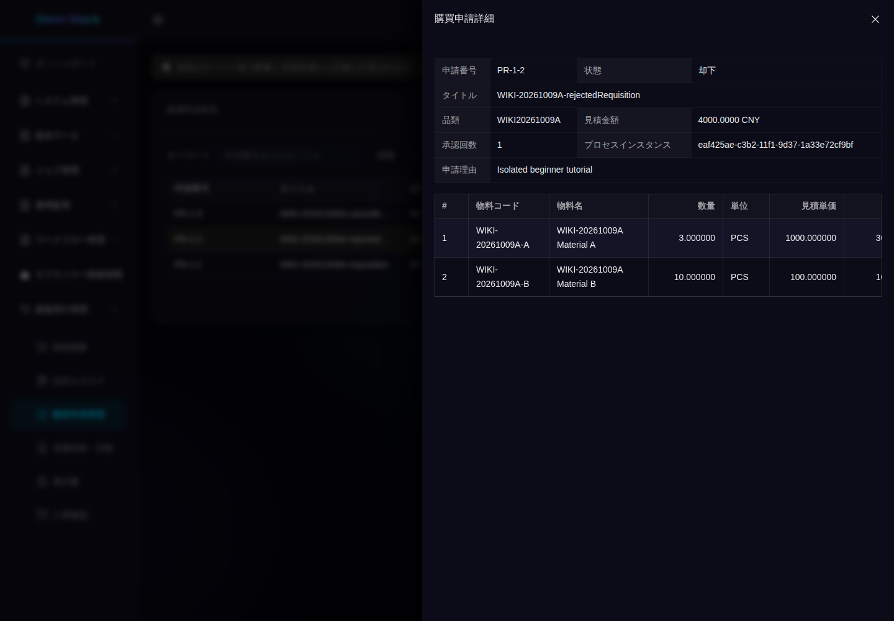

下書き取消：承認が開始されず取消済みであることを確認します。実行中の承認も任意に取消可能という証拠ではありません。

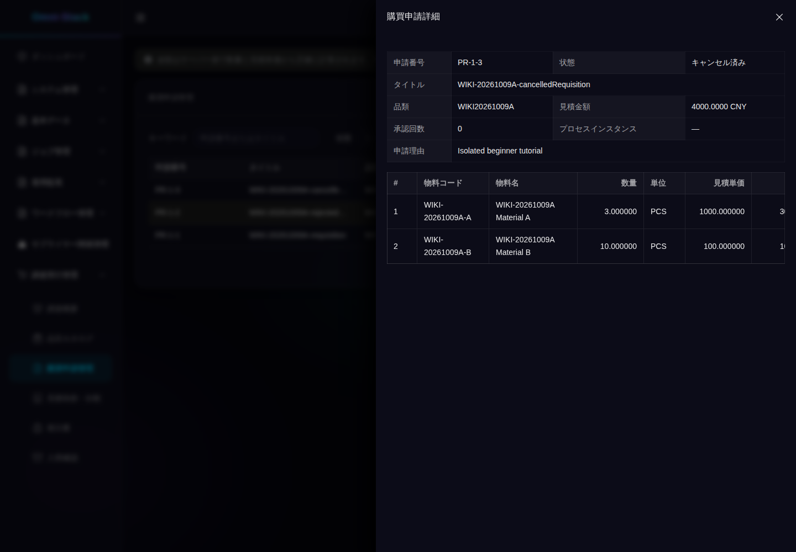

見積選定：RFQ 詳細で Vendor D の選定、Vendor C の非選定、見積バージョンを確認します。

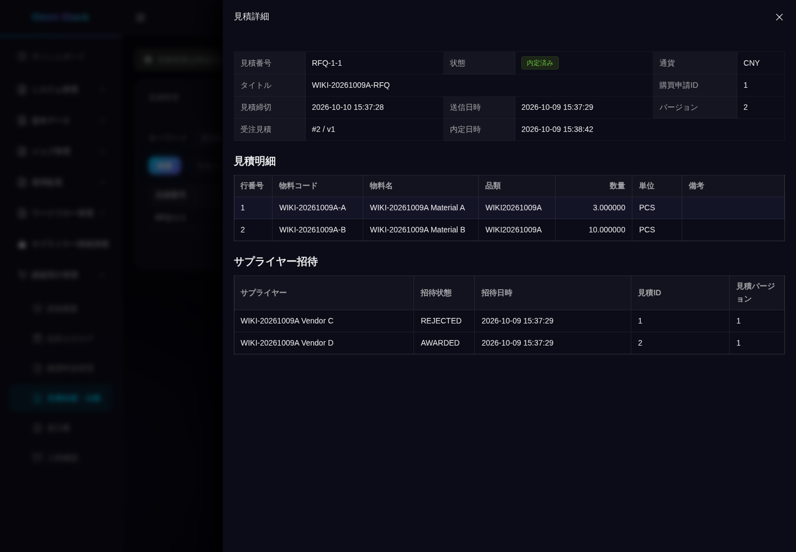

入荷完了注文：同じ出典の PO を開き、CNY 3500、2 行の入荷完了、未入荷数量 0 を確認します。

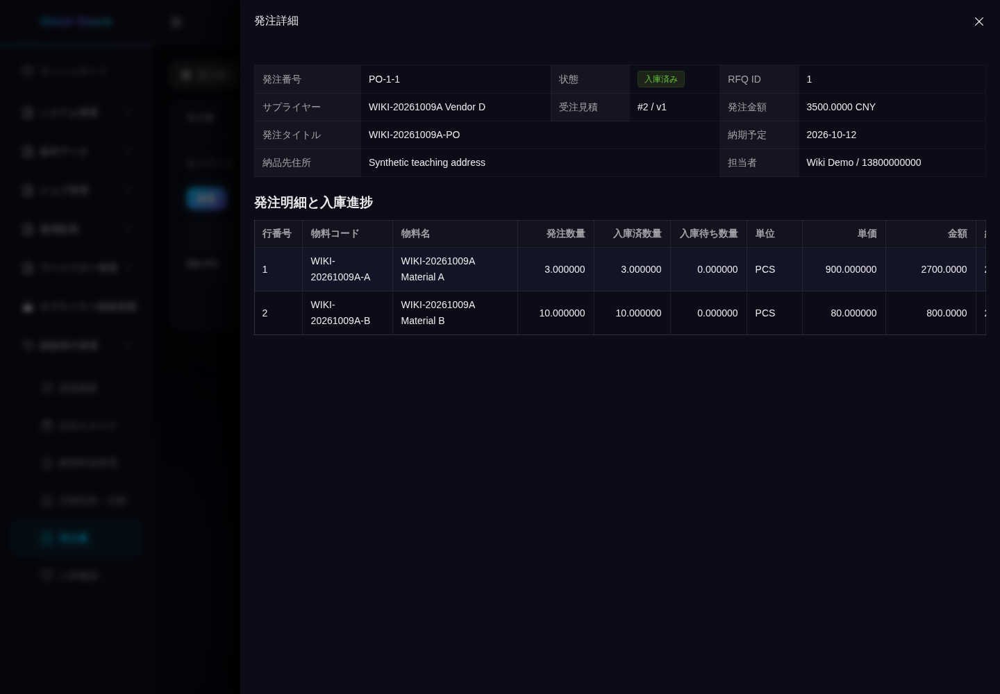

初回入荷：A は数量 1・FAIL・資産管理あり、B は数量 10・PASS・資産管理なしです。カードなしの結果は出典照会で検証し、画像だけで判断しません。

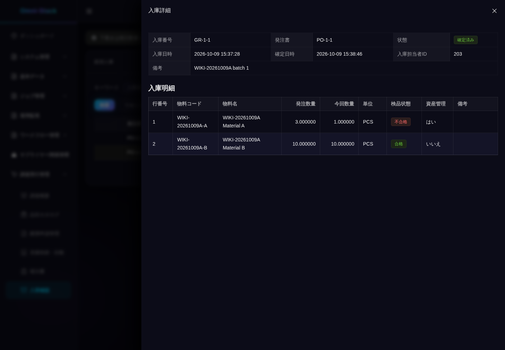

2 回目入荷：A は数量 2・PASS・資産管理ありです。その GR を出典とするカードが正確に 2 枚あることを確認します。

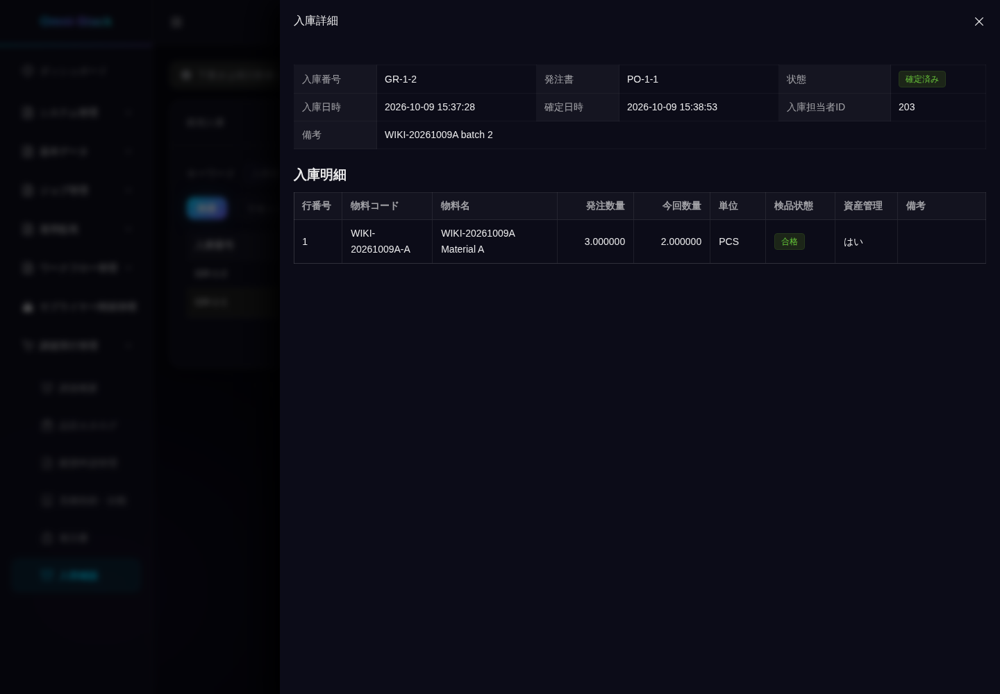

## 10. 品目、ルール試算、概要を再確認する

上記の独立した教材チェーンを完了した後、同じテナントの一般購買マネージャーで確認します。[2026-10-12 の読取専用記録](../reference/evidence/procurement-readonly-2026-10-12.json)は今回の教材データを再利用し、申請・発注・入荷を作り直していません。新しい環境では自分で記録した分類と名称を使い、画像の ID をコピーしないでください。

1. 品目カタログで教材分類を選び、今回の品目プレフィックスを検索します。A・B の 2 行だけが表示され、両方 ACTIVE、資産管理はそれぞれ true・false であることを確認します。プレフィックスだけで検索すると、同じ接頭辞の否定ケース用分類も該当する場合があります。
2. 購買申請ルールの試算で同じ分類と `4000` を指定して実行します。MATCHED、自分の有効なルール、AVAILABLE のモデルが期待結果です。今回はルール 1・モデル版 2 に一致しました。`POST /api/procurement/approval-route/match-preview` は読取専用の計算で、プロセスインスタンスを作成しません。
3. 概要で現在の利用者のデータ範囲を確認します。今回は入荷済み発注による確約額が CNY 3500.0000、4 種の未処理件数がすべて 0 です。新環境は自身のデータを表示し、画像の金額はシード値ではありません。

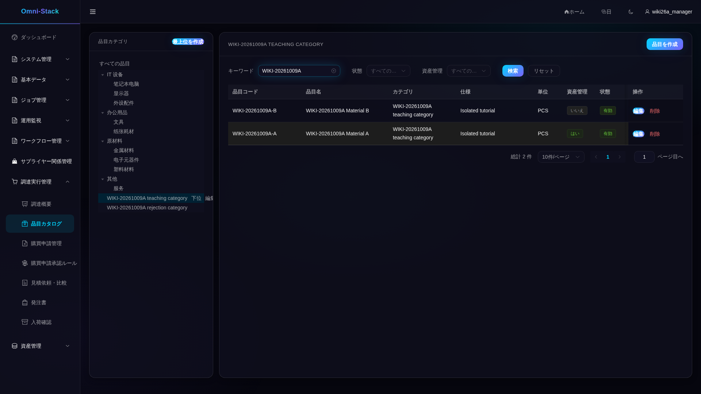

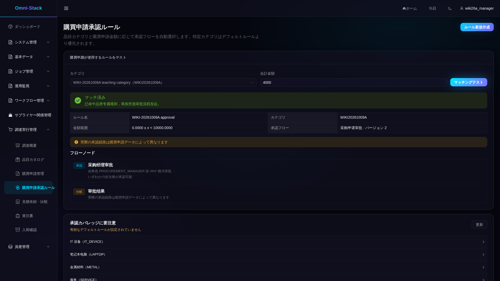

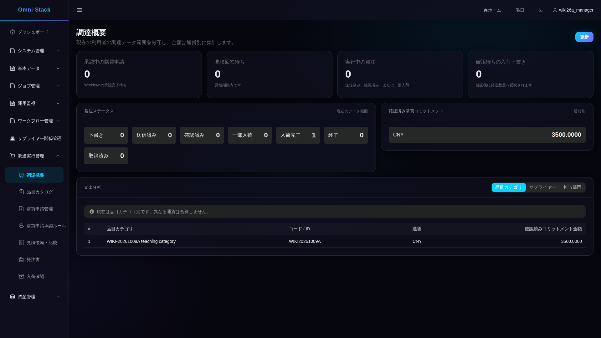

390×844 のスマートフォンではサイドバーが閉じた状態で始まります。上部のメニューを押すと開き、再度押すと閉じます。その後に分類・金額・試算ボタンを操作します。1024×768 のタブレットでも同じ試算を行います。4 言語・3 画面サイズの計 12 回すべてで一致し、ページ全体の横はみ出しはありませんでした。

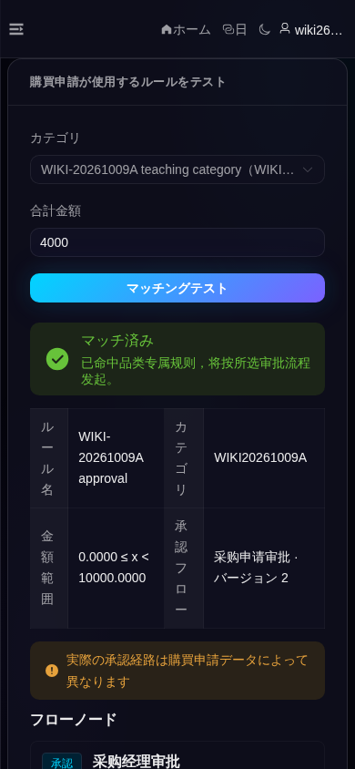

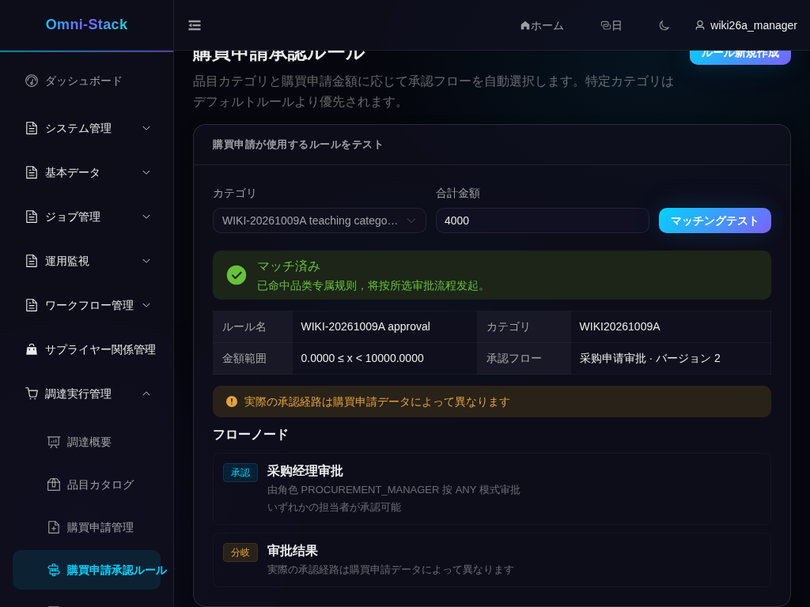

スマートフォンの結果表は、表の内部を横スクロールして全列を確認します。原画像が示すのは金額・操作可能な試算ボタン・一致結果で、モデル版は実際の応答に対する検証でも確認しています。英語の長いサイドバー名には省略表示があり、日韓のタブレット画像は試算欄へスクロールしたため見出しの一部が固定ヘッダーの下にあります。画像は見えている操作と結果を示します。既存の分類・モデル・ノード名、未加工のサーバー診断には中国語が残る場合があり、翻訳された画面ラベルとは別です。画像確認の対象は視認性です。四言語文書は前述の承認方針に基づく実際の AI 意味レビュー合格で受け入れます。

## 11. 内定後に二社それぞれの記録を確認する

この節と過去 UI の「内定」は、調達における落札・採用見積の確定を意味します。比較と内定操作は RFQ が SENT の間に行います。AWARDED 後は比較操作が非表示となり、`GET /api/procurement/rfq/{id}/comparison` は HTTP 200・業務コード 409 を返します。画像のために状態を戻したり内定操作を再実行したりしないでください。

購買マネージャーで RFQ 詳細を開き、保持された見積 ID・版と受注見積を確認します。今回は Vendor C が #1/v1・招待結果 REJECTED、Vendor D が #2/v1・AWARDED、受注見積は #2/v1 です。この画像は結果記録を示し、画面でのリアルタイム比較や内定クリックの証明ではありません。

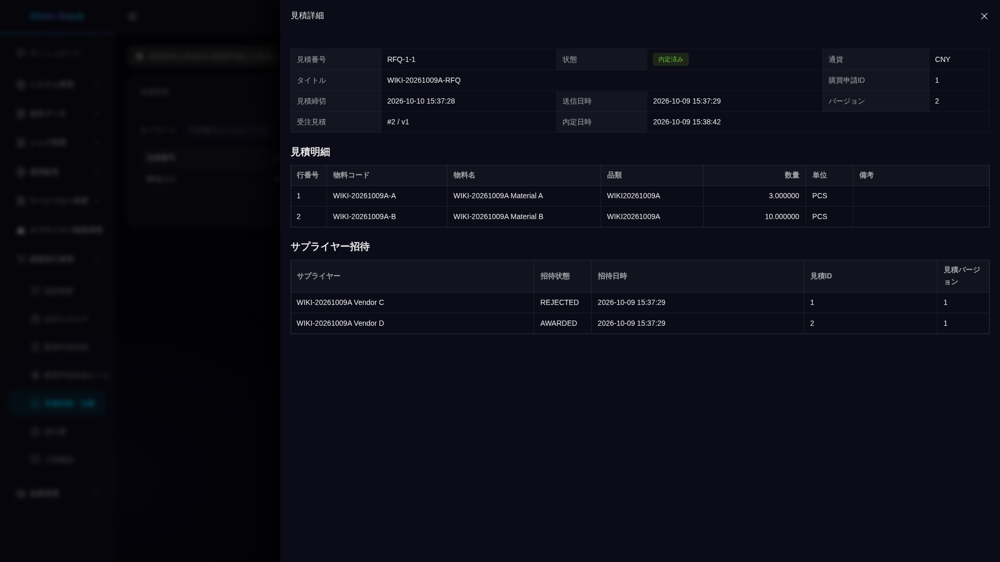

サプライヤー C・D として別々にポータルへログインし、「見積回答」で今回の RFQ に対する自身の見積を探します。C は合計 CNY 3850、D は CNY 3500 です。表示を押すと参照専用の詳細が開き、閉じた後も一覧の金額と招待結果を確認できます。終了した RFQ に再回答せず、非受注でも自身の履歴は参照できます。

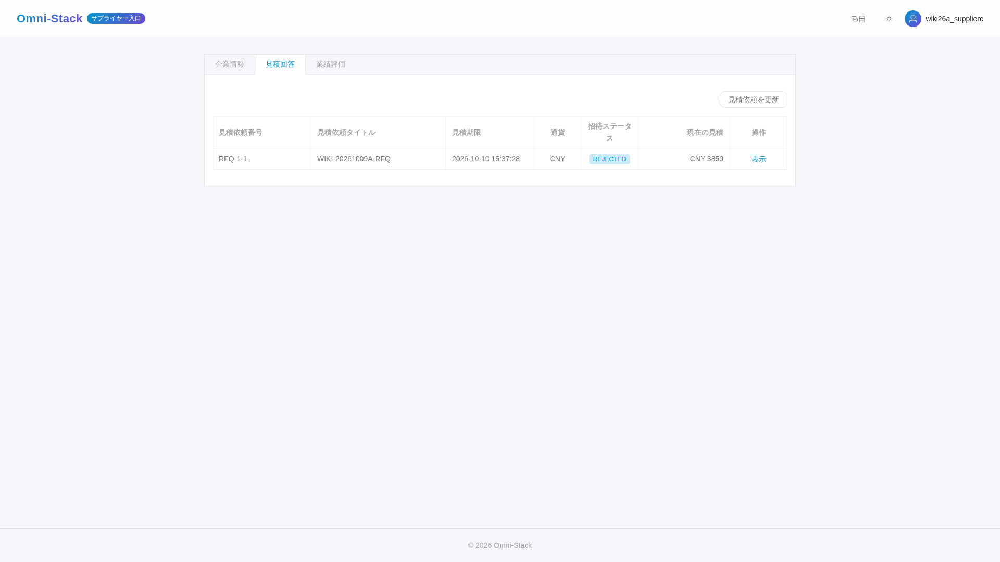

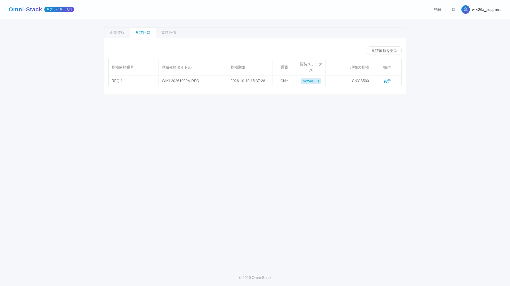

[読取専用記録](../reference/evidence/procurement-quotation-2026-10-12.json)は一般ロール、版、金額、原画像の摘要を結び付けます。単価は実際の応答と詳細コントロールの検証で確認し、公開一覧画像は見える合計と結果のみを証明します。サプライヤー画像は製品のテーマボタンでライトモードへ切り替えています。日本語の長い表見出しは列内で折り返します。原画像 31 枚を個別確認し 12 枚を公開、描画不完全な 7 枚を除外、読み取れる重複詳細 12 枚を非公開記録に保持しました。業務書込みは再実行していません。この 31 枚の確認日は 2026-10-12 です。今回新たに確認した原画像 20 枚と、再度開いていない残り 40 枚は今回のレビュー範囲に区別して記録しています。
