# 빈 업무 환경에서 구매와 입고 재현하기

기준: main fc165e3 및 이번 문서 브랜치. supply-chain 또는 full이 필요합니다. [시작](quick-start.kr.md), [SRM 승인](srm-flow.kr.md), [학습 데이터](../wiki/data-and-fixtures.kr.md)를 먼저 완료하세요. 업무 성공 기록은 2026-10-09 독립 로컬 Docker 학습 실행에서 나온 요청 승인, 두 공급업체 견적, 선정, 두 차례 입고, 출처가 연결된 자산 카드 2개 확인입니다. 2026-10-12 읽기 검증은 같은 기록을 재사용했습니다. 이번에는 문서·현재 소스·기존 증거를 검토했으며 업무 흐름을 다시 실행하지 않았습니다. 과거 결과가 현재 산출물의 통합 인수 완료를 증명하지는 않습니다.

인수는 [승인된 AI 검토 정책](../adr/0003-authorized-ai-translation-review.md)을 따르며 실제 AI 의미 검토 통과로 충족합니다. 사람의 번역 검토는 필수가 아닙니다. [이번 검토 범위](../reference/evidence/procurement-guide-review-2026-10-17.json)는 소스·원본 이미지·과거 실행을 구분합니다. 과거 실행은 이미지 레지스트리 DNS/인증 실패 후 캐시된 기반 이미지를 사용했으며 정식 운영 기반 이미지 빌드 성공은 입증하지 않았습니다.

## 1. 사용자, 분류, 실행 기록 준비

모든 사용자는 같은 학습 테넌트에 속합니다. 기본값은 1이지만 다른 환경에서는 직접 확인하세요. 정식 시드는 분류/통화/역할을 제공하며 이 실습의 요청/견적/주문/입고는 제공하지 않습니다.

| 사용자 | 준비와 책임 |
|---|---|
| 초기 관리자 | 정식 사용자/역할/조직 화면으로 학습 사용자와 승인 모델/규칙 준비 |
| 요청자 | PROCUREMENT_STAFF와 주 조직 지정; 자신의 구매 요청 생성 |
| 구매 관리자/승인자 | PROCUREMENT_MANAGER, 요청자와 같은 주 조직; 실제 후보 미리 보기에 표시 |
| 공급업체 A/B | SRM 초대, Portal 등록, 가입 Saga 및 승인 완료; APPROVED, SUPPLIER, 활성 Portal 연결 필요 |
| 자산 관리자/수령자 | [자산 가이드](asset-flow.kr.md)로 진행; 배정과 수락은 각각의 사용자로 실행 |

기본 구매 모델 후보는 PROCUREMENT_MANAGER + START_USER_PRIMARY_UNIT + SAME_UNIT입니다. SUPER_ADMIN 기능 권한만으로 승인 후보가 되지는 않습니다. 인스턴스를 시작하기 전에 실제 후보를 확인하세요.

고유한 `WIKI-{run-id}` 접두사를 정하고 Git 외부에 실행 기록을 보관합니다. 테넌트, 사용자, 조직, 자재 ID, 규칙/모델 버전, 요청 ID/번호/version, RFQ/행 ID, 견적 ID/버전, PO/행 ID, GR/행 ID, 자산 ID를 기록하세요. 응답마다 version을 갱신하고 과거 이미지의 숫자를 복사하지 마세요.

10월 12일 관리자 계정에는 USER, PROCUREMENT_MANAGER, ASSET_MANAGER, TEAM_LEADER, WIKI_20261009A_WORKFLOW_DESIGNER가 함께 있었습니다. 증거는 이 실제 계정의 유효 권한을 보여 주며 단일 역할만 부여한 격리 실험이 아닙니다.

## 2. 학습용 자재 두 종류 생성

구매 → 자재 목록에서 구매 관리자가 이번 실행 전용 분류를 만듭니다. `WIKICAT{run}`처럼 대문자 영문과 숫자로 된 코드를 사용하고 실제 categoryId/categoryCode를 기록하세요. **두 자재 모두 같은 교육 분류**에 넣습니다. 한 요청에 다른 분류를 넣으면 409입니다. 승인된 두 교육 공급업체에도 같은 categoryCode를 설정해 분류별 후보 검색에서 찾도록 합니다. 다른 공급업체를 덮어쓰지 않습니다.

| 자재 | materialCode/이름 접두사 | 단위 | assetManaged | 수량 | 예상 단가 |
|---|---|---|---|---|---|
| A | WIKI-{run-id}-A / 학습 기기 | PCS | true | 3 | 1000.0000 |
| B | WIKI-{run-id}-B / 학습 부속품 | PCS | false | 10 | 100.0000 |

ACTIVE로 생성한 뒤 새로 고침하여 코드마다 한 건인지 확인합니다. [자재 API](../../omni-frontend/src/api/procurement-material.ts)를 참고하세요. 가격/수량은 십진 문자열이며 요청 총액은 CNY 4000.0000입니다. 교육 분류는 이 실습의 공통 분류이며 자산 생성에는 assetManaged와 검사 결과도 필요합니다.

## 3. 승인 모델 게시와 규칙 활성화

프로세스 모델에서 procurement-approval의 현재 게시 버전을 먼저 확인합니다. 표준 초기화는 보통 필수 업무 모델을 게시합니다. 유효한 게시 버전은 그대로 기록하고 변경할 때만 새 초안의 후보 설정을 점검한 뒤 검증/게시하세요. 역할, 기본 조직, Workflow 조직 범위는 별도 설정입니다. [학습 데이터](../wiki/data-and-fixtures.kr.md)로 후보 연결을 확인하세요.

실제 교육 categoryCode, `[0, 10000)`, 현재 게시 버전으로 실행 전용 규칙을 만듭니다. 실제 categoryCode/4000을 시험하여 MATCHED, 모델 AVAILABLE, 올바른 후보를 확인한 뒤 범위 분석과 활성화를 진행하세요. 기존 규칙은 범위/버전을 점검하고 다른 설정을 덮어쓰지 않습니다. 중복/공백은 실제 분석에 따라 해결합니다.

매칭 시험은 규칙·모델 가용성을 확인할 뿐 승인을 시작하거나 현재 사용자의 실제 후보 자격을 증명하지 않습니다. 요청자의 주 조직을 기준으로 자격을 확인하세요. 초기화되지 않은 테넌트의 첫 접근에서는 기본 설정과 분류를 멱등 생성할 수 있습니다. 과거 테넌트의 읽기 기록으로 모든 새 테넌트 접근에서 쓰기가 0이라고 보장할 수 없습니다.

## 4. 요청자가 생성하고 승인받기

1. A/B와 위 수량/가격으로 WIKI-{run-id}-PR을 생성합니다.
2. 초안 저장 후 DRAFT, CNY 4000.0000을 확인하고 반환 ID/번호/version을 기록합니다.
3. 제출 뒤 승인 단계와 최종 workflowStartStatus=STARTED를 확인하고 processInstanceId를 보관합니다.
4. 실제 구매 관리자가 자신의 대기 작업에서 명세/금액을 확인하고 승인합니다. 구매 상세가 APPROVED가 될 때까지 기다립니다.

제출 응답만으로 서비스 간 승인이 끝났다고 판단하지 마세요. status=SUBMITTED이고 workflowStartStatus=FAILED일 때만 모델·후보·MQ/Workflow를 점검하고 상세를 새로 고친 뒤 최신 version으로 시작을 재시도합니다. 서비스는 원래 승인 시도·요청·모델 스냅샷을 재사용합니다. 결과를 감추려고 다시 제출하거나 다른 요청을 만들지 마세요.

거절 및 철회/취소는 별도의 실행 소유 기록에서 연습합니다. 실제 후보가 거절하면 REJECTED를 확인하고 취소는 현재 상태에서 허용된 동작으로만 수행합니다. 주 흐름 RFQ에는 승인된 요청을 사용합니다.

## 5. RFQ 발송과 두 공급업체의 독립 견적

1. APPROVED 요청에서 WIKI-{run-id}-RFQ를 만들고 미래 마감과 승인된 두 공급업체를 선택합니다.
2. DRAFT, 원본 요청, 통화, 명세를 확인하고 발송하여 SENT를 확인합니다.
3. 각 업체는 Supplier Portal → RFQ/견적에서 자신의 초대만 열고 행별 가격, 납기 일수, 유효기간을 입력하여 제출합니다.
4. A 업체는 A=950.0000/B=100.0000, 합계 3850.0000. B 업체는 A=900.0000/B=80.0000, 합계 3500.0000으로 작성합니다.
5. 구매 비교 화면을 갱신하여 두 실제 quotationId/version과 CNY 합계를 기다립니다. Portal 성공과 구매 측 비동기 소비는 별개입니다.

이번 RFQ의 반환 행 ID를 쓰세요. 다른 업체의 초대/견적은 볼 수 없습니다. 만료/취소 후 새 견적은 거부되며 DB 상태 수정으로 우회하지 않습니다.

## 6. 선정 및 주문 확인 기록

B 업체의 현재 견적 버전을 선택하고 학습 배송지와 가상 연락처로 선정합니다. `award` 응답은 RFQ와 새 PO를 함께 반환합니다. RFQ=AWARDED, PO=DRAFT, 3500.0000을 확인하고 반환 PO를 기록하세요. 주문을 중복 생성하지 않습니다. 최신 `rfqVersion`, 선택한 `quotationId`와 해당 `quotationVersion`을 함께 전송하세요. 이전 버전 충돌 후에는 기존 선정·PO 부수 효과를 대조한 다음 후속 작업을 결정합니다.

PO 발송 후 SENT가 됩니다. **현재 구현은 권한 있는 구매 관리 화면에서 공급업체 확인을 기록합니다**. 실제 업무 확인을 받은 뒤 구매 담당자가 확인을 실행하여 CONFIRMED를 검증합니다. Portal은 견적을 담당하며 별도 PO 확인 버튼은 없습니다. procurement:purchase-order:confirm 권한과 행 데이터 범위가 필요합니다.

## 7. 두 차례 입고와 검사/자산 확인

반환 poLineId로 입고 초안 두 건을 작성하고 저장 후 각각 확인합니다. 날짜/시간은 `yyyy-MM-dd HH:mm:ss`입니다.

| 차수 | A 실수령/검사 | B 실수령/검사 | 예상 결과 |
|---|---|---|---|
| GR-1 | 1 / FAIL | 10 / PASS | PARTIAL_RECEIVED; 두 행 모두 자산 카드 없음 |
| GR-2 | 2 / PASS | B 추가 수령 없음 | RECEIVED; 합격 A 수량으로 카드 두 장 |

FAIL도 누적 수령에 포함되지만 자산 후보는 만들지 않습니다. 비자산 B는 PASS여도 카드가 없습니다. 입고 요청은 receivedQuantity/qualityStatus를 쓰며 이벤트 assetQuantity를 직접 위조하지 않습니다. 누적 수령은 주문 수량을 초과할 수 없습니다.

전체 DB 개수 대신 이번 원본으로 정확히 두 카드를 찾습니다. 지연되면 GR/Outbox/Inbox로 relay/consumer를 추적하세요. 같은 이벤트를 통제 환경에서 재전송해도 두 카드가 유지되어야 합니다. 새 입고 생성은 멱등성 시험이 아닙니다. 이후 [자산 가이드](asset-flow.kr.md)에서 배정, 수락, 반납, 이관/처분을 연습합니다.

## 8. 필수 실패와 복구 확인

| 상황 | 경계와 복구 |
|---|---|
| 요청 내 분류 혼합 | 409; 동일 분류 또는 요청 분리 |
| 구매 권한 없는 직원 | 403/동작 불가; 목록 데이터 유출 없음; 빈 목록만으로 접근 거부가 증명되지는 않음 |
| 공급업체의 관리 경로/타사 초대 접근 | 도메인 리다이렉트/API 거부; 자신의 Portal 사용 가능 |
| 오래된 version 재사용 | 충돌; 새로 조회하고 이전 부수 효과 확인 후 다음 명령 결정 |
| 승인 거절/시작 실패 | 업무/Workflow 상태 일치; 허용된 수정/retry-start |
| 마감/취소 후 견적 | 거부; 새 업무에는 새 RFQ |
| 초과 수령/자산 수량 소수 | 검증 거부; 유효한 잔량 사용 |
| MQ 실패/재전송 | 실패/재시도 증거 보존; 견적/주문/카드 중복 없음 |

생성 타임아웃 뒤에는 먼저 고유 업무 키로 조회하세요. 모든 생성 API가 requestId를 받는 것은 아닙니다. Saga 재시도는 원래 requestId를 쓰고 다른 명령은 각각의 버전/멱등 계약을 따릅니다.

## 9. 정리, 진단, 이미지

초안은 정식 삭제 API, 제출 기록은 허용된 거절/철회/취소로 정리합니다. 입고/자산 생성 완료 흐름은 추적 가능한 최종 상태로 남깁니다. 이번 정확한 대상과 삭제 불가 이유를 기록하며 시드, 기존 데이터, volume은 보존합니다.

요청, processInstanceId, RFQ, 견적, PO, GR, Outbox/Inbox, Trace ID를 연결합니다. [소스 디버깅](../wiki/source-debugging.kr.md), [구매 설계](../design/procurement-design.kr.md)를 참고하세요.

### 이번 실행의 실제 화면

다음은 2026-10-09 독립 로컬 Docker 환경의 실제 과거 기록입니다. [출처](../reference/evidence/supply-chain-2026-10-09.json)는 일반 역할, 소스 해시, 실행 이미지, 테스트, PNG SHA를 연결합니다. 전체 48장은 원본 해상도의 네 언어 콘택트 시트 12묶음으로 확인했고 이 페이지는 그중 28장을 사용합니다. 원본을 한 장씩 연 방식과는 다릅니다. 넓은 표의 숨은 열은 가로 스크롤로 확인하세요. 이미지는 보이는 필드를 증명하며 업무 결과는 해당 날짜의 API 단언과 함께 확인해야 합니다. 이번에 다시 시험했다는 증거는 아닙니다.

승인된 요청: 구매 담당자로 이번 상세를 열어 승인됨, CNY 4000, 두 자재 수량을 확인합니다.

반려 요청: 별도 반려 기록의 상태와 보존된 이전 인스턴스를 확인합니다.

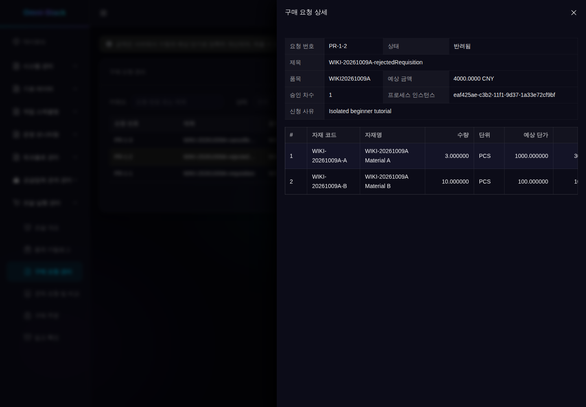

초안 취소: 승인 시작 없이 취소됐는지 확인합니다. 진행 중 승인도 임의로 로컬 취소할 수 있다는 의미는 아닙니다.

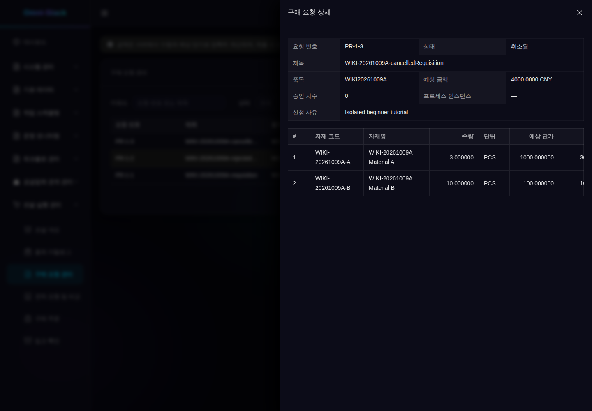

RFQ 선정: 상세에서 Vendor D 선정, Vendor C 미선정, 견적 버전을 확인합니다.

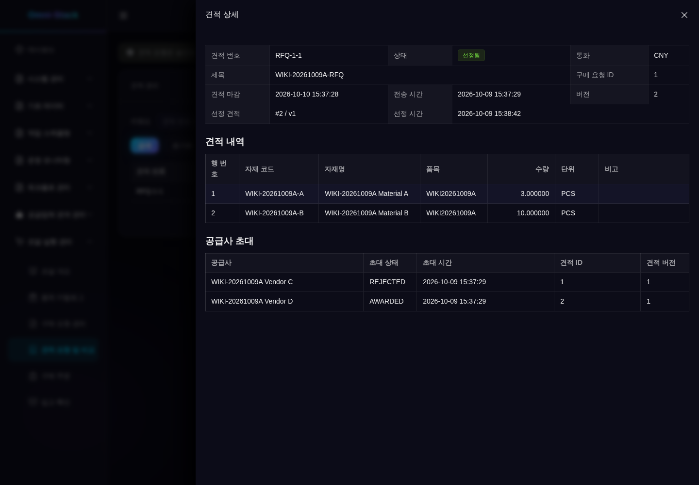

입고 완료 주문: 연결된 PO의 CNY 3500, 두 행 입고 완료, 대기 수량 0을 확인합니다.

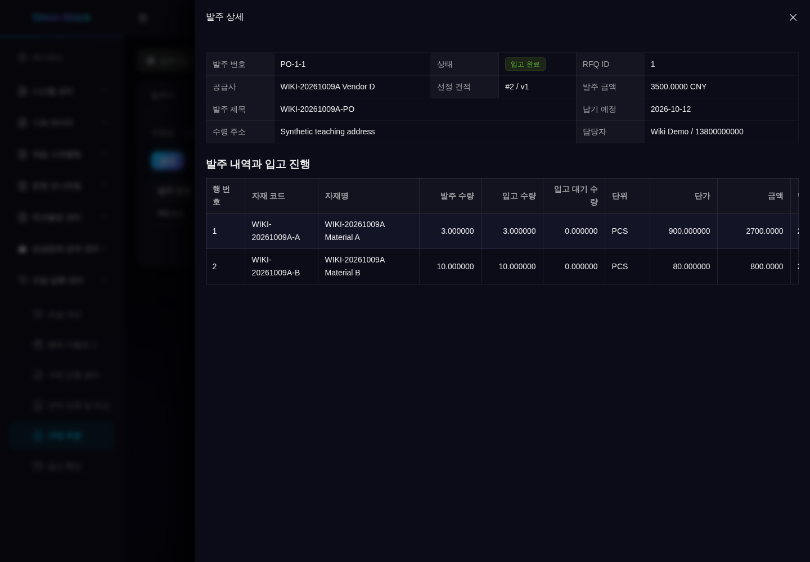

첫 입고: A는 수량 1·FAIL·자산 관리 예, B는 수량 10·PASS·자산 관리 아니요입니다. 카드가 없다는 결과는 출처 조회로 검증하며 이 화면만으로 판단하지 않습니다.

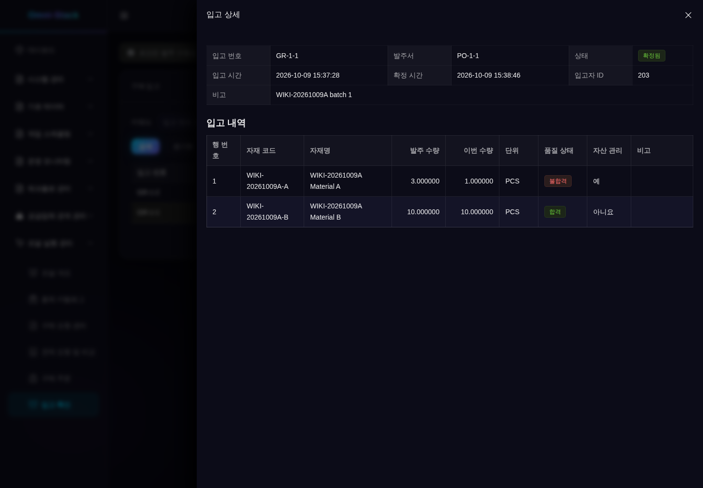

두 번째 입고: A는 수량 2·PASS·자산 관리 예입니다. 해당 GR 출처 카드가 정확히 두 장인지 조회합니다.

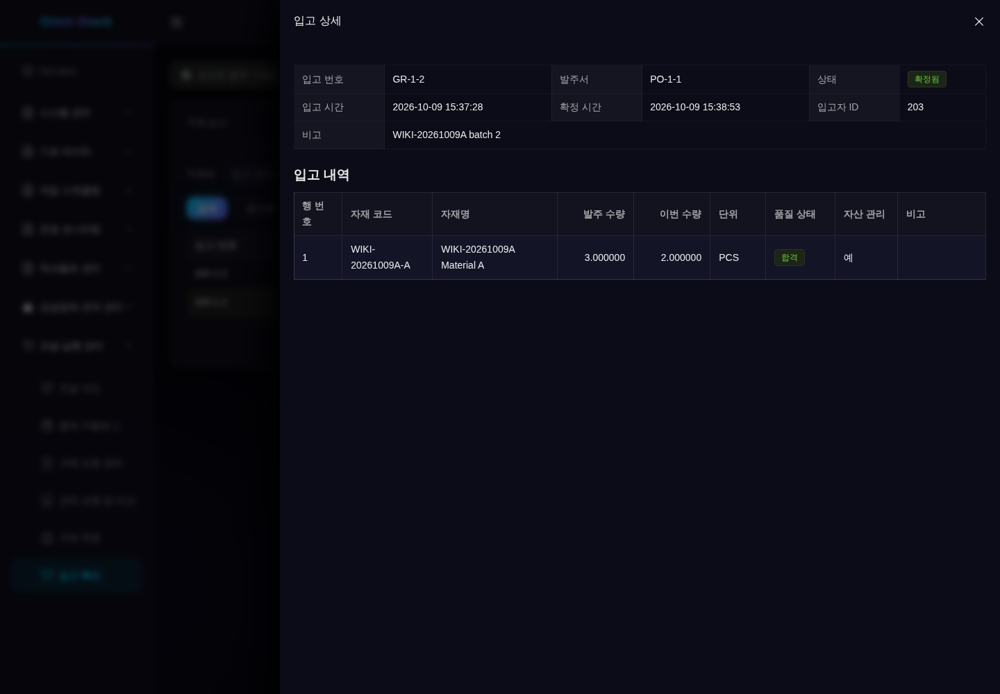

## 10. 자재, 규칙 시험, 개요 다시 확인하기

앞의 독립 학습 체인을 완료한 뒤 같은 테넌트의 일반 구매 관리자로 확인합니다.[2026-10-12 읽기 전용 기록](../reference/evidence/procurement-readonly-2026-10-12.json)은 이번 학습 객체를 재사용했으며 요청·주문·입고를 다시 생성하지 않았습니다. 새 환경에서는 직접 기록한 분류와 이름을 사용하고 이미지의 ID를 복사하지 마세요.

1. 자재 목록에서 학습 분류를 선택하고 이번 자재 접두사를 검색합니다. A와 B 두 행만 표시되며 모두 ACTIVE, 자산 관리 여부는 각각 true와 false여야 합니다. 접두사만 검색하면 같은 접두사를 쓰는 부정 사례용 분류도 검색될 수 있습니다.
2. 구매 요청 규칙 시험에서 같은 분류와 `4000`을 지정하고 시험 버튼을 누릅니다. MATCHED, 자신의 활성 규칙, AVAILABLE 모델이 예상 결과입니다. 이번에는 규칙 1과 모델 버전 2에 일치했습니다. `POST /api/procurement/approval-route/match-preview`는 읽기 전용 계산이며 프로세스 인스턴스를 생성하지 않습니다.
3. 개요에서 현재 사용자의 데이터 범위를 확인합니다. 이번에는 입고 완료 주문의 약정 금액이 CNY 3500.0000이고 네 가지 대기 건수가 모두 0입니다. 새 환경은 자체 데이터를 표시하며 이미지의 금액은 시드 값이 아닙니다.

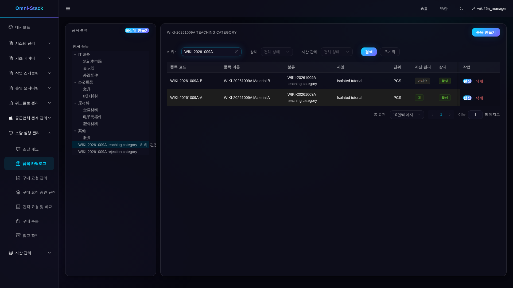

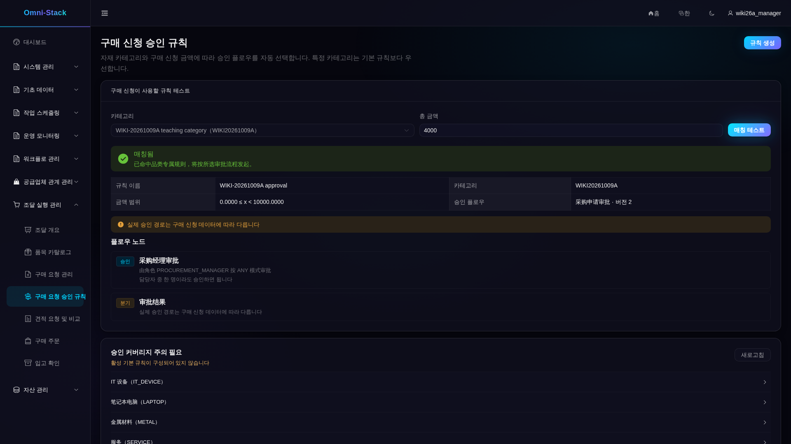

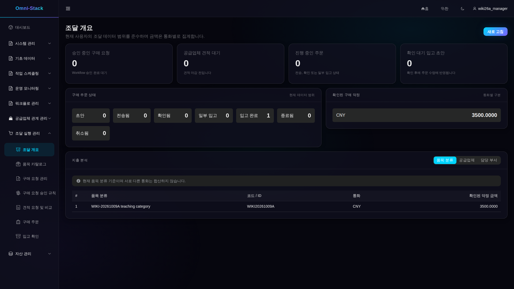

390×844 휴대폰에서는 사이드바가 접힌 상태로 시작합니다. 상단 메뉴를 누르면 열리고 다시 누르면 닫힙니다. 그 뒤 분류·금액·시험 버튼을 사용합니다. 1024×768 태블릿에서도 같은 시험을 실행합니다. 네 언어와 세 화면 크기의 실제 시험 12회가 모두 일치했으며 페이지 전체 가로 넘침은 없었습니다.

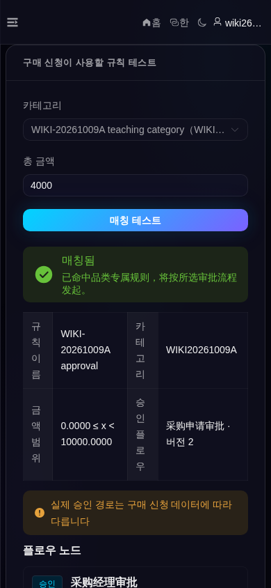

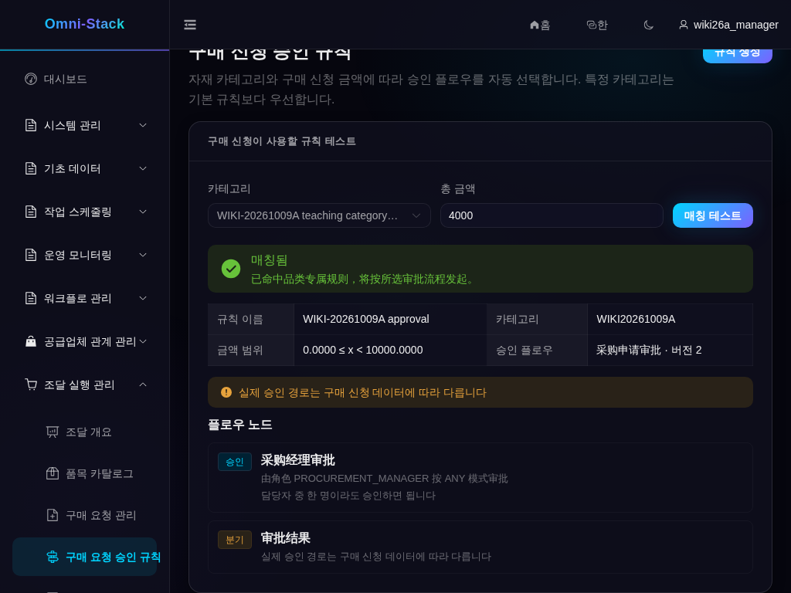

휴대폰 결과 표는 표 내부를 가로로 스크롤해야 모든 열을 볼 수 있습니다. 원본 이미지는 금액·조작 가능한 시험 버튼·일치 결과를 보여 주며 모델 버전은 실제 응답 검증으로도 확인했습니다. 긴 영어 사이드바 이름 일부는 잘리고, 일본어·한국어 태블릿 이미지는 시험 영역으로 스크롤하여 제목 일부가 고정 헤더 아래에 있습니다. 이미지는 보이는 조작과 결과를 입증합니다. 기존 분류·모델·노드 이름과 원본 서버 진단은 중국어 업무 데이터로 남을 수 있으며 번역된 UI 라벨과 구분합니다. 이미지 확인 범위는 가독성입니다. 네 언어 문서는 앞서 승인된 정책에 따라 실제 AI 의미 검토 통과로 인수합니다.

## 11. 선정 후 두 공급업체의 기록 확인하기

비교와 선정은 RFQ가 SENT일 때 실행합니다. AWARDED 이후에는 비교 작업이 숨겨지고 `GET /api/procurement/rfq/{id}/comparison`은 HTTP 200과 업무 코드 409를 반환합니다. 이미지를 얻으려고 상태를 되돌리거나 다시 선정하지 마세요.

구매 관리자로 RFQ 상세를 열어 보존된 견적 ID·버전과 선정 견적을 확인합니다. 이번에는 Vendor C가 #1/v1·초대 결과 REJECTED, Vendor D가 #2/v1·AWARDED이며 선정 견적은 #2/v1입니다. 이미지는 보존된 결과를 보여 주며 UI 실시간 비교나 선정 클릭을 증명하지 않습니다.

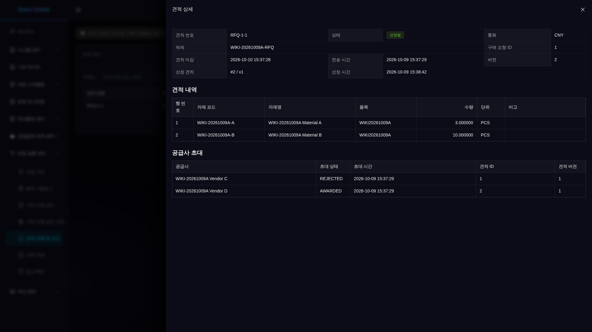

공급업체 C와 D로 각각 포털에 로그인하고 “견적 응답”에서 이번 RFQ의 자기 견적을 찾습니다. C의 합계는 CNY 3850, D는 CNY 3500입니다. 보기를 누르면 읽기 전용 상세가 열리며 닫은 뒤 목록 금액과 초대 결과를 확인할 수 있습니다. 종료된 RFQ에 다시 제출하지 마세요. 미선정이어도 자신의 기록은 볼 수 있습니다.

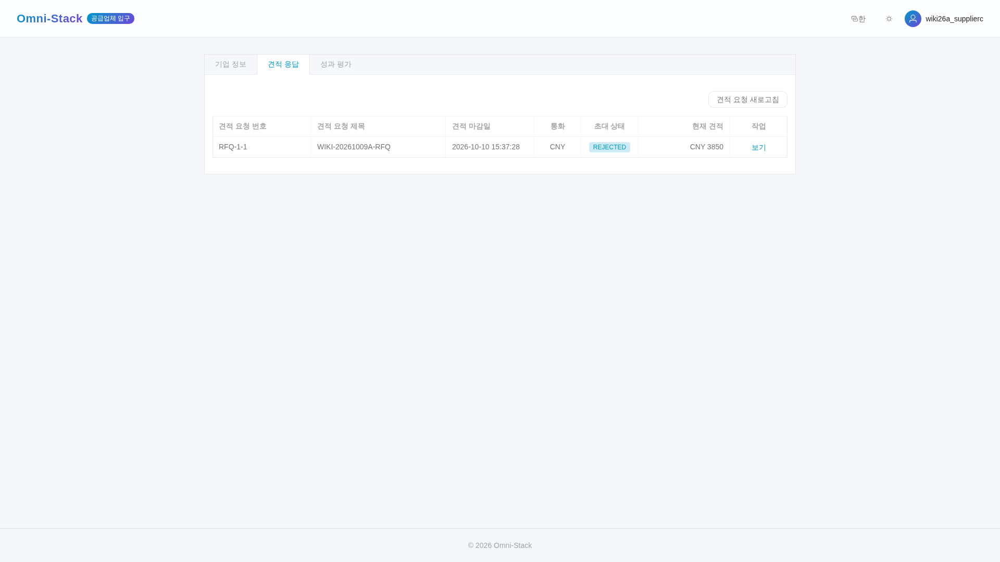

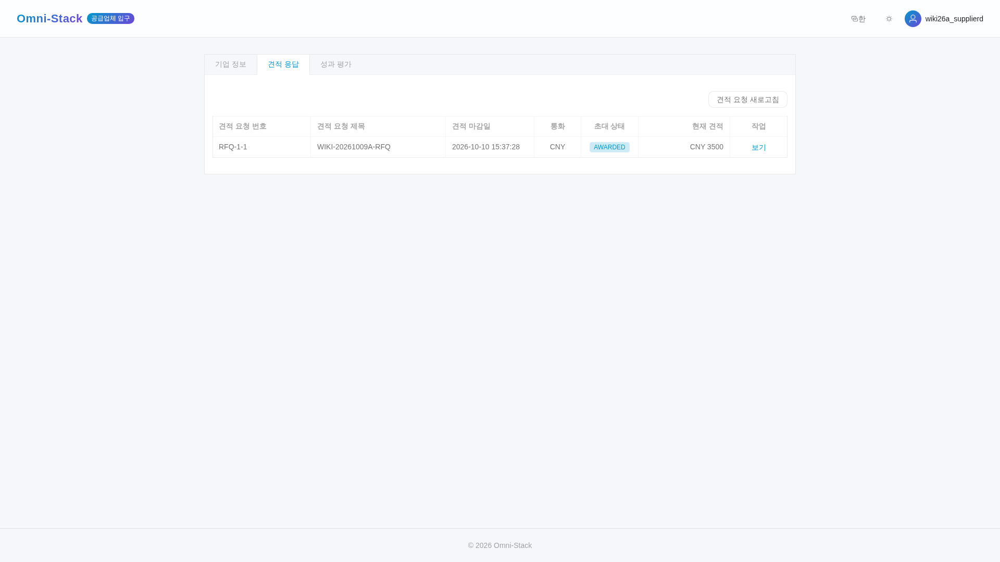

[읽기 전용 기록](../reference/evidence/procurement-quotation-2026-10-12.json)은 일반 역할, 버전, 금액, 원본 이미지 해시를 연결합니다. 단가는 실제 응답과 상세 입력 컨트롤 검증으로 확인하며 공개 목록 이미지는 보이는 합계와 결과만 증명합니다. 공급업체 이미지는 제품의 테마 버튼으로 밝은 모드로 전환했습니다. 긴 일본어 표 머리글은 열 안에서 줄 바꿈됩니다. 원본 31장을 개별 검토해 12장을 공개하고, 렌더링 불완전한 7장은 제외했으며, 읽을 수 있지만 중복인 상세 12장은 비공개 기록에 보관했습니다. 업무 쓰기는 재실행하지 않았습니다. 이 원본 31장 검토는 2026-10-12에 수행했습니다. 이번에 새로 확인한 원본 20장과 다시 열지 않은 나머지 40장은 이번 검토 범위에 구분해 기록했습니다.
