# 구매 요청, RFQ, 견적, 주문과 입고 전체 흐름

Procurement는 품목, 구매 요청 승인 규칙, 요청, RFQ, 견적, 구매 주문과 입고를 소유합니다. 승인 런타임은 `omni-workflow`에 있으며 Procurement는 Flowable에 직접 의존하지 않습니다.

> 본 가이드의 스크린숏은 WP006 실제 메인 체인 검수 환경(fixture `wp006-real-chain-v1`)에서 촬영되었습니다: WP005 실제 자재 2건 → 구매 요청 PR-1-1 실제 워크플로 승인(10000 CNY) → RFQ-1-1 2개 공급사 실제 견적 → 비교와 선정 → 구매 주문 PO-1-1 → 3개 입고 전표와 2가지 검사 상태. 모든 촬영은 읽기 전용이며 `omni-frontend/e2e-docs/flows/wp006-visual.flows.spec.ts`로 4개 언어로 실제 촬영(68 테스트 전부 통과)했고 데이터 쓰기는 없습니다.

## 1. 종단 간 흐름

```text
품목 유지 → 승인 규칙 설정 → 구매 요청과 승인 → RFQ 생성
→ 공급업체 초대 → 견적 수신과 비교 → 주문 → 확인 → 입고
```

각 단계는 독립 상태 머신을 가지며 DB 상태 변경으로 선행 단계를 건너뛰지 않습니다.

### 스크린숏

#### 그림 1 `procurement-overview-ko-KR`: 조달 개요

- 전제 조건: `procurement:overview:list` 권한을 가진 조달 관리자로 로그인
- 작업자: 조달 관리자
- 작업: 조달 실행 관리 → 조달 개요 열기
- 예상 결과: 메인 영역에 '조달 개요' 제목과 통화별 집계가 표시되고, 실제 체인은 수령 완료 주문 1건·확정 구매 커밋먼트 CNY 9000.0000

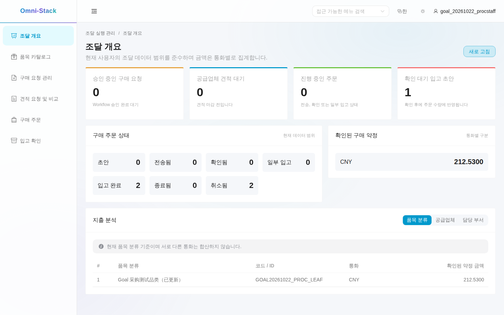

## 2. 품목

카테고리와 품목은 테넌트 공유 마스터입니다. 코드, 이름, 카테고리, 단위, 자산 관리 플래그와 자산 수량 의미를 가집니다. 삭제 전에 참조를 확인합니다. 합격한 자산 관리 품목만 자산 후보를 생성하고 `assetQuantity`는 정확한 양의 정수입니다.

### 스크린숏

#### 그림 2 `procurement-material-list-ko-KR`: 자재 카탈로그 목록

- 전제 조건: 자재 카탈로그 조회 권한을 가진 조달 관리자로 로그인
- 작업자: 조달 관리자
- 작업: 조달 실행 관리 → 자재 카탈로그 열기
- 예상 결과: 목록에 WP005 실제 자재 2건(자산 관리 있음·없음 각 1) 표시

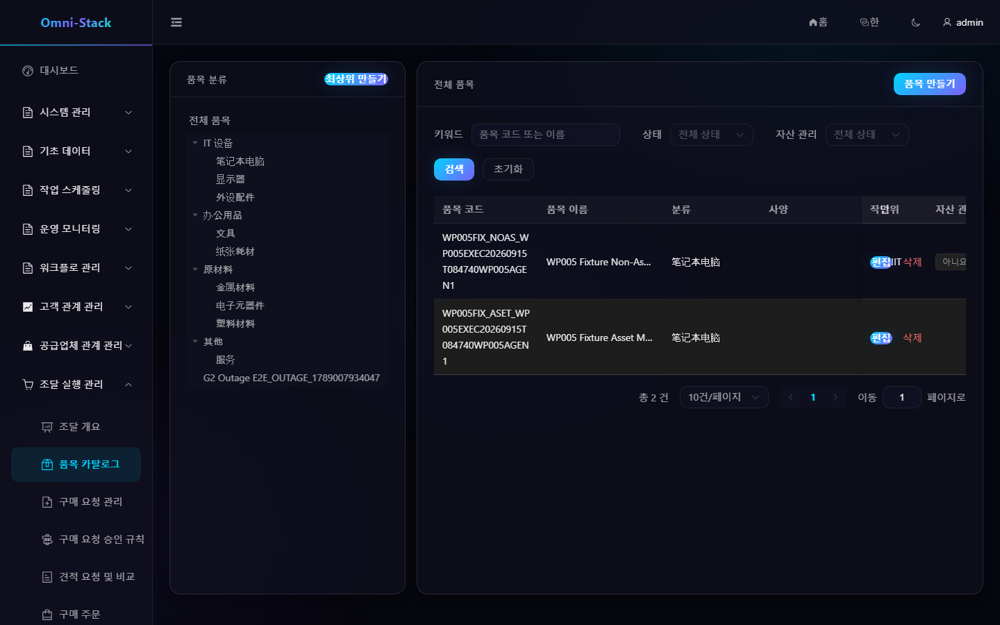

#### 그림 3 `procurement-forbidden-403-ko-KR`: 권한 없는 접근 거부

- 전제 조건: 조달 권한이 없는 일반 직원으로 로그인
- 작업자: 일반 직원
- 작업: 자재 카탈로그 라우트에 직접 접근
- 예상 결과: 빈 목록이 아닌 403 거부 페이지를 표시하고 데이터를 노출하지 않음

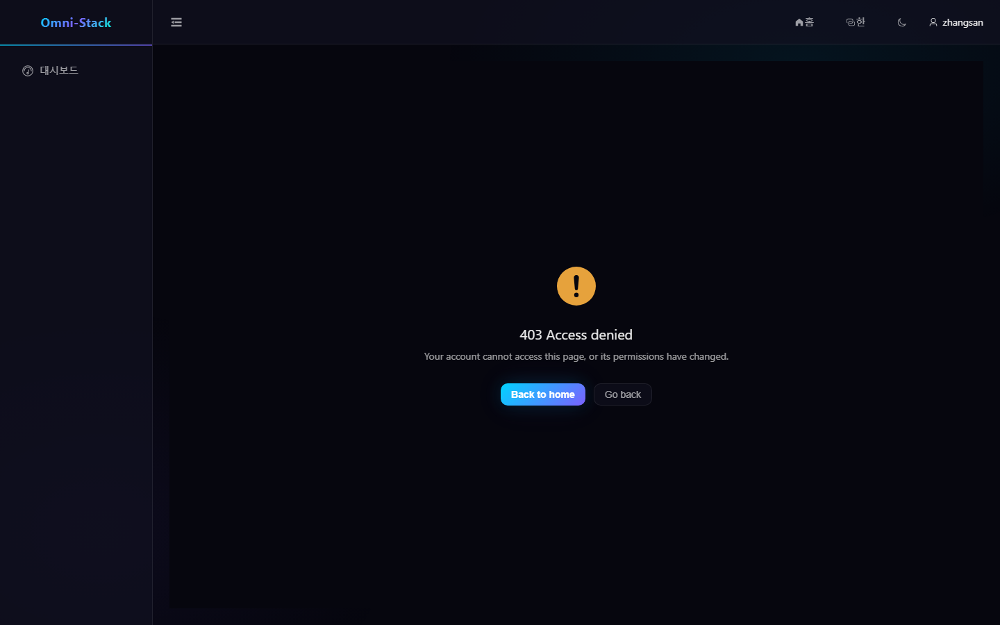

## 3. 구매 요청 승인 규칙

카테고리/기본 범위, 하한 포함·상한 제외 금액 구간, 현재 게시된 조달 승인 흐름을 선택합니다. 실제 경로를 미리 보고 "시험"에서 카테고리와 금액을 서버 해석기에 전달합니다. 커버리지 공백이나 충돌을 해결한 뒤 활성화하며 중지·삭제 전에 새 공백을 표시합니다.

### 스크린숏

#### 그림 4 `procurement-approval-rules-ko-KR`: 승인 규칙 진입

- 전제 조건: `procurement:approval-route:list` 권한을 가진 조달 관리자로 로그인
- 작업자: 조달 관리자
- 작업: 조달 실행 관리 → 구매 요청 승인 규칙 열기
- 예상 결과: 메인 영역에 '구매 요청 승인 규칙' 제목, 실제 LAPTOP 3금액 구간 규칙, 시험 테스터, 커버리지 위험 카드가 표시됨

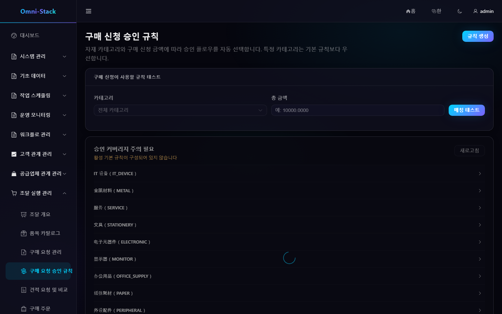

#### 그림 5 `procurement-approval-rules-mobile-ko-KR`: 390×844 반응형

- 전제 조건: 그림 4와 동일
- 작업자: 조달 관리자
- 작업: 같은 화면을 390×844로 열기
- 예상 결과: 가로 스크롤 없이 핵심 문안이 완전하게 표시됨

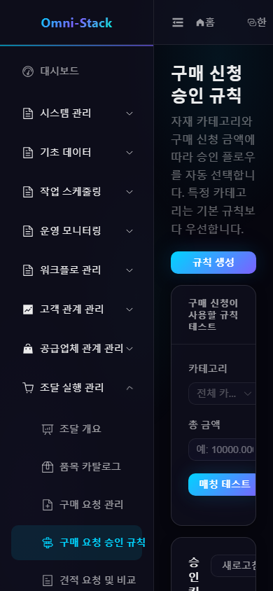

#### 그림 6 `procurement-approval-rules-tablet-ko-KR`: 1024×768 반응형

- 전제 조건: 그림 4와 동일
- 작업자: 조달 관리자
- 작업: 같은 화면을 1024×768로 열기
- 예상 결과: 레이아웃이 적응하고 기능 진입점이 완전함

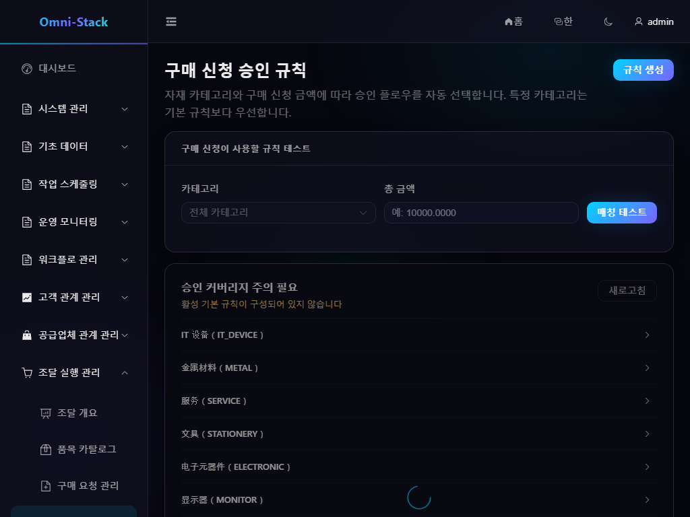

#### 그림 7 `procurement-rule-match-success-ko-KR`: 시험 성공

- 전제 조건: 그림 4와 동일
- 작업자: 조달 관리자
- 작업: 시험 테스터에서 카테고리 "노트북"·금액 5000을 입력해 서버 시험 실행(읽기 전용 해석, 객체 생성 없음)
- 예상 결과: MATCHED로 WP006FIX-LAPTOP-small(0 ≤ x < 10000)와 실제 승인 경로 표시

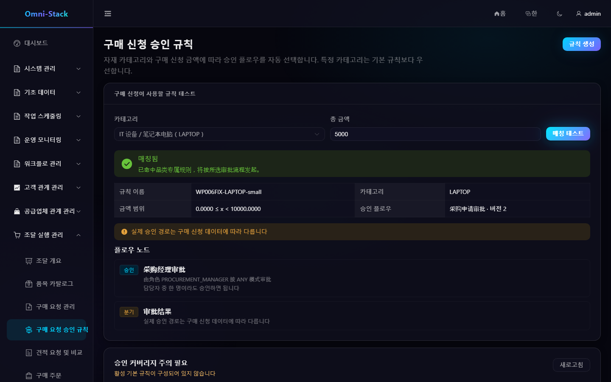

## 4. 구매 요청

초안은 요청자, 조직, 용도, 상세를 가집니다. 제출 후 중요 필드를 잠그고 영구 멱등 시작 요청으로 Workflow를 시작합니다. `START_FAILED`는 중복 프로세스 없이 재시도합니다. 승인, 거절, 철회, 취소는 도메인 규칙을 따릅니다.

본 검수 환경의 구매 요청 PR-1-1(10000 CNY)은 실제 Workflow로 승인되었습니다(APPROVED, 승인 코멘트 WP006 main chain approval).

### 스크린숏

#### 그림 8 `procurement-requisition-list-ko-KR`: 구매 요청 목록

- 전제 조건: 조달 관리자로 로그인
- 작업자: 조달 관리자
- 작업: 조달 실행 관리 → 구매 요청 열기
- 예상 결과: 목록에 실제 PR-1-1(APPROVED) 표시

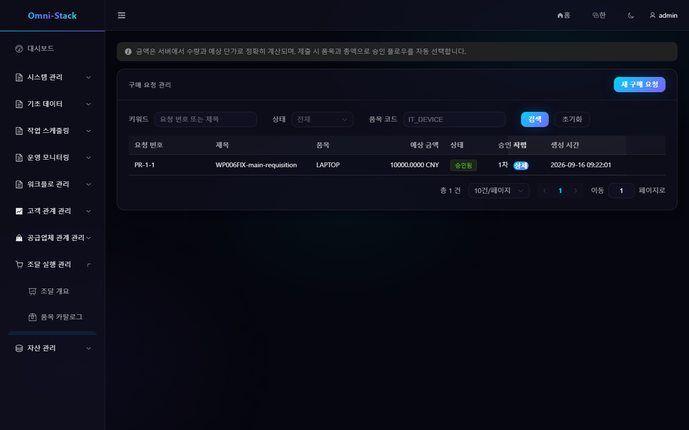

#### 그림 9 `procurement-requisition-detail-ko-KR`: 구매 요청 상세 서랍

- 전제 조건: 그림 8과 동일
- 작업자: 조달 관리자
- 작업: PR-1-1 행의 '상세' 서랍 열기
- 예상 결과: 승인 attempt, Workflow 프로세스 인스턴스 ID, 내역 표시

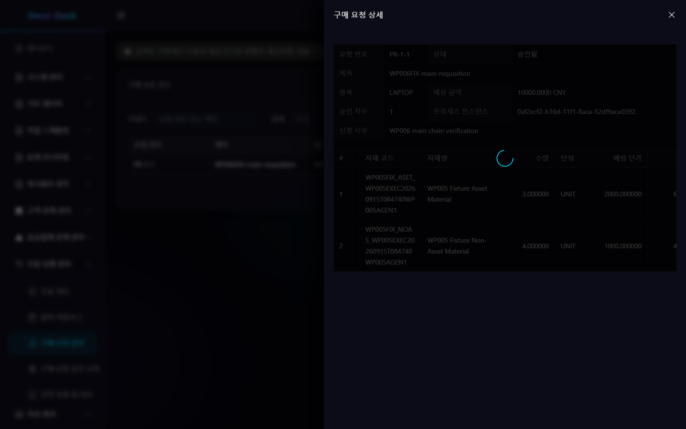

## 5. RFQ와 견적

승인된 수요에서 RFQ를 만들고 활성 공급업체에 보냅니다. Portal 견적은 신뢰성 메시지로 도착하며 이벤트 ID로 멱등 처리합니다. 가격, 세금, 납기, 메모를 비교하고 통화, 세금 기준, 마감, 공급업체 자격을 확인해 선정합니다.

본 검수 환경의 RFQ-1-1은 2개 실제 공급사에 발송되어 견적을 수신했고, 낙찰 견적은 #2 / v1입니다. 선정 후 비교 입구가 숨겨지며 상세 서랍은 견적 접수와 비교 선정 결과를 선정 스냅샷으로 표시합니다.

### 스크린숏

#### 그림 10 `procurement-rfq-list-ko-KR`: RFQ 목록

- 전제 조건: 조달 관리자로 로그인
- 작업자: 조달 관리자
- 작업: 조달 실행 관리 → 견적 요청 열기
- 예상 결과: 목록에 실제 RFQ-1-1(선정됨) 표시

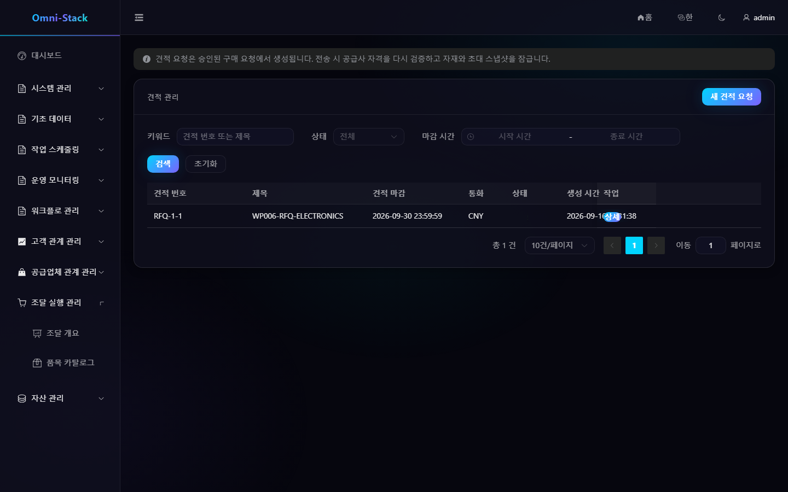

#### 그림 11 `procurement-rfq-detail-award-ko-KR`: RFQ 상세와 선정 스냅샷

- 전제 조건: 그림 10과 동일
- 작업자: 조달 관리자
- 작업: RFQ-1-1 행의 '상세' 서랍 열기
- 예상 결과: 2개 공급사 견적 ID와 낙찰 견적 #2 / v1(비교 의미 면과 선정 스냅샷을 한 그림에 표시)

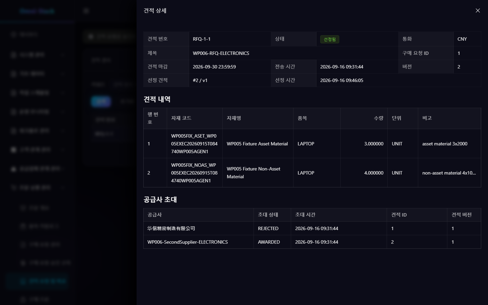

#### 그림 12 `procurement-portal-quotation-record-ko-KR`: 포털 견적 기록

- 전제 조건: 낙찰 공급사 계정(supplier2)으로 로그인
- 작업자: 공급업체
- 작업: 공급업체 포털 → 견적 응답 탭 열기
- 예상 결과: 이번 라운드 실제 견적 기록 RFQ-1-1(현재 CNY 9000, 선정됨) 표시

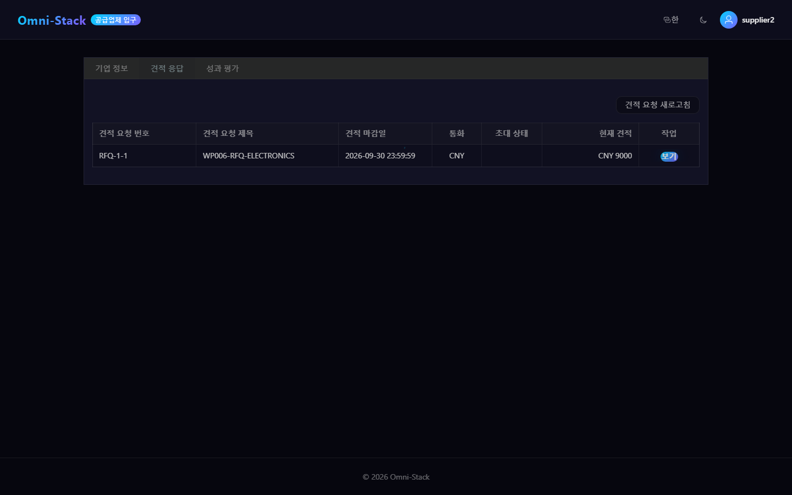

## 6. 구매 주문

선정 결과는 초안, 발송, 공급업체 확인, 부분 입고, 전체 입고, 취소로 진행합니다. 발송 후 주요 조건을 보호하고 취소 전에 기존 입고를 확인합니다.

본 검수 환경의 PO-1-1(9000 CNY)은 2개 내역 모두 주문 수량대로 입고 완료(RECEIVED)입니다.

### 스크린숏

#### 그림 13 `procurement-purchase-order-list-ko-KR`: 구매 주문 목록

- 전제 조건: 조달 관리자로 로그인
- 작업자: 조달 관리자
- 작업: 조달 실행 관리 → 구매 주문 열기
- 예상 결과: 목록에 실제 PO-1-1(수령 완료) 표시

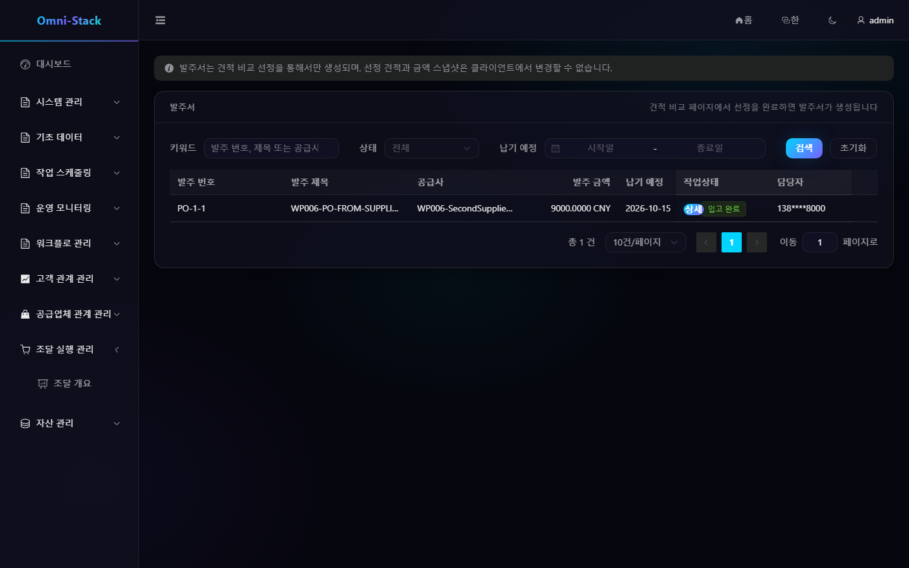

#### 그림 14 `procurement-purchase-order-detail-ko-KR`: 주문 상세 트래커

- 전제 조건: 그림 13과 동일
- 작업자: 조달 관리자
- 작업: PO-1-1 상세(주문 트래커) 열기
- 예상 결과: 2개 내역 행에 주문/수령 수량과 금액 표시

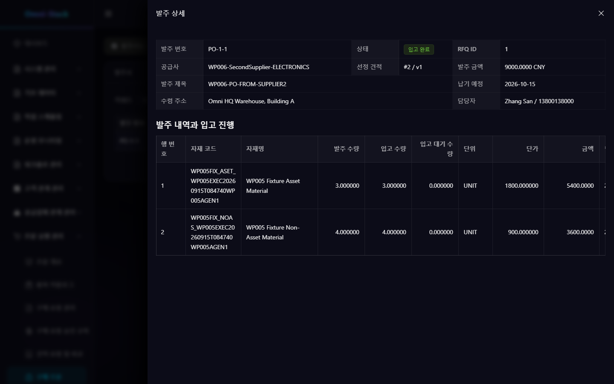

## 7. 입고

입고 전표는 실수령 수량·품질 상태·자산 수량을 행별로 기록합니다. `qualityStatus=PASS`, 자재가 `assetManaged=true`, 자산 수량이 정확한 양의 정수일 때만 자산 후보 이벤트를 발행합니다. 중복 제출·메시지 재전달·Asset 백필은 멱등하게 유지됩니다. 완료 후 조달 개요에서 주문과 입고 상태를 확인하고 자산 대장에서 실제 카드 생성 결과를 확인합니다.

본 검수 환경은 3개 실제 입고 전표(GR-1-1 / GR-1-2 / GR-1-3)를 생성했으며 GR-1-2는 실제 검사 2가지 상태(1행 불합격·1행 합격)를 보여줍니다.

### 스크린숏

#### 그림 15 `procurement-goods-receipt-list-ko-KR`: 입고 목록

- 전제 조건: 조달 관리자로 로그인
- 작업자: 조달 관리자
- 작업: 조달 실행 관리 → 입고 관리 열기
- 예상 결과: 목록에 실제 3전표 GR-1-1 / GR-1-2 / GR-1-3 표시

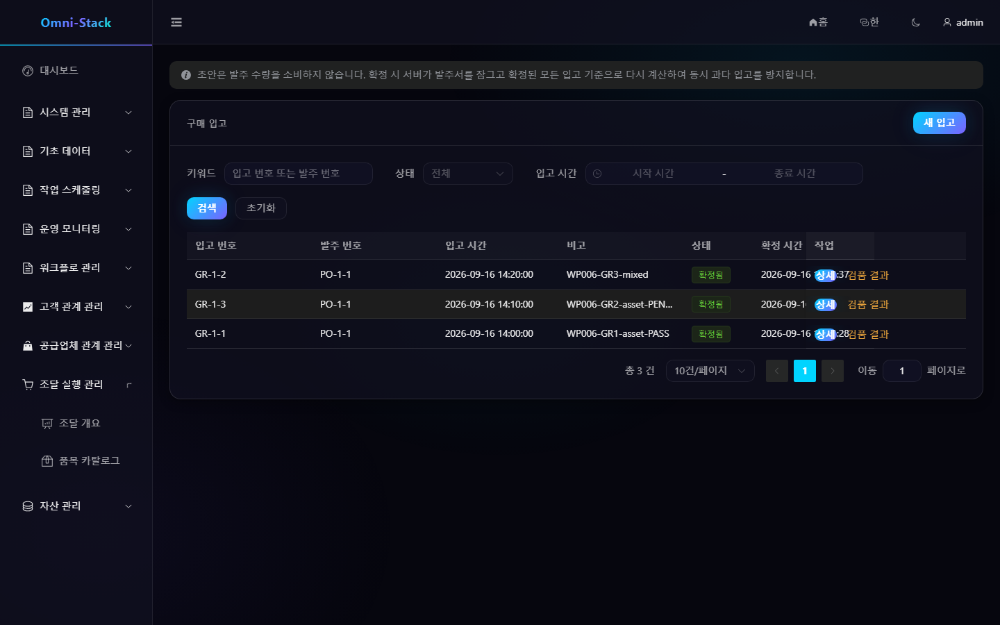

#### 그림 16 `procurement-goods-receipt-detail-quality-ko-KR`: 입고 상세와 검사 2가지 상태

- 전제 조건: 그림 15와 동일
- 작업자: 조달 관리자
- 작업: GR-1-2 상세 서랍 열기
- 예상 결과: material1 행 불합격·material2 행 합격의 실제 검사 결과와 자산 관리 플래그

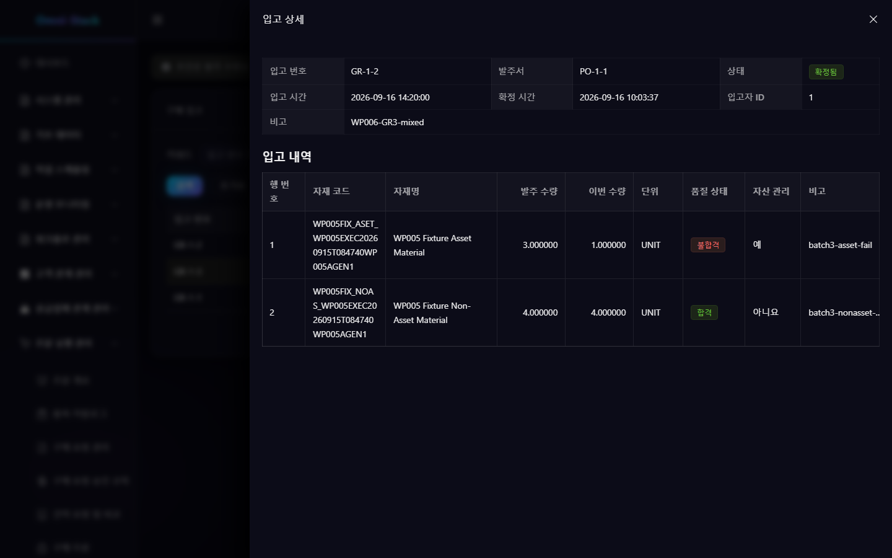

## 8. 권한과 진단

조달 관리자는 마스터와 규칙, 요청자는 보이는 요청, 구매 담당은 RFQ/주문/입고, 공급업체는 자기 Portal 정보만 다룹니다.

공급업체 계정이 조달 관리 라우트에 직접 접근하면 프런트 라우트 가드가 역할 도메인 분리로 공급업체 포털로 리다이렉트하며 관리 UI는 노출되지 않습니다.

### 스크린숏

#### 그림 17 `procurement-supplier-domain-isolation-ko-KR`: 공급업체 역할 도메인 분리

- 전제 조건: 공급업체 계정으로 로그인
- 작업자: 공급업체
- 작업: 조달 관리 라우트에 직접 접근
- 예상 결과: 라우트 가드가 공급업체 포털로 리다이렉트하고 관리 UI는 표시되지 않음

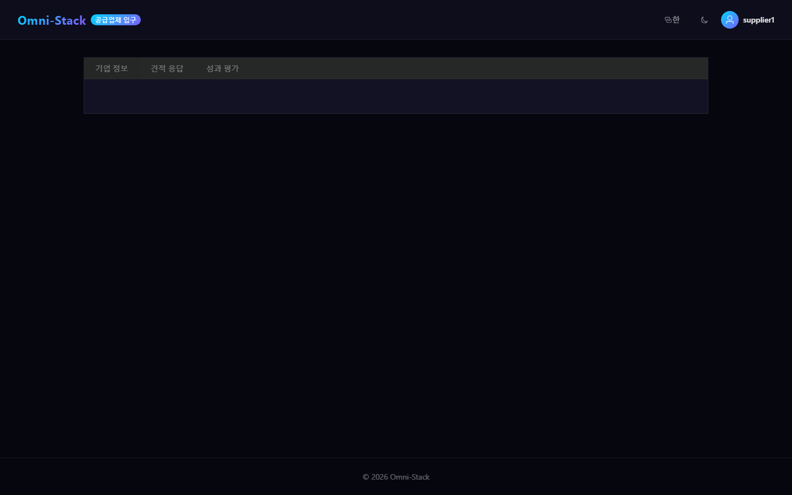

문서 번호, Workflow, Outbox, Inbox, Trace ID를 연결합니다. [Procurement 설계](../design/procurement-design.kr.md)를 참고하세요.
