# 采购申请、询价、报价、订单与收货完整业务流程

Procurement 负责物料目录、请购审批规则、请购、RFQ、报价汇聚、采购订单和收货。审批运行时始终位于 `omni-workflow`，采购服务不直接依赖 Flowable。

> 本文截图取自 WP006 真实主链验收环境（fixture `wp006-real-chain-v1`）：两类 WP005 基础物料 → 请购 PR-1-1 真实审批（10000 CNY）→ RFQ-1-1 双供应商真实报价 → 比价定标 → 采购订单 PO-1-1 → 三张收货单与两态质检。所有截图均为只读采集，由 `omni-frontend/e2e-docs/flows/wp006-visual.flows.spec.ts` 四语言实拍（68 项全部通过），无数据写入。

## 1. 端到端流程

```text
维护物料 → 配置审批规则 → 创建请购 → 提交审批 → 生成 RFQ
→ 邀请供应商 → 接收报价 → 比价定标 → 创建订单 → 供应商确认 → 收货
```

每一步都有独立状态机。不能通过修改数据库状态跳过前置步骤。

### 操作截图

#### 图 1 `procurement-overview-zh-CN`：采购概览

- 前置条件：以采购管理员身份登录，具备 `procurement:overview:list` 权限
- 操作者：采购管理员
- 操作：进入「采购执行管理 → 采购概览」
- 预期结果：主内容区显示「采购概览」标题，金额按币种隔离汇总；真实链路收货完成订单 1 笔、已确认采购承诺 CNY 9000.0000


## 2. 物料目录

物料分类和物料是租户共享基础数据。物料记录包含编码、名称、分类、单位、是否资产化和默认资产数量规则。删除前必须检查是否已被请购或采购单据引用。

资产化物料在收货合格时才产生资产候选事件。`assetQuantity` 必须是精确正整数，金额和数量按接口契约使用十进制字符串或明确精度。

### 操作截图

#### 图 2 `procurement-material-list-zh-CN`：物料目录列表

- 前置条件：以采购管理员身份登录，具备物料目录查看权限
- 操作者：采购管理员
- 操作：进入「采购执行管理 → 物料目录」
- 预期结果：列表显示两类真实 WP005 基础物料（资产化与非资产化各一）

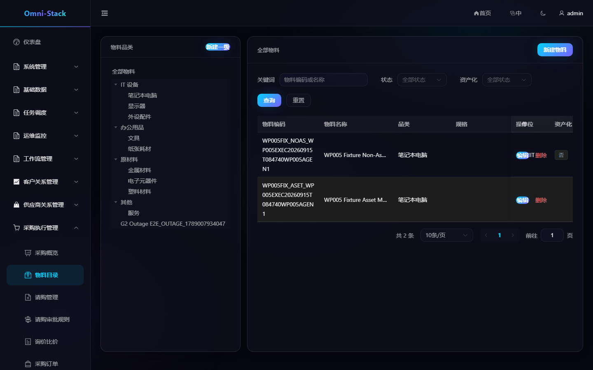

#### 图 3 `procurement-forbidden-403-zh-CN`：无权限访问拒绝

- 前置条件：以无采购权限的普通员工身份登录
- 操作者：普通员工
- 操作：直接访问物料目录路由
- 预期结果：呈现 403 无权访问拒绝页而非空列表，页面不泄露任何数据

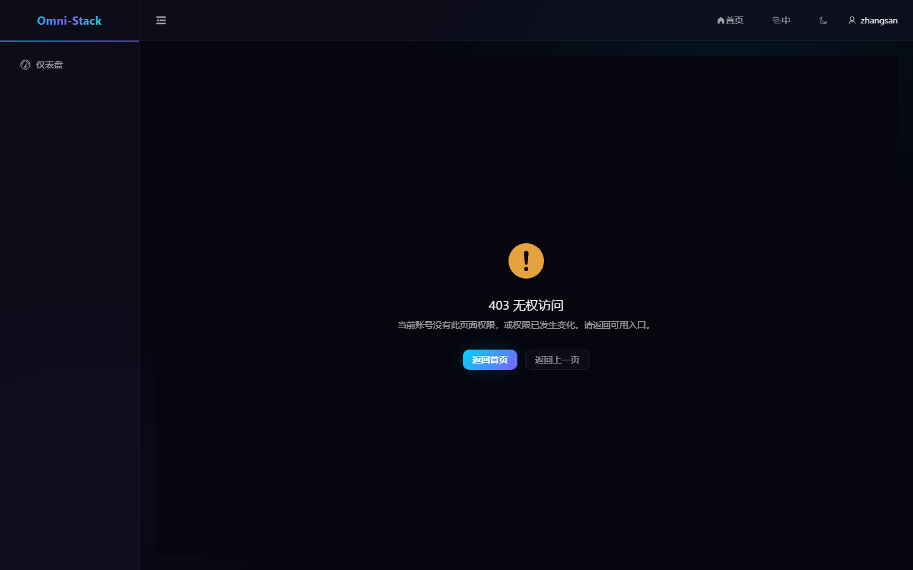

## 3. 请购审批规则

“请购审批规则”面向采购业务人员，不要求理解模型版本 ID。创建规则时：

1. 选择适用品类或默认范围。
2. 设置包含下限、不包含上限的金额区间。
3. 选择当前已发布的采购审批流程。
4. 查看真实审批路径预览。
5. 使用“先试一笔”输入品类和金额验证匹配结果。
6. 确认覆盖分析无断档或冲突后启用。

停用或删除前页面会展示新增断档和受影响范围。规则按服务端解析器匹配，前端不复制判断算法。

### 操作截图

#### 图 4 `procurement-approval-rules-zh-CN`：请购审批规则入口

- 前置条件：以采购管理员身份登录，具备 `procurement:approval-route:list` 权限
- 操作者：采购管理员
- 操作：进入「采购执行管理 → 请购审批规则」
- 预期结果：主内容区显示「请购审批规则」标题、真实 LAPTOP 品类三个金额区间规则、「先试一笔」与审批覆盖风险卡片

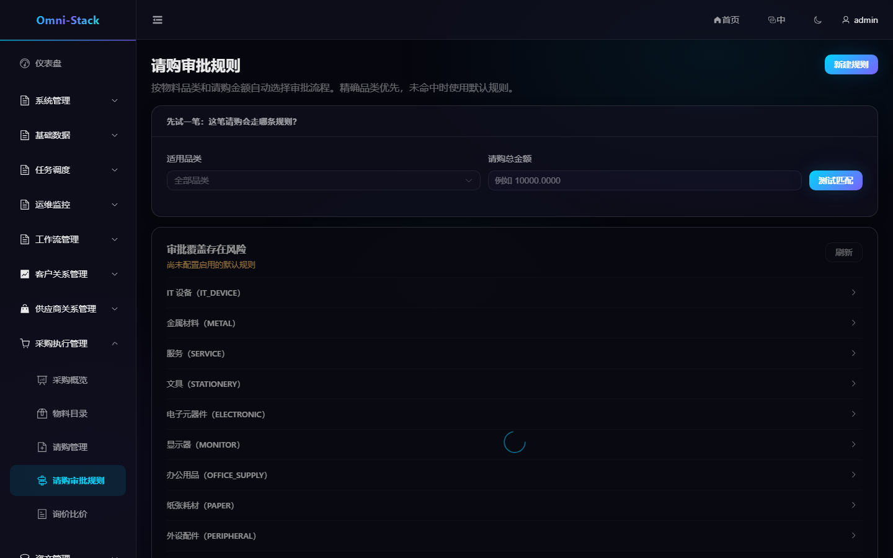

#### 图 5 `procurement-approval-rules-mobile-zh-CN`：390×844 响应式

- 前置条件：同图 4
- 操作者：采购管理员
- 操作：390×844 视口打开同一页面
- 预期结果：页面正常渲染无横向滚动，核心文案完整

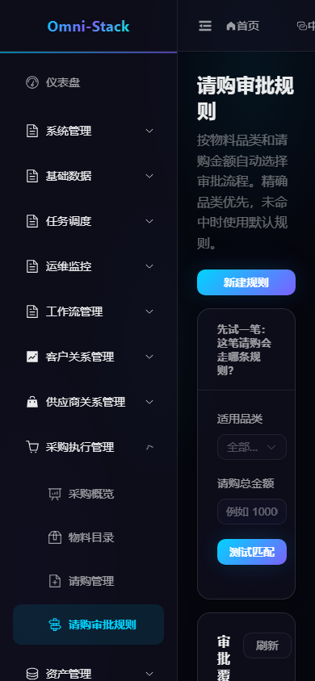

#### 图 6 `procurement-approval-rules-tablet-zh-CN`：1024×768 响应式

- 前置条件：同图 4
- 操作者：采购管理员
- 操作：1024×768 视口打开同一页面
- 预期结果：布局自适应，功能入口完整

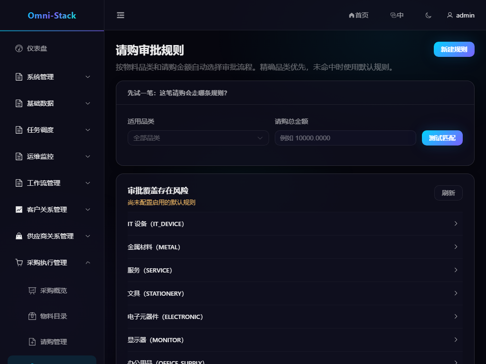

#### 图 7 `procurement-rule-match-success-zh-CN`：先试一笔服务端试算

- 前置条件：同图 4
- 操作者：采购管理员
- 操作：在「先试一笔」选择品类“笔记本电脑”、输入金额 5000 触发服务端试算（只读解析，不创建对象）
- 预期结果：MATCHED 命中 WP006FIX-LAPTOP-small（0 ≤ x < 10000）并展示真实审批路径

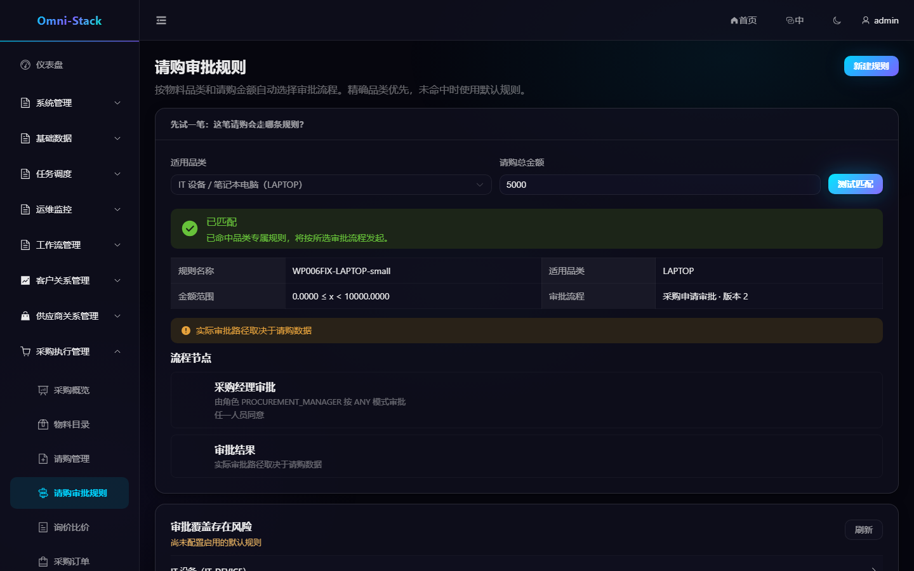

## 4. 请购

请购包含申请人、组织、用途和明细。草稿可编辑和删除；提交后锁定关键字段并启动 Workflow。启动使用持久化请求与重试协调，出现 `START_FAILED` 时可诊断重试，不能重复创建审批实例。

审批通过后请购进入可采购状态；拒绝、撤回或取消按领域规则恢复。申请人数据范围与 RFQ/订单负责人范围不同。

本验收环境的请购 PR-1-1（10000 CNY）经真实 Workflow 审批通过（APPROVED），审批意见 WP006 main chain approval。

### 操作截图

#### 图 8 `procurement-requisition-list-zh-CN`：请购列表

- 前置条件：以采购管理员身份登录
- 操作者：采购管理员
- 操作：进入「采购执行管理 → 请购管理」
- 预期结果：列表显示真实 PR-1-1（APPROVED）

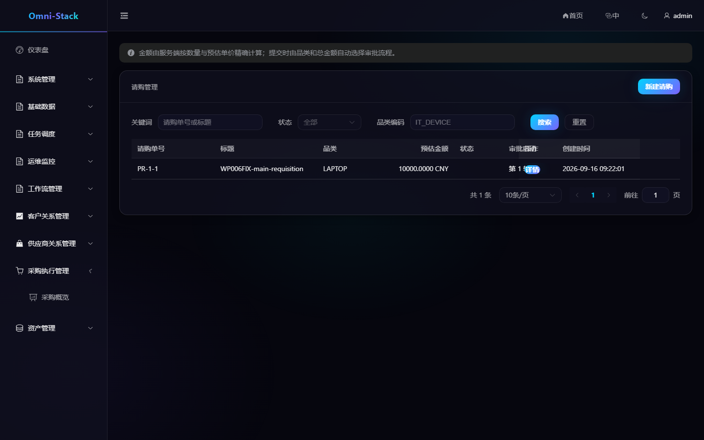

#### 图 9 `procurement-requisition-detail-zh-CN`：请购详情抽屉

- 前置条件：同图 8
- 操作者：采购管理员
- 操作：打开 PR-1-1 行「详情」抽屉
- 预期结果：显示审批 attempt、Workflow 流程实例 ID 与明细行


## 5. RFQ 与供应商报价

从已批准请购创建 RFQ，选择有效供应商并发送。供应商在 Portal 提交报价后，SRM 通过可靠消息通知 Procurement。消费者按事件 ID 幂等更新报价。

比价视图比较价格、税率、交期和备注。业务人员定标前应确认币种、含税口径、截止状态和供应商有效性。取消或截止的 RFQ 拒绝新报价。

本验收环境的 RFQ-1-1 向两家真实供应商发送并收到报价，定标结果为中标报价 #2 / v1。定标后比价入口收起，详情抽屉以定点快照呈现报价接收与比价定标结果。

### 操作截图

#### 图 10 `procurement-rfq-list-zh-CN`：询价比价列表

- 前置条件：以采购管理员身份登录
- 操作者：采购管理员
- 操作：进入「采购执行管理 → 询价比价」
- 预期结果：列表显示真实 RFQ-1-1（已定标）

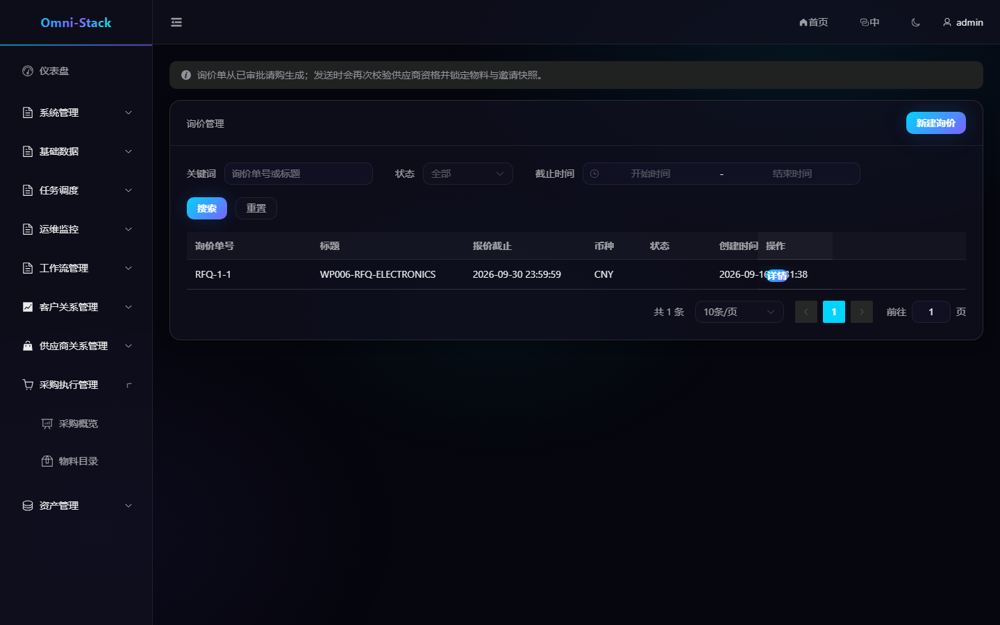

#### 图 11 `procurement-rfq-detail-award-zh-CN`：RFQ 详情与定点快照

- 前置条件：同图 10
- 操作者：采购管理员
- 操作：打开 RFQ-1-1 行「详情」抽屉
- 预期结果：显示两供应商报价 ID 与中标报价 #2 / v1 定点结果（比价定标语义面与定点快照同图呈现）

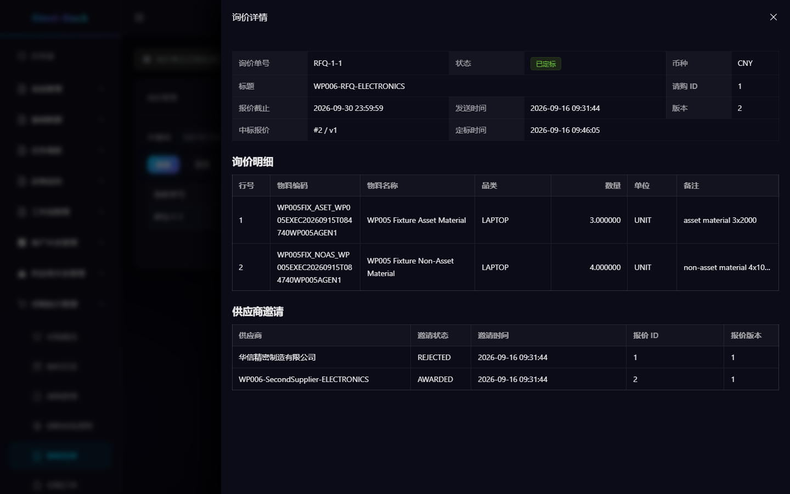

#### 图 12 `procurement-portal-quotation-record-zh-CN`：供应商门户报价记录

- 前置条件：以中标供应商账号（supplier2）登录
- 操作者：供应商
- 操作：进入「供应商门户 → 询价报价」页签
- 预期结果：显示本轮真实报价记录 RFQ-1-1（当前报价 CNY 9000，已中标）

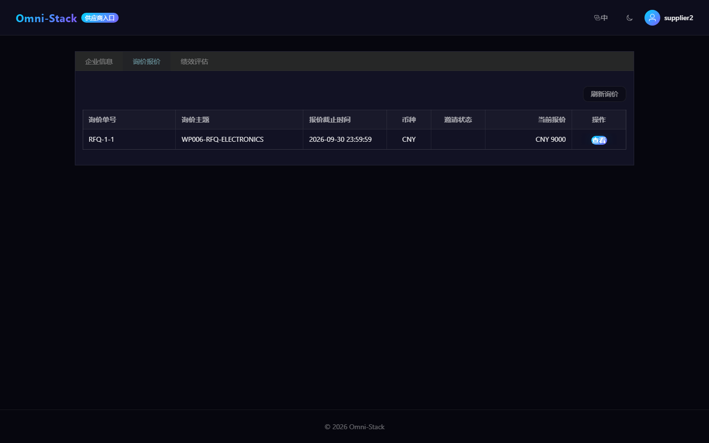

## 6. 采购订单

定标后创建采购订单。订单从草稿到发送、供应商确认、部分收货、全部收货或取消。发送后关键价格与供应商不能随意修改；取消需要检查是否已有收货。

本验收环境的 PO-1-1（9000 CNY）两行明细均已按订单数量完成收货（RECEIVED）。

### 操作截图

#### 图 13 `procurement-purchase-order-list-zh-CN`：采购订单列表

- 前置条件：以采购管理员身份登录
- 操作者：采购管理员
- 操作：进入「采购执行管理 → 采购订单」
- 预期结果：列表显示真实 PO-1-1（已收货）

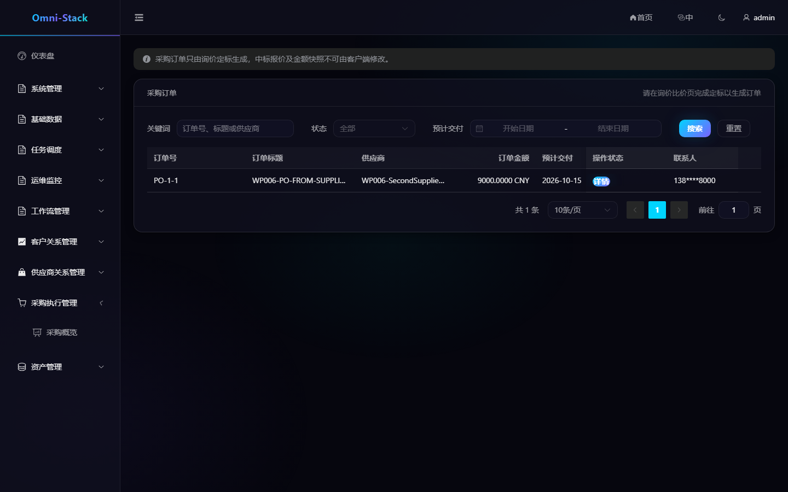

#### 图 14 `procurement-purchase-order-detail-zh-CN`：订单详情跟踪器

- 前置条件：同图 13
- 操作者：采购管理员
- 操作：打开 PO-1-1 详情（订单跟踪器）
- 预期结果：两行明细展示订单数量、已收数量与金额

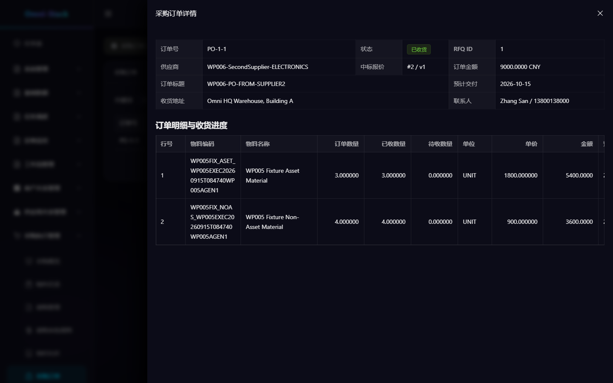

## 7. 收货

收货单逐行记录实收数量、质量状态和资产数量。只有 `qualityStatus=PASS`、物料 `assetManaged=true` 且资产数量为精确正整数时，才发布资产候选事件。

重复提交、消息重投和 Asset 回填都必须保持幂等。完成后在采购概览核对订单与收货状态，在资产台账核对实际建卡结果。

本验收环境生成三张真实收货单（GR-1-1 / GR-1-2 / GR-1-3），其中 GR-1-2 呈现真实质检两态（一行不合格、一行合格）。

### 操作截图

#### 图 15 `procurement-goods-receipt-list-zh-CN`：收货单列表

- 前置条件：以采购管理员身份登录
- 操作者：采购管理员
- 操作：进入「采购执行管理 → 收货管理」
- 预期结果：列表显示三张真实收货单 GR-1-1 / GR-1-2 / GR-1-3

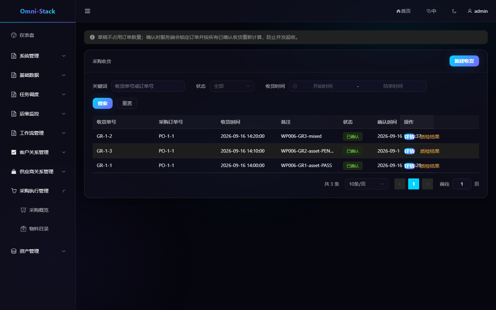

#### 图 16 `procurement-goods-receipt-detail-quality-zh-CN`：收货详情与质检两态

- 前置条件：同图 15
- 操作者：采购管理员
- 操作：打开 GR-1-2 详情抽屉
- 预期结果：material1 行不合格、material2 行合格的真实质检结果与资产化标记

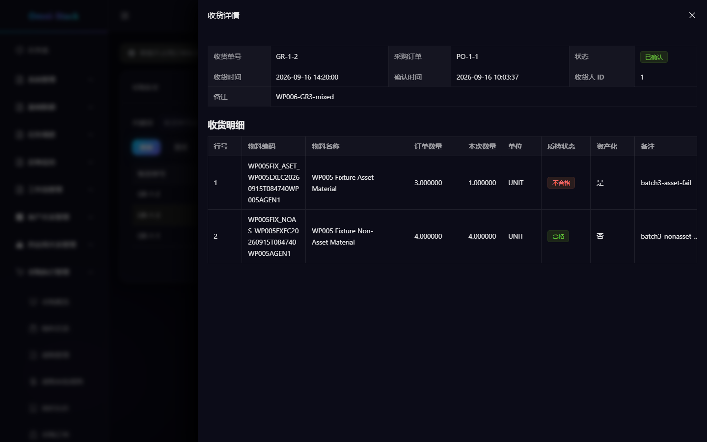

## 8. 权限与排查

- 采购管理员维护物料和审批规则。
- 申请人创建并查看自己或组织范围内的请购。
- 采购负责人管理 RFQ、订单和收货。
- 供应商只在 Portal 查看自己的邀请和报价。

供应商账号直接访问采购管理路由时，前端路由守卫按角色域隔离将其重定向回供应商门户，管理界面不向供应商泄露。

### 操作截图

#### 图 17 `procurement-supplier-domain-isolation-zh-CN`：供应商角色域隔离

- 前置条件：以供应商账号登录
- 操作者：供应商
- 操作：直接访问采购管理路由
- 预期结果：路由守卫重定向回供应商门户，不出现管理界面内容

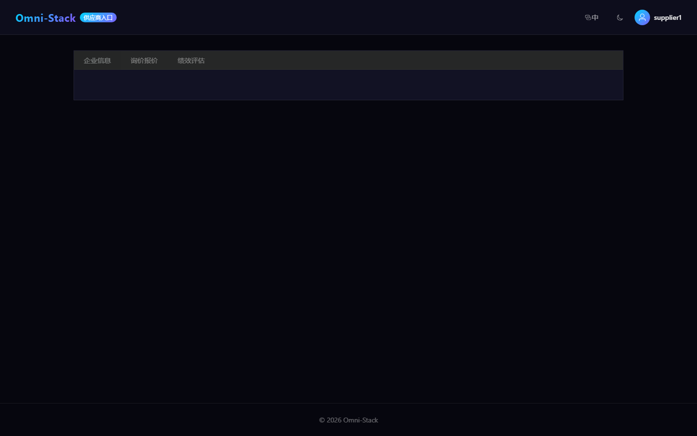

跨服务问题按业务单号、Workflow 实例 ID、Outbox 消息 ID、Inbox 事件 ID 和 Trace ID 排查。详细约束见 [Procurement 设计](../design/procurement-design.md)。
