# 从空业务环境走通采购到收货

适用基线：主干 fc165e3 及本次文档分支；需要 supply-chain 或 full。先完成[启动与首次登录](quick-start.md)、[SRM 准入](srm-flow.md)和[教学数据边界](../wiki/data-and-fixtures.md)。业务成功记录来自 2026-10-09 的独立本机 Docker 教学执行：请购审批、双供应商报价、定标、两批收货和 2 张来源资产卡核对；2026-10-12 的只读检查复用这些记录。本轮只复核文档、当前源码和已有证据，没有重新执行业务链路，历史结果不证明当前产物已完成综合验收。

验收按[已授权 AI 复核政策](../adr/0003-authorized-ai-translation-review.md)执行，实际 AI 语义复核通过即可，不要求人工翻译复核。[本轮复核范围](../reference/evidence/procurement-guide-review-2026-10-17.json)区分源码、原图和历史执行。旧执行因镜像仓库 DNS/认证失败使用缓存基础镜像验证，未证明正式生产基础镜像构建通过。

## 1. 先准备身份、分类与记录表

所有身份处于同一教学租户。默认租户为 1，但不要把默认值套到其他环境。正式种子提供分类、币种和角色，不提供本页的请购、订单、报价或收货记录。

| 身份 | 准备与职责 |
|---|---|
| 引导管理员 | 使用正式用户/角色/组织页面建立教学身份，配置审批模型和规则 |
| 申请人 | 分配 PROCUREMENT_STAFF；设置一个主组织，创建自己的请购 |
| 采购经理/审批人 | 分配 PROCUREMENT_MANAGER；与申请人处于同一主组织，出现在实际候选人预览中 |
| 供应商 A、B | 通过 SRM 邀请、Portal 注册与入驻 Saga，完成准入；均为 APPROVED，具有 SUPPLIER 和有效门户关联 |
| 资产管理员/使用人 | 继续[资产教程](asset-flow.md)；领取与接受使用各自身份 |

默认采购模型采购审批节点使用 PROCUREMENT_MANAGER + START_USER_PRIMARY_UNIT + SAME_UNIT。SUPER_ADMIN 功能权限不意味着自动成为审批候选人。先验证候选人，再发起实例；不要把“没有候选人”误判为采购接口故障。

为本次操作选择唯一前缀 `WIKI-{run-id}`。保存一份仓库外的教学记录表：租户、身份、组织、物料 ID、规则/模型版本、请购 ID/单号/version、RFQ ID/明细 ID、报价 ID/version、PO ID/明细 ID、GR ID/明细 ID、资产 ID。每次响应刷新 version。ID 来自实际返回，不能抄历史图片中的数字。

10 月 12 日的经理身份同时持有 USER、PROCUREMENT_MANAGER、ASSET_MANAGER、TEAM_LEADER、WIKI_20261009A_WORKFLOW_DESIGNER；证据说明该实际身份的有效权限，不是只授予一个角色的隔离实验。

## 2. 建立两种教学物料

进入「采购执行管理 → 物料目录」，由采购经理新建本次独有分类，使用大写字母与数字编码，如 `WIKICAT{run}`，记录实际 categoryId/categoryCode。两种物料都放在**同一教学分类**；单张请购混用分类返回 409。准入后的两个教学供应商也设置这个 categoryCode，以便按分类检索；不覆盖他人的供应商。

| 记录 | materialCode / 名称前缀 | 单位 | assetManaged | 数量 | 预估单价 |
|---|---|---|---|---|---|
| A | WIKI-{run-id}-A / 教学样机 | PCS | true | 3 | 1000.0000 |
| B | WIKI-{run-id}-B / 教学配件 | PCS | false | 10 | 100.0000 |

物料均启用 ACTIVE。创建后刷新列表，按编码确认只存在各一条。接口字段见[物料 API](../../omni-frontend/src/api/procurement-material.ts)。价格和数量在接口中为十进制字符串；教学请购总额应为 CNY 4000.0000。教学分类是本例的共同分类，不决定是否建卡；建卡还要检查 assetManaged 和质检结果。

## 3. 发布审批模型并启用规则

在「审批流程管理 → 流程模型」查找 procurement-approval，先检查当前发布版本。标准引导程序通常已发布必需业务模型；有有效发布版时直接记录。需要修改时另存草稿，检查候选配置、校验并发布新版。角色、主组织和 Workflow 组织作用域是不同配置，按[教学数据](../wiki/data-and-fixtures.md)核对候选人绑定。

在「采购执行管理 → 请购审批规则」建立本次教学分类规则，金额范围 `[0, 10000)`，选择当前发布版本。「先试一笔」输入实际 categoryCode 与 4000，预期 MATCHED、模型 AVAILABLE、候选人正确；查看覆盖分析后启用。复用已有规则时核对范围与版本，不覆盖他人的配置。重叠或断档按实际分析处理。

命中试算只检查规则与模型可用性，不会启动审批，也不证明当前用户就是实际候选人；仍需按申请人主组织核对资格。首次访问尚未初始化的租户时，后端可能幂等建立默认配置和分类；旧租户只读回执不能推导所有新租户访问均零写入。

## 4. 申请人创建并提交请购

1. 用申请人账号进入「请购申请」，创建 WIKI-{run-id}-PR，选择 A、B，填上表数量与预估价格。
2. 保存草稿：预期 DRAFT、币种 CNY、总额 4000.0000，记录真实 ID/单号/version。
3. 提交：预期进入提交/审批过程，workflowStartStatus 最终 STARTED；记录 processInstanceId。
4. 采购经理进入自己的「待办任务」，打开该请购，核对金额与明细后通过。等待采购详情最终 APPROVED。

提交返回不代表跨服务审批已结束。仅当 status=SUBMITTED 且 workflowStartStatus=FAILED 时，先排查模型、候选人和 MQ/Workflow，刷新详情，用当前 version 执行「重试启动」；服务复用原审批轮次、请求和模型快照。不要重新提交或另建请购掩盖结果不明的上一笔。

另建带本次前缀的草稿练习拒绝和撤回/取消：由实际候选人拒绝后核对 REJECTED；取消按页面当前状态允许的动作执行。主链使用已通过的那笔，拒绝单不能拿来创建 RFQ。

## 5. 发询价，让两个供应商分别报价

1. 采购人员由 APPROVED 请购创建 WIKI-{run-id}-RFQ，设置未来的报价截止时间，选择已准入的 A、B 供应商并保存。
2. 核对 DRAFT、请购来源、币种和明细，再发送，预期 SENT。
3. 供应商 A、B 各自登录「供应商门户 → 询价报价」，只打开自己的邀请，逐行填报价、交付天数和有效期并提交。
4. 本例供应商 A 报 A=950.0000、B=100.0000，总额 3850.0000；供应商 B 报 A=900.0000、B=80.0000，总额 3500.0000。
5. 采购人员刷新比较视图，直到出现两个实际 quotationId/version、相同 CNY 和正确总额。报价异步汇聚，Portal 成功响应不等于采购侧已消费事件。

报价按本次 RFQ 明细 ID 填写。供应商不能读取另一供应商的邀请或报价。超期、已取消等状态拒绝新报价，不能修改数据库绕过限制。

## 6. 定标和记录订单确认

采购人员在比价页选择供应商 B 当前报价版本，填写教学收货地址和虚构联系人，提交定标。`award` 响应同时包含 RFQ 和新建 PO：预期 RFQ=AWARDED、PO=DRAFT、总额 3500.0000。直接记录返回的 PO，不再重复创建订单。请求须同时携带当前 `rfqVersion`、所选 `quotationId` 和对应 `quotationVersion`；旧版本冲突后先核对既有定标与 PO 副作用，再决定下一步。

发送 PO 后为 SENT。**当前项目由有权限的采购管理端记录供应商已确认**：核实业务确认后，采购人员执行「确认」，预期 CONFIRMED；供应商门户目前承担询价报价，没有独立的 PO 确认按钮。本页不把管理端动作写成供应商 Portal 操作。权限为 procurement:purchase-order:confirm，同时受数据范围约束。

## 7. 分两批收货，验证质检与建卡

使用返回的 poLineId 建立两张草稿收货单；每张保存后还要执行「确认」。日期时间为 `yyyy-MM-dd HH:mm:ss`。

| 批次 | A 物料实收/质检 | B 物料实收/质检 | 预期 |
|---|---|---|---|
| GR-1 | 1 / FAIL | 10 / PASS | 订单 PARTIAL_RECEIVED；两行均不建资产卡 |
| GR-2 | 2 / PASS | 本批不再收 B | 订单 RECEIVED；A 的合格数量产生 2 张资产卡 |

FAIL 仍计入订单累计实收，但不产生资产候选卡；非资产化 B 即使 PASS 也不建卡。普通收货请求填写 receivedQuantity 和 qualityStatus，不自行伪造事件里的 assetQuantity。确认前校验累计实收不超过订单数量。

在资产台账按本次来源核对 2 张卡，不能用全库资产总数判断。若暂未出现，按 GR、Outbox、Inbox 关联查中继和消费者。重复投递相同事件后仍应为同两张卡；这项证据需要受控消息重放，不用重复点创建收货单来代替。接着练习分配、接受、归还和调拨/处置，见[资产教程](asset-flow.md)。

## 8. 必须保留的失败与恢复检查

| 场景 | 应看到的边界与恢复 |
|---|---|
| 单张请购包含两种分类 | 409；改为同一分类或拆单，不放宽领域校验 |
| 普通员工无采购权限 | 403/无可用操作；不泄露列表，不用空列表当拒绝证明 |
| 供应商访问管理路由/其他邀请 | 管理域重定向或接口拒绝；自己的 Portal 仍可用 |
| 使用过期 version 再提交命令 | 冲突；刷新详情，先确认上次副作用，再决定下一条命令 |
| 审批拒绝/流程启动失败 | 业务状态与 Workflow 相符；按允许的修订或 retry-start 恢复 |
| RFQ 截止/取消后报价 | 拒绝；新业务需新 RFQ，原邀请不改状态 |
| 累计超收或资产化数量为非整数 | 校验拒绝；使用合法剩余数量，不手改已收数量 |
| MQ 失败或消息重投 | 留下失败/重试证据，恢复后无重复报价、订单或资产卡 |

出现创建请求超时，先按唯一业务键查询；创建接口不是都接受 requestId，不能盲目重发。Saga 请求重试复用原 requestId，其他命令按各自版本/幂等契约处理。

## 9. 收尾、定位与截图

草稿按正式删除接口清理；已提交记录按允许状态拒绝、撤回或取消。已收货/建卡链保留可追溯终态，不物理删库。列出本次前缀涉及的确切对象与不能删除的原因，不删除基础种子、用户旧记录或 volume。

定位按请购、processInstanceId、RFQ、报价、PO、GR、Outbox/Inbox 和 Trace ID 关联。源码与测试入口见[源码调试](../wiki/source-debugging.md)，契约见[采购设计](../design/procurement-design.md)。

### 本次链路的真实截图

以下为 2026-10-09 独立本机 Docker 项目的真实历史记录。[来源记录](../reference/evidence/supply-chain-2026-10-09.json)绑定普通角色、源码摘要、镜像、用例与图片 SHA；其 48 张图曾按 12 组四语原分辨率联系表检查，本页使用其中 28 张，不应写成当时逐张单独打开。宽表的隐藏列须横向滚动，截图只证明可见字段；业务结果须结合对应日期的 API 断言，不能由图片推导本轮已重测。

请购批准：采购经办人打开本次请购详情，核对已批准、金额 4000 CNY 和两行物料数量。

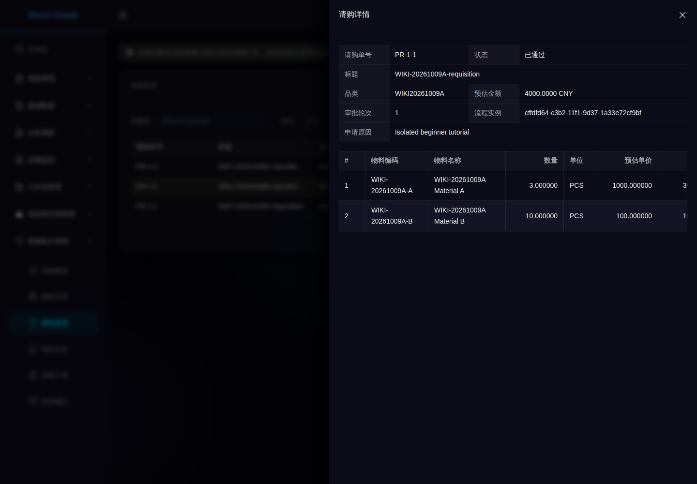

请购驳回：打开独立的被拒绝申请，核对业务状态与保留的原流程实例。

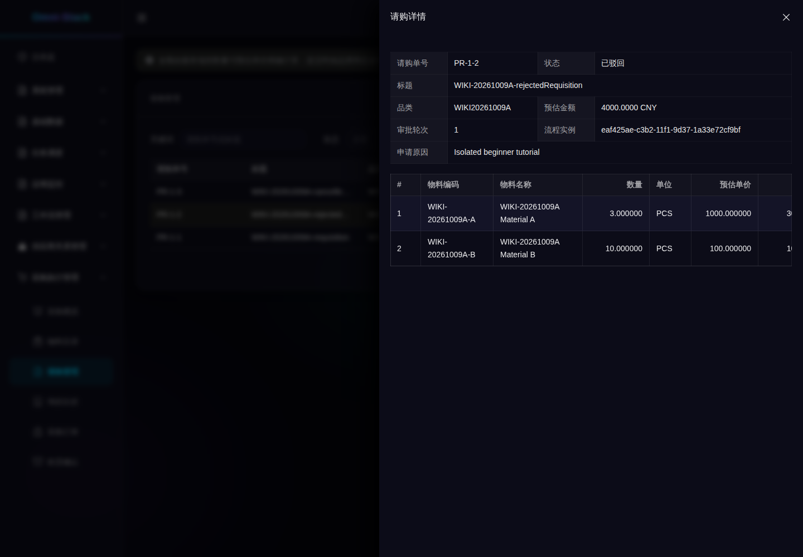

草稿取消：打开本次取消记录，核对已取消且未启动审批，不能据此推定运行中审批可随意取消。

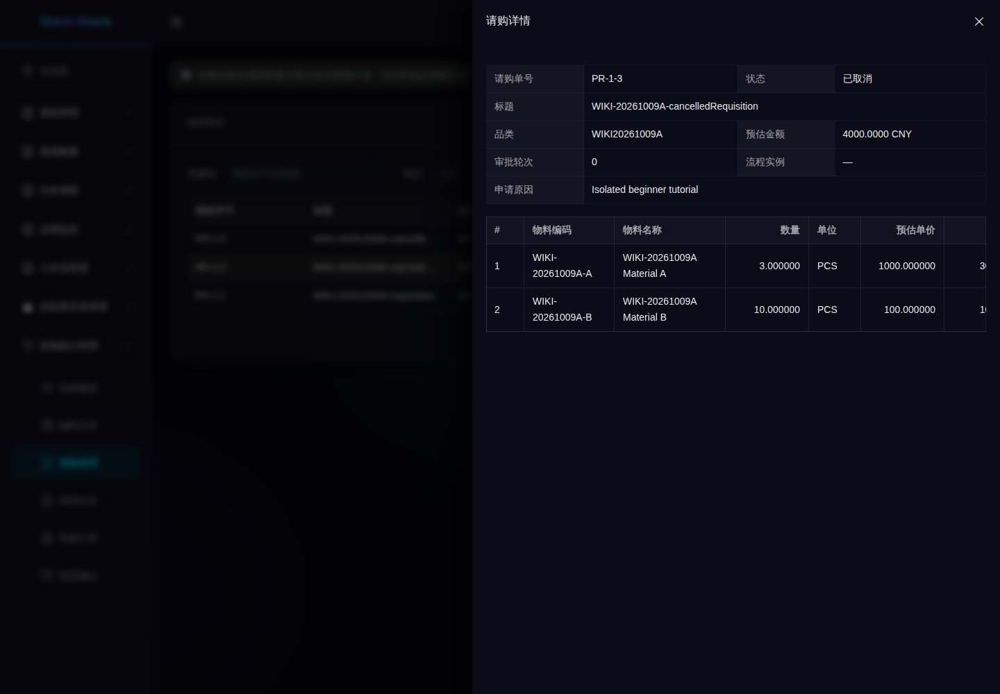

询价定标：打开 RFQ 详情，核对 Vendor D 中标、Vendor C 未中标及对应报价版本。

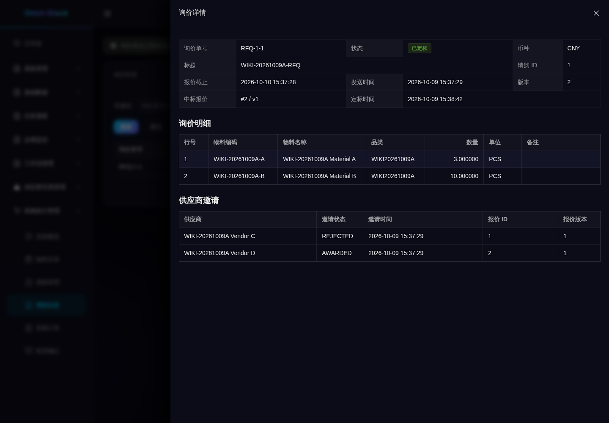

订单收货完成：打开同源 PO，核对总额 3500 CNY、两行累计收齐和待收数量 0。

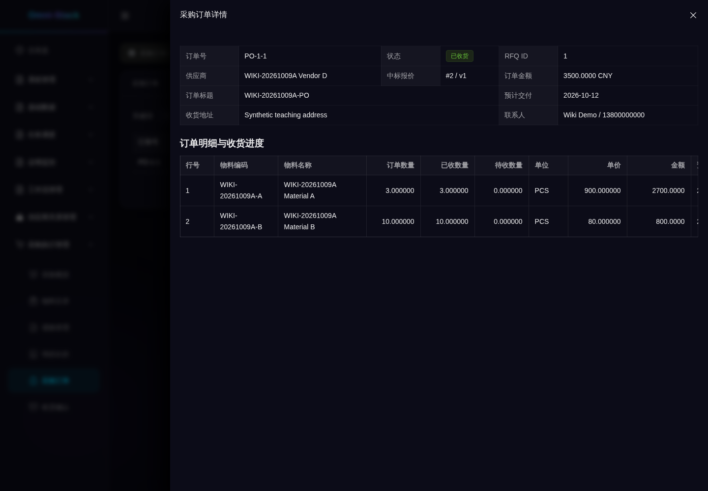

首批收货：A 数量 1、质检 FAIL、资产化是；B 数量 10、质检 PASS、资产化否。无卡片结果由来源查询验证，不能仅从收货图断言。

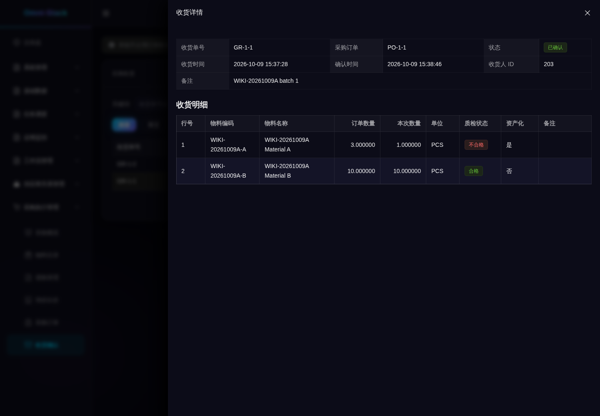

第二批收货：A 数量 2、质检 PASS、资产化是。随后按该 GR 来源核对恰好两张卡。

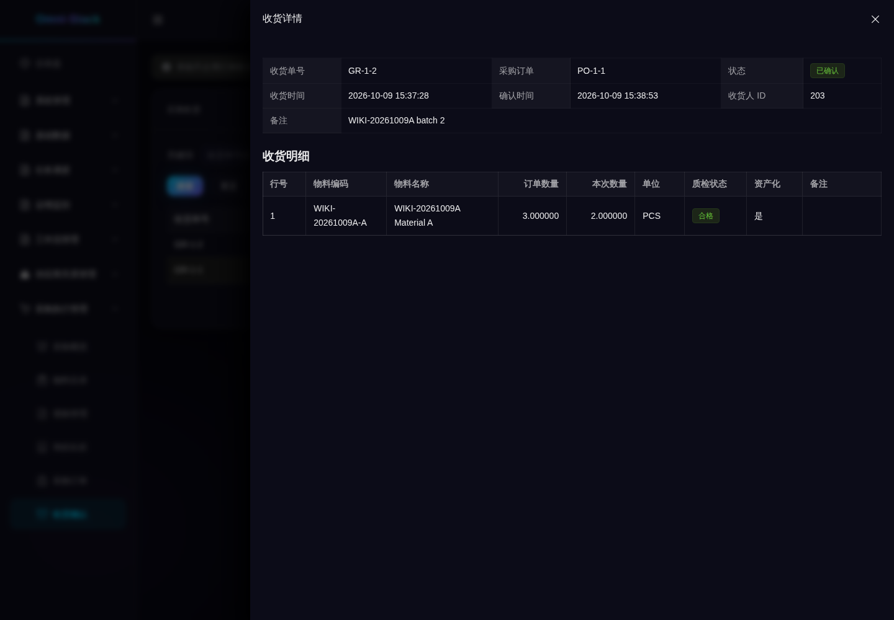

## 10. 复查物料、规则与概览

完成前面的独立教学链后，以同租户普通采购经理打开以下页面。2026-10-12 的[只读来源记录](../reference/evidence/procurement-readonly-2026-10-12.json)复用了本次教学对象，没有重建请购、订单或收货；新环境应使用自己记录的分类和名称，不能照抄截图中的 ID。

1. 在物料目录选中教学分类，再搜索本次物料前缀。应只显示 A、B 两行，均为 ACTIVE，资产化分别为是、否；只搜索前缀可能同时找到同前缀的负例分类。
2. 在请购审批规则的试算区选择同一分类，输入 `4000` 后点击试算。期望 MATCHED、自己的启用规则和 AVAILABLE 模型；本次实际命中规则 1、模型版本 2。`POST /api/procurement/approval-route/match-preview` 是只读计算，不创建流程实例。
3. 在采购概览核对当前身份的数据范围。本次链路的已承诺金额是 CNY 3500.0000，来自已收货订单；四个待办计数为 0。新环境显示自身数据，不能把截图金额当成种子数据。

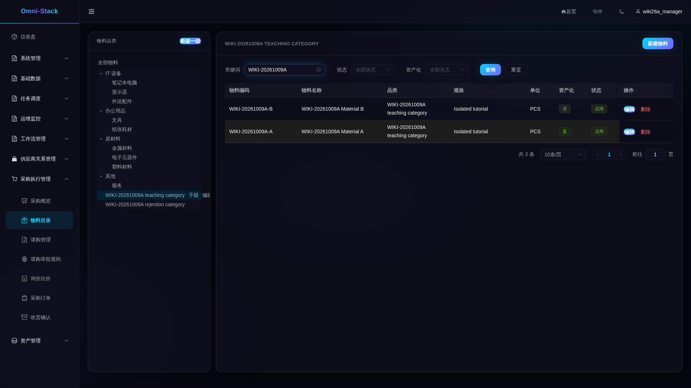

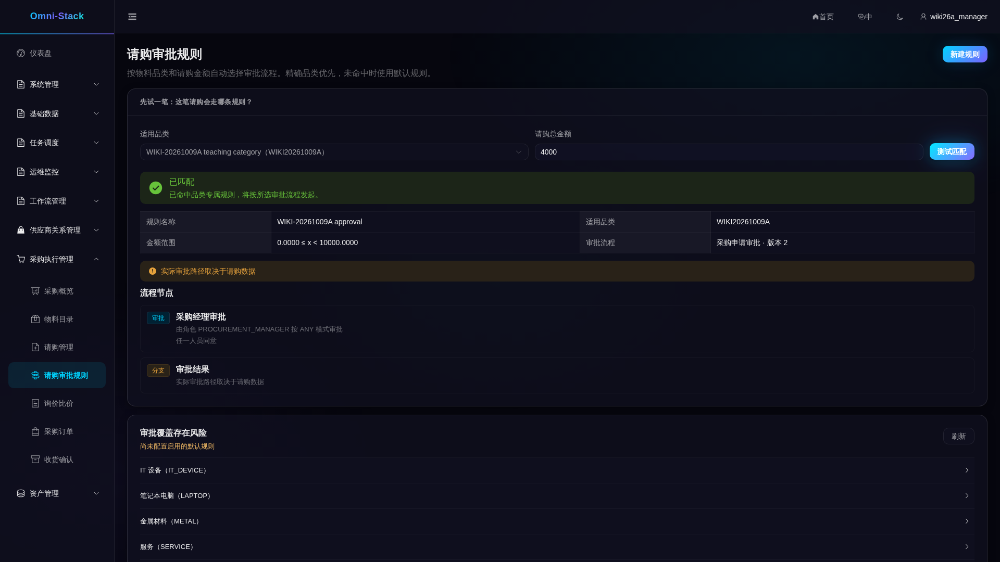

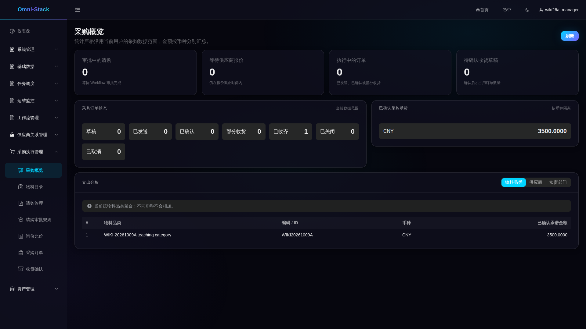

手机 390×844 下侧栏初始收起；点击顶部菜单可展开，再点击可收起，随后操作分类、金额和试算按钮。平板 1024×768 也使用同一试算。四语言、三种视口共 12 次真实试算均命中，页面无整体横向溢出。

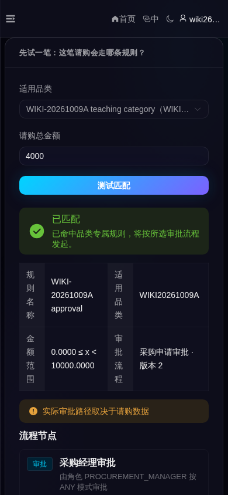

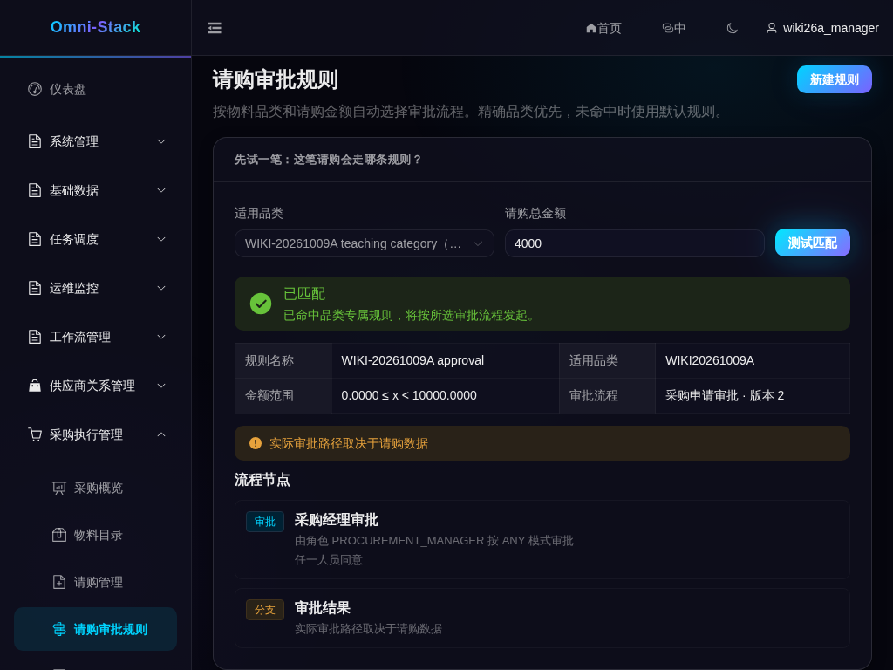

手机结果表需要在表内横向滚动查看全部列；原图证明金额、试算按钮和命中结果，模型版本另由真实响应断言核对。部分英文侧栏长名称会截断，日/韩平板图滚动到试算区后页标题部分位于固定顶栏下；这些图只说明可见操作和结果。分类、模型、节点名称及原始服务端诊断属于现存业务数据，可能保留中文，不代表对应界面标签未切换语言。截图目检只覆盖视觉可读性；四语文档按前述授权政策完成实际 AI 语义复核即可。

## 11. 定标后核对两家供应商的记录

比价与定标操作只在 RFQ 为 SENT 时执行。AWARDED 后比价入口收起，`GET /api/procurement/rfq/{id}/comparison` 返回 HTTP 200、业务码 409；不能为了补图修改状态或重新定标。

采购经理打开 RFQ 详情，查看保留的报价 ID、版本与中标报价。本次 Vendor C 为 #1/v1、邀请结果 REJECTED，Vendor D 为 #2/v1、AWARDED，中标报价为 #2/v1。这张图证明结果记录，不证明曾在界面点击实时比价或定标。

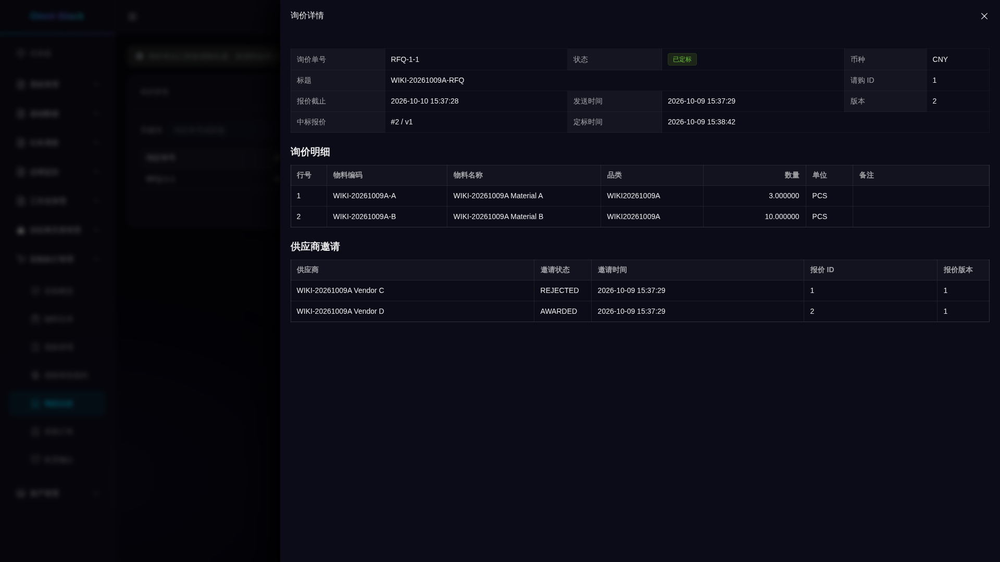

分别以供应商 C、D 登录门户，打开“询价报价”，按本次 RFQ 找到自己的报价。C 合计 CNY 3850，D 合计 CNY 3500。点击查看会打开只读详情，关闭后仍可核对列表金额和邀请结果。已关闭询价不重新提交报价；未中标不等于该供应商看不到自己的历史记录。

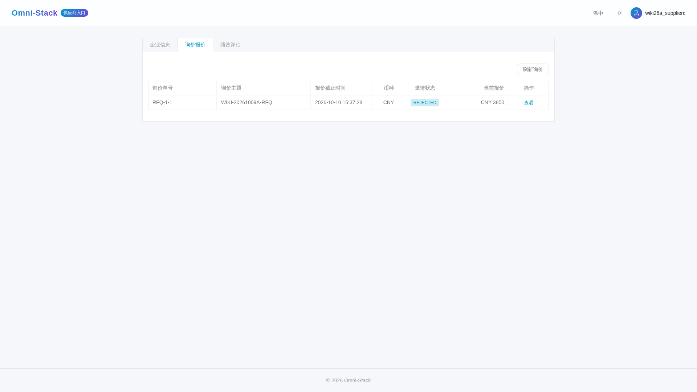

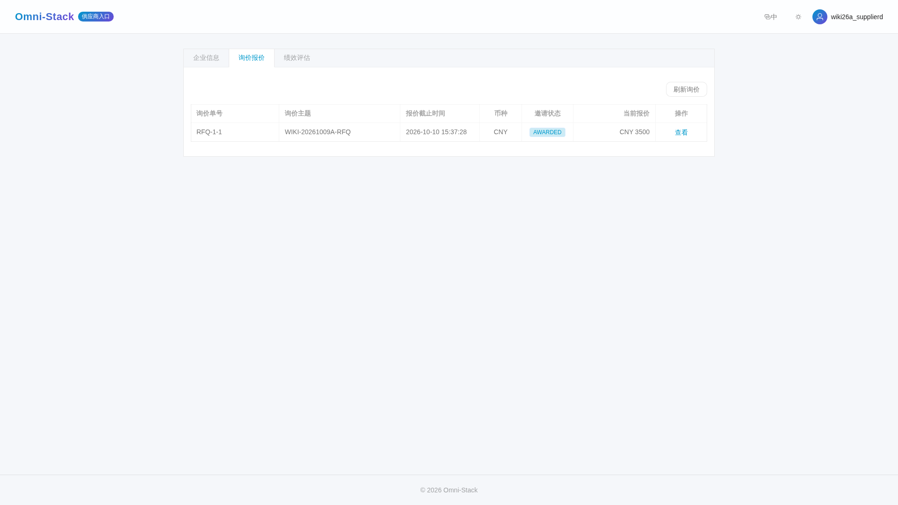

[本次只读回执](../reference/evidence/procurement-quotation-2026-10-12.json)绑定普通角色、版本、金额与原图摘要。单价由真实响应及详情控件断言验证，正式列表图只证明可见总额与状态。供应商图通过产品自身按钮切到浅色主题；日文长表头会在列内换行。31 张原图逐张复核后发布 12 张，7 张绘制不完整图被排除，12 张可读但重复的详情图保留在私有记录；没有重放业务写入。以上 31 张原图的检查发生于 2026-10-12；本轮新抽看的 20 张原图与未重新打开的其余 40 张分别列在本轮复核范围中。
