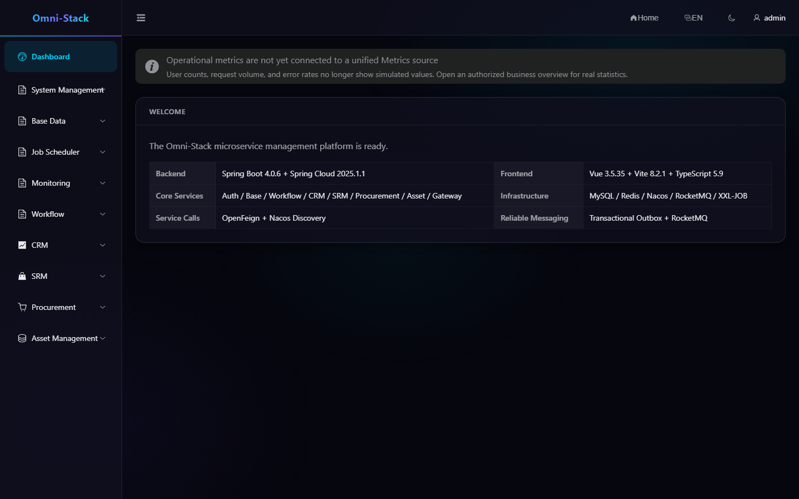

# Five-Minute Quick Start

Applies to: Omni-Stack 0.6.x

Use this guide to start a local development environment and sign in for the first time. For production, read the [Docker Deployment Guide](../docker-deployment.en.md) and [Operations, Backup, Recovery, and Upgrade Guide](operations-upgrade.en.md).

## 1. Prerequisites

- JDK 25.
- Node.js LTS 22.12.0 or later.
- Docker Desktop with Docker Compose.
- At least 12 GB of available memory is recommended. Prefer a project preset when evaluating one domain.

Official build images provide JDK 25 and Node.js 22.12+; host installations are optional development tools.

## 2. Choose a Startup Mode

> **Prerequisite (fresh run)**: In the repo root, copy the template and securely fill required secrets before startup, otherwise Compose fails closed on missing required variables:
>
> ```bash
> # run in the repo root (Windows PowerShell)
> Copy-Item -LiteralPath .env.example -Destination .env
> ```
>
> `.env` must provide (never echo real values): `MYSQL_ROOT_PASSWORD`, `OMNI_DB_PASSWORD`, `REDIS_PASSWORD`, `NACOS_AUTH_TOKEN`, `XXL_JOB_ACCESS_TOKEN`, and a `GATEWAY_ASSERTION_SECRET` consistent across every backend service (otherwise generated services return 503 "gateway assertion secret not ready"). Generate random secrets securely. This step is for a brand-new start; adopting an old data volume is a separate bounded migration path, not a fresh run.

Full system:

```bash
docker compose --profile full up -d
docker compose ps
```

CRM only:

```bash
npm --prefix tools/omni-cli run dev -- dev up --preset crm
```

Available presets include `core`, `workflow`, `crm`, `supply-chain`, and `full`. See [Preset Quick Selection](../preset-quick-selection.en.md). On first startup, Liquibase migrates the database before services start. Do not run legacy `init-all.sql` or `migrate-*.sql` files.

## 3. Verify Service Health

Wait until every selected application is `healthy` in `docker compose ps`.

| Entry | Address | Purpose |
|---|---|---|
| Frontend | `http://localhost:3000` | Login, workspace, and administration |
| Nacos | `http://localhost:8080` | Local discovery and configuration |
| Gateway | `http://localhost:8102` | Unified frontend API entry |

If a port is busy, use `docker compose ps` and `docker compose logs <service>` to identify the failed service. Do not repeatedly rebuild the database volume.

## 4. First Login

1. Open the frontend login page.
2. Select the development tenant.
3. Use the development administrator explicitly marked in `scripts/sql/seed/auth.sql`.
4. Enter the one-time CAPTCHA shown on the page.
5. Replace the development credential immediately after login. Never use seed credentials in shared, non-development, or production environments.

A CAPTCHA belongs to one request and can be used once. After refreshing it or after a failed submission, use the new image and `captchaKey`.

## 5. First Functional Check

An administrator should see System, Base Data, Scheduling, Monitoring, Workflow, and the business modules included by the selected preset. Check that:

1. System Management → Users loads a list.
2. Workflow → Process Models shows the seeded models.
3. The target domain overview loads real data or an explicit empty state.
4. My Workspace can open the Create Task dialog.

A missing menu usually means the role lacks permission or the preset omits the module. Do not fix it by hard-coding frontend routes.

### Screenshot

#### Figure 1 `system-dashboard-en-US`: Console dashboard

- Prerequisites: log in as an administrator
- Actor: administrator
- Action: after login the app lands on the approval workbench; click Console (top right) to open the admin dashboard
- Expected result: the main area shows the Welcome card with backend/frontend/core services/infrastructure info, and the sidebar lists System, Base Data, Scheduler, Monitoring, and Workflow



## 6. Source Development

After editing source, rebuild the affected images from the repository root. Backend build stages use JDK 25 and the Maven Wrapper; the Node build stage produces frontend assets. Run every application in Docker.

The standard local project is `omni-stack`, its default network is `omni-stack_default`, and its MySQL volume is `omni-stack_omni-mysql-data`. Run every application and business verification in local Docker. Edit source on the host and rebuild through Compose. Keep the default ports fixed; identify and resolve conflicts instead of shifting ports.

```bash
docker compose --profile full up -d --build
docker compose ps
```

## 7. Stop the Environment

```bash
docker compose --profile full down
```

Do not add `--volumes` by default. Delete a dedicated volume only when you intentionally need a fresh database and have verified the exact Compose project and volume name.

## 8. Next Steps

- [Authentication and Tenant Selection](authentication.en.md)
- [Menus, Roles, and Data Permissions](permissions.en.md)
- [Scaffold Development Tutorial](scaffold-development.en.md)
- [Troubleshooting](troubleshooting.en.md)

