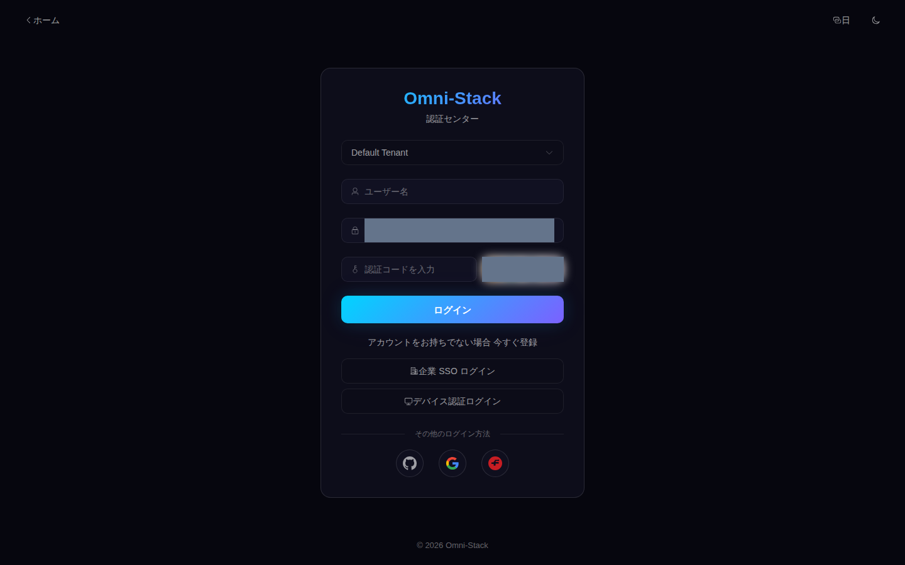

# コード取得から初回ログインまで

基準：主幹 fc165e3 以降の 0.6.x。今回のブランチは文書とツールを追加します。動作は現在の checkout の Compose、ソース、シードで確認します。初回ビルドはネットワーク、CPU、キャッシュに依存し、5分以内とは保証しません。

## 1. コード取得とディレクトリ

一つのホスティング先を選んで空の場所に clone します。同じディレクトリへ両方を続けて実行しません。以降はリポジトリルートで実行します。

GitHub:

```bash
git clone --branch main https://github.com/wang-baohai/Omni-Stack.git
cd Omni-Stack
```

Gitee:

```bash
git clone --branch main https://gitee.com/wang-baohai/Omni-Stack.git
cd Omni-Stack
```

`omni-backend/` は Maven モジュール、`omni-frontend/` は Vue ソースです。`docker/` と Compose がコンテナをビルドし実行します。`database/` は構造移行、`scripts/sql/seed/` は正式な初期データ、`tools/omni-cli/` と `scaffold/` はプロジェクト生成を担います。`docs/` は技術リファレンスと Wiki、`ai/` は共有 AI 資産です。

## 2. Docker とツールコンテナ

ホストには Git、Compose を備えた Docker Desktop/Engine、エディターが必要です。ホスト JDK/Node は必須ではなく、ツールコンテナが JDK 25、Node 22、Maven Wrapper を提供します。ローカル Linux engine を使います。[プリセット表](../preset-dependency-matrix.jp.md)の資源を Docker に割り当てます。全体はメモリ 12–16 GiB、空きディスク約 20 GiB を初期予算とし、実際のイメージとビルドピークで調整します。測定済み上限ではありません。

```bash
docker version
docker compose version
docker compose -p omni-stack-tools -f compose.tools.yaml build cli
docker compose -p omni-stack-tools -f compose.tools.yaml run --rm cli npm ci
```

Docker client/server の両方が応答し、Compose の版が表示され、ツールイメージが構築されるのが正常です。登録先/Maven/npm のタイムアウトはプロキシ、DNS、Docker ネットワークを確認します。権限失敗はプラットフォームの許可で処理し、daemon 停止とは判断しません。

## 3. 新環境の非公開設定

コンテナスクリプトが `.env.example` から必要な秘密を安全に生成します。新しい `.env` のみ作成し、既存ファイルを上書きせず、値も表示しません。既存データボリュームは元の認証情報と[更新/復旧手順](operations-upgrade.jp.md)を使い、古い DB の認証情報を新しいパスワードで置き換えません。

```bash
docker compose -p omni-stack-tools -f compose.tools.yaml run --rm cli node scripts/init-env.mjs
```

結果は作成確認のみです。実 `.env` は Git に含めません。キー名は四言語共通です。

| 変数 | 用途と制約 |
|---|---|
| `MYSQL_ROOT_PASSWORD` / `OMNI_DB_PASSWORD` | 移行管理者 / 七つの業務 DB のアプリユーザー。新規時に migrator が作成して権限付与 |
| `REDIS_PASSWORD` | Redis と全クライアントで一致 |
| `NACOS_AUTH_TOKEN` | 32 ランダムバイト以上の Base64、サーバー署名用 |
| `NACOS_AUTH_IDENTITY_KEY` / `NACOS_AUTH_IDENTITY_VALUE` | Nacos サーバー識別認証 |
| `NACOS_PASSWORD` | コンソールとクライアントで共通。既定ユーザー nacos |
| `XXL_JOB_ACCESS_TOKEN` / `XXL_JOB_ADMIN_PASSWORD` | 実行器 token / ランダムなコンソールパスワード。管理者 admin、14–20 文字 |
| `GATEWAY_ASSERTION_SECRET` / `OMNI_INTERNAL_API_TOKEN` | 全体で共通の Gateway HMAC（32 バイト以上）/ 内部 API 認証 |
| `OAUTH2_STATE_SECRET` / `JWK_ENCRYPT_KEY` | ソーシャル state HMAC（32 バイト以上）/ Redis JWK 暗号鍵（正確に 32 文字） |

GitHub、Google、Gitee の OAuth ID/secret は外部アプリの任意設定です。パスワードログインには不要です。空の設定では外部ソーシャルログインは利用できません。

## 4. 選択と起動

全サプライチェーンまたは全機能は full を選びます。初回 `--build` は依存をダウンロードしイメージ内で構築します。migrator が成功終了してから健康条件でサービスが起動します。

```bash
docker compose --profile full up -d --build
docker compose ps -a
docker compose logs omni-db-migrator
```

ログイン、権限、基本基盤の学習は core から始められます。CLI は依存閉包、サービス、無効な能力を表示します。core lite は Nacos client、XXL-JOB、MQ relay を無効にし、サプライチェーン検証には使えません。

```bash
docker compose -p omni-stack-tools -f compose.tools.yaml run --rm cli npm run dev -- preset list
docker compose -p omni-stack-tools -f compose.tools.yaml run --rm cli npm run dev -- preset explain core
docker compose -p omni-stack-tools -f compose.tools.yaml run --rm cli npm run dev -- dev up --preset core --project-name omni-stack --build
```

これは選択サービスの起動です。必要なモジュールに絞った別プロジェクトの生成は[開発ガイド](scaffold-development.jp.md)を参照します。`preset create` と `dev up` の成果は異なります。

## 5. 移行と健康の確認

`omni-db-migrator` は Exited (0)、healthcheck を宣言した選択コンテナは healthy になり、フロントエンドにも接続できる必要があります。選択外は不要です。失敗時は migrator または対象サービスのログ、必須変数、ポートを調べます。ボリューム削除で問題を隠しません。標準 project は omni-stack、固定既定ポートは frontend 3000、Gateway 8102、MySQL 3306 です。

```bash
docker compose ps -a
docker compose logs --tail 100 omni-auth omni-gateway omni-frontend
```

## 6. 初回ログインと一回限りの CAPTCHA

1. ブラウザーで `http://localhost:3000` を開きます。
2. 開発テナントを選び、正式 `auth.sql` のローカル例 `admin` / `admin123` を使います。
3. 人が現在の画像 CAPTCHA を入力します。画像更新で captchaKey が新しくなります。
4. 成功するとワークスペースが開きます。コンソールでシステム管理 → ユーザーを確認します。
5. 例の認証情報は隔離開発環境限定で、共有/本番前に置換します。

誤答や送信失敗の後は新しい画像を取得します。Redis GETDEL が旧値を消費済みです。テナント間違い、ロック、503 は[認証ガイド](authentication.jp.md)で調べ、旧 captchaKey を再送しません。短期 fixture token は認証後の機能のみを検証し、この手順の代わりにはなりません。

画像は各言語のフォーム配置を示し、CAPTCHA はマスク済みです。2026-10-09 に人が一度限りの CAPTCHA を入力し、実際の初回ログインが HTTP・業務とも 200 で成功しました。[匿名化した記録](../reference/evidence/human-login-2026-10-09.json)を参照してください。他言語のページテストは短期テスト ID を使い、4 回のパスワードログインを証明しません。



## 7. プリセット確認、停止、開発

管理者は選択モジュールを見られます。core に workflow/サプライチェーンメニューがないのは設定どおりで、一般ユーザーは役割にも制限されます。空一覧も正常です。シードには過去の注文、承認、資産が含まれません。[データと fixture](../wiki/data-and-fixtures.jp.md)で学習記録を作ります。

既定の down は名前付きボリュームを保持し、次の up はデータを再利用します。`--volumes` は付けません。ソース変更後はコンテナでテストし対象イメージを再構築します。

```bash
docker compose --profile full down
docker compose --profile full up -d
```

```bash
docker compose -p omni-stack-tools -f compose.tools.yaml run --rm backend ./mvnw clean install
docker compose -p omni-stack-tools -f compose.tools.yaml run --rm frontend npm ci
docker compose -p omni-stack-tools -f compose.tools.yaml run --rm frontend npm run build
docker compose -p omni-stack-tools -f compose.tools.yaml run --rm frontend npm run lint
docker compose --profile full up -d --build
```

次の学習： [認証とテナント](authentication.jp.md) · [権限とデータ範囲](permissions.jp.md) · [サービスとモジュールの除外](scaffold-development.jp.md) · [問題解決](troubleshooting.jp.md)
