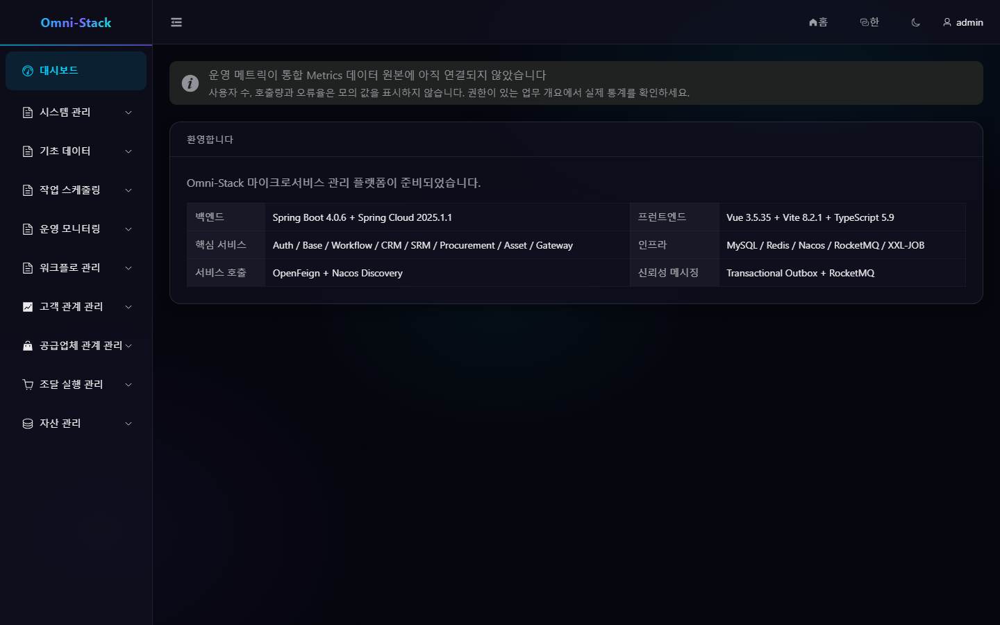

# 5분 빠른 시작

적용 버전: Omni-Stack 0.6.x

로컬 개발 환경을 시작하고 처음 로그인하기 위한 안내서입니다. 운영 배포는 [Docker 배포](../docker-deployment.kr.md)와 [운영·백업·복구·업그레이드](operations-upgrade.kr.md)를 참고하세요.

## 1. 사전 조건

- JDK 25.
- Node.js LTS 22.12.0 이상.
- Docker Desktop과 Docker Compose.
- 사용 가능 메모리 12GB 이상 권장. 단일 도메인 평가에는 프로젝트 프리셋을 사용합니다.

정식 빌드 이미지가 JDK 25와 Node.js 22.12+를 제공합니다. 호스트 설치는 개발 도구 사용 시에만 필요합니다.

## 2. 시작 방식 선택

> **시작 전 필수 준비(fresh 실행)**: 저장소 루트에서 템플릿을 복사해 필수 시크릿을 안전하게 채워야 하며, 미설정 시 Compose 가 필수 변수 결드로 실패합니다:
>
> ```powershell
> # 저장소 루트에서 실행 (Windows PowerShell)
> Copy-Item -LiteralPath .env.example -Destination .env
> ```
>
> `.env` 는(실제 값을 절대 표시하지 말고) `MYSQL_ROOT_PASSWORD`, `OMNI_DB_PASSWORD`, `REDIS_PASSWORD`, `NACOS_AUTH_TOKEN`, `XXL_JOB_ACCESS_TOKEN`, 그리고 Auth 와 Gateway 간 일치하는 `GATEWAY_ASSERTION_SECRET`(미설정 시 생성물 서비스가 503 "게이트웨이 신원 서명 미준비" 반환) 를 필수로 요구합니다. 랜덤 시크릿은 안전한 방식으로 생성하세요. 본 단계는 신규 시작용이며, 기존 데이터 볼륨 인수는 별도 유한 마이그레이션 경로로 fresh 와 구분합니다.

전체 시스템:

```bash
docker compose --profile full up -d
docker compose ps
```

CRM만 시작:

```bash
npm --prefix tools/omni-cli run dev -- dev up --preset crm
```

`core`, `workflow`, `crm`, `supply-chain`, `full` 프리셋을 제공합니다. [프리셋 선택](../preset-quick-selection.kr.md)을 참고하세요. 최초 시작 시 Liquibase가 먼저 마이그레이션합니다. 기존 `init-all.sql` 또는 `migrate-*.sql`을 실행하지 마세요.

## 3. 상태 확인

`docker compose ps`에서 선택한 애플리케이션이 `healthy`가 될 때까지 기다립니다.

| 진입점 | 주소 | 용도 |
|---|---|---|
| 프론트엔드 | `http://localhost:3000` | 로그인, 작업 공간, 관리 화면 |
| Nacos | `http://localhost:8080` | 로컬 서비스 검색과 설정 |
| Gateway | `http://localhost:8102` | 프론트엔드 API 통합 진입점 |

포트 충돌은 `docker compose ps`와 `docker compose logs <service>`로 실패 서비스를 찾고 DB 볼륨을 반복해서 만들지 마세요.

## 4. 첫 로그인

로그인 화면에서 개발 테넌트를 선택하고 `scripts/sql/seed/auth.sql`에 개발용으로 명시된 관리자를 사용합니다. 화면의 일회용 CAPTCHA를 입력하고, 로그인 후 개발 자격 증명을 즉시 교체합니다. 공유 또는 운영 환경에서 시드 계정을 사용하지 않습니다.

CAPTCHA는 요청마다 한 번만 사용합니다. 새로 고침이나 실패 후에는 새 이미지와 `captchaKey`를 사용합니다.

## 5. 첫 기능 확인

관리자는 시스템 관리, 기초 데이터, 작업 스케줄링, 운영 모니터링, 워크플로와 프리셋의 업무 모듈을 확인할 수 있어야 합니다. 사용자 목록, 프로세스 모델, 도메인 개요, 개인 작업 생성 대화상자를 차례로 확인합니다.

메뉴가 없으면 권한과 프리셋을 점검하고 프론트엔드 정적 라우트로 우회하지 않습니다.

### 스크린숏

#### 그림 1 `system-dashboard-ko-KR`: 콘솔 대시보드

- 전제 조건: 관리자로 로그인
- 작업자: 관리자
- 작업: 로그인 후 승인 워크벤치에 도착하므로 우측 상단의 '콘솔'을 클릭해 관리 대시보드 열기
- 예상 결과: 메인 영역에 '환영합니다' 카드와 백엔드/프론트엔드/핵심 서비스/인프라 정보가, 사이드바에 시스템/기초 데이터/작업 스케줄링/운영 모니터링/워크플로 관리가 표시됨



## 6. 소스 개발

소스를 수정한 후 저장소 루트에서 해당 이미지를 다시 빌드하고 실행합니다. 백엔드 빌드 단계는 JDK 25와 Maven Wrapper를, 프론트엔드 빌드 단계는 Node를 사용합니다. 모든 앱은 Docker 안에서 실행합니다.

표준 로컬 프로젝트는 `omni-stack`, 기본 네트워크는 `omni-stack_default`, MySQL 볼륨은 `omni-stack_omni-mysql-data`입니다. 모든 앱과 업무 검증을 로컬 Docker 안에서 실행합니다. 호스트에서 소스를 편집하고 Compose로 다시 빌드합니다. 기본 포트를 고정하고 충돌 원인을 해결합니다.

```bash
docker compose --profile full up -d --build
docker compose ps
```

## 7. 종료

```bash
docker compose --profile full down
```

기본적으로 `--volumes`를 사용하지 않습니다. 완전히 새 DB가 필요할 때 정확한 Compose project와 전용 볼륨을 확인한 뒤 삭제합니다.

## 8. 다음 단계

- [인증과 테넌트 선택](authentication.kr.md)
- [메뉴·역할·데이터 권한](permissions.kr.md)
- [스캐폴드 개발](scaffold-development.kr.md)
- [문제 해결](troubleshooting.kr.md)

