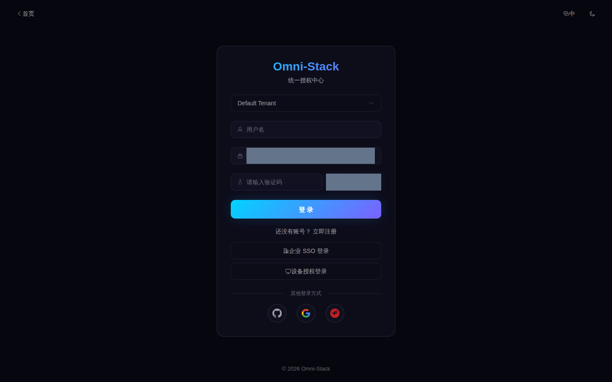

# 从克隆代码到首次登录

适用基线：主干 fc165e3 起的 0.6.x；本次整改分支补充文档/工具。正式行为以当前 checkout 的 Compose、源码和种子为准。首次构建受网络、CPU 和缓存影响，不承诺五分钟。

## 1. 获取代码与认识目录

任选一个托管平台，在空目录克隆；不要连续执行两次到同一个目录。所有后续命令从仓库根执行。

GitHub:

```bash
git clone --branch main https://github.com/wang-baohai/Omni-Stack.git
cd Omni-Stack
```

Gitee:

```bash
git clone --branch main https://gitee.com/wang-baohai/Omni-Stack.git
cd Omni-Stack
```

`omni-backend/` 是 Maven 多模块源码，`omni-frontend/` 是 Vue 源码；`docker/` 与 Compose 把源码构建为容器。`database/` 保存结构迁移，`scripts/sql/seed/` 保存正式基础数据，`tools/omni-cli/` 与 `scaffold/` 负责生成项目。`docs/` 保存工程事实和 Wiki，`ai/` 保存共享 AI 资产。

## 2. 准备 Docker 和工具容器

宿主需要 Git、Docker Desktop/Engine 和 Compose，以及编辑器。本次构建和验证不要求宿主安装 JDK/Node：工具容器提供 JDK 25、Node 22 和 Maven Wrapper。先确认 Docker 使用本机 Linux engine。按[预设依赖矩阵](../preset-dependency-matrix.md)的资源预算分配 Docker 内存；全栈初始建议 12–16 GiB，可用磁盘预留约 20 GiB，再根据实际镜像与构建峰值调整。这是准备预算，不是已测量的运行上限。

```bash
docker version
docker compose version
docker compose -p omni-stack-tools -f compose.tools.yaml build cli
docker compose -p omni-stack-tools -f compose.tools.yaml run --rm cli npm ci
```

正常结果是 Docker client/server 都可用、Compose 有版本号、工具镜像构建完成。注册表或 Maven/npm 超时先检查网络代理、DNS 与 Docker 网络；本机权限失败应走平台授权，不把它误判为 daemon 未运行。

## 3. 初始化全新环境的私有配置

下面的容器脚本从 `.env.example` 安全生成全部必填秘密，只创建新 `.env`，不覆盖已有文件、不打印值。已有数据卷必须保留原凭据，改读[升级与恢复](operations-upgrade.md)，不能重新随机生成密码接管旧库。

```bash
docker compose -p omni-stack-tools -f compose.tools.yaml run --rm cli node scripts/init-env.mjs
```

预期仅输出创建结果；真实 `.env` 被 Git 忽略。必填项的角色如下，四语言使用同一组键名。

| 变量 | 用途与约束 |
|---|---|
| `MYSQL_ROOT_PASSWORD` / `OMNI_DB_PASSWORD` | 迁移管理账号 / 七个业务库应用账号；fresh 由 migrator 创建并授权 |
| `REDIS_PASSWORD` | Redis 与全部客户端一致 |
| `NACOS_AUTH_TOKEN` | 至少 32 字节随机内容的 Base64，服务端签名 |
| `NACOS_AUTH_IDENTITY_KEY` / `NACOS_AUTH_IDENTITY_VALUE` | Nacos 服务端身份认证 |
| `NACOS_PASSWORD` | 控制台与客户端一致；用户名默认 nacos |
| `XXL_JOB_ACCESS_TOKEN` / `XXL_JOB_ADMIN_PASSWORD` | 执行器 token / 控制台管理员随机密码；管理员默认 admin，密码 14–20 字符 |
| `GATEWAY_ASSERTION_SECRET` / `OMNI_INTERNAL_API_TOKEN` | 全栈一致的网关 HMAC（至少 32 字节）/ 内部 API 认证 |
| `OAUTH2_STATE_SECRET` / `JWK_ENCRYPT_KEY` | 社交 state HMAC（至少 32 字节）/ Redis JWK 加密键（恰好 32 字符） |

GitHub、Google、Gitee OAuth client ID/secret 是可选外部应用凭据；密码登录不需要它们。空凭据不会提供可用的外部社交登录。

## 4. 选择并启动

完整供应链或全部功能选择 full。首次 `--build` 下载依赖、执行镜像内构建；migrator 成功退出后服务按健康依赖启动。

```bash
docker compose --profile full up -d --build
docker compose ps -a
docker compose logs omni-db-migrator
```

只学习登录、权限和基础平台可先选 core。CLI 真实子命令会列出模块闭包、服务与降级信息；core 的 lite 模式关闭 Nacos 客户端、XXL-JOB 和 MQ 中继，不能拿它验证供应链。

```bash
docker compose -p omni-stack-tools -f compose.tools.yaml run --rm cli npm run dev -- preset list
docker compose -p omni-stack-tools -f compose.tools.yaml run --rm cli npm run dev -- preset explain core
docker compose -p omni-stack-tools -f compose.tools.yaml run --rm cli npm run dev -- dev up --preset core --project-name omni-stack --build
```

这是启动所选服务。真正生成裁剪后项目请读[脚手架开发](scaffold-development.md)；`preset create` 与 `dev up` 的结果不同。

## 5. 确认迁移与健康

`omni-db-migrator` 应为 Exited (0)，所选服务中声明了 healthcheck 的容器应为 healthy，前端还需能正常打开；非选中服务无需出现。若失败，先定位 migrator/具体服务日志，再核对必填变量和端口，不删除数据卷重试。标准 project 为 omni-stack，默认端口固定：前端 3000、Gateway 8102、MySQL 3306。

```bash
docker compose ps -a
docker compose logs --tail 100 omni-auth omni-gateway omni-frontend
```

## 6. 首次登录与一次性验证码

1. 在浏览器打开 `http://localhost:3000`。
2. 选择开发租户，使用正式 `auth.sql` 的本地演示账号 `admin` / `admin123`。
3. 人工输入当前图片验证码并提交；获取新图会产生新的 captchaKey。
4. 请求成功后进入工作台，再打开控制台检查“系统管理 → 用户管理”。
5. 只用于隔离开发环境；共享或生产前替换演示身份与凭据。

输错验证码或一次登录失败后必须换新图，Redis GETDEL 已消费旧值。租户选错、账号锁定或服务 503 时按[认证指南](authentication.md)定位，不重复提交旧 captchaKey。短期测试 token 只能验证登录后的功能，不能替代这一步。

下图仅示意对应语言的表单布局，验证码区域已遮罩。2026-10-09 已通过人工输入一次性验证码完成真实首次登录（HTTP/业务均为 200），见[脱敏登录记录](../reference/evidence/human-login-2026-10-09.json)。其他四语页面测试使用短期测试身份，不能冒充四次密码登录。



## 7. 核对预设、停止与开发

管理员能看到所选模块；core 没有工作流和供应链菜单是预设结果，普通用户的菜单还受角色限制。业务列表为空不代表故障：正式种子没有历史订单、审批和资产。按[数据与 fixture](../wiki/data-and-fixtures.md)建立自己的教学记录。

默认 down 保留命名卷，重新 up 使用原数据；不加 `--volumes`。正常修改源码后，用容器测试并重建对应镜像：

```bash
docker compose --profile full down
docker compose --profile full up -d
```

```bash
docker compose -p omni-stack-tools -f compose.tools.yaml run --rm backend ./mvnw clean install
docker compose -p omni-stack-tools -f compose.tools.yaml run --rm frontend npm ci
docker compose -p omni-stack-tools -f compose.tools.yaml run --rm frontend npm run build
docker compose -p omni-stack-tools -f compose.tools.yaml run --rm frontend npm run lint
docker compose --profile full up -d --build
```

下一步： [认证与租户](authentication.md) · [权限与数据范围](permissions.md) · [新服务与裁剪](scaffold-development.md) · [故障排查](troubleshooting.md)
