# System Jobs, Personal Jobs, and Handler Extensions

Start with an ordinary user's drink-water exercise: create, pause, edit, run manually, resume Cron, inspect results, and delete. Then inspect system jobs and the implementation. Use the `full` preset or a project with XXL-JOB deployed; the trimmed `core` project does not include this scheduling capability.

Verified on 2026-10-10. The mainline starting point is `fc165e3`; the running images were built from the remediation working tree. [Evidence and source hashes](../reference/evidence/scheduling-2026-10-10.json) record each original image, runtime, test version, and limitation. Four-language operation checks passed. Translations use `AI_REVIEW` under [ADR-0003](../adr/0003-authorized-ai-translation-review.md); see the [review queue](../i18n-review-queue.md) for the current digest-bound status.

## 1. Prepare the Environment and Identities

Complete [first startup](quick-start.en.md) and [data preparation](../wiki/data-and-fixtures.en.md). Start the full project in local Docker with your private `.env` configured:

```bash
docker compose --profile full up -d
docker compose ps
```

Confirm that the migrator exited successfully and MySQL, Nacos, XXL-JOB, Auth, Base, Gateway, and the frontend are available. The internal XXL-JOB address is `http://xxl-job-admin:8080/xxl-job-admin`. Standard Compose exposes `http://127.0.0.1:18080/xxl-job-admin` by default; use the actual value if `OMNI_XXL_JOB_HOST_PORT` is set. Read credentials from your own `.env`, rather than screenshots or historical accounts.

Use an authenticated ordinary account for personal jobs. The evidence account has `USER` and other business roles, without `SUPER_ADMIN`; this does not establish a separate test of an account having only `USER`. System-job and job-type management require `job:system-job:*` and `job:user-job-type:*` permissions respectively and are demonstrated by an administrator.

Choose a unique name, such as `PRACTICE-20261010-WATER`. Names beginning `WIKI-20261009A-SCHUI-<locale>-...` belong to this isolated exercise, not official seed data. Identify your exact row: other practice jobs, notifications, and summary counters awaiting refresh may coexist.

## 2. Create an Identifiable Personal Job

1. Open My Jobs in the home workspace and choose Create.
2. Enter your unique name and select the seeded drink-water type, whose stable code is `Task-00001`.
3. Choose daily at `23:59` and the small cup, displayed as “小杯”. The Cron is `0 59 23 * * ?`, and parameters are `{"cupShape":"小杯"}`. Choose another future time if this time is already close.
4. Check the type, frequency, and cup before saving.

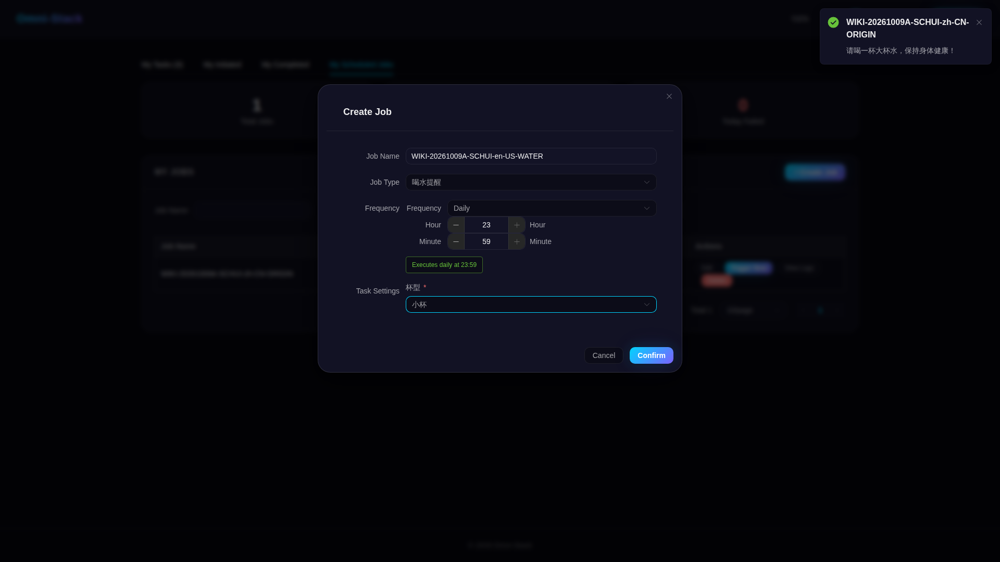

A successful save adds an enabled job and establishes its XXL-JOB association. The image proves the list result; separate assertions checked the local ID and returned `xxlJobId`, neither of which is displayed in this list.

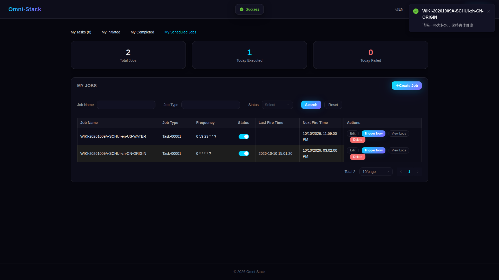

Creation enables scheduling immediately. Turn off that row's switch before editing. The switch should be off and its next execution time absent.


## 3. Edit While Paused, Then Run Manually

Edit the same job, append `-EDITED` to its name, choose every minute, and select the large cup, “大杯”. Its type cannot be changed in the edit form. The Cron becomes `0 * * * * ?`, with `{"cupShape":"大杯"}`. This image precedes submission; the later list and execution result establish the committed change.

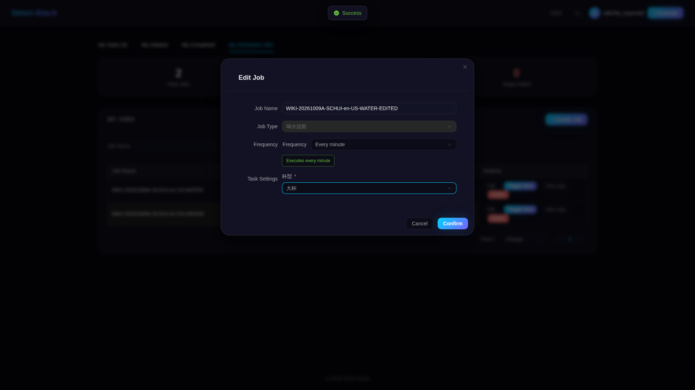

Keep the job paused after saving, select Execute Now, and confirm. Pause stops future Cron scheduling; the current implementation permits manual triggers. A green message means the scheduler accepted the request. Open execution logs and wait for a new successful entry; correlate its name, log ID, time, and large-cup result. An older entry or another job's notification does not establish this execution's success.

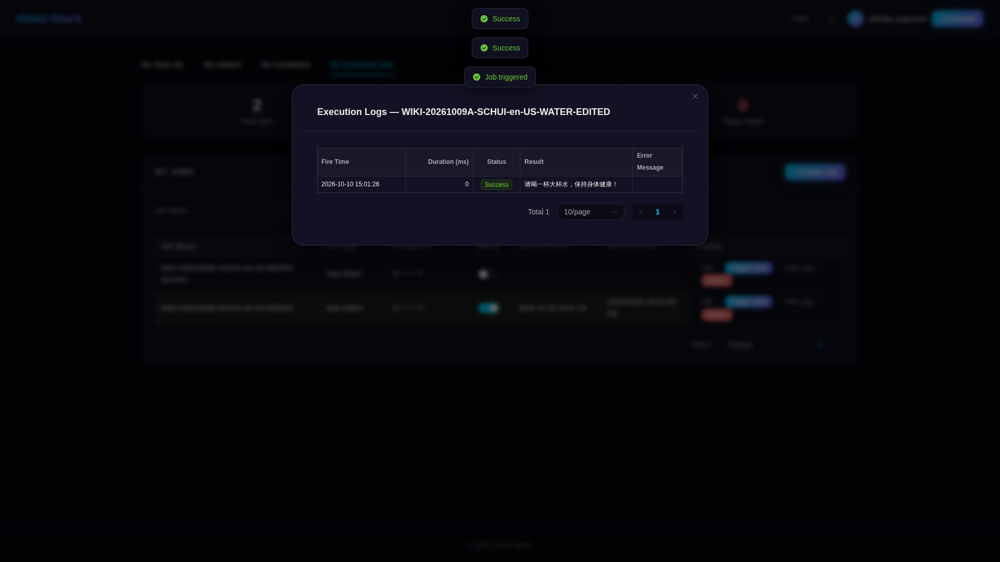

The drink-water handler logs and returns reminder text, which the frontend can poll and display. It does not send an external desktop, email, or mobile notification. The actual result here is “请喝一杯大杯水，保持身体健康！”, a reminder to drink a large cup of water.

## 4. Resume Cron and Establish a New Execution

Turn the switch back on. The next execution time should appear. This column follows browser-locale formatting and can contain slashes, AM/PM, or localized text; backend log dates still follow `yyyy-MM-dd HH:mm:ss`.

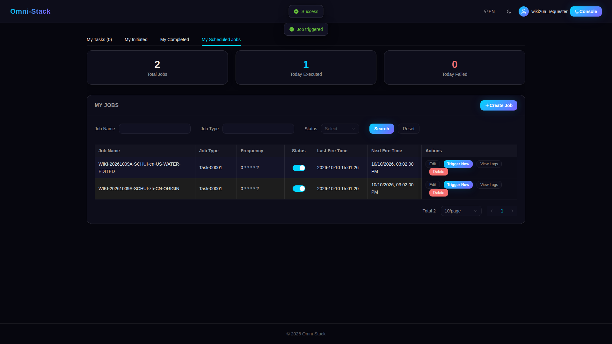

Do not trigger manually again. Wait for the next minute boundary, then inspect logs. This automated exercise waited up to about 90 seconds. Expect a new successful log whose ID and time are later than the manual entry.

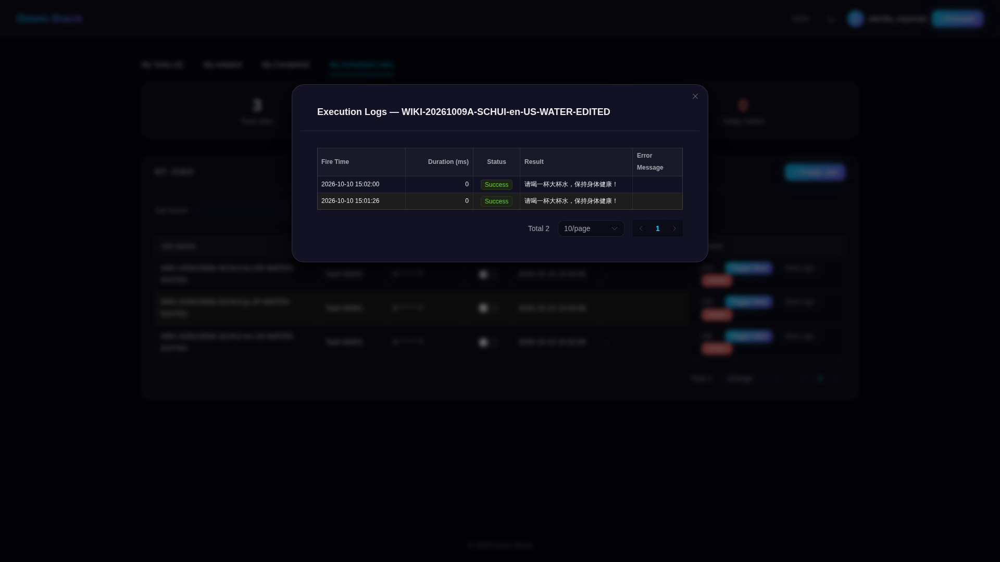

The personal-log dialog has no trigger-origin column. Before deletion, ask the administrator to correlate XXL-JOB trigger records by `xxlJobId`: `MANUAL` / `CRON`, trigger/callback status, and the local `jobId` and `tenantId` in parameters. Sanitized results are retained in the public evidence.

The original Chinese job was deleted before its XXL-JOB origin audit, so its trigger logs cannot be reconstructed. A uniquely named supplementary job was created through real APIs to verify origins. Its Chinese-only image proves successful supplementary logs, not a second UI creation journey; origin is established by separate XXL-JOB records.

After confirming the Cron execution, pause the job again so the exercise stops running.

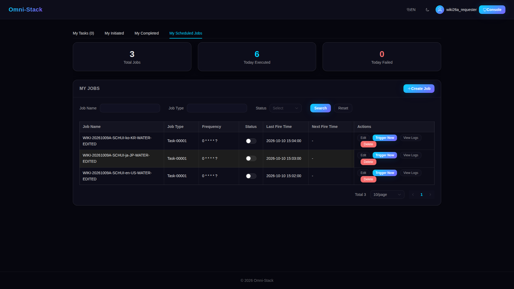

## 5. Deletion and Ownership Boundaries

Preserve execution and trigger records first, then delete your own job. Deleting an XXL-JOB task also removes its trigger logs. Confirm absence by unique name in the local list and by the original `xxlJobId` in the scheduler; other practice jobs can remain visible.

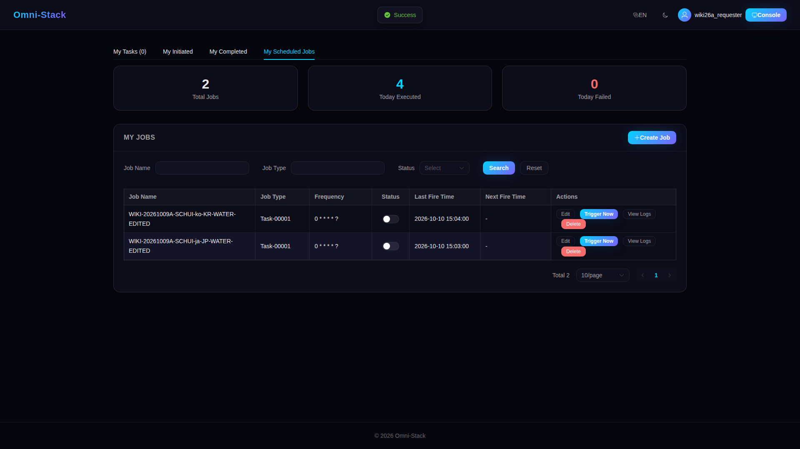

A different ordinary identity was also tested: its list omitted these jobs, and direct log, update, status, trigger, and delete requests all returned 403. Ownership depends on tenant and `createBy`; knowing an ID or adding a UI button cannot bypass it. Do not replace row ownership checks with `@PreAuthorize` on `MyJobController`.

## 6. Reproduce a Real Handler Failure

Use only your own isolated practice project. An administrator creates a unique type through the formal `POST /api/job/user-job-type` endpoint with the example body below, deploys no matching Handler, and enables the type through its ID-specific status endpoint:

```json
{
  "typeCode": "PRACTICE-UNHANDLED-UNIQUE",
  "typeName": "PRACTICE-UNHANDLED-UNIQUE",
  "description": "Isolated missing-handler exercise",
  "paramTemplate": "{\"type\":\"object\",\"properties\":{}}"
}
```

As the ordinary user, select this type, create a job at a future time, pause immediately, then trigger manually. A new failed log should have `status=0`. Hover over its error to read the full message stating that no handler exists for the type. This is an actual executor routing failure, without intercepting an API to fabricate 500.

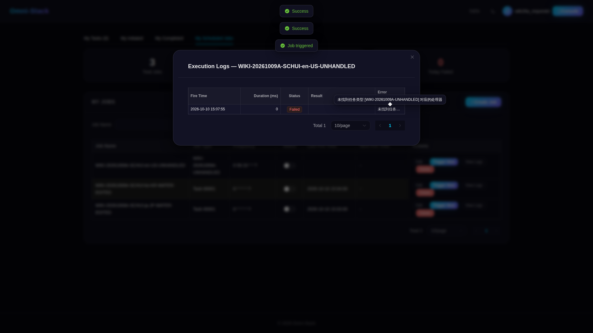

Personal failure logs were verified in all four languages. EN/JA/KO additionally retain XXL-JOB `handleCode=500`. The Chinese failure job had already been deleted; its missing scheduler logs are not claimed as recovered.

Other real failures passed: creation with a disabled type returned 400, and invalid Cron registration returned 500, with zero related local/remote practice jobs left behind. When registration has an unknown outcome, reconcile the exact executor group, handler, tenant, and local ID before attempting another create request.

Delete all owned personal jobs first, verify remote absence, confirm the practice type has no references in any tenant, and finally delete that unique type. The current type-delete endpoint has no job-reference guard. Preserve seed type `Task-00001` and types used by others. This exercise's failure type, normal jobs, and origin supplement were cleaned in that order.

## 7. Two Administrative Catalogs

System jobs are declared in code, with both `@XxlJob("handlerName")` and `@SystemJobMeta(...)` on the method. The registry collects metadata; automatic registration adds missing tasks while retaining existing Cron and parameters. Status comes from the scheduler. This image is a read-only view of Base log archival and MQ relay; neither was stopped or unregistered.

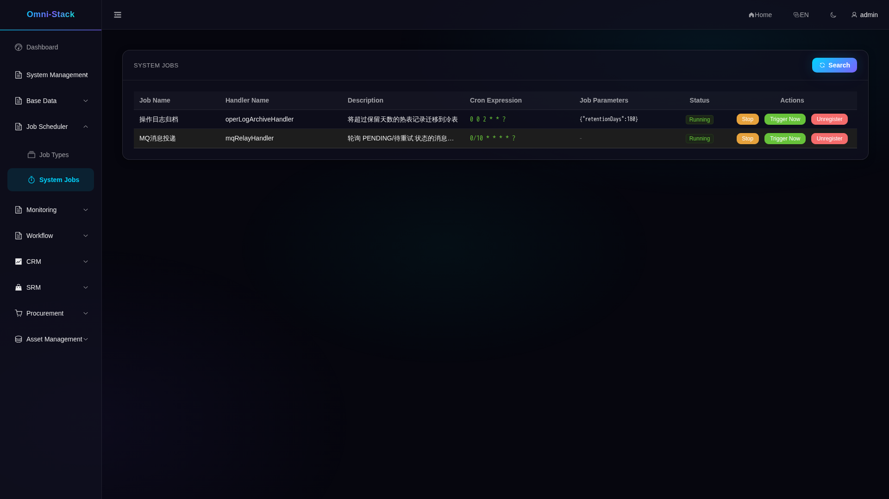

The type catalog is global; personal jobs and logs are isolated by tenant and creator. An enabled catalog entry permits selection but does not prove a matching deployed handler. This image shows the seed and the then-active owned failure fixture; the latter has since been removed.

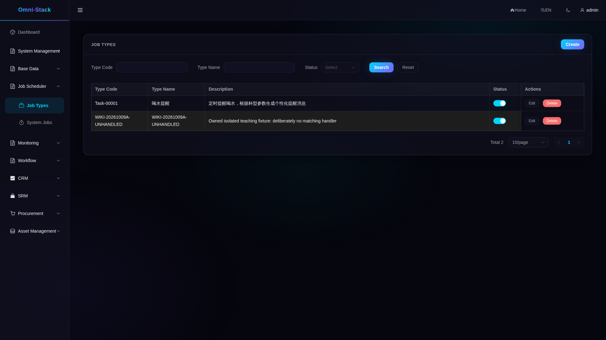

## 8. Debug One Source Unit at a Time

Build and run the service in local Docker. Use your own job ID and place breakpoints in this order. Repository source links remain usable without potentially stale code screenshots.

| Source unit | Observe | Common misunderstanding |
|---|---|---|
| [MyJobController.verifyOwnership()](../../omni-backend/omni-base/src/main/java/com/omni/base/controller/MyJobController.java) | Request tenant, current username, and target row | Access to a page does not establish ownership |
| [UserJobServiceImpl.createJob()/buildExecutorParam()](../../omni-backend/omni-base/src/main/java/com/omni/base/service/impl/UserJobServiceImpl.java) | Local ID → executor group → returned XXL ID | An unknown remote outcome is not confirmed rollback |
| Same file: `updateJob()/toggleStatus()/deleteJob()/triggerNow()` | Remote responses, previous local values, exact association | Rename-only edits leave the remote description unchanged; pause still permits manual triggers |
| [UserJobHandlerRegistry.getHandler()](../../omni-backend/omni-base/src/main/java/com/omni/base/job/UserJobHandlerRegistry.java) | Spring Map key and message `jobType` | A database catalog row does not create a Bean |
| [UserJobExecuteHandler.execute()](../../omni-backend/omni-base/src/main/java/com/omni/base/job/UserJobExecuteHandler.java) | JSON → Handler → business log → XXL callback | Acceptance differs from completion; malformed message JSON may fail before a personal log exists |
| [DrinkWaterRemindHandler.parseCupShape()/buildReminder()](../../omni-backend/omni-base/src/main/java/com/omni/base/job/handler/DrinkWaterRemindHandler.java) | String parameters, medium-cup default, returned text | This handler's malformed-JSON fallback is not a general parameter-validation policy |
| [XxlJobAdminClient](../../omni-backend/omni-common-job/src/main/java/com/omni/common/job/XxlJobAdminClient.java) | Group, complete pagination, responses, session renewal | Logging in again with the same Admin account can invalidate an earlier session; never save Cookies as evidence |

The routing lookup is this source unit:

```java
public UserJobHandler getHandler(String jobType) {
    return handlers.get(jobType);
}
```

Spring's injected Map uses Bean names as keys, so `@Component("Task-00001")` must match catalog `type_code`. The message field is `jobType`; the complete fields are `jobId/tenantId/jobType/jobName/jobParams`, not `typeCode`. `jobParams` contains a JSON string rather than a directly nested object.

Every personal job shares `userJobExecuteHandler`. It calls `execute()` and then `getResultMessage()`; the latter should produce a summary without repeating side effects. Logs explicitly use the message tenant, then the last execution time is updated. Result text is limited to 500 characters and errors to 2000. Seed synchronization scans enabled rows lacking an XXL ID; restarting does not reconcile an unknown registration outcome.

## 9. Add a Job Type

1. Implement [UserJobHandler](../../omni-backend/omni-common-core/src/main/java/com/omni/common/core/job/UserJobHandler.java) with a stable, unique Bean/type code.
2. Validate `jobParams` and explicitly use `message.getTenantId()`. Cron and manual requests can overlap; side effects need idempotency, with result summaries produced separately.
3. Define `paramTemplate` using standard JSON Schema `object/properties`. Enum values are stable protocol values; display labels may be translated.
4. Add the official catalog seed to `scripts/sql/seed/base.sql`, refresh checksums/assertions in `database/seed/manifest.yaml`, and use forward migrations for schema changes. Deploy the Handler before enabling its catalog type.
5. Verify the ordinary-user lifecycle, parameter failure, missing Handler, ownership denial, and cleanup in local Docker. After backend changes, run:

```bash
docker compose -p omni-stack-tools -f compose.tools.yaml run --rm backend ./mvnw clean install
```

See [scheduling facts](../scheduling.en.md) for engineering constraints. Cup labels, seeded names, server results/errors remain Chinese, and some Japanese/Korean column labels remain English. The tutorial explains the actual screens; image counts do not establish complete localization or human translation approval.
