# システムタスク・個人タスクとハンドラーの拡張

一般ユーザーの水分補給タスクで、作成、停止、編集、手動実行、Cron の再開、結果確認、削除を順に学び、その後にシステムタスクとソースコードを確認します。`full` プリセット、または XXL-JOB を導入済みのプロジェクトが対象です。削減された `core` プロジェクトには、このスケジューリング機能は含まれません。

検証日：2026-10-10。主幹の開始点は `fc165e3`、実行イメージは改善作業ツリーからビルドしています。[証拠とソースのハッシュ](../reference/evidence/scheduling-2026-10-10.json)に各原画像、イメージ、テスト版、制約を記録しています。4言語の操作検証は成功しています。翻訳は [ADR-0003](../adr/0003-authorized-ai-translation-review.md) に基づく `AI_REVIEW` を使用し、現在のハッシュに対応する状態は[レビュー一覧](../i18n-review-queue.md)で確認できます。

## 1. 環境とアカウントの準備

[初回起動](quick-start.jp.md)と[データの準備](../wiki/data-and-fixtures.jp.md)を済ませ、非公開の `.env` を設定した完全なプロジェクトをローカル Docker で起動します。

```bash
docker compose --profile full up -d
docker compose ps
```

migrator が正常終了し、MySQL、Nacos、XXL-JOB、Auth、Base、Gateway、フロントエンドが利用可能であることを確認します。XXL-JOB の内部 URL は `http://xxl-job-admin:8080/xxl-job-admin`、標準 Compose のホスト側 URL は既定で `http://127.0.0.1:18080/xxl-job-admin` です。`OMNI_XXL_JOB_HOST_PORT` を設定した場合は実際の値を使います。認証情報は自分の `.env` から取得し、画像や過去のアカウントを流用しません。

個人タスクにはログイン済みの一般アカウントを使います。証拠のアカウントには `USER` などの業務ロールがあり、`SUPER_ADMIN` はありません。`USER` だけを持つアカウントを別途検証したという意味ではありません。システムタスクとタスク種類の管理には、それぞれ `job:system-job:*` と `job:user-job-type:*` の権限が必要で、管理者が実演しています。

`PRACTICE-20261010-WATER` など固有名を用意してください。画像の `WIKI-20261009A-SCHUI-<locale>-...` は今回の隔離環境の練習データであり、正式なシードではありません。他の練習タスクや通知、更新前の集計値が併存するため、自分の名前の行を確認します。

## 2. 識別できる個人タスクを作る

1. ホームのワークスペースで個人タスクを開き、新規作成します。
2. 固有名を入力し、シードの水分補給タイプ「喝水提醒」を選びます。固定コードは `Task-00001` です。
3. 毎日 `23:59`、小さいカップ「小杯」を選びます。Cron は `0 59 23 * * ?`、パラメーターは `{"cupShape":"小杯"}` です。その時刻が近い場合は別の未来の時刻にします。
4. 種類、頻度、カップを確認して保存します。

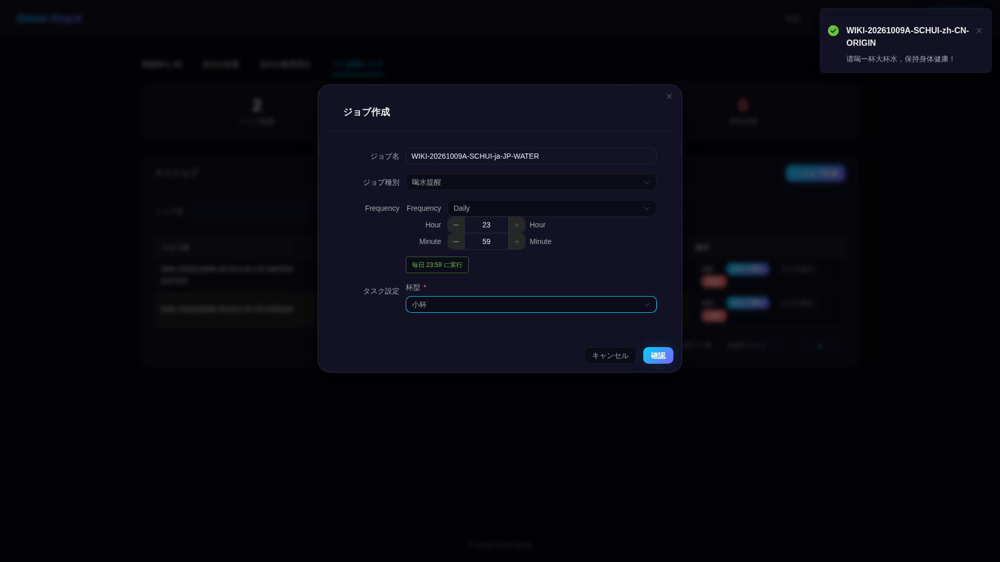

保存すると有効なタスクが表示され、バックエンドで XXL-JOB との関連も作成されます。画像が示すのは一覧の結果です。ローカル ID と返却された `xxlJobId` は別のアサーションで確認しており、この一覧には表示されません。

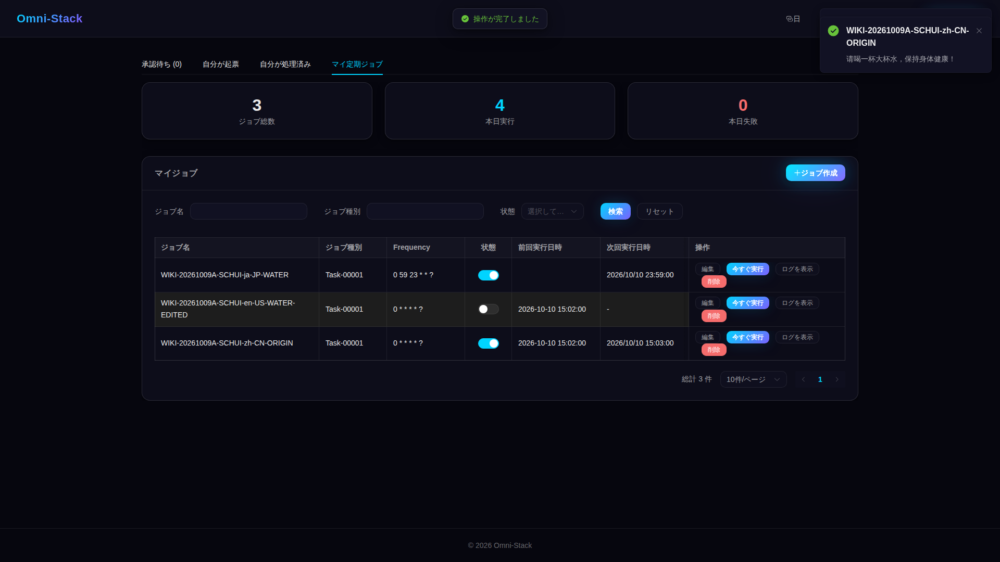

作成直後からスケジュールが有効です。編集する前に、その行のスイッチをオフにします。次回実行時刻が消えたことを確認してください。

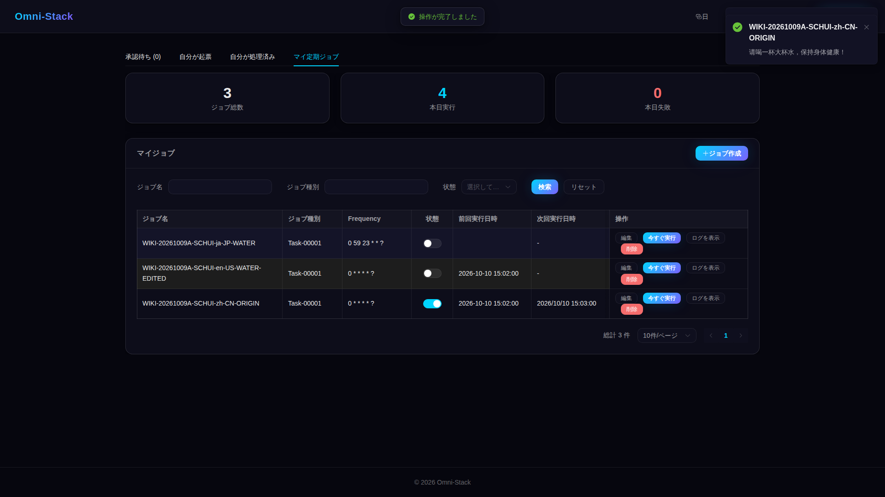

## 3. 停止中に編集して手動実行する

同じタスクを編集し、名前に `-EDITED` を追加し、頻度を毎分、カップを「大杯」にします。編集時に種類は変更できません。Cron は `0 * * * * ?`、パラメーターは `{"cupShape":"大杯"}` です。画像は送信前のフォームであり、変更の確定は後の一覧と実行結果でも確認します。

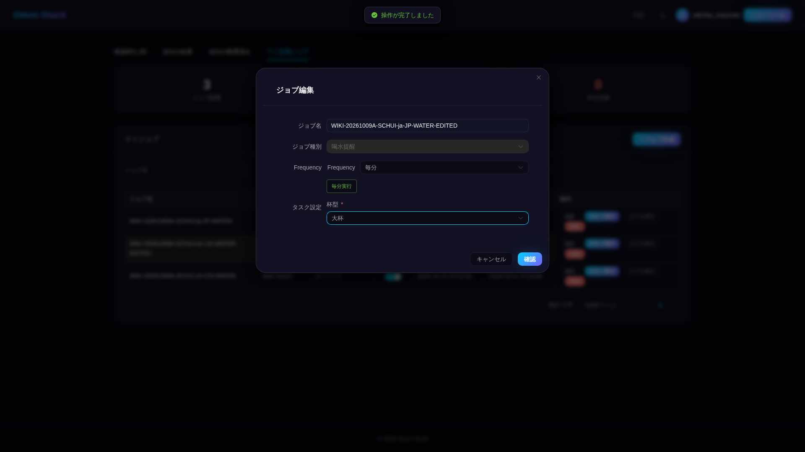

保存後も停止状態を保ち、その行の即時実行を選んで確認します。停止が止めるのは今後の Cron で、現在の実装では手動実行できます。緑色の通知はスケジューラーが要求を受理したことを示します。実行ログで新しい成功行を待ち、名前、ログ ID、時刻、「大杯」の結果を照合してください。古いログや他のタスクの通知では今回の成功を証明できません。

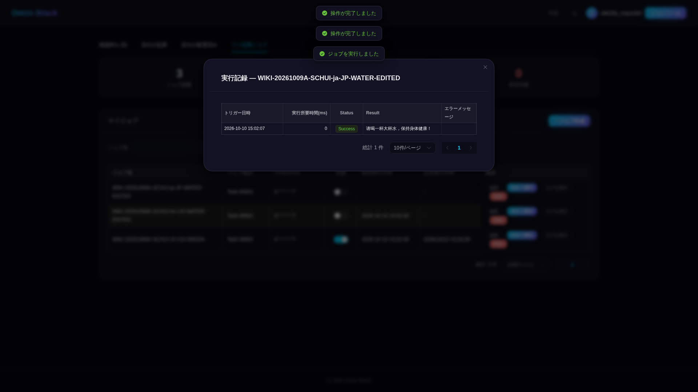

水分補給ハンドラーは通知文を記録して返し、フロントエンドがポーリングして表示できます。外部のデスクトップ、メール、携帯電話へ通知は送りません。今回の結果は、大きなカップの水を勧める「请喝一杯大杯水，保持身体健康！」です。

## 4. Cron を再開し、新しい実行を確認する

同じ行のスイッチをオンにすると、次回実行時刻が表示されます。この列はブラウザーの言語形式に従い、スラッシュ、AM/PM、地域の表記を含む場合があります。バックエンドのログ日時は `yyyy-MM-dd HH:mm:ss` のままです。

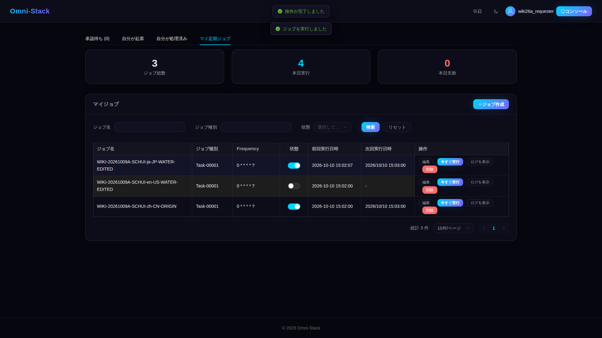

追加の手動実行はせず、次の分境界を待ってログを確認します。今回の自動検証では約90秒を上限に待機しました。手動実行より ID と時刻が新しい成功ログが必要です。

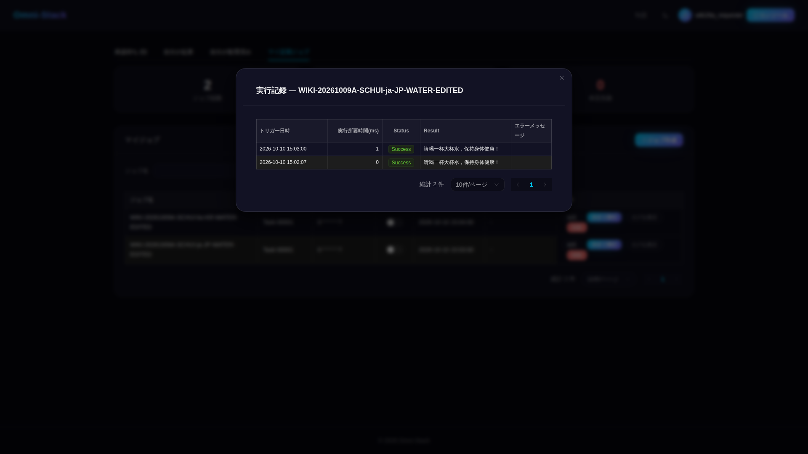

個人ログのダイアログにはトリガー元の列がありません。削除前に管理者が XXL-JOB のトリガー記録を `xxlJobId` で照合し、`MANUAL` / `CRON`、トリガーとコールバックの状態、パラメーター内のローカル `jobId` と `tenantId` を確認します。公開証拠には秘匿情報を除いた結果があります。

最初の中国語タスクは XXL-JOB のトリガー元を読む前に削除されたため、元の記録は再現できません。固有名の補足タスクを実 API で作成して確認しています。その中国語画像は補足タスクの成功ログを示し、2回目の UI 作成フローではありません。トリガー元は別の XXL-JOB 記録で証明しています。

Cron 実行を確認したら再び停止し、練習が継続しないようにします。

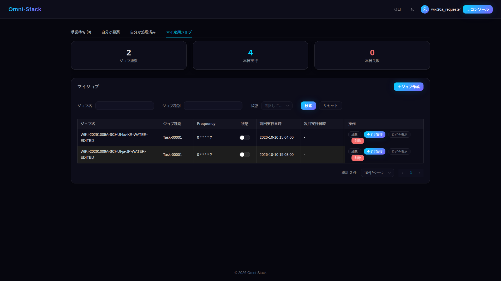

## 5. 削除と所有者の境界

必要な実行・トリガー記録を保存してから自分のタスクを削除します。XXL-JOB のタスク削除は対応するトリガーログも削除します。ローカル一覧を固有名で、スケジューラーを元の `xxlJobId` で確認します。他の練習タスクが表示されていても構いません。

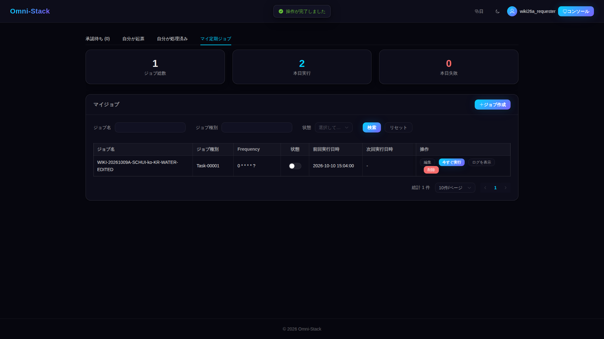

別の一般ユーザーでも検証しました。一覧に対象は現れず、ログ取得、編集、状態変更、手動実行、削除の直接要求はすべて403です。所有者はテナントと `createBy` から判断します。ID を知ることやボタン追加では回避できません。`MyJobController` の行単位の所有者検証を `@PreAuthorize` で置き換えないでください。

## 6. 実際のハンドラー不在を再現する

自分が管理する隔離練習プロジェクトだけで行います。管理者が正式な `POST /api/job/user-job-type` へ次の例を送り、固有の種類を作ります。同名 Handler は配備せず、種類 ID を指定する状態 API で有効化します。

```json
{
  "typeCode": "PRACTICE-UNHANDLED-UNIQUE",
  "typeName": "PRACTICE-UNHANDLED-UNIQUE",
  "description": "Isolated missing-handler exercise",
  "paramTemplate": "{\"type\":\"object\",\"properties\":{}}"
}
```

一般ユーザーでこの種類を選び、未来の時刻で作成し、すぐ停止してから手動実行します。新しい失敗ログは `status=0` になり、エラーにカーソルを置くと該当種類のハンドラーがないという全文が読めます。API を横取りして500を偽造したものではなく、実際の実行器のルーティング失敗です。

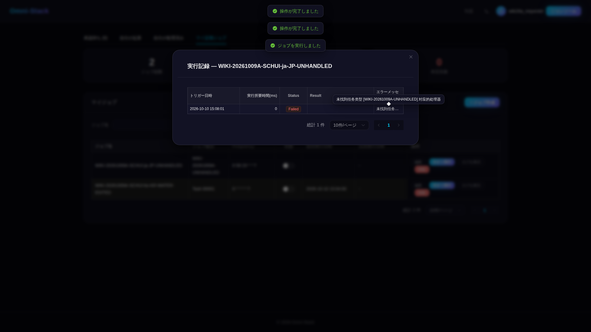

個人の失敗ログは4言語すべてで確認し、英・日・韓には XXL-JOB の `handleCode=500` も残しています。中国語の失敗タスクは先に削除されており、失われたスケジューラーログが復元されたとはしていません。

別の実失敗も検証済みです。無効な種類での作成は400、不正 Cron の登録は500で、関連するローカル・遠隔の練習タスクの残留はゼロでした。登録結果が不明なら、実行器グループ、handler、テナント、ローカル ID を正確に照合してから次の作成を判断します。タイムアウトだけを根拠に再作成しません。

終了時は自作個人タスクをすべて削除し、遠隔に存在しないことと全テナントから種類参照がないことを確認してから、その固有種類を削除します。現在の種類削除 API にはタスク参照保護がありません。シード `Task-00001` や他者利用中の種類は残してください。今回の失敗種類、通常タスク、トリガー元の補足タスクもこの順序で削除済みです。

## 7. 管理者向けの2つの一覧

システムタスクはコードで宣言し、メソッドに `@XxlJob("handlerName")` と `@SystemJobMeta(...)` の両方が必要です。登録表がメタデータを収集し、自動登録は既存の Cron とパラメーターを保ちつつ不足するタスクを追加します。状態はスケジューラー由来です。画像は Base のログ保管と MQ 中継を読み取っただけで、停止や登録解除は行っていません。

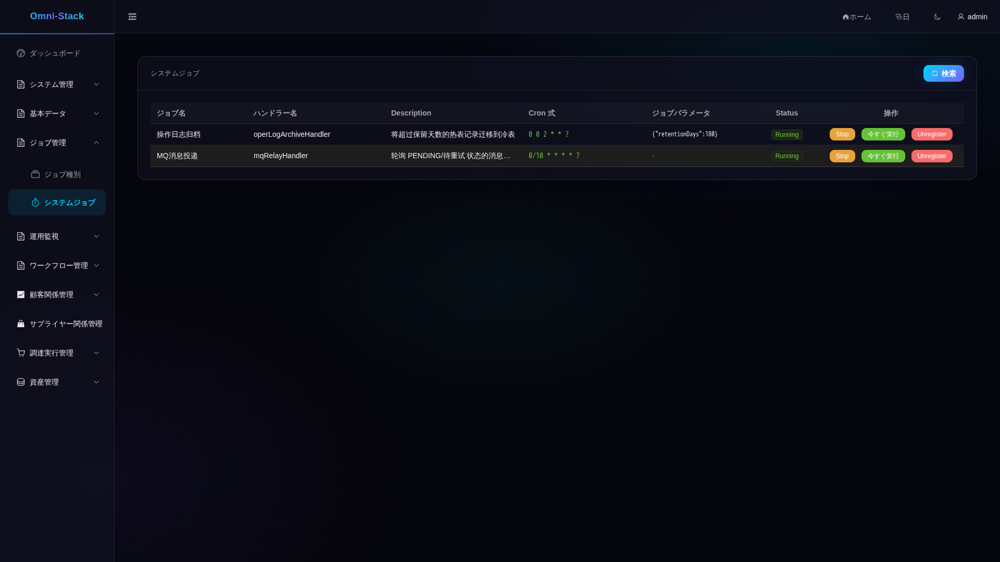

種類一覧はグローバルで、個人タスクとログはテナントおよび作成者で分離されます。一覧の有効化は選択可能を意味し、同名ハンドラーの配備を保証しません。画像にはシードと当時の自作失敗種類があり、後者は現在削除済みです。

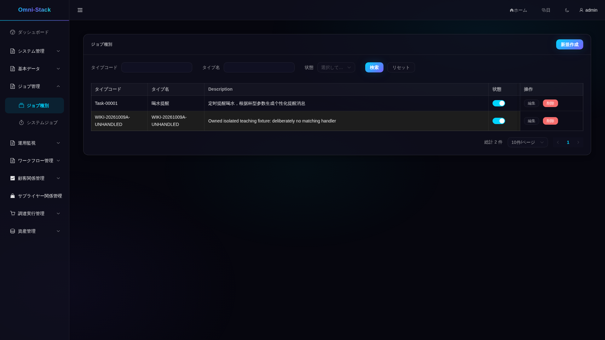

## 8. ソース単位でデバッグする

ローカル Docker でサービスをビルド・実行し、自分のタスク ID を使って以下の順にブレークポイントを置きます。リポジトリのソースリンクを使えば、古くなる可能性のあるコード画像に依存しません。

| ソース単位 | 観察する値 | よくある誤解 |
|---|---|---|
| [MyJobController.verifyOwnership()](../../omni-backend/omni-base/src/main/java/com/omni/base/controller/MyJobController.java) | 要求テナント、現在のユーザー名、対象行 | 画面アクセスと対象タスクの所有権は別 |
| [UserJobServiceImpl.createJob()/buildExecutorParam()](../../omni-backend/omni-base/src/main/java/com/omni/base/service/impl/UserJobServiceImpl.java) | ローカル ID → 実行器グループ → XXL ID の書き戻し | 遠隔結果不明はロールバック確認済みを意味しない |
| 同ファイルの `updateJob()/toggleStatus()/deleteJob()/triggerNow()` | 遠隔応答、以前のローカル値、正確な関連 | 名前のみの編集では遠隔説明は更新されず、停止中も手動実行可能 |
| [UserJobHandlerRegistry.getHandler()](../../omni-backend/omni-base/src/main/java/com/omni/base/job/UserJobHandlerRegistry.java) | Spring Map のキーとメッセージの `jobType` | DB の一覧行は Bean を作らない |
| [UserJobExecuteHandler.execute()](../../omni-backend/omni-base/src/main/java/com/omni/base/job/UserJobExecuteHandler.java) | JSON → Handler → 業務ログ → XXL コールバック | 受理と完了は別。メッセージ JSON が不正なら個人ログより前で失敗し得る |
| [DrinkWaterRemindHandler.parseCupShape()/buildReminder()](../../omni-backend/omni-base/src/main/java/com/omni/base/job/handler/DrinkWaterRemindHandler.java) | 文字列パラメーター、中杯への既定処理、返却文 | この Handler の不正 JSON への代替処理は全 Handler の検証方針ではない |
| [XxlJobAdminClient](../../omni-backend/omni-common-job/src/main/java/com/omni/common/job/XxlJobAdminClient.java) | グループ、完全なページ取得、応答、セッション更新 | 同じ Admin の再ログインで旧セッションが無効になる場合がある。Cookie を証拠に保存しない |

ルーティングの要点はこの検索だけです。

```java
public UserJobHandler getHandler(String jobType) {
    return handlers.get(jobType);
}
```

Spring が注入する Map は Bean 名をキーとするため、`@Component("Task-00001")` が一覧の `type_code` と一致する必要があります。メッセージのフィールドは `jobType` です。全体は `jobId/tenantId/jobType/jobName/jobParams` であり、`typeCode` ではありません。`jobParams` は直接入れ子のオブジェクトではなく JSON 文字列です。

すべての個人タスクは `userJobExecuteHandler` を共有します。`execute()` の後に `getResultMessage()` が呼ばれるため、後者は要約生成だけにし、副作用を再実行しません。ログにはメッセージのテナントを明示し、その後に最終実行時刻を更新します。結果は500文字、エラーは2000文字までです。シード同期は有効かつ XXL ID がない行だけを走査し、再起動は登録結果不明の照合にはなりません。

## 9. タスク種類を追加する

1. [UserJobHandler](../../omni-backend/omni-common-core/src/main/java/com/omni/common/core/job/UserJobHandler.java) を実装し、Bean と種類に安定した固有コードを付けます。
2. `jobParams` を検証し、`message.getTenantId()` を明示的に使います。Cron と手動実行は重なり得るため、副作用を冪等にし、結果要約は別に生成します。
3. 標準 JSON Schema の `object/properties` で `paramTemplate` を定義します。enum 値は安定したプロトコル値とし、表示文だけ翻訳できます。
4. `scripts/sql/seed/base.sql` に正式な種類シードを加え、`database/seed/manifest.yaml` のハッシュとアサーションを更新します。構造変更は前進移行で行い、種類を有効化する前に Handler を配備します。
5. ローカル Docker で一般ユーザーの全ライフサイクル、パラメーター失敗、Handler 不在、所有権拒否、後片付けを確認します。バックエンド変更後は次を実行します。

```bash
docker compose -p omni-stack-tools -f compose.tools.yaml run --rm backend ./mvnw clean install
```

工程制約は[スケジューリングの事実文書](../scheduling.jp.md)にあります。カップ、シード名、サーバーの結果とエラーは中国語、日・韓の一部列名は英語のままです。このチュートリアルは実画面を説明しており、画像枚数で完全なローカライズや人による翻訳レビューを代替しません。
