# 시스템 작업, 개인 작업과 핸들러 확장

일반 사용자의 물 마시기 연습으로 생성, 일시 중지, 수정, 수동 실행, Cron 재개, 결과 확인, 삭제를 순서대로 진행한 뒤 시스템 작업과 소스를 살펴봅니다. `full` 프리셋 또는 XXL-JOB가 배포된 프로젝트가 대상입니다. 축소된 `core` 프로젝트에는 이 스케줄링 기능이 포함되지 않습니다.

검증일: 2026-10-10. 주 브랜치의 시작점은 `fc165e3`이며 실행 이미지는 개선 작업 트리에서 빌드했습니다. [증거와 소스 해시](../reference/evidence/scheduling-2026-10-10.json)에 원본 이미지별 런타임, 테스트 버전, 한계를 기록했습니다. 4개 언어의 동작 검증은 통과했습니다. 번역은 [ADR-0003](../adr/0003-authorized-ai-translation-review.md)에 따른 `AI_REVIEW`를 사용하며 현재 해시에 연결된 상태는 [검토 목록](../i18n-review-queue.md)에서 확인합니다.

## 1. 환경과 계정 준비

[최초 시작](quick-start.kr.md)과 [데이터 준비](../wiki/data-and-fixtures.kr.md)를 마친 뒤 비공개 `.env`를 설정한 전체 프로젝트를 로컬 Docker에서 시작합니다.

```bash
docker compose --profile full up -d
docker compose ps
```

migrator가 정상 종료되었고 MySQL, Nacos, XXL-JOB, Auth, Base, Gateway, 프런트엔드를 사용할 수 있는지 확인합니다. XXL-JOB 내부 주소는 `http://xxl-job-admin:8080/xxl-job-admin`이며 표준 Compose의 호스트 주소는 기본적으로 `http://127.0.0.1:18080/xxl-job-admin`입니다. `OMNI_XXL_JOB_HOST_PORT`를 설정했다면 실제 값을 사용합니다. 자격 증명은 자신의 `.env`에서 확인하며 이미지나 과거 계정을 복사하지 않습니다.

개인 작업에는 로그인한 일반 계정을 사용합니다. 증거 계정은 `USER` 등의 업무 역할을 가지며 `SUPER_ADMIN`은 없습니다. `USER` 역할만 있는 계정을 별도로 검증했다는 뜻은 아닙니다. 시스템 작업과 작업 유형 관리에는 각각 `job:system-job:*`, `job:user-job-type:*` 권한이 필요하며 관리자가 시연합니다.

`PRACTICE-20261010-WATER`처럼 고유한 이름을 준비합니다. 이미지의 `WIKI-20261009A-SCHUI-<locale>-...`는 이번 격리 환경의 연습 데이터이며 공식 시드가 아닙니다. 다른 연습 작업, 알림, 갱신 전 요약 수치가 함께 표시될 수 있으므로 자신의 이름에 해당하는 행을 확인합니다.

## 2. 식별 가능한 개인 작업 생성

1. 홈 작업 공간의 내 작업에서 새 작업을 엽니다.
2. 고유한 이름을 입력하고 시드의 물 마시기 유형 “喝水提醒”을 선택합니다. 고정 코드는 `Task-00001`입니다.
3. 매일 `23:59`, 작은 컵 “小杯”를 선택합니다. Cron은 `0 59 23 * * ?`, 매개변수는 `{"cupShape":"小杯"}`입니다. 해당 시각이 가까우면 다른 미래 시각을 선택합니다.
4. 유형, 빈도, 컵을 확인한 다음 저장합니다.

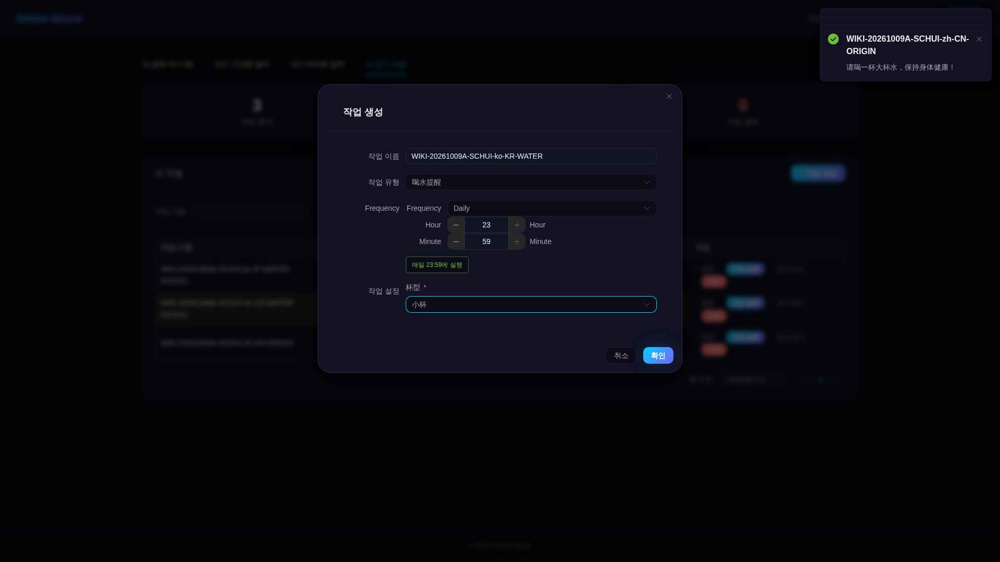

저장하면 활성화된 작업이 표시되고 백엔드에서 XXL-JOB 연결도 생성합니다. 이미지는 목록 결과를 보여 줍니다. 로컬 ID와 반환된 `xxlJobId`는 별도의 단언으로 확인했으며 이 목록에는 표시되지 않습니다.

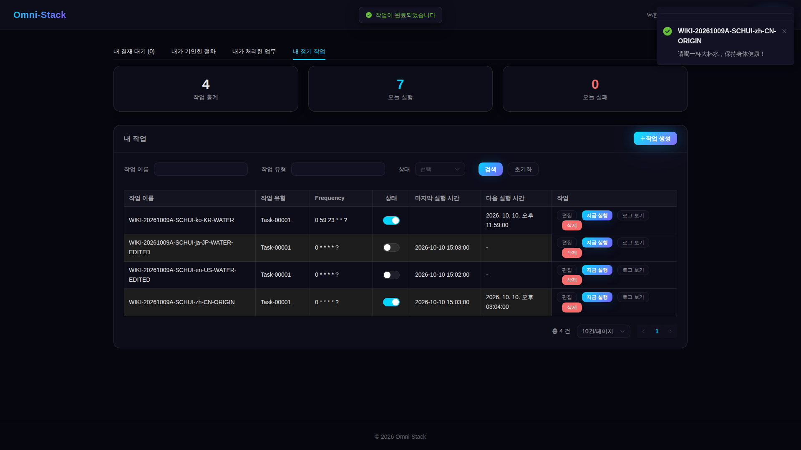

생성 즉시 스케줄링이 활성화됩니다. 수정하기 전에 해당 행의 스위치를 끕니다. 다음 실행 시각이 사라지고 스위치가 꺼졌는지 확인합니다.

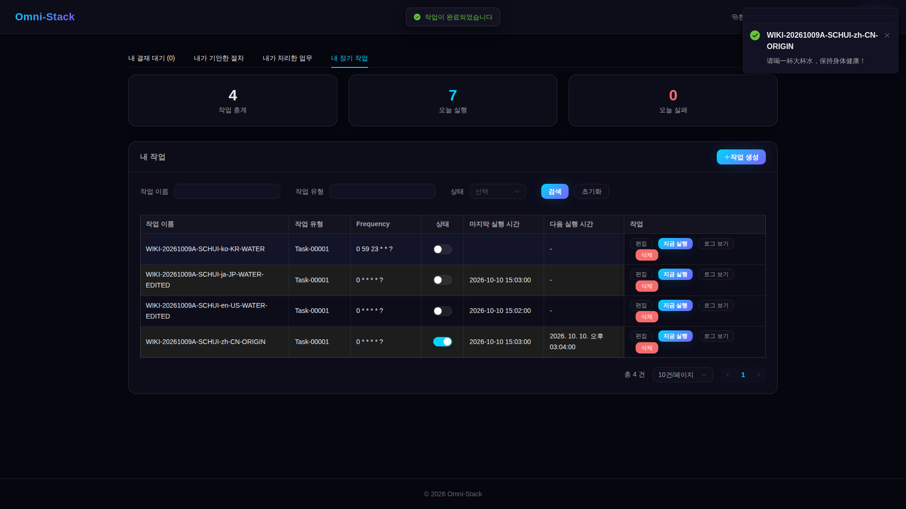

## 3. 중지 상태에서 수정하고 수동 실행

같은 작업을 수정하여 이름에 `-EDITED`를 붙이고 빈도를 매분, 컵을 “大杯”로 바꿉니다. 수정할 때 유형은 변경할 수 없습니다. Cron은 `0 * * * * ?`, 매개변수는 `{"cupShape":"大杯"}`입니다. 이미지는 제출 전 양식이며 실제 수정은 이후 목록과 실행 결과로도 확인합니다.

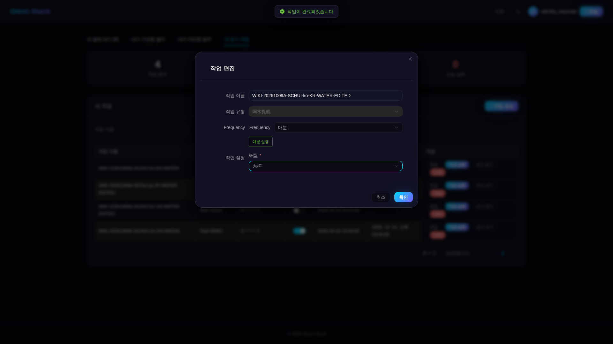

저장 후에도 중지 상태를 유지하고 해당 행의 즉시 실행을 선택해 확인합니다. 일시 중지는 이후 Cron을 막으며 현재 구현은 수동 실행을 허용합니다. 녹색 알림은 스케줄러가 요청을 접수했다는 뜻입니다. 실행 로그에서 새 성공 기록을 기다리고 이름, 로그 ID, 시각, 큰 컵 결과를 대조합니다. 이전 로그나 다른 작업의 알림으로 이번 성공을 판단하지 않습니다.

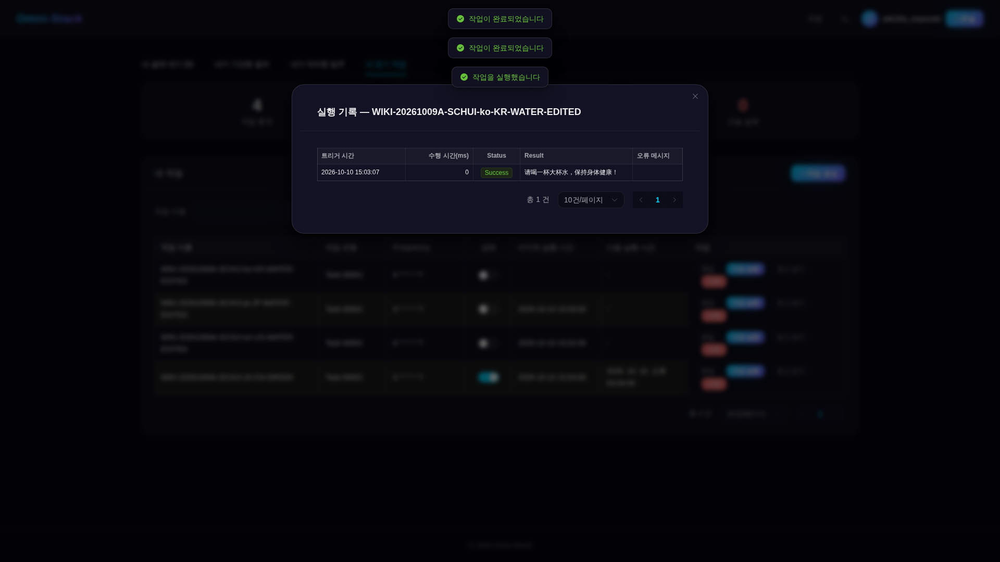

물 마시기 핸들러는 안내 문구를 기록하고 반환하며 프런트엔드가 폴링해서 표시할 수 있습니다. 외부 데스크톱, 이메일, 휴대전화에 알림을 보내지는 않습니다. 이번 실제 결과는 큰 컵의 물을 권하는 “请喝一杯大杯水，保持身体健康！”입니다.

## 4. Cron 재개와 새 실행 확인

같은 행의 스위치를 켜면 다음 실행 시각이 표시됩니다. 이 열은 브라우저 언어 형식을 사용하므로 슬래시, AM/PM, 현지 문자가 포함될 수 있습니다. 백엔드 로그 날짜는 여전히 `yyyy-MM-dd HH:mm:ss`입니다.

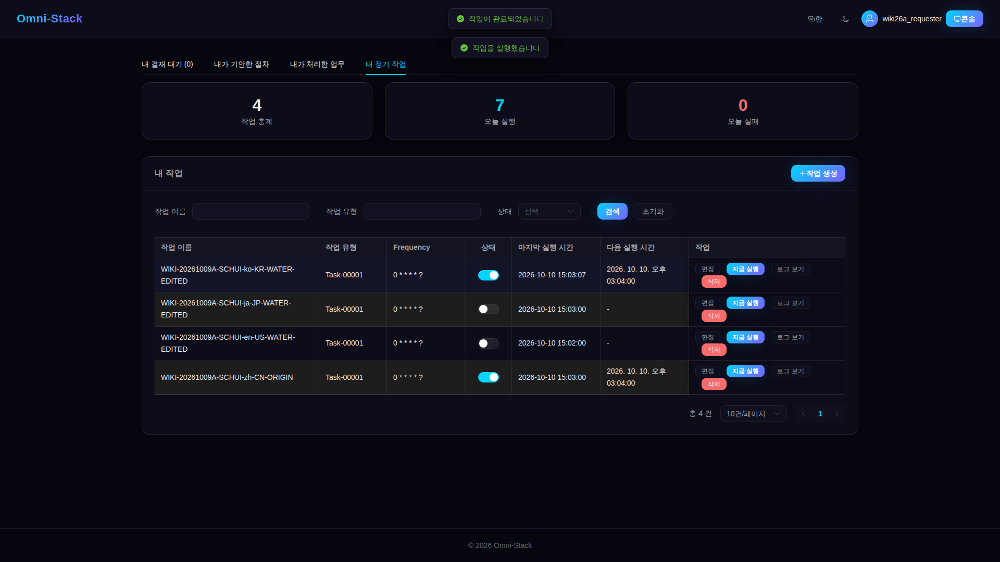

수동 실행을 추가로 누르지 않고 다음 분 경계까지 기다린 뒤 로그를 확인합니다. 이번 자동 검증은 약90초까지 기다렸습니다. 수동 기록보다 ID와 시각이 나중인 새 성공 로그가 필요합니다.

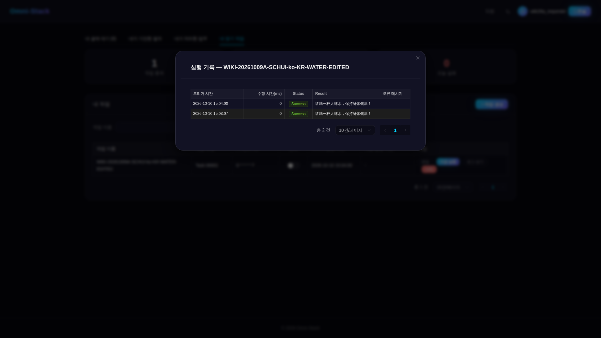

개인 로그 대화상자에는 트리거 출처 열이 없습니다. 삭제 전에 관리자가 XXL-JOB 트리거 기록을 `xxlJobId`로 대조하여 `MANUAL` / `CRON`, 트리거와 콜백 상태, 매개변수의 로컬 `jobId`와 `tenantId`를 확인합니다. 공개 증거에는 민감 정보를 제외한 결과가 있습니다.

최초 중국어 작업은 XXL-JOB 출처를 조회하기 전에 삭제되어 원래 기록을 재구성할 수 없습니다. 고유한 보충 작업을 실제 API로 생성해 출처를 검증했습니다. 해당 중국어 이미지는 보충 작업의 성공 로그를 보여 주며 두 번째 UI 생성 흐름은 아닙니다. 출처는 별도의 XXL-JOB 기록으로 입증합니다.

Cron 실행을 확인한 다음 다시 중지해 연습이 계속 실행되지 않도록 합니다.

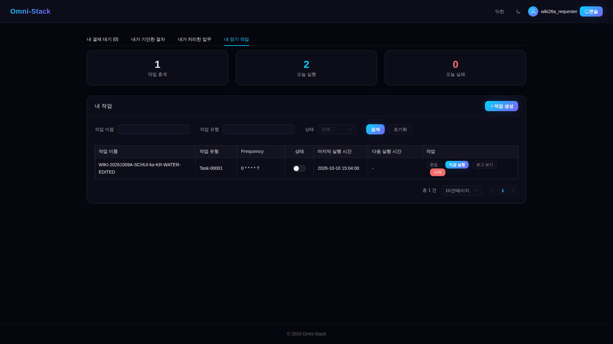

## 5. 삭제와 소유권 경계

필요한 실행 및 트리거 기록을 저장한 후 자신의 작업을 삭제합니다. XXL-JOB 작업 삭제는 해당 트리거 로그도 제거합니다. 로컬 목록에서는 고유 이름으로, 스케줄러에서는 원래 `xxlJobId`로 부재를 확인합니다. 다른 연습 작업은 남아 있을 수 있습니다.

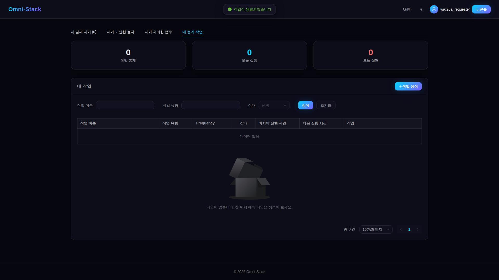

다른 일반 계정으로도 검증했습니다. 목록에 이 작업들이 없고 로그 조회, 수정, 상태 변경, 실행, 삭제의 직접 요청은 모두403을 반환했습니다. 소유권은 테넌트와 `createBy`로 판단합니다. ID를 알거나 버튼을 추가해도 우회할 수 없습니다. `MyJobController`의 행별 소유권 검사를 `@PreAuthorize`로 대체하지 마세요.

## 6. 실제 핸들러 부재 재현

자신이 소유한 격리 연습 프로젝트에서만 수행합니다. 관리자가 공식 `POST /api/job/user-job-type`에 아래 예시 본문을 보내 고유 유형을 만들고, 같은 이름의 Handler는 배포하지 않은 채 유형 ID별 상태 API로 활성화합니다.

```json
{
  "typeCode": "PRACTICE-UNHANDLED-UNIQUE",
  "typeName": "PRACTICE-UNHANDLED-UNIQUE",
  "description": "Isolated missing-handler exercise",
  "paramTemplate": "{\"type\":\"object\",\"properties\":{}}"
}
```

일반 사용자로 해당 유형을 선택해 미래 시각의 작업을 만들고 즉시 중지한 다음 수동 실행합니다. 새 실패 로그는 `status=0`이며 오류에 마우스를 올리면 해당 유형의 핸들러를 찾을 수 없다는 전체 메시지를 확인할 수 있습니다. API를 가로채500을 만든 것이 아니라 실제 실행기의 라우팅 실패입니다.

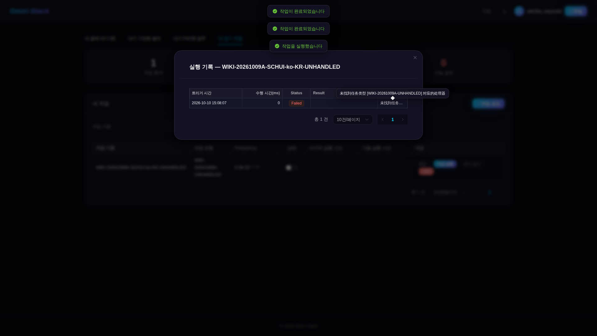

개인 실패 로그는 4개 언어 모두 검증했으며 영/일/한은 XXL-JOB `handleCode=500`도 보존했습니다. 중국어 실패 작업은 먼저 삭제되어 사라진 스케줄러 로그를 복구했다고 주장하지 않습니다.

다른 실제 실패도 확인했습니다. 비활성 유형으로 생성하면400, 잘못된 Cron 등록은500을 반환했으며 관련 로컬/원격 연습 작업 잔여는0입니다. 등록 결과가 불명확하면 실행기 그룹, handler, 테넌트, 로컬 ID를 정확히 대조한 뒤 다음 생성을 판단합니다. 시간 초과만으로 다시 만들지 않습니다.

종료할 때 자기가 만든 개인 작업을 모두 삭제하고 원격 부재와 모든 테넌트에서 유형 참조가 없음을 확인한 다음 고유 유형을 삭제합니다. 현재 유형 삭제 API에는 작업 참조 보호가 없습니다. 시드 `Task-00001`과 다른 사용자가 쓰는 유형은 보존합니다. 이번 실패 유형, 정상 작업, 출처 보충 작업도 이 순서로 정리했습니다.

## 7. 관리자용 두 가지 목록

시스템 작업은 코드로 선언하며 메서드에 `@XxlJob("handlerName")`과 `@SystemJobMeta(...)`가 모두 필요합니다. 등록 표가 메타데이터를 수집하고 자동 등록은 기존 Cron과 매개변수를 유지하면서 없는 작업을 추가합니다. 상태는 스케줄러에서 읽습니다. 이미지는 Base 로그 보관과 MQ 중계를 읽기만 한 것이며 중지하거나 등록 해제하지 않았습니다.

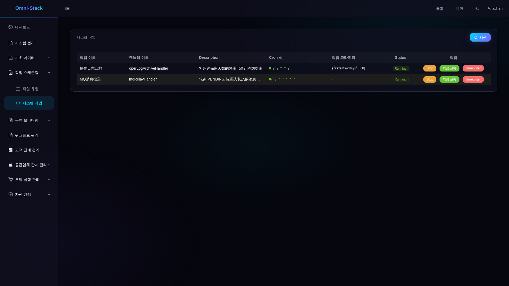

유형 목록은 전역이며 개인 작업과 로그는 테넌트와 생성자별로 격리됩니다. 목록 활성화는 선택 가능하다는 뜻이며 같은 이름의 핸들러 배포를 증명하지 않습니다. 이미지에는 시드와 당시의 자체 실패 유형이 있으며 후자는 현재 삭제되었습니다.

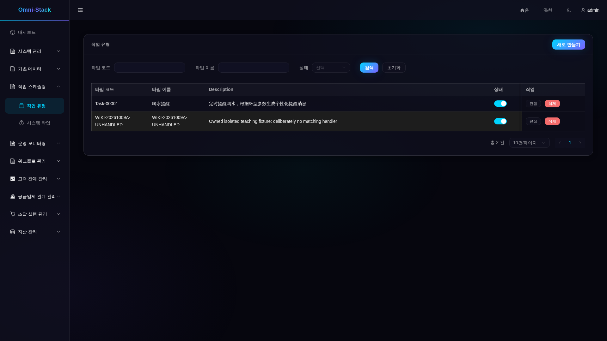

## 8. 소스 단위로 디버깅

로컬 Docker에서 서비스를 빌드하고 실행한 뒤 자신의 작업 ID로 아래 순서에 따라 중단점을 설정합니다. 오래될 수 있는 코드 이미지 대신 저장소 소스 링크를 사용할 수 있습니다.

| 소스 단위 | 관찰할 값 | 흔한 오해 |
|---|---|---|
| [MyJobController.verifyOwnership()](../../omni-backend/omni-base/src/main/java/com/omni/base/controller/MyJobController.java) | 요청 테넌트, 현재 사용자명, 대상 행 | 화면 접근과 작업 소유권은 다름 |
| [UserJobServiceImpl.createJob()/buildExecutorParam()](../../omni-backend/omni-base/src/main/java/com/omni/base/service/impl/UserJobServiceImpl.java) | 로컬 ID → 실행기 그룹 → XXL ID 저장 | 불명확한 원격 결과는 확인된 롤백이 아님 |
| 같은 파일의 `updateJob()/toggleStatus()/deleteJob()/triggerNow()` | 원격 응답, 이전 로컬 값, 정확한 연결 | 이름만 바꾸면 원격 설명은 그대로이며 중지 중 수동 실행 가능 |
| [UserJobHandlerRegistry.getHandler()](../../omni-backend/omni-base/src/main/java/com/omni/base/job/UserJobHandlerRegistry.java) | Spring Map 키와 메시지의 `jobType` | DB 목록 행이 Bean을 생성하지 않음 |
| [UserJobExecuteHandler.execute()](../../omni-backend/omni-base/src/main/java/com/omni/base/job/UserJobExecuteHandler.java) | JSON → Handler → 업무 로그 → XXL 콜백 | 접수와 완료는 다름. 메시지 JSON 오류는 개인 로그 생성 전에 실패할 수 있음 |
| [DrinkWaterRemindHandler.parseCupShape()/buildReminder()](../../omni-backend/omni-base/src/main/java/com/omni/base/job/handler/DrinkWaterRemindHandler.java) | 문자열 매개변수, 중간 컵 기본값, 반환 문구 | 이 핸들러의 잘못된 JSON 대체 처리는 모든 핸들러의 검증 정책이 아님 |
| [XxlJobAdminClient](../../omni-backend/omni-common-job/src/main/java/com/omni/common/job/XxlJobAdminClient.java) | 그룹, 전체 페이지 조회, 응답, 세션 갱신 | 같은 Admin 계정의 재로그인이 기존 세션을 무효화할 수 있음. Cookie를 증거에 저장하지 않음 |

라우팅의 핵심은 다음 조회입니다.

```java
public UserJobHandler getHandler(String jobType) {
    return handlers.get(jobType);
}
```

Spring이 주입한 Map의 키는 Bean 이름이므로 `@Component("Task-00001")`은 목록의 `type_code`와 일치해야 합니다. 메시지 필드는 `jobType`입니다. 전체 필드는 `jobId/tenantId/jobType/jobName/jobParams`이며 `typeCode`가 아닙니다. `jobParams`는 직접 중첩된 객체가 아니라 JSON 문자열입니다.

모든 개인 작업은 `userJobExecuteHandler`를 공유합니다. `execute()` 후 `getResultMessage()`를 호출하므로 후자는 요약만 생성하고 업무 부수 효과를 반복하지 않아야 합니다. 로그에 메시지 테넌트를 명시한 다음 최근 실행 시각을 갱신합니다. 결과는 최대500자, 오류는2000자입니다. 시드 동기화는 활성 상태이면서 XXL ID가 없는 행만 조회하며 재시작은 불명확한 등록 결과의 대조가 아닙니다.

## 9. 작업 유형 추가

1. [UserJobHandler](../../omni-backend/omni-common-core/src/main/java/com/omni/common/core/job/UserJobHandler.java)를 구현하고 Bean과 유형에 안정적이고 고유한 코드를 지정합니다.
2. `jobParams`를 검증하고 `message.getTenantId()`를 명시적으로 사용합니다. Cron과 수동 요청이 겹칠 수 있으므로 부수 효과에 멱등성을 적용하고 결과 요약은 별도로 생성합니다.
3. 표준 JSON Schema `object/properties`로 `paramTemplate`을 정의합니다. enum 값은 안정적인 프로토콜 값이며 표시 문구는 번역할 수 있습니다.
4. `scripts/sql/seed/base.sql`에 공식 목록 시드를 추가하고 `database/seed/manifest.yaml`의 해시와 단언을 갱신합니다. 스키마 변경은 순방향 마이그레이션으로 처리하며 유형 활성화 전에 Handler를 배포합니다.
5. 로컬 Docker에서 일반 사용자 전체 수명 주기, 매개변수 실패, Handler 부재, 소유권 거부, 정리를 검증합니다. 백엔드 변경 후 다음을 실행합니다.

```bash
docker compose -p omni-stack-tools -f compose.tools.yaml run --rm backend ./mvnw clean install
```

공학 제약은 [스케줄링 사실 문서](../scheduling.kr.md)에 있습니다. 컵, 시드 이름, 서버 결과와 오류는 중국어이며 일/한의 일부 열 이름은 영어로 남아 있습니다. 이 튜토리얼은 실제 화면을 설명하며 이미지 수로 완전한 현지화나 사람의 번역 검토를 대체하지 않습니다.
