# 系统任务、个人任务与处理器扩展

本文从普通用户的一次喝水提醒练习开始，走完创建、暂停、修改、手动执行、恢复 Cron、查看结果和删除，再解释系统任务与源码。适用 `full` 预设及已部署 XXL-JOB 的项目；`core` 裁剪项目不包含本教程的调度能力。

验证日期：2026-10-10。主干起点为 `fc165e3`，实际运行的是整改工作树构建的镜像；[证据与源码摘要](../reference/evidence/scheduling-2026-10-10.json)记录每张原图、镜像、测试版本和限制。四语言操作验收通过；译文按 [ADR-0003](../adr/0003-authorized-ai-translation-review.md) 进行 `AI_REVIEW`，当前摘要绑定状态见[复核队列](../i18n-review-queue.md)。

## 1. 准备环境与身份

先完成[首次启动](quick-start.md)与[数据准备](../wiki/data-and-fixtures.md)。在本机 Docker 启动已配置私有 `.env` 的完整项目：

```bash
docker compose --profile full up -d
docker compose ps
```

确认 migrator 成功退出，MySQL、Nacos、XXL-JOB、Auth、Base、Gateway 和前端可用。XXL-JOB 内网地址是 `http://xxl-job-admin:8080/xxl-job-admin`；标准 Compose 的宿主入口默认是 `http://127.0.0.1:18080/xxl-job-admin`，若设置了 `OMNI_XXL_JOB_HOST_PORT`，按实际值访问。凭据取自自己的 `.env`，不要复制截图或历史账号。

个人任务使用已登录的普通账号。实际取证账号有 `USER` 等业务角色，没有 `SUPER_ADMIN`；这不代表已单独验证只有 `USER` 一个角色的账号。系统任务/任务类型管理另需 `job:system-job:*` / `job:user-job-type:*` 权限，由管理员演示。

准备唯一名称，例如 `PRACTICE-20261010-WATER`。截图中的 `WIKI-20261009A-SCHUI-<locale>-...` 是本次隔离环境自建数据，不是正式种子。识别自己那一行；其他练习任务、通知及暂未刷新的统计数字可能同时出现。

## 2. 创建一个可识别的个人任务

1. 打开首页工作台的“我的任务”，点击新建。
2. 输入唯一名称，选择种子类型“喝水提醒”，其稳定编码为 `Task-00001`。
3. 选择每天 `23:59`，杯型选择“小杯”。对应 Cron 是 `0 59 23 * * ?`，参数是 `{"cupShape":"小杯"}`。若已接近这个时间，选择另一个未来时间。
4. 提交前核对类型、频率和杯型，再保存。

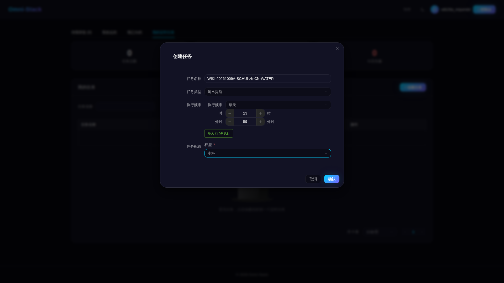

保存成功后会出现启用状态的任务，后台同时建立 XXL-JOB 关联。截图证明列表结果；本次测试另行核对了本地 ID 和返回的 `xxlJobId`，界面没有展示这两个 ID。

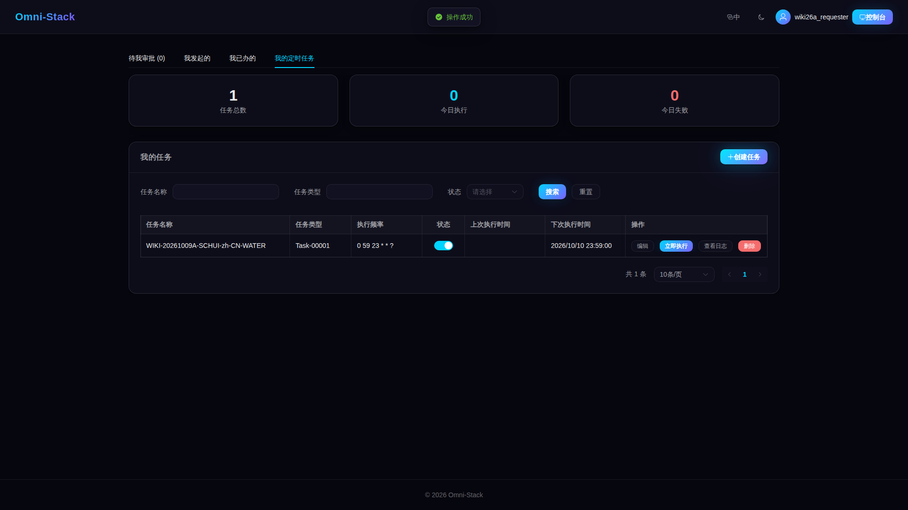

正常创建立即启用。先关闭该行开关，为下一步修改留出时间；应看到开关关闭、下一次执行时间消失。

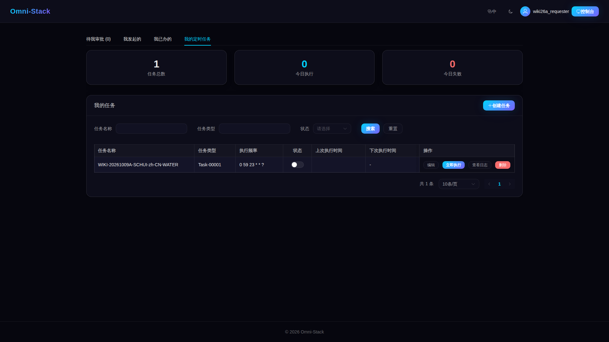

## 3. 暂停中修改，再手动执行

编辑刚才的任务，将名称加上 `-EDITED`，频率改为每分钟，杯型改为“大杯”。类型在编辑时不可更换。对应 Cron 为 `0 * * * * ?`，参数为 `{"cupShape":"大杯"}`。下图是提交前表单，修改成功由后续列表和执行结果共同核对。

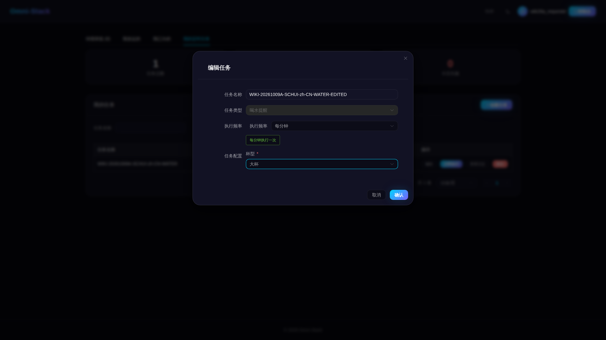

保存后保持暂停，点击该行“立即执行”并确认。暂停只停止后续 Cron，当前实现允许手动触发。绿色提示表示调度中心受理；进入执行日志，等待一条新的成功记录，核对名称、日志 ID、时间和“大杯”结果。不要用已有日志或其他任务的通知作为本次成功依据。

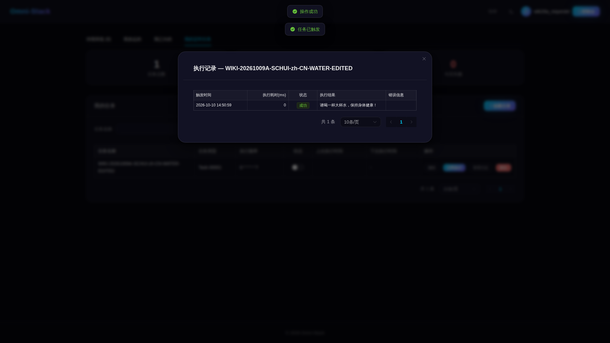

喝水处理器只记录并返回提醒文字，前端可以轮询显示通知；它没有给桌面、邮箱或手机发送外部通知。本次结果为“请喝一杯大杯水，保持身体健康！”。

## 4. 恢复 Cron，并证明发生了新执行

重新打开该行开关，应看到下一次执行时间。该列按浏览器语言格式化，可能含斜杠、AM/PM 或本地文字；后端日志日期仍遵循 `yyyy-MM-dd HH:mm:ss`。

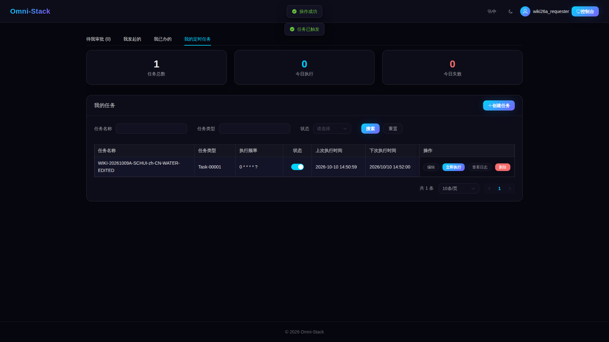

不再点击立即执行，等待下一个分钟边界，再查看日志。本次自动化最多等待约 90 秒；应出现 ID 和时间都晚于手动记录的新成功日志。

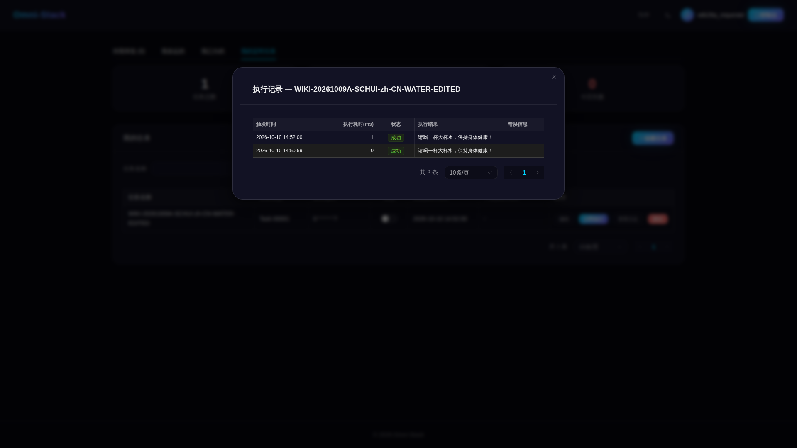

个人日志弹层没有“触发来源”列。要严格区分手动与 Cron，删除前请管理员在 XXL-JOB 触发记录中按 `xxlJobId` 核对 `MANUAL` / `CRON`、触发/回调状态及参数中的本地 `jobId`、`tenantId`。公开证据保留了这些字段的脱敏结果。

中文首次任务在读取 XXL-JOB 来源之前已删除，原调度日志无法补造，因此另外通过真实 API 建立了唯一名称的来源验证任务。下面仅证明补充任务已有成功日志；它不是第二次界面创建流程，来源仍由独立 XXL-JOB 记录证明。

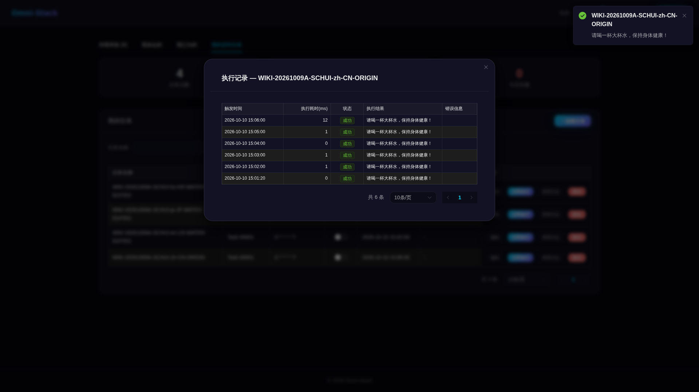

确认 Cron 执行后再次暂停，防止练习继续运行。

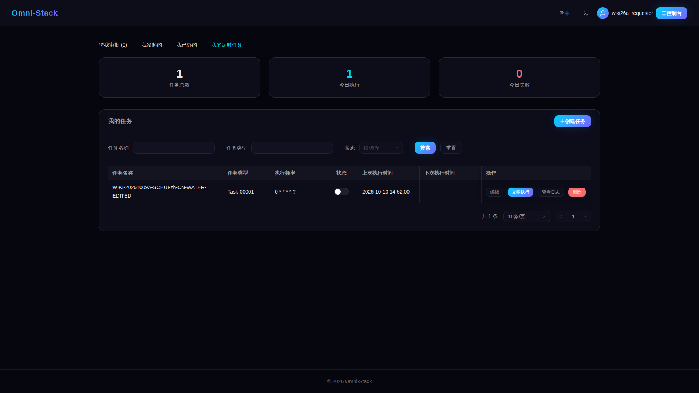

## 5. 删除与归属边界

先保存需要的执行/触发记录，再删除自己的任务。XXL-JOB 删除任务会一并删除对应触发日志。删除后按唯一名称确认本地列表无该任务，并核对原 `xxlJobId` 在调度中心已不存在；列表中仍可保留别的练习任务。

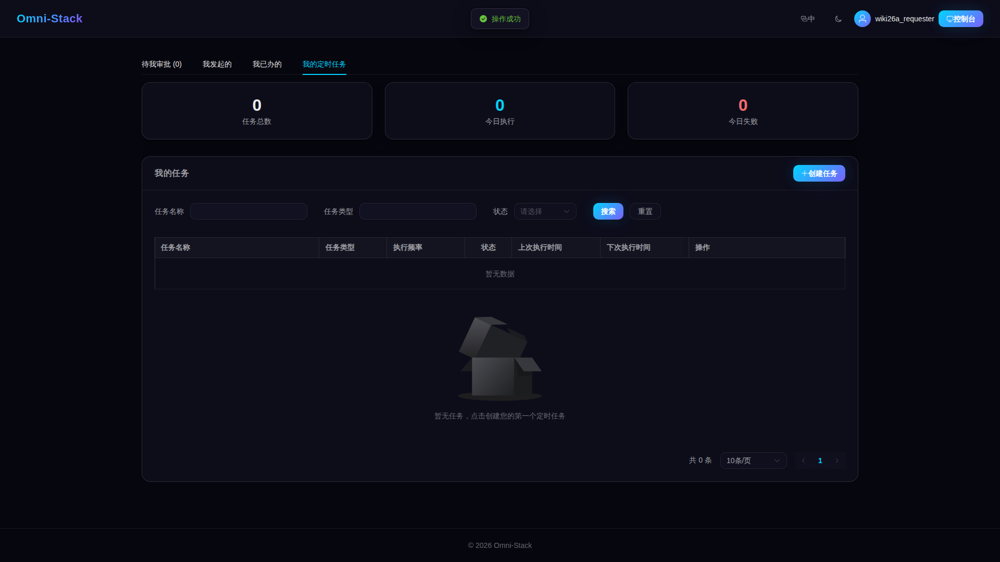

本次还用另一普通身份核对：列表看不到这些任务；直接访问日志、修改、启停、触发和删除均返回 403。归属来自租户和 `createBy`，不能通过拿到 ID 或增加页面按钮绕开。不要给 `MyJobController` 添加 `@PreAuthorize` 来替代逐行归属校验。

## 6. 复现一次真实处理器失败

这一步只在自有隔离练习项目做。管理员通过正式 `POST /api/job/user-job-type` 创建唯一类型，示例请求体如下；不部署同名 Handler，并用该类型 ID 的状态接口启用它：

```json
{
  "typeCode": "PRACTICE-UNHANDLED-UNIQUE",
  "typeName": "PRACTICE-UNHANDLED-UNIQUE",
  "description": "Isolated missing-handler exercise",
  "paramTemplate": "{\"type\":\"object\",\"properties\":{}}"
}
```

普通用户选择它，创建未来时间的个人任务，立即暂停，然后手动执行。应新增失败日志 `status=0`，悬停错误文本能看到“未找到任务类型 […] 对应的处理器”。这是执行器真实路由失败，不是拦截接口伪造 500。

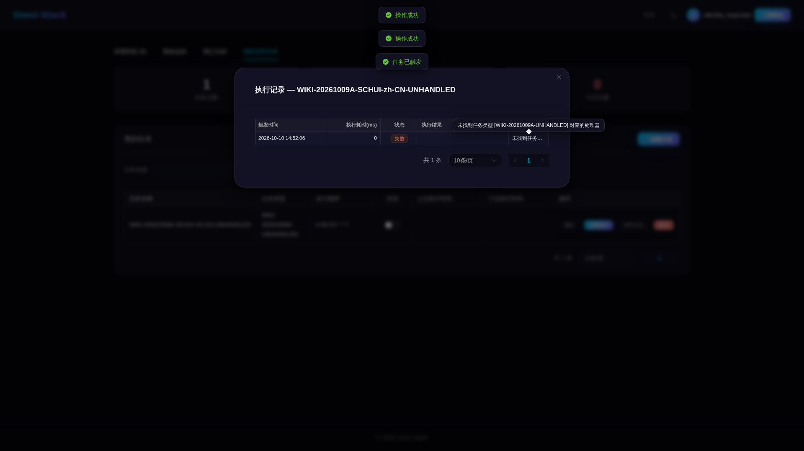

本次四语言均验证了个人失败日志；英/日/韩另保留 XXL-JOB `handleCode=500`。中文失败任务已先删除，不能声称补回其 XXL-JOB 日志。

其他真实失败也已验证：禁用类型创建返回 400，非法 Cron 注册返回 500，相关本地/远端练习任务残留为零。注册结果未知时，先对账精确的执行器组、handler、租户及本地 ID，不能凭超时直接再次创建。

完成后先删除全部自建个人任务、核对远端无残留，再确认该类型在所有租户均无引用，最后删除唯一自建类型。当前类型删除接口没有任务引用保护；不要删除种子 `Task-00001` 或他人使用的类型。本次失败类型、正常任务和来源补充任务均已按这个顺序清理。

## 7. 管理员看到的两类目录

系统任务由代码声明，方法同时需要 `@XxlJob("handlerName")` 和 `@SystemJobMeta(...)`。注册表收集元数据，自动注册补充缺失任务并保留已有 Cron/参数。列表中的运行状态来自调度中心；下图只读查看 Base 的日志归档和 MQ 中继，没有启停或注销它们。

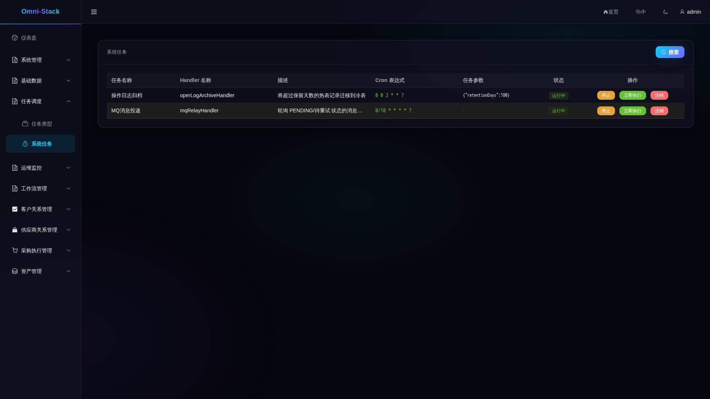

任务类型是全局目录，个人任务与日志按租户和创建人隔离。目录启用只表示用户可以选择，不证明同名处理器已部署。下图记录种子类型及当时尚在验证中的自建失败类型；后者现已删除。

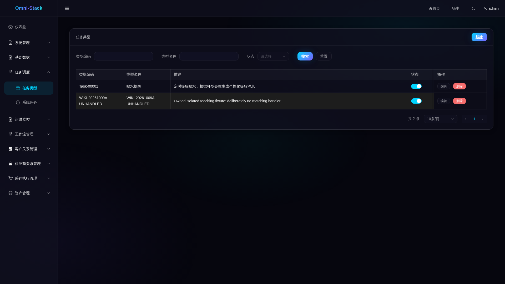

## 8. 沿源码逐个单元调试

先在本机 Docker 构建并运行对应服务，使用自己的任务 ID，按以下顺序断点。源码链接可直接在仓库中打开；无需依赖可能过期的代码截图。

| 源码单元 | 观察什么 | 常见误解 |
|---|---|---|
| [MyJobController.verifyOwnership()](../../omni-backend/omni-base/src/main/java/com/omni/base/controller/MyJobController.java) | 请求租户、当前用户名与目标行 | 看得到入口不等于拥有目标任务 |
| [UserJobServiceImpl.createJob()/buildExecutorParam()](../../omni-backend/omni-base/src/main/java/com/omni/base/service/impl/UserJobServiceImpl.java) | 本地 ID → 执行器组 → XXL ID 回填 | 远端未知结果不能当成已回滚 |
| 同文件 `updateJob()/toggleStatus()/deleteJob()/triggerNow()` | 更新前后远端响应、本地旧值、精确关联 | 只改名称不更新远端描述；暂停仍可手动执行 |
| [UserJobHandlerRegistry.getHandler()](../../omni-backend/omni-base/src/main/java/com/omni/base/job/UserJobHandlerRegistry.java) | Spring Map 的键与消息 `jobType` | 数据库目录行不会自动创建 Bean |
| [UserJobExecuteHandler.execute()](../../omni-backend/omni-base/src/main/java/com/omni/base/job/UserJobExecuteHandler.java) | JSON → Handler → 业务日志 → XXL 回调 | 受理与完成分开；解析 JSON 失败可能还没有个人日志 |
| [DrinkWaterRemindHandler.parseCupShape()/buildReminder()](../../omni-backend/omni-base/src/main/java/com/omni/base/job/handler/DrinkWaterRemindHandler.java) | 字符串参数、默认中杯、返回文字 | 非法参数 JSON 在此处理器会回退，不代表所有处理器都接受非法参数 |
| [XxlJobAdminClient](../../omni-backend/omni-common-job/src/main/java/com/omni/common/job/XxlJobAdminClient.java) | 分组、完整分页、响应与会话更新 | 同一 Admin 账号重新登录可使旧会话失效；不把 Cookie 写入证据 |

路由的关键源码只有这个查找：

```java
public UserJobHandler getHandler(String jobType) {
    return handlers.get(jobType);
}
```

Spring 注入的 Map 以 Bean 名为键，所以 `@Component("Task-00001")` 必须匹配目录 `type_code`。消息字段叫 `jobType`，完整消息为 `jobId/tenantId/jobType/jobName/jobParams`，不是 `typeCode`。`jobParams` 是 JSON 字符串，不是直接嵌套对象。

所有个人任务共享 `userJobExecuteHandler`。它调用 `execute()` 后再调用 `getResultMessage()`，后者应只生成摘要，不能重复业务副作用。成功/失败日志显式写入消息租户，再更新最近执行时间；结果最多 500 字符，错误最多 2000 字符。种子同步器仅扫描启用且缺 XXL ID 的行，重启不等于未知注册结果恢复。

## 9. 增加一个任务类型

1. 实现 [UserJobHandler](../../omni-backend/omni-common-core/src/main/java/com/omni/common/core/job/UserJobHandler.java)，为 Bean 选一个稳定且唯一的类型编码。
2. 校验 `jobParams`，显式使用 `message.getTenantId()`。Cron 与手动请求可能重叠，带业务副作用的处理器需要幂等设计；结果摘要单独生成。
3. 用标准 JSON Schema `object/properties` 声明 `paramTemplate`；枚举值作为稳定协议值，显示文案可以翻译。
4. 将正式目录种子加入 `scripts/sql/seed/base.sql`，刷新 `database/seed/manifest.yaml` 摘要与断言；结构变更走前向迁移。先部署 Handler，再启用目录类型。
5. 在本机 Docker 验证普通用户完整生命周期、参数失败、缺 Handler、越权及清理。后端改动执行：

```bash
docker compose -p omni-stack-tools -f compose.tools.yaml run --rm backend ./mvnw clean install
```

事实约束见[调度事实文档](../scheduling.md)。截图中的杯型、种子名称、服务端结果/错误仍为中文，日/韩部分列名仍为英文；本教程解释实际画面，不以截图数量代替本地化或人工翻译复核。
