# SRM administration and supplier portal walkthrough

Follow enrollment, onboarding approval, evaluation, risk and procurement quotations. Internal users and portal users have different roles and data boundaries. Prepare an isolated environment, organizations and approval candidates using [Data and evidence fixtures](../wiki/data-and-fixtures.en.md).

This stage checks four-language documents, current source and historical originals without repeating enrollment, approval, scoring, risk or lifecycle commands. Section 8 records 2026-10-12; section 9 records 2026-10-13. Do not replay successful writes.

## 1. Check roles, organizations and the model

1. Internal operators need SRM management permissions. A new supplier account starts with `USER`; a successful enrollment Saga grants `SUPPLIER` and creates an active portal association. Sign in again to obtain updated permissions.
2. Check the published version of `supplier-onboarding`. Bootstrap may already have published it; do not republish or edit a shared version merely to follow this tutorial.
3. The default approval sequence requires `SRM_MANAGER`, `SRM_COMPLIANCE` and `SRM_DIRECTOR`. Role assignment, the organization anchor and `sys_user_role_scope` must all match the model. A user-role row alone is insufficient.
4. Candidates also need task, instance-view and `workflow:approval:complete` permissions. Existing SRM approval roles do not automatically provide every workflow action. In the isolated demo, add a minimal supplementary role; the fixture chapter lists the permissions and controlled organization-scope fixture.
5. Preview actual candidates before submitting. Verify ordinary business roles without substituting `SUPER_ADMIN`.

## 2. Invite, register and enroll

1. In SRM enrollment invitations, create an invitation owned by this tutorial run. Record its expiry and usage limits. Keep the token private and mask it in screenshots.
2. The supplier opens `/portal-register`, completes registration and the real CAPTCHA as described in [Authentication](authentication.en.md), then signs in to the portal.
3. Submit the invitation token, company details and a unique client-generated `requestId`. Reuse that ID for network retries to avoid duplicate enrollment records.
4. Inspect enrollment progress. SRM creates a `REGISTERING` supplier, requests the Auth role through a Saga and establishes the portal association. Only after the Saga completes does onboarding start.
5. Inspect the Saga separately from supplier `status`, `workflowStartStatus` and `processInstanceId`. A completed Saga proves the role/association steps, not approval of the supplier.

Never write a portal user ID into internal `owner_user_id` or `owner_unit_id`. Assign internal ownership through administration. Contacts, qualifications and bank accounts inherit visibility from the supplier aggregate; do not filter child tables using owner columns they do not have.

## 3. Approve, reject and withdraw

```text
Portal: REGISTERING → PENDING_REVIEW → APPROVING → APPROVED
                                      ↘ REJECTED → resubmit → APPROVING
APPROVING → withdraw/cancel → PENDING_REVIEW
APPROVED ↔ SUSPENDED
APPROVED ↔ BLACKLISTED
APPROVED/SUSPENDED → ELIMINATED
```

1. Creating a supplier internally also attempts to start onboarding automatically. A successful start returns `APPROVING + STARTED` and a real `processInstanceId`.
2. The three approvers open the same business in their task lists and submit decisions in sequence. After the last approval, a Workflow completion event updates SRM to `APPROVED`. Poll while the asynchronous callback is pending; do not edit database status.
3. Use a separate demo supplier for rejection. Reject at the first task, wait for `REJECTED`, correct the details and resubmit. The new approval must use a different instance while preserving the old history.
4. Withdraw or cancel the resubmitted running approval. After remote termination, the supplier becomes `PENDING_REVIEW`, the instance ID is cleared, the start status becomes `NOT_STARTED` and the former task disappears.
5. **Current limitation:** the public resubmit endpoint only accepts `REJECTED`. It cannot restart a withdrawn `PENDING_REVIEW` supplier or a `PENDING_REVIEW + FAILED` start. There is no public retry-start endpoint. Retrying the portal enrollment Saga is not a workflow retry. Preserve the record and investigate the failure path.

## 4. Lifecycle and procurement eligibility

1. Read the current version of an approved demo supplier, then suspend it. The native dialog confirms the name and has no reason input. To record a reason, use the formal API's optional `reason` field. Expect `SUSPENDED` and exclusion from procurement options for the category.
2. Resume to `APPROVED`. Blacklisting produces `BLACKLISTED`; the dedicated restore-from-blacklist operation returns it to `APPROVED`.
3. `ELIMINATED` is terminal. Use a separate disposable test record; it is not the next step of the suspend/resume example.
4. Every mutation uses the current `version`. On a stale-version conflict, reload and inspect the state before deciding on another submission.

Procurement options require `APPROVED` and a matching category. `RED` risk and lifecycle blacklisting are separate fields; the historical risk assessment did not automatically blacklist the supplier.

## 5. Evaluation completes on submission

1. Open evaluations as an internal evaluator. Select a visible, eligible supplier and load the default template and dimensions.
2. Score every dimension exactly once within `1.0–5.0`, with at most one decimal place. Weights must total 100. Submit with a period unique to this run.
3. The current endpoint calculates the result, updates supplier level and writes the Outbox event in one transaction. It returns `COMPLETED`; there is no separate pending/in-progress/completion interaction.
4. The formula is `Σ(dimension score / 5 × dimension weight)`. Scores of 4 with weights totaling 100 give 80 and level `PREFERRED`; a score of 6 should return business code 400 under current validation. This explains the rule, not a new scoring submission in this stage.
5. The associated supplier sees the result under portal evaluations; another supplier must not. Active supplier associations determine portal visibility.

## 6. Risk and quotations

1. Open the demo supplier in risk management and distinguish automatic from manual indicators. The backend checks `autoCalc` only when it finds an enabled indicator type; an automatically calculated type rejects manual overwrite. Missing or disabled types are not covered by that same check.
2. Choose a scoring criterion belonging to each manual indicator and submit its `criterionId`, current version and remark. Changing a displayed color is insufficient.

First verify the criterion belongs to the indicator's scoring choices. The current `criterionId` branch checks existence and copies score/level without an additional same-indicator-type check. API success does not replace this verification.
3. Inspect the risk summary after saving; create an assessment snapshot when needed. The historical manual-criterion example produced a `RED` snapshot after selecting RED. Current aggregation uses the sum of indicator scores and tenant thresholds, so one indicator's color does not determine the overall level. Keep historical results.
4. An approved, invited supplier can quote on a published RFQ in the portal. Continue with [Procurement](procurement-flow.en.md) for messaging, comparison, award and receipt.
5. The portal only exposes its own quotations and evaluations. Admission rejects an unapproved supplier with business code 409. Separately verify an approved but uninvited supplier: its list excludes the target RFQ and detail returns business code 404, while an invited supplier can read that same detail. These error responses used HTTP 200; inspect the response body's `code`.

## 7. Source-level debugging

- Enrollment stalls: trace one `requestId` through `SupplierPortalServiceImpl.doEnroll()`, the Saga coordinator and Auth role assignment. Separate remote role assignment from local portal association; do not roll back an already committed remote transaction.
- Enrollment succeeds without a task: inspect model version, organization anchor and start response in `SupplierWorkflowCoordinator.prepareAndStart()`, then follow Workflow candidate resolution and role scopes. Empty candidates really produced `FAILED` in this run.
- Resubmission/withdrawal: inspect state checks, version and old/new instances in `SupplierServiceImpl.submit()` and `terminateWorkflow()`. The public supplier response does not expose `approvalAttempt`; do not assert it as a response field.
- Unexpected scores: inspect dimension IDs, scores and weights in `EvaluationServiceImpl.create()` and `SrmEvaluationScoreCalculator.calculate()`, including the supplier-level update in the same transaction.
- Risk and visibility: inspect `RiskServiceImpl.updateIndicator()`, the supplier access guard and portal association queries for editable indicators and aggregate visibility.

This chapter covers three-step admission, rejection/resubmission/withdrawal, evaluation, risk, lifecycle and portal isolation. Rules are checked against current implementation. Sections 8/9 and their receipts define the actual run scopes; static source, result images or this AI review do not establish other branches as completed. Fault recovery requires separate verification. See [SRM facts](../srm.en.md) and [Design](../design/srm-design.en.md).

## 8. Reproduce enrollment and admission from real screens

These originals come from an isolated Docker project. The [sanitized receipt](../reference/evidence/srm-2026-10-12.json) binds roles, API results, image/source digests, runtime images and cleanup limits. The account was created through the formal administrator API: the registration screen shows the entry only and **does not prove this supplier completed CAPTCHA self-registration or password login**. Invitation creation and the three approval decisions used formal APIs; screens show the actual resulting state, not a complete UI click journey. The 2026-10-12 originals have a recorded individual agent inspection; the dated receipt defines its exact scope.

### 8.1 Prepare an invitation and a separate account

Open the invitation form and choose one use and one hour. Keep the created token private. A real self-registration requires a human to read and submit the current CAPTCHA. These two entry screenshots predate the portal-route fix; the remaining enrollment images use the formally built frontend image containing the fix.

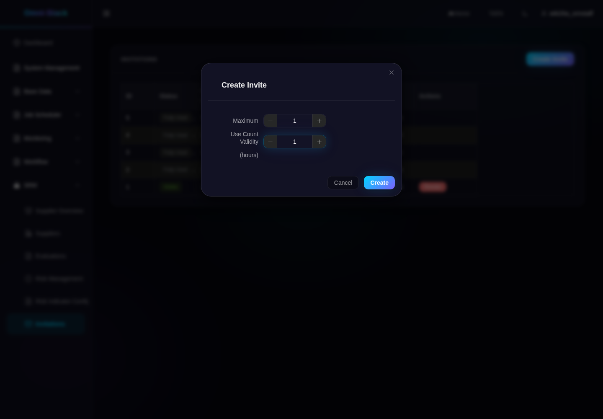

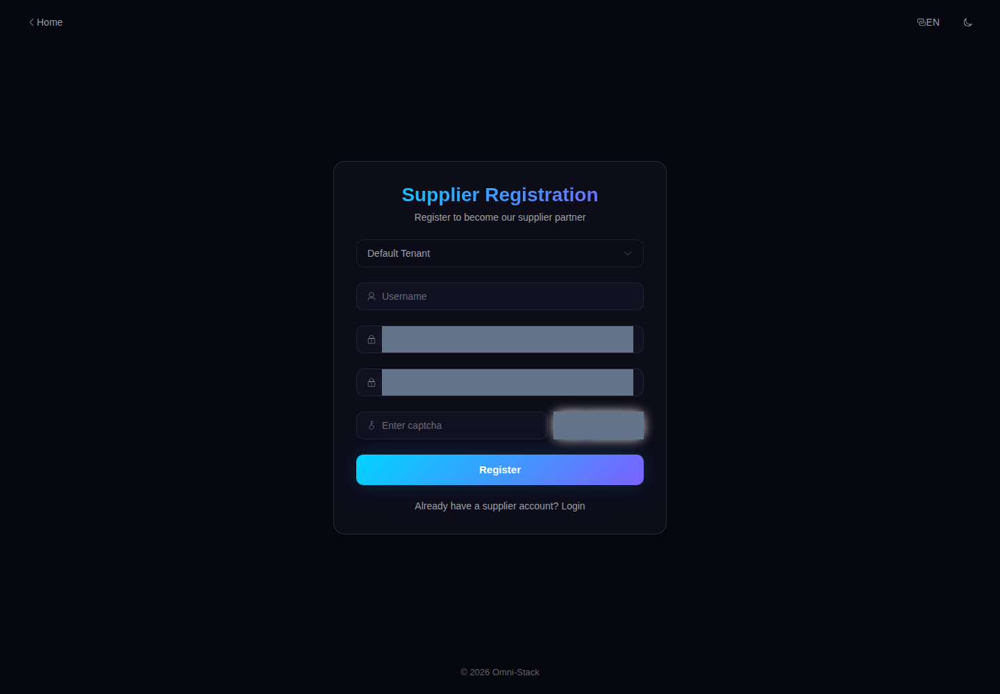

### 8.2 Submit company details and distinguish the Saga from admission

Enter with a separate `USER`, fill the invitation, company name and credit code, and submit once. Retrying the same `requestId` must return the same supplier. `COMPLETED` below means role assignment and association completed. Sign in again, or refresh the controlled test identity, to obtain `SUPPLIER` permissions. This does not approve admission.

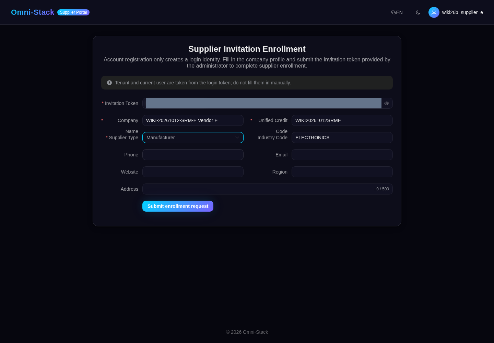

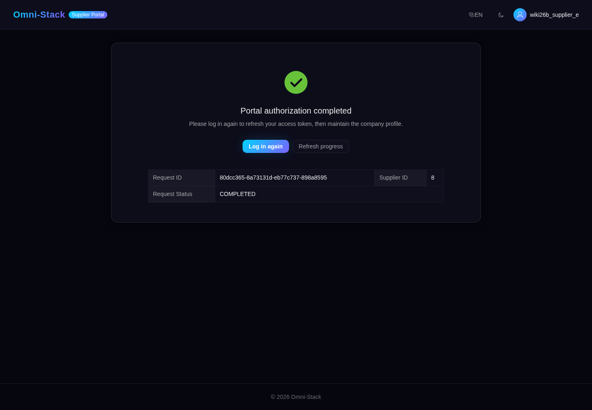

### 8.3 Follow the same three-step approval instance

Check Reviewing in the portal. The procurement manager, compliance approver and director then process the same instance in order. Match the task title and supplier number. After all three decisions, check `APPROVED` in both the internal 360 view and portal. Ownership belongs to an internal operator, not the portal account.

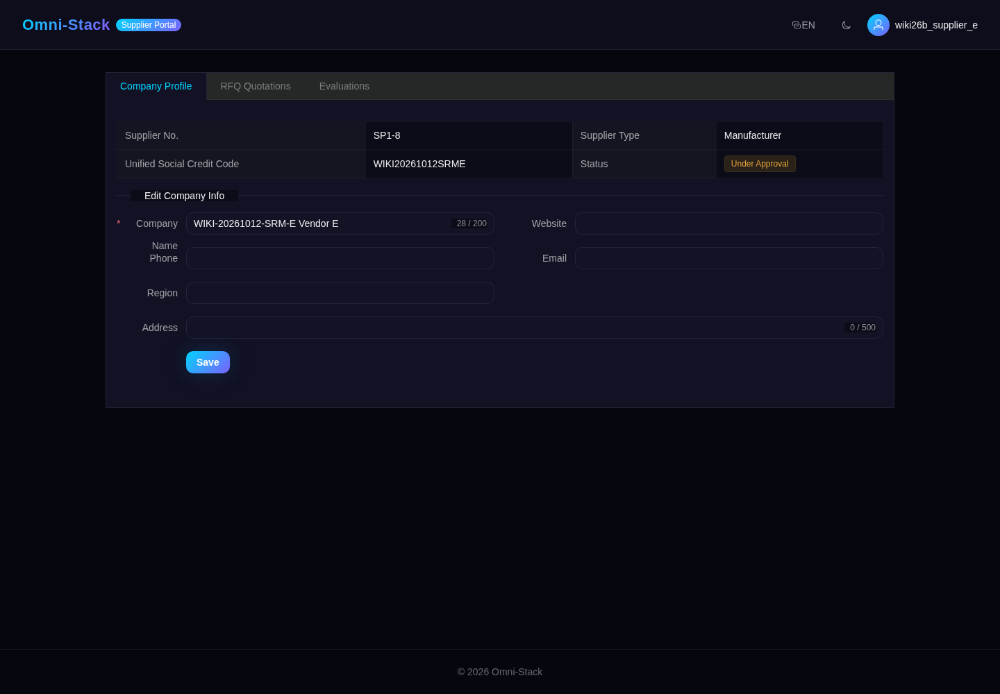

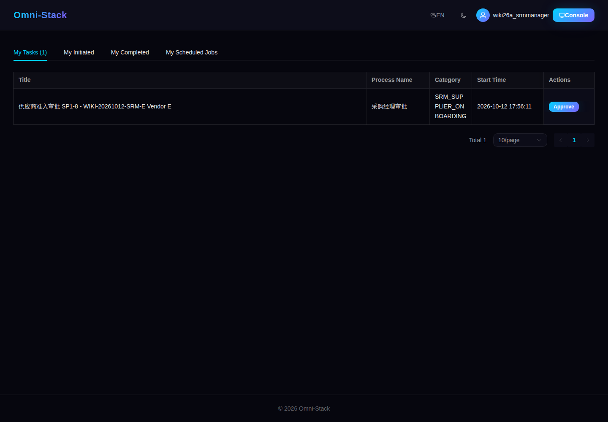


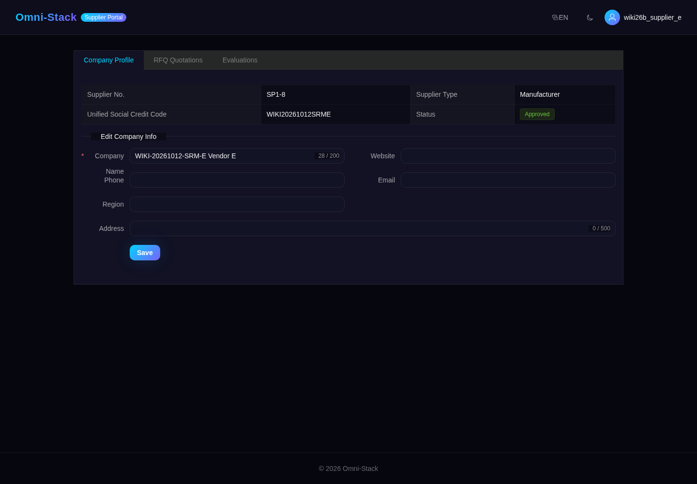

### 8.4 Verify suspension and blacklist states in detail

Read the current version before each command and open the 360 view afterward. Query procurement options for the same category: `SUSPENDED` and `BLACKLISTED` are excluded; restoring `APPROVED` includes the supplier again. The fixed Actions column hid state text in the original management list. Twenty list images were rejected for publication; these are real detail-page recaptures.

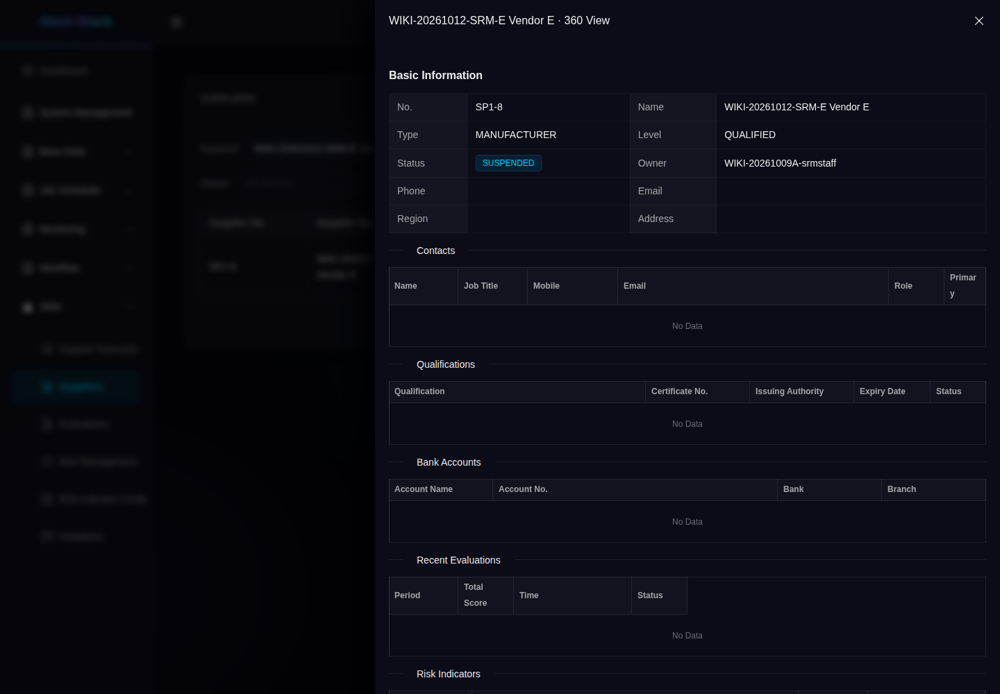


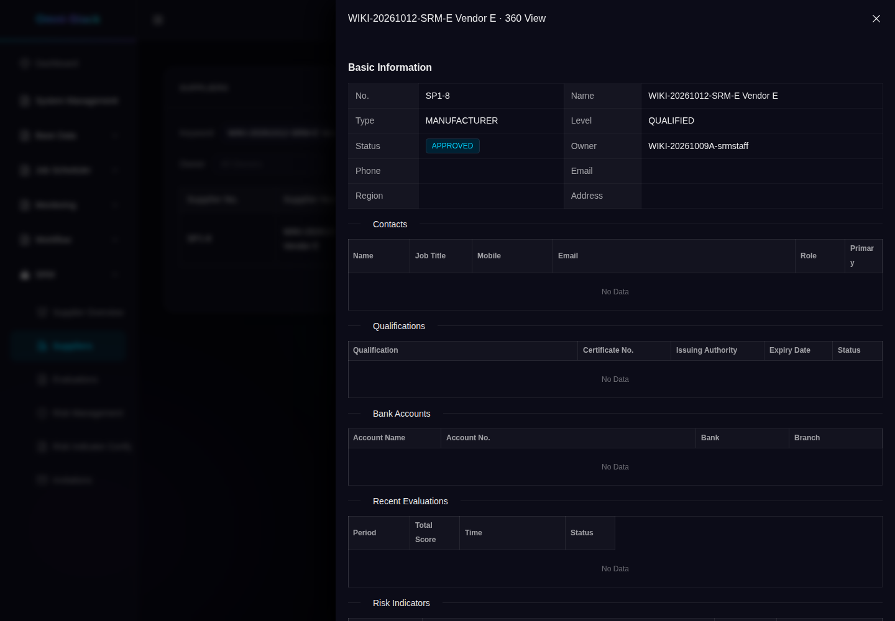

### 8.5 Verify the uninvited boundary and retire the sample

While the sample is approved, confirm procurement invited only the other two suppliers. Its portal must show an empty list and direct RFQ-detail access must return business code 404. An invited account reads the same detail with code 200. Error HTTP status remains 200; inspect the body's `code`. The historical sample used an awarded RFQ and proves read isolation only, not a new quotation submission.

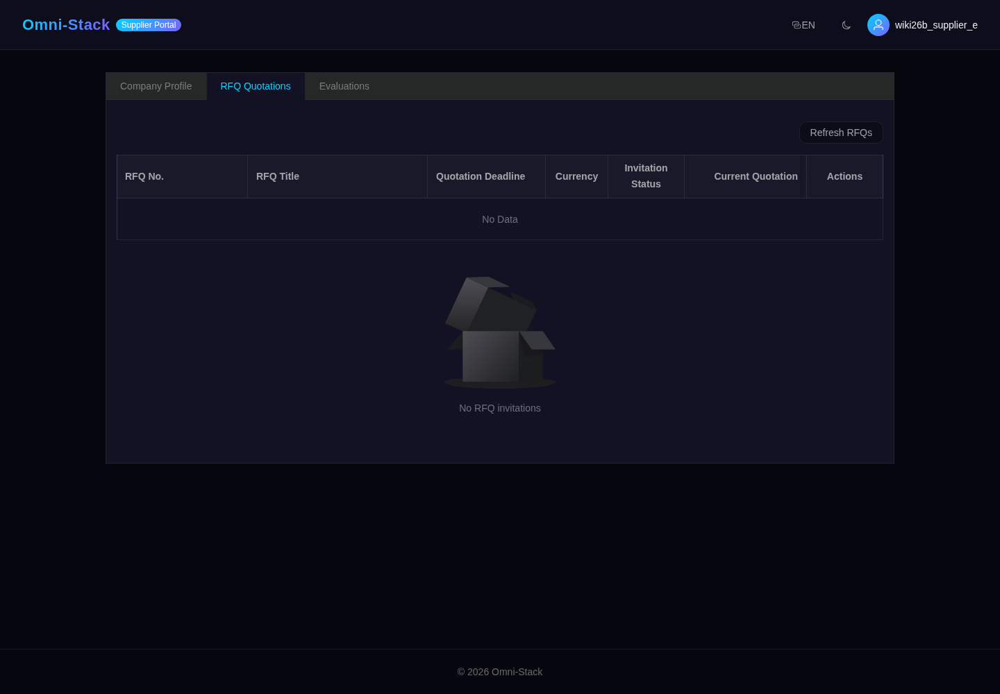

After the boundary check, eliminate the dedicated sample to `ELIMINATED` and inspect its invitation. The recorded status is `USED`; the script revokes only a displayed `ACTIVE` invite, so an unexecuted revocation must not be reported as completed. Procurement excludes the sample; resume and quotation-invitation reads return business code 409. Retain formal approval/enrollment history and fixture accounts in the isolated project. Account/project cleanup awaits final acceptance; a database reset is not cleanup.

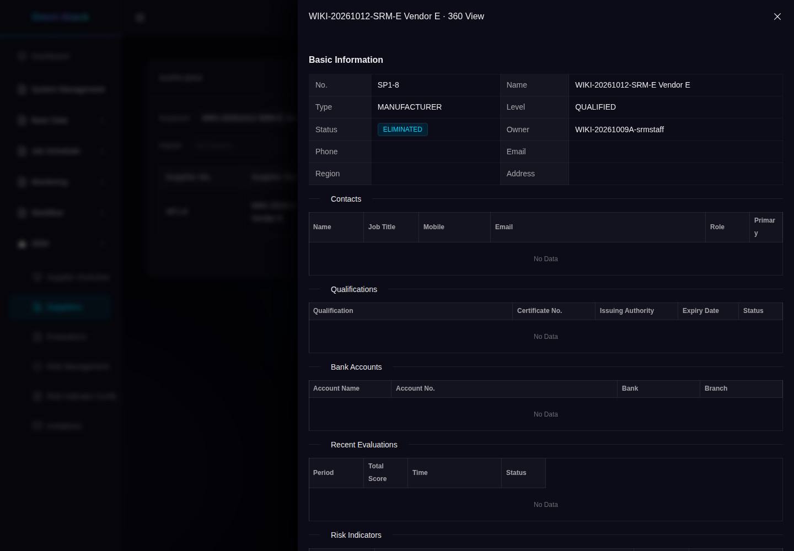

Some Japanese/Korean labels fall back to English, the 360 view displays raw status enums, and long labels wrap. The tutorial explains the actual screens without claiming complete UI localization.

The current [document and image audit](../reference/evidence/srm-guide-review-2026-10-17.json) matches 80 guide files to 88 capture records across two batches, including 8 byte-identical reuses; 20 rejected old list images remain excluded. Seven capture-time source/image groups are retained. This stage individually inspects 20 selected raw originals; the other 60 files retain actual historical visual records, without claiming every image was re-viewed or recaptured.

## 9. Create and operate a dedicated supplier with native buttons

This internal path uses `USER + SRM_ADMIN` and does not go through Portal. Prepare the model, organization and candidates in section 1, then create a dedicated supplier in an isolated environment; do not reuse the retired record from section 8. The [receipt](../reference/evidence/srm-native-actions-2026-10-13.json) identifies local Docker sample F, number `S1-9`. In your own fresh environment use a new name and unique credit code; the service generates the number.

1. Open the supplier list, click Add and enter the name, type and credit code. This example selects `MANUFACTURER` and industry `ELECTRONICS`, leaving Owner empty to use the current internal operator. Verify the data and click Save once.
2. Saving starts admission. Three actual candidates process the same instance in order; after completion open the 360 view and verify `APPROVED` and the internal owner. These three decisions used the formal API; the result image does not prove native approval-button clicks.
3. Close the detail and select Suspend from this supplier row's More menu. Verify the supplier name in the confirmation dialog, confirm once, then reopen the 360 view and check `SUSPENDED`.
4. Continue with Resume, Add to Blacklist, Remove from Blacklist and Eliminate as below. Read the current version after each operation before the next command. Versions come from API responses, not the detail screenshot.

| Operation | Required state and example version | Result state and example version |
|---|---|---|
| Suspend | `APPROVED / 2` | `SUSPENDED / 3` |
| Resume | `SUSPENDED / 3` | `APPROVED / 4` |
| Add to Blacklist | `APPROVED / 4` | `BLACKLISTED / 5` |
| Remove from Blacklist | `BLACKLISTED / 5` | `APPROVED / 6` |
| Eliminate | `APPROVED / 6` | `ELIMINATED / 7` |

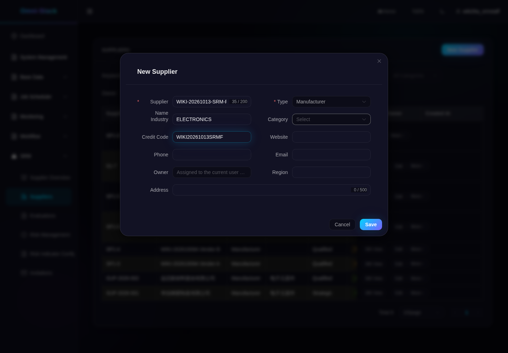

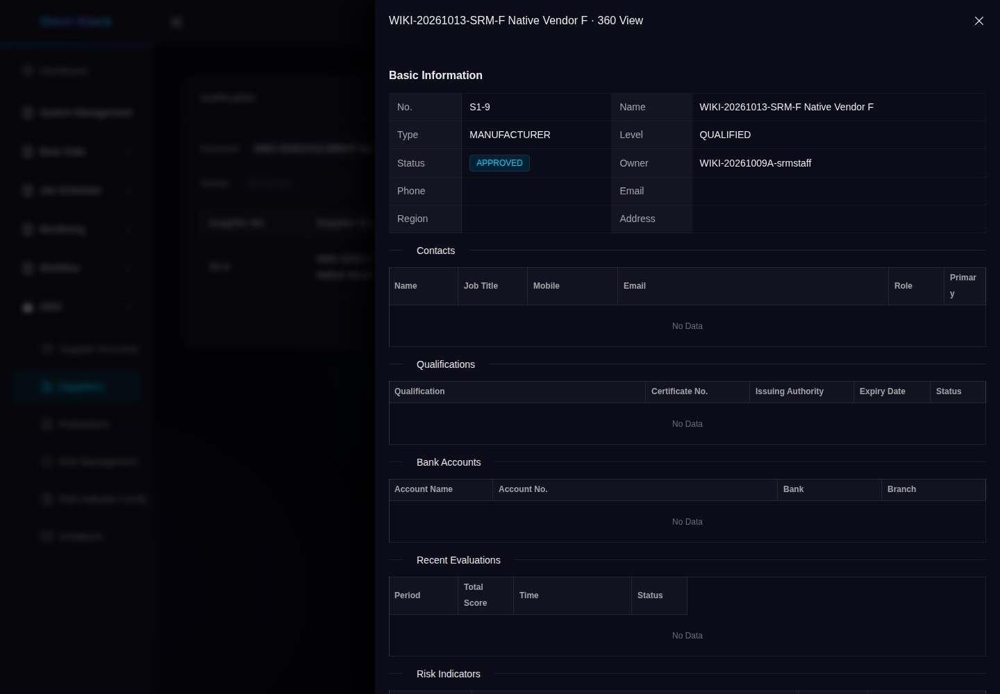

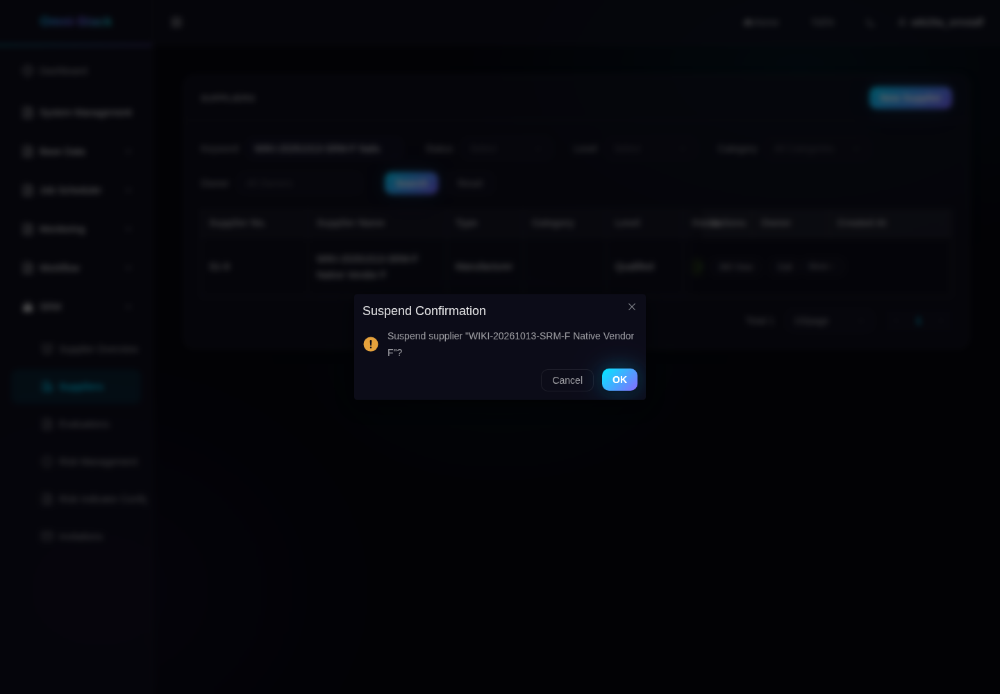

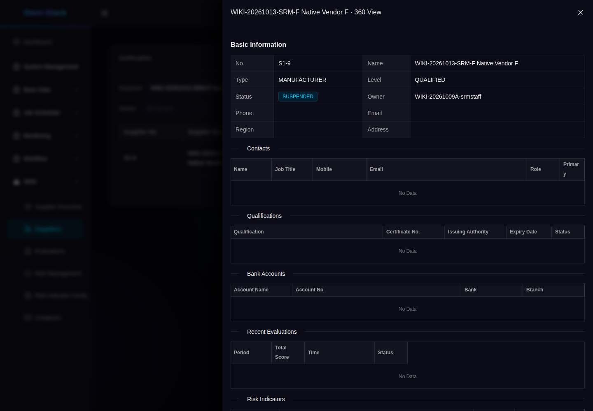

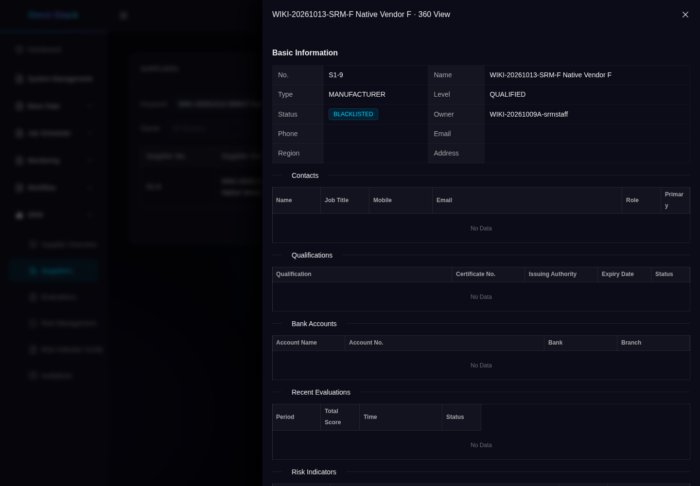


In the 2026-10-13 record, creation and five lifecycle commands each execute once in the Chinese UI; the four locales preview or read the same record. All 32 originals were inspected individually. Eight resume/blacklist-restoration images are byte-identical to the approved view, so 24 distinct files are published; separate command times and versions remain in the receipt. Screenshots prove desktop identity and status at the top. Lower risk rows are outside the viewport, and empty contact, bank and evaluation lists do not prove those journeys. The actual product uses a dark theme; long name inputs clip, English headings and some Japanese labels wrap, and some optional field labels remain English.

The entrypoint is `scripts/fixtures/capture-srm-native-actions.mjs`, with explicit phases `prepare / suspend / resume / blacklist / restore / eliminate`. It requires the controlled project, runtime allowlist, private short-lived identities and operation journal. Successful phases cannot replay. If the connection drops after submission, reconcile the same supplier and version before any further command; do not recreate it or confirm again. Retain formal approval history after elimination and clean project resources only within the explicitly owned isolated environment. This path creates no Portal account or invite; real CAPTCHA self-registration still requires separate completion.

Four-language documents follow the [authorized AI review policy](../adr/0003-authorized-ai-translation-review.md): actual `AI_REVIEW` suffices without mandatory human review or a false `HUMAN_REVIEW` label. See the [review queue](../i18n-review-queue.md) for current valid hashes and status.
