# SRM 管理画面とサプライヤーポータルの操作手順

入居登録から准入承認、業績評価、リスク、購買見積まで進めます。内部利用者とポータル利用者ではロールとデータ範囲が異なります。[データと証跡フィクスチャ](../wiki/data-and-fixtures.jp.md) に従い、独立した検証環境、組織、承認候補者を先に準備してください。

今回は四言語文書、現在のソース、過去の原画像を確認し、登録申請・承認・採点・リスク・ライフサイクルを再実行していません。第8節は2026-10-12、第9節は2026-10-13の記録です。成功済み書込みは繰り返しません。本章の「入居」はサプライヤー登録申請、「准入」は取引開始審査を指します。

## 1. ロール・組織・モデルの確認

1. 内部担当者には SRM 管理権限が必要です。新規サプライヤーアカウントは `USER` から始まり、入居 Saga の成功後に `SUPPLIER` と有効なポータル関連付けが追加されます。権限更新後は再ログインします。
2. `supplier-onboarding` の公開済みバージョンを確認します。初期化時に公開済みの場合、共有バージョンを変更したり再公開したりする必要はありません。
3. 標準の承認順序は `SRM_MANAGER`、`SRM_COMPLIANCE`、`SRM_DIRECTOR` です。ロール、組織アンカー、`sys_user_role_scope` がモデルと一致する必要があり、ユーザーとロールの関連付けだけでは不足します。
4. 候補者にはタスク、インスタンス参照、`workflow:approval:complete` の機能権限も必要です。既存の SRM 承認ロールがすべての操作権限を持つとは限りません。独立デモでは最小限の補助ロールを追加します。具体的な権限と組織範囲フィクスチャは準備章を参照してください。
5. 提出前に候補者プレビューで実ユーザーを確認し、`SUPER_ADMIN` で代用せず一般業務ロールで検証します。

## 2. 招待・アカウント登録・入居

1. SRM の入居招待画面で、この演習専用の招待を作成します。有効期限と使用制限を記録し、招待トークンは非公開で保存してスクリーンショットではマスクします。
2. サプライヤーは `/portal-register` を開き、[認証手順](authentication.jp.md) に従って登録と実際の CAPTCHA 検証を済ませ、ポータルにログインします。
3. 招待トークン、企業情報、一意なクライアント `requestId` を提出します。通信再試行では同じ ID を使い、入居記録の重複作成を防ぎます。
4. 入居の進行状況を確認します。SRM は `REGISTERING` のサプライヤーを作成し、Saga で Auth のロール付与を要求してポータルを関連付けます。Saga 完了後に准入ワークフローを開始します。
5. Saga とサプライヤーの `status`、`workflowStartStatus`、`processInstanceId` を別々に確認します。Saga 完了だけで准入承認済みとは判断できません。

ポータルユーザー ID を内部の `owner_user_id` や `owner_unit_id` に書き込んではいけません。内部担当者は管理画面で割り当てます。連絡先、資格、銀行口座はサプライヤー集約の可視範囲を継承し、owner 列のない子テーブルにその列による条件を追加しません。

## 3. 承認・却下・取り下げ

```text
Portal: REGISTERING → PENDING_REVIEW → APPROVING → APPROVED
                                      ↘ REJECTED → 再提出 → APPROVING
APPROVING → 取り下げ/取消 → PENDING_REVIEW
APPROVED ↔ SUSPENDED
APPROVED ↔ BLACKLISTED
APPROVED/SUSPENDED → ELIMINATED
```

1. 管理画面での新規作成も准入処理を自動開始します。成功時は `APPROVING + STARTED` と実際の `processInstanceId` が返ります。
2. 3 種の承認者が順番に自分のタスクで同じ業務を開き、企業情報を確認して判断します。最終承認後、Workflow 完了イベントが SRM を `APPROVED` に更新します。非同期反映中は再照会し、DB の状態を直接変更しません。
3. 別の演習用サプライヤーで最初の承認を却下します。`REJECTED` を確認して資料を修正し再提出すると、過去の履歴を残したまま新しいインスタンスで承認が始まります。
4. 再提出後の承認を取り下げるか取り消します。遠隔フローの終了後は `PENDING_REVIEW` に戻り、インスタンス ID が消え、開始状態は `NOT_STARTED` となり、元のタスクも消えます。
5. **現在の制約**：公開の再提出 API が受け付けるのは `REJECTED` のみです。取り下げ後の `PENDING_REVIEW` や開始失敗の `PENDING_REVIEW + FAILED` は再提出で再開できません。公開の開始再試行 API はありません。入居 Saga の再試行もワークフローの再試行ではありません。記録を保持して失敗経路を調査します。

## 4. ライフサイクルと購買候補

1. 准入済みサンプルの最新バージョンを取得して凍結します。標準ダイアログは名称確認だけで、理由入力はありません。理由を記録する場合は正式 API の任意項目 `reason` を使います。`SUSPENDED` となり、同品類の購買候補から外れることを確認します。
2. 再開すると `APPROVED` に戻ります。ブラックリスト登録は `BLACKLISTED` となり、専用の復元操作で `APPROVED` に戻します。
3. `ELIMINATED` は復元できない終端状態です。専用の別テスト記録で扱い、停止・再開の続きとして実行しません。
4. 更新には最新の `version` を使います。古いバージョンの競合時は再読込し、最新状態を確認してから判断します。

購買候補には `APPROVED` と品類一致が必要です。リスクの `RED` とブラックリスト状態は別の項目です。今回のリスク評価はサプライヤーを自動的にブラックリストへ移しませんでした。

## 5. 業績評価は提出時に完了する

1. 内部評価者で業績評価を開き、参照可能で評価条件を満たすサプライヤーと標準テンプレートを選びます。
2. 全評価軸を各 1 回、`1.0–5.0`、小数 1 桁以内で採点します。重みの合計は 100 です。演習専用の評価期間を指定して提出します。
3. 現行 API は集計、サプライヤー等級更新、Outbox 書込みを同一トランザクションで処理し、`COMPLETED` を返します。未評価・評価中・完了を別操作で進める画面はありません。
4. 式は `Σ(評価軸の点数 / 5 × 重み)` です。全点数4、重み合計100の例は80点で `PREFERRED` となり、6点は現在の検証で業務コード400となるべきです。規則の説明で、今回の新規採点結果ではありません。
5. 対象サプライヤーのポータル業績評価には結果が表示され、別サプライヤーには表示されないことを確認します。有効な関連付けで表示範囲が決まります。

## 6. リスクと見積回答

1. リスク管理で自動指標と手動指標を区別します。バックエンドは有効な指標種別を取得した場合だけ `autoCalc` を調べ、自動計算の手動上書きを拒否します。種別が存在しない場合や無効な場合にも同じ検証が働くとは判断しません。
2. 手動指標ではその指標の採点基準を選び、`criterionId`、最新バージョン、説明を提出します。表示色だけの変更ではありません。

先に対象指標の採点基準であることを確認します。現在の `criterionId` 分岐は存在を確認して点数・レベルをコピーし、同一指標種別との追加照合は行いません。API成功だけでこの確認を代替しません。
3. 保存後に集計を確認し、必要なら評価スナップショットを作ります。過去の手動基準の例ではREDを選び `RED` となりました。現在は指標点数の合計とテナント閾値で集計するため、単一指標の色だけで全体を判断しません。過去の結果を保持します。
4. 公開 RFQ に招待された准入済みサプライヤーはポータルから見積を回答できます。メッセージ、比較、選定、入荷は [購買手順](procurement-flow.jp.md) に進んでください。
5. ポータルは自社の見積と評価のみを表示します。未准入は業務コード 409 で拒否されます。准入済み未招待ユーザーは別途検証し、一覧に対象 RFQ がなく、詳細は業務コード 404、招待済みユーザーの同じ詳細は 200 でした。エラー時も HTTP は 200 のため、応答本文の `code` を確認してください。

## 7. ソースでの調査

- 入居停止：同じ `requestId` を `SupplierPortalServiceImpl.doEnroll()`、Saga 調整処理、Auth ロール付与で追います。遠隔ロール付与とローカル関連付けを区別し、確定済みの遠隔トランザクションを巻き戻しません。
- 入居済みなのにタスクがない：`SupplierWorkflowCoordinator.prepareAndStart()` でモデル版、組織アンカー、開始応答を確認し、Workflow の候補者解析とロール範囲へ進みます。今回も候補者なしで `FAILED` を再現しました。
- 再提出・取り下げ：`SupplierServiceImpl.submit()` と `terminateWorkflow()` で前提状態、バージョン、新旧インスタンスを確認します。公開応答に `approvalAttempt` は含まれないため、応答項目として検証しません。
- 点数の相違：`EvaluationServiceImpl.create()` と `SrmEvaluationScoreCalculator.calculate()` で評価軸 ID、点数、重み、同一トランザクションの等級更新を確認します。
- リスクと可視性：`RiskServiceImpl.updateIndicator()`、サプライヤーアクセスガード、ポータル関連付け照会で編集可能指標と集約の可視範囲を確認します。

本章は三段階准入、却下・再提出・取り下げ、評価、リスク、ライフサイクル、ポータル分離を扱います。規則は現在の実装と照合し、実行の範囲は第8・9節と各記録に従います。静的ソース、結果画像、今回のAIレビューから他の分岐の完了を推測しません。障害復旧は独立検証が必要です。[SRM事実文書](../srm.jp.md)と[設計](../design/srm-design.jp.md)を参照してください。

## 8. 実画面で入居と准入を再現する

独立 Docker プロジェクトの原画像です。[匿名化した検証記録](../reference/evidence/srm-2026-10-12.json) にロール、API 結果、画像・ソースのダイジェスト、コンテナイメージ、後処理の範囲を記録しています。アカウントは正式な管理者 API で作成したため、登録画面は入口の説明に限ります。**このサプライヤーの CAPTCHA 自己登録やパスワードログインの成功は証明しません。** 招待作成と 3 件の承認判断は正式 API で実行し、画面は実際の状態を表示しています。全操作を UI でクリックした記録ではありません。2026-10-12の原画像は代理が個別確認した記録です。実際の範囲は当時の検証記録に従います。

### 8.1 招待と独立アカウントを準備する

招待フォームで利用回数 1、有効期間 1 時間を指定します。作成したトークンは非公開で保存してください。自己登録では人が現在の CAPTCHA を読んで送信します。この 2 枚はポータルルート修正前の画像です。以降の入居画像は修正を含む正式ビルドのフロントエンドを使用しています。

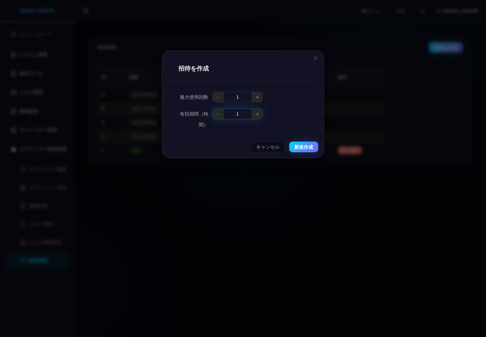

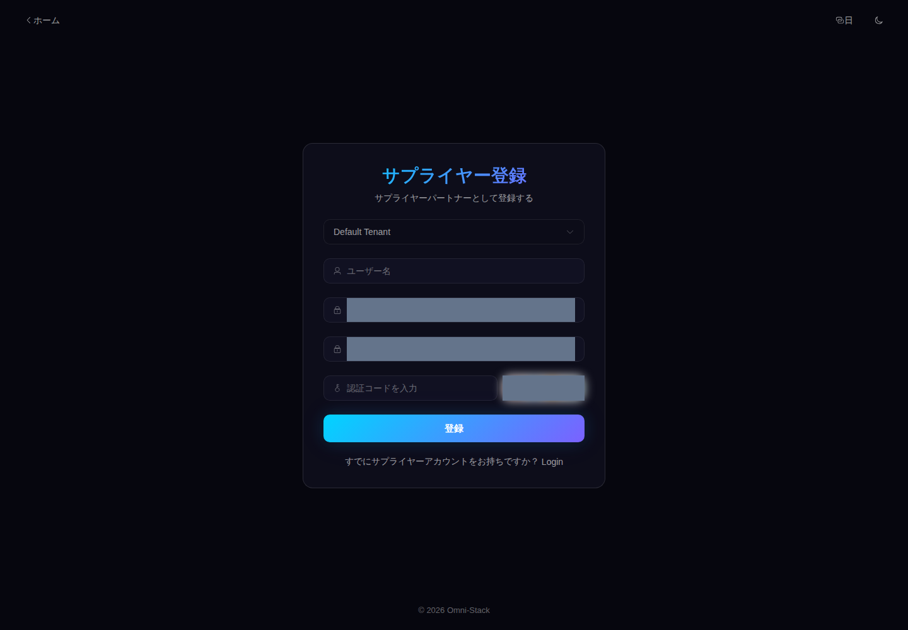

### 8.2 企業情報を提出し、Saga と准入を区別する

独立した `USER` でポータルに入り、招待、企業名、信用コードを入力して 1 回提出します。同じ `requestId` の再試行は同じサプライヤーを返す必要があります。`COMPLETED` はロール割り当てと関連付けの完了です。再ログイン、または統制されたテスト ID の更新後に `SUPPLIER` 権限を取得します。准入承認の完了ではありません。

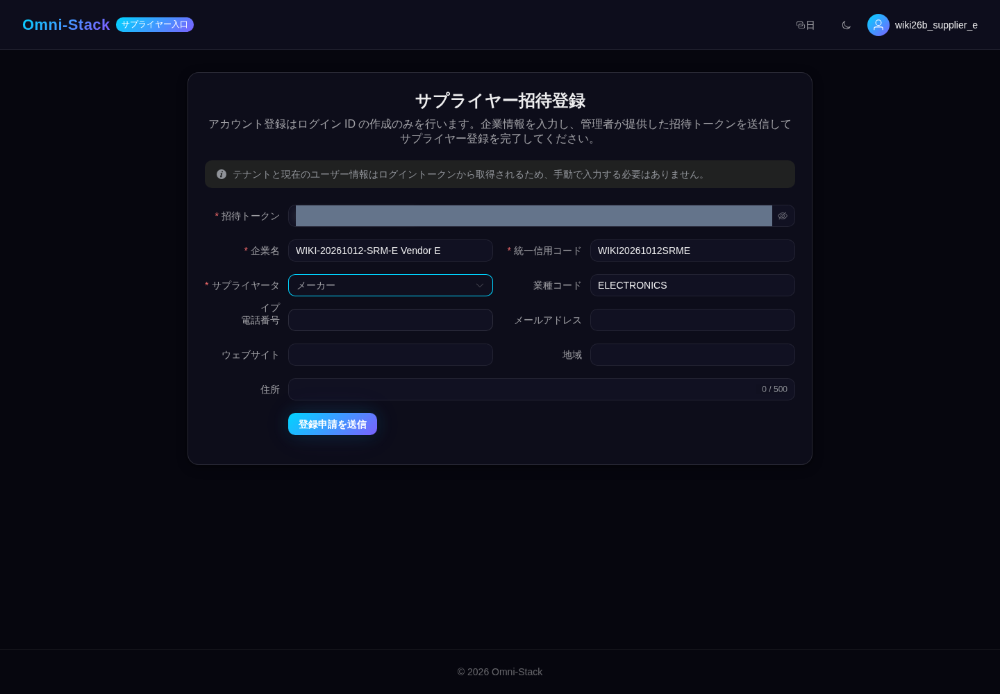

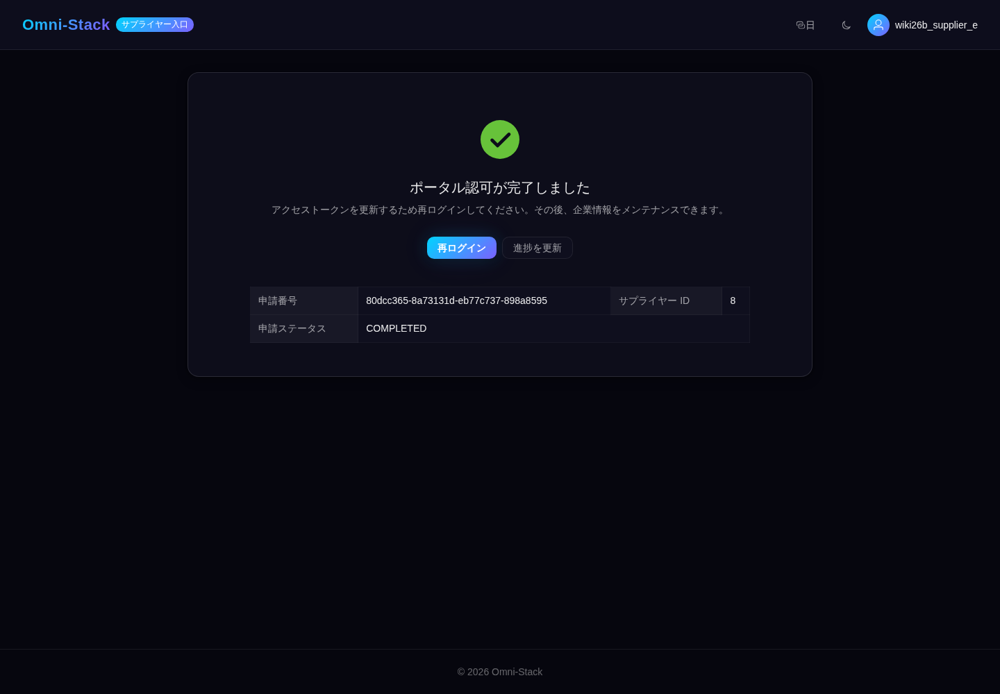

### 8.3 同じ 3 段階承認インスタンスを追う

ポータルの承認中表示を確認し、購買マネージャー、コンプライアンス担当、責任者が同じインスタンスを順に処理します。タスクのタイトルとサプライヤー番号を照合してください。3 人の承認後、内部の 360 ビューとポータルで `APPROVED` を確認します。担当者には内部ユーザーを指定し、ポータルアカウントを指定しません。


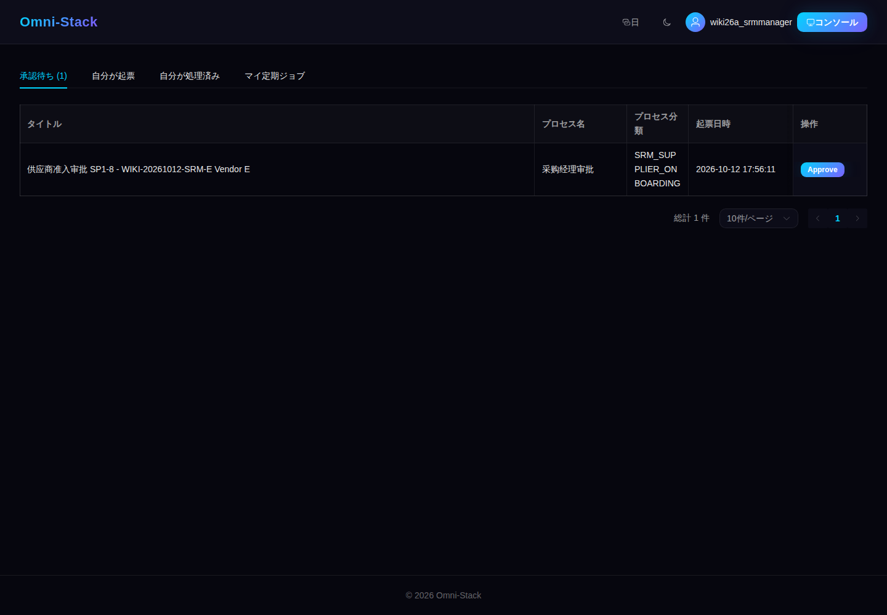


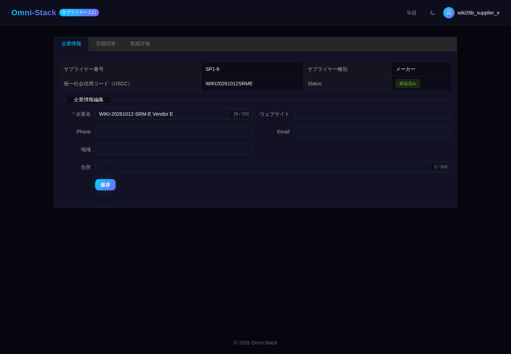

### 8.4 詳細で停止とブラックリストを確認する

毎回現在のバージョンを読み、操作後に 360 ビューを開きます。同一品類の購買選択肢では `SUSPENDED` と `BLACKLISTED` が除外され、`APPROVED` に戻すと再び選択できます。元の管理一覧は固定操作列が状態を隠したため、20 枚の一覧画像を公開対象から除外しました。以下は実際の詳細画面で撮り直した画像です。


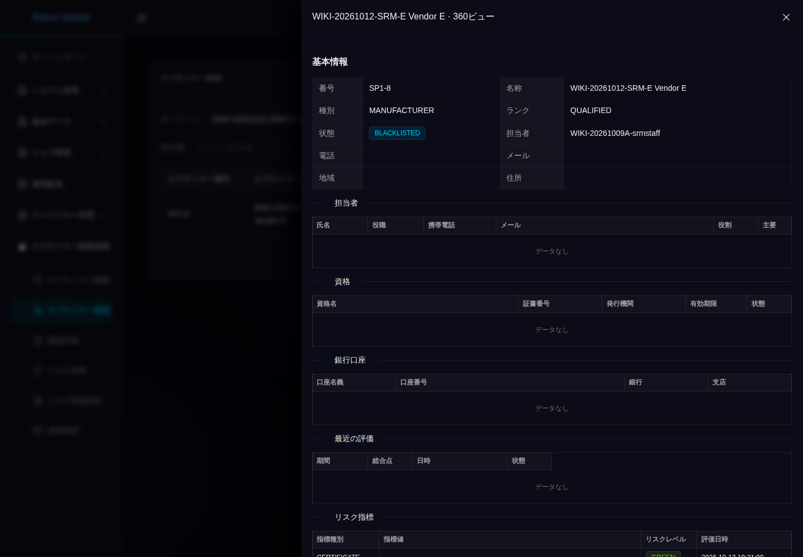


### 8.5 未招待の境界を確認し、サンプルを退役する

サンプルを准入済みに保ち、購買側で RFQ の招待先が他の 2 社だけであることを確認します。サンプルのポータルは空一覧となり、RFQ 詳細の直接取得は業務コード 404 を返します。招待済みユーザーは同じ詳細をコード 200 で読めます。エラー時も HTTP は 200 のため、応答本文の `code` を確認してください。定標済み RFQ を使用しており、読み取り分離だけを証明し、新規見積送信は証明しません。

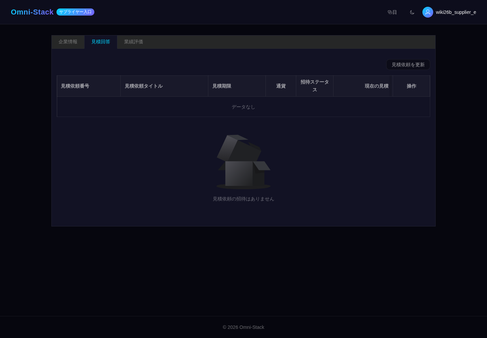

境界確認後、専用サンプルを `ELIMINATED` にして招待状態を確認します。記録は `USED` であり、スクリプトは表示が `ACTIVE` の場合だけ取り消します。未実行の取消を完了済みとは記載しません。購買候補から除外され、凍結解除と見積招待取得は業務コード409です。隔離プロジェクトに正式承認・登録履歴とフィクスチャアカウントを残し、アカウント・プロジェクトの後処理は最終検証を待ちます。DB初期化で後処理を代替しません。


現在の日・韓画面には一部英語のフォールバックがあり、360 ビューは状態の生の列挙値を表示し、長いラベルは折り返します。実画面を説明するもので、UI の完全なローカライズを主張しません。

今回の[文書・原画像確認](../reference/evidence/srm-guide-review-2026-10-17.json)は教材80ファイルと二回の88件の取得記録を照合し、8件の同一バイト再利用を保持します。除外済みの旧一覧20枚は公開しません。取得時のソース・イメージ7群を保持し、今回は20枚の原画像を個別確認します。他60ファイルは実際の過去の視覚記録を保持し、全件の再確認・再撮影を主張しません。

## 9. 標準ボタンで専用サプライヤーを作成・操作する

この内部向け経路は `USER + SRM_ADMIN` を使用し、Portal を経由しません。第 1 節のモデル、組織、候補者を準備し、隔離環境に専用サプライヤーを新規作成します。第 8 節の淘汰済みレコードは再利用しません。[検証記録](../reference/evidence/srm-native-actions-2026-10-13.json)はローカル Docker のサンプル F、番号 `S1-9` に対応します。自分の空環境では新しい名称と一意の信用コードを使い、番号はサービスに生成させます。

1. サプライヤー一覧で追加を押し、名称、種別、信用コードを入力します。本例は `MANUFACTURER`、業種 `ELECTRONICS` を選び、担当者は空欄にして現在の内部担当者を使用します。内容を確認し、保存を一度だけ押します。
2. 保存で准入フローが開始します。実際の候補者 3 人が同じインスタンスを順に処理した後、360 ビューで `APPROVED` と内部担当者を確認します。本検証の 3 回の承認は正式 API で行ったもので、結果画像は承認ボタンのクリック証拠ではありません。
3. 詳細を閉じ、対象行の「その他」から凍結を選択します。確認ダイアログの名称を照合して一度確定し、360 ビューを開き直して `SUSPENDED` を確認します。
4. 下表の順に凍結解除、ブラックリスト追加・解除、淘汰を進めます。毎回完了後に最新バージョンを取得して次の操作に使用します。バージョンは API 応答で確認し、詳細画像には表示されません。

| 操作 | 前提状態と本例のバージョン | 結果状態と本例のバージョン |
|---|---|---|
| 凍結 | `APPROVED / 2` | `SUSPENDED / 3` |
| 凍結解除 | `SUSPENDED / 3` | `APPROVED / 4` |
| ブラックリスト追加 | `APPROVED / 4` | `BLACKLISTED / 5` |
| ブラックリスト解除 | `BLACKLISTED / 5` | `APPROVED / 6` |
| 淘汰 | `APPROVED / 6` | `ELIMINATED / 7` |

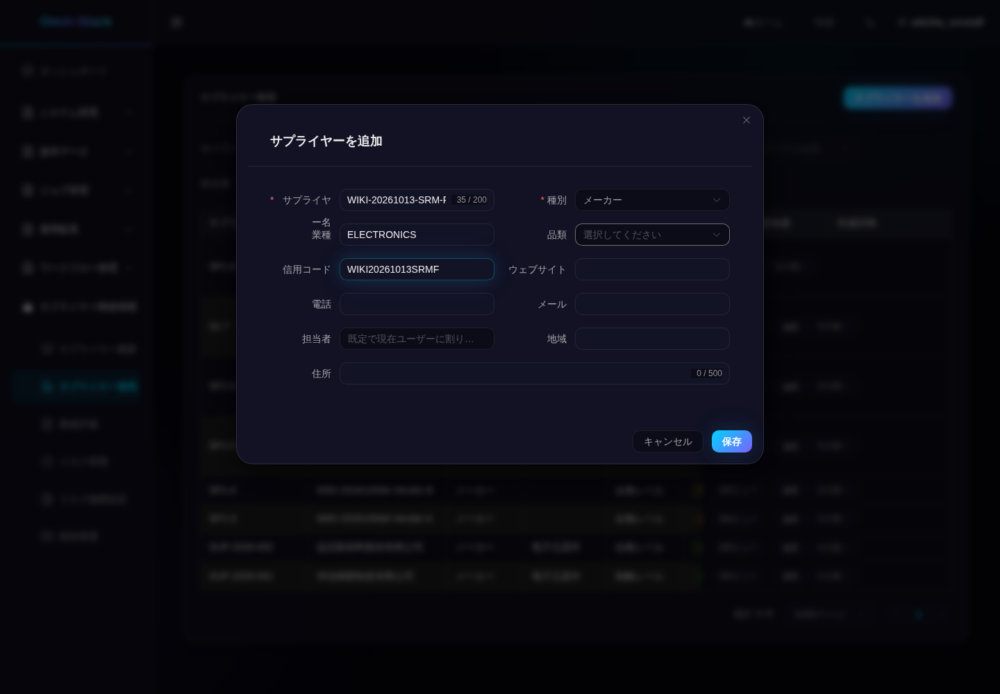

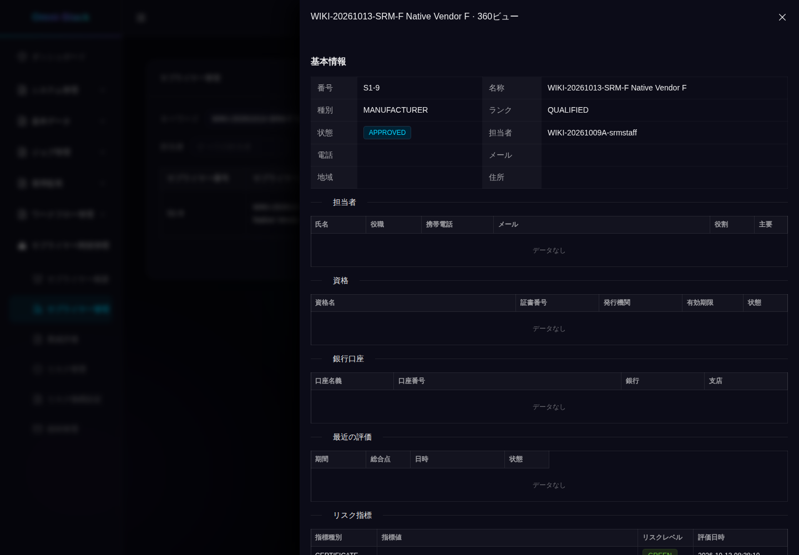

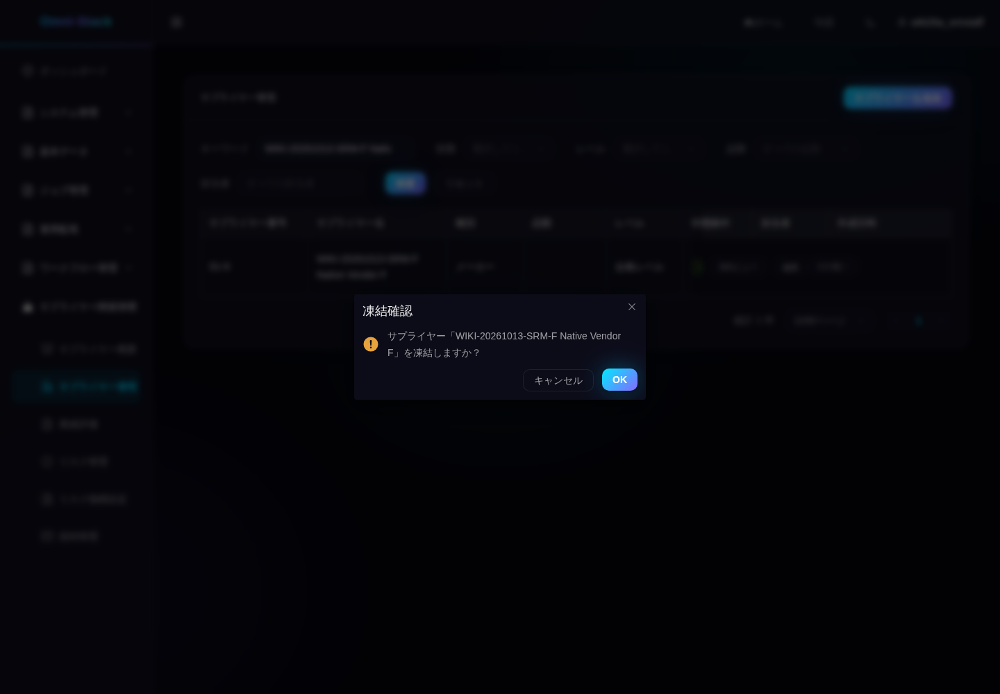


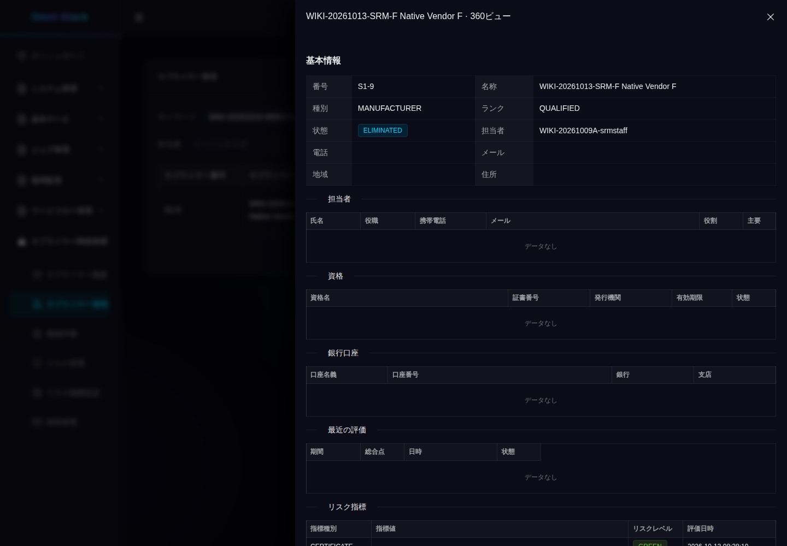

2026-10-13の記録では、作成と 5 回のライフサイクル操作は中国語 UI で各一度実行し、4 言語は同じレコードをプレビューまたは参照します。原図 32 枚を個別に確認しました。凍結解除とブラックリスト解除の 8 枚は承認済み詳細とバイト単位で一致するため、公開ファイルは 24 個に重複排除し、各操作の時刻とバージョンは検証記録に保持します。画像が証明するのはデスクトップ上部の識別情報と状態です。下部のリスク行は画面外で、空の連絡先・銀行口座・評価一覧はそれらの業務を証明しません。実際の製品はダークテーマです。長い名称入力は一部が隠れ、英語見出しや一部の日本語ラベルは折り返し、一部の任意項目は英語表示のままです。

入口は `scripts/fixtures/capture-srm-native-actions.mjs`、明示する段階は `prepare / suspend / resume / blacklist / restore / eliminate` です。制御されたプロジェクト、実行時許可リスト、リポジトリ外の短期認証情報、操作記録が必要です。成功済みの段階は再実行できません。送信後に切断した場合は同じサプライヤーの状態とバージョンを照合し、再作成や二重確定を避けます。淘汰後も正式承認履歴を残し、明確に所有する隔離環境の終了時だけプロジェクト資源を整理します。この経路はPortalアカウントや招待を作成しておらず、実CAPTCHA自己登録は独立した未完了項目です。

四言語文書は[許可済みAIレビュー方針](../adr/0003-authorized-ai-translation-review.md)に従い、実際の `AI_REVIEW` で受け入れます。人のレビューは必須ではなく、`HUMAN_REVIEW` と偽って表示しません。現在の有効ハッシュと状態は[レビュー一覧](../i18n-review-queue.md)を参照してください。
