# SRM 관리 화면과 공급업체 포털 실습

입점부터 승인, 성과 평가, 위험, 구매 견적까지 진행합니다. 내부 사용자와 포털 사용자는 역할과 데이터 범위가 다릅니다. [데이터 및 증거 픽스처](../wiki/data-and-fixtures.kr.md)에 따라 독립 검증 환경, 조직, 승인 후보자를 먼저 준비하세요.

이번에는 네 언어 문서, 현재 소스와 과거 원본을 확인했으며 입점/승인/채점/위험/수명 주기 명령을 반복하지 않았습니다. 8절은 2026-10-12, 9절은 2026-10-13 기록이며 성공한 쓰기는 재실행하지 않습니다.

## 1. 역할·조직·모델 확인

1. 내부 담당자는 SRM 관리 권한이 필요합니다. 신규 공급업체 계정은 `USER`로 시작하며 입점 Saga가 성공하면 `SUPPLIER`와 활성 포털 연결이 생깁니다. 변경된 권한을 받으려면 다시 로그인합니다.
2. `supplier-onboarding`의 게시 버전을 확인합니다. 초기화에서 이미 게시했을 수 있으므로 공유 버전을 불필요하게 수정하거나 다시 게시하지 않습니다.
3. 기본 승인 순서는 `SRM_MANAGER`, `SRM_COMPLIANCE`, `SRM_DIRECTOR`입니다. 역할, 조직 앵커, `sys_user_role_scope`가 모두 모델과 일치해야 합니다. 사용자 역할 연결만으로는 부족합니다.
4. 후보자는 할 일, 인스턴스 조회, `workflow:approval:complete` 기능 권한도 필요합니다. 기존 SRM 승인 역할에 모든 작업 권한이 있다고 가정하지 마세요. 격리 실습에서는 최소 보조 역할을 추가합니다. 구체적인 권한과 통제된 조직 범위 픽스처는 준비 장을 참조하세요.
5. 제출 전 후보자 미리보기에서 실제 사용자를 확인하고 `SUPER_ADMIN` 대신 일반 업무 역할로 검증합니다.

## 2. 초대·계정 등록·입점

1. SRM 입점 초대에서 이번 실습 전용 초대를 만듭니다. 만료와 사용 제한을 기록하고 토큰은 비공개로 보관하며 스크린샷에서는 가립니다.
2. 공급업체는 `/portal-register`에서 [인증 안내](authentication.kr.md)에 따라 계정 등록과 실제 CAPTCHA 검증을 완료한 뒤 포털에 로그인합니다.
3. 초대 토큰, 기업 정보, 클라이언트에서 만든 고유 `requestId`를 제출합니다. 네트워크 재시도는 같은 ID를 사용해 입점 기록 중복을 방지합니다.
4. 진행 상황을 조회합니다. SRM은 `REGISTERING` 공급업체를 만들고 Saga로 Auth 역할 부여를 요청한 뒤 포털을 연결합니다. Saga 완료 후에 승인 흐름을 시작합니다.
5. Saga 상태와 공급업체의 `status`, `workflowStartStatus`, `processInstanceId`를 각각 확인합니다. Saga 완료가 공급업체 승인 완료를 뜻하지는 않습니다.

포털 사용자 ID를 내부 `owner_user_id` 또는 `owner_unit_id`에 쓰지 마세요. 내부 담당자는 관리 화면에서 지정합니다. 연락처·자격·은행 계좌는 공급업체 집합 루트의 가시 범위를 상속하며 owner 열이 없는 하위 테이블에 해당 열 조건을 붙이지 않습니다.

## 3. 승인·반려·철회

```text
Portal: REGISTERING → PENDING_REVIEW → APPROVING → APPROVED
                                      ↘ REJECTED → 재제출 → APPROVING
APPROVING → 철회/취소 → PENDING_REVIEW
APPROVED ↔ SUSPENDED
APPROVED ↔ BLACKLISTED
APPROVED/SUSPENDED → ELIMINATED
```

1. 내부 관리 화면에서 생성해도 승인 시작을 자동 시도합니다. 성공하면 `APPROVING + STARTED`와 실제 `processInstanceId`가 반환됩니다.
2. 세 승인자가 순서대로 자신의 할 일에서 같은 업무를 열어 기업 정보를 확인하고 결정합니다. 마지막 승인 뒤 Workflow 완료 이벤트가 SRM을 `APPROVED`로 갱신합니다. 비동기 반영 중에는 조회하며 DB 상태를 직접 고치지 않습니다.
3. 별도 실습 공급업체로 첫 승인에서 반려합니다. `REJECTED`를 확인하고 자료를 보완해 재제출하면 이전 기록을 보존하면서 새 인스턴스가 시작되어야 합니다.
4. 재제출한 승인 흐름을 철회하거나 취소합니다. 원격 흐름 종료 후 `PENDING_REVIEW`로 돌아가고 인스턴스 ID는 비워지며 시작 상태는 `NOT_STARTED`, 기존 할 일은 사라집니다.
5. **현재 제약:** 공개 재제출 API는 `REJECTED`만 받습니다. 철회 후 `PENDING_REVIEW`와 시작 실패 `PENDING_REVIEW + FAILED`는 재제출로 다시 시작할 수 없습니다. 공개 시작 재시도 API가 없습니다. 입점 Saga 재시도도 승인 흐름 재시도가 아닙니다. 기록을 보존하고 실패 경로를 조사하세요.

## 4. 수명주기와 구매 후보

1. 승인된 실습 공급사의 현재 버전을 읽고 정지합니다. 기본 확인 창은 이름만 확인하며 사유 입력란이 없습니다. 사유 기록이 필요하면 정식 API의 선택적 `reason` 필드를 사용합니다. `SUSPENDED`가 되고 같은 범주의 구매 후보에서 빠지는지 확인합니다.
2. 재개하면 `APPROVED`로 돌아갑니다. 블랙리스트 등록은 `BLACKLISTED`, 전용 복원 작업은 다시 `APPROVED`가 됩니다.
3. `ELIMINATED`는 복원할 수 없는 최종 상태입니다. 별도 테스트 기록에만 사용하며 정지·재개 실습의 다음 단계로 실행하지 않습니다.
4. 모든 변경에 현재 `version`을 사용합니다. 오래된 버전 충돌이면 다시 조회하고 최신 상태를 확인한 뒤 판단합니다.

구매 후보는 `APPROVED`와 범주 일치가 필요합니다. `RED` 위험과 블랙리스트 수명 주기는 다른 필드이며 과거 위험 평가는 공급사를 자동으로 블랙리스트에 넣지 않았습니다.

## 5. 성과 평가는 제출 즉시 완료

1. 내부 평가자로 성과 평가를 열고 조회 가능하며 평가 조건을 충족한 공급업체와 기본 템플릿을 선택합니다.
2. 모든 차원을 한 번씩 `1.0–5.0`, 소수점 한 자리까지 채점합니다. 가중치 합은 100이어야 합니다. 이번 실습 고유 평가 기간으로 제출합니다.
3. 현재 API는 집계, 공급업체 등급 갱신, Outbox 기록을 한 트랜잭션에서 처리하고 `COMPLETED`를 반환합니다. 대기·진행·완료를 별도 작업으로 거치는 화면 흐름은 없습니다.
4. 공식은 `Σ(차원 점수 / 5 × 차원 가중치)`입니다. 점수가 모두 4이고 가중치 합이 100인 예시는 80점과 `PREFERRED`이며 점수 6은 현재 검증에서 업무 코드 400이 되어야 합니다. 규칙 설명이며 이번 새 채점 제출 결과가 아닙니다.
5. 해당 공급업체 포털 평가에는 결과가 보이고 다른 공급업체에는 보이지 않아야 합니다. 활성 공급업체 연결이 포털 범위를 결정합니다.

## 6. 위험과 견적

1. 위험 관리에서 자동 지표와 수동 지표를 구분합니다. 백엔드는 활성 지표 유형을 찾은 경우에만 `autoCalc` 설정을 확인하고 자동 계산 지표의 수동 덮어쓰기를 거부합니다. 유형이 없거나 비활성인 경우에도 같은 검증이 적용된다고 가정하지 않습니다.
2. 수동 지표는 해당 지표의 채점 기준을 선택하고 `criterionId`, 현재 버전, 설명을 제출합니다. 화면 색만 바꾸는 작업이 아닙니다.

먼저 해당 지표의 채점 기준인지 확인합니다. 현재 `criterionId` 분기는 존재를 확인하고 점수/등급을 복사하며 같은 지표 유형인지 추가 검사하지 않습니다. API 성공은 이 확인을 대신하지 않습니다.
3. 저장 후 집계를 확인하고 필요하면 평가 스냅샷을 만듭니다. 과거 수동 기준 예시는 RED 선택 후 `RED`였습니다. 현재 집계는 지표 점수 합과 테넌트 임곗값을 사용하므로 한 지표의 색만으로 전체 등급을 판단하지 않습니다. 과거 결과를 유지합니다.
4. 게시 RFQ에 초대된 승인 공급업체는 포털에서 견적을 제출합니다. 메시지, 비교, 선정, 입고는 [구매 실습](procurement-flow.kr.md)을 따르세요.
5. 포털은 자신의 견적과 평가만 노출합니다. 미승인 업체는 업무 코드 409로 거부됩니다. 승인됐지만 미초대된 업체를 별도로 검증해 목록에 대상 RFQ가 없고 상세는 업무 코드 404, 초대된 계정의 같은 상세는 200임을 확인했습니다. 오류 응답도 HTTP 200이므로 본문의 `code`를 확인하세요.

## 7. 소스 수준 조사

- 입점 정체: 같은 `requestId`를 `SupplierPortalServiceImpl.doEnroll()`, Saga 조정기, Auth 역할 부여에서 추적합니다. 원격 역할 부여와 로컬 포털 연결을 구분하고 이미 커밋된 원격 트랜잭션을 롤백하지 않습니다.
- 입점 후 할 일 없음: `SupplierWorkflowCoordinator.prepareAndStart()`에서 모델 버전, 조직 앵커, 시작 응답을 확인하고 Workflow 후보자 해석과 역할 범위를 따라갑니다. 이번에도 후보자 부재로 `FAILED`를 재현했습니다.
- 재제출·철회: `SupplierServiceImpl.submit()`과 `terminateWorkflow()`에서 선행 상태, 버전, 이전·새 인스턴스를 비교합니다. 공개 응답에는 `approvalAttempt`가 없으므로 응답 필드로 단언하지 않습니다.
- 점수 불일치: `EvaluationServiceImpl.create()`와 `SrmEvaluationScoreCalculator.calculate()`에서 차원 ID, 점수, 가중치와 같은 트랜잭션의 등급 갱신을 확인합니다.
- 위험·가시성: `RiskServiceImpl.updateIndicator()`, 공급업체 접근 가드, 포털 연결 조회에서 편집 가능 지표와 집합 루트 범위를 확인합니다.

이 장은 3단계 승인, 반려/재제출/철회, 평가, 위험, 수명 주기와 포털 격리를 다룹니다. 규칙은 현재 구현과 대조하며 실제 실행 범위는 8/9절과 각 기록을 따릅니다. 정적 소스, 결과 이미지나 이번 AI 검토로 다른 분기의 완료를 추정하지 않습니다. 장애 복구는 별도 검증이 필요합니다. [SRM 사실 문서](../srm.kr.md)와 [설계](../design/srm-design.kr.md)를 참고하세요.

## 8. 실제 화면으로 입점과 승인을 재현하기

독립 Docker 프로젝트에서 찍은 원본입니다. [민감 정보를 제외한 검증 기록](../reference/evidence/srm-2026-10-12.json)에 역할, API 결과, 이미지·소스 해시, 컨테이너 이미지와 정리 범위를 기록했습니다. 계정은 정식 관리자 API로 만들었으므로 등록 화면은 진입점만 보여 줍니다. **이 공급업체의 CAPTCHA 자가 등록이나 비밀번호 로그인 성공을 증명하지 않습니다.** 초대 생성과 3단계 승인 결정은 정식 API를 사용했으며 화면에는 실제 상태가 표시됩니다. 전체 UI 클릭 여정의 기록은 아닙니다. 2026-10-12 원본은 에이전트가 개별 확인한 기록이며 정확한 범위는 당시 검증 기록을 따릅니다.

### 8.1 초대와 독립 계정 준비

초대 폼에서 사용 1회, 유효 기간 1시간을 선택합니다. 생성된 토큰은 비공개로 보관하세요. 실제 자가 등록은 사람이 현재 CAPTCHA를 읽고 제출해야 합니다. 이 두 이미지는 포털 라우트 수정 전 화면입니다. 이후 입점 이미지는 수정이 포함된 정식 프런트엔드 빌드에서 촬영했습니다.

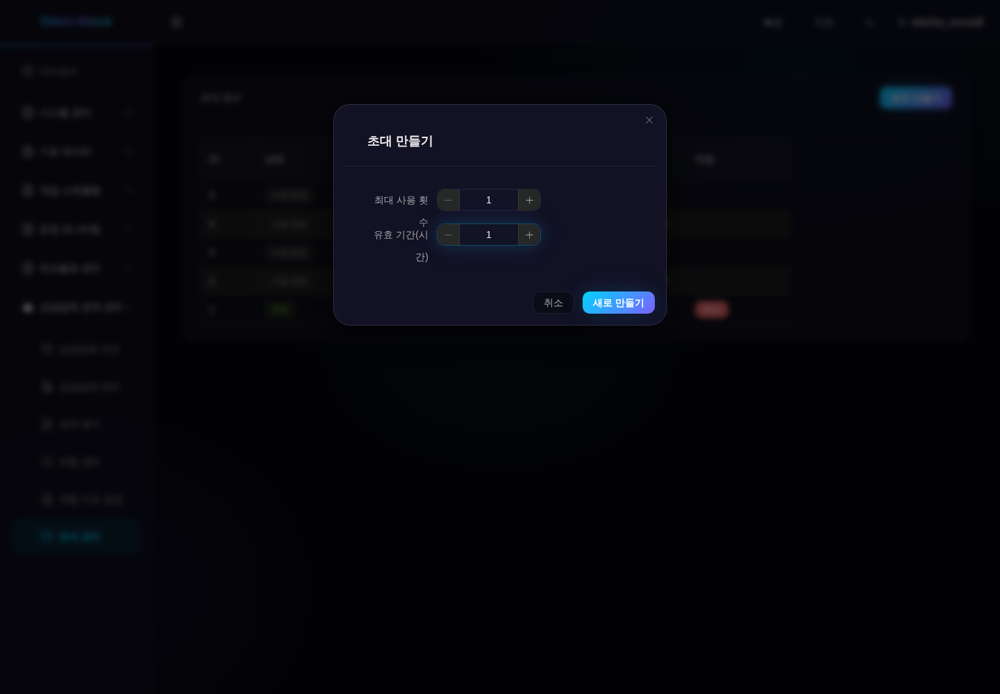

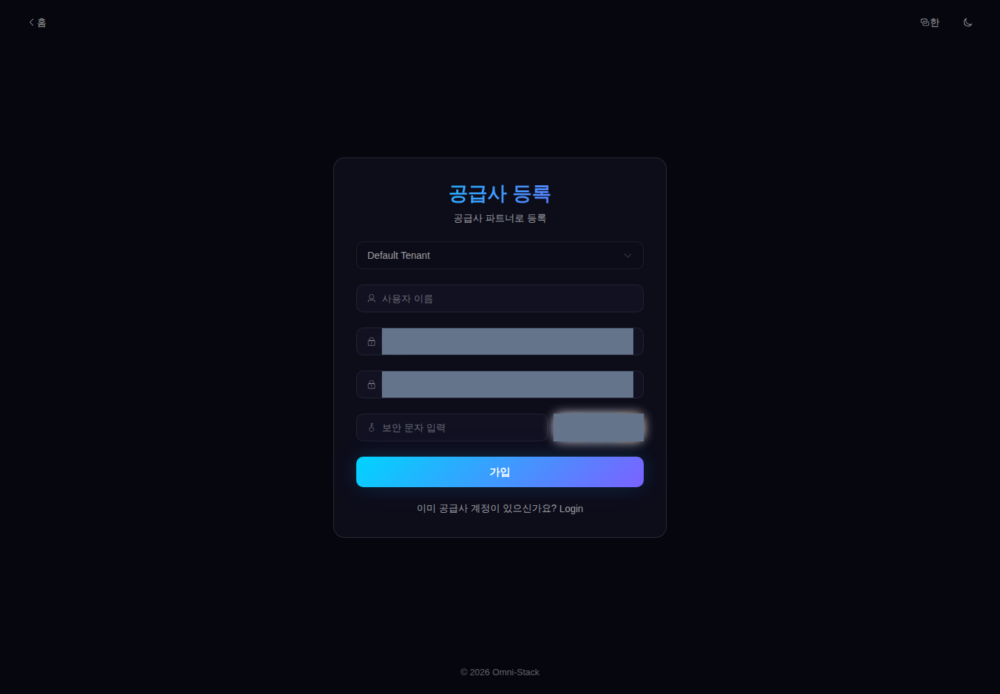

### 8.2 기업 정보를 제출하고 Saga와 승인을 구분하기

독립 `USER`로 포털에 들어가 초대, 회사 이름, 신용 코드를 입력하고 한 번 제출합니다. 같은 `requestId`를 재시도하면 같은 업체를 반환해야 합니다. `COMPLETED`는 역할 부여와 연결이 끝났다는 뜻입니다. 다시 로그인하거나 통제된 테스트 ID를 갱신해야 새 `SUPPLIER` 권한을 얻습니다. 입점 승인 완료를 의미하지 않습니다.

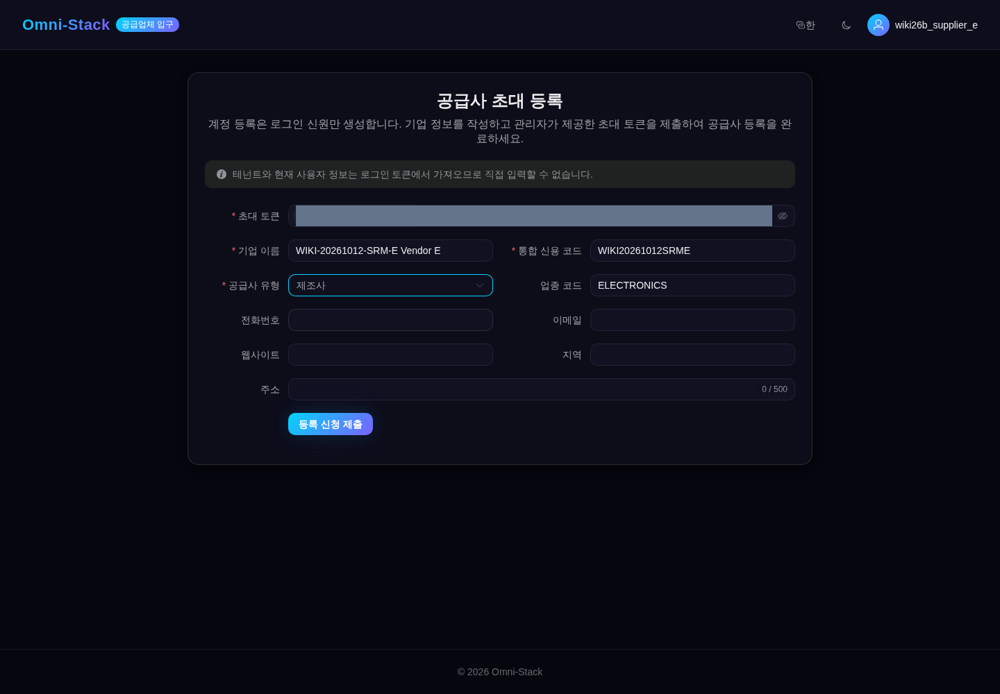

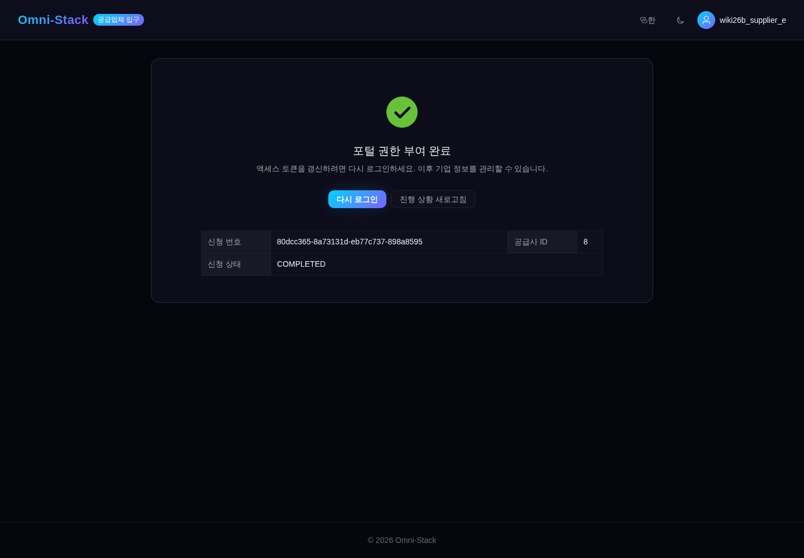

### 8.3 같은 3단계 승인 인스턴스 따라가기

포털의 승인 중 상태를 확인하고 구매 관리자, 컴플라이언스 담당자, 책임자가 같은 인스턴스를 차례로 처리합니다. 작업 제목과 공급업체 번호가 일치해야 합니다. 세 명이 승인하면 내부 360 뷰와 포털에서 `APPROVED`를 확인합니다. 담당자는 내부 사용자이며 포털 계정이 아닙니다.

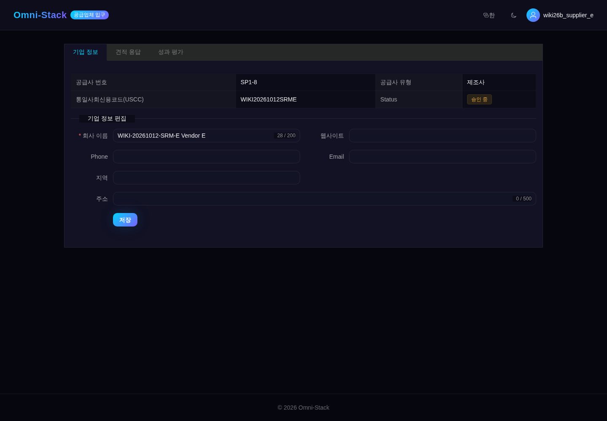

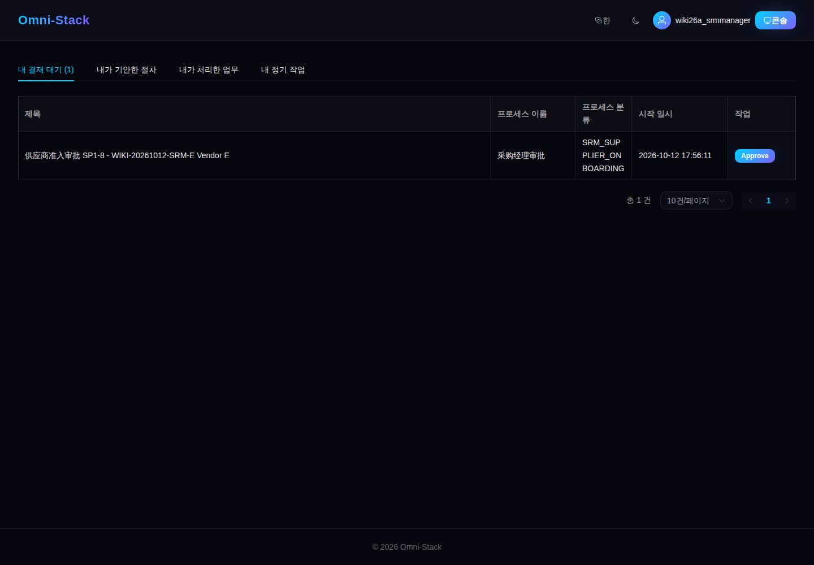


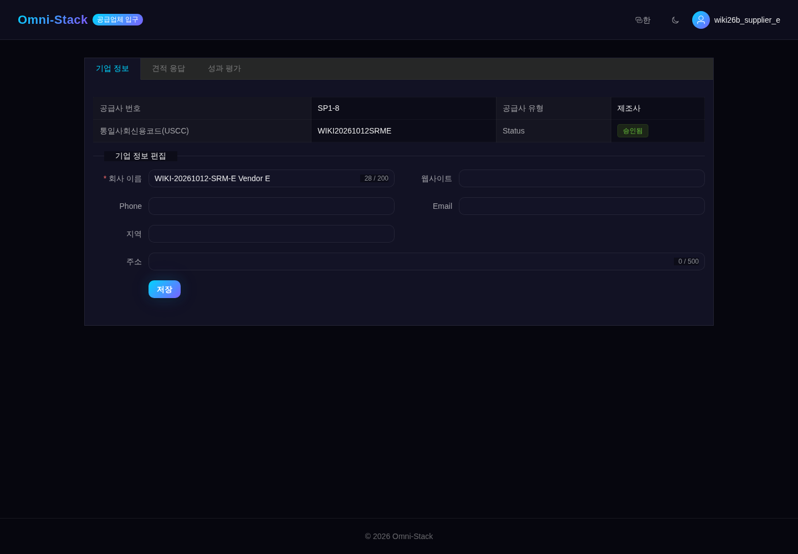

### 8.4 상세 화면에서 정지와 블랙리스트 확인

매번 현재 버전을 읽고 명령을 실행한 뒤 360 뷰를 엽니다. 같은 품목의 구매 선택 목록에서 `SUSPENDED`와 `BLACKLISTED`는 제외되고 `APPROVED`로 복원하면 다시 선택됩니다. 기존 관리 목록의 고정 작업 열이 상태를 가려 목록 이미지 20장을 게시에서 제외했습니다. 아래는 실제 상세 화면에서 다시 촬영한 이미지입니다.


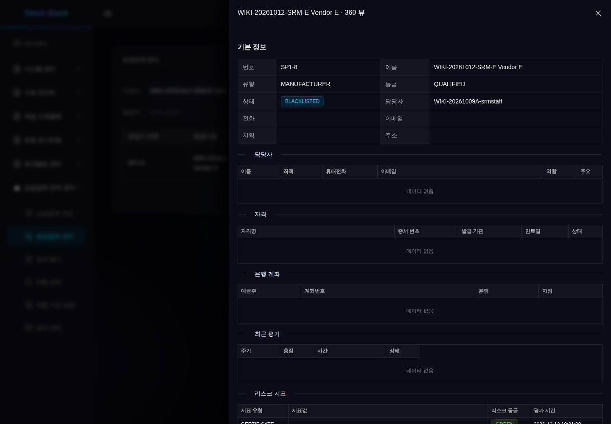


### 8.5 미초대 경계를 확인하고 샘플 퇴역하기

샘플을 승인 상태로 두고 구매 화면에서 RFQ 초대 대상이 다른 두 업체뿐인지 확인합니다. 샘플 포털은 빈 목록이고 해당 RFQ 상세 직접 조회는 업무 코드 404를 반환해야 합니다. 초대된 계정은 같은 상세를 코드 200으로 읽습니다. 오류 응답도 HTTP 200이므로 본문의 `code`를 확인하세요. 이번에는 낙찰된 RFQ를 사용했으며 읽기 격리만 증명하고 새 견적 제출은 증명하지 않습니다.

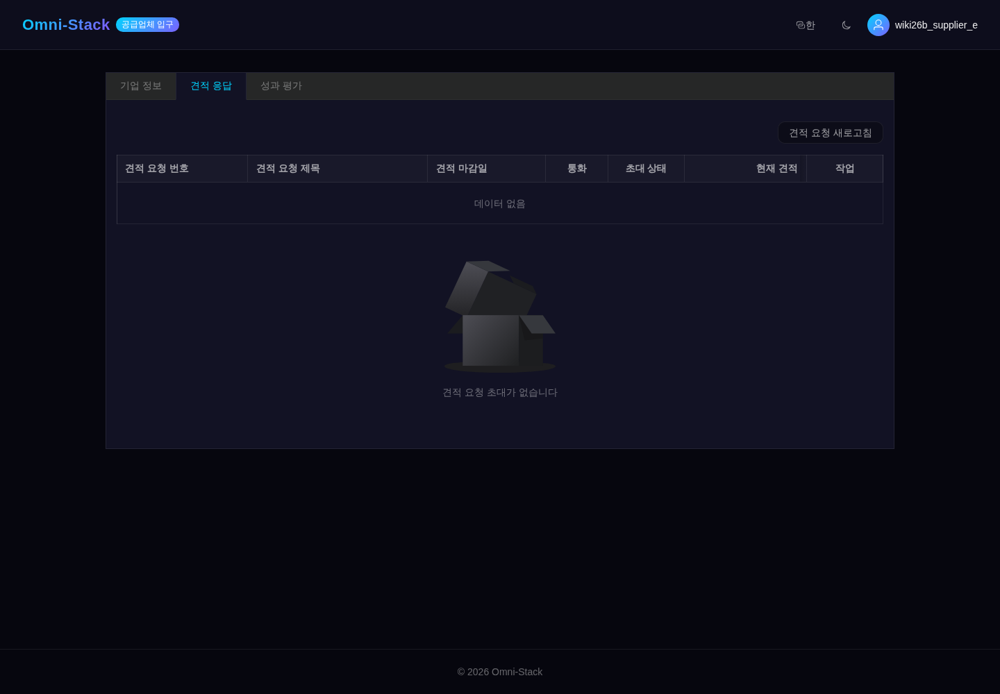

경계 확인 뒤 전용 샘플을 `ELIMINATED`로 만들고 초대 상태를 확인합니다. 기록은 `USED`이며 스크립트는 표시가 `ACTIVE`일 때만 취소합니다. 실행하지 않은 취소를 완료했다고 기록하지 않습니다. 구매 후보에서 제외되고 정지 해제와 견적 초대 조회는 업무 코드 409입니다. 정식 승인/입점 이력과 픽스처 계정을 격리 프로젝트에 남기며 계정/프로젝트 정리는 최종 검증 때 수행합니다. DB 초기화를 정리로 대체하지 않습니다.

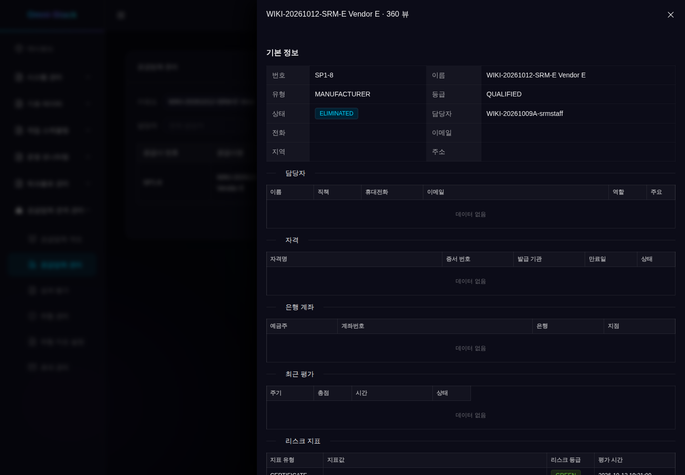

현재 일본어·한국어 화면의 일부 라벨은 영어로 대체되며 360 뷰는 원시 상태 열거 값을 표시하고 긴 라벨은 줄바꿈됩니다. 튜토리얼은 실제 화면을 설명하며 UI가 완전히 현지화되었다고 주장하지 않습니다.

이번 [문서 및 원본 검사](../reference/evidence/srm-guide-review-2026-10-17.json)는 실습 80개 파일과 두 실행의 88개 수집 기록을 대조하며 8개의 동일 바이트 재사용을 보존합니다. 제외된 과거 목록 20개는 게시하지 않습니다. 수집 시 소스/이미지 7그룹을 유지하며 이번에는 20개 원본을 개별 확인합니다. 나머지 60개 파일은 실제 과거 시각 기록을 유지하며 전체 재검토나 재촬영을 주장하지 않습니다.

## 9. 기본 버튼으로 전용 공급사를 생성하고 조작하기

이 내부 경로는 `USER + SRM_ADMIN`을 사용하며 Portal을 거치지 않습니다. 1절의 모델·조직·후보자를 준비한 뒤 격리 환경에서 전용 공급사를 새로 만듭니다. 8절의 퇴출된 기록을 재사용하지 않습니다. [검증 기록](../reference/evidence/srm-native-actions-2026-10-13.json)은 로컬 Docker 샘플 F, 번호 `S1-9`에 해당합니다. 자신의 빈 환경에서는 새로운 이름과 고유 신용 코드를 사용하고 번호는 서비스가 생성하도록 둡니다.

1. 공급사 목록에서 추가를 누르고 이름·유형·신용 코드를 입력합니다. 이 예에서는 `MANUFACTURER`, 업종 `ELECTRONICS`를 선택하고 담당자를 비워 현재 내부 담당자를 사용합니다. 내용을 확인한 뒤 저장을 한 번 누릅니다.
2. 저장하면 입점 승인 흐름이 시작됩니다. 실제 후보자 세 명이 같은 인스턴스를 차례로 처리한 뒤 360 뷰에서 `APPROVED`와 내부 담당자를 확인합니다. 이번 세 번의 승인은 정식 API로 실행했으므로 결과 이미지는 승인 버튼 클릭을 증명하지 않습니다.
3. 상세를 닫고 해당 공급사 행의 더 보기 메뉴에서 정지를 선택합니다. 확인 창의 공급사 이름을 확인하고 한 번 확정한 뒤 360 뷰를 다시 열어 `SUSPENDED`를 확인합니다.
4. 아래 순서대로 정지 해제, 블랙리스트 추가·해제, 퇴출을 진행합니다. 각 작업 후 현재 버전을 다시 읽고 다음 명령에 사용합니다. 버전은 API 응답으로 확인하며 상세 이미지에는 버전 필드가 없습니다.

| 작업 | 사전 상태와 예제 버전 | 결과 상태와 예제 버전 |
|---|---|---|
| 정지 | `APPROVED / 2` | `SUSPENDED / 3` |
| 정지 해제 | `SUSPENDED / 3` | `APPROVED / 4` |
| 블랙리스트 추가 | `APPROVED / 4` | `BLACKLISTED / 5` |
| 블랙리스트 해제 | `BLACKLISTED / 5` | `APPROVED / 6` |
| 퇴출 | `APPROVED / 6` | `ELIMINATED / 7` |

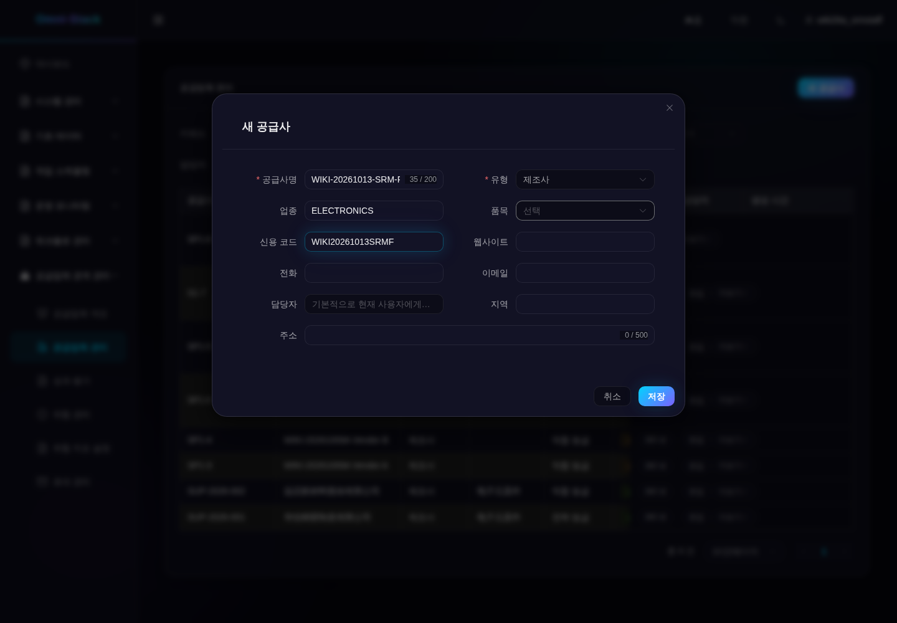

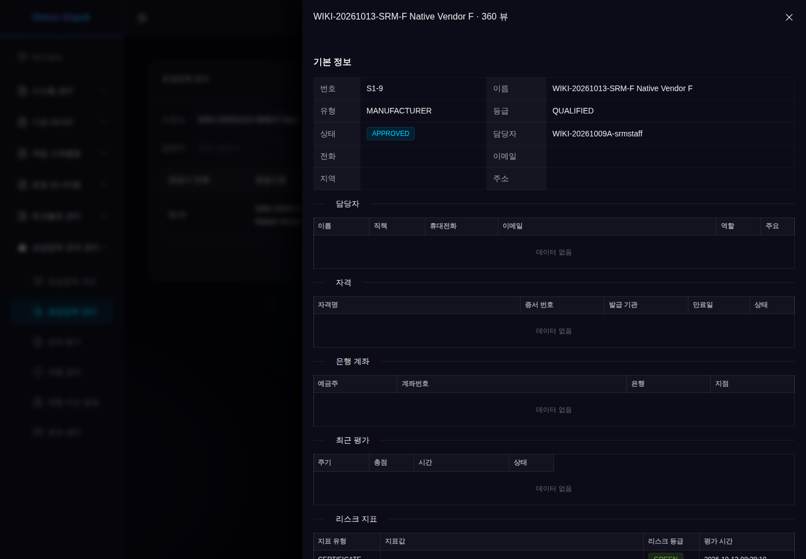

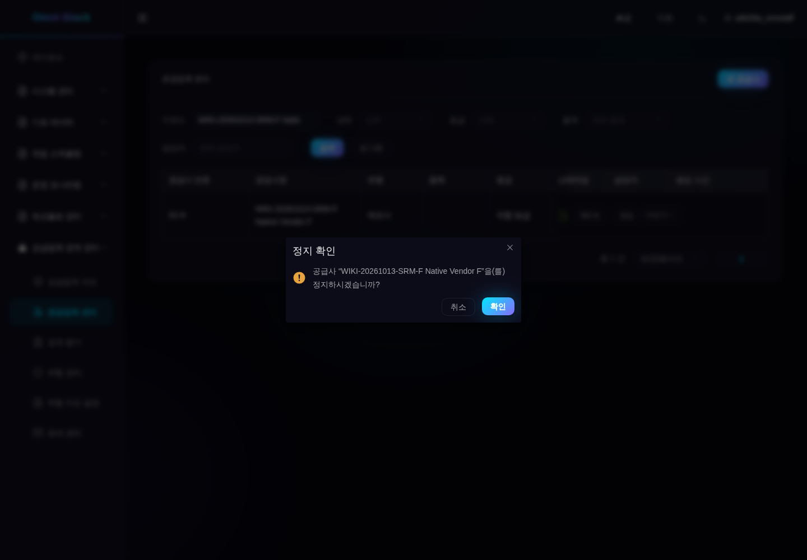

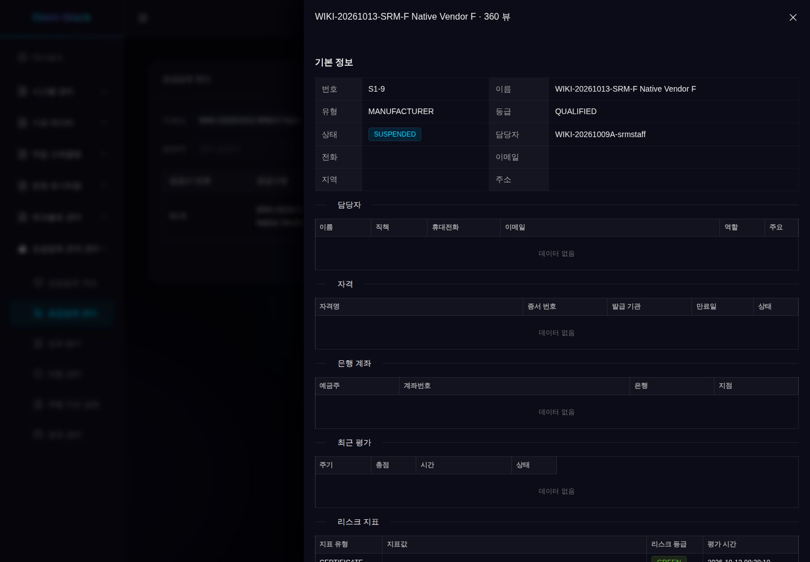

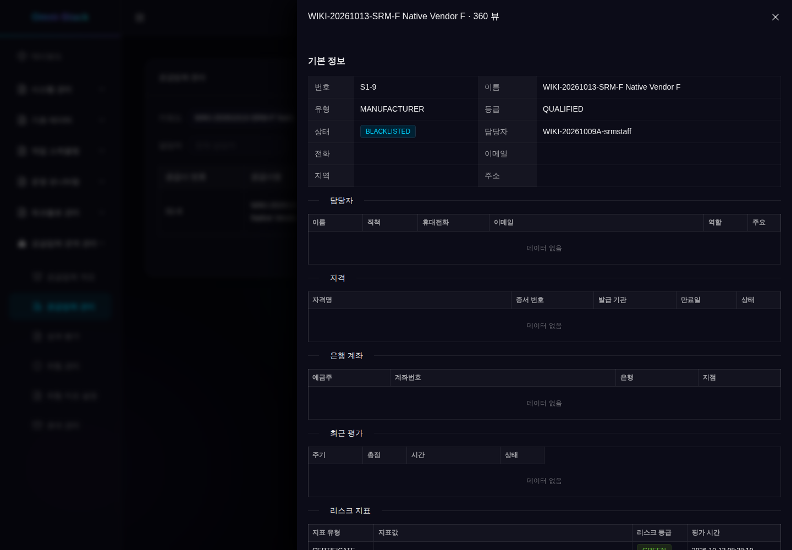


2026-10-13 기록에서 생성과 다섯 수명 주기 명령은 중국어 UI에서 각각 한 번 실행하며 네 언어는 같은 기록을 미리 보거나 결과를 읽습니다. 원본 32장을 각각 검사했습니다. 정지 해제와 블랙리스트 복원 이미지 8장은 승인 완료 상세와 바이트가 같아 독립 파일 24개만 게시하며, 각 명령의 시간과 버전은 검증 기록에 남깁니다. 이미지는 데스크톱 상단의 식별 정보와 상태를 증명합니다. 하단 위험 행은 뷰포트 밖이며 빈 연락처·은행 계좌·평가 목록은 해당 업무 흐름을 증명하지 않습니다. 실제 제품은 어두운 테마이고 긴 이름 입력은 일부가 잘립니다. 영어 표 머리글과 일부 일본어 라벨은 줄바꿈되며 일부 선택 항목은 영어로 남아 있습니다.

진입점은 `scripts/fixtures/capture-srm-native-actions.mjs`이며 단계는 `prepare / suspend / resume / blacklist / restore / eliminate`를 명시합니다. 통제된 프로젝트, 런타임 허용 목록, 저장소 밖의 단기 인증 정보와 작업 기록이 필요합니다. 성공한 단계는 재실행할 수 없습니다. 제출 후 연결이 끊기면 같은 공급사의 상태·버전을 먼저 대조하고 다시 생성하거나 중복 확정하지 않습니다. 퇴출 후 정식 승인 이력을 보존하며 명확히 소유한 격리 프로젝트를 종료할 때만 프로젝트 자원을 정리합니다. 이 경로는 Portal 계정이나 초대를 만들지 않았으며 실제 CAPTCHA 자가 등록은 별도의 미완료 항목입니다.

네 언어 문서는 [승인된 AI 검토 정책](../adr/0003-authorized-ai-translation-review.md)에 따라 실제 `AI_REVIEW`로 인수합니다. 사람 검토는 필수가 아니며 `HUMAN_REVIEW`로 허위 표시하지 않습니다. 현재 유효 해시와 상태는[검토 목록](../i18n-review-queue.md)을 참고하세요.
