# SRM 管理端与供应商门户完整业务流程

本章从入驻走到准入审批、绩效评估、风险和采购报价。管理端与供应商门户使用不同角色；门户账号不能代替内部负责人。先完成 [数据与取证夹具](../wiki/data-and-fixtures.md) 中的独立验收环境、组织和审批候选人准备。

本轮核对四语文档、当前源码与历史原图，没有重新入驻、审批、评分、改风险或执行生命周期命令。第 8 节记录于 2026-10-12，第 9 节记录于 2026-10-13；已有成功写入不重放。

## 1. 先检查角色、组织和模型

1. 内部经办人使用 SRM 管理权限，供应商账号先有 `USER` 角色。邀请入驻成功后，Saga 才分配 `SUPPLIER` 并建立有效门户关联；重新登录后使用更新后的权限。
2. 默认准入模型为 `supplier-onboarding`。检查当前已发布版本；初始化可能已经发布，不要重复发布或修改已有共享版本。
3. 默认审批依次需要 `SRM_MANAGER`、`SRM_COMPLIANCE`、`SRM_DIRECTOR` 候选人。角色、组织锚点、`sys_user_role_scope` 必须同时满足模型配置；只有用户角色关联不够。
4. 候选人还需要待办、实例查看和 `workflow:approval:complete` 功能权限。现有 SRM 审批角色不能被视为天然具备所有审批操作权限。隔离演示可创建最小补充角色，具体权限和受控组织范围夹具见上面的准备章节。
5. 在候选人预览中核对实际用户，再提交业务。不要用 `SUPER_ADMIN` 代替普通角色验证。

## 2. 邀请、账号注册与 Portal 入驻

1. 内部用户进入「供应商关系管理 → 入驻邀请」，新建只供本次教学使用的邀请，并记录有效期和使用限制。邀请令牌只在私有环境保存，截图遮挡。
2. 供应商打开 `/portal-register`，按 [认证教程](authentication.md) 完成账号注册和真实验证码校验，再登录供应商门户。
3. 提交邀请令牌、企业名称等资料，以及客户端生成的唯一 `requestId`。网络重试沿用同一个请求 ID，避免创建多份入驻记录。
4. 查询入驻进度：SRM 先建立 `REGISTERING` 供应商，通过 Saga 请求 Auth 分配角色，再建立门户关联。Saga 完成后才触发准入流程。
5. 分别检查 Saga 状态和供应商的 `status`、`workflowStartStatus`、`processInstanceId`。Saga 完成表示角色和关联步骤完成，不能据此判断供应商已获准入。

门户用户 ID 不得写入内部 `owner_user_id` 或 `owner_unit_id`。内部负责人通过管理端分配；联系人、资质、银行账户继承供应商聚合根的数据范围，不能给没有 owner 列的子表硬加过滤列。

## 3. 准入审批、驳回与撤回

```text
Portal: REGISTERING → PENDING_REVIEW → APPROVING → APPROVED
                                      ↘ REJECTED → 重新提交 → APPROVING
APPROVING → 撤回或取消 → PENDING_REVIEW
APPROVED ↔ SUSPENDED
APPROVED ↔ BLACKLISTED
APPROVED/SUSPENDED → ELIMINATED
```

1. 管理端新建供应商也会自动尝试启动准入流程。成功时显示 `APPROVING + STARTED`，并带真实 `processInstanceId`。
2. 三类审批人依次在个人待办打开同一业务，查看企业资料并提交意见。最后一位通过后，Workflow 完成事件回写 SRM，供应商变为 `APPROVED`；异步回写期间刷新查询，不要直接改数据库。
3. 用独立演示供应商验证驳回：第一位审批人拒绝，等待业务状态变为 `REJECTED`。经办人补充资料并重新提交，应得到新的流程实例，旧实例保留历史。
4. 重新提交后的审批中记录可以撤回或取消。远端流程终止后，供应商回到 `PENDING_REVIEW`，实例 ID 清空，启动状态为 `NOT_STARTED`，原待办消失。
5. **当前限制**：公开的重新提交接口只接受 `REJECTED`。撤回后的 `PENDING_REVIEW`，以及启动失败的 `PENDING_REVIEW + FAILED`，均不能靠再次点击“提交”重新启动；当前没有公开的重试启动接口。Portal 入驻 Saga 的重试也不能冒充工作流重试。保留记录并按故障路径排查。

## 4. 生命周期与采购可选范围

1. 选一条已准入的教学供应商，读取当前版本后冻结；原生确认框只有名称确认，没有原因输入。需要记录原因时，通过正式接口的可选 `reason` 字段提交。状态应为 `SUSPENDED`，同品类采购选项不再包含它。
2. 解冻后回到 `APPROVED`。加入黑名单后为 `BLACKLISTED`；从黑名单恢复使用专门操作，并再次回到 `APPROVED`。
3. 淘汰 `ELIMINATED` 是终态，只在独立测试记录上使用。它不是本次冻结/恢复演示的下一步。
4. 所有变更带当前 `version`。旧版本发生冲突时刷新并确认最新状态，不能盲目重复提交。

只有 `APPROVED` 且品类匹配的供应商可用于采购选择。风险 `RED` 和生命周期黑名单是不同字段；本次验收的风险评定不会自动把供应商拉黑。

## 5. 绩效评估：提交即完成

1. 内部评估人进入「绩效评估」，选择可见且符合评估条件的供应商，加载默认模板和维度。
2. 为所有维度各填一次评分，范围 `1.0–5.0`，最多一位小数；权重合计必须为 100。填写本次唯一评估周期后提交。
3. 当前接口一次完成评分、总分计算、供应商等级更新和 Outbox 事件写入，返回 `COMPLETED`。界面没有独立的“待评估 → 评估中 → 完成”操作链。
4. 计算规则为 `Σ(维度评分 / 5 × 维度权重)`。全部维度评分 4、权重合计 100 的示例总分为 80，对应 `PREFERRED`；评分 6 按当前后端校验应返回业务码 400。这是规则说明，不是本轮重新提交评分的结果。
5. 对应供应商登录 Portal 的「绩效评估」页应看到该结果；另一供应商账号不应看到。门户展示范围由有效供应商关联控制。

## 6. 风险评定与询价报价

1. 在风险管理中打开教学供应商，区分自动指标与人工指标。当前后端只在找到启用的指标类型时检查其 `autoCalc` 配置；配置为自动计算的指标不允许手工覆盖。不能把缺失或停用类型也视为已经过相同校验。
2. 人工指标从当前指标的评分标准中选择，提交 `criterionId`、当前版本和说明。不要仅改界面颜色。

先从该指标对应的评分标准中核对选择。当前 `criterionId` 分支检查标准存在并复制分数与等级，没有额外的同指标类型匹配校验；接口成功不能代替这一核对。
3. 保存后查看风险汇总；需要保留明确时点结果时创建风险评估快照。历史样例的人工指标选择 RED 标准后快照为 `RED`；当前汇总按各指标分数之和及租户阈值计算，不能只凭一个指标颜色推断整体等级。保留历史结果。
4. 采购发布 RFQ 后，已准入且被邀请的供应商在 Portal 查看询价并报价。消息传递、比价、定标和收货见 [采购完整链路](procurement-flow.md)。
5. Portal 只能查看自身报价和评估。未准入供应商会先被准入检查以业务码 409 拒绝。另用已准入、未受邀的供应商检查：邀请列表不包含目标 RFQ，详情返回业务码 404；受邀供应商读取同一详情成功。本次错误响应的 HTTP 状态仍为 200，必须检查响应体的 `code`。

## 7. 源码定位与故障复现

- 入驻卡住：在 `SupplierPortalServiceImpl.doEnroll()`、Saga 协调器及 Auth 角色分配处跟随同一 `requestId`，区分远端角色分配和本地门户关联。不要回滚已经提交的远端事务。
- 已入驻但没有待办：在 `SupplierWorkflowCoordinator.prepareAndStart()` 看模型版本、组织锚点和启动响应；再到 Workflow 的候选人解析链查看角色范围。本次确实复现过候选人为空导致 `FAILED`。
- 重新提交和撤回：在 `SupplierServiceImpl.submit()`、`terminateWorkflow()` 对照前置状态、版本和新旧实例；公开响应没有 `approvalAttempt` 字段，调试时不要把它当作响应断言。
- 评分不符：在 `EvaluationServiceImpl.create()`、`SrmEvaluationScoreCalculator.calculate()` 对照维度 ID、评分和权重，观察同一事务中的等级更新。
- 风险和数据范围：在 `RiskServiceImpl.updateIndicator()`、供应商访问守卫及 Portal 关联查询处检查可编辑指标和聚合根可见性。

本章涵盖三节点准入、驳回/重新提交/撤回、绩效、风险、生命周期和门户隔离。流程规则按当前实现核对；第 8、9 节及其回执说明各自真实运行范围，不能从静态源码、结果图或本轮 AI 复核推断其他分支已完成。故障恢复仍须独立验证。架构约束见 [SRM 事实文档](../srm.md) 与 [设计](../design/srm-design.md)。

## 8. 按真实画面复现入驻与准入

以下为独立 Docker 项目中的原图；[脱敏验收回执](../reference/evidence/srm-2026-10-12.json) 记录角色、接口结果、图片和源码摘要、容器镜像及收尾边界。账号由正式管理员 API 创建，因此注册页图只说明入口，**不能证明此供应商已通过验证码自注册或密码登录**。邀请创建和三节点审批使用正式 API，页面展示其真实状态；不要把这些图当作全程点击自动化。2026-10-12 的原图曾由代理逐张检查，具体历史范围以回执为准。

### 8.1 准备邀请和独立账号

打开邀请创建表单，设置本次只使用一次、有效一小时。创建后把令牌保存在私有位置。供应商打开注册入口；真实自注册须由人读取并提交当前验证码。本次这两张图采集于修复门户路由前，其余入驻图使用修复后正式构建的前端镜像。

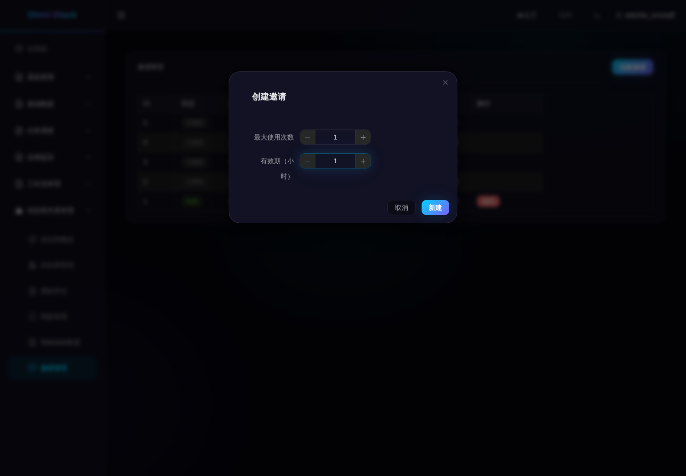

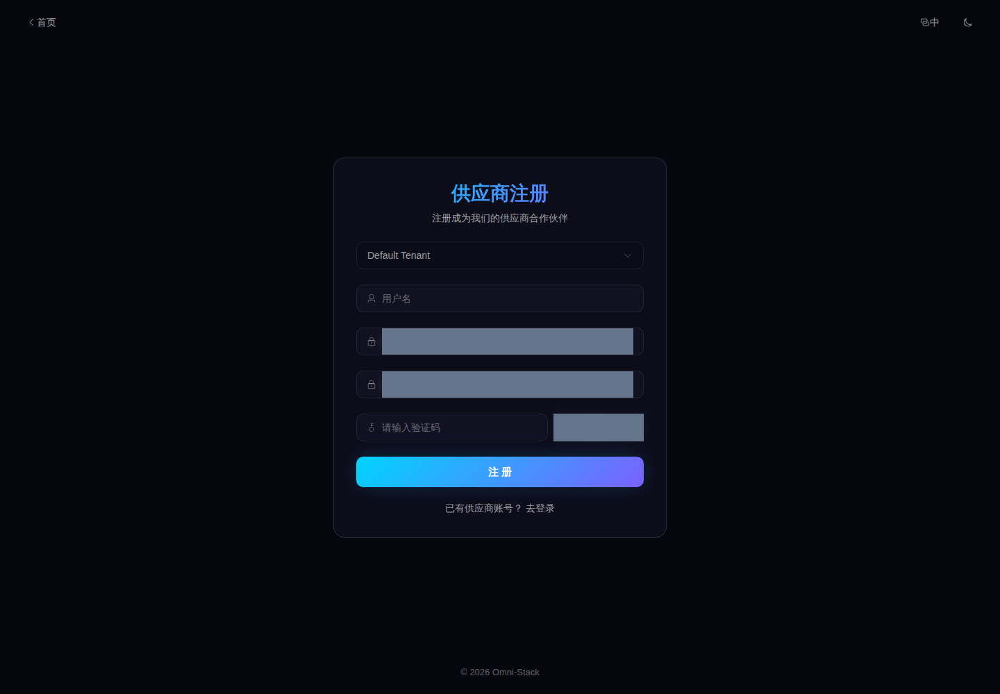

### 8.2 提交企业资料，区分 Saga 和准入

用独立 `USER` 身份进入门户，填写邀请、企业名称和信用代码。提交只做一次；相同 `requestId` 重试应得到同一供应商。下图的 `COMPLETED` 表示角色分配和关联完成。重新登录或刷新受控测试身份后，门户才会读取新 `SUPPLIER` 权限；这不是准入审批通过。

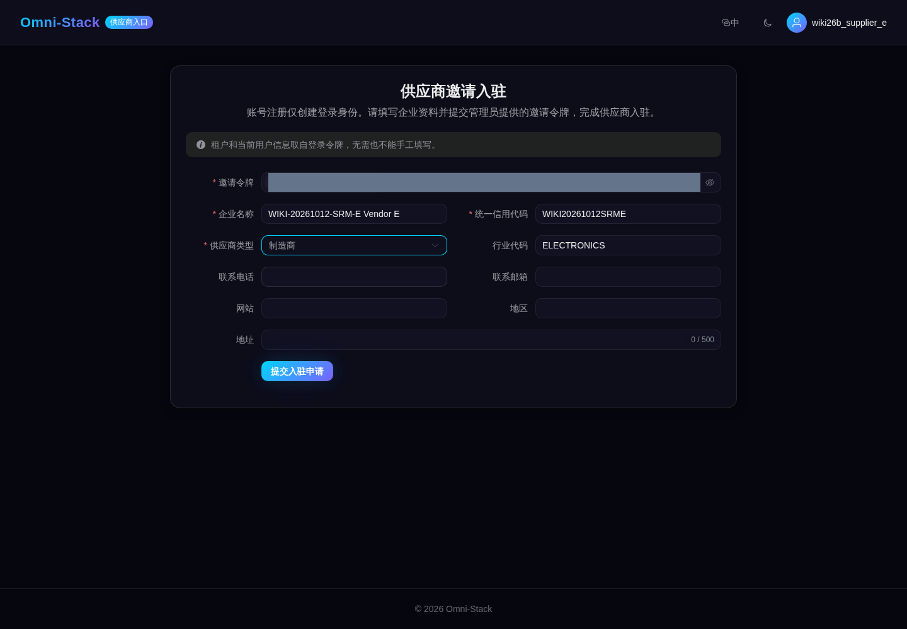

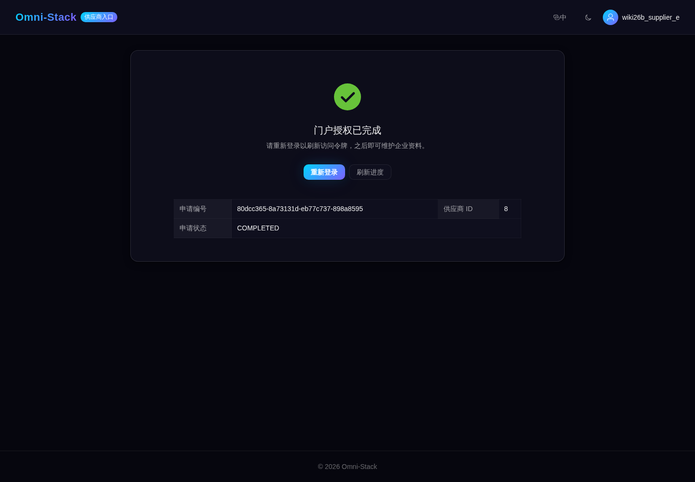

### 8.3 跟随同一个三节点审批实例

先在门户核对“审批中”，再由采购经理、合规人员和总监依次处理同一个实例。经理待办中的标题和供应商编号必须一致。三人通过后，分别检查内部 360 视图和供应商门户的 `APPROVED`。负责人是内部经办人，不能是门户账号。


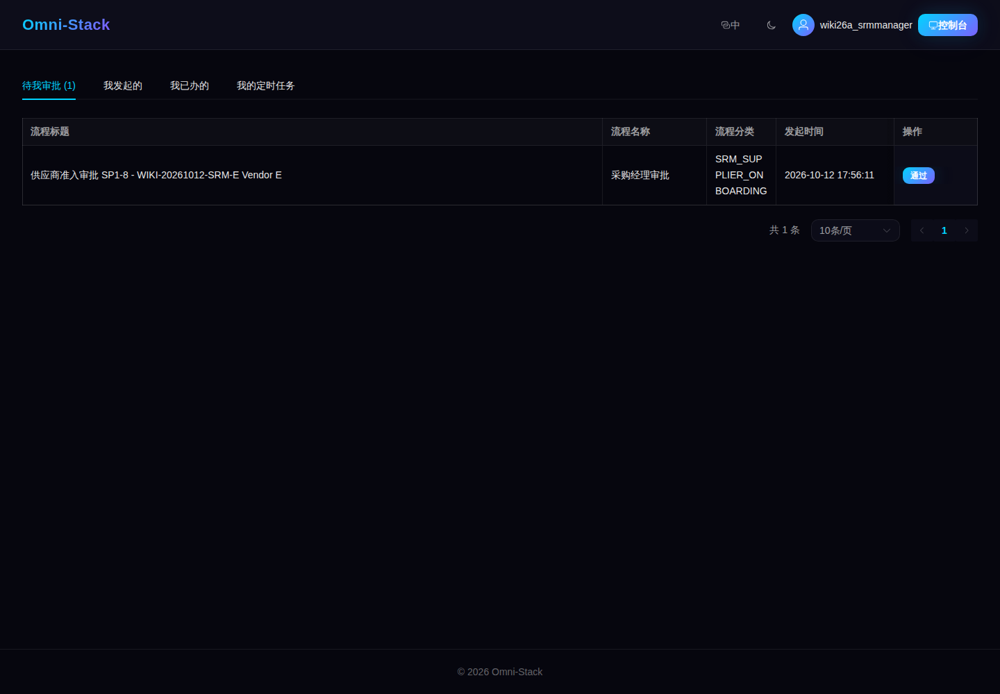

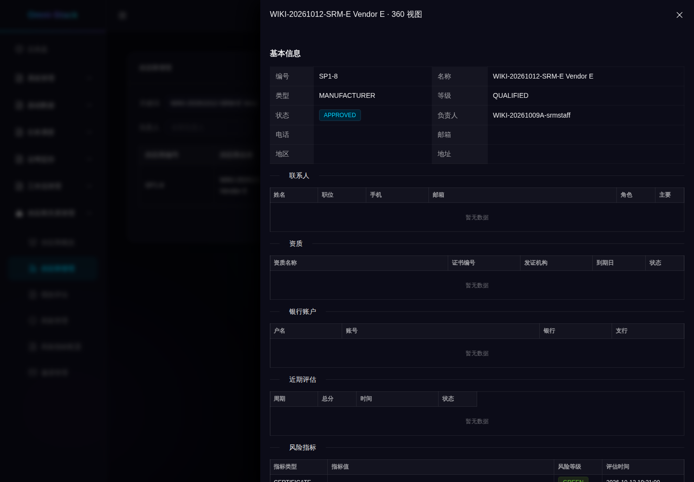

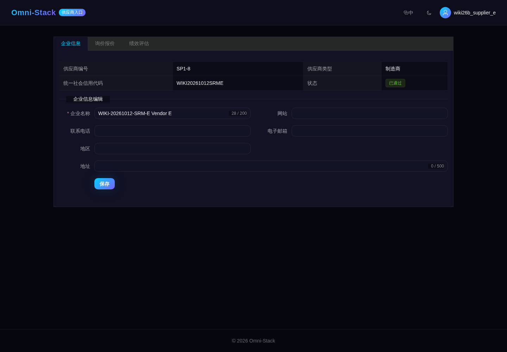

### 8.4 用详情状态验证冻结和黑名单

每次读取当前版本再执行操作，打开 360 视图核对状态。同时查询同品类采购选项：`SUSPENDED`、`BLACKLISTED` 不可选，恢复 `APPROVED` 后重新可选。原管理列表的固定操作列遮住了状态，20 张列表原图已拒绝用于发布；以下为真实详情页补录。

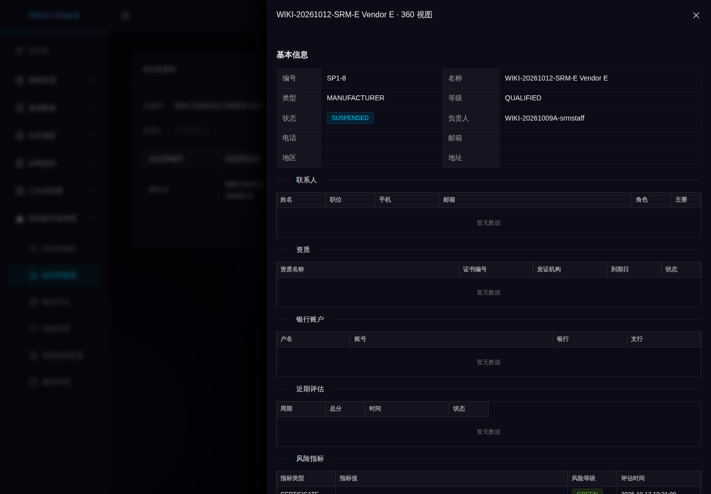


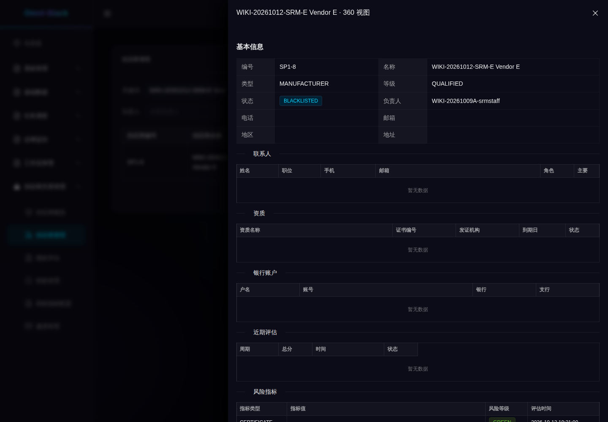


### 8.5 验证未受邀边界并收尾

保持样例准入通过，采购端确认 RFQ 只邀请另外两家供应商；该样例门户应为空列表，直接读取该 RFQ 详情应得到业务码 404。受邀账号读取同一详情返回 200。错误的 HTTP 状态仍为 200，应检查响应体 `code`。历史样例使用已定标 RFQ，只证明读取隔离，不证明新报价提交。

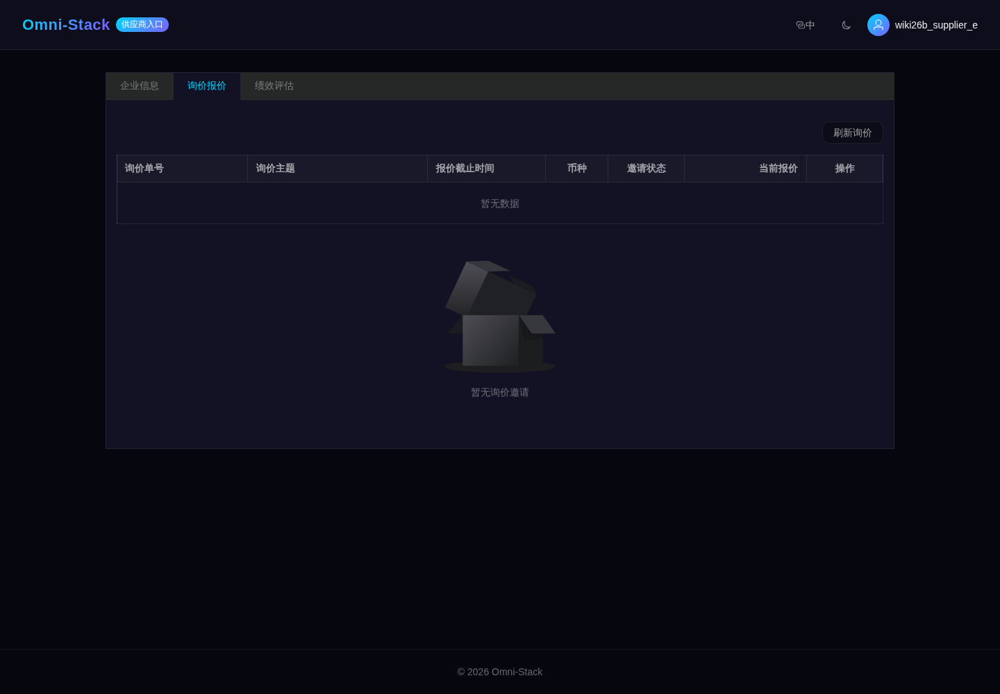

边界验证后，通过正式淘汰命令把专用样例改为 `ELIMINATED` 并核对邀请状态。本样例回执为 `USED`，脚本只在显示 `ACTIVE` 时撤销；不能把未执行的撤销写成已完成。样例不再进入采购选项，解冻和读取报价邀请均返回业务码 409。保留正式审批、入驻历史与隔离项目内的夹具账号，账号和项目级清理仍待最终验收；不以清库冒充收尾。


当前界面的部分日/韩文标签回退英文，360 视图状态使用原始枚举，部分长标签换行；教程解释实际画面，不宣称界面已完整本地化。

本轮[文档与原图检查](../reference/evidence/srm-guide-review-2026-10-17.json)匹配 80 个教程文件与两批 88 条采集记录，其中 8 条为相同字节复用，20 张旧列表图仍被拒绝发布。各图保留 7 组采集源码/镜像版本；本轮逐张抽查 20 张原图，其余 60 个文件沿用实际历史视觉记录，不冒称全部重新逐张查看或重拍。

## 9. 通过原生按钮创建并操作独立供应商

这条路径使用内部经办人 `USER + SRM_ADMIN`，不经过 Portal。先完成第 1 节的模型、组织和候选人准备，在独立环境新建一个专用供应商；不要复用第 8 节已淘汰的记录。以下[回执](../reference/evidence/srm-native-actions-2026-10-13.json)对应本机 Docker 中的样例 F，编号 `S1-9`。在自己的空环境中使用新名称和唯一信用代码，编号由服务生成。

1. 打开供应商列表，点击新增，填写名称、类型和信用代码。本例选择 `MANUFACTURER`、行业 `ELECTRONICS`，负责人留空以使用当前内部经办人。确认数据后点击保存一次。
2. 保存触发准入流程。三名真实候选人依次处理同一个实例，完成后打开 360 视图，核对 `APPROVED` 和内部负责人。本次三次审批通过正式 API 完成，不能把结果图当作审批按钮点击证明。
3. 关闭详情，在此供应商行的“更多”菜单选择冻结。先核对确认框中的供应商名称，再确认一次；重新打开 360 视图，检查 `SUSPENDED`。
4. 按下表继续解冻、加入黑名单、从黑名单恢复和淘汰。每次完成后重新读取当前版本再做下一次操作；版本来自接口响应，详情图没有版本字段。

| 操作 | 前置状态及本例版本 | 结果状态及本例版本 |
|---|---|---|
| 冻结 | `APPROVED / 2` | `SUSPENDED / 3` |
| 解冻 | `SUSPENDED / 3` | `APPROVED / 4` |
| 加入黑名单 | `APPROVED / 4` | `BLACKLISTED / 5` |
| 从黑名单恢复 | `BLACKLISTED / 5` | `APPROVED / 6` |
| 淘汰 | `APPROVED / 6` | `ELIMINATED / 7` |

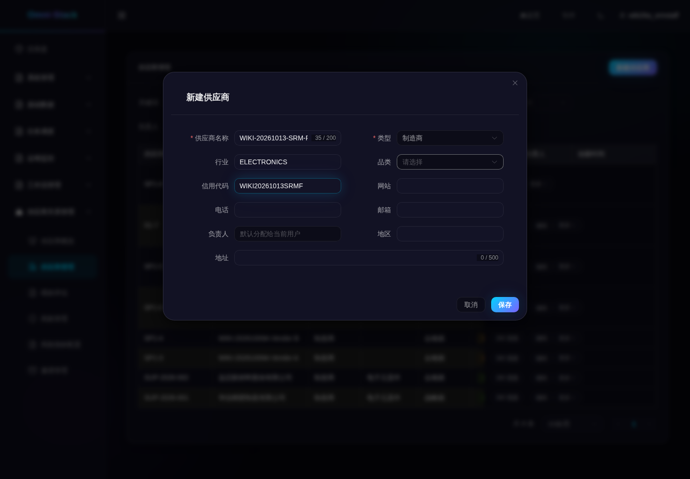


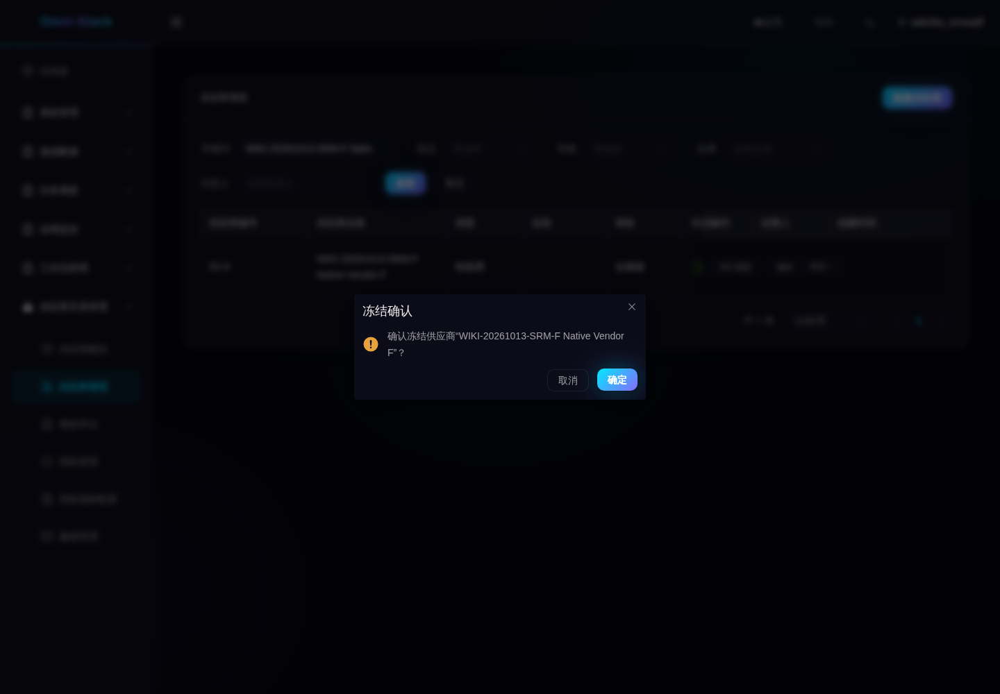


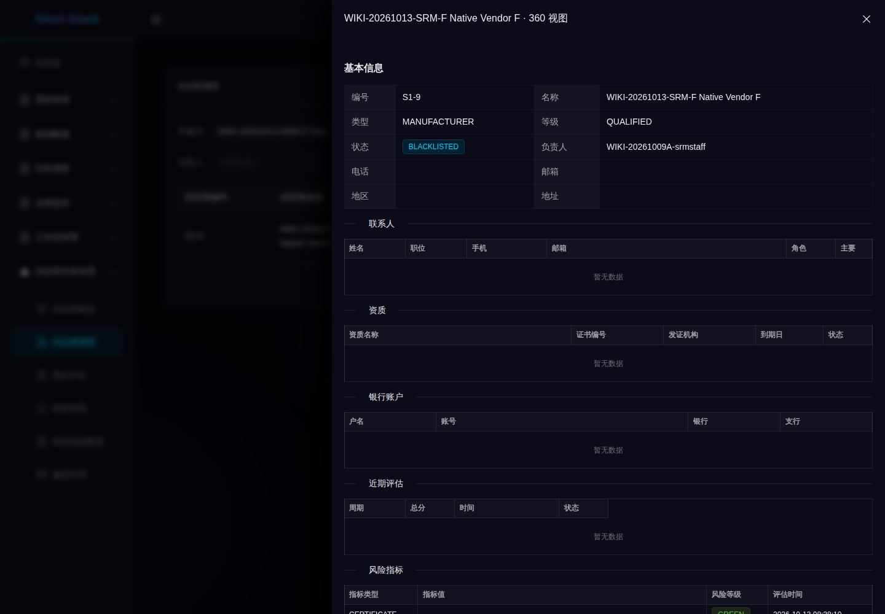

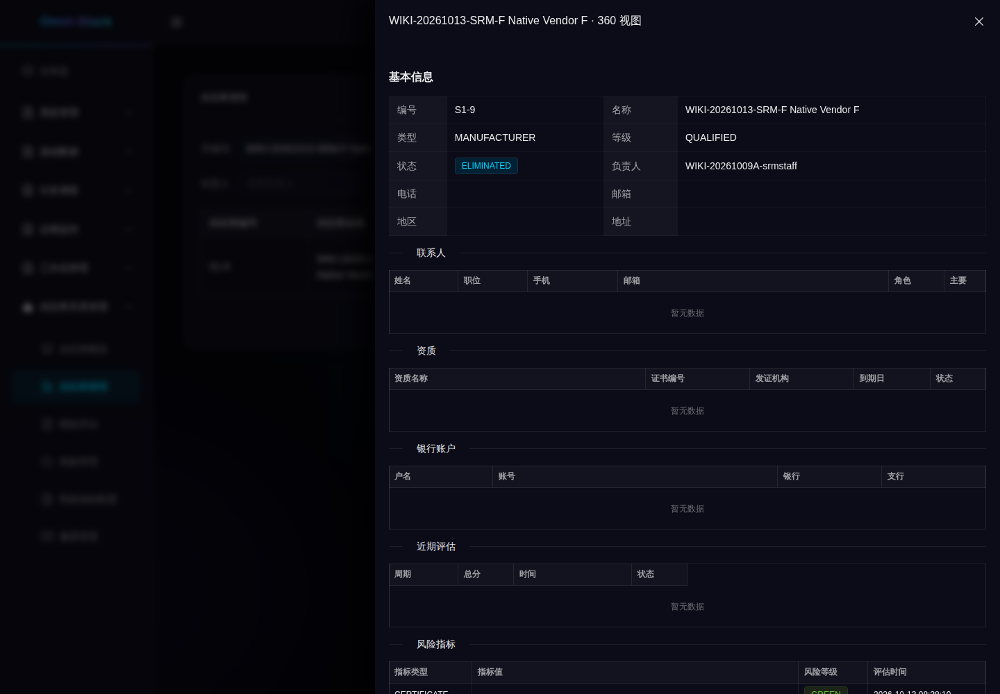

2026-10-13 的记录中，创建和五次生命周期命令均在中文界面真实提交一次；四语言使用同一记录预览或读取结果。32 张原图逐张检查后，解冻和黑名单恢复的 8 张与准入通过图字节相同，因此复用 24 个独立文件，操作时间与版本分别保留在回执中。截图只证明桌面顶部身份与状态，底部风险行不在视口；空联系人、银行账户和评估列表不证明相应业务链。实际产品为深色主题，长名称输入框有截断，英文表头和部分日文标签换行，部分可选字段标签保留英文。

工具入口为 `scripts/fixtures/capture-srm-native-actions.mjs`，显式阶段依次为 `prepare / suspend / resume / blacklist / restore / eliminate`，要求受控项目、运行时白名单、仓库外短期身份及操作登记。已成功的阶段禁止重放；若提交后断流，先核对同一供应商状态和版本，不能重新创建或重复确认。淘汰后保留正式审批历史，仅在明确拥有的隔离项目收尾时清理项目资源。本路径没有创建门户账号或邀请，真实验证码自注册仍待独立完成。

四语文档按[已授权 AI 复核政策](../adr/0003-authorized-ai-translation-review.md)以真实 `AI_REVIEW` 通过为验收条件，不要求人工复核，也不标为 `HUMAN_REVIEW`。当前有效哈希和状态见[复核队列](../i18n-review-queue.md)。
