# System Configuration, Security Settings, and Audit Logs

Baseline: this repository's Spring Boot 4 / Vue 3 implementation; use core or a preset containing core. Complete [first startup](quick-start.en.md) and [authentication](authentication.en.md) first. This is an operating tutorial; [core flows](../core-flows.en.md) define security boundaries and event contracts.

## 1. Prepare the Environment and Identities

- Run migrations, Auth, Base, Gateway, and the frontend in local Docker; confirm migration completion and service health. Native lite mode supports page reads. Section 6 requires the complete messaging runtime for asynchronous delivery; see [Docker deployment](../docker-deployment.en.md).
- Prepare an administrator and an ordinary employee in the same tenant. Record their user IDs, roles, and actual permissions. Use the relevant write permission for administration and the employee's own session for negative checks.
- Use a unique `WIKI-{run-id}` prefix. Keep original values, created IDs, request results, and cleanup records outside the repository. Never commit passwords, tokens, client secrets, or private environment files.
- The write instructions below are for an isolated teaching environment. Successful business writes from 2026-10-10/12 already have receipts and were not replayed. New 2026-10-17 images only read existing data; see Section 7.

## 2. Understand Organizations, Roles, and Menus

1. As administrator, open System Management → Organization Management, create a department with the unique prefix, and record its returned ID.
2. Create a teaching account in User Management and verify its default `USER` role. The current user page has no primary-organization editor. When needed, an administrator with `system:user:update` uses the formal `PUT /api/auth/user/{id}` to update `primaryUnitId`, then reads it back. An organization-list image does not prove user binding.
3. Read the original role set before assigning functional roles. Assignment replaces the complete set, so preserve every role still needed. Sign in again as the target account before checking menus, buttons, and APIs.
4. Check the role's `ALL/TENANT/DEPT/DEPT_AND_CHILD/SELF/CUSTOM` data scope; `CUSTOM` also needs a department set. Compare employee and manager results rather than inferring their visibility from `SUPER_ADMIN`.

**Functional roles and workflow candidate scopes are separate.** User management writes `sys_user_role`; changing the primary organization does not create `sys_user_role_scope`. Default approval models use the latter to find candidates, so functional roles alone can still leave a task without approvers. There is currently no public maintenance API for that scope. Use a recorded controlled fixture in an isolated tutorial environment, not direct production-table edits. Preview candidates before supply-chain tutorials; see the [workflow guide](workflow-approval.en.md).

### 2.1. Save a Role Scope and Assign Menu Permissions

1. Prepare a uniquely coded teaching role assigned to no users. You may create it through Role Management → Create. The 2026-10-12 evidence preparation used formal `POST /api/auth/role`, initially with `dataScope=DEPT`, without modifying seed roles.
2. Edit the role, choose Self Only (`SELF`), and confirm. Read `GET /api/auth/role/{id}` and verify that `dataScope=SELF` matches the list.

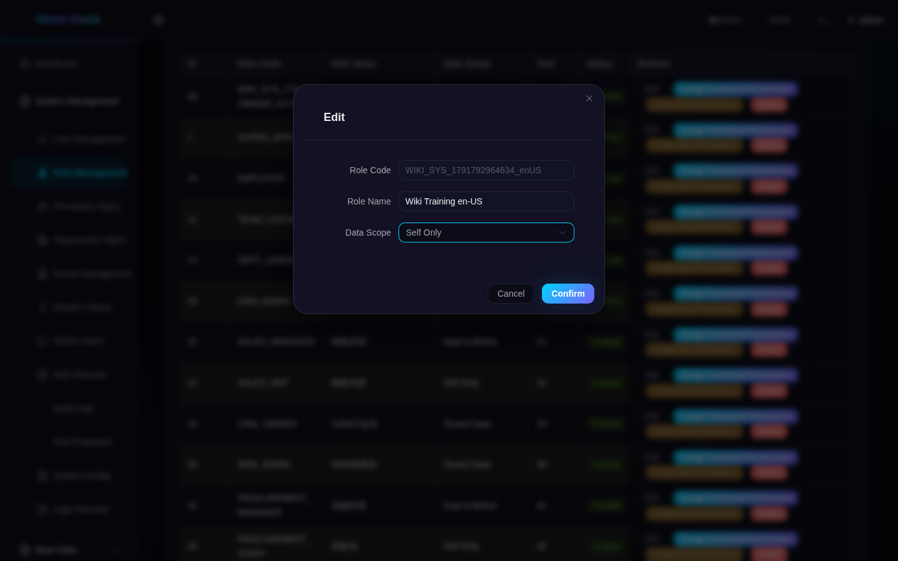
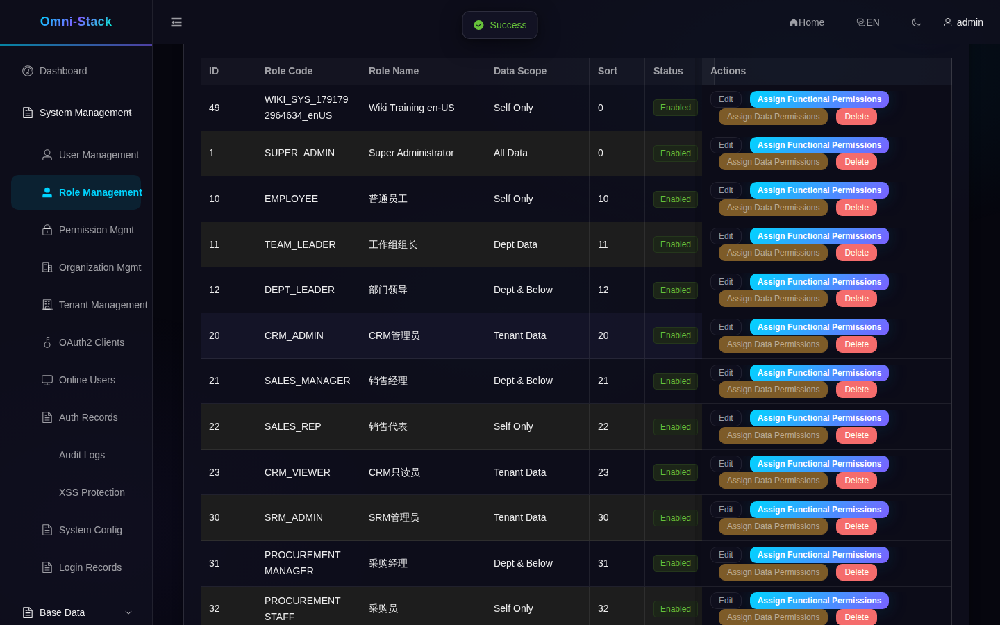

3. Read the three-level permission tree: directory `DIRECTORY`, menu `MENU`, and endpoint `API`. Viewing nodes does not create or modify menus.

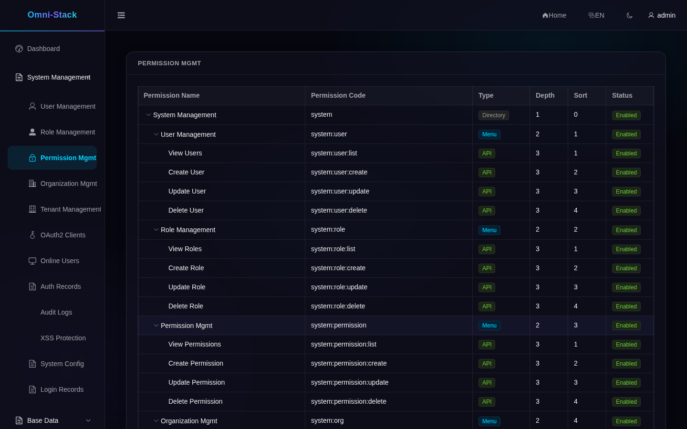

4. Open Assign Functional Permissions on the teaching role. Select only menu `system:loginrecord` and endpoint `system:loginrecord:list`. After confirming, read `GET /api/auth/permission/role/{id}` and match the returned IDs to the permission tree: exactly those two items should remain. This replaces the full set; do not apply it to a working business role.

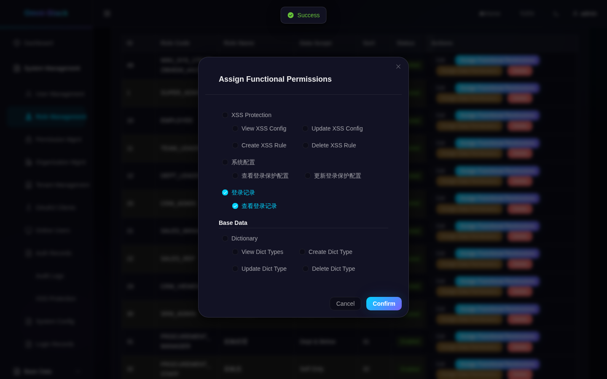

5. Delete your unassigned role by its unique code and ID, then confirm absence with `GET /api/auth/role/all`. Persisted role configuration does not prove user row isolation; see the [permission guide](permissions.en.md). After a failure, read the state first and handle only this run's objects; do not repeat successful writes.

## 3. Create and Clean Up a Teaching Dictionary

Dictionary write permission is required. The historical images use isolated-tenant `admin/SUPER_ADMIN`, not evidence of employee write access. Record a unique code such as `WIKI_DICT_{run-id}` first.

1. Open Base Data → Dictionary → Create Type. Check Type Code, Type Name, Remark, and Sort. Leave the code and name empty; keep the default sort value if suitable.

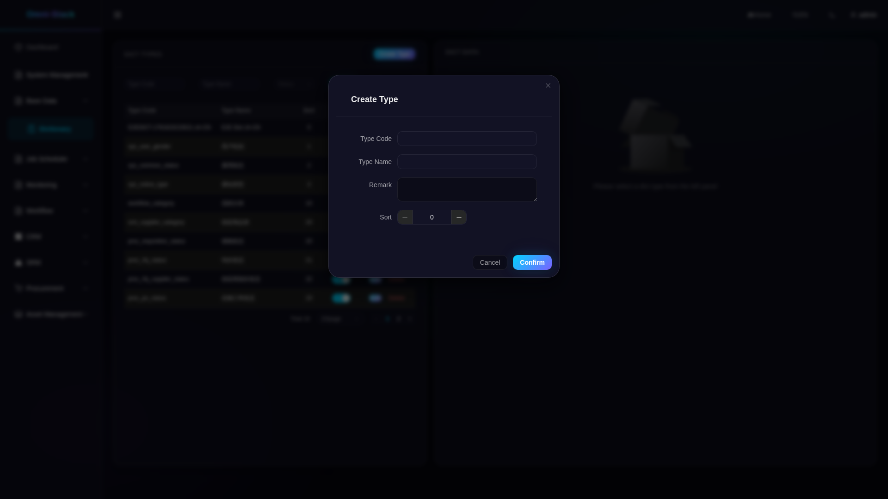

2. Confirm. For empty code/name, `POST /api/base/dict/type` returns HTTP 400 and business code 400; the dialog stays open and no type is created. The current page has no local required-field rules: backend validation feeds the common error layer.
3. Wait for the full error message. Its prefix follows the UI language; field identifiers remain `typeCode/typeName` with a troubleshooting Trace ID. A blank message during animation is not failure evidence.

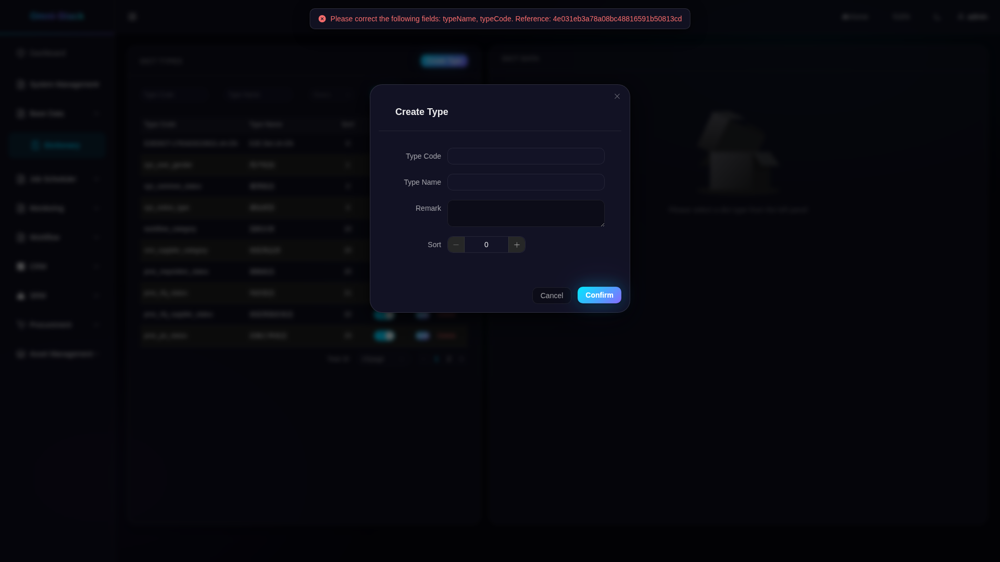

4. Let the error disappear, fill the unique code and name, and confirm. Success closes the dialog. Search by the entire code, wait for loading to finish, and verify this run's row. An empty right panel is expected until a type is selected.
5. The historical capture used `E2EDICT-{runStamp}-{locale}`, creating one type per language. Codes in those images are not seed values for readers to reuse.

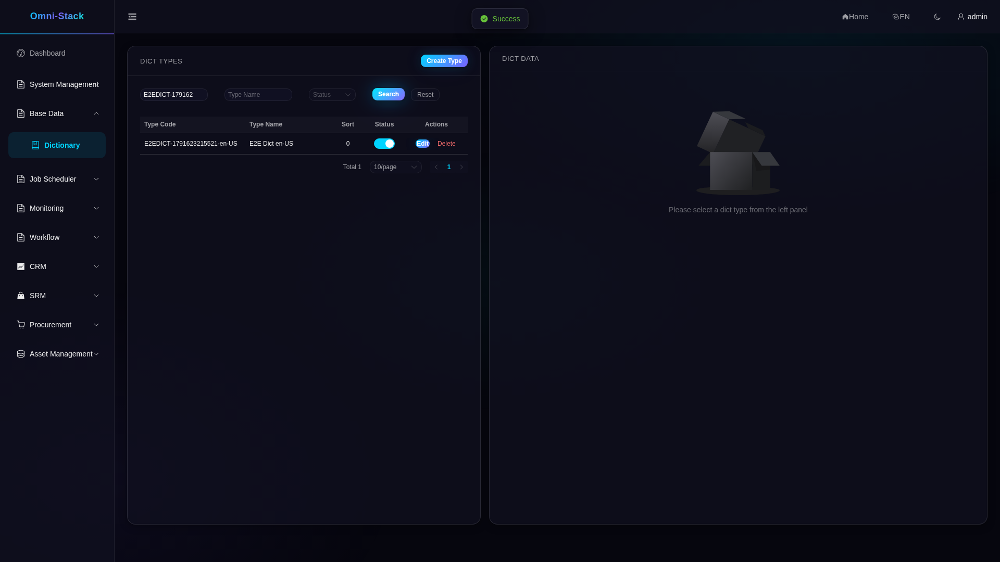

6. Record the type ID returned by the list. Delete only that type with `DELETE /api/base/dict/type/{id}`; confirm HTTP/business code 200 and then zero matches for its unique code. After failure or disconnection, query whether the action already completed. Do not delete seeds or use a fixed global row count as cleanup proof.

Automation entry `omni-frontend/e2e-docs/flows/system-dictionary.flows.spec.ts` requires Docker, external mode, explicit `E2E_MUTATIONS=true`, the matching isolated project, and runtime-image receipts. Image, resource-register, and run-receipt paths must point outside the repository. Never copy controlled test tokens into commands or the repository.

The [2026-10-10 receipt](../reference/evidence/dictionary-2026-10-10.json) records 4 passed, 0 failed, 0 skipped, and prior individual AI visual review of 12 originals. Type IDs 27–30 were already deleted through formal APIs and verified absent; they were not recreated in this stage. Japanese/Korean `Remark` remains English, the Japanese remark row is unclear, the English sidebar clips, and error fields remain API identifiers. These original limits are retained.

## 4. Change Login Protection and Check the Audit

1. Open System Management → System Config. Use `GET /api/auth/system-config/login-policy` to record original `failureThreshold/failureWindowSeconds/version`. With no persisted policy, this reads a default view without writing a row.
2. Choose a valid teaching value different from the original. The historical example is `10 → 9` with a `3600`-second window; do not assume every environment starts at 10. Save through `PUT /api/auth/system-config/login-policy` with the latest `expectedVersion`, then read back the new value and version.
3. Restore the original values in a second client using the latest version; submit again from the first, unrefreshed page. The result should be HTTP 200 with business code 409. The page retains the draft and refreshes the latest server configuration version. Compare both, then explicitly adopt the server values or retry the draft; do not silently overwrite a concurrent update.
4. Find `AUTH_CONFIG_UPDATED` in security audit by operator and time. Restore the original threshold/window with the current version and read back. Restore Defaults means `10/3600`, which may differ from this run's original values. Restoring values does not roll back versions or remove audit events.

The threshold is `3–10`, and the window is `3600–86400` seconds; login protection cannot be disabled. New policy applies to the next failure window; existing windows retain their creation-time policy. Reads require `system:config:list`, writes `system:config:update`. A hidden button is not backend-denial evidence. Actual 2026-10-17 reads returned HTTP/business code 200 for admin and 403 for employee; employee writes were not rerun.

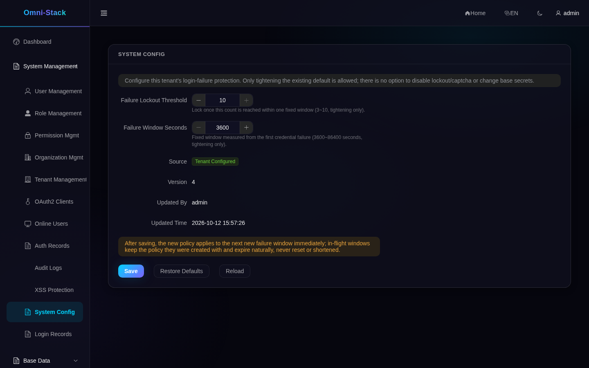
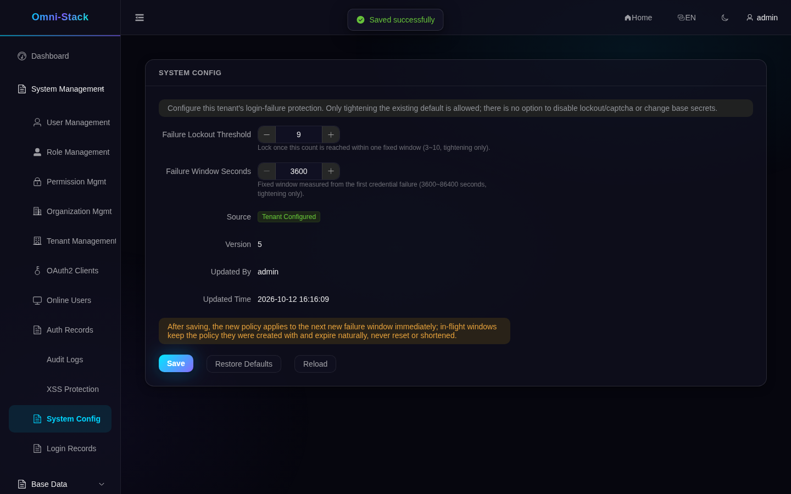
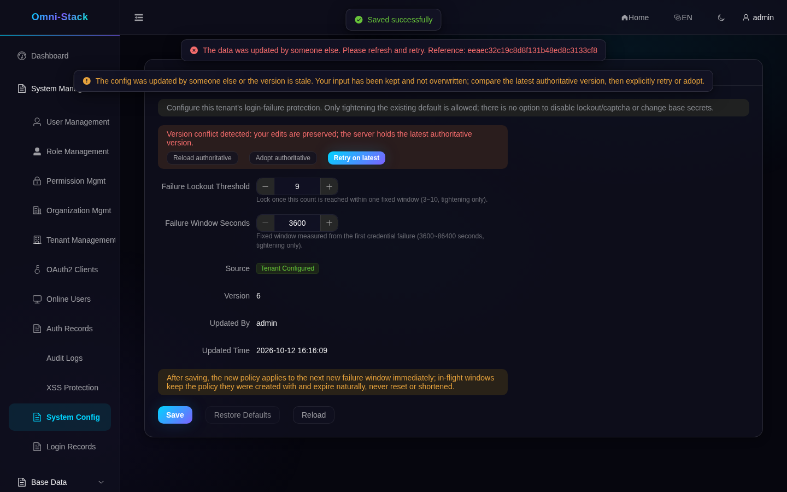

The conflict image's green message belongs to a preceding successful save. The current result is the red error, conflict explanation, and business code 409. After a network failure, GET the policy to determine whether the save completed before taking further action.

Login Records is a read-only projection of `LOGIN_SUCCESS/LOGIN_FAILED` in `sys_audit_log`. Enter the account, choose Password and the actual time range, then check account, method, outcome, reason code, and masked IP. The default is the last 7 days; explicit queries require both endpoints and at most 90 days. Date-time format is `yyyy-MM-dd HH:mm:ss`. Locks and role/password changes belong to security audit; OAuth grants belong to authorization records.

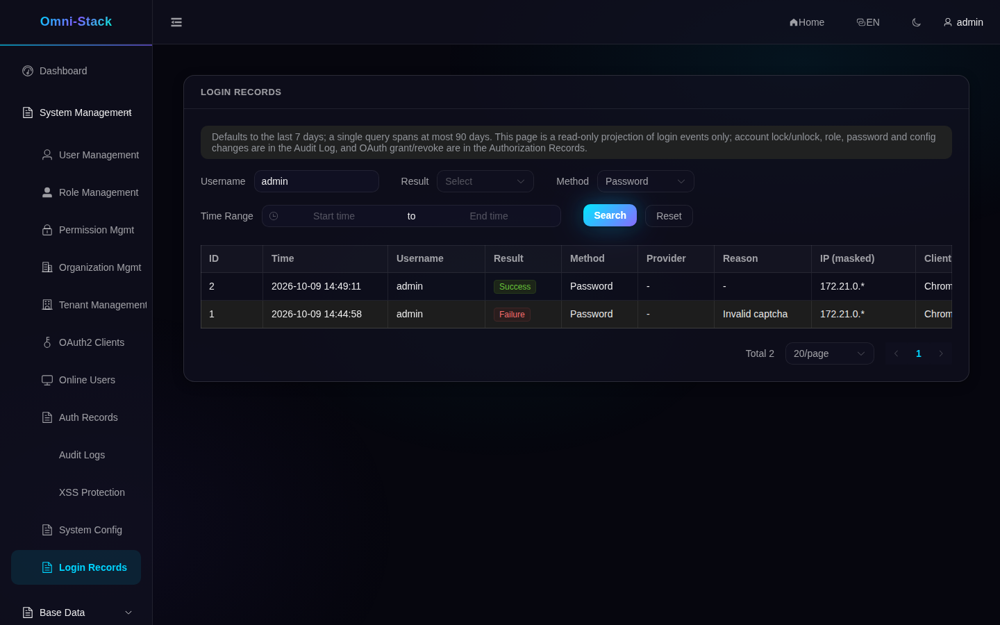

Those two logins occurred on 2026-10-09. The 2026-10-12 run only filtered history, and this stage also submitted no passwords or CAPTCHA. Refreshing a list is not a new login.

The [2026-10-12 platform receipt](../reference/evidence/system-platform-2026-10-12.json) preserves 32 images: six successful Chinese steps from an earlier attempt and 26 later images, with the subsequent four-locale tests reporting 4 passed. Earlier timeouts were reconciled, policy restored, and the corresponding roles cleaned up. The images did not all come from one failure-free run. Temporary roles differed between attempts and were deleted; original `10/3600` was restored while increasing versions and audit events remained. No writes were replayed here.

Some historical dialog nodes fall back to Chinese, Japanese/Korean permission tables contain English, and the English sidebar or rightmost login column may clip. These originals prove dated saves, conflicts, permission persistence, and historical filtering, not user isolation with the teaching role.

## 5. OAuth2, XSS, and Sessions

For OAuth2 clients, check allowed grants, exact callbacks, scopes, and consent settings. Client IDs are public identifiers; keep secrets private. See [authentication](authentication.en.md) for external social login and local authorization-code/PKCE flows. Old device-code rows in an authorization list do not prove a new grant or external callback.

On XSS Protection, confirm that both settings and rules requests succeed. In the current implementation, settings GET creates a default disabled row if that tenant has none. This stage first confirmed the existing tenant-1 row, then checked that reads left its value unchanged. The global switch in the 2026-10-17 originals is OFF; enabled individual rules do not prove protection is active.

To test XSS changes in isolation, first record original settings/rules and operate only on recorded, recoverable teaching rules. Following [core flows](../core-flows.en.md), check actual saves/responses for event attributes, script protocols, and allowed rich text, then restore originals. Writes must invalidate `xss:enabled:{tenantId}` and `xss:rules:{tenantId}`. This stage did not toggle protection, change rules, or test attack inputs. Never disable protection to make a test pass.

Online Users, Auth Records, Login Records, and Audit Logs are separate views. The kick API is `DELETE /api/auth/online/{userId}`, a user-targeted action rather than a delete button for an arbitrary single `jti`. Use only a test user clearly owned by this run, then verify old-session denial and recovery by signing in again; do not affect others. This stage's online list was empty, and no kick occurred.

## 6. Trace an Operation to Asynchronous Logs

Auth does not use `@OperLog`; authentication events remain in security audit. Business-operation logs pass through Outbox, MQ, and a consumer. Native lite mode disables the relay, XXL-JOB, and consumer. Reading old logs needs none of these; testing new delivery requires the full runtime and appropriate components/bindings described in [Docker deployment](../docker-deployment.en.md) and [reliable messaging](../mq-reliability.en.md). Starting an MQ container alone does not prove readiness.

1. Record tenant, operator, module, time, URL, result, and response Trace ID for an authorized business request. Do not repeat a successful operation for a screenshot.
2. Filter Operation Logs by operator, module, type, and time. The current page has no Trace ID filter or dedicated column; do not instruct readers to search it by Trace ID.
3. Cross-check request details against structured logs, then inspect the source service's Outbox `msgId`, optional `msgKey`, and `serviceName`. The producer records `producerTraceId`; relay tracing can use a different context. See [observability](../observability.en.md) for correlation. Do not assume every message has a business key or that every field is visible in the UI.
4. Check broker acknowledgment and consumer results. Outbox `SENT` does not mean business consumption completed. At maximum retries, inspect downstream state and idempotency before resending or skipping. A successful list read does not prove failure recovery.

## 7. Images and Verification Boundaries

The [2026-10-17 page-read receipt](../reference/evidence/security-lists-2026-10-17.json) binds the following 40 four-language originals to the executed script, sources, and runtime artifacts. Controlled Docker identities read existing tenant data: 44 page API reads succeeded, with no business-form submissions or historical-write replay. This was not password/CAPTCHA login. All six containers started for capture were stopped afterward.

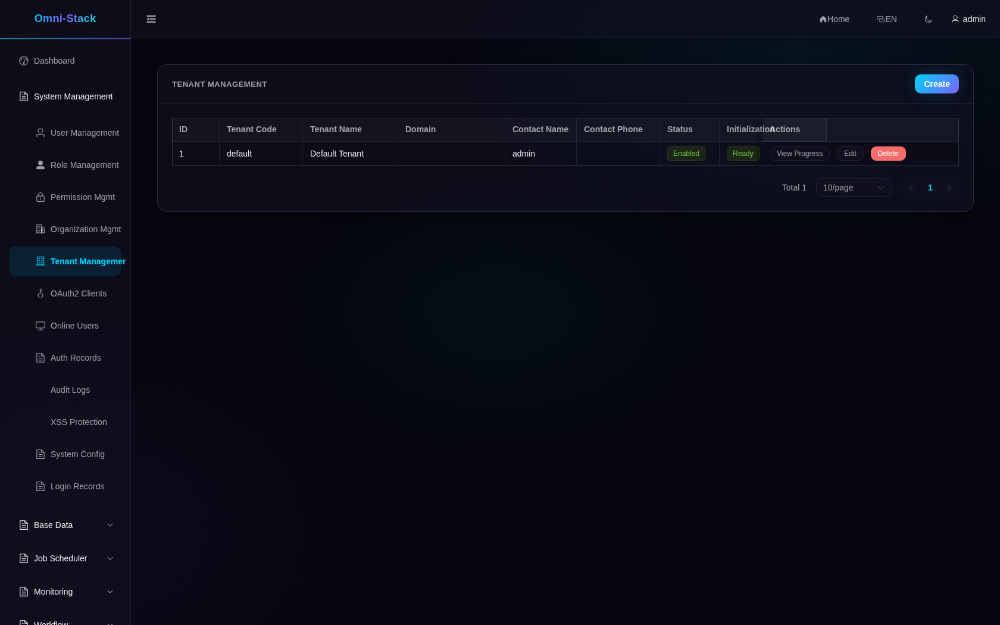
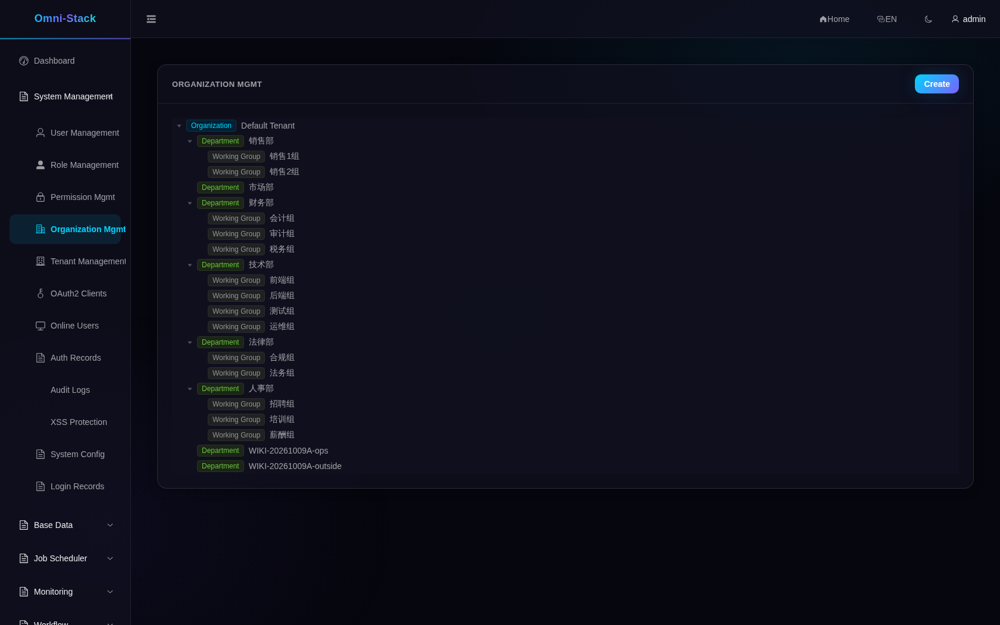
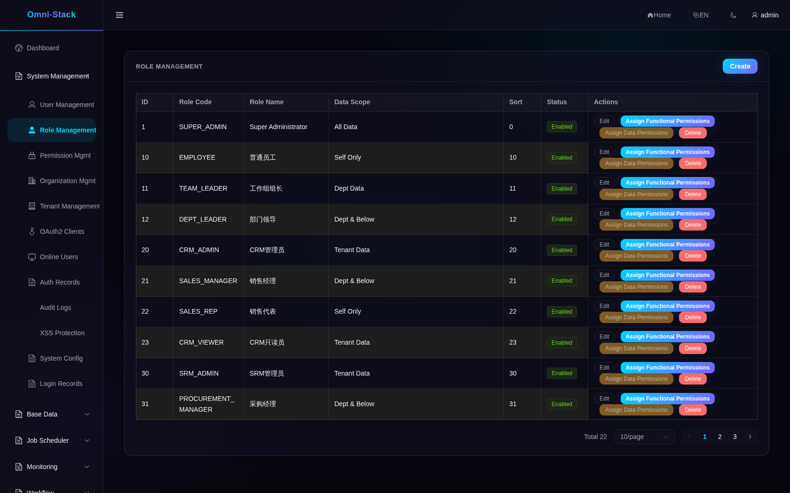
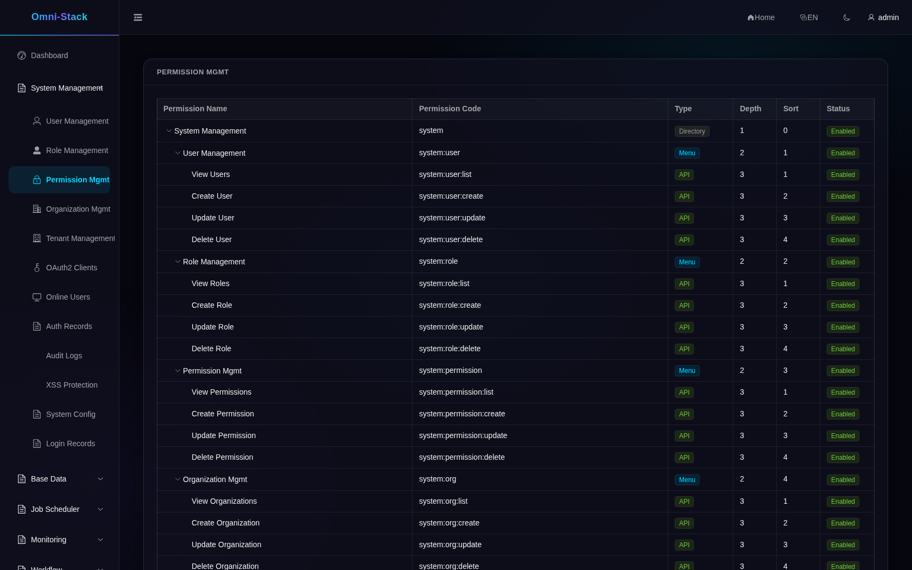
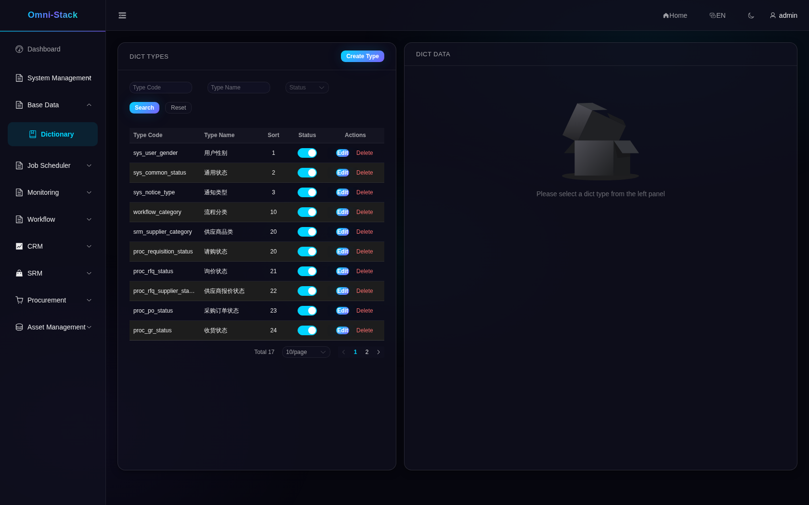
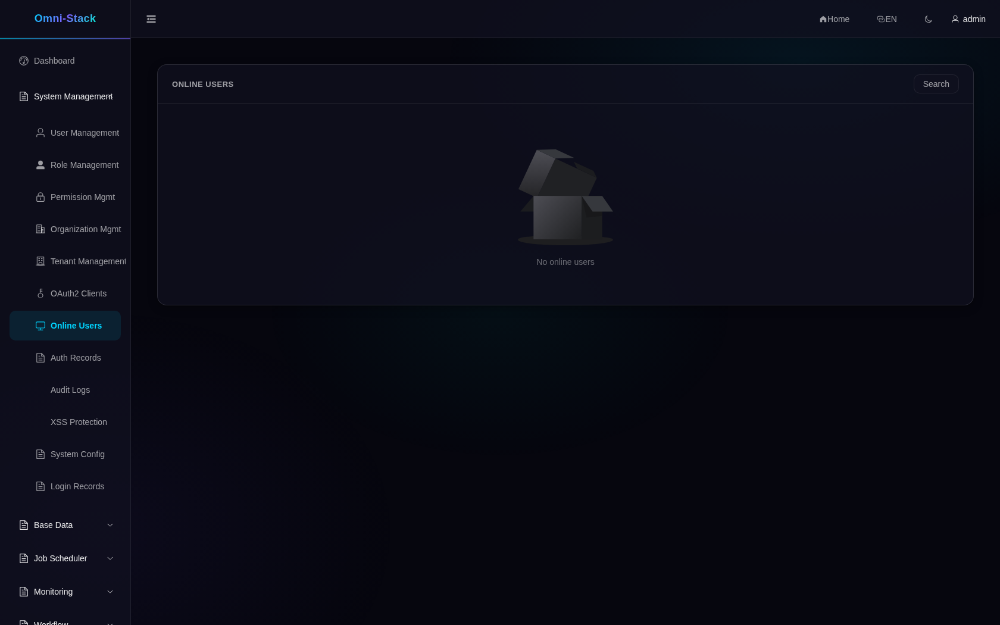
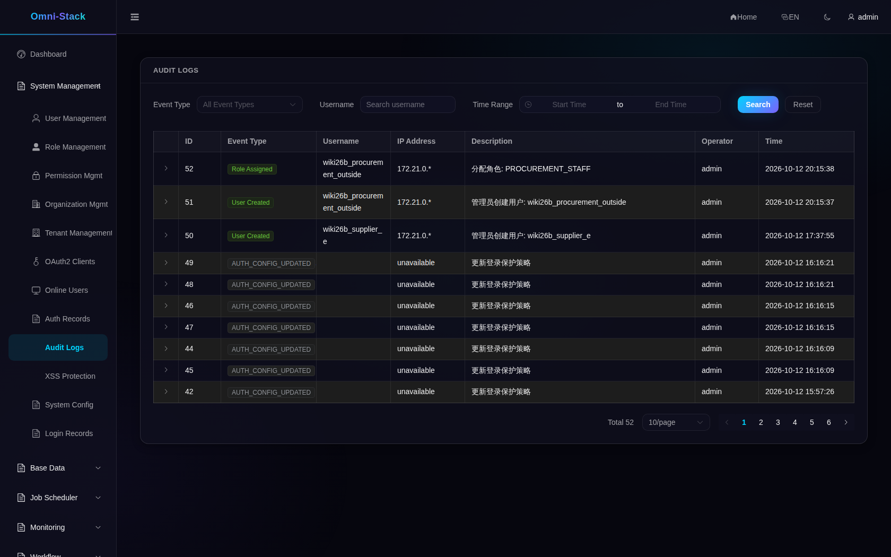
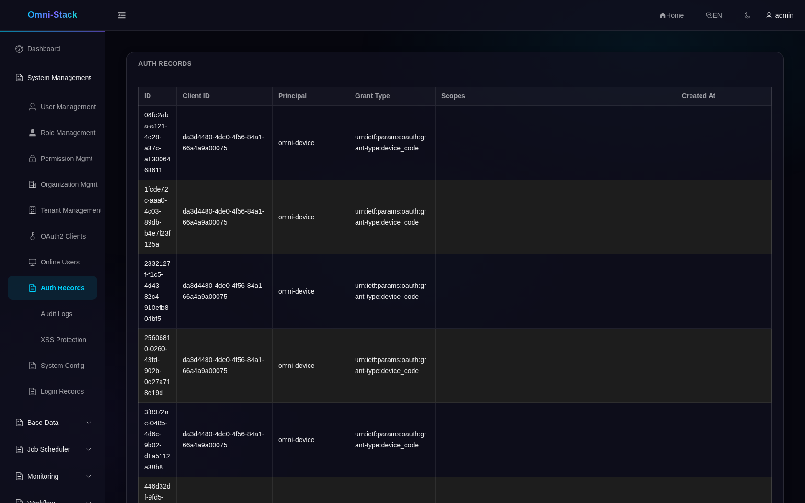
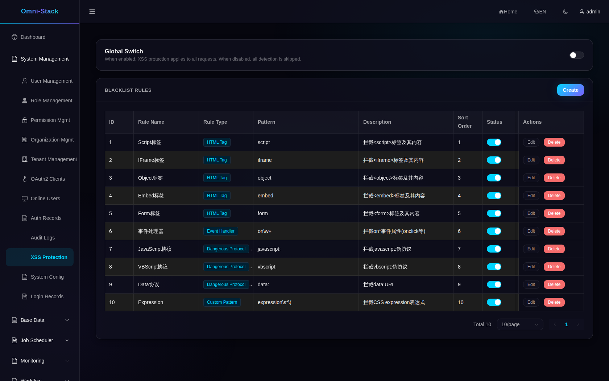
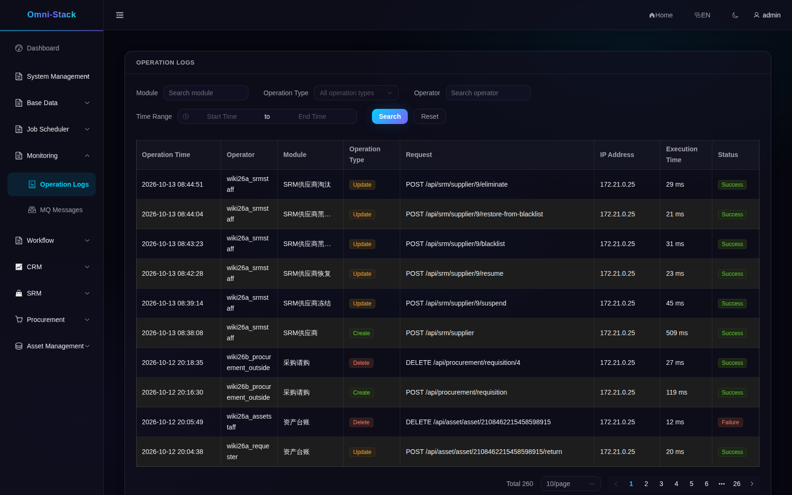

Every raw image was individually AI-reviewed with native display limits retained: some sidebar labels and tenant initialization/action headers overlap or clip; long IDs/grants wrap and require scrolling; some Japanese/Korean labels remain English; database business names/descriptions remain Chinese. Grant scopes and creation times are blank, and the online list is empty; no values were fabricated. These captures prove visible content and recorded reads, not XSS effectiveness, kicks, external OAuth, consumption, or complete UI localization.

Four-language documents follow authorized `AI_REVIEW` bound to content hashes. Human review is not mandatory, and AI review must never be labeled `HUMAN_REVIEW`. Image inspection, passing tests, and hashes do not replace complete document semantic review. Current status is recorded in the [review queue](../i18n-review-queue.md).
