# システム設定、セキュリティ設定、監査ログ

対象は本リポジトリの Spring Boot 4 / Vue 3 実装です。core または core を含むプリセットを使い、[初回起動](quick-start.jp.md)と[認証](authentication.jp.md)を先に完了してください。本書は操作手順です。セキュリティ境界とイベント契約は[コアフロー](../core-flows.jp.md)に従います。

## 1. 環境と利用者を準備する

- マイグレーション、Auth、Base、Gateway、フロントエンドをローカル Docker で実行し、移行完了と稼働状態を確認します。画面の読み取りには標準 lite モードを使えます。第 6 節の非同期配信には完全なメッセージ実行環境が必要です。[Docker デプロイ](../docker-deployment.jp.md)を参照してください。
- 同じテナントの管理者と一般従業員を用意し、ユーザー ID、ロール、実際の権限を記録します。管理操作には対応する書き込み権限を使い、拒否の確認には従業員本人のセッションを使います。
- 毎回一意の `WIKI-{run-id}` 接頭辞を使い、元の値、作成 ID、応答、後片付けの記録をリポジトリ外に保存します。パスワード、トークン、クライアント secret、非公開環境ファイルをコミットしないでください。
- 以下の書き込みは隔離した学習環境で行う手順です。2026-10-10/12 の成功済み書き込みには記録があり、今回は再実行していません。2026-10-17 の新しい画像は既存データの読み取りのみです。第 7 節を参照してください。

## 2. 組織、ロール、メニューを理解する

1. 管理者で「システム管理 → 組織管理」を開き、一意の接頭辞を付けた学習用部門を作成し、返された ID を記録します。
2. ユーザー管理で学習用アカウントを作り、既定の `USER` ロールを確認します。現在のユーザー画面には主組織の編集欄がありません。設定が必要なら `system:user:update` を持つ管理者が正式な `PUT /api/auth/user/{id}` で `primaryUnitId` を更新し、再取得します。組織一覧の画像だけでユーザーとの関連付けを証明しないでください。
3. 機能ロールを割り当てる前に元の集合を読み取ります。割り当ては全件置換なので、必要な既存ロールを残します。対象アカウントで再ログインしてから、メニュー、ボタン、API を確認します。
4. ロールの範囲 `ALL/TENANT/DEPT/DEPT_AND_CHILD/SELF/CUSTOM` を確認します。`CUSTOM` では部門集合も必要です。従業員と管理職の結果を比較し、`SUPER_ADMIN` の表示から両者の範囲を推測しないでください。

**機能ロールとワークフロー候補者のスコープは別です。** ユーザー管理は `sys_user_role` に書き込みますが、主組織を変えても `sys_user_role_scope` は作成されません。既定の承認モデルは後者から候補者を探すため、機能ロールだけでは承認者が不在になることがあります。現在、そのスコープを管理する公開 API はありません。隔離環境では記録付きの制御されたフィクスチャを使い、本番テーブルの直接編集を日常手順にしないでください。サプライチェーンの演習前に[ワークフロー手順](workflow-approval.jp.md)で候補者をプレビューします。

### 2.1. ロール範囲を保存し、メニュー権限を割り当てる

1. 誰にも割り当てていない、一意コードの学習用ロールを用意します。「ロール管理 → 新規作成」も使えます。2026-10-12 の証跡準備では正式な `POST /api/auth/role` と初期値 `dataScope=DEPT` を使い、シードロールは変更していません。
2. そのロールを編集し、「本人のデータのみ」`SELF` を選んで確定します。`GET /api/auth/role/{id}` を再取得し、`dataScope=SELF` と一覧表示が一致することを確認します。

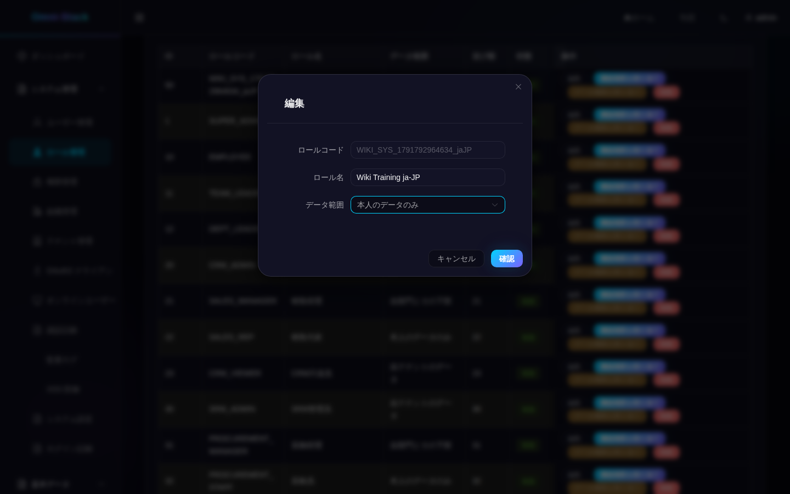
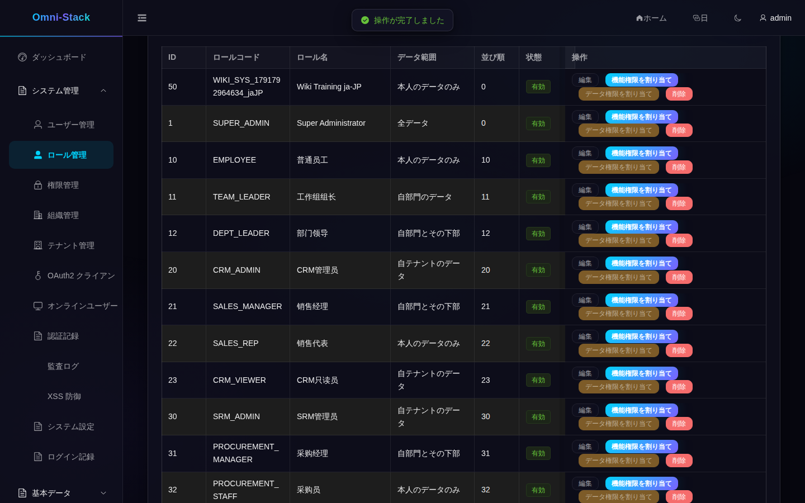

3. 権限管理の 3 階層を読み取ります。ディレクトリは `DIRECTORY`、メニューは `MENU`、API は `API` です。表示しただけではメニューの作成・変更にはなりません。

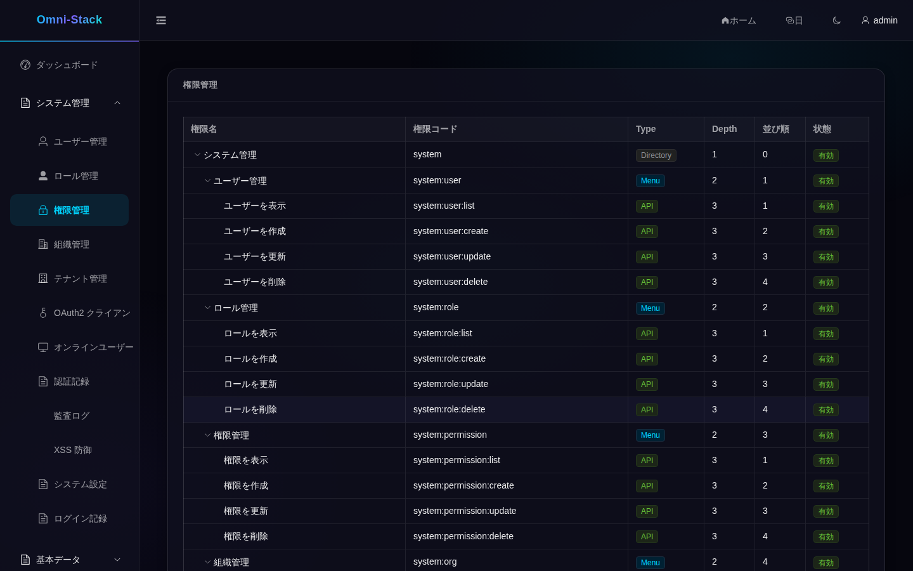

4. 学習用ロールの「機能権限を割り当て」で、メニュー `system:loginrecord` と API `system:loginrecord:list` だけを選びます。確定後に `GET /api/auth/permission/role/{id}` を読み、返された ID を権限ツリーと照合して、この 2 件だけであることを確認します。全件置換なので、業務ロールをこの手順で上書きしないでください。

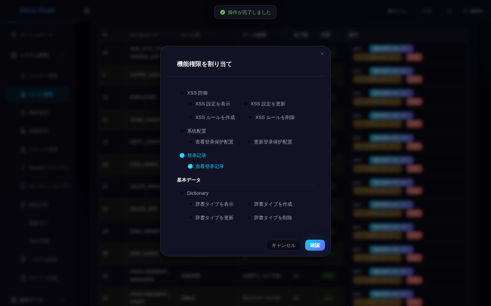

5. 自分の未割り当てロールだけを一意コードと ID で削除し、`GET /api/auth/role/all` で残存がないことを確認します。設定の永続化は行単位の分離の証明ではありません。[権限手順](permissions.jp.md)の比較を参照してください。失敗時は先に状態を再取得し、成功済み書き込みを繰り返さないでください。

## 3. 学習用辞書を作成して削除する

辞書の書き込み権限が必要です。過去の画像は隔離テナントの `admin/SUPER_ADMIN` によるもので、従業員の書き込み権限を証明しません。先に `WIKI_DICT_{run-id}` などの一意コードを記録します。

1. 「基本データ → 辞書管理 → タイプ新規作成」で、タイプコード、タイプ名、備考、並び順を確認します。コードと名前は空のままにし、並び順は既定値でも構いません。

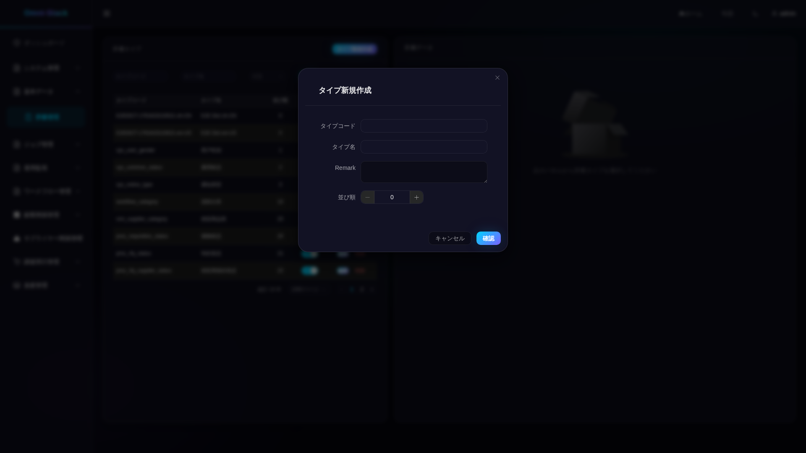

2. 確定すると、空のコード・名前に対する `POST /api/base/dict/type` は HTTP 400、業務コード 400 を返し、ダイアログは開いたままでタイプは作成されません。現在の画面にはローカル必須 rules がなく、バックエンド検証結果を共通エラー処理で表示します。
3. エラーが完全に表示されるまで待ちます。接頭部は画面言語に従い、フィールド名は `typeCode/typeName` と調査用 Trace ID のままです。アニメーション途中の空白を失敗証跡にしないでください。

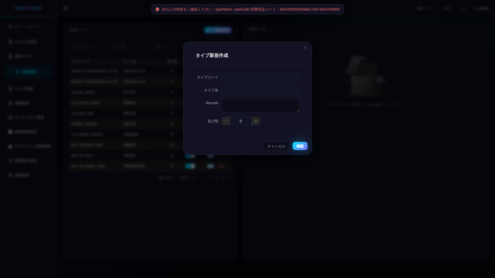

4. エラーが消えてから一意コードと名前を入力し、確定します。成功時はダイアログが閉じます。完全なコードで検索し、読み込み完了後に対象行を確認します。タイプ未選択なら右ペインは空で正常です。
5. 過去の取得では `E2EDICT-{runStamp}-{locale}` を使い、言語ごとに 1 件作成しました。画像のコードをシード値として再利用しないでください。

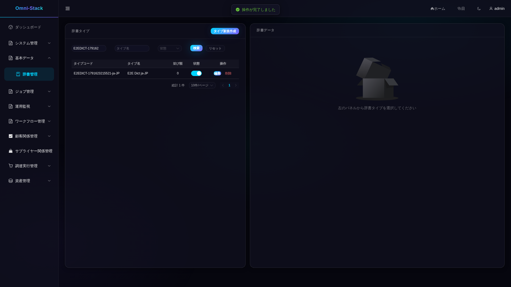

6. 一覧が返したタイプ ID を記録し、そのタイプだけを `DELETE /api/base/dict/type/{id}` で削除します。HTTP・業務コード 200 と、一意コードでの再検索 0 件を確認します。失敗・切断時は完了済みかを先に照会します。シードを削除したり、全体の固定件数で後片付けを判断したりしないでください。

自動化の入口 `omni-frontend/e2e-docs/flows/system-dictionary.flows.spec.ts` は Docker、external モード、明示的な `E2E_MUTATIONS=true`、一致する隔離プロジェクトと実行イメージ記録を要求します。画像、リソース台帳、実行記録のパスはリポジトリ外に指定します。制御されたテストトークンをコマンドやリポジトリにコピーしないでください。

[2026-10-10 の記録](../reference/evidence/dictionary-2026-10-10.json)は 4 passed、0 failed、0 skipped と、原画像 12 枚の個別 AI 目視確認を記録しています。タイプ ID 27–30 は正式 API で削除済みで、残存なしも確認済みです。今回は再作成していません。日韓の備考は `Remark` のまま、日本語の備考行は不鮮明、英語サイドバーは切れ、エラーのフィールド名は API 識別子という制限を保持します。

## 4. ログイン保護を変更し、監査を確認する

1. 「システム管理 → システム設定」で `GET /api/auth/system-config/login-policy` を読み、元の `failureThreshold/failureWindowSeconds/version` を保存します。永続化された行がなければ、書き込みなしで既定ビューを返します。
2. 元の値と異なる有効な学習用値を選びます。過去の例は `10 → 9`、ウィンドウ `3600` 秒です。どの環境も 10 から始まるとは限りません。最新の `expectedVersion` を付けて `PUT /api/auth/system-config/login-policy` で保存し、新しい値とバージョンを再取得します。
3. 第 2 クライアントで最新バージョンを使って元の値に戻し、未更新の第 1 画面から再送します。HTTP 200、業務コード 409 になるはずです。画面は下書きを保持し、サーバーの最新設定バージョンを取得します。比較してからサーバー値の採用か下書きの再試行を明示的に選び、並行更新を自動上書きしません。
4. 操作者と時刻で安全監査の `AUTH_CONFIG_UPDATED` を探します。現バージョンで元の閾値・ウィンドウに戻し、再取得します。「既定値に戻す」は `10/3600` であり、今回の元の値と同じとは限りません。値を戻してもバージョンは巻き戻らず、監査も消えません。

閾値は `3–10`、ウィンドウは `3600–86400` 秒で、保護は無効化できません。新設定は次の失敗ウィンドウから使われ、既存ウィンドウは作成時の設定を保持します。読み取りは `system:config:list`、更新は `system:config:update` が必要です。ボタン非表示はバックエンド拒否の証明ではありません。2026-10-17 の実際の読み取りは管理者が HTTP・業務コード 200、従業員が 403 でした。従業員の書き込みは再実行していません。

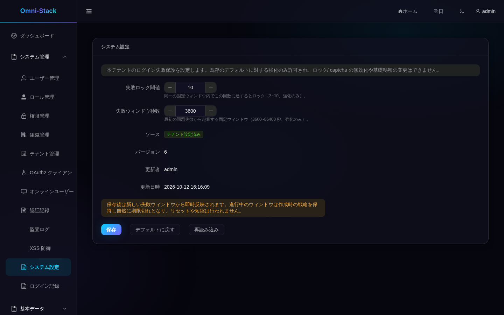
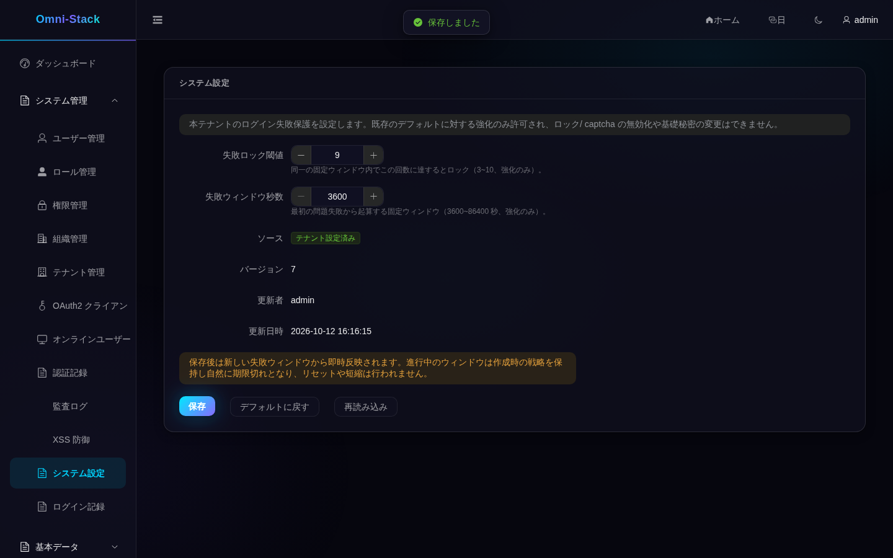
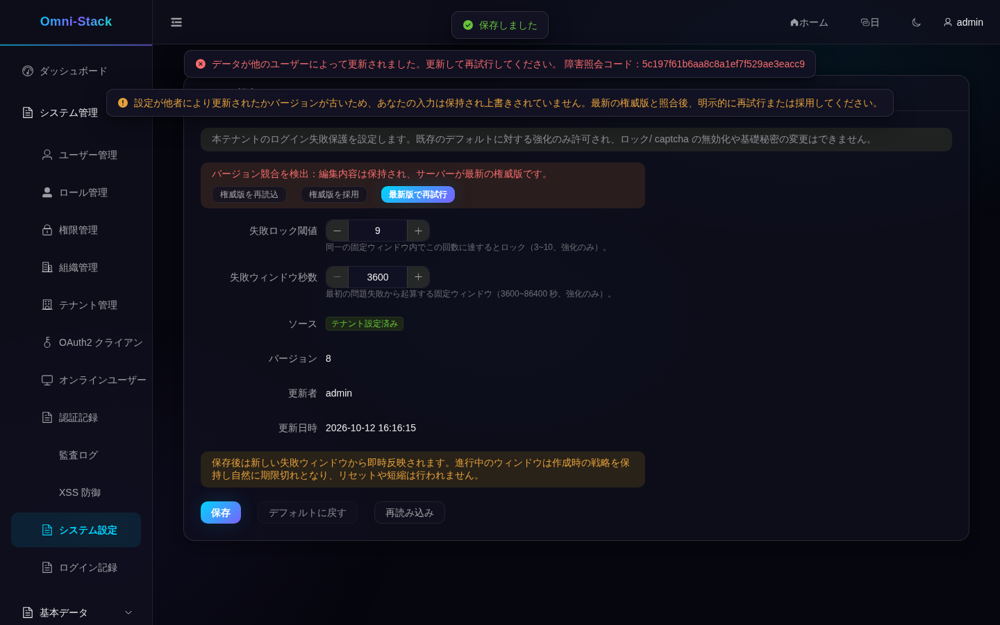

競合画像の緑色メッセージは直前の成功した保存に対応します。現在の結果は赤いエラー、競合説明、業務コード 409 で判断します。通信失敗時は先に GET で保存済みかを確認します。

ログイン記録は `sys_audit_log` の `LOGIN_SUCCESS/LOGIN_FAILED` の読み取り専用投影です。アカウント、パスワード方式、実際の期間を選んで検索し、利用者、方式、結果、理由コード、マスク済み IP を確認します。既定は直近 7 日です。明示的な期間は開始・終了を両方指定し、最大 90 日、日時形式は `yyyy-MM-dd HH:mm:ss` です。ロック、ロール・パスワード変更は安全監査、OAuth 許可は認可記録を確認します。

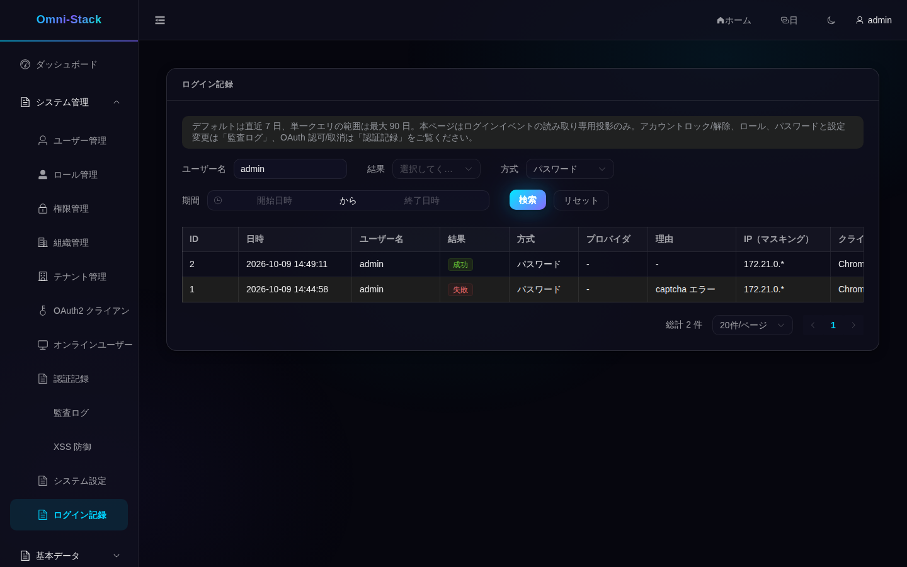

この 2 件は 2026-10-09 に発生しました。2026-10-12 は履歴の検索のみで、今回もパスワードや CAPTCHA を送信していません。一覧更新を新しいログインと呼ばないでください。

[2026-10-12 の基盤記録](../reference/evidence/system-platform-2026-10-12.json)は、先行試行で成功した中国語 6 枚と後続 26 枚、計 32 枚を保持し、後続の四言語テストは 4 passed です。先行タイムアウトの副作用を照合し、設定を復元し、該当ロールを削除済みです。すべての画像が失敗のない 1 回の実行から得られたわけではありません。試行間で一時ロールは異なり、すべて削除済みです。元の `10/3600` は復元し、増加したバージョンと監査は保持しました。今回は書き込みを繰り返していません。

過去のダイアログには中国語へのフォールバック、日韓の権限表には英語があり、英語のサイドバーやログイン表の右端は切れる場合があります。これらは記録当時の保存・競合・権限永続化・履歴検索の証跡で、学習用ロールによる利用者分離の証明ではありません。

## 5. OAuth2、XSS、セッション

OAuth2 クライアントでは許可 grant、完全一致のコールバック、scope、同意設定を確認します。クライアント ID は公開識別子で、secret は非公開設定に保持します。外部ソーシャルログインとローカル認可コード/PKCE は[認証手順](authentication.jp.md)を参照してください。認可一覧の古い device-code 行は新規認可や外部コールバック成功を証明しません。

「XSS 防御」では設定とルールの両リクエスト成功を確認します。現在の settings GET は、そのテナントに行がなければ既定の無効行を作ります。今回はテナント 1 の既存行を先に確認し、読み取り前後で値が不変でした。2026-10-17 の原画像はグローバルスイッチが OFF です。個別ルールが有効でも防御が機能している証明にはなりません。

XSS 変更を検証する際は隔離環境で元の設定・ルールを記録し、所有と復元方法が明確な学習用ルールだけを操作します。[コアフロー](../core-flows.jp.md)に沿い、イベント属性、スクリプトプロトコル、許可されたリッチテキストの実際の保存・応答を確認してから元に戻します。書き込みでは `xss:enabled:{tenantId}` と `xss:rules:{tenantId}` を無効化する必要があります。今回は切り替え、ルール変更、攻撃入力の検証をしていません。合格のために防御を無効にしないでください。

オンラインユーザー、画面の「認証記録」（OAuth 許可履歴）、ログイン記録、安全監査は別の一覧です。強制切断 API は `DELETE /api/auth/online/{userId}` で、ユーザーを対象とし、任意の単一 `jti` を削除するボタンではありません。今回所有するテストユーザーだけに実施し、旧セッション拒否と再ログインでの回復を確認します。他者には実施しません。今回のオンライン一覧は空で、強制切断は行っていません。

## 6. 操作から非同期ログをたどる

Auth は `@OperLog` を使わず、認証イベントは安全監査に残ります。業務操作ログは Outbox、MQ、コンシューマーを経て非同期で保存されます。標準 lite モードは relay、XXL-JOB、コンシューマーを無効にします。履歴閲覧には不要ですが、新規配信の検証には[Docker デプロイ](../docker-deployment.jp.md)と[信頼性のあるメッセージ](../mq-reliability.jp.md)に従って完全な実行モード、部品、バインディングを有効にします。MQ コンテナだけを起動しても準備完了とはいえません。

1. 許可済み業務リクエストのテナント、操作者、モジュール、時刻、URL、結果、応答 Trace ID を記録します。画像のために成功済み操作を再送しません。
2. 操作ログを操作者、モジュール、種別、時刻で絞ります。現在の画面に Trace ID 検索欄や専用列はないため、そこで Trace ID 検索を指示しないでください。
3. リクエスト情報を構造化ログと照合し、送信元サービスの Outbox で `msgId`、任意の `msgKey`、`serviceName` を確認します。送信元は `producerTraceId` を保存しますが、relay のトレース文脈は異なる場合があります。[可観測性](../observability.jp.md)の関連付けに従います。全メッセージに業務キーがある、全フィールドが画面に出るとは限りません。
4. broker の確認とコンシューマーの結果を確認します。Outbox の `SENT` は業務処理完了ではありません。最大再試行に達したら、下流状態と冪等性を確認してから再送・スキップを判断します。一覧取得成功は障害回復の証明ではありません。

## 7. 画像と検証範囲

[2026-10-17 の画面読み取り記録](../reference/evidence/security-lists-2026-10-17.json)は、以下の四言語 40 原画像を実行済みスクリプト、ソース、実行成果物に結び付けます。Docker の制御されたテスト利用者が既存テナントデータを読み、画面 API 44 回が成功しました。業務フォーム送信と過去の書き込み再実行はなく、パスワード/CAPTCHA ログインでもありません。取得用に起動した 6 コンテナはすべて停止済みです。

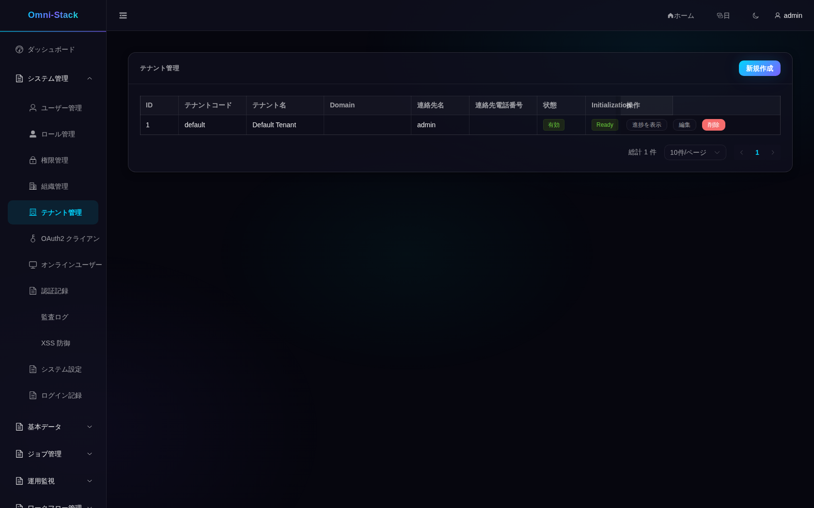
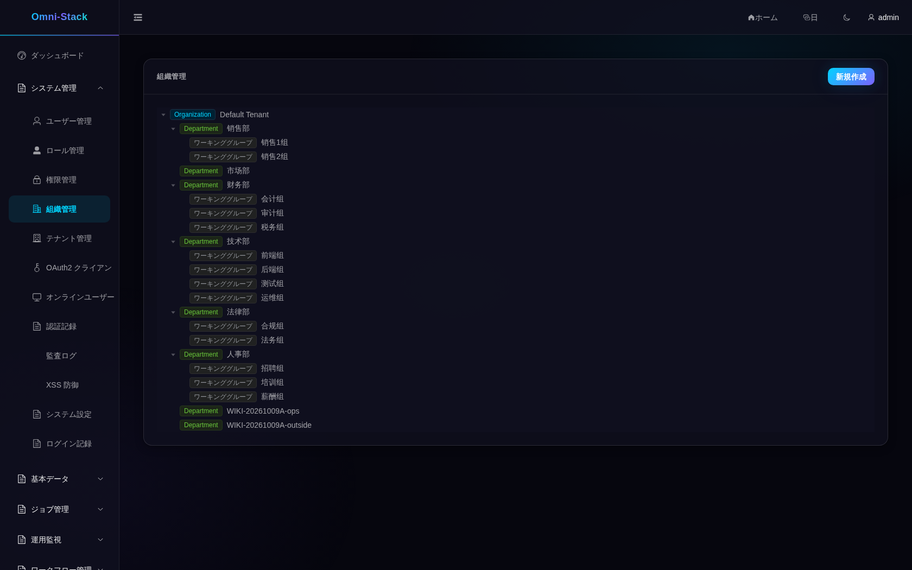
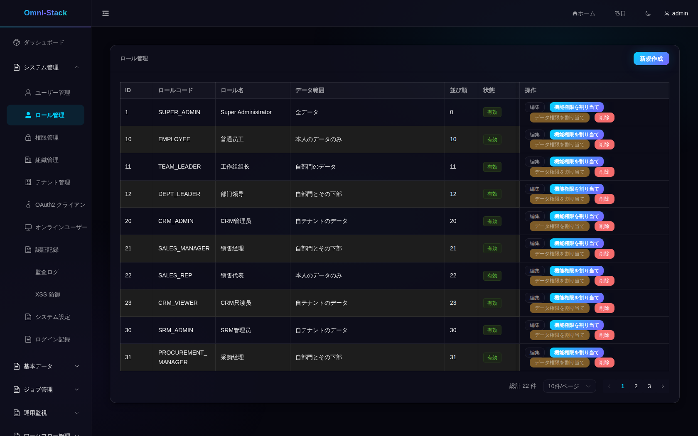
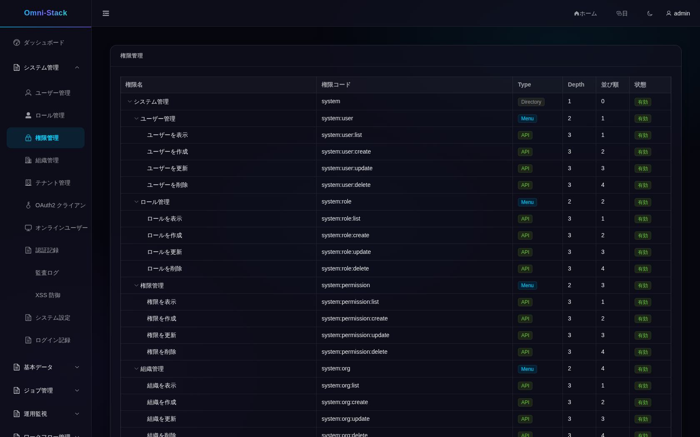
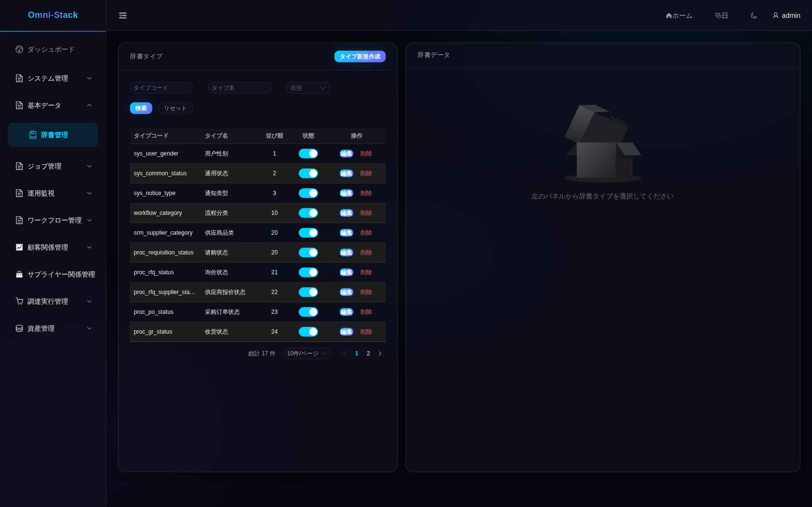
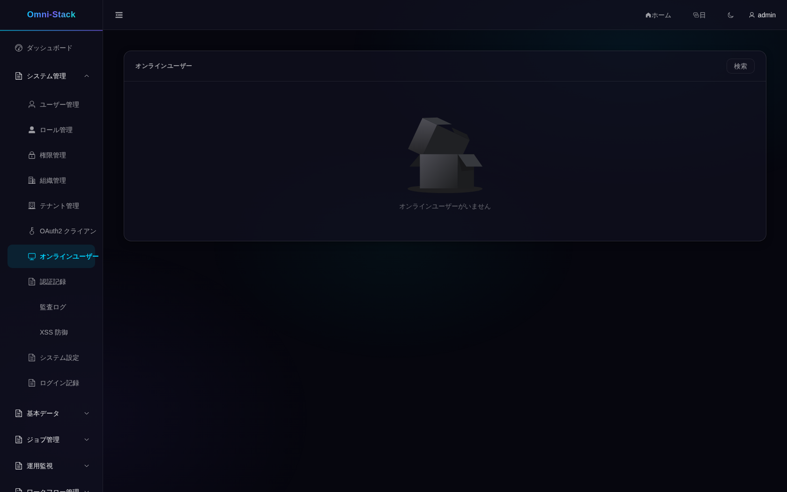
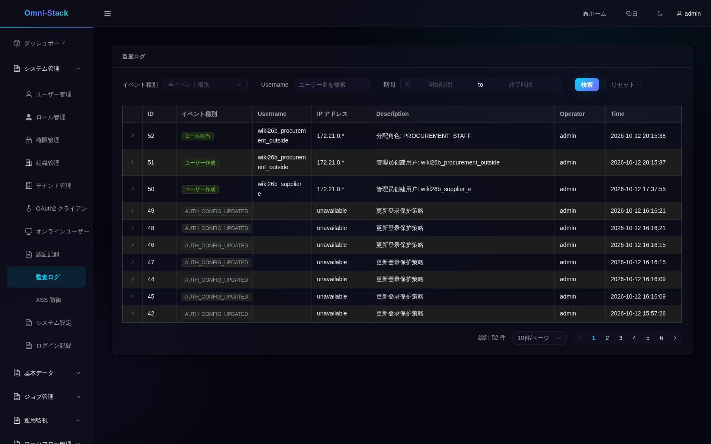
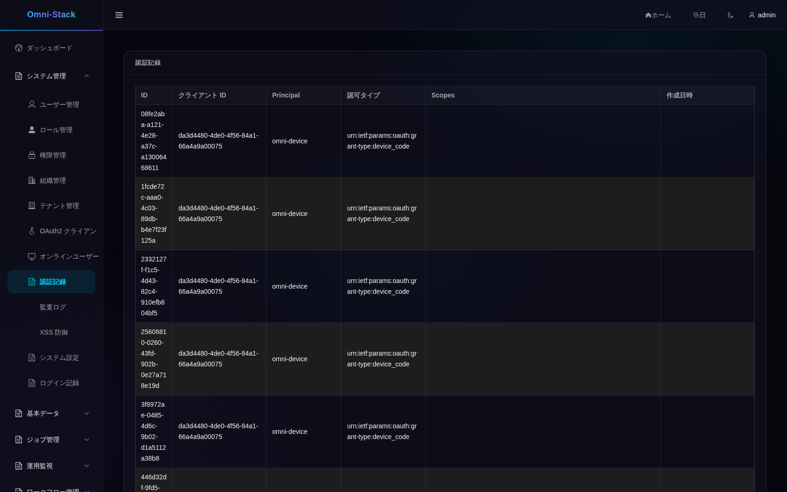
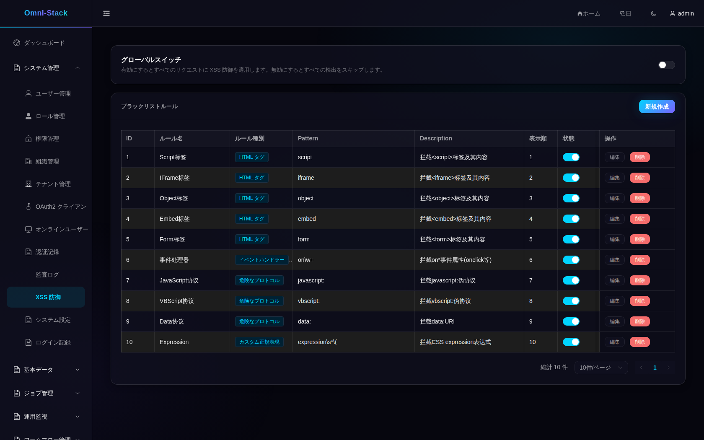
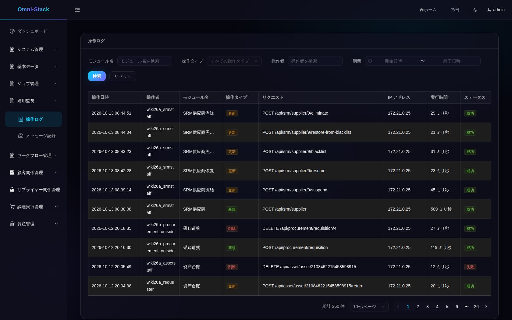

全原画像を個別に AI 確認し、元の表示制限を保持しました。一部のサイドバーとテナント初期化・操作ヘッダーは重なりや切れがあり、長い ID・grant は折り返されスクロールが必要です。日韓の一部ラベルは英語、DB の業務名・説明は中国語のままです。認可行の scope・作成日時とオンライン一覧は空で、値を捏造していません。画像は見えている内容と記録された読み取りのみを証明し、XSS 効果、強制切断、外部 OAuth、消費完了、画面全体の翻訳完了は証明しません。

四言語文書は許可済み `AI_REVIEW` と内容ハッシュで受け入れます。人によるレビューは必須ではなく、AI レビューを `HUMAN_REVIEW` と呼びません。画像、テスト、ハッシュは文書全体の意味確認を代替しません。現状は[レビュー一覧](../i18n-review-queue.md)を参照してください。
