# 시스템 설정, 보안 설정 및 감사 로그

기준은 이 저장소의 Spring Boot 4 / Vue 3 구현이며, core 또는 core를 포함한 프리셋이 필요합니다. 먼저 [첫 실행](quick-start.kr.md)과 [인증](authentication.kr.md)을 완료하세요. 이 문서는 운영 절차이며 보안 경계와 이벤트 계약은 [핵심 흐름](../core-flows.kr.md)을 따릅니다.

## 1. 환경과 사용자 준비

- 마이그레이션, Auth, Base, Gateway, 프런트엔드를 로컬 Docker에서 실행하고 마이그레이션 완료와 서비스 상태를 확인합니다. 기본 lite 모드로 화면을 읽을 수 있습니다. 6절의 비동기 전달에는 전체 메시징 실행 환경이 필요합니다. [Docker 배포](../docker-deployment.kr.md)를 참고하세요.
- 같은 테넌트의 관리자와 일반 직원을 준비하고 사용자 ID, 역할, 실제 권한을 기록합니다. 관리에는 해당 쓰기 권한을 사용하고 거부 확인에는 직원 본인의 세션을 사용합니다.
- 매번 고유한 `WIKI-{run-id}` 접두사를 사용합니다. 원래 값, 생성 ID, 요청 결과, 정리 기록은 저장소 밖에 보관합니다. 비밀번호, 토큰, 클라이언트 secret, 비공개 환경 파일을 커밋하지 않습니다.
- 아래 쓰기 절차는 격리된 교육 환경에서 수행하는 방법입니다. 2026-10-10/12에 성공한 업무 쓰기는 기록이 있으며 이번에는 재실행하지 않았습니다. 2026-10-17 새 이미지는 기존 데이터만 읽었습니다. 7절을 참고하세요.

## 2. 조직, 역할, 메뉴 이해

1. 관리자로 시스템 관리 → 조직 관리에서 고유 접두사를 가진 교육용 부서를 만들고 반환된 ID를 기록합니다.
2. 사용자 관리에서 교육용 계정을 만들고 기본 `USER` 역할을 확인합니다. 현재 사용자 화면에는 주 조직 편집 항목이 없습니다. 필요하면 `system:user:update` 권한을 가진 관리자가 정식 `PUT /api/auth/user/{id}`로 `primaryUnitId`를 변경하고 다시 읽습니다. 조직 목록 이미지만으로 사용자 연결을 완료했다고 판단하지 않습니다.
3. 기능 역할을 할당하기 전에 원래 역할 집합을 읽습니다. 할당은 전체 교체이므로 필요한 기존 역할을 유지합니다. 대상 계정으로 다시 로그인한 후 메뉴, 버튼, API를 확인합니다.
4. 역할의 `ALL/TENANT/DEPT/DEPT_AND_CHILD/SELF/CUSTOM` 데이터 범위를 확인합니다. `CUSTOM`은 부서 집합도 필요합니다. 직원과 관리자의 결과를 비교하며 `SUPER_ADMIN` 결과로 두 사용자의 범위를 추정하지 않습니다.

**기능 역할과 워크플로 후보자 범위는 별도 설정입니다.** 사용자 관리는 `sys_user_role`에 기록하며 주 조직을 변경해도 `sys_user_role_scope`가 생성되지 않습니다. 기본 승인 모델은 후자로 후보자를 찾으므로 기능 역할만 있으면 승인자가 없을 수 있습니다. 현재 이 범위의 공개 관리 API는 없습니다. 격리 교육 환경에서는 기록이 있는 통제된 픽스처를 사용하며 운영 테이블 직접 수정을 일상 절차로 안내하지 않습니다. 공급망 실습 전에 [워크플로 가이드](workflow-approval.kr.md)에서 후보자를 미리 확인하세요.

### 2.1. 역할 범위 저장 및 메뉴 권한 할당

1. 아무 사용자에게도 할당하지 않은 고유 코드의 교육용 역할을 준비합니다. 역할 관리 → 새로 만들기를 사용할 수 있습니다. 2026-10-12 증거 준비에는 정식 `POST /api/auth/role`과 초기 `dataScope=DEPT`를 사용했으며 시드 역할을 수정하지 않았습니다.
2. 역할을 편집하여 본인 데이터만(`SELF`)을 선택하고 확인합니다. `GET /api/auth/role/{id}`를 다시 읽어 `dataScope=SELF`와 목록 표시가 일치하는지 확인합니다.

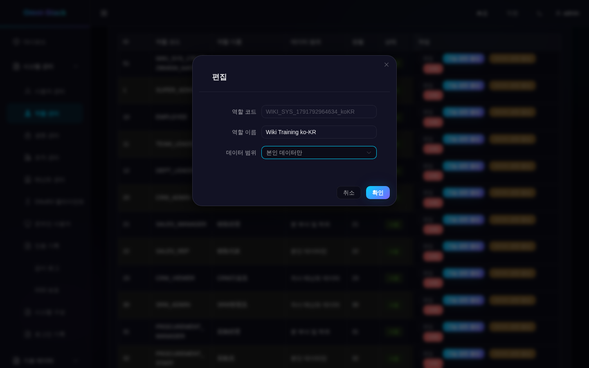
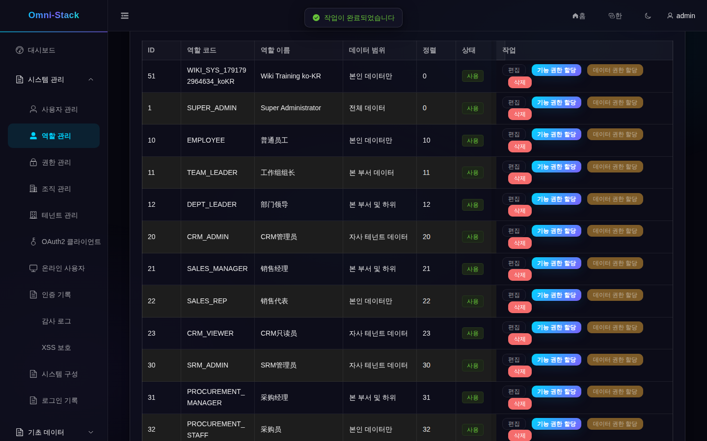

3. 권한 관리의 3단계 트리를 읽습니다. 디렉터리는 `DIRECTORY`, 메뉴는 `MENU`, API는 `API`입니다. 노드 조회는 메뉴 생성이나 변경을 의미하지 않습니다.

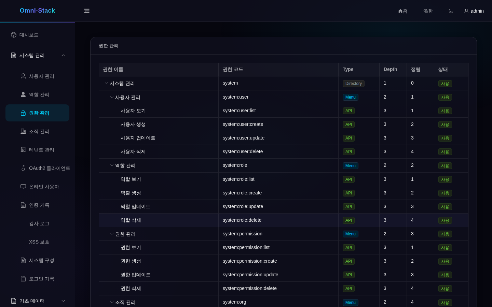

4. 교육용 역할의 기능 권한 할당에서 `system:loginrecord` 메뉴와 `system:loginrecord:list` API만 선택합니다. 확인 후 `GET /api/auth/permission/role/{id}`를 읽고 반환 ID를 권한 트리와 대조하여 정확히 두 항목인지 확인합니다. 전체 교체이므로 실제 업무 역할에 이 방식으로 덮어쓰지 않습니다.

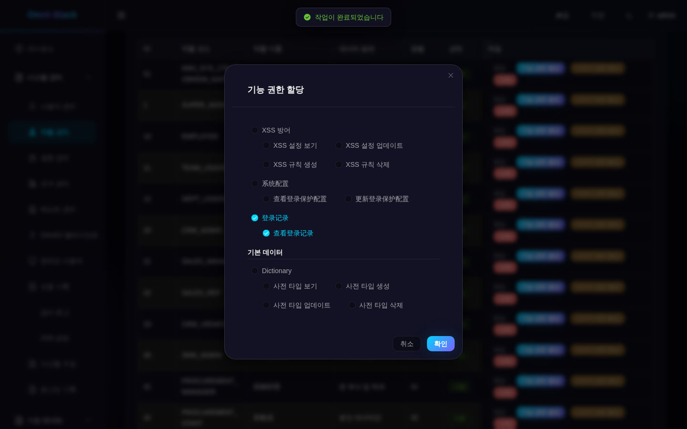

5. 자신의 미할당 역할만 고유 코드와 ID로 삭제하고 `GET /api/auth/role/all`에서 잔여가 없는지 확인합니다. 설정 영속화는 사용자 행 격리의 증명이 아닙니다. [권한 가이드](permissions.kr.md)의 비교를 참고하세요. 실패하면 먼저 상태를 읽고 이번 객체만 처리하며 성공한 쓰기를 반복하지 않습니다.

## 3. 교육용 사전 생성 및 정리

사전 쓰기 권한이 필요합니다. 과거 이미지는 격리 테넌트의 `admin/SUPER_ADMIN`으로 수집했으며 직원의 쓰기 권한을 증명하지 않습니다. 먼저 `WIKI_DICT_{run-id}` 같은 고유 코드를 기록합니다.

1. 기초 데이터 → 사전 관리 → 타입 추가에서 타입 코드, 타입 이름, 비고, 정렬을 확인합니다. 코드와 이름은 비워 두고 정렬은 기본값을 유지해도 됩니다.

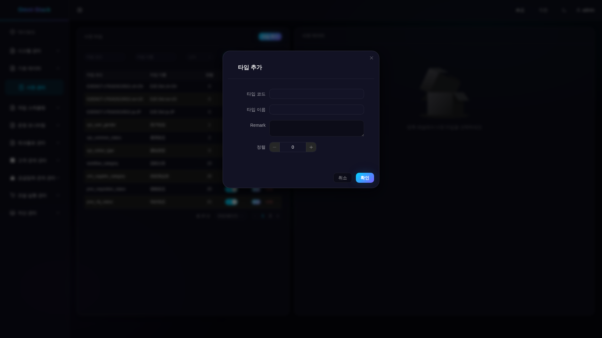

2. 확인을 누르면 빈 코드/이름의 `POST /api/base/dict/type`은 HTTP 400, 업무 코드 400을 반환하고 대화상자는 열린 채 타입이 생성되지 않습니다. 현재 화면에는 로컬 필수 rules가 없으며 백엔드 검증 결과를 공통 오류 계층으로 표시합니다.
3. 오류 메시지가 완전히 나타날 때까지 기다립니다. 접두사는 화면 언어를 따르고 필드 식별자는 `typeCode/typeName`, 문제 추적용 Trace ID가 유지됩니다. 애니메이션 중 빈 메시지를 실패 증거로 사용하지 않습니다.

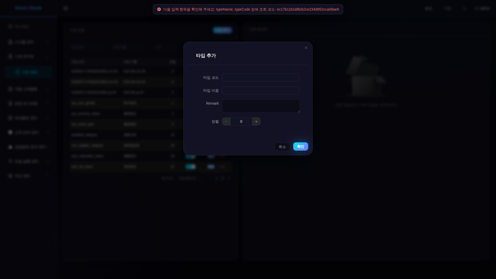

4. 오류가 사라지면 고유 코드와 이름을 입력하고 확인합니다. 성공하면 대화상자가 닫힙니다. 전체 코드로 검색하고 로딩 종료 후 이번 행을 확인합니다. 타입 미선택 상태에서 오른쪽 영역이 비어 있는 것은 정상입니다.
5. 과거 수집은 `E2EDICT-{runStamp}-{locale}`로 언어마다 한 타입을 생성했습니다. 이미지의 코드는 독자가 재사용할 시드가 아닙니다.

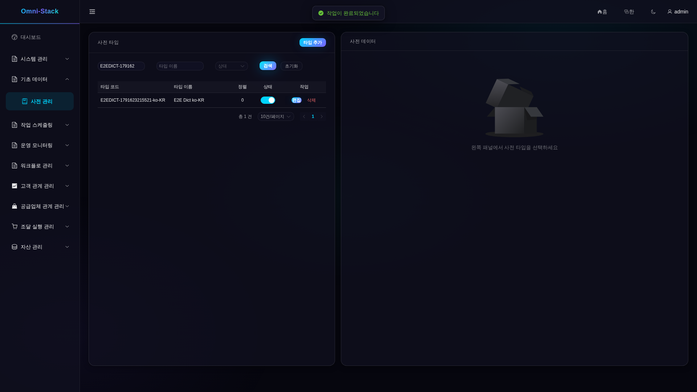

6. 목록에서 반환된 타입 ID를 기록하고 해당 타입만 `DELETE /api/base/dict/type/{id}`로 삭제합니다. HTTP/업무 코드 200과 고유 코드 재조회 0건을 확인합니다. 실패나 연결 단절 후에는 이미 완료되었는지 먼저 조회합니다. 시드를 삭제하거나 고정된 전체 행 수를 정리 기준으로 삼지 않습니다.

자동화 진입점 `omni-frontend/e2e-docs/flows/system-dictionary.flows.spec.ts`에는 Docker, external 모드, 명시적 `E2E_MUTATIONS=true`, 일치하는 격리 프로젝트와 실행 이미지 기록이 필요합니다. 이미지, 리소스 등록, 실행 기록 경로는 저장소 밖이어야 합니다. 통제된 테스트 토큰을 명령어나 저장소에 복사하지 않습니다.

[2026-10-10 기록](../reference/evidence/dictionary-2026-10-10.json)은 4 passed, 0 failed, 0 skipped와 원본 12장의 개별 AI 시각 검토를 기록합니다. 타입 ID 27–30은 정식 API로 삭제하고 잔여 없음까지 확인했으며 이번에 재생성하지 않았습니다. 일/한 비고는 `Remark`로 남아 있고 일본어 비고 행은 불명확하며 영어 사이드바는 잘리고 오류 필드는 API 식별자입니다. 원래 한계를 유지합니다.

## 4. 로그인 보호 변경 및 감사 확인

1. 시스템 관리 → 시스템 구성에서 `GET /api/auth/system-config/login-policy`로 원래 `failureThreshold/failureWindowSeconds/version`을 저장합니다. 저장된 정책 행이 없으면 쓰기 없이 기본 뷰를 읽습니다.
2. 원래 값과 다른 유효한 교육용 값을 선택합니다. 과거 예시는 `10 → 9`, 창 `3600`초이며 모든 환경의 원래 값이 10이라고 가정하지 않습니다. 최신 `expectedVersion`을 포함해 `PUT /api/auth/system-config/login-policy`로 저장하고 새 값과 버전을 다시 읽습니다.
3. 두 번째 클라이언트에서 최신 버전으로 원래 값을 복원한 뒤 새로 고치지 않은 첫 화면에서 다시 제출합니다. HTTP 200, 업무 코드 409가 반환되어야 합니다. 화면은 초안을 유지하며 서버의 최신 설정 버전을 가져옵니다. 두 값을 비교한 뒤 서버 값 채택 또는 초안 재시도를 명시적으로 선택하고 동시 변경을 자동으로 덮어쓰지 않습니다.
4. 보안 감사에서 작업자와 시간으로 `AUTH_CONFIG_UPDATED`를 찾습니다. 현재 버전으로 원래 임계값과 창을 복원하고 다시 읽습니다. 기본값 복원은 `10/3600`이며 이번 원래 값과 다를 수 있습니다. 값을 복원해도 버전이나 감사 기록은 되돌리지 않습니다.

임계값은 `3–10`, 창은 `3600–86400`초이며 보호를 끌 수 없습니다. 새 정책은 다음 실패 창부터 적용되고 기존 창은 생성 시 정책을 유지합니다. 읽기는 `system:config:list`, 변경은 `system:config:update`가 필요합니다. 버튼 숨김만으로 백엔드 거부를 증명할 수 없습니다. 2026-10-17 실제 읽기는 관리자 HTTP/업무 코드 200, 직원 403이었으며 직원 쓰기 요청은 재실행하지 않았습니다.

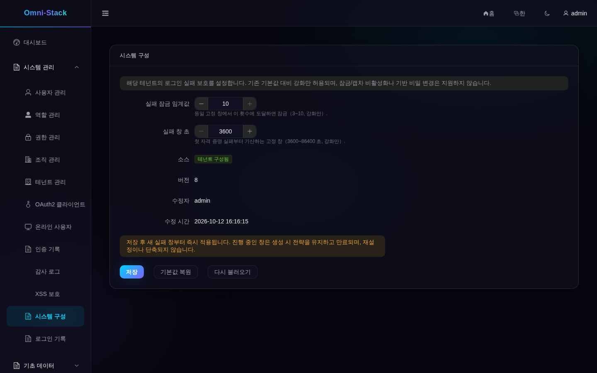
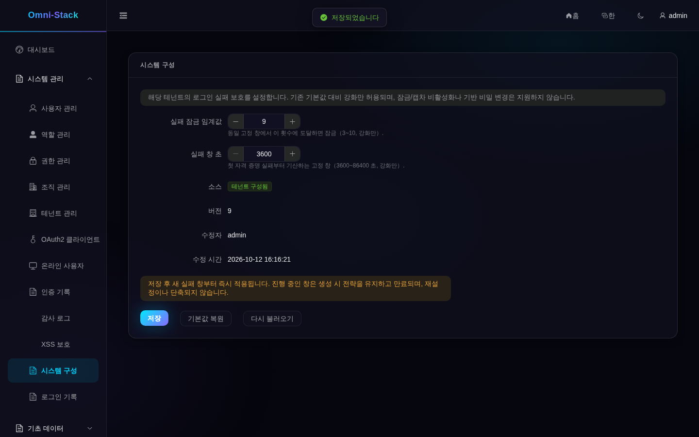
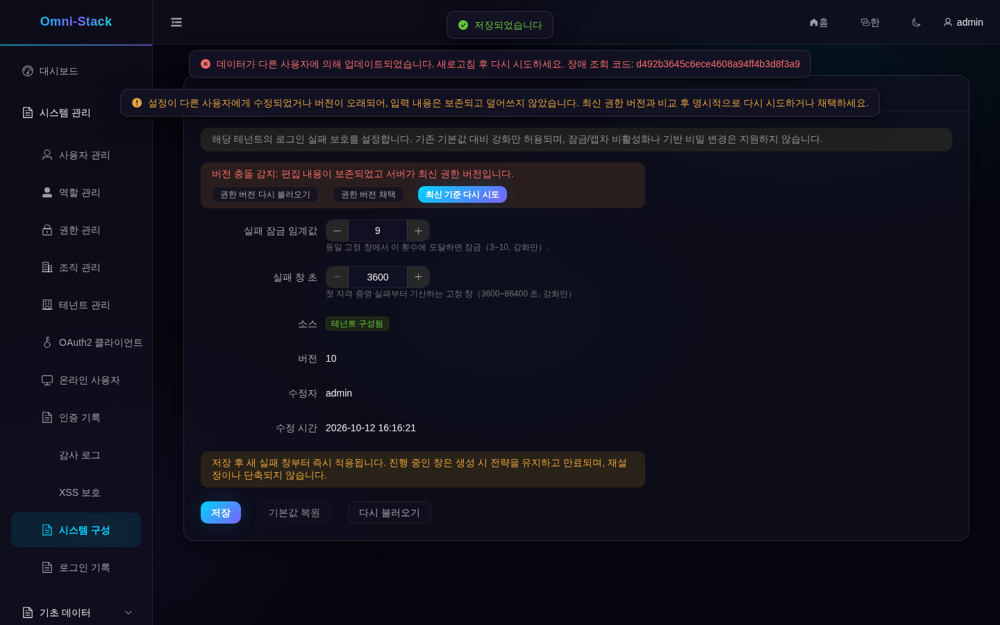

충돌 이미지의 녹색 메시지는 앞선 저장 성공에 해당합니다. 현재 결과는 빨간 오류, 충돌 설명, 업무 코드 409로 판단합니다. 네트워크 실패 시 먼저 GET으로 저장 여부를 확인합니다.

로그인 기록은 `sys_audit_log`의 `LOGIN_SUCCESS/LOGIN_FAILED`에 대한 읽기 전용 투영입니다. 계정, 비밀번호 방식, 실제 시간 범위를 선택해 검색하고 계정, 방식, 결과, 사유 코드, 마스킹 IP를 확인합니다. 기본은 최근 7일이며 명시적 범위는 시작/종료를 모두 지정하고 최대 90일입니다. 날짜 형식은 `yyyy-MM-dd HH:mm:ss`입니다. 잠금과 역할/비밀번호 변경은 보안 감사, OAuth 허가는 권한 부여 기록에서 확인합니다.

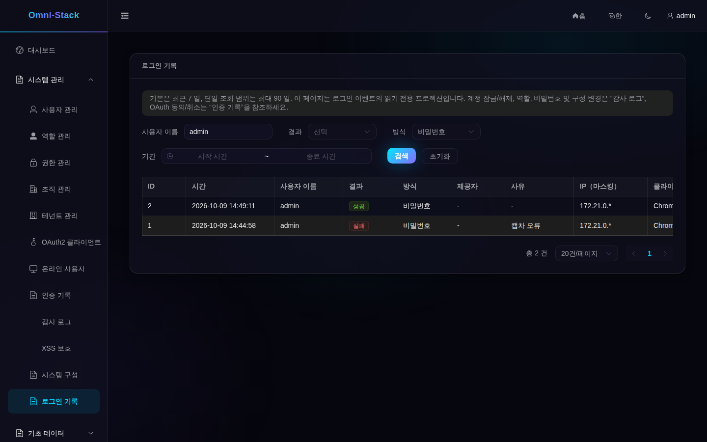

두 로그인은 2026-10-09에 발생했습니다. 2026-10-12에는 과거 기록만 필터링했으며 이번에도 비밀번호나 CAPTCHA를 제출하지 않았습니다. 목록 새로 고침은 새 로그인이 아닙니다.

[2026-10-12 플랫폼 기록](../reference/evidence/system-platform-2026-10-12.json)은 앞선 시도에서 성공한 중국어 6장과 후속 26장, 총 32장을 보존하며 후속 4언어 테스트는 4 passed입니다. 앞선 타임아웃의 부작용을 대조하고 정책을 복원했으며 관련 역할을 정리했습니다. 모든 이미지가 실패 없는 한 번의 실행에서 나온 것은 아닙니다. 시도별 임시 역할은 서로 달랐고 모두 삭제했습니다. 원래 `10/3600`은 복원했고 증가한 버전과 감사는 유지했습니다. 이번에는 쓰기를 반복하지 않았습니다.

과거 대화상자 일부 노드는 중국어로 표시되고 일/한 권한 표에는 영어가 있으며 영어 사이드바나 로그인 표 맨 오른쪽 열이 잘릴 수 있습니다. 기록 당시의 저장, 충돌, 권한 영속화, 과거 필터링을 증명하며 교육 역할의 실제 사용자 격리를 증명하지 않습니다.

## 5. OAuth2, XSS 및 세션

OAuth2 클라이언트의 허용 grant, 정확한 콜백 주소, scope, 동의 설정을 확인합니다. 클라이언트 ID는 공개 식별자이며 secret은 비공개 설정에 둡니다. 외부 소셜 로그인과 로컬 인가 코드/PKCE는 [인증 가이드](authentication.kr.md)를 참고하세요. 허가 목록의 과거 device-code 행은 새로운 허가나 외부 콜백 성공을 증명하지 않습니다.

XSS 보호에서 설정과 규칙 요청이 모두 성공했는지 확인합니다. 현재 settings GET은 테넌트에 행이 없으면 기본 비활성 행을 생성합니다. 이번에는 테넌트 1의 기존 행을 먼저 확인하고 읽기 전후 값이 같은지 대조했습니다. 2026-10-17 원본의 전역 스위치는 OFF입니다. 개별 규칙이 켜져 있어도 보호가 작동한다는 증거는 아닙니다.

XSS 변경 검증 시 격리 환경에서 원래 설정/규칙을 기록하고 소유와 복원이 명확한 교육 규칙만 조작합니다. [핵심 흐름](../core-flows.kr.md)에 따라 이벤트 속성, 스크립트 프로토콜, 허용 리치 텍스트의 실제 저장/응답을 확인한 뒤 원래 값으로 복원합니다. 쓰기는 `xss:enabled:{tenantId}`와 `xss:rules:{tenantId}`를 무효화해야 합니다. 이번에는 스위치 변경, 규칙 수정, 공격 입력 검증을 하지 않았습니다. 테스트 통과를 위해 보호를 끄지 않습니다.

온라인 사용자, 화면의 인증 기록(OAuth 허가 이력), 로그인 기록, 보안 감사는 별도 목록입니다. 강제 종료 API는 `DELETE /api/auth/online/{userId}`이며 사용자 대상 동작으로 임의의 단일 `jti` 삭제 버튼이 아닙니다. 이번 실행 소유가 명확한 테스트 사용자만 대상으로 삼고 기존 세션 거부와 재로그인 복구를 확인합니다. 다른 사용자를 종료하지 않습니다. 이번 온라인 목록은 비어 있었고 강제 종료는 수행하지 않았습니다.

## 6. 업무 작업에서 비동기 로그 추적

Auth는 `@OperLog`를 사용하지 않으며 인증 이벤트는 보안 감사에 남습니다. 업무 작업 로그는 Outbox, MQ, 소비자를 거쳐 비동기로 저장됩니다. 기본 lite 모드는 relay, XXL-JOB, 소비자를 비활성화합니다. 과거 조회에는 필요 없지만 새 전달 검증에는 [Docker 배포](../docker-deployment.kr.md)와 [신뢰성 메시징](../mq-reliability.kr.md)에 따른 전체 실행 모드, 구성요소, 바인딩이 필요합니다. MQ 컨테이너만 실행해도 전달 준비가 끝났다고 볼 수 없습니다.

1. 승인된 업무 요청의 테넌트, 작업자, 모듈, 시간, URL, 결과, 응답 Trace ID를 기록합니다. 이미 성공한 작업을 이미지 때문에 반복하지 않습니다.
2. 작업 로그를 작업자, 모듈, 유형, 시간으로 검색합니다. 현재 화면에는 Trace ID 필터나 전용 열이 없으므로 여기서 Trace ID 검색을 지시하지 않습니다.
3. 요청 정보를 구조화 로그와 대조하고 원본 서비스 Outbox의 `msgId`, 선택적 `msgKey`, `serviceName`을 확인합니다. 생산자는 `producerTraceId`를 기록하지만 relay 추적 문맥은 다를 수 있습니다. [관측성](../observability.kr.md)의 연결 방법을 따릅니다. 모든 메시지에 업무 키가 있거나 모든 필드가 화면에 표시된다고 가정하지 않습니다.
4. broker 확인과 소비자 결과를 점검합니다. Outbox `SENT`는 업무 소비 완료가 아닙니다. 최대 재시도 도달 후에는 하위 상태와 멱등성을 먼저 확인하고 재전송/건너뛰기를 결정합니다. 목록 조회 성공은 장애 복구 증명이 아닙니다.

## 7. 이미지와 검증 경계

[2026-10-17 화면 읽기 기록](../reference/evidence/security-lists-2026-10-17.json)은 아래 4언어 원본 40장을 실제 실행 스크립트, 소스, 실행 산출물에 연결합니다. Docker의 통제된 테스트 사용자가 기존 테넌트 데이터를 읽었고 화면 API 읽기 44회가 성공했습니다. 업무 양식 제출이나 과거 쓰기 반복이 없었으며 비밀번호/CAPTCHA 로그인도 아닙니다. 수집을 위해 시작한 컨테이너 6개는 모두 중지했습니다.

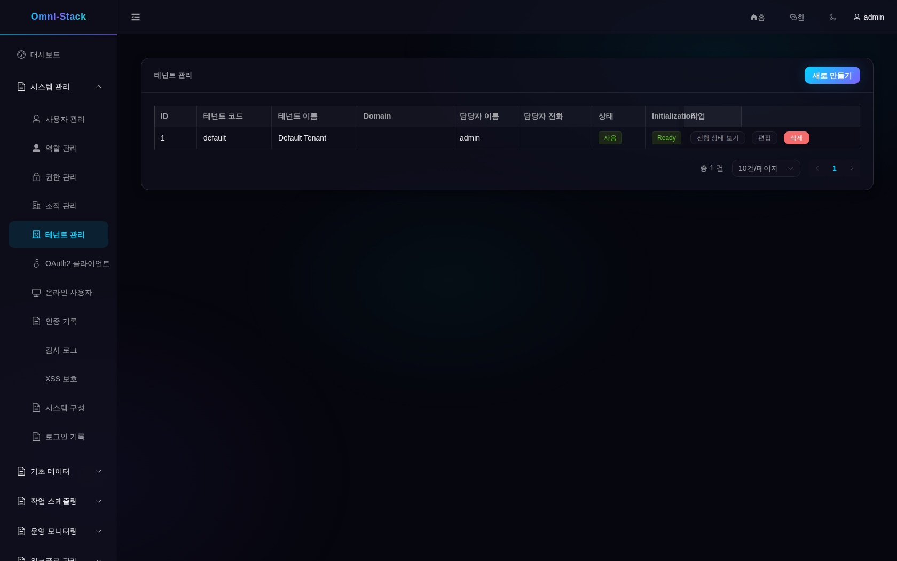
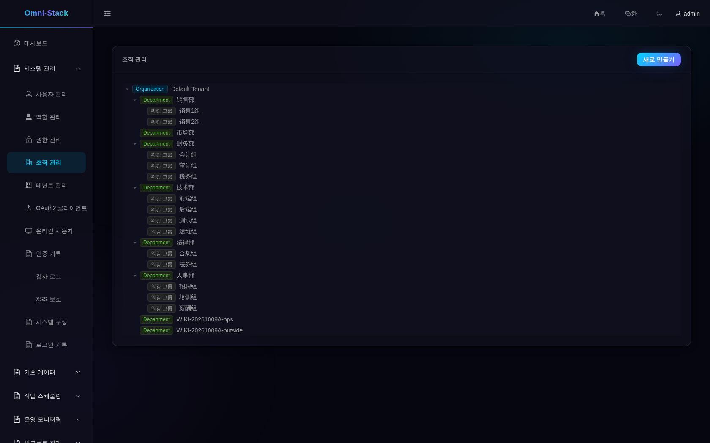
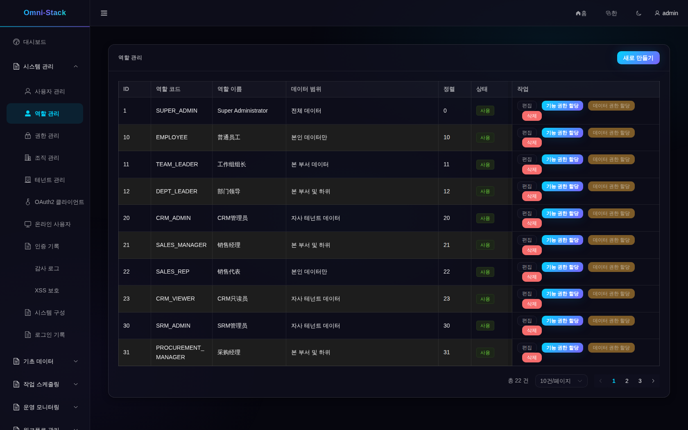
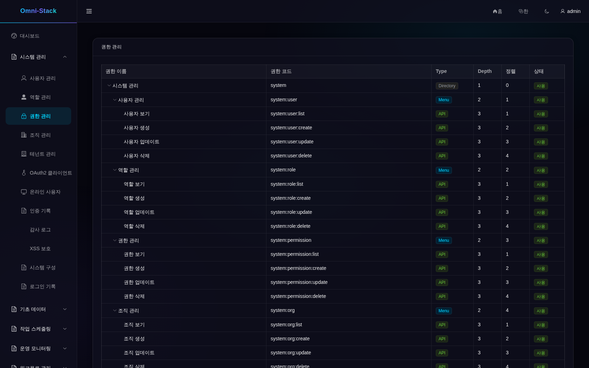
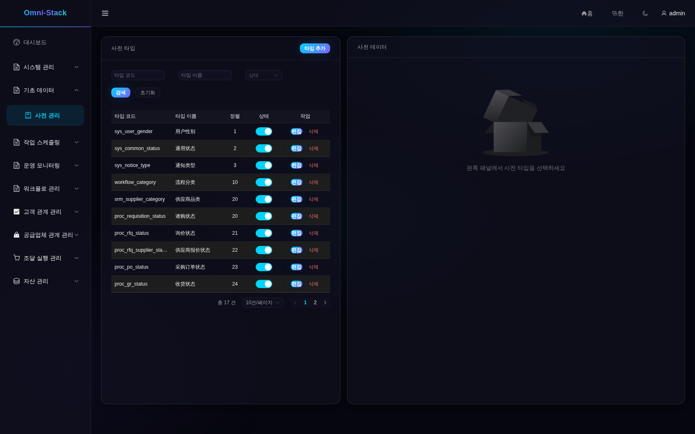
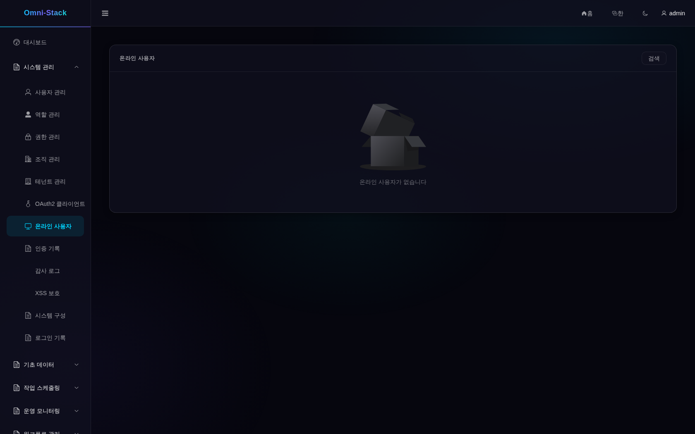
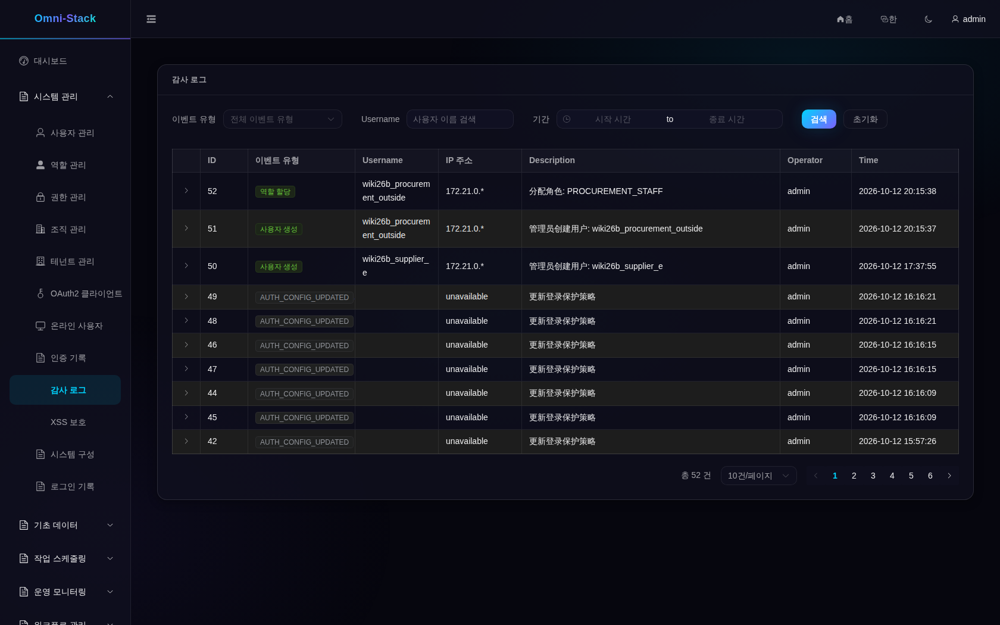
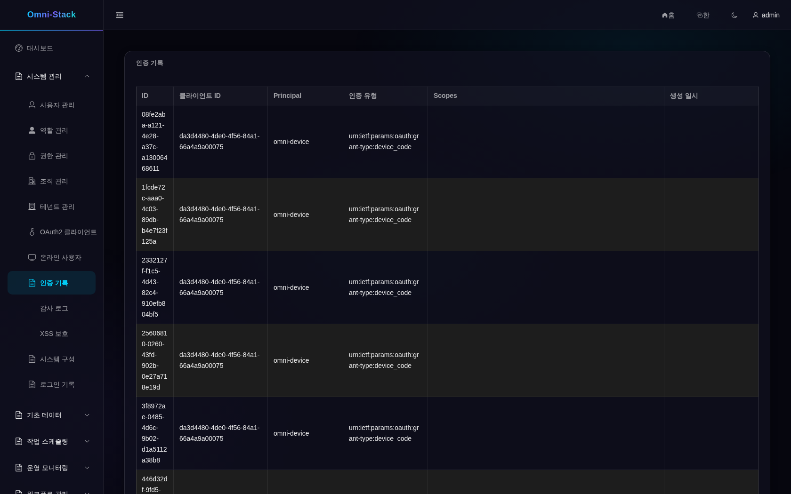
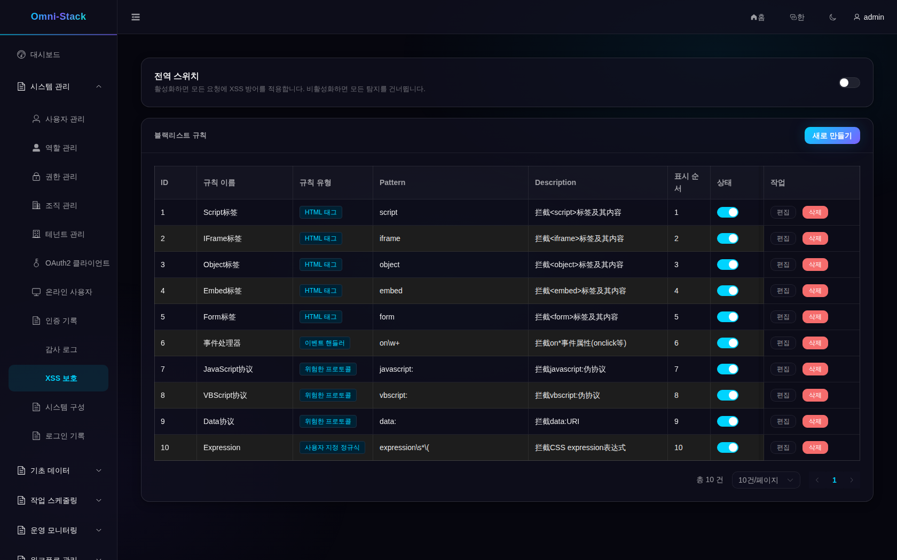
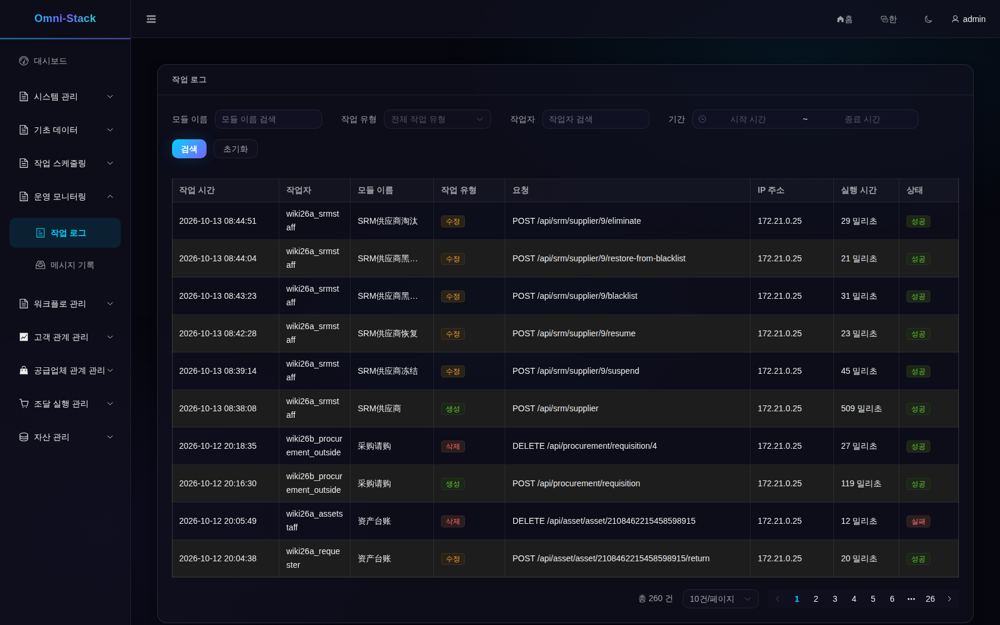

모든 원본을 개별 AI 검토했고 원래 표시 한계를 유지했습니다. 일부 사이드바와 테넌트 초기화/작업 헤더는 겹치거나 잘리며 긴 ID/grant는 줄 바꿈과 스크롤이 필요합니다. 일/한 일부 라벨은 영어, DB 업무 이름/설명은 중국어로 남습니다. 허가 행의 scope/생성 시간과 온라인 목록은 비어 있고 값을 꾸며 채우지 않았습니다. 이미지는 보이는 내용과 기록된 읽기를 증명하며 XSS 효과, 강제 종료, 외부 OAuth, 소비 완료, 전체 UI 번역 완료를 증명하지 않습니다.

4언어 문서는 승인된 `AI_REVIEW`와 내용 해시로 인수합니다. 사람 검토는 필수가 아니며 AI 검토를 `HUMAN_REVIEW`라고 부르지 않습니다. 이미지, 테스트, 해시는 전체 문서 의미 검토를 대체하지 않습니다. 현재 상태는 [검토 목록](../i18n-review-queue.md)을 참고하세요.
