# 系统配置、安全配置与审计日志

适用基线：本仓库 Spring Boot 4 / Vue 3 实现；所需预设：core 或包含 core 的预设。先完成[首次启动](quick-start.md)和[认证](authentication.md)。本文是操作教程，安全边界与事件契约以[核心流程](../core-flows.md)为准。

## 1. 准备环境与身份

- 在本机 Docker 内运行数据库迁移、Auth、Base、Gateway 和前端；先确认迁移与服务健康。页面读取可用原生 lite 模式；第 6 节的异步投递还需要完整消息运行环境，见[Docker 部署](../docker-deployment.md)。
- 准备同一租户的管理员与普通员工，记录各自用户 ID、角色及实际权限。管理操作使用对应写权限；员工负向验证使用员工自己的会话，不能用管理员代替。
- 每次使用唯一 `WIKI-{run-id}` 前缀，并将原值、创建 ID、请求结果和清理记录保存在仓库外。不要提交密码、令牌、客户端 secret 或私有环境文件。
- 下文写操作是读者在隔离教学环境中的操作步骤。2026-10-10/12 的成功业务写入已有回执，本轮未重放；2026-10-17 新图只读取既有数据，来源见第 7 节。

## 2. 认识组织、角色与菜单

1. 管理员进入「系统管理 → 组织管理」，建立唯一前缀的教学部门，记录返回 ID。
2. 在用户管理新建教学账号，核对默认 `USER` 角色。当前用户页面没有主组织编辑项；需要设置时，由具有 `system:user:update` 权限的管理员通过正式 `PUT /api/auth/user/{id}` 更新 `primaryUnitId`，再回读。不要将组织列表截图说成已完成用户绑定。
3. 分配功能角色前先读原角色集合；分配接口是全量替换，必须保留仍需使用的角色。目标账号重新登录后再检查菜单、按钮和 API。
4. 核对角色的数据范围 `ALL/TENANT/DEPT/DEPT_AND_CHILD/SELF/CUSTOM`；`CUSTOM` 还需配置部门集合。实际可见范围用员工和经理对照，不能由 `SUPER_ADMIN` 的结果推断。

**功能角色与工作流候选作用域分开维护。** 用户管理写入 `sys_user_role`；设置主组织不会自动建立 `sys_user_role_scope`。默认审批模型通过后者找候选人，只有功能角色仍可能无人审批。当前没有该作用域的公共维护 API；隔离教学环境使用有记录的受控夹具，不把直接修改生产表写成管理步骤。供应链教程开始前先做候选人预览，见[工作流教程](workflow-approval.md)。

### 2.1. 保存角色范围并分配菜单权限

1. 准备未分配给任何用户的教学角色，使用唯一编码。可从「角色管理 → 新建」创建；2026-10-12 取证准备使用正式 `POST /api/auth/role`，初始 `dataScope=DEPT`，未改种子角色。
2. 编辑该角色，将范围改为「仅本人数据」`SELF`，确认保存；回读 `GET /api/auth/role/{id}`，核对 `dataScope=SELF` 与列表一致。

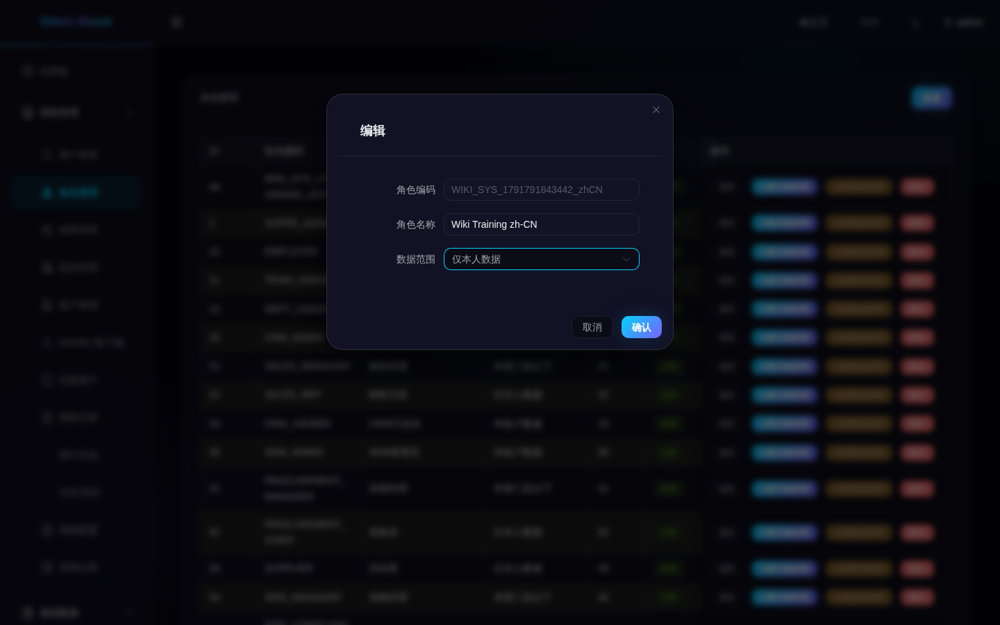
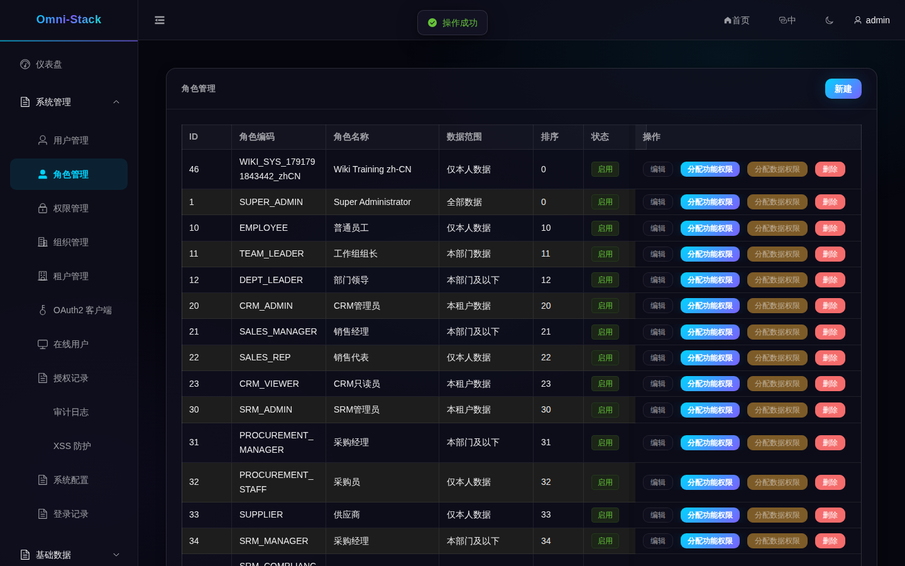

3. 读取「权限管理」三级树：目录 `DIRECTORY`、菜单 `MENU`、接口 `API`。查看节点不是创建或改写菜单。

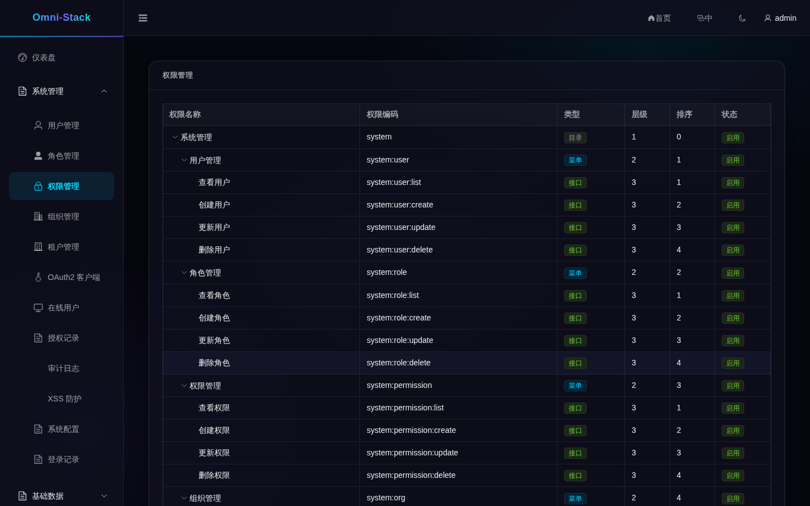

4. 在教学角色的「分配功能权限」中，仅选择 `system:loginrecord` 菜单与 `system:loginrecord:list` 接口。确认后回读 `GET /api/auth/permission/role/{id}`，将返回 ID 对照权限树，确认只有这两项。分配为全量替换，不要照此覆盖业务角色。

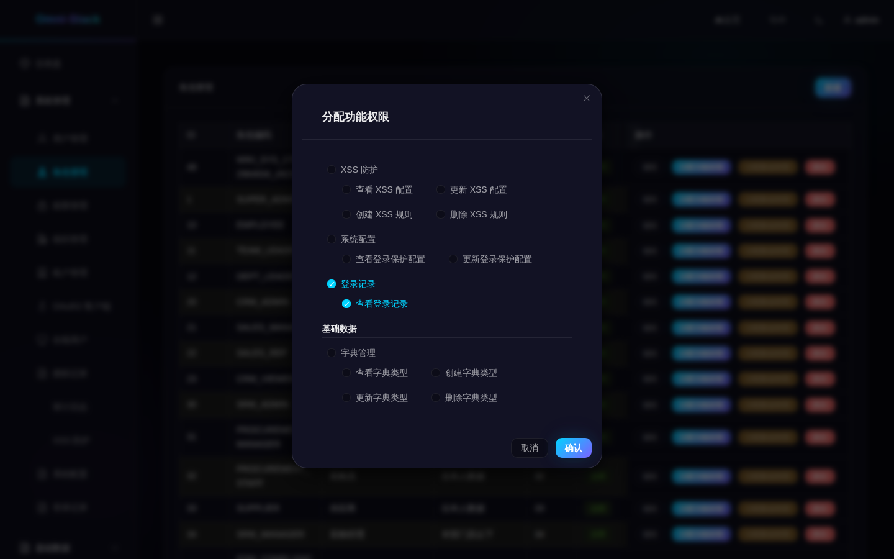

5. 按唯一编码和 ID 删除自己的未分配角色，通过 `GET /api/auth/role/all` 确认无残留。角色配置持久化不证明用户行级隔离，相关对照见[权限教程](permissions.md)。若失败，先回读状态，只处理本次对象，不重复已成功写入。

## 3. 创建一条教学字典并清理

本节需要字典写权限；历史图片身份为隔离租户的 `admin/SUPER_ADMIN`，不能证明员工写权限。先记录唯一编码，如 `WIKI_DICT_{run-id}`。

1. 打开「基础数据 → 字典管理 → 新建类型」，核对类型编码、类型名称、备注和排序。保留空编码、空名称，排序可用默认值。

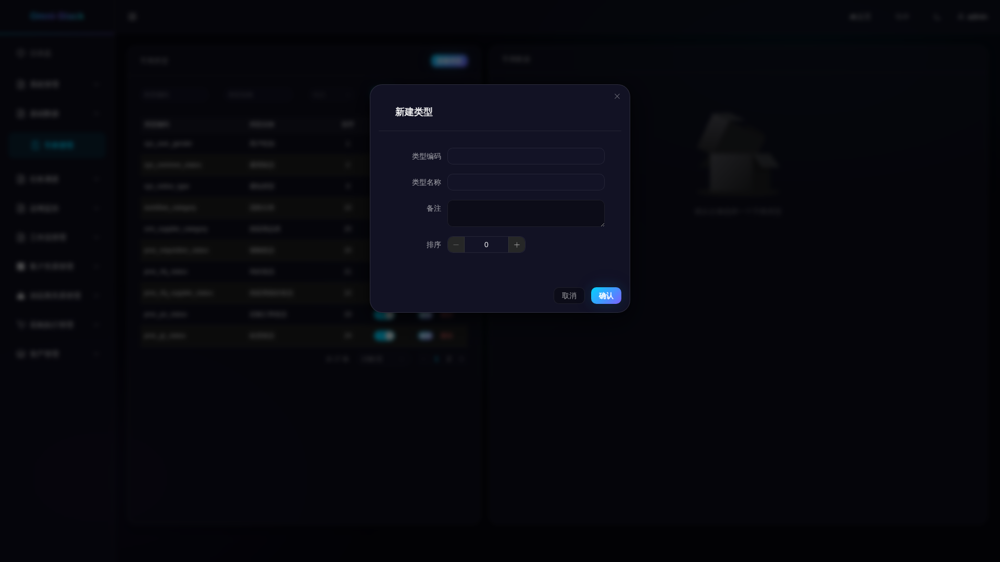

2. 点击「确认」，`POST /api/base/dict/type` 对空编码/名称返回 HTTP 400、业务码 400，弹窗保持打开且未创建类型。当前页面没有本地必填 rules，由后端校验并经统一错误层提示。
3. 等待错误提示完全显示；前缀随语言变化，字段名保留 `typeCode/typeName` 并附排障 Trace ID。不要把动画中的空白提示当作失败证据。

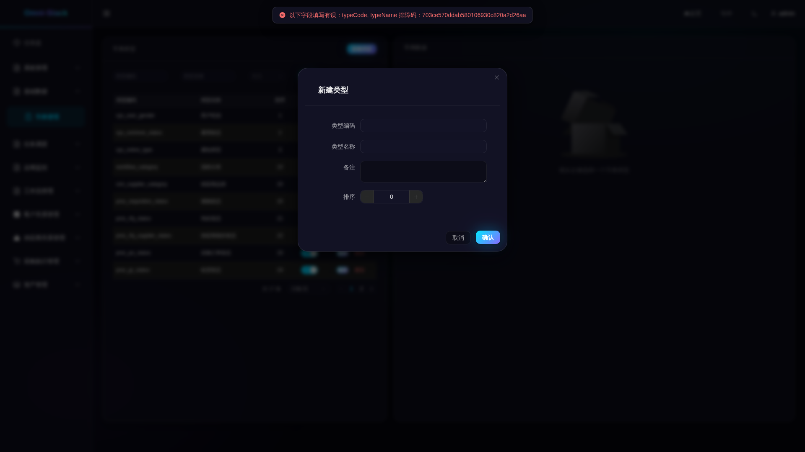

4. 等错误提示消失，填写唯一编码和名称，确认保存。成功后弹窗关闭；按完整编码搜索，等加载结束，核对本次记录。右侧未选择类型时为空是正常状态。
5. 历史采集使用 `E2EDICT-{runStamp}-{locale}`，每种语言创建一条；图片编码不是读者应复用的种子。

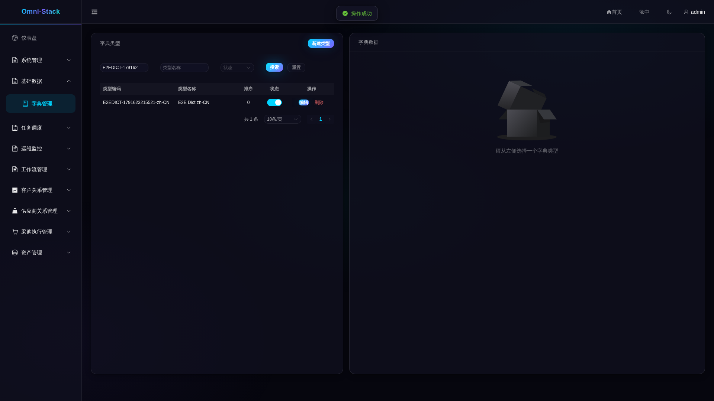

6. 记录列表返回的类型 ID，仅删除本次类型：`DELETE /api/base/dict/type/{id}`。确认 HTTP/业务码均为 200，再按唯一编码回查为零。失败或断流时先查询是否已完成，不删除种子，不按全库固定行数判断清理。

自动化入口 `omni-frontend/e2e-docs/flows/system-dictionary.flows.spec.ts` 要求 Docker、external 模式、显式 `E2E_MUTATIONS=true`、匹配隔离项目及运行镜像回执。图片、资源登记和运行回执均指向仓库外；受控测试令牌不能复制到命令或仓库。

[2026-10-10 回执](../reference/evidence/dictionary-2026-10-10.json)：4 passed、0 failed、0 skipped，12 张原图已有逐张 AI 视觉检查；类型 ID 27–30 已经通过正式接口删除并回查无残留，本轮未重建。日/韩备注仍为 `Remark`，日语备注行不清晰、英文侧栏截断、错误字段名为接口标识，均保留原始限制。

## 4. 修改登录保护并核对审计

1. 进入「系统管理 → 系统配置」，通过 `GET /api/auth/system-config/login-policy` 保存原 `failureThreshold/failureWindowSeconds/version`。没有持久化策略时读取默认视图，不写库。
2. 选择一个不同于原值且合法的教学值；历史例为 `10 → 9`、窗口 `3600` 秒，不能假设每个环境原值均为 10。保存使用 `PUT /api/auth/system-config/login-policy` 和最新 `expectedVersion`，再回读确认新值、新版本。
3. 第二个客户端用最新版本恢复原值；第一个未刷新的页面再提交，应得到 HTTP 200、业务码 409。页面保留草稿并刷新服务器最新配置版本；比较两者后，明确选择采用服务器值或重试草稿，不自动覆盖并发更新。
4. 在安全审计中按操作者和时间查 `AUTH_CONFIG_UPDATED`；用当前版本恢复原阈值、窗口并回读。页面「恢复默认」是 `10/3600`，不保证等于本次原值。恢复业务值不会回退版本或删除审计。

阈值允许 `3–10`，窗口允许 `3600–86400` 秒，不能关闭登录保护。新策略用于下一个失败窗口，已有窗口保留其创建时策略。读取需 `system:config:list`，更新需 `system:config:update`；按钮隐藏不能证明后端拒绝。2026-10-17 实际读取为管理员 HTTP/业务码 200、员工 HTTP/业务码 403；本轮没有重跑员工写请求。

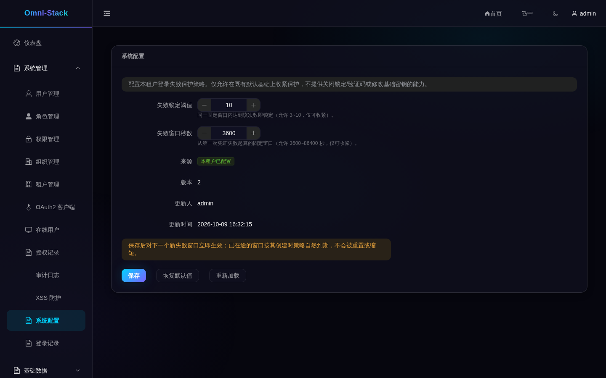
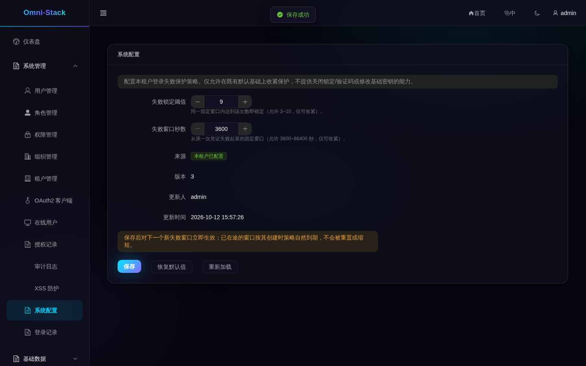
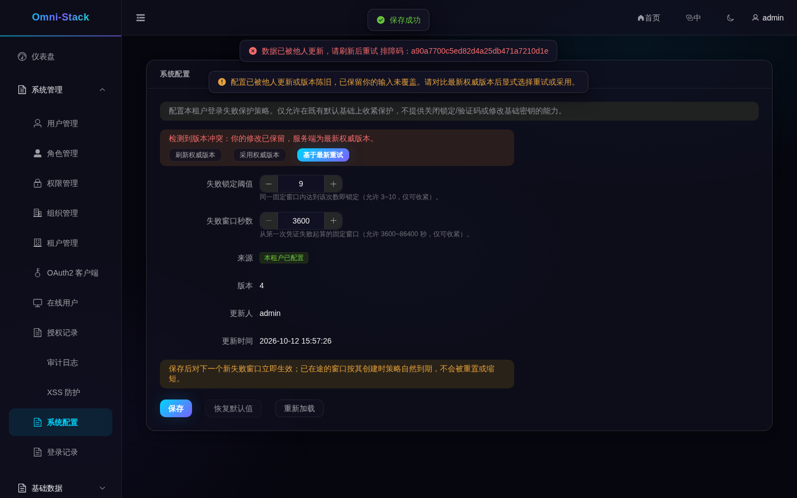

冲突图绿色提示来自前一次成功保存；当前结果以红色错误、冲突说明和业务码 409 为准。网络失败时先 GET 核实是否已保存，再决定后续动作。

「登录记录」是 `sys_audit_log` 中 `LOGIN_SUCCESS/LOGIN_FAILED` 的只读投影。输入账号、选择「密码」和实际时间范围，搜索后核对账号、方式、结果、原因码与脱敏 IP。默认近 7 天，显式查询须同时提供起止时间且不超过 90 天；日期时间格式为 `yyyy-MM-dd HH:mm:ss`。锁定、角色或密码变化查安全审计，OAuth 授权查授权记录。

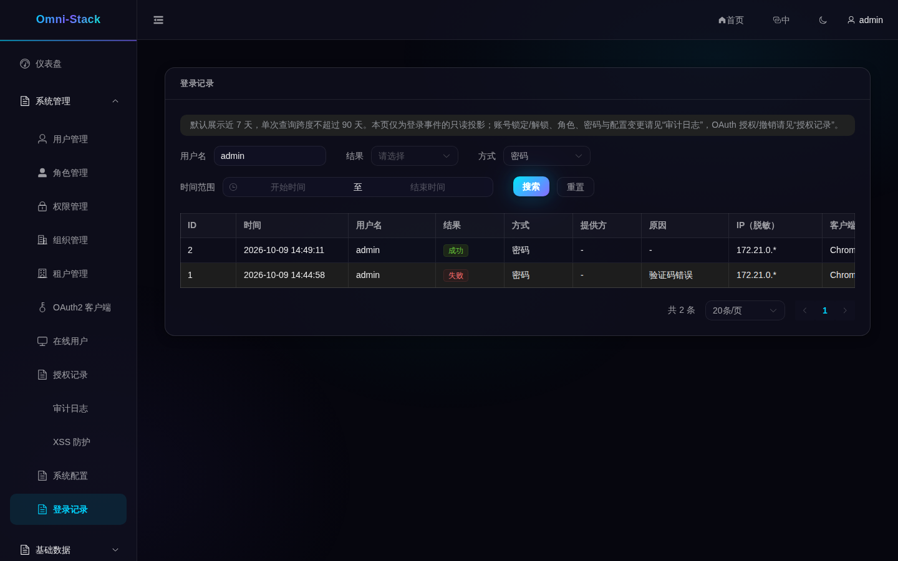

图中两条登录实际发生于 2026-10-09；2026-10-12 只筛选历史记录，本轮也没有提交密码或验证码。不要把列表刷新说成一次新登录。

[2026-10-12 基础平台回执](../reference/evidence/system-platform-2026-10-12.json)保留 32 张图：首批中文六个成功步骤与后续 26 图分别取证，后续四语测试 4 passed。首批超时后已核对副作用、恢复策略并清理对应角色，不能说所有图来自一次无失败运行。两批临时角色不同，均已删除；原策略 `10/3600` 已恢复，版本及审计递增保留。本轮不重放这些写入。

历史弹窗部分节点回退中文，日/韩权限表有英文，英文侧栏及登录表最右列可能裁切。原图证明其记录日期的保存、冲突、权限持久化和历史筛选，不证明教学角色已用于用户隔离。

## 5. OAuth2、XSS 与会话

OAuth2 客户端先核对允许的 grant、精确回调地址、scope 和同意设置。客户端 ID 是公开标识，secret 留在私有配置。外部社交登录和本地授权码/PKCE 见[认证教程](authentication.md)；授权记录列表中的旧 device-code 行不证明新的授权或外部回调成功。

进入「XSS 防护」时核对设置、规则两个请求都成功。当前实现的设置 GET 在该租户尚无配置时会创建默认关闭行；本轮先确认租户 1 已有该行，再读取并核对前后值不变。2026-10-17 原图的全局开关为关闭，即使单条规则启用，也不能证明防护生效。

需要验证 XSS 修改时，在隔离环境先记录原开关和规则，只操作有归属记录、可恢复的教学规则；按[核心流程](../core-flows.md)核对事件属性、脚本协议及允许富文本的实际保存/响应，再恢复原值。写操作应失效 `xss:enabled:{tenantId}` 与 `xss:rules:{tenantId}`。本轮未切换开关、未改规则、未验证攻击输入；不得关闭防护让测试通过。

在线用户、授权记录、登录记录、安全审计各自独立。在线用户踢出 API 是 `DELETE /api/auth/online/{userId}`，按用户操作，并非任意单个 `jti` 的删除按钮。仅对明确归属本次的测试用户执行，再验证旧会话请求被拒和重新登录恢复，不动他人会话。本轮在线用户为空，未执行踢出。

## 6. 从一次操作追到异步日志

Auth 不使用 `@OperLog`，认证事件留在安全审计；业务操作日志经 Outbox、MQ、消费者异步落库。原生 lite 模式关闭消息 relay、XXL-JOB 和消费者；查看历史日志不需要它们，验证新投递则需按[Docker 部署](../docker-deployment.md)启用完整运行模式及相应组件/绑定，详见[可靠消息](../mq-reliability.md)。仅补启动 MQ 容器不足以证明投递链就绪。

1. 保存一次已授权业务请求的租户、操作者、模块、时间、URL、结果及响应 Trace ID。不要为截图重复已经成功的操作。
2. 按操作人、模块、类型、时间查「操作日志」。当前页面没有 Trace ID 搜索栏或专用列，不能要求读者在此按 Trace ID 查找。
3. 用请求信息与结构化日志交叉核对；再查来源服务 Outbox 的 `msgId`、可选 `msgKey`、`serviceName`。生产端记录 `producerTraceId`，relay 的跟踪上下文可能不同，关联方法见[可观测性](../observability.md)。不能假设每条消息都有业务键或这些字段都在页面可见。
4. 核对 broker 确认和消费者结果；Outbox `SENT` 不等于业务消费完成。达到最大重试后，先检查下游状态与幂等，再决定重发或跳过。列表读取成功不证明故障恢复成功。

## 7. 图片与验证边界

[2026-10-17 页面读取回执](../reference/evidence/security-lists-2026-10-17.json)绑定以下 40 张四语原图、实际执行脚本、源码与运行产物。Docker 受控测试身份读取既有租户数据，44 次页面 API 读取成功，未提交业务表单、未重放历史写操作；这不是密码/验证码登录。采集后六个本轮启动容器均已停止。

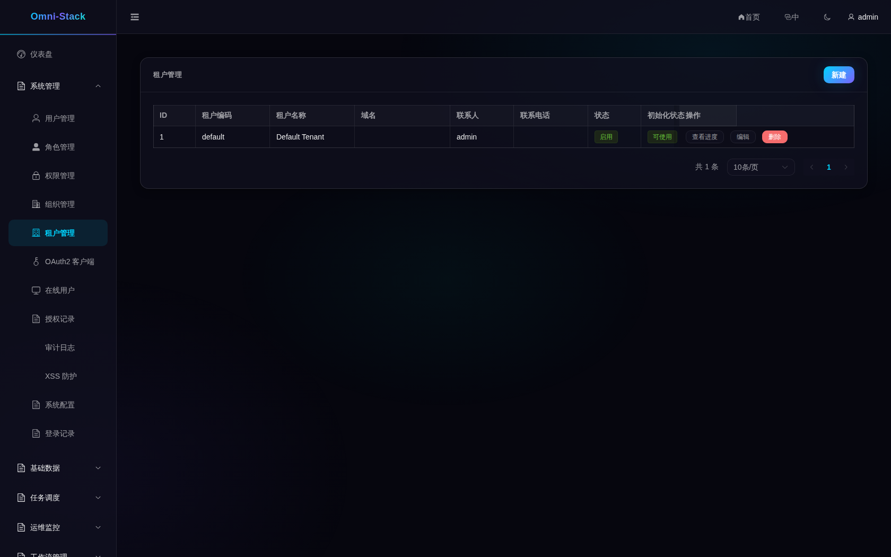
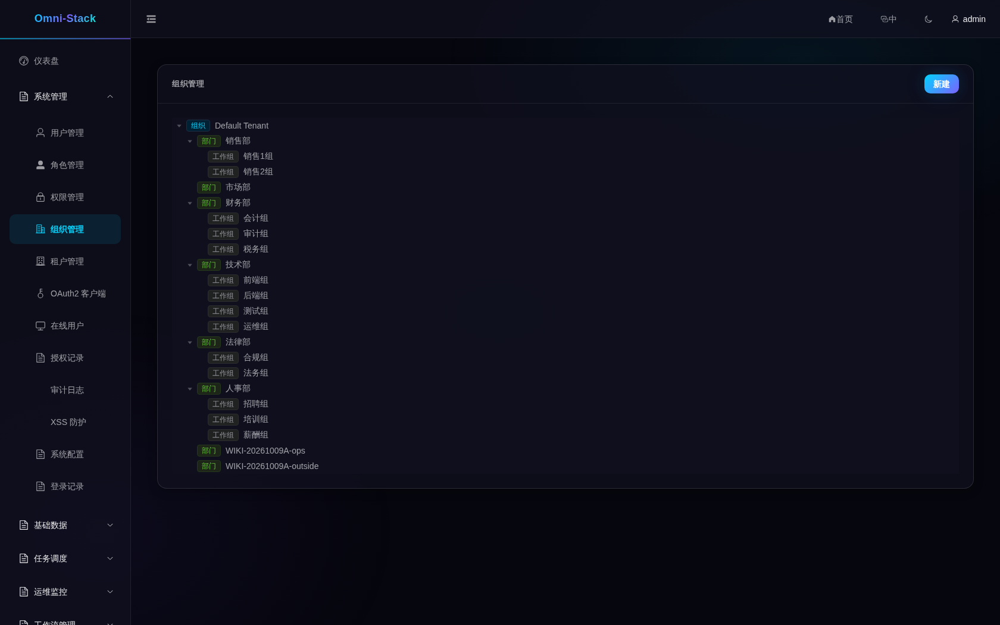
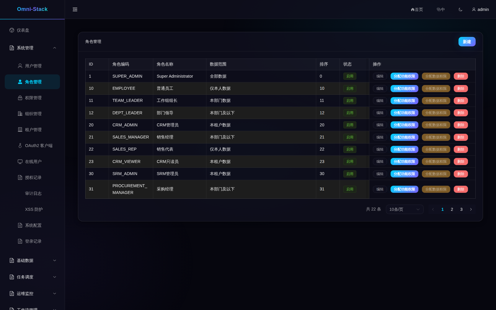
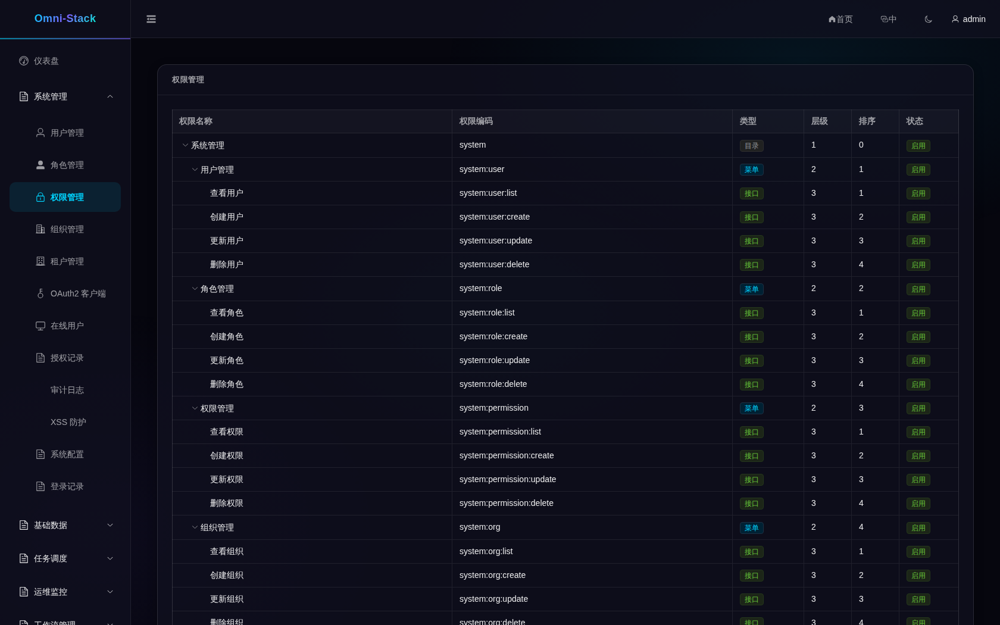
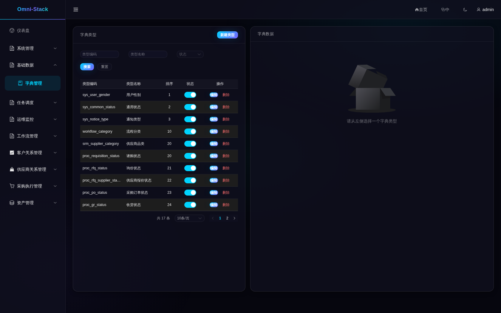
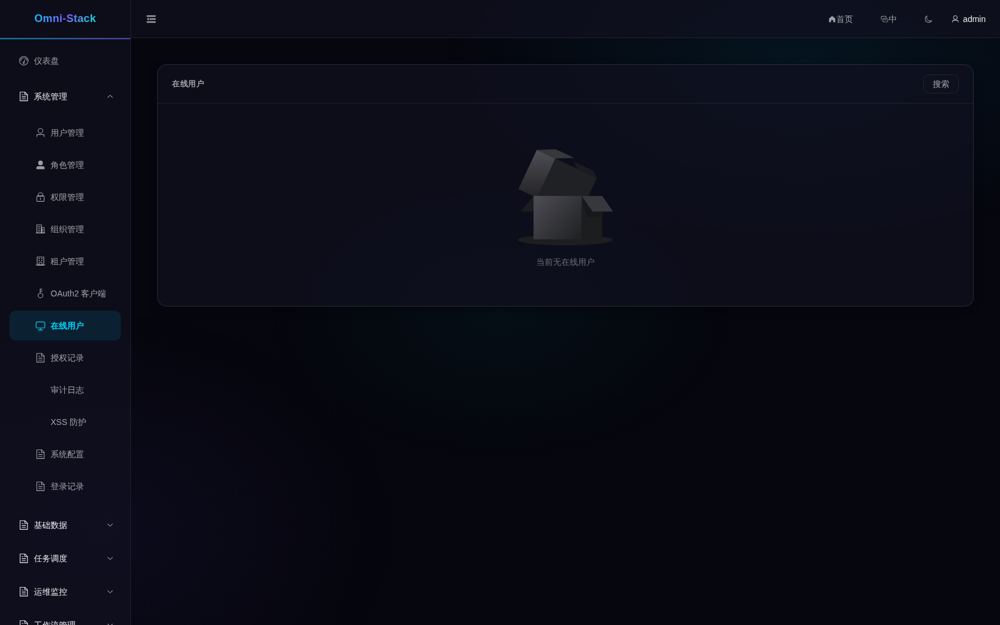
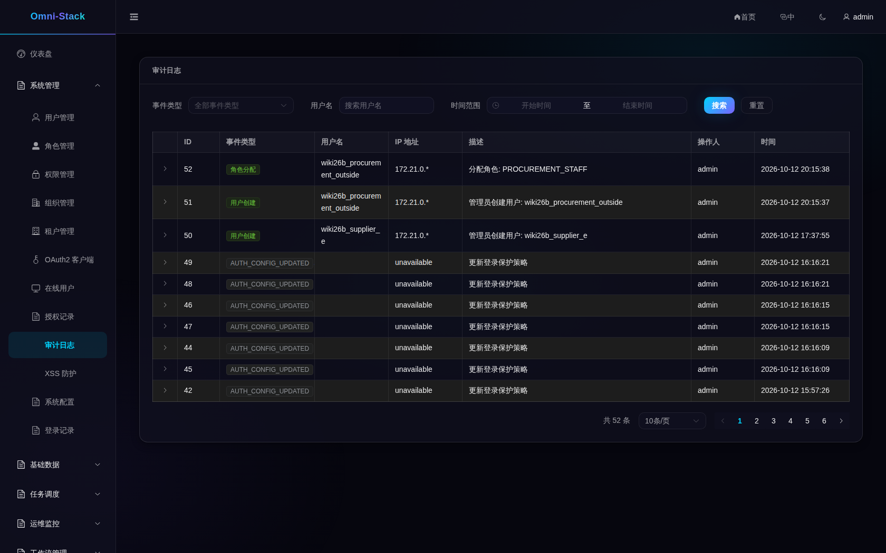
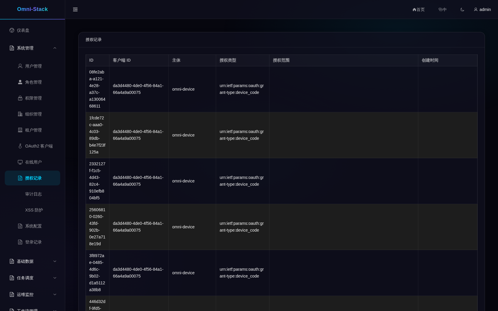
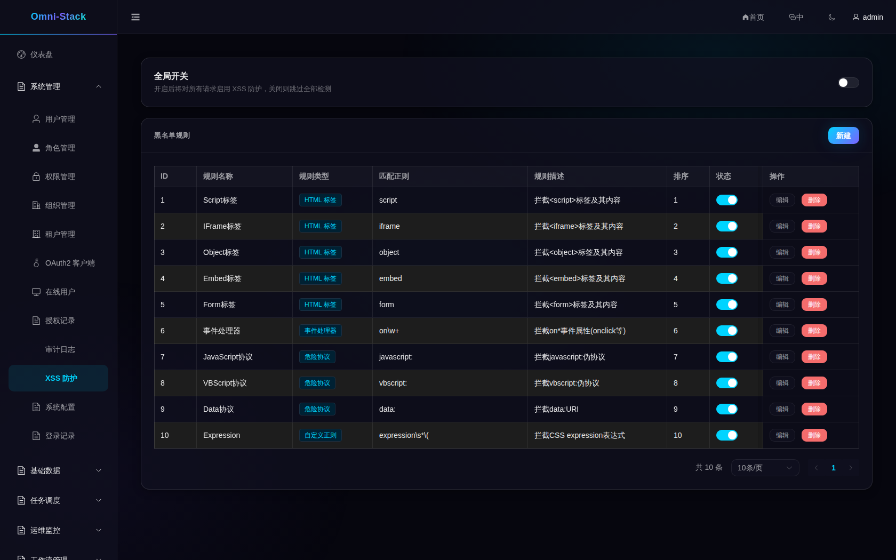
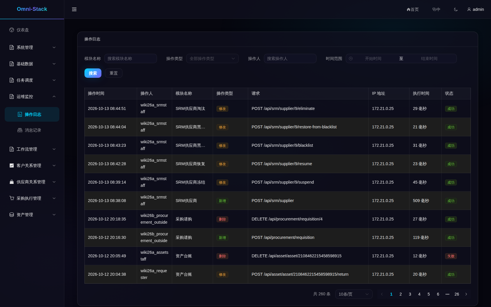

全部原图已逐张 AI 检查，并保留原始显示限制：部分侧栏、租户初始化/操作表头重叠或裁切；长 ID/授权类型换行且需滚动；部分日/韩标签保留英文，数据库业务名称和描述保留中文。授权行的 scope、创建时间为空，在线列表为空；这些都未伪造填充。截图只证明可见范围与所记录接口读取，不证明 XSS 效果、踢出、外部 OAuth、异步消费或全局界面翻译完成。

四语言文档按已授权的 `AI_REVIEW` 及绑定内容哈希验收，不要求人工复核，也不冒称 `HUMAN_REVIEW`。图片读取、测试通过和哈希校验均不能替代完整文档语义复核；当前状态以[复核队列](../i18n-review-queue.md)为准。
