# From a new model to ordinary-user approval

This tutorial applies to the `workflow`, `supply-chain`, and `full` presets containing standalone `omni-workflow`, with Flowable 8.0.0 as declared in source. Complete [first startup](quick-start.en.md) and [teaching data preparation](../wiki/data-and-fixtures.en.md). Business names, organization IDs, and dates identify isolated teaching records; use your own new identifiers when reproducing them.

The instructions are checked against current source; images and business results come from the local Docker exercise on 2026-10-10. This stage audits documents, provenance, and originals only: no model creation/publication, process startup/approval/withdrawal, or signer changes. Do not replay successful writes; inspect side effects after an unknown response.

## 1. Prepare identities and organizations

Create a child organization, an ordinary initiator, a model designer, and three approvers in its parent organization. Put the designer and initiator in the same child organization so their preview and runtime results can be compared. Approvers retain their business roles and receive only the necessary workflow permissions.

| Identity | Actions in this tutorial | Permissions to check |
|---|---|---|
| Model designer | Create, edit, validate, publish, inspect versions | `workflow:model:list/create/update/validate/publish`, `workflow:identity:list` |
| Ordinary initiator | Start, inspect own instances, withdraw | `workflow:instance:start/terminate`, model list and personal workspace access |
| Three ordinary approvers | Read own tasks and approve | `workflow:task:todo`, `workflow:approval:complete` |
| Additional approver | Receive delegation or an added task | Matching approval permissions; outside the original three candidates |
| Process observer | Read administration list, progress, history | `workflow:instance:list` |

Slash notation abbreviates separate complete codes, such as `workflow:model:create` and `workflow:model:update`; do not enter the abbreviation as one permission. Grant the required parent menu permissions through the role management tree as well.

Roles, primary organization, and `sys_user_role_scope` are separate settings. Role management does not establish Workflow organization scope. In an explicitly named teaching project with independent volumes and network and no host MySQL port, follow the [fixture instructions](../../scripts/fixtures/README.md) to run `run-workflow-scope-fixture.ps1`. It binds existing teaching roles to their primary organization with `SAME_UNIT`, rejects standard `omni-stack`, creates no accounts, grants no roles, and refuses conflicting bindings. Do not edit task or process-state tables.

Sign in again after changing roles. Preview normally simulates the current designer; it cannot prove another initiator will receive the same candidates. Start with the actual initiator and check the tasks. This example expects three candidates and uses no super administrator to approve on their behalf.

## 2. Create the first ALL model

1. As the designer, open Workflow Management → Process Models and create a model with a unique key, name, and category. The key starts with a letter and contains letters, digits, or hyphens. Check the filled form before confirming.

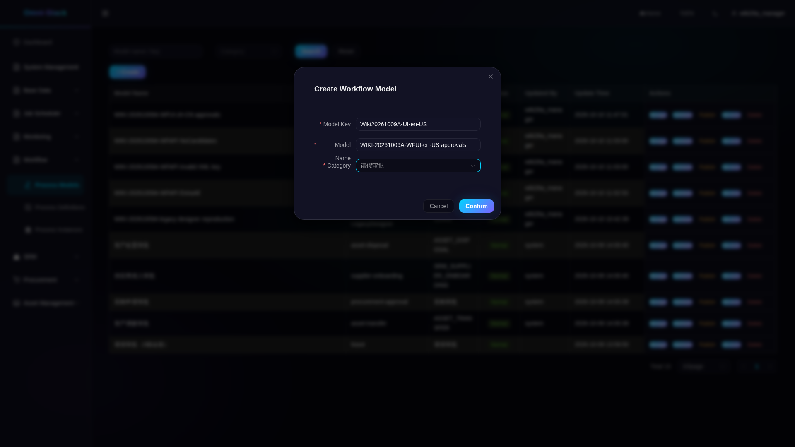

2. Open Design on that row. A new model should already contain a start event, and BPMN `<process id>` should match its model key. An empty canvas or leftover `Process_1` is not ready for publication.

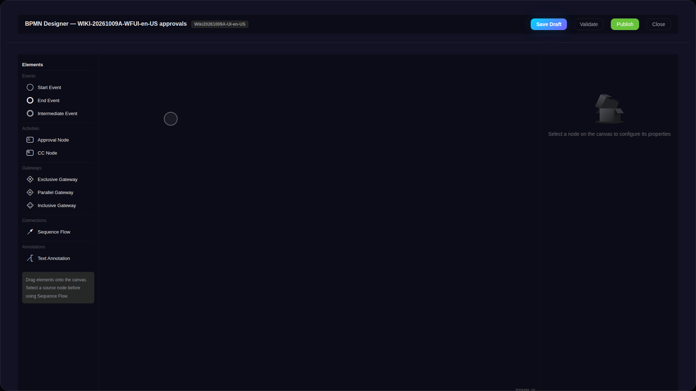

3. Select the start event, append a user task through the context pad, and name it. Select the approver role, initiator's parent organization, and all-person approval in the right panel. Preview and verify the three identities and their organization, close the preview, and append an end event. An appended node is already selected; clicking it again deselects it.

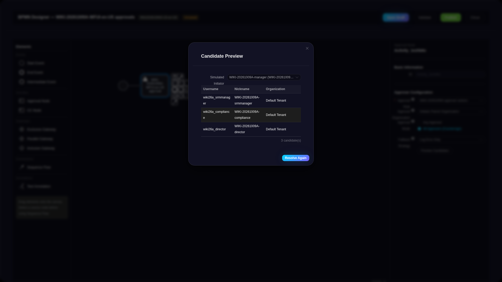

4. Save the draft, then validate. The server should report successful validation. This checks the process key, structure, and configuration; it does not replace runtime candidate assignment verification.

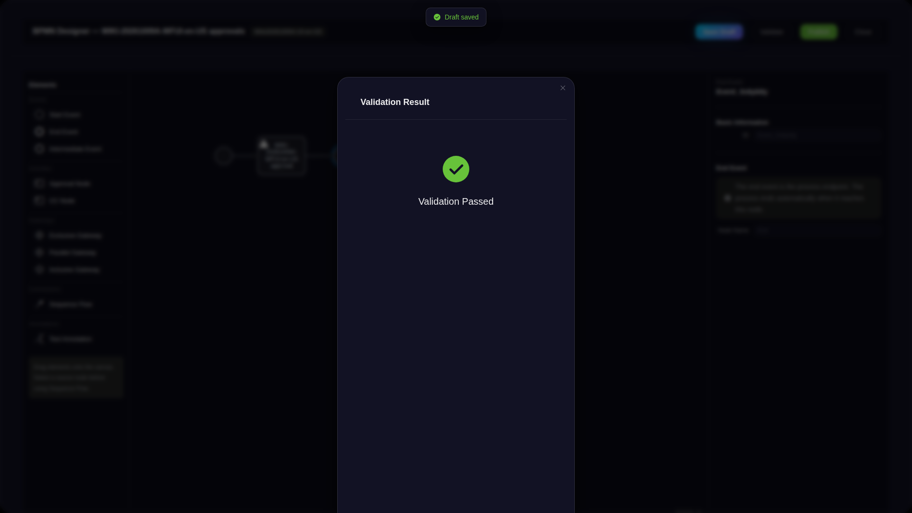

5. Close validation, publish, and confirm. Inspect business version 1, `PUBLISHED`, and the engine version in the list. Verify the actual process definition ID through the versions API; that ID is not shown in this image. Business versions describe model history; Flowable engine versions describe deployments. They are separate values.

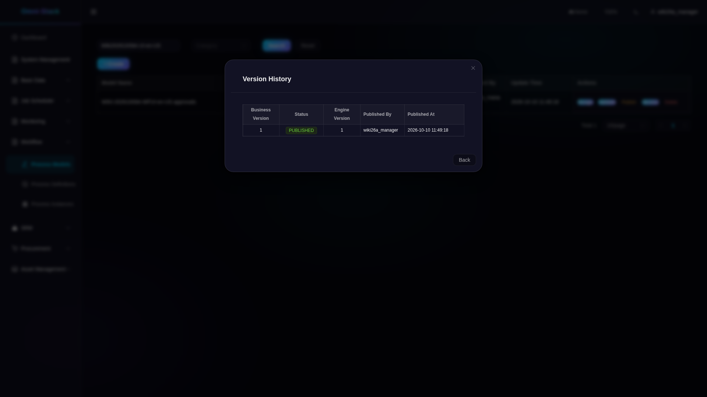

## 3. Start as the ordinary initiator and cast the first vote

The 2026-10-10 exercise starts through the ordinary initiator's real API, then approves through the workspace. It does not prove a UI start interaction. Business modules have their own entry points and state checks, such as requisitions and asset transfers, and start through the internal Workflow contract.

Call `POST /api/workflow/process-instance/start` through Gateway. Replace the example version ID with the actual published ID and use a new business key and title. Use the ordinary user's normal authenticated session. Gateway derives and forwards `X-User-Id` and `X-Tenant-Id` from the verified JWT; client-supplied identity headers are not trusted identity, and direct backend requests must not impersonate another user.

```json
{
  "modelVersionId": 7,
  "title": "Tutorial ALL approval",
  "businessKey": "tutorial-all-001"
}
```

Ordinary startup has no cross-service request-reservation idempotency guarantee. After a lost response, inspect My Initiated and the business key before retrying. See the [workflow contract](../workflow.en.md) for internal `requestId` reservation rules.

6. The first actual candidate signs into the home workspace and finds the instance in My Tasks. Each of the three receives one task. Approval permission alone does not let another user process this task.

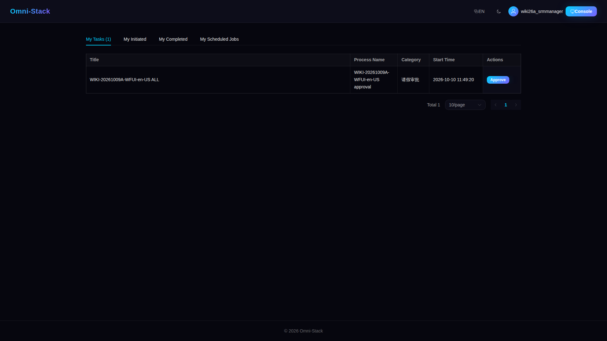

7. Open the approval form, verify the title, node, and comment, then approve. Real human CAPTCHA login and subsequent controlled short-lived E2E identities are separate steps; the latter does not prove automatic CAPTCHA validation.

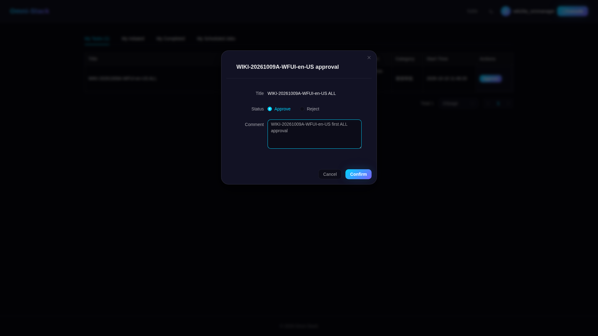

8. The observer searches the instance title and opens progress. After the first vote it remains running, with two other pending tasks. ALL waits for every effective approver to approve.

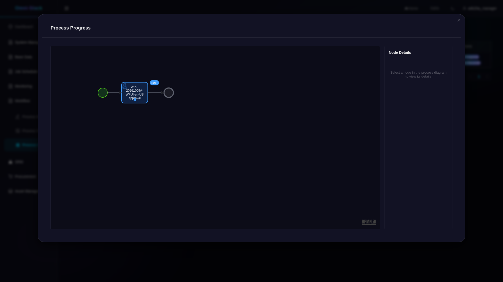

## 4. Publish ANY and check the old instance stays unchanged

9. Keep the ALL instance running. Reopen the same model, select the user task, switch to any-person approval, and save. Editing a published model creates a new draft; it does not overwrite the old published version.

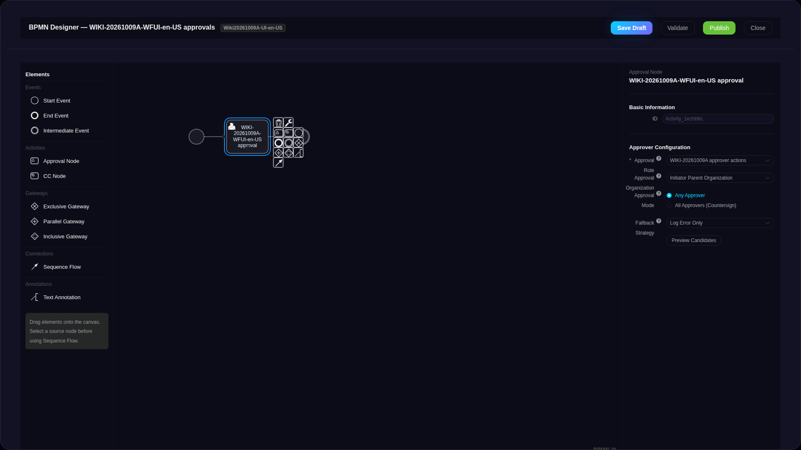

10. Validate and publish business version 2. The list retains the older version and the current `PUBLISHED` version. The old ALL instance still points to version 1 through `modelVersionId`, `processDefinitionId`, and its business version.

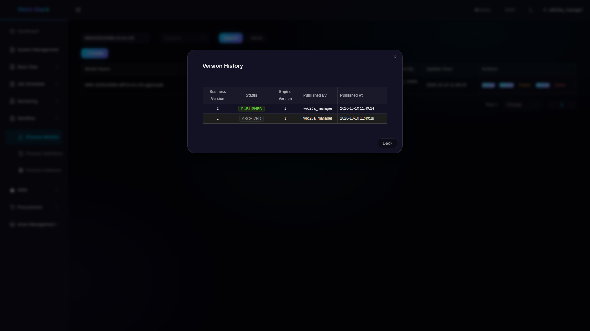

11. Start a second instance with version 2 and a new business key. One approval finishes ANY. The multi-instance completion condition skips the other two tasks and clears their pending work.

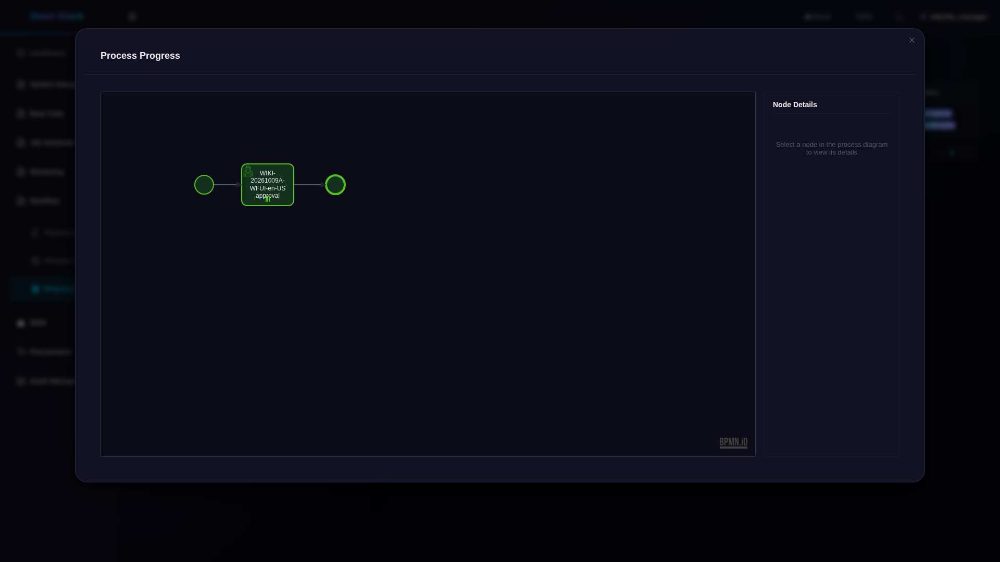

12. Return to the version 1 ALL instance and have the other two approvers approve. Check three actual approval records. The new version neither converted the old instance to ANY nor cast votes for the remaining people.

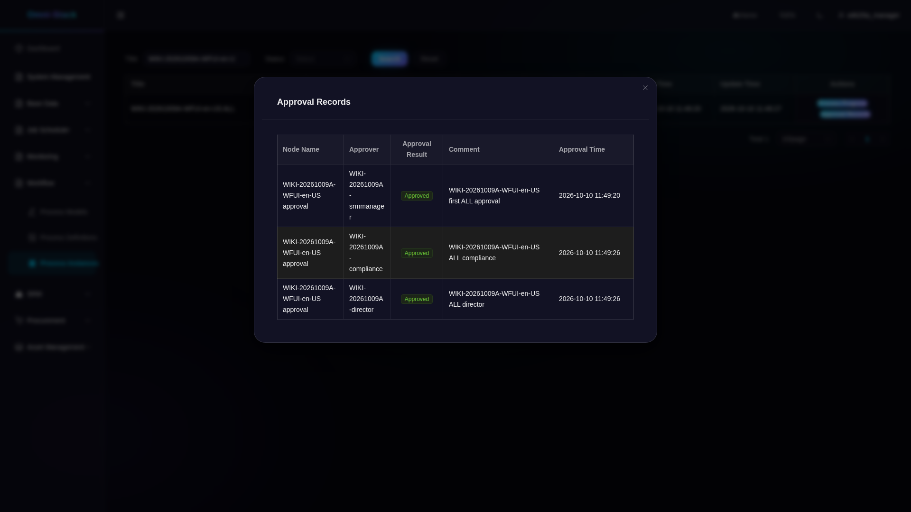

## 5. Verify rejection and withdrawal separately

Use a separate ALL model for rejection: follow the task with an exclusive gateway, set the approved edge condition to `${approved == true}`, make the rejection edge the default, and connect each to its own end event. The cases below were configured, published, and executed through real APIs; the screenshots are subsequent read-only views.

13. One candidate rejects. The rejection end event is reached and the remaining tasks disappear. Generic administration status `2` means completed, not that the business approval passed.

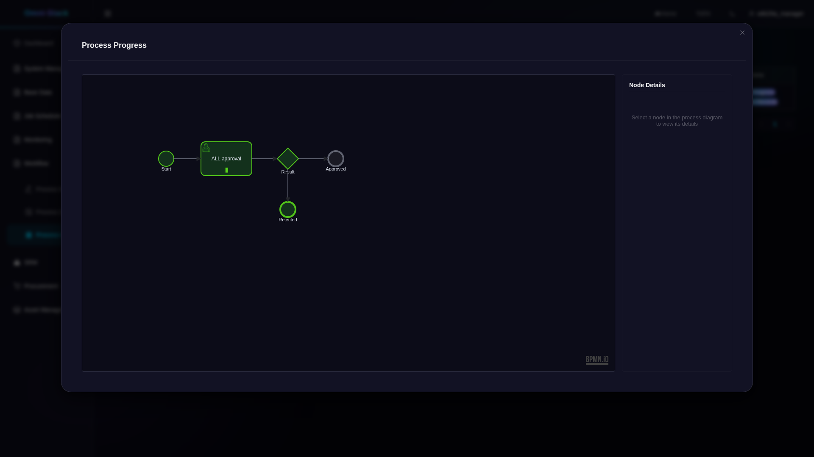

14. History contains one actual rejection and two tasks skipped with `MI_END`. The current UI labels the skipped records auto-approved. This display limitation does not turn them into actual affirmative votes.

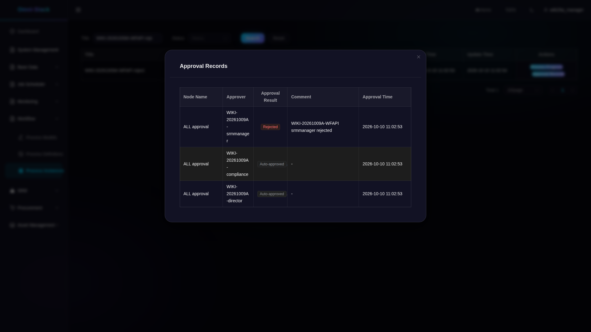

15. Start another instance and withdraw it as its original initiator using `PUT /api/workflow/process-instance/{id}/terminate?reason=...`. Check status `0`, no pending tasks, and cancellation history. Another ordinary user's withdrawal attempt returns 403.

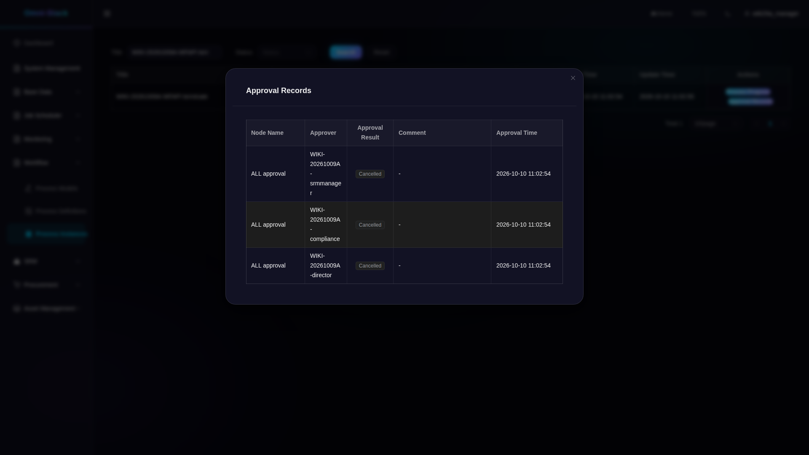

## 6. Current delegation and signer entry points

The personal workspace form offers approve, reject, and comments. Delegation and adding/removing signers have real APIs and frontend request wrappers, but no corresponding controls on this form. Reproduce the following through the API; screenshots prove the resulting history, not the existence of buttons.

First verify that the additional approver is an existing, enabled user in the same tenant with the required approval permissions. The current target-ID check validates numeric format only; API success is not eligibility validation. For this tutorial submit only necessary `approved` and `comment` fields. Extra `variables` reach the engine and must be constructed by trusted business code, not passed through from untrusted input.

| Action | API called by the current task assignee | Additional permission |
|---|---|---|
| Delegate | `POST /api/workflow/approval/{taskId}/delegate?targetUserId=...` | `workflow:approval:delegate` |
| Add signer | `POST /api/workflow/approval/{taskId}/add-signer?newUserId=...` | `workflow:approval:add-signer` |
| Remove signer | `POST /api/workflow/approval/{taskId}/remove-signer?targetUserId=...` | `workflow:approval:remove-signer` |

16. Delegate one of your tasks to the additional approver. The implementation changes the assignee using `setAssignee`. The original assignee then gets 403, and the new assignee can complete it. This does not implement a Flowable delegate/resolve round trip.

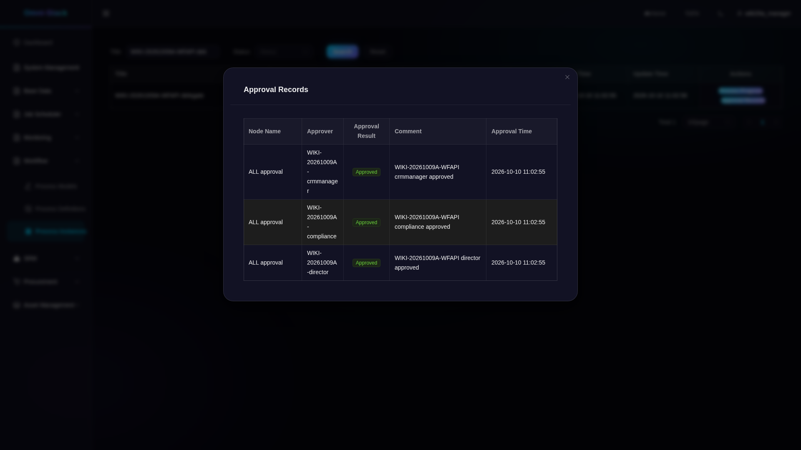

17. Add a fourth person to a separate ALL instance. The original three approvals leave it running; the fourth finishes it. Verify four actual affirmative votes.

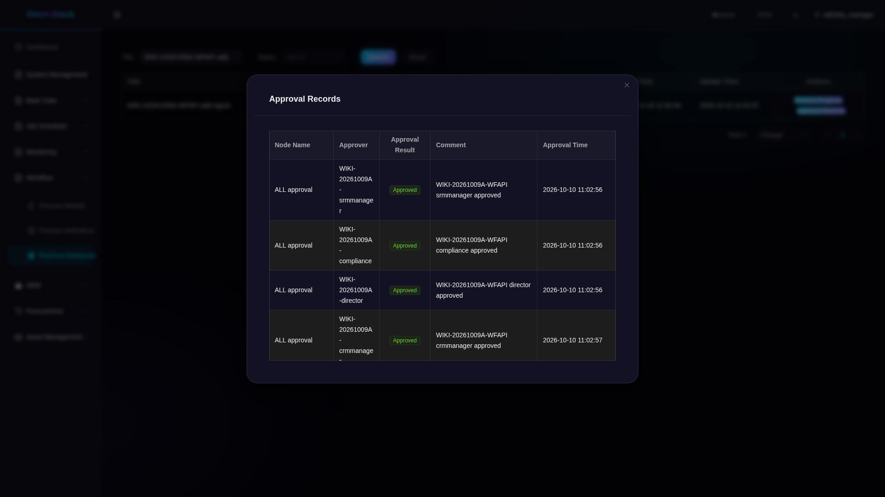

18. In another instance, add then remove that fourth signer. Their task disappears, the threshold is recalculated, and the original three approvals finish the instance. Do not delete execution rows to simulate signer removal.

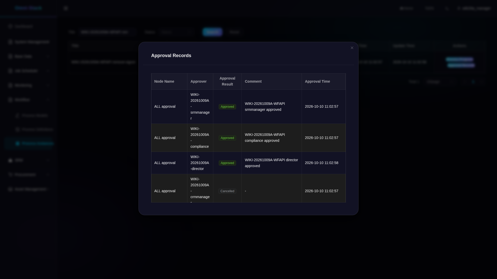

## 7. Reproduce invalid XML, rejected publication, and denied access

Use a separate new model without changing the ALL/ANY history above. `WIKI-20261009A` identifies isolated teaching data, not formal seed data. Create your own key, such as `Tutorial-Invalid-20261010`, through the formal `POST /api/workflow/model`, then save a complete start → end BPMN process. The key must start with a letter and contain only letters, digits, and hyphens.

19. As the designer, call `GET /api/workflow/model/{id}` for `currentDraftVersionId`, then `GET /api/workflow/model/version/{versionId}`. Back up the original `designerJson` and complete `bpmnXml` in a private file outside the repository. Confirm this is an unpublished `DRAFT`.
20. Change only the XML `<process id="...">` to `DifferentProcessKey`, keeping the model's `modelKey`. Call `PUT /api/workflow/model/{id}/draft` with the original `designerJson` string and the complete modified `bpmnXml`. This API operation introduces a specific error; it does not assume an XML editor button exists in the designer.
21. Search for the key in the model list and click the row's Validate action. The dialog should report failed validation and the mismatched keys. The list action reads saved XML. Validation inside the designer may first save the canvas, changing the input being tested.

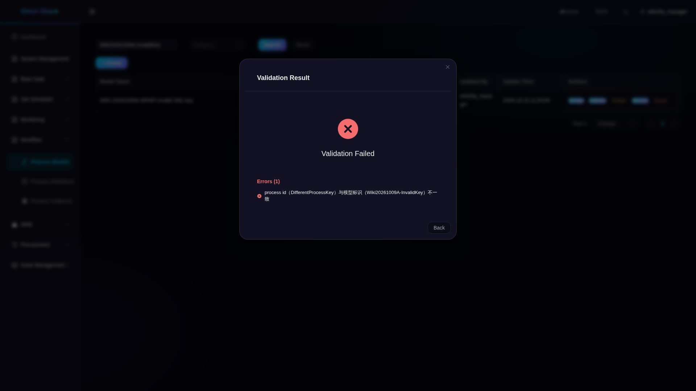

22. Close the dialog, publish from the same row, and confirm. The recorded 2026-10-10 response was HTTP `200` with business code `500`; publication was rejected. The UI shows a generic error and reference code, sometimes twice. Use list validation for the cause instead of concluding that the service is down from this message.

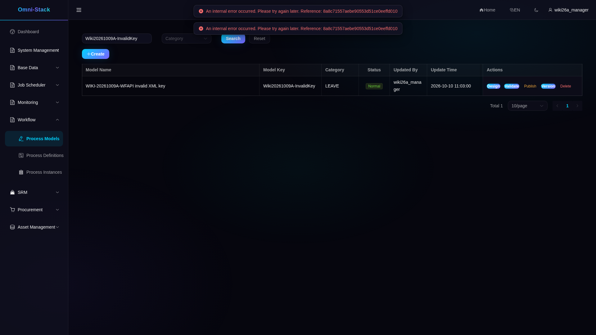

Query the model, draft version, and `GET /api/workflow/model/{id}/versions` again. There is still one `DRAFT` with the same XML hash; `currentPublishedVersionId`, `deploymentId`, and `processDefinitionId` are null. The failure branch's `FAILED` update rolls back with its exception and is not a persisted terminal state. Normal in the list does not mean the version was published.

23. Restore the backed-up complete XML and `designerJson` through `PUT /api/workflow/model/{id}/draft`, then call `POST /api/workflow/model/{id}/validate`; expect `valid=true`. On 2026-10-10, a separate teaching model was checked through valid → key mismatch → rejected publication → valid restoration, retaining one unpublished draft. The failure-image model was unchanged. This write was not replayed in the current stage.
24. Sign in as an ordinary employee without `workflow:model:list` and open `/admin/workflow/model`. The page shows 403 while retaining the signed-in username. A direct model-list API request with that identity also returns HTTP/business `403`. Check permissions merged from every role and sign in again after changing them. The earlier initiator already has model-list permission and cannot serve as the denied identity here.

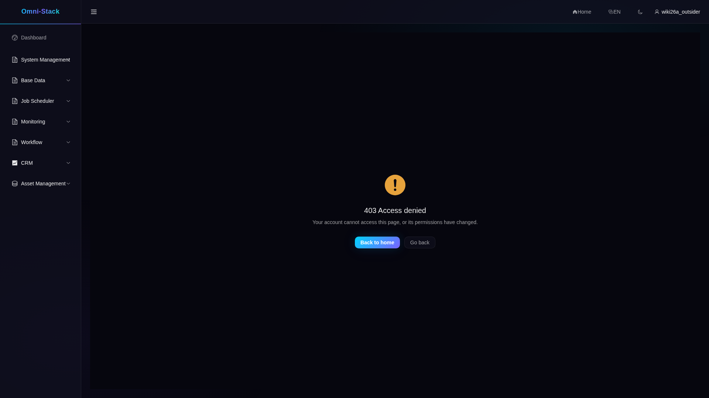

See the [real negative-page test](../../omni-frontend/e2e-docs/flows/workflow-negative-teaching.flows.spec.ts) for automated evidence collection. Historical validation details remain Chinese, and all four-language originals retain that behavior. This documented UI limit does not substitute language fallback for translated documentation.

## 8. Failures, breakpoints, and recovery

| Observation or check | Expected result | Next action |
|---|---|---|
| No approval permission | 403 | Grant minimum permissions and sign in again; do not substitute a super administrator |
| Permission without task ownership | Form and submission return 403 | Verify actual taskId and assignee |
| Another person in `simulateUserId` | 403, no instance | Use the authenticated actor |
| Empty candidates with ERROR fallback | Current business code 500; transaction rollback | Check initiator, organization, role, and scope; inspect side effects before retrying |
| Approval submission targets an already processed, absent, or tenant-invisible task | Business code409 | Refresh tasks and inspect history; do not blindly submit again |
| Progress/history read for another tenant's instance | Business code404, same as absence | Use your own tenant session; do not guess other tenants' instances |
| Model key differs from process id | Validation fails; publication blocked | Fix the draft, not a historical deployment |
| Lost save/start/approval response | Result unknown | Inspect versions, business key, tasks, and history for an existing commit |

Use these breakpoints in the isolated Docker environment. Keep tokens, authentication headers, and secrets out of screenshots.

| Unit | Breakpoint and variables | Problem explained |
|---|---|---|
| [ModelDesigner.handleSave](../../omni-frontend/src/components/workflow/ModelDesigner.vue) | `saveXML`, `modelKey`, `bpmnXml` | Empty canvas, key mismatch, draft contents |
| [writeAssignment](../../omni-frontend/src/composables/useBpmnExtension.ts) | assignment, lowercase executionListener, collection, assignee | Preview finds people but runtime creates no tasks |
| [ProcessInstanceServiceImpl.start](../../omni-backend/omni-workflow/src/main/java/com/omni/workflow/service/impl/ProcessInstanceServiceImpl.java) | `safeVariables.initiator` and authenticated actor before the engine call | Initiator-parent resolution failure |
| [ScopedRoleAssignmentListener.notify](../../omni-backend/omni-workflow/src/main/java/com/omni/workflow/listener/ScopedRoleAssignmentListener.java) | ExecutionListener start, candidateUserIds, counters | Assignment and approval thresholds |
| [WorkflowModelServiceImpl.publishModel](../../omni-backend/omni-workflow/src/main/java/com/omni/workflow/service/impl/WorkflowModelServiceImpl.java) | Row lock, validation, both version numbers | Concurrent publication and old-instance isolation |
| [ApprovalServiceImpl](../../omni-backend/omni-common-workflow/src/main/java/com/omni/common/workflow/approval/ApprovalServiceImpl.java) | MI root, approvedCount, requiredApprovals, deleteReason | ALL/ANY, rejection, signer changes |

The designer's ExecutionListener assigns candidates before evaluating the multi-instance collection. The old `ScopedRoleAssignmentListener.notify(DelegateTask)` is a compatibility no-op. Seeded business models can instead use `${candidateResolver.resolve(execution)}` as the collection expression; keep those paths distinct. Saving persists the browser-exported XML directly. `BpmnXmlBuilder` is not in the current save path.

Regression entry points: [XML round trip](../../omni-frontend/tests/workflow/bpmn-assignment.test.ts), [startup identity](../../omni-backend/omni-workflow/src/test/java/com/omni/workflow/service/impl/ProcessInstanceStartIdentityTest.java), [real designer and approval](../../omni-frontend/e2e-docs/flows/workflow-teaching-ui.flows.spec.ts), and [read-only history](../../omni-frontend/e2e-docs/flows/workflow-teaching.flows.spec.ts). Run in local Docker. Screenshot tests need external receipts, short-lived ordinary identities, and isolated-project authorization; missing inputs do not count as a pass.

See the [2026-10-10 evidence register](../reference/evidence/workflow-2026-10-10.json) for per-image fields. The earlier nine supplementary API groups use ABSOLUTE_UNIT and do not prove ordinary PARENT startup. Later UI runs 007/008 reconcile committed Chinese results and execute new journeys for the other three locales. Earlier failures, draft repair, and capture-time runtime versions remain recorded; the later aggregate source hash must not be assigned to the five early images.

The current [document and image audit](../reference/evidence/workflow-guide-review-2026-10-17.json) checks paths, locales, hashes, and capture epochs for all 84 images and individually views a selection of 20 raw originals. The other 64 retain their original visual records: the original 72 positive/history images were inspected through 18 original-resolution four-locale contact sheets, and the original 12 negative images individually. This stage did not recapture or individually re-view every image.

Category values may remain Chinese and version states use English protocol values. Japanese/Korean task views, approval forms, and history tables may retain `Approve`, `Reject`, and `Comment`. Names and long node labels wrap; graph colors do not replace actual vote counts from task/history APIs. Keep terminal history; repeat with new business keys without resetting the database or modifying published versions. See [workflow constraints](../workflow.en.md) and [source debugging](../wiki/source-debugging.en.md).

Four-language documents follow the [authorized AI review policy](../adr/0003-authorized-ai-translation-review.md): actual `AI_REVIEW` suffices, without mandatory human review or a false `HUMAN_REVIEW` label. The [review queue](../i18n-review-queue.md) records current valid hashes and status.
