# モデル作成から一般ユーザーの承認まで

独立した `omni-workflow` を含む `workflow`、`supply-chain`、`full` プリセットと、ソースで宣言された Flowable 8.0.0 を対象とします。[初回起動](quick-start.jp.md)と[教材データの準備](../wiki/data-and-fixtures.jp.md)を先に完了してください。業務名、組織 ID、日付は隔離した教材記録を識別します。再現時は自分の新しい識別子を使います。

操作は現在のソースと照合し、画像と業務結果は2026-10-10のローカル Docker 演習に由来します。今回は文書、出典、原画像の確認だけで、モデル作成・公開、開始・承認・取り下げ、承認者変更はしていません。成功済み書き込みを繰り返さず、応答不明なら先に副作用を確認します。

## 1. ユーザーと組織を準備する

子組織、一般の起案者、モデル設計者、その親組織に所属する承認者三名を用意します。プレビューと実行結果を比較できるよう、設計者と起案者は同じ子組織に配置します。承認者は業務ロールを維持し、必要最小限のワークフロー権限を追加します。

| ユーザー | この教材での操作 | 確認する権限 |
|---|---|---|
| モデル設計者 | 作成、編集、検証、公開、版の確認 | `workflow:model:list/create/update/validate/publish`、`workflow:identity:list` |
| 一般の起案者 | 開始、自分のインスタンス確認、取り下げ | `workflow:instance:start/terminate`、モデル一覧と個人ワークスペースへのアクセス |
| 一般の承認者三名 | 自分のタスク取得と承認 | `workflow:task:todo`、`workflow:approval:complete` |
| 追加の承認者 | 委譲または追加されたタスクの処理 | 対応する承認権限。最初の三名の候補には含めない |
| 進捗確認者 | 管理一覧、進捗、履歴の参照 | `workflow:instance:list` |

スラッシュ表記は `workflow:model:create`、`workflow:model:update` など複数の完全な権限コードの略記です。一つの権限コードとして入力しないでください。ロール管理のメニューツリーで必要な親メニュー権限も付与します。

ロール、主所属組織、`sys_user_role_scope` は別々の設定です。ロール管理だけでは Workflow の組織スコープは作られません。独立したボリュームとネットワークを使い、MySQL のホストポートを公開しない、明示的に名前を付けた教材環境で、[フィクスチャ説明](../../scripts/fixtures/README.md)に従って `run-workflow-scope-fixture.ps1` を実行します。既存の教材ロールを主所属組織へ `SAME_UNIT` で関連付けます。この入口は標準の `omni-stack` を拒否し、アカウント作成、ロール付与、競合する設定の上書きは行いません。タスクやプロセス状態のテーブルを直接変更しないでください。

ロール変更後は再ログインします。プレビューは通常、現在の設計者を起案者として模擬するため、別の起案者でも同じ候補になるとは限りません。実際の起案者で開始し、タスクを確認します。この例では三名が候補になり、スーパー管理者による代理承認は使いません。

## 2. 最初の ALL モデルを作る

1. 設計者として「ワークフロー管理 → プロセスモデル」から新規作成し、一意なキー、名前、分類を入力します。キーは英字で始め、英数字とハイフンだけを使います。入力を確認してから作成を確定します。

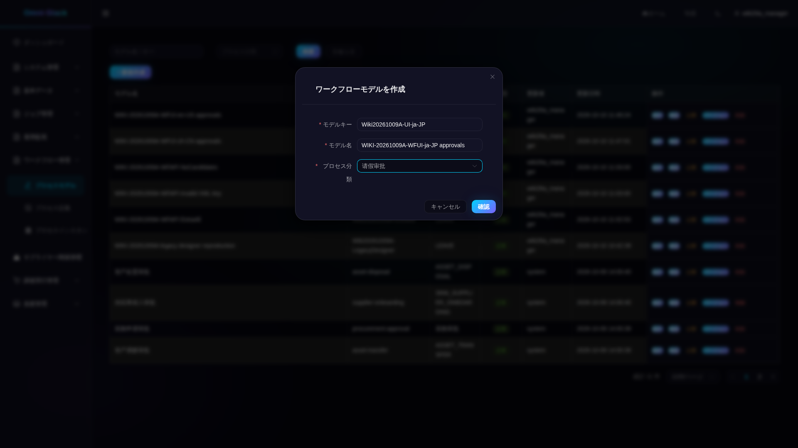

2. 対象行の設計を開きます。新しいモデルには開始イベントがあり、BPMN の `<process id>` はモデルキーと一致する必要があります。空のキャンバスや残った `Process_1` は公開可能な状態ではありません。

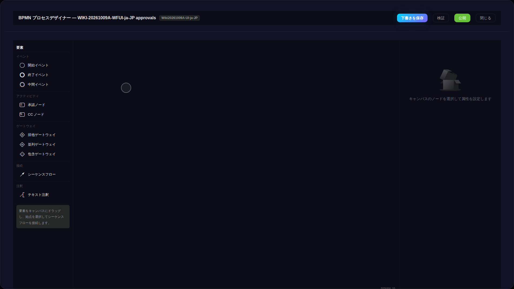

3. 開始イベントを選択し、コンテキストパッドでユーザータスクを追加して名前を付けます。右のパネルで承認ロール、起案者の親組織、全員承認を選び、候補をプレビューします。三名のユーザーと組織を確認し、プレビューを閉じて終了イベントを追加します。追加直後のノードは選択済みなので、もう一度クリックすると選択が解除されます。

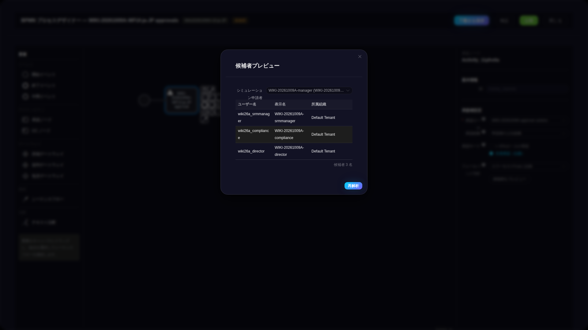

4. 下書きを保存して検証します。サーバーが検証成功を返すことを確認します。この検証はキー、構造、設定を調べるもので、開始後の候補割り当ての検証は別途必要です。

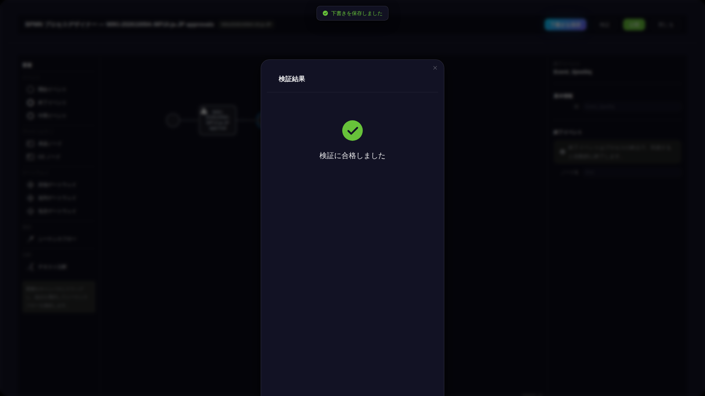

5. 検証ダイアログを閉じ、公開を確認します。バージョン一覧で業務バージョン 1、`PUBLISHED`、エンジンバージョンを確認します。実際のプロセス定義 ID はバージョン API で確認し、この画像には表示されていません。業務バージョンはモデル履歴、Flowable のエンジンバージョンはデプロイ履歴を表す別の値です。

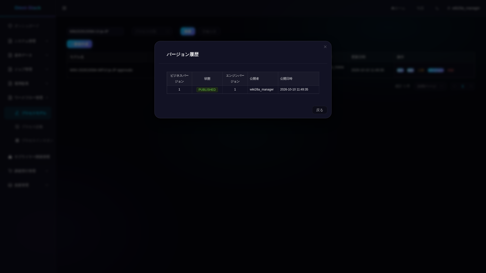

## 3. 一般の起案者で開始し、最初の一票を承認する

2026-10-10 の演習は、一般の起案者の実 API で開始し、ワークスペースで承認したものです。画面からの開始操作を証明しません。購買申請や資産移管などの業務モジュールには独自の入口と状態検証があり、内部 Workflow 契約から開始します。

通常の開始は Gateway 経由で `POST /api/workflow/process-instance/start` を呼びます。例の版 ID は実際の公開済み ID に置き換え、業務キーとタイトルは新しい値を使います。一般ユーザーの通常の認証済みセッションを使ってください。Gateway は検証済み JWT から `X-User-Id` と `X-Tenant-Id` を生成して転送します。クライアントが自分で指定した識別ヘッダーを信頼したり、バックエンドへ直接接続して他人を装ったりしません。

```json
{
  "modelVersionId": 7,
  "title": "Tutorial ALL approval",
  "businessKey": "tutorial-all-001"
}
```

通常の開始には、サービス間のリクエスト予約による冪等性保証はありません。応答が途切れた場合は、自分が起案した一覧と業務キーを確認してから再試行します。内部起動の `requestId` 予約規則は[ワークフロー契約](../workflow.jp.md)を参照してください。

6. 最初の実候補者でホームのワークスペースにログインし、自分の未処理タスクに対象インスタンスがあることを確認します。三名に各一件のタスクが割り当てられます。権限があっても、そのタスクの担当者でなければ処理できません。

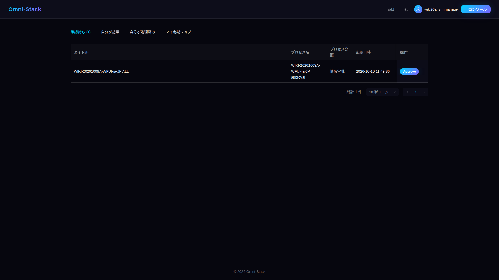

7. 承認フォームを開き、タイトル、ノード、コメントを確認して承認します。人が CAPTCHA を入力する実ログインと、その後の制御された短期 E2E 認証は別の手順です。後者を CAPTCHA の自動検証と呼ばないでください。

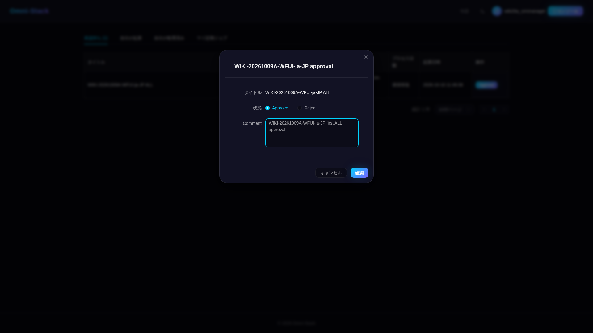

8. 進捗確認者としてインスタンスのタイトルを検索し、進捗を開きます。一票の承認後も実行中で、残り二名のタスクが残ります。ALL は有効な承認者全員の承認を待ちます。

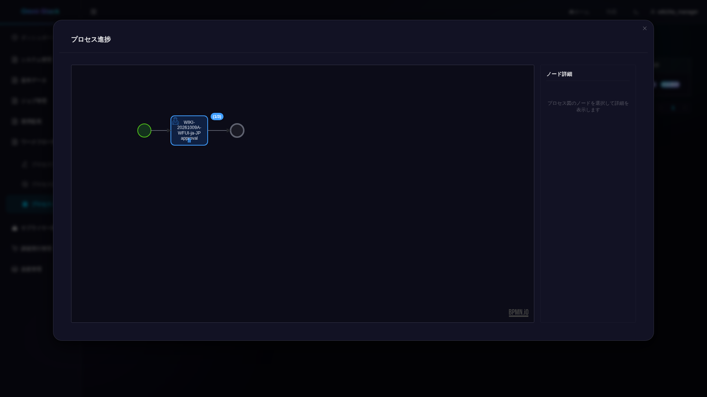

## 4. ANY を公開し、旧インスタンスが変わらないことを確認する

9. ALL インスタンスを実行中のまま残します。同じモデルを開き、ユーザータスクを選択して任意の一名の承認に変更し、保存します。公開済みモデルの編集では新しい下書きが作られ、旧公開版は上書きされません。

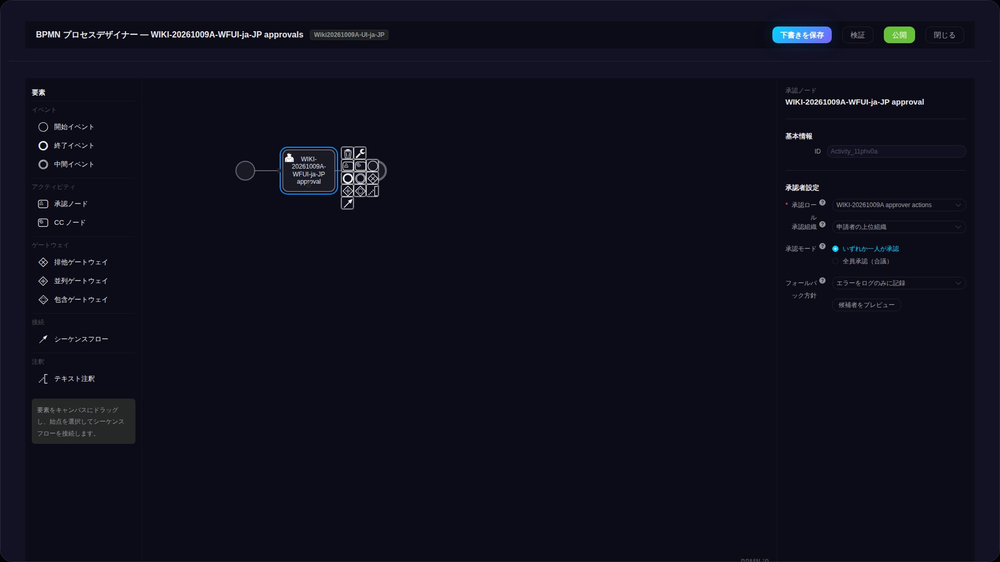

10. 検証して業務バージョン 2 を公開します。一覧には旧版と現在の `PUBLISHED` 版が残ります。旧 ALL インスタンスの `modelVersionId`、`processDefinitionId`、業務バージョンは引き続きバージョン 1 を指します。

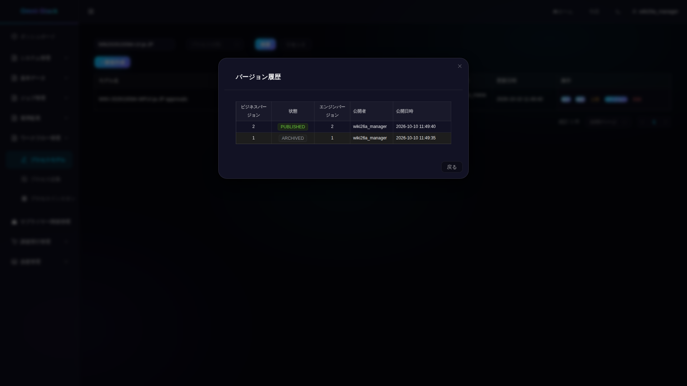

11. バージョン 2 と新しい業務キーで別のインスタンスを開始します。一名の承認で ANY が終了し、多重インスタンスの完了条件により残り二件がスキップされ、未処理タスクが消えます。

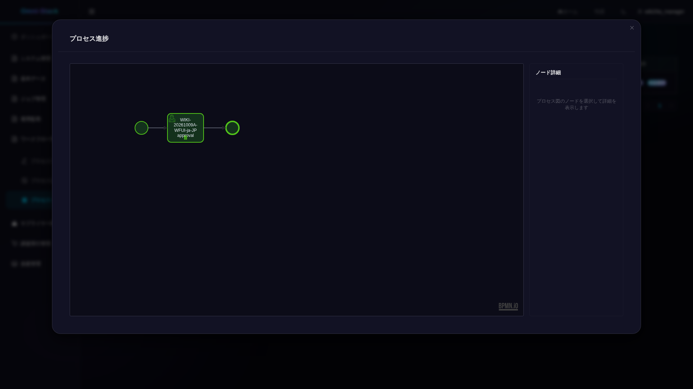

12. バージョン 1 の ALL に戻り、残り二名が個別に承認します。三件の実承認記録を確認します。新版は旧インスタンスを ANY に変更せず、残りの人の投票を代行しません。

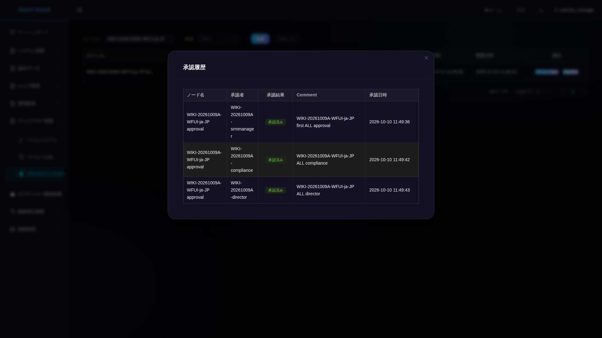

## 5. 却下と取り下げを別々に検証する

却下用には別の ALL モデルを作り、タスクの後に排他ゲートウェイを配置します。承認側の条件を `${approved == true}`、却下側をデフォルトフローとし、それぞれ終了イベントへ接続します。以下の例は実 API で設定、公開、実行し、その結果を後から読み取り専用で撮影したものです。

13. 一名の候補者が却下すると、却下の終了イベントへ到達し、残りのタスクが消えます。管理一覧の汎用状態 `2` は完了を表し、業務承認の成功を意味しません。

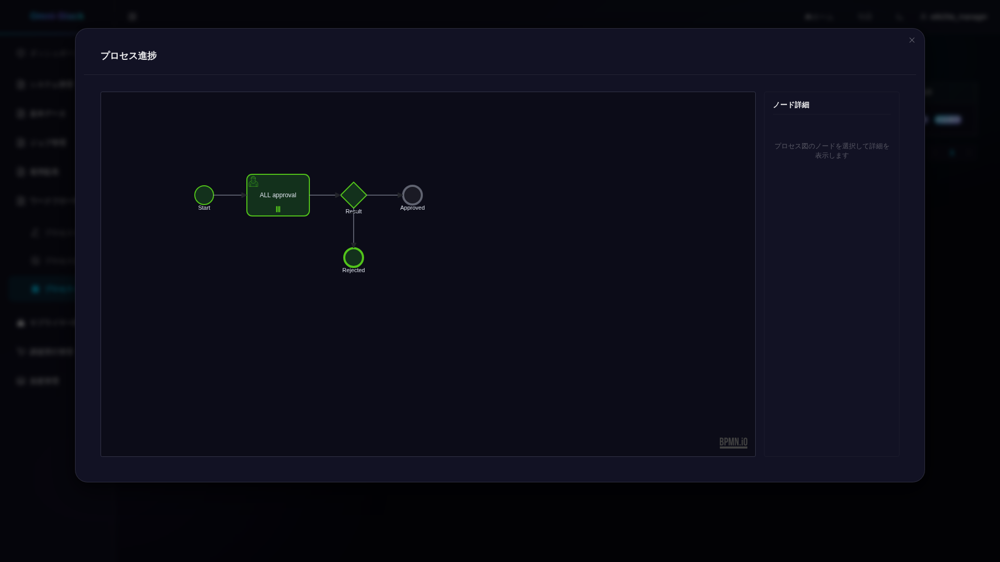

14. 履歴には実際の却下一票と、`MI_END` でスキップされた二件が残ります。現在の画面はスキップを自動承認と表示します。これは表示上の制約であり、二票の実賛成として数えてはいけません。

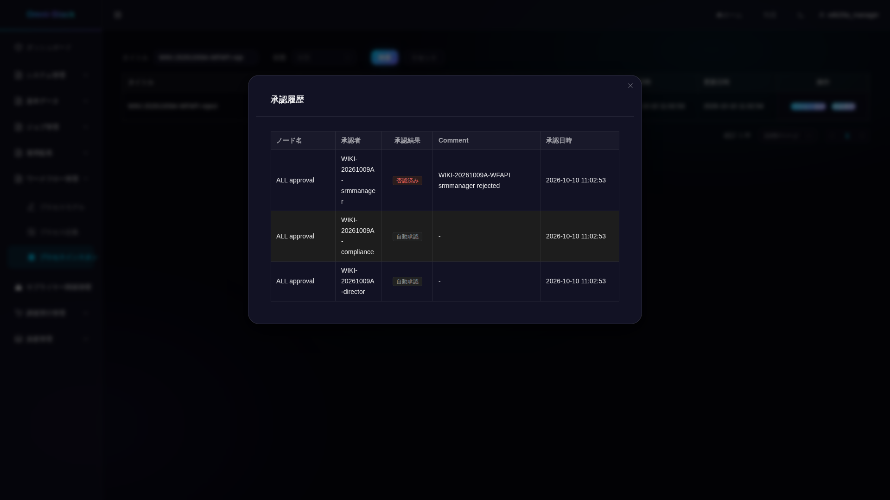

15. 別の実行中インスタンスを作り、元の起案者が `PUT /api/workflow/process-instance/{id}/terminate?reason=...` で取り下げます。状態 `0`、未処理タスクなし、取消履歴を確認します。他の一般ユーザーによる取り下げは 403 です。

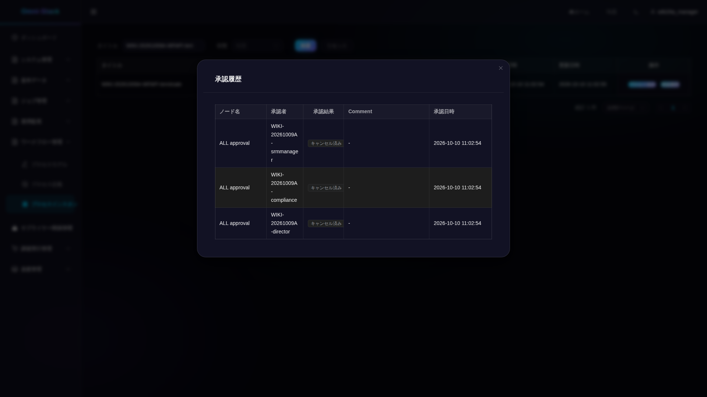

## 6. 委譲と承認者追加・削除の現在の入口

個人ワークスペースのフォームには承認、却下、コメントがあります。委譲、承認者追加・削除には実 API とフロントエンドのリクエスト関数がありますが、このフォームに対応する操作はありません。以下は API で再現し、画像は操作後の履歴だけを証明します。対応ボタンが存在すると解釈しないでください。

追加承認者は同じテナントの既存有効ユーザーで、必要な承認権限を持つことを先に確認します。現在の対象 ID 検査は数値形式だけで、API 成功は資格検証ではありません。本教材では必要な `approved` と `comment` のみ送信します。拡張 `variables` はエンジンへ渡るため、信頼できる業務コードで構築し、未検証入力をそのまま転送しません。

| 操作 | 現在のタスク担当者が呼ぶ API | 追加で必要な権限 |
|---|---|---|
| 委譲 | `POST /api/workflow/approval/{taskId}/delegate?targetUserId=...` | `workflow:approval:delegate` |
| 承認者追加 | `POST /api/workflow/approval/{taskId}/add-signer?newUserId=...` | `workflow:approval:add-signer` |
| 承認者削除 | `POST /api/workflow/approval/{taskId}/remove-signer?targetUserId=...` | `workflow:approval:remove-signer` |

16. 自分のタスクを追加の承認者へ委譲します。現在は `setAssignee` で担当者を変更します。元の担当者の承認は 403 となり、新しい担当者が完了できます。Flowable の delegate/resolve の往復ライフサイクルではありません。

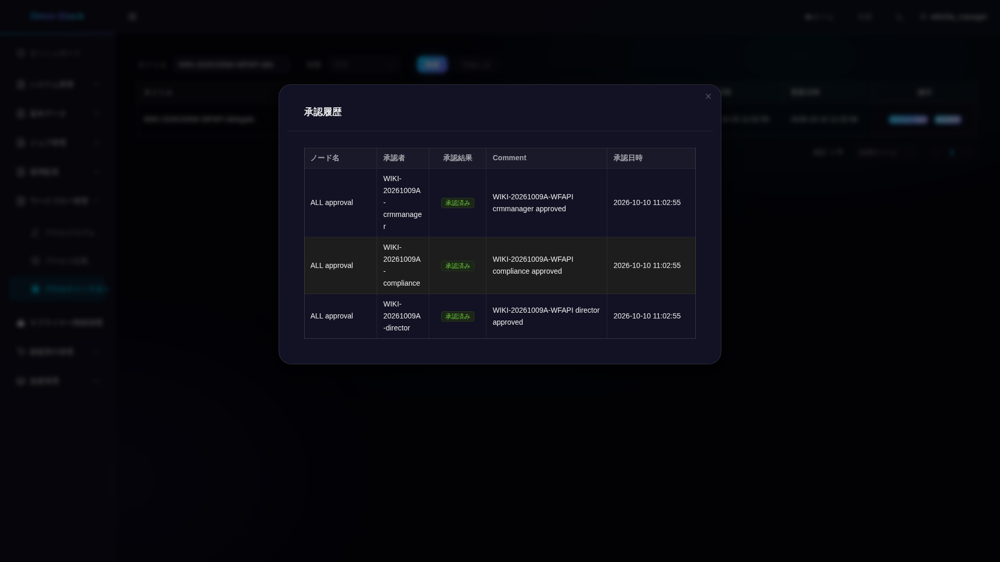

17. 別の ALL インスタンスで四人目を追加します。元の三名が承認しても実行中のままで、四人目の承認で終了します。四件の実賛成を確認します。

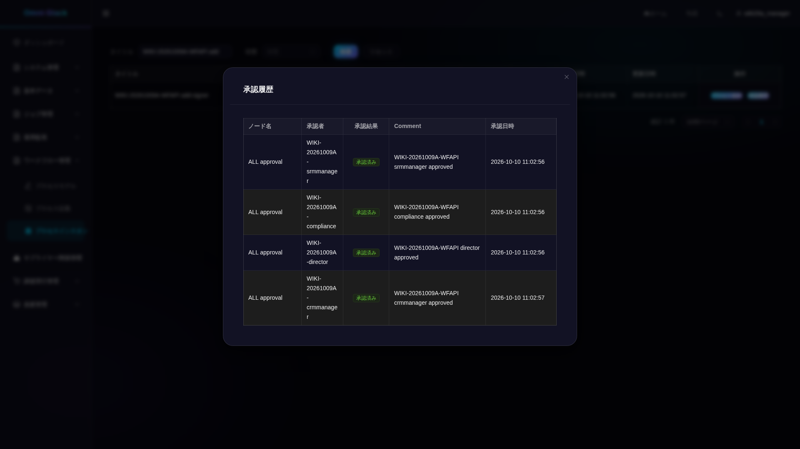

18. さらに別のインスタンスで四人目を追加してから削除します。その人の未処理タスクが消え、しきい値が再計算され、元の三名の承認で終了します。実行テーブルの行削除で承認者削除を模擬しないでください。

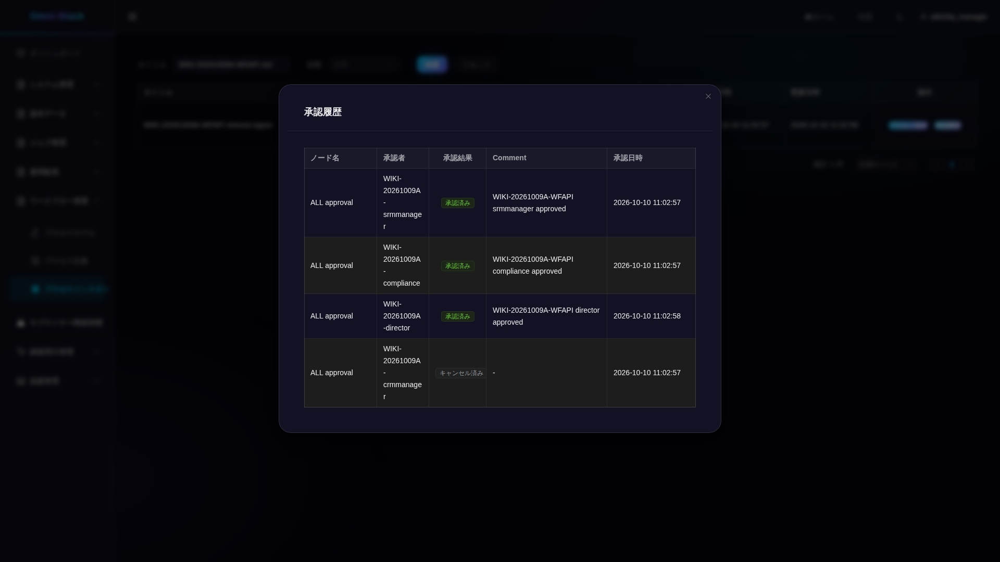

## 7. XML 検証失敗、公開拒否、権限不足を再現する

前述の ALL/ANY 履歴を変更せず、別の新規モデルで練習します。画像の `WIKI-20261009A` は隔離教材データで、正式シードではありません。正式な `POST /api/workflow/model` で `Tutorial-Invalid-20261010` など自分のキーを作り、開始 → 終了の完全な BPMN を保存します。キーは英字で始め、英数字とハイフンのみを使います。

19. 設計者として `GET /api/workflow/model/{id}` から `currentDraftVersionId` を取得し、`GET /api/workflow/model/version/{versionId}` で元の `designerJson` と完全な `bpmnXml` をリポジトリ外の非公開ファイルへ保存します。未公開の `DRAFT` であることを確認します。
20. XML の `<process id="...">` だけを `DifferentProcessKey` に変更し、モデルの `modelKey` は変えません。`PUT /api/workflow/model/{id}/draft` に元の `designerJson` 文字列と変更後の完全な `bpmnXml` を送ります。この API 操作で原因の明確なエラーを作り、設計器に XML 編集ボタンがあるとは仮定しません。
21. モデル一覧でキーを検索し、その行の「検証」を押します。失敗と二つのキーの不一致が表示されます。一覧の操作は保存済み XML を読みます。設計器内の検証は先にキャンバスを保存する場合があり、確認対象の入力が変わります。

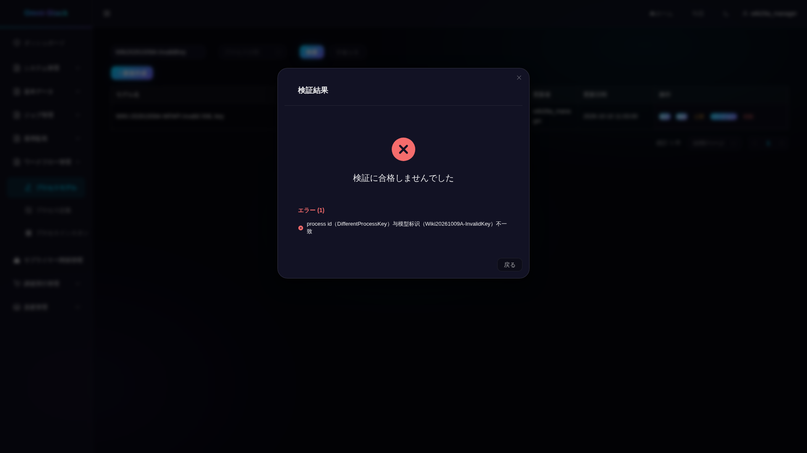

22. ダイアログを閉じ、同じ行から公開して確認します。2026-10-10 の記録は HTTP `200`、業務コード `500` で、公開は拒否されました。画面は一般的なエラーと障害照会コードを表示し、二件重複する場合があります。この文言だけでサービス停止と判断せず、一覧の検証で原因を確認します。

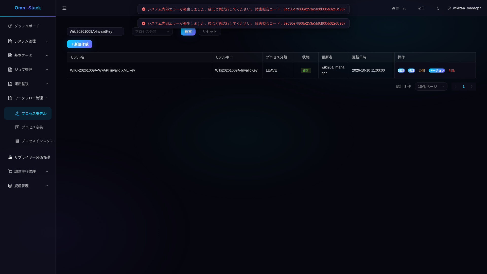

モデル、下書き版、`GET /api/workflow/model/{id}/versions` を再取得します。一件の `DRAFT` と XML 摘要は変わらず、`currentPublishedVersionId`、`deploymentId`、`processDefinitionId` は null です。失敗分岐の `FAILED` 更新は例外とともにロールバックされ、永続化された終了状態ではありません。一覧の「正常」は版の公開成功を意味しません。

23. `PUT /api/workflow/model/{id}/draft` で保存済みの完全な XML と `designerJson` を戻し、`POST /api/workflow/model/{id}/validate` で `valid=true` を確認します。2026-10-10 に別の教材モデルで、有効 → キー不一致 → 公開拒否 → 有効への復元を実検証し、未公開の下書き一件を保持しました。失敗画像の対象モデルは変更していません。今回はこの書き込みを繰り返していません。
24. `workflow:model:list` を持たない一般社員でログインし、`/admin/workflow/model` を開きます。ログイン名を残したまま 403 が表示され、そのユーザーによるモデル一覧 API の直接要求も HTTP・業務とも `403` になります。全ロールの合算権限を調べ、変更後は再ログインします。前述の起案者はモデル一覧権限を持つため、ここでの権限不足ユーザーには使えません。

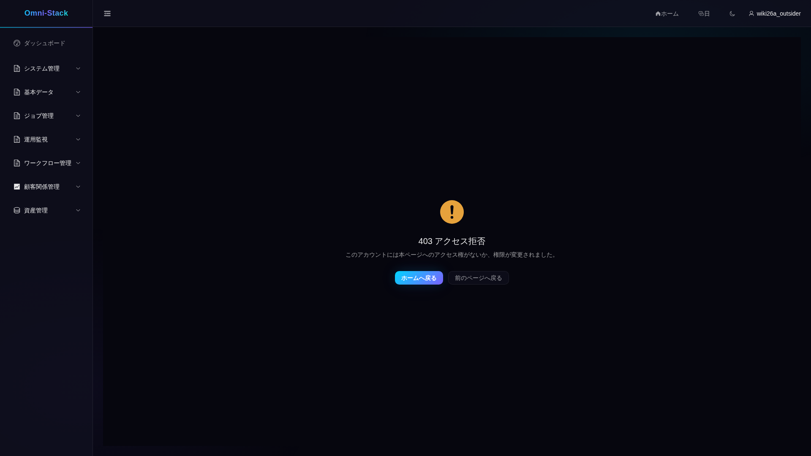

自動収集の入口は[実際の失敗画面テスト](../../omni-frontend/e2e-docs/flows/workflow-negative-teaching.flows.spec.ts)です。過去の検証ダイアログのサーバー詳細は中国語で、四言語原画像はそのまま保持します。これは記録済みの画面制限で、文書翻訳を言語フォールバックで代替するものではありません。

## 8. 失敗、ブレークポイント、復旧

| 現象・検証 | 期待する結果 | 次の操作 |
|---|---|---|
| 承認権限なし | 403 | 最小権限を付与して再ログイン。スーパー管理者で代行しない |
| 権限はあるが担当者ではない | フォーム取得・送信とも 403 | 実際の taskId と assignee を確認 |
| 他人の `simulateUserId` | 403、インスタンスなし | 認証済み本人を使う |
| 候補なし、fallback が ERROR | 現在の業務コードは 500、トランザクションはロールバック | 起案者・組織・ロール・スコープと副作用を確認してから再試行 |
| 承認送信時にタスクが処理済み・不存在・テナント外 | 業務コード409 | タスクを更新し履歴を確認。無条件に再送しない |
| 別テナントの進捗・承認履歴を読む | 不存在と同じ業務コード404 | 自分のテナントのセッションを使用し、他テナントのインスタンスを推測しない |
| モデルキーと process id の不一致 | 検証失敗、公開不可 | 下書きを修正。過去のデプロイは変更しない |
| 保存・開始・承認の応答断 | 結果不明 | 版、業務キー、タスク、履歴からコミット済みか確認 |

隔離 Docker 環境で次のブレークポイントを使います。トークン、認証ヘッダー、秘密情報を画像へ含めないでください。

| 単位 | ブレークポイント・変数 | 調べる問題 |
|---|---|---|
| [ModelDesigner.handleSave](../../omni-frontend/src/components/workflow/ModelDesigner.vue) | `saveXML`、`modelKey`、`bpmnXml` | 空キャンバス、キー不一致、下書き内容 |
| [writeAssignment](../../omni-frontend/src/composables/useBpmnExtension.ts) | assignment、小文字の executionListener、collection、assignee | プレビューに候補がいても実タスクがない |
| [ProcessInstanceServiceImpl.start](../../omni-backend/omni-workflow/src/main/java/com/omni/workflow/service/impl/ProcessInstanceServiceImpl.java) | エンジン呼出前の `safeVariables.initiator` と認証ユーザー | 起案者の親組織を解決できない |
| [ScopedRoleAssignmentListener.notify](../../omni-backend/omni-workflow/src/main/java/com/omni/workflow/listener/ScopedRoleAssignmentListener.java) | ExecutionListener start、candidateUserIds、カウンター | 割り当てと承認しきい値 |
| [WorkflowModelServiceImpl.publishModel](../../omni-backend/omni-workflow/src/main/java/com/omni/workflow/service/impl/WorkflowModelServiceImpl.java) | 行ロック、検証、二つのバージョン番号 | 同時公開と旧インスタンスの分離 |
| [ApprovalServiceImpl](../../omni-backend/omni-common-workflow/src/main/java/com/omni/common/workflow/approval/ApprovalServiceImpl.java) | MI ルート、approvedCount、requiredApprovals、deleteReason | ALL/ANY、却下、承認者変更 |

設計器の ExecutionListener は多重インスタンス集合の評価前に候補を割り当てます。旧 `ScopedRoleAssignmentListener.notify(DelegateTask)` は互換用の空実装です。業務用初期モデルは `${candidateResolver.resolve(execution)}` の集合式も使えます。この二つのモデル経路を混同しないでください。保存はブラウザーが出力した XML を直接永続化し、`BpmnXmlBuilder` は現在の保存経路に含まれません。

回帰入口：[XML 往復](../../omni-frontend/tests/workflow/bpmn-assignment.test.ts)、[開始時の認証境界](../../omni-backend/omni-workflow/src/test/java/com/omni/workflow/service/impl/ProcessInstanceStartIdentityTest.java)、[実設計・承認](../../omni-frontend/e2e-docs/flows/workflow-teaching-ui.flows.spec.ts)、[履歴の読み取り専用撮影](../../omni-frontend/e2e-docs/flows/workflow-teaching.flows.spec.ts)。ローカル Docker で実行します。撮影テストにはリポジトリ外の実行記録、短期の一般ユーザー認証、隔離プロジェクトの許可が必要で、入力不足を成功として扱えません。

出典と画像ごとの項目は[2026-10-10 の証拠登録](../reference/evidence/workflow-2026-10-10.json)を参照してください。先行する API 補足9グループは ABSOLUTE_UNIT を使い、一般ユーザーの PARENT 起動を証明しません。後続 UI007/008 は中国語のコミット済み結果を照合し、他三言語の新規手順を実行しました。先行失敗、下書き修復、各画像の実行版を保持し、後のソース集約ハッシュを初期5画像へ流用しません。

今回の[文書・原画像確認](../reference/evidence/workflow-guide-review-2026-10-17.json)は全84枚の画像のパス、言語、ハッシュ、取得時の実行版を照合し、うち20枚の原画像を個別に確認します。他64枚の画像は元の視覚確認を保持します。元の正常系・履歴の72枚の画像は原解像度の四言語コンタクトシート18枚、元の異常系の12枚の画像は個別に確認されたものです。今回は全画像の再撮影・個別再確認をしていません。

分類辞書は中国語、版状態は英語のプロトコル値の場合があります。日韓のタスク、承認フォーム、履歴表には `Approve`、`Reject`、`Comment` が残る場合があります。人物名や長いノード名は折り返され、図の色はタスク・履歴 API の実投票数を代替しません。終了履歴を保持し、再実行では新しい業務キーを使います。DB 初期化や公開版変更は行いません。[ワークフロー制約](../workflow.jp.md)と[ソースデバッグ](../wiki/source-debugging.jp.md)も参照してください。

四言語文書は[許可済み AI レビュー方針](../adr/0003-authorized-ai-translation-review.md)に従い、実際の `AI_REVIEW` で受け入れます。人のレビューは必須ではなく、`HUMAN_REVIEW` と偽って表示しません。現在の有効ハッシュと状態は[レビュー一覧](../i18n-review-queue.md)に記録します。
