# 모델 생성부터 일반 사용자 승인까지

독립 `omni-workflow`를 포함하는 `workflow`, `supply-chain`, `full` 프리셋과 소스에 선언된 Flowable 8.0.0을 대상으로 합니다. [최초 실행](quick-start.kr.md)과 [교육 데이터 준비](../wiki/data-and-fixtures.kr.md)를 먼저 완료하세요. 업무 이름, 조직 ID, 날짜는 격리 교육 기록을 식별하며 재현 시 자신의 새 식별자를 사용합니다.

절차는 현재 소스와 대조했으며 이미지와 업무 결과는 2026-10-10 로컬 Docker 실습에서 나왔습니다. 이번에는 문서, 출처, 원본만 확인했으며 모델 생성/게시, 프로세스 시작/승인/철회, 승인자 변경을 수행하지 않았습니다. 성공한 쓰기를 반복하지 않고 응답이 불명확하면 부수 효과를 먼저 확인합니다.

## 1. 사용자와 조직 준비

하위 조직, 일반 기안자, 모델 설계자, 상위 조직에 속한 승인자 세 명을 준비합니다. 미리보기와 실행 결과를 비교할 수 있도록 설계자와 기안자를 같은 하위 조직에 배치합니다. 승인자는 업무 역할을 유지하며 필요한 최소 워크플로우 권한을 추가로 받습니다.

| 사용자 | 이 안내서의 작업 | 확인할 권한 |
|---|---|---|
| 모델 설계자 | 생성, 편집, 검증, 게시, 버전 조회 | `workflow:model:list/create/update/validate/publish`, `workflow:identity:list` |
| 일반 기안자 | 시작, 본인 인스턴스 조회, 철회 | `workflow:instance:start/terminate`, 모델 목록 및 개인 작업 공간 접근 |
| 일반 승인자 세 명 | 본인 할 일 조회 및 승인 | `workflow:task:todo`, `workflow:approval:complete` |
| 추가 승인자 | 위임 또는 추가된 작업 처리 | 해당 승인 권한. 최초 후보 세 명에는 포함하지 않음 |
| 진행 확인자 | 관리 목록, 진행, 이력 조회 | `workflow:instance:list` |

슬래시는 `workflow:model:create`, `workflow:model:update`처럼 여러 완전한 권한 코드를 줄여 쓴 것입니다. 하나의 권한 코드로 입력하지 마세요. 역할 관리 메뉴 트리에서 필요한 상위 메뉴 권한도 부여합니다.

역할, 주 소속 조직, `sys_user_role_scope`는 별도 설정입니다. 역할 관리만으로 Workflow 조직 범위가 만들어지지 않습니다. 독립 볼륨과 네트워크를 쓰고 MySQL 호스트 포트를 열지 않은, 명시적으로 이름을 붙인 교육 프로젝트에서 [픽스처 안내](../../scripts/fixtures/README.md)에 따라 `run-workflow-scope-fixture.ps1`을 실행합니다. 기존 교육 역할을 주 소속 조직의 `SAME_UNIT` 범위에 연결합니다. 이 진입점은 표준 `omni-stack`을 거부하고, 계정 생성이나 역할 부여를 하지 않으며 충돌하는 연결을 덮어쓰지 않습니다. 작업 및 프로세스 상태 테이블을 직접 변경하지 마세요.

역할 변경 후 다시 로그인합니다. 미리보기는 보통 현재 설계자를 기안자로 가정하므로 다른 기안자도 같은 후보를 얻는다고 단정할 수 없습니다. 실제 기안자로 시작해 할 일을 확인합니다. 이 예에서는 후보 세 명을 기대하며 슈퍼 관리자의 대리 승인을 사용하지 않습니다.

## 2. 첫 ALL 모델 생성

1. 설계자로 워크플로우 관리 → 프로세스 모델에서 새 모델을 만들고 고유 키, 이름, 분류를 입력합니다. 키는 영문자로 시작하고 영문자, 숫자, 하이픈만 사용합니다. 입력 내용을 확인한 다음 생성을 확정합니다.

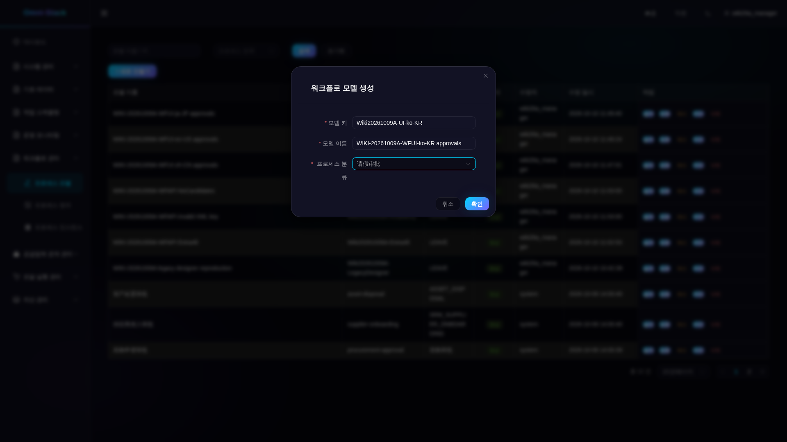

2. 해당 행에서 설계를 엽니다. 새 모델에는 시작 이벤트가 있어야 하고 BPMN `<process id>`는 모델 키와 일치해야 합니다. 빈 캔버스나 남아 있는 `Process_1`은 게시 가능한 상태가 아닙니다.

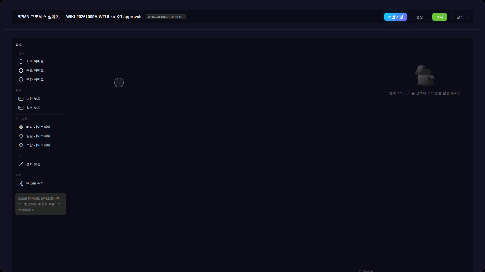

3. 시작 이벤트를 선택하고 컨텍스트 패드로 사용자 작업을 추가한 뒤 이름을 입력합니다. 오른쪽에서 승인 역할, 기안자의 상위 조직, 전원 승인을 선택하고 후보를 미리 봅니다. 세 명의 사용자와 조직을 확인한 뒤 미리보기를 닫고 종료 이벤트를 추가합니다. 추가 직후 노드는 이미 선택되어 있으며 같은 노드를 다시 클릭하면 선택이 해제됩니다.

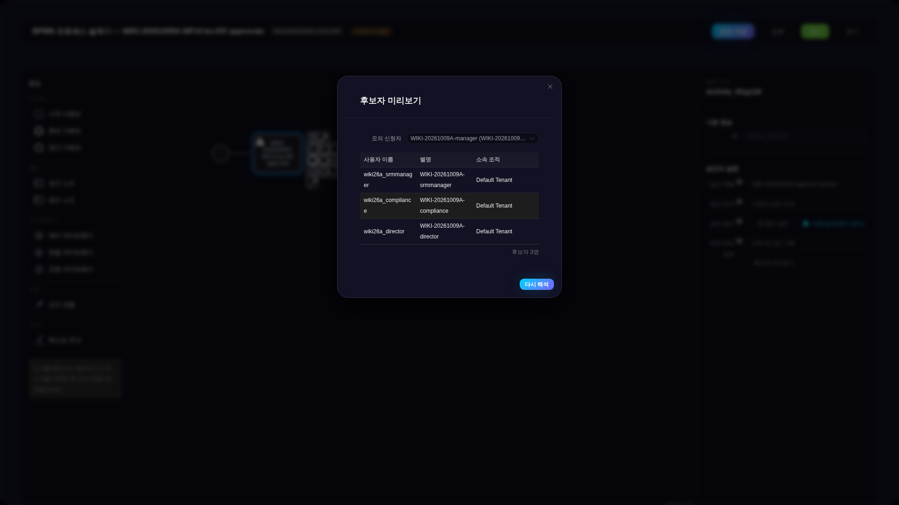

4. 초안을 저장하고 검증합니다. 서버에서 검증 성공이 반환되어야 합니다. 이 검증은 키, 구조, 설정을 검사하며 시작 후의 실제 후보 배정을 대신하지 않습니다.

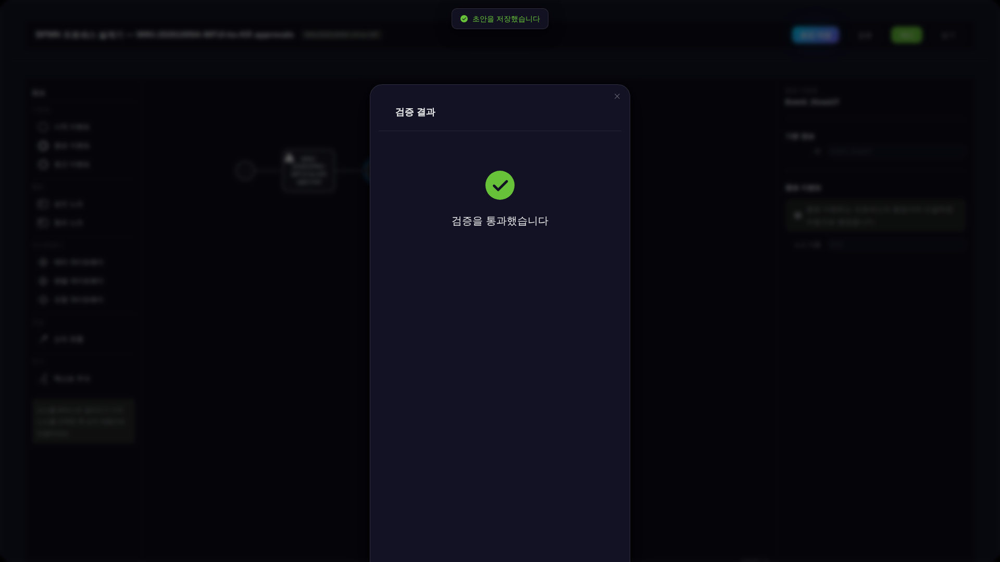

5. 검증 창을 닫고 게시를 확인합니다. 버전 목록에서 업무 버전 1, `PUBLISHED`, 엔진 버전을 확인합니다. 실제 프로세스 정의 ID는 버전 API로 확인하며 이 이미지에는 표시되지 않습니다. 업무 버전은 모델 이력이고 Flowable 엔진 버전은 배포 이력으로 서로 다른 값입니다.

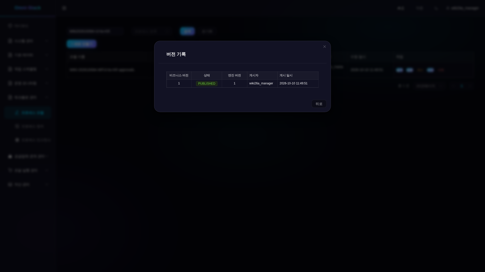

## 3. 일반 기안자로 시작하고 첫 번째 승인 처리

2026-10-10 실습은 일반 기안자의 실제 API로 시작한 뒤 작업 공간에서 승인했습니다. 화면에서 시작 버튼을 누른 증거는 아닙니다. 구매 요청과 자산 이전 등 업무 모듈은 자체 진입점과 상태 검증을 갖고 내부 Workflow 계약으로 시작합니다.

일반 시작은 Gateway를 통해 `POST /api/workflow/process-instance/start`를 호출합니다. 예제 버전 ID는 실제 게시된 ID로 바꾸고 업무 키와 제목은 새 값을 사용합니다. 일반 사용자의 정상 인증 세션을 사용하세요. Gateway가 검증한 JWT에서 `X-User-Id`와 `X-Tenant-Id`를 만들어 전달합니다. 클라이언트가 직접 작성한 신원 헤더를 신뢰하거나 백엔드 직접 호출로 다른 사용자를 사칭하지 않습니다.

```json
{
  "modelVersionId": 7,
  "title": "Tutorial ALL approval",
  "businessKey": "tutorial-all-001"
}
```

일반 시작에는 서비스 간 요청 예약에 의한 멱등성 보장이 없습니다. 응답이 끊기면 내가 기안한 목록과 업무 키를 확인한 후 재시도합니다. 내부 시작의 `requestId` 예약 규칙은 [워크플로우 계약](../workflow.kr.md)을 참조하세요.

6. 실제 후보 중 첫 사용자가 홈 작업 공간에 로그인하여 내 할 일에서 인스턴스를 찾습니다. 세 명에게 각각 하나의 작업이 배정됩니다. 승인 권한이 있어도 해당 작업의 담당자가 아니면 처리할 수 없습니다.

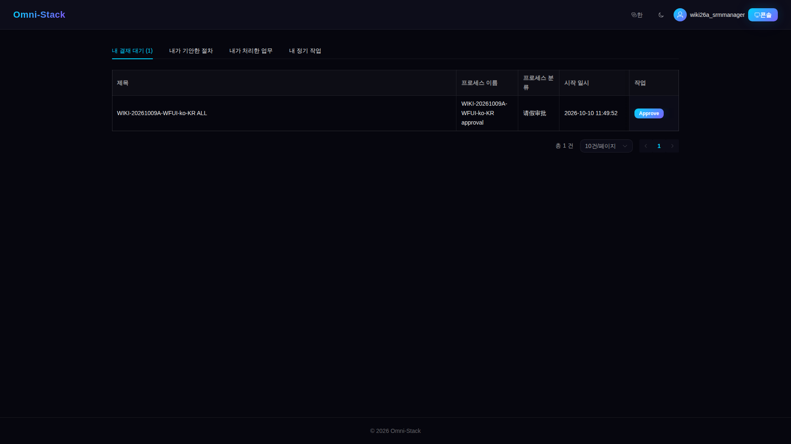

7. 승인 양식에서 제목, 노드, 의견을 확인하고 승인합니다. 사람이 CAPTCHA를 입력하는 실제 로그인과 이후의 통제된 단기 E2E 인증은 다른 단계이며, 후자를 CAPTCHA 자동 검증으로 표현하면 안 됩니다.

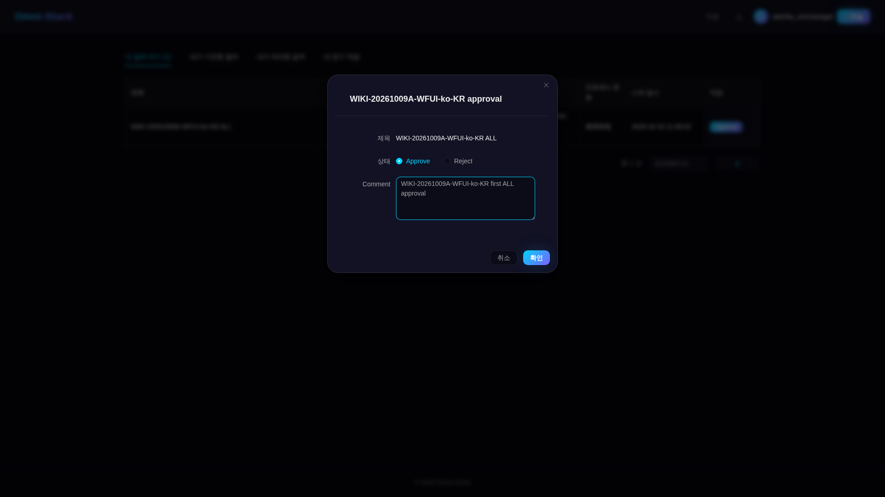

8. 진행 확인자가 인스턴스 제목을 검색하고 진행을 엽니다. 첫 승인 후에도 실행 중이며 나머지 두 작업이 남아 있습니다. ALL은 유효한 승인자 전원의 승인을 기다립니다.

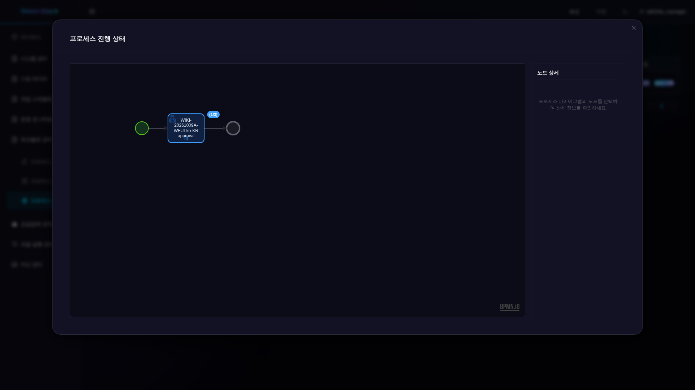

## 4. ANY 게시 후 기존 인스턴스 유지 확인

9. ALL 인스턴스를 실행 중으로 둡니다. 같은 모델을 다시 열고 사용자 작업을 선택하여 한 명 승인 방식으로 바꾼 뒤 저장합니다. 게시된 모델을 편집하면 새 초안이 생기며 기존 게시 버전을 덮어쓰지 않습니다.

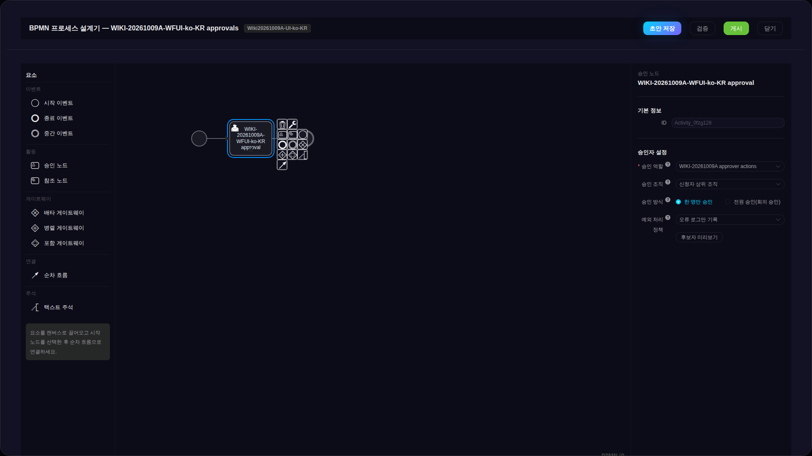

10. 검증하고 업무 버전 2를 게시합니다. 목록에는 이전 버전과 현재 `PUBLISHED` 버전이 남습니다. 기존 ALL 인스턴스의 `modelVersionId`, `processDefinitionId`, 업무 버전은 계속 버전 1을 가리킵니다.

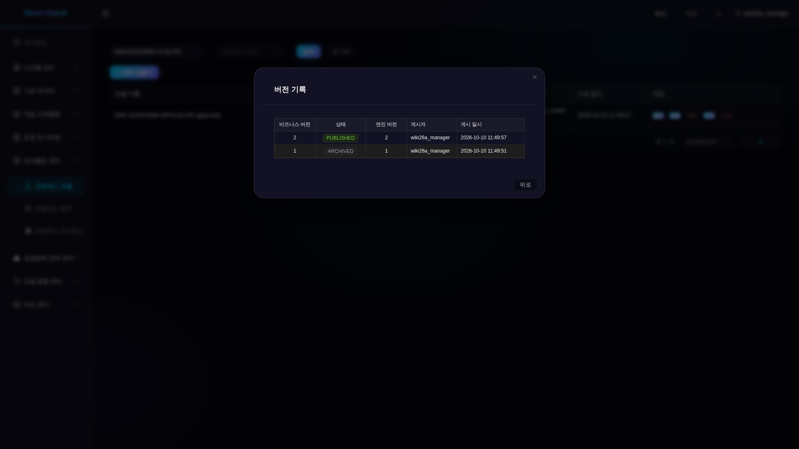

11. 버전 2와 새 업무 키로 두 번째 인스턴스를 시작합니다. 한 명이 승인하면 ANY가 끝나고 다중 인스턴스 완료 조건이 나머지 두 작업을 건너뛰어 할 일이 사라집니다.

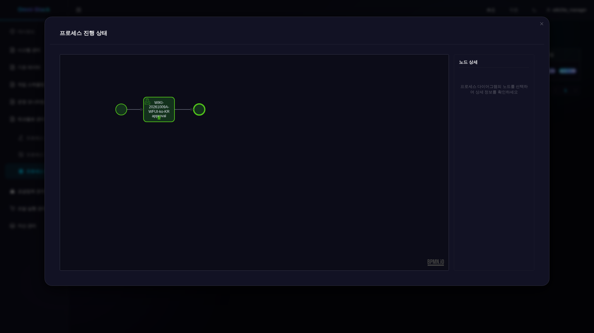

12. 버전 1 ALL로 돌아가 나머지 두 사람이 각각 승인합니다. 실제 승인 기록 세 건을 확인합니다. 새 버전은 기존 인스턴스를 ANY로 바꾸지 않았고 남은 사람의 표를 대신하지도 않았습니다.

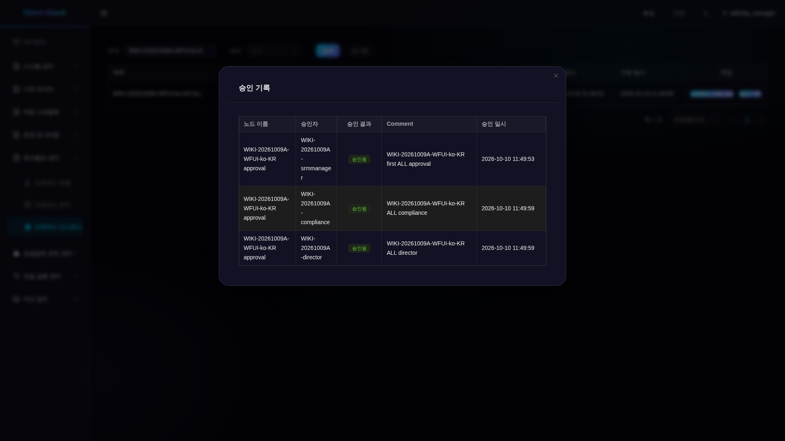

## 5. 거절과 철회는 따로 검증

거절용 별도 ALL 모델에서는 작업 다음에 배타적 게이트웨이를 둡니다. 승인 경로 조건은 `${approved == true}`, 거절 경로는 기본 흐름으로 지정하고 각각 종료 이벤트에 연결합니다. 다음 사례는 실제 API로 설정, 게시, 실행한 뒤 결과를 읽기 전용으로 촬영한 것입니다.

13. 후보 한 명이 거절하면 거절 종료 이벤트에 도달하고 나머지 할 일이 사라집니다. 관리 목록의 일반 상태 `2`는 완료를 뜻하며 업무 승인이 통과했다는 뜻은 아닙니다.

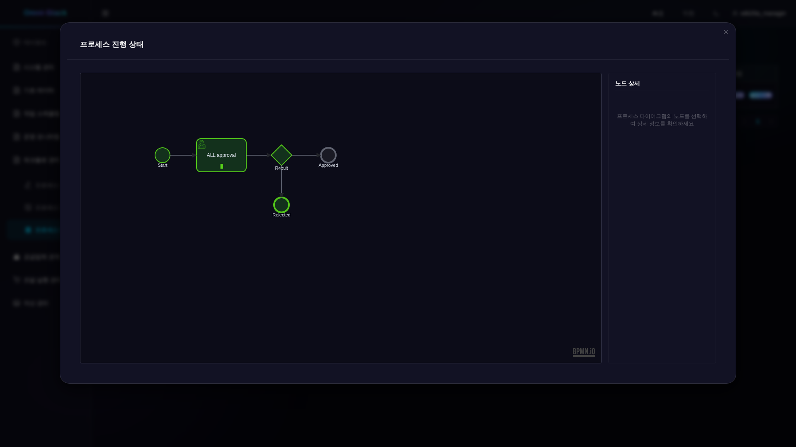

14. 이력에는 실제 거절 한 건과 `MI_END`로 건너뛴 두 건이 남습니다. 현재 화면은 건너뛴 작업을 자동 승인으로 표시합니다. 이 표시상 한계를 실제 찬성 두 표로 해석하면 안 됩니다.

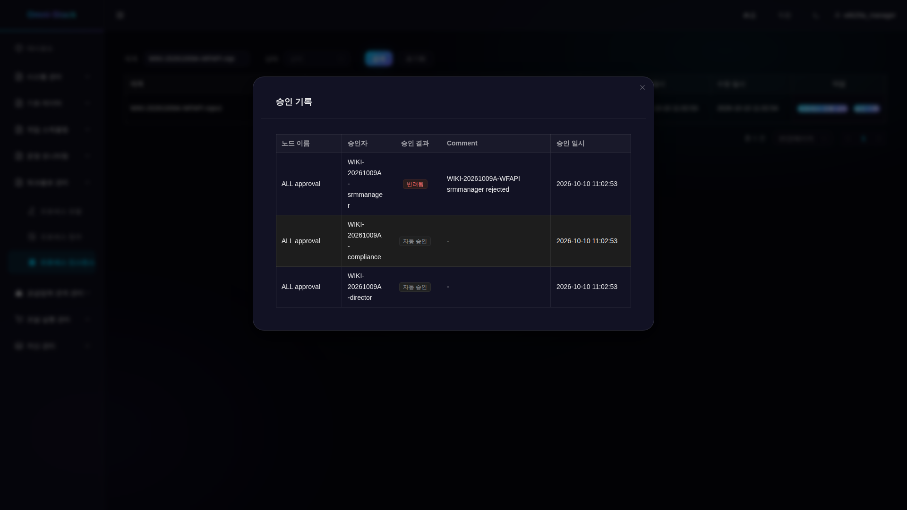

15. 별도의 실행 중 인스턴스를 만들고 원 기안자가 `PUT /api/workflow/process-instance/{id}/terminate?reason=...`로 철회합니다. 상태 `0`, 남은 할 일 없음, 취소 이력을 확인합니다. 다른 일반 사용자의 철회 시도는 403입니다.

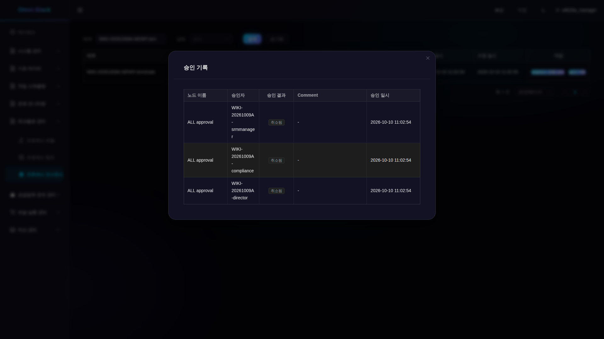

## 6. 위임과 승인자 추가·제거의 현재 진입점

개인 작업 공간 양식에는 승인, 거절, 의견이 있습니다. 위임과 승인자 추가·제거에는 실제 API와 프런트엔드 요청 함수가 있지만 이 양식에 해당 조작은 없습니다. 다음은 API로 재현하며 이미지는 처리 후 이력을 증명합니다. 대응 버튼이 있다고 해석하지 마세요.

추가 승인자는 같은 테넌트의 기존 활성 사용자이며 필요한 승인 권한이 있는지 먼저 확인합니다. 현재 대상 ID 검사는 숫자 형식만 확인하므로 API 성공은 자격 검증이 아닙니다. 이 실습에서는 필요한 `approved`와 `comment`만 제출합니다. 확장 `variables`는 엔진에 전달되므로 신뢰할 수 있는 업무 코드에서 구성하고 검증되지 않은 입력을 그대로 넘기지 않습니다.

| 작업 | 현재 작업 담당자가 호출하는 API | 추가 권한 |
|---|---|---|
| 위임 | `POST /api/workflow/approval/{taskId}/delegate?targetUserId=...` | `workflow:approval:delegate` |
| 승인자 추가 | `POST /api/workflow/approval/{taskId}/add-signer?newUserId=...` | `workflow:approval:add-signer` |
| 승인자 제거 | `POST /api/workflow/approval/{taskId}/remove-signer?targetUserId=...` | `workflow:approval:remove-signer` |

16. 자신의 작업을 추가 승인자에게 위임합니다. 현재 구현은 `setAssignee`로 담당자를 변경합니다. 원 담당자가 승인하면 403이고 새 담당자는 완료할 수 있습니다. Flowable delegate/resolve 왕복 생명주기는 구현하지 않습니다.

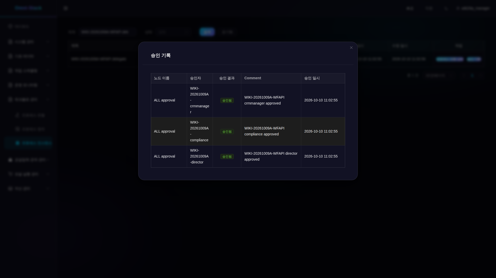

17. 별도 ALL 인스턴스에 네 번째 사람을 추가합니다. 기존 세 명이 승인해도 실행 중이며 네 번째 승인으로 끝납니다. 실제 찬성 네 건을 확인합니다.

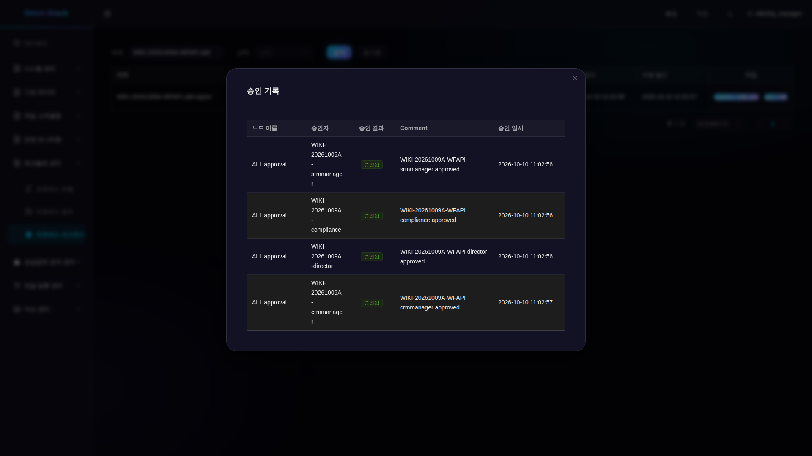

18. 또 다른 인스턴스에서는 네 번째 사람을 추가한 후 제거합니다. 그 사람의 할 일이 사라지고 임계값이 다시 계산되며 기존 세 명의 승인으로 끝납니다. 실행 테이블의 행을 삭제해 승인자 제거를 흉내 내지 마세요.

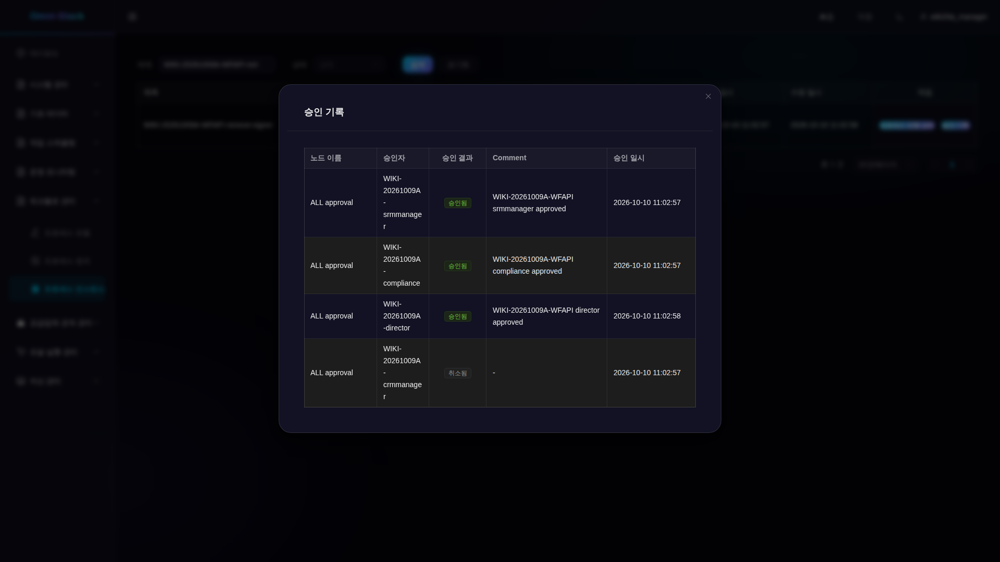

## 7. XML 검증 실패, 게시 거부, 권한 부족 재현

앞의 ALL/ANY 이력을 변경하지 않고 별도 새 모델로 연습합니다. 이미지의 `WIKI-20261009A`는 격리 교육 데이터이며 정식 시드가 아닙니다. 정식 `POST /api/workflow/model`로 `Tutorial-Invalid-20261010` 같은 새 키를 만들고 시작 → 종료의 완전한 BPMN을 저장하세요. 키는 영문자로 시작하며 영문자, 숫자, 하이픈만 사용합니다.

19. 설계자 계정으로 `GET /api/workflow/model/{id}`에서 `currentDraftVersionId`를 얻고, `GET /api/workflow/model/version/{versionId}`로 원래 `designerJson`과 완전한 `bpmnXml`을 저장소 외부의 비공개 파일에 보관합니다. 게시되지 않은 `DRAFT`인지 확인하세요.
20. XML의 `<process id="...">`만 `DifferentProcessKey`로 바꾸고 모델의 `modelKey`는 유지합니다. `PUT /api/workflow/model/{id}/draft`에 원래 `designerJson` 문자열과 수정한 완전한 `bpmnXml`을 보냅니다. 이 API 작업으로 원인이 명확한 오류를 만들며 설계기에 XML 편집 버튼이 있다고 가정하지 않습니다.
21. 모델 목록에서 키를 검색하고 해당 행의 검증을 누릅니다. 검증 실패와 두 키의 불일치가 표시되어야 합니다. 목록 작업은 저장된 XML을 읽습니다. 설계기 내부 검증은 먼저 캔버스를 저장할 수 있으므로 확인하려던 입력이 바뀔 수 있습니다.

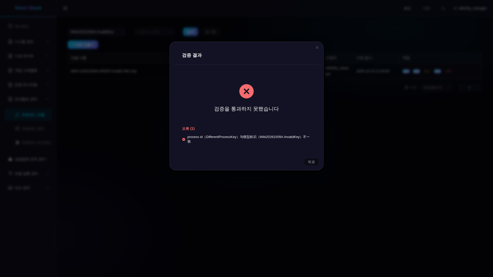

22. 대화상자를 닫고 같은 행에서 게시한 뒤 확인합니다. 2026-10-10 기록의 응답은 HTTP `200`, 업무 코드 `500`이며 게시가 거부되었습니다. 화면은 일반 오류와 장애 조회 코드를 표시하고 두 번 나타날 수 있습니다. 이 문구만 보고 서비스 중단으로 판단하지 말고 목록 검증에서 원인을 확인하세요.

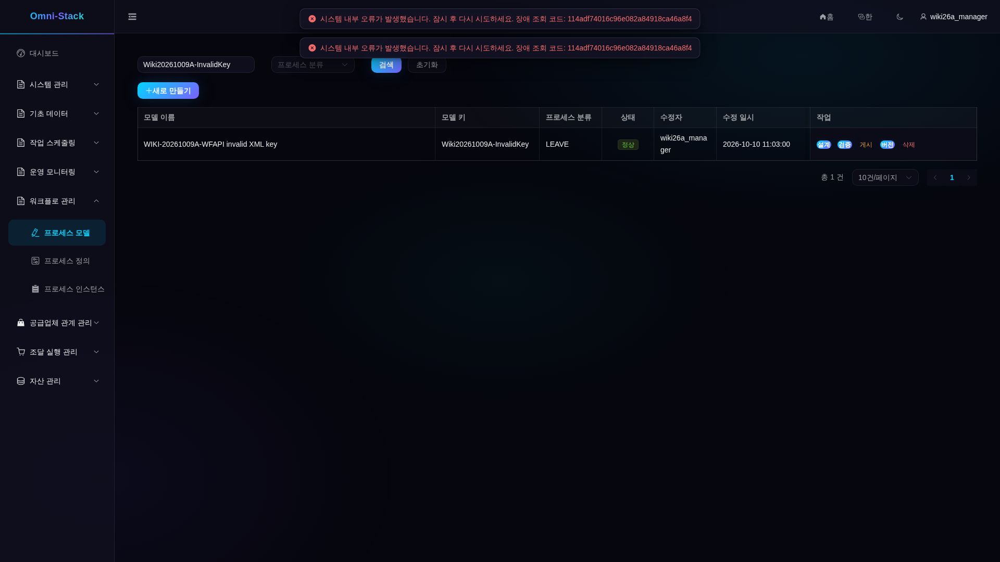

모델, 초안 버전, `GET /api/workflow/model/{id}/versions`를 다시 조회합니다. 한 개의 `DRAFT`와 XML 해시는 유지되며 `currentPublishedVersionId`, `deploymentId`, `processDefinitionId`는 null입니다. 실패 분기의 `FAILED` 갱신은 예외와 함께 롤백되므로 영속화된 종료 상태가 아닙니다. 목록의 정상 표시는 버전 게시 성공을 뜻하지 않습니다.

23. `PUT /api/workflow/model/{id}/draft`로 보관한 완전한 XML과 `designerJson`을 복원한 뒤 `POST /api/workflow/model/{id}/validate`에서 `valid=true`를 확인하세요. 2026-10-10 별도 교육 모델에서 유효 → 키 불일치 → 게시 거부 → 유효한 상태로 복원을 실제 검증했고 미게시 초안 한 개를 유지했습니다. 실패 이미지의 대상 모델은 변경하지 않았으며 이번에는 이 쓰기를 반복하지 않았습니다.
24. `workflow:model:list`가 없는 일반 직원으로 로그인해 `/admin/workflow/model`을 엽니다. 로그인 사용자 이름을 유지하면서 403이 표시되며, 같은 신원으로 모델 목록 API를 직접 호출해도 HTTP/업무 `403`입니다. 모든 역할에서 합쳐진 권한을 확인하고 변경 후 재로그인하세요. 앞의 기안자에게는 모델 목록 권한이 있으므로 이 권한 부족 사례의 신원으로 사용할 수 없습니다.

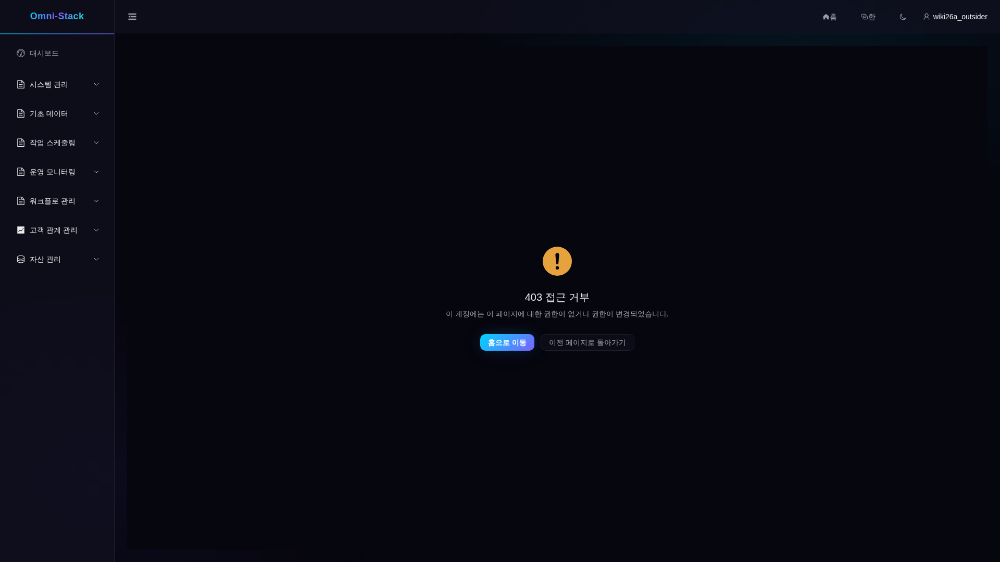

자동 수집 진입점은 [실제 실패 화면 테스트](../../omni-frontend/e2e-docs/flows/workflow-negative-teaching.flows.spec.ts)입니다. 과거 검증 대화상자의 서버 상세는 중국어이며 네 언어 원본을 그대로 보존합니다. 이는 기록된 UI 한계이며 문서 번역을 언어 폴백으로 대체하는 것이 아닙니다.

## 8. 실패, 중단점, 복구

| 현상 또는 검증 | 예상 결과 | 다음 조치 |
|---|---|---|
| 승인 권한 없음 | 403 | 최소 권한 부여 후 재로그인. 슈퍼 관리자 대리 처리 금지 |
| 권한은 있지만 작업 담당자가 아님 | 양식과 제출 모두 403 | 실제 taskId와 assignee 확인 |
| 다른 사람의 `simulateUserId` | 403, 인스턴스 없음 | 인증된 본인 사용 |
| 후보 없음, ERROR fallback | 현재 업무 코드 500, 트랜잭션 롤백 | 기안자·조직·역할·범위와 부수 효과 확인 후 재시도 |
| 승인 제출 대상 작업이 이미 처리됨/없음/테넌트에서 보이지 않음 | 업무 코드409 | 할 일 새로 고침과 이력 확인 후 판단. 무조건 재제출하지 않음 |
| 다른 테넌트의 진행/승인 이력 읽기 | 없음과 같은 업무 코드404 | 본인 테넌트 세션을 사용하고 다른 테넌트 인스턴스를 추측하지 않음 |
| 모델 키와 process id 불일치 | 검증 실패, 게시 차단 | 초안 수정. 과거 배포 변경 금지 |
| 저장·시작·승인 응답 끊김 | 결과 불명 | 버전·업무 키·할 일·이력에서 커밋 여부 확인 |

격리 Docker 환경에서 다음 중단점을 사용합니다. 토큰, 인증 헤더, 비밀 정보를 이미지에 포함하지 마세요.

| 단위 | 중단점과 변수 | 확인할 문제 |
|---|---|---|
| [ModelDesigner.handleSave](../../omni-frontend/src/components/workflow/ModelDesigner.vue) | `saveXML`, `modelKey`, `bpmnXml` | 빈 캔버스, 키 불일치, 초안 내용 |
| [writeAssignment](../../omni-frontend/src/composables/useBpmnExtension.ts) | assignment, 소문자 executionListener, collection, assignee | 미리보기 후보는 있지만 실제 작업 없음 |
| [ProcessInstanceServiceImpl.start](../../omni-backend/omni-workflow/src/main/java/com/omni/workflow/service/impl/ProcessInstanceServiceImpl.java) | 엔진 호출 전 `safeVariables.initiator`와 인증 사용자 | 기안자의 상위 조직 해석 실패 |
| [ScopedRoleAssignmentListener.notify](../../omni-backend/omni-workflow/src/main/java/com/omni/workflow/listener/ScopedRoleAssignmentListener.java) | ExecutionListener start, candidateUserIds, 카운터 | 배정 및 승인 임계값 |
| [WorkflowModelServiceImpl.publishModel](../../omni-backend/omni-workflow/src/main/java/com/omni/workflow/service/impl/WorkflowModelServiceImpl.java) | 행 잠금, 검증, 두 버전 번호 | 동시 게시와 기존 인스턴스 격리 |
| [ApprovalServiceImpl](../../omni-backend/omni-common-workflow/src/main/java/com/omni/common/workflow/approval/ApprovalServiceImpl.java) | MI 루트, approvedCount, requiredApprovals, deleteReason | ALL/ANY, 거절, 승인자 변경 |

설계기의 ExecutionListener는 다중 인스턴스 컬렉션 평가 전에 후보를 배정합니다. 기존 `ScopedRoleAssignmentListener.notify(DelegateTask)`는 호환용 빈 구현입니다. 초기 업무 모델은 `${candidateResolver.resolve(execution)}` 컬렉션 표현식도 사용할 수 있으므로 두 모델 경로를 혼동하지 마세요. 저장은 브라우저가 내보낸 XML을 직접 영속화하며 `BpmnXmlBuilder`는 현재 저장 경로에 포함되지 않습니다.

회귀 진입점: [XML 왕복](../../omni-frontend/tests/workflow/bpmn-assignment.test.ts), [시작 시 신원 경계](../../omni-backend/omni-workflow/src/test/java/com/omni/workflow/service/impl/ProcessInstanceStartIdentityTest.java), [실제 설계 및 승인](../../omni-frontend/e2e-docs/flows/workflow-teaching-ui.flows.spec.ts), [읽기 전용 이력 수집](../../omni-frontend/e2e-docs/flows/workflow-teaching.flows.spec.ts). 모두 로컬 Docker에서 실행합니다. 촬영 테스트에는 저장소 외부 실행 기록, 단기 일반 사용자 인증, 격리 프로젝트 허가가 필요하며 입력 부족을 통과로 처리하지 않습니다.

출처와 이미지별 필드는 [2026-10-10 증거 등록](../reference/evidence/workflow-2026-10-10.json)을 참고하세요. 앞선 API 보충 9그룹은 ABSOLUTE_UNIT을 사용하므로 일반 PARENT 시작을 증명하지 않습니다. 후속 UI007/008은 중국어의 커밋된 결과를 대조하고 다른 세 언어의 새 절차를 실행했습니다. 앞선 실패, 초안 복구, 이미지별 실행 버전을 유지하며 나중 소스 집계 해시를 초기 5개 이미지에 적용하지 않습니다.

이번 [문서 및 원본 검사](../reference/evidence/workflow-guide-review-2026-10-17.json)는 전체 84개 이미지의 경로, 언어, 해시, 수집 시 실행 버전을 대조하고 그중 20개 원본을 개별 확인합니다. 나머지 64개는 기존 시각 기록을 유지합니다. 기존 정상 사례/이력의 이미지 72개는 4개 언어 이미지를 원본 해상도로 배치한 시트 18장으로, 기존 실패 사례의 이미지 12개는 개별 확인했습니다. 이번에 전체를 다시 촬영하거나 모두 개별 재검토한 것은 아닙니다.

분류 사전은 중국어, 버전 상태는 영어 프로토콜 값일 수 있습니다. 일/한 할 일, 승인 양식, 이력 표에는 `Approve`, `Reject`, `Comment`가 남을 수 있습니다. 이름과 긴 노드명이 줄바꿈되며 그림 색상은 작업/이력 API의 실제 표 수를 대체하지 않습니다. 종료 이력을 보존하고 새 업무 키로 재실행하며 DB 초기화나 게시 버전 변경을 하지 않습니다. [워크플로우 제약](../workflow.kr.md)과 [소스 디버깅](../wiki/source-debugging.kr.md)도 참고하세요.

4언어 문서는 [승인된 AI 검토 정책](../adr/0003-authorized-ai-translation-review.md)에 따라 실제 `AI_REVIEW`로 인수합니다. 사람 검토는 필수가 아니며 `HUMAN_REVIEW`로 허위 표시하지 않습니다. 현재 유효한 해시와 상태는 [검토 목록](../i18n-review-queue.md)에 기록합니다.
