# 从创建模型到普通用户审批

本教程适用于包含 Workflow 的 `workflow`、`supply-chain` 或 `full` 预设，使用独立的 `omni-workflow` 服务和源码声明的 Flowable 8.0.0。先完成[首次启动](quick-start.md)和[教学数据准备](../wiki/data-and-fixtures.md)。业务名、组织 ID 和日期用于定位隔离教学记录；复现时使用自己的新标识。

本文按当前源码核对操作，图片与业务结果来自 2026-10-10 的本机 Docker 演练。本轮只做文档、来源与原图检查，未重建或发布模型、发起或审批流程、撤回或加减签。已有成功写入不重放；响应未知时先查副作用。

## 1. 先准备身份和组织

准备一个子组织、一名普通发起人、一名模型设计者，以及位于其上级组织的三名审批人。设计者和发起人在同一子组织，方便比较预览与实际运行；审批人保留业务角色，另获最小工作流操作权限。

| 身份 | 本教程动作 | 需要检查的权限 |
|---|---|---|
| 模型设计者 | 创建、编辑、校验、发布和查看版本 | `workflow:model:list/create/update/validate/publish`、`workflow:identity:list` |
| 普通发起人 | 发起、查看自己的实例、撤回 | `workflow:instance:start/terminate`、模型列表和个人工作台访问权限 |
| 三名普通审批人 | 查询自己的待办并审批 | `workflow:task:todo`、`workflow:approval:complete` |
| 额外审批人 | 接收委托或加签任务 | 对应审批权限；不属于最初三个候选人 |
| 流程观察者 | 查看管理列表、进度和历史 | `workflow:instance:list` |

斜线表示多个完整权限码，例如 `workflow:model:create` 和 `workflow:model:update`，不是一个可直接录入的权限码。按角色管理界面的菜单树同时赋予所需父菜单权限。

角色、主组织和 `sys_user_role_scope` 是三项独立配置。角色管理不会建立 Workflow 组织作用域。在明确命名、独立卷和网络、MySQL 无宿主端口的教学项目中，按[夹具说明](../../scripts/fixtures/README.md)运行 `run-workflow-scope-fixture.ps1`，为已有教学角色建立主组织的 `SAME_UNIT` 绑定。该入口拒绝标准 `omni-stack`，不创建账号、不授予角色、不覆盖冲突。不要直接改审批任务或流程状态表。

角色变更后重新登录。预览通常按当前设计者模拟，不能推断另一名发起人必有同样候选人；必须实际启动并核对待办。本例应得到三名候选人，全程不用超级管理员代签。

## 2. 建立第一个 ALL 模型

1. 设计者进入“工作流管理 → 流程模型”，点击新建，填写唯一标识、名称和分类。标识以字母开头，仅使用字母、数字和连字符；填写后再确认创建。

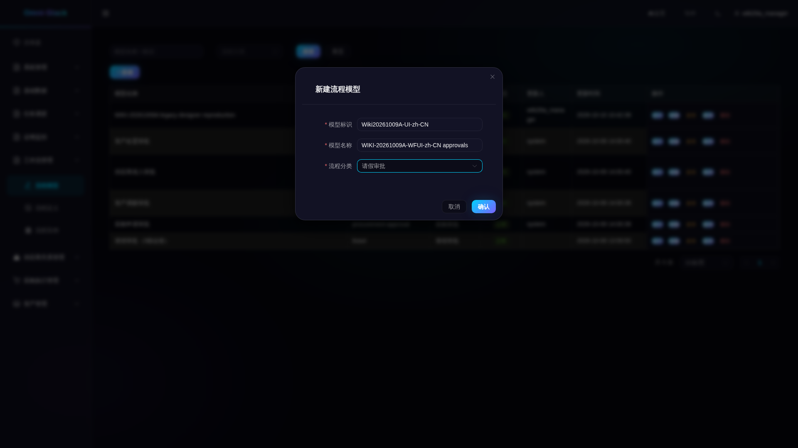

2. 在该行点击“设计”。新模型应已有开始事件，BPMN 的 `<process id>` 使用刚才的模型标识。空画布或残留 `Process_1` 都不能作为可发布模型继续操作。

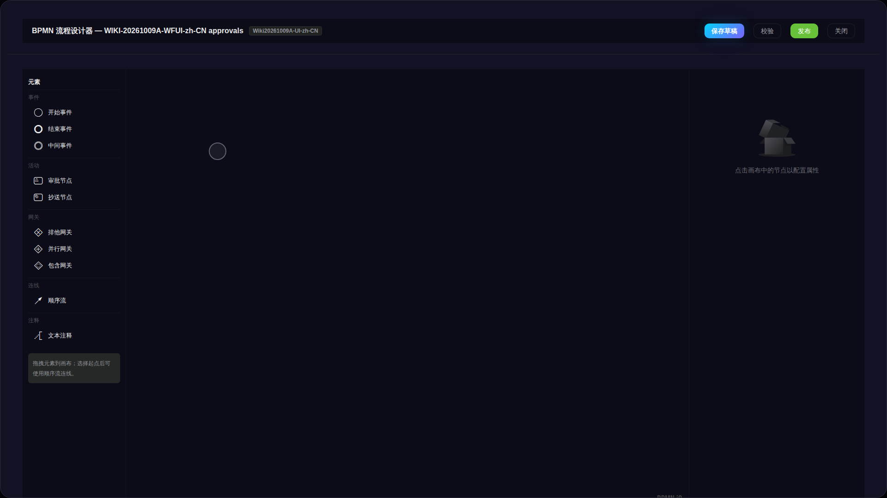

3. 选中开始事件，用快捷面板追加用户任务，输入节点名称。右侧选择审批角色、发起人上级组织和“全员通过”，然后预览。确认三人的身份与组织，再关闭预览并追加结束事件。追加后节点已选中；再单击同一节点会取消选择。

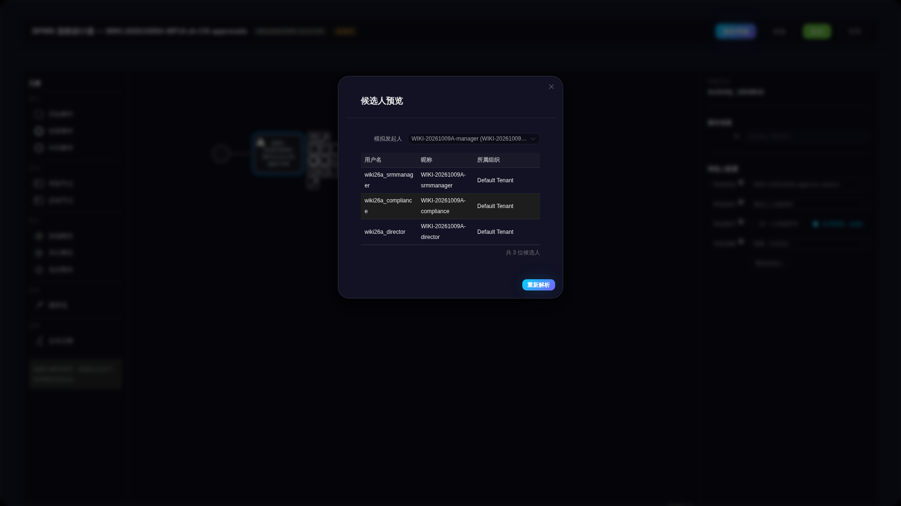

4. 保存草稿，再点击校验。服务端应返回校验通过。校验检查流程标识、结构和配置，不能代替启动后的候选分派验证。

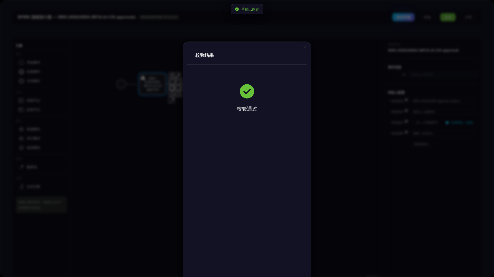

5. 关闭校验弹层，点击发布并确认。版本列表应有业务版本 1、`PUBLISHED` 和引擎版本。实际流程定义 ID 从版本 API 核对，图中没有展示该 ID。业务版本属于模型历史，Flowable 引擎版本属于部署历史，不能互换。

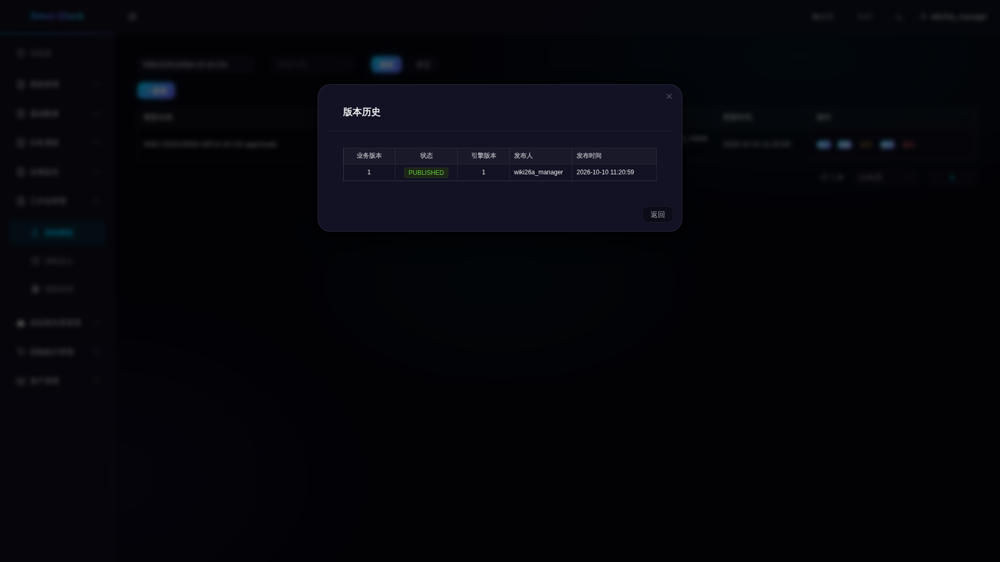

## 3. 普通发起人启动，审批人完成第一票

2026-10-10 演练通过普通发起人的真实 API 启动，再从工作台执行审批。这不证明界面点击发起。业务模块有自己的入口和状态校验，例如采购请购与资产调拨，通过内部 Workflow 契约启动。

普通启动经 Gateway 调用 `POST /api/workflow/process-instance/start`。将示例版本 ID 换成刚发布的实际 ID，业务键和标题使用新值；使用当前普通用户的正常认证会话。`X-User-Id` 与 `X-Tenant-Id` 由 Gateway 从已校验 JWT 派生并转发，不以客户端自填身份头作为可信身份，也不直连后端冒充他人。

```json
{
  "modelVersionId": 7,
  "title": "Tutorial ALL approval",
  "businessKey": "tutorial-all-001"
}
```

普通启动没有跨服务请求预留的幂等保证。响应中断后先查询“我发起的”和业务键，不能直接重发。内部启动的 `requestId` 规则见[工作流契约](../workflow.md)。

6. 第一名候选人登录首页工作台，在“我的待办”找到实例。三人各有一项任务；有审批权限但不是该任务受理人的用户仍不能处理。

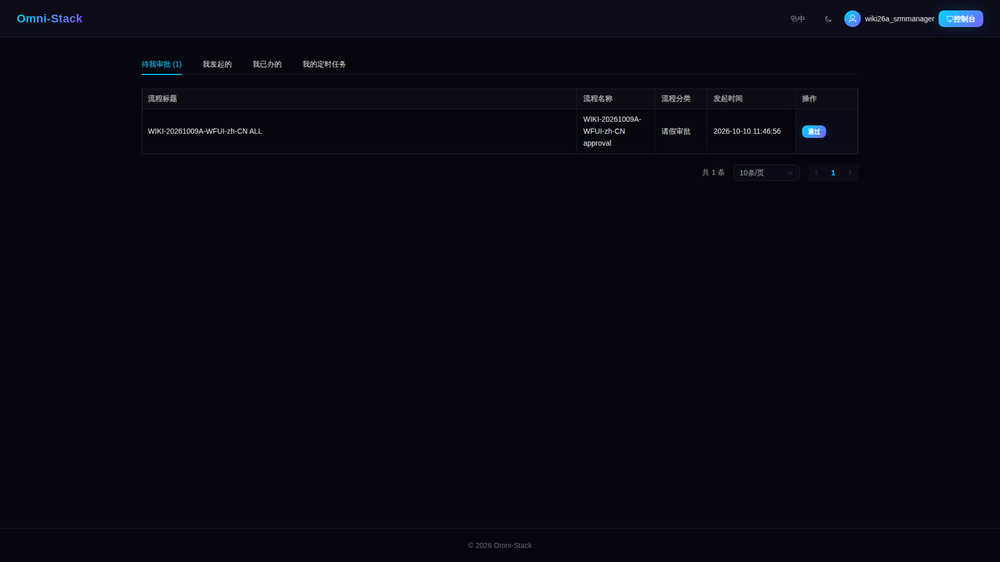

7. 打开审批表单，核对标题、节点和意见，再提交“通过”。真实验证码登录与后续受控短时 E2E 身份是不同步骤，不能混称验证码已被自动验证。

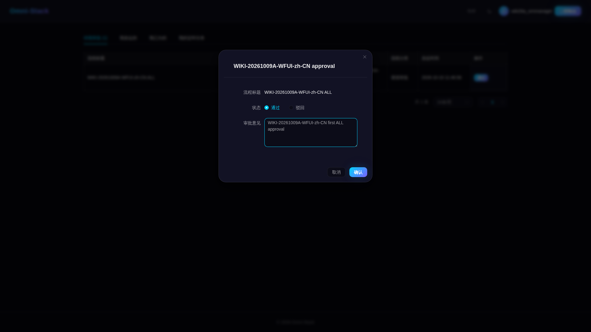

8. 观察者在流程实例列表找到该标题，打开进度。第一票后仍进行中，另两人的待办仍在；ALL 等待全部有效审批人通过。

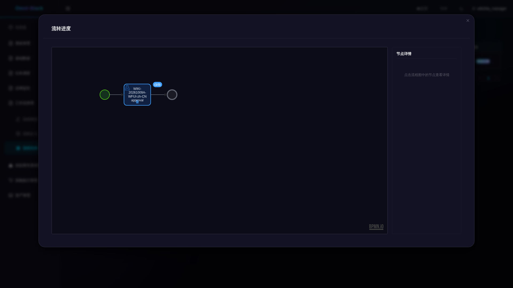

## 4. 发布 ANY 版本，检查旧实例不被改变

9. 保留 ALL 实例进行中。设计者重新打开同一模型，选中用户任务，将方式改为“任一人通过”，保存草稿。编辑已发布模型会产生新草稿，不能覆盖旧发布版本。

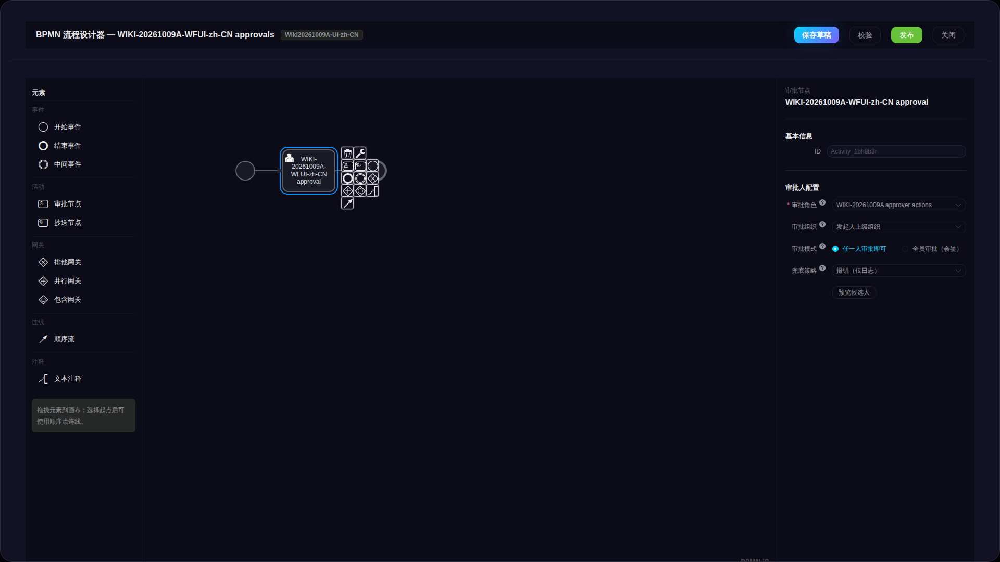

10. 校验并发布业务版本 2。列表保留旧版本和当前 `PUBLISHED` 版本。旧 ALL 实例的 `modelVersionId`、`processDefinitionId` 和业务版本仍指向版本 1。

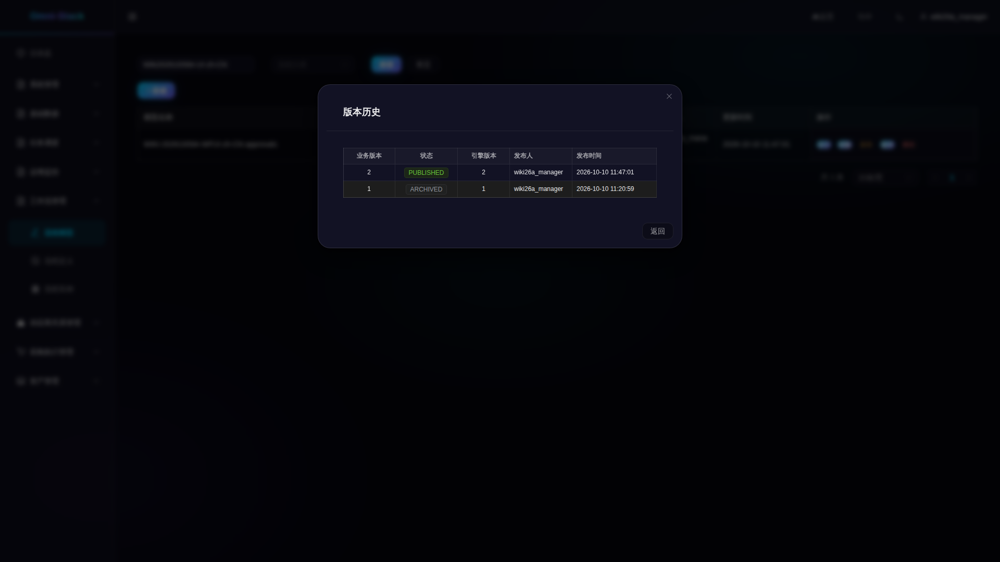

11. 使用版本 2 和新业务键启动第二个实例。一人通过后 ANY 结束，其余两项任务被多实例完成条件跳过，待办清空。

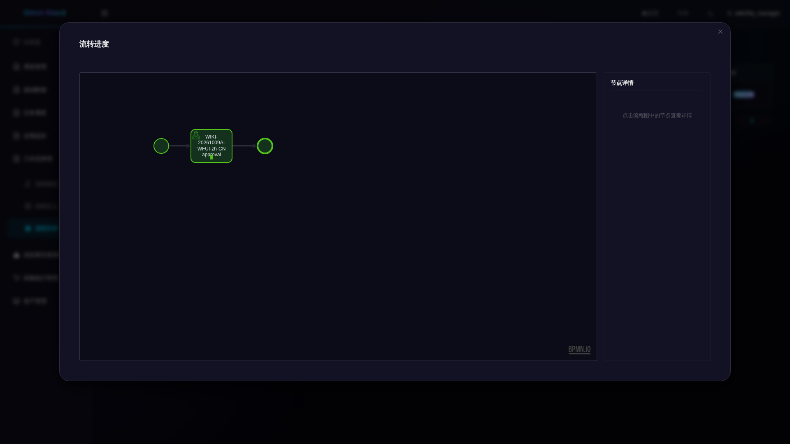

12. 回到版本 1 的 ALL 实例，让另两人分别通过，检查三条实际通过记录。新版本没有把旧实例变成 ANY，也没有替旧审批人投票。

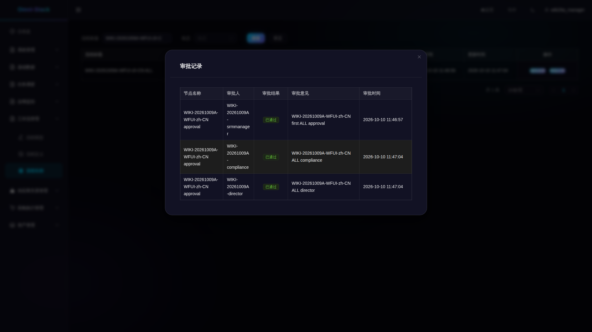

## 5. 拒绝与撤回要分别验证

拒绝案例另建 ALL 模型：审批后接排他网关，批准连线条件为 `${approved == true}`，拒绝连线为默认流，两条连线各接结束事件。下面案例由真实 API 配置、发布和执行，图片是随后只读查看的结果。

13. 一名候选人拒绝，流程到达拒绝结束事件，其余待办清空。管理列表通用状态 `2` 表示“已完成”，不表示领域审批通过。

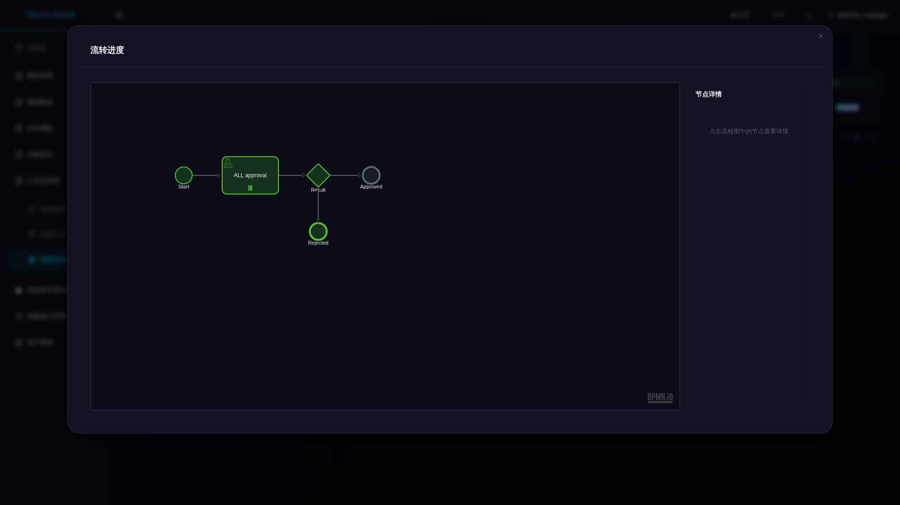

14. 历史中一票为实际拒绝，另两项被 `MI_END` 跳过。当前界面仍把它们标为“自动通过”，这是展示限制，不是两张实际赞成票。

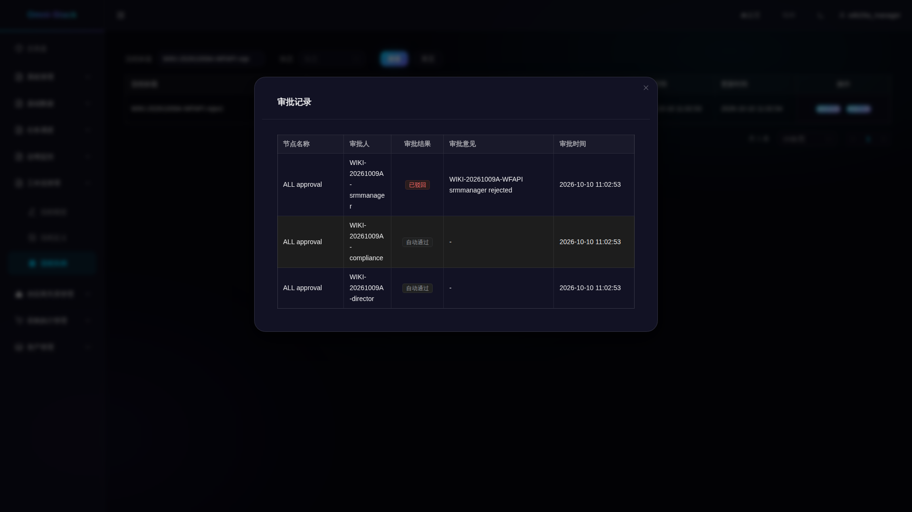

15. 另起未结束实例，由原发起人调用 `PUT /api/workflow/process-instance/{id}/terminate?reason=...` 撤回。检查状态 `0`、三个待办清空和取消历史；其他普通用户撤回返回 403。

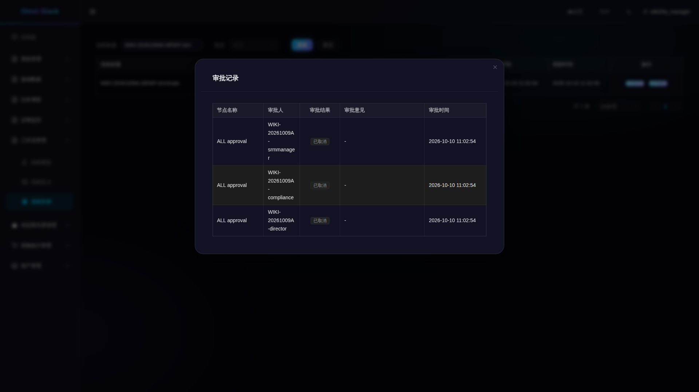

## 6. 委托与加减签的当前入口

当前个人工作台表单提供通过、拒绝和意见。委托、加签、减签有真实 API 和前端请求封装，该表单尚无对应操作入口。以下通过 API 复现；图片只证明已提交动作后的历史，不宣称存在对应按钮。

额外审批人先核对为同租户、启用且具有所需审批权限的已有用户。当前目标 ID 检查只确认数字格式，接口成功不等于资格已校验。按教程只提交必要的 `approved`、`comment`；扩展 `variables` 会传入引擎，应由受信任业务代码构造，不透传不可信输入。

| 操作 | 当前任务受理人调用的 API | 还需的权限 |
|---|---|---|
| 委托 | `POST /api/workflow/approval/{taskId}/delegate?targetUserId=...` | `workflow:approval:delegate` |
| 加签 | `POST /api/workflow/approval/{taskId}/add-signer?newUserId=...` | `workflow:approval:add-signer` |
| 减签 | `POST /api/workflow/approval/{taskId}/remove-signer?targetUserId=...` | `workflow:approval:remove-signer` |

16. 把自己的一项任务委托给额外审批人。当前通过 `setAssignee` 改受理人；原受理人再审批返回 403，新受理人能完成，不提供 Flowable delegate/resolve 往返生命周期。

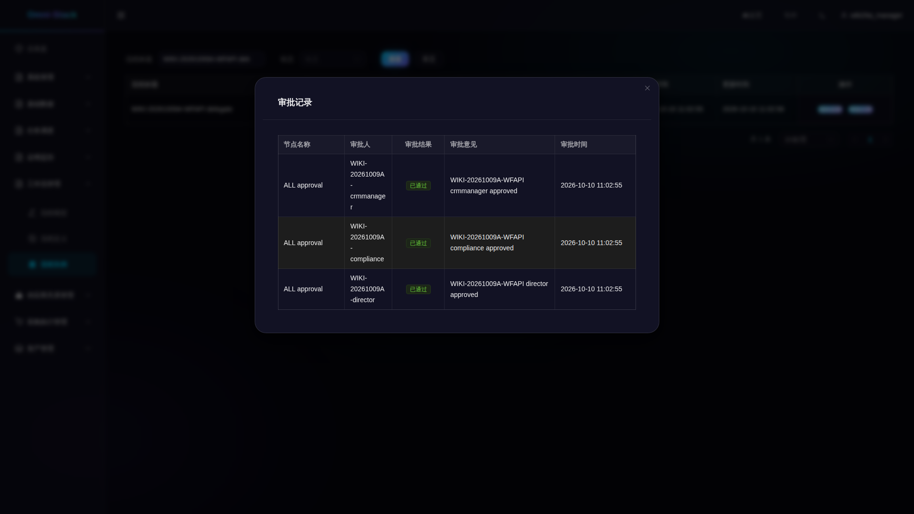

17. 在独立 ALL 实例中加签第四人。原三人通过后仍进行中，第四人通过才结束；核对四条实际赞成票。

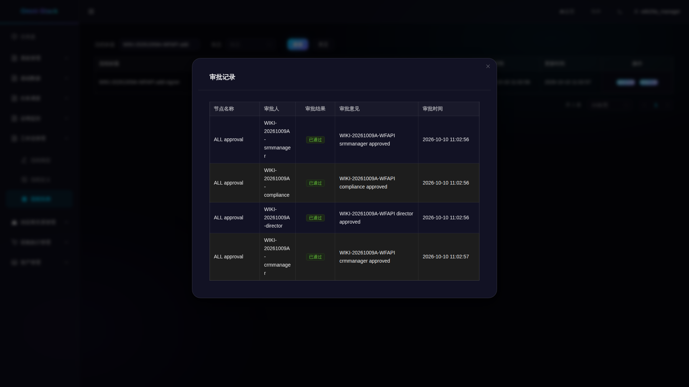

18. 在另一实例中先加签，再减去第四人。其待办消失，阈值重新计算，原三人通过后结束。不要删除引擎表执行行模拟减签。

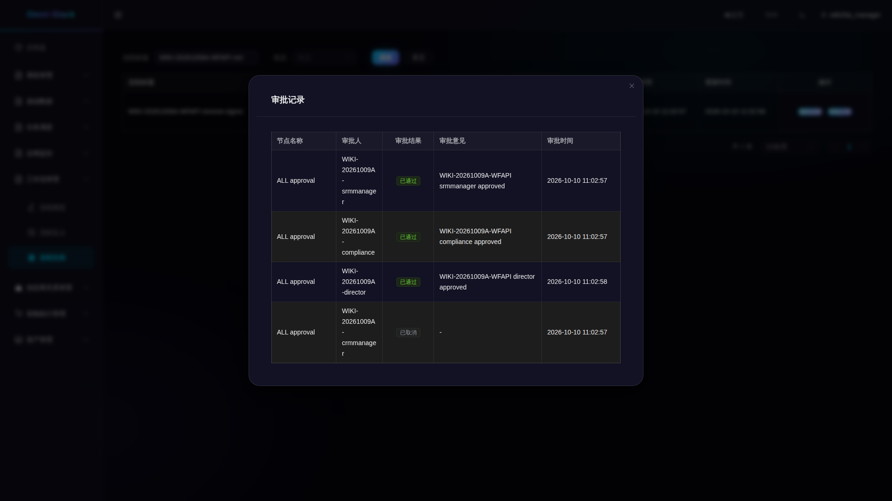

## 7. 复现校验失败、发布拒绝与无权限访问

这组练习使用单独的新模型，不改前面的 ALL/ANY 历史。图中 `WIKI-20261009A` 是隔离教学数据，不属于正式种子。先用正式 `POST /api/workflow/model` 创建自己的新标识，例如 `Tutorial-Invalid-20261010`，再保存一个“开始 → 结束”的完整 BPMN；模型标识以字母开头，只含字母、数字和短横线。

19. 设计者调用 `GET /api/workflow/model/{id}` 取得 `currentDraftVersionId`，再调用 `GET /api/workflow/model/version/{versionId}` 保存原始 `designerJson` 和完整 `bpmnXml` 到仓库外私有文件。确认这是未发布的 `DRAFT`。
20. 仅把原 XML 的 `<process id="...">` 改为 `DifferentProcessKey`，不要改模型的 `modelKey`。调用 `PUT /api/workflow/model/{id}/draft`，请求体提交原有的 `designerJson` 字符串和修改后的完整 `bpmnXml`。这一步通过 API 制造可定位的错误，不依赖设计器提供 XML 编辑按钮。
21. 返回模型列表，搜索该标识，点击列表行的“校验”。应看到校验未通过和两种标识不一致的说明。列表入口读取已保存 XML；设计器内校验可能先保存当前画布，会改变这次要检查的输入。

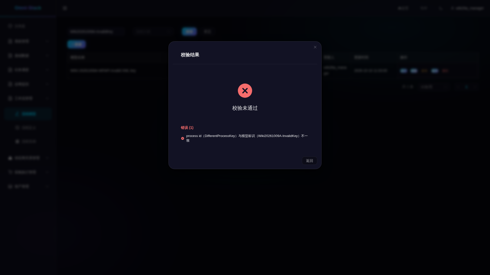

22. 关闭弹层，在同一行点击发布并确认。2026-10-10 记录的响应为 HTTP `200`、业务码 `500`，发布被拒绝。界面显示通用错误与排障码，可能重复出现两条提示；具体根因回到列表校验查看，不能凭通用错误判断服务宕机。

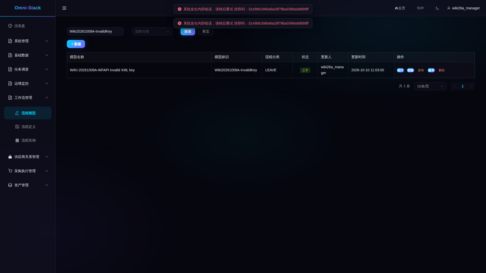

再查询模型、草稿版本和 `GET /api/workflow/model/{id}/versions`：仍只有一个 `DRAFT`，XML 摘要不变，`currentPublishedVersionId`、`deploymentId`、`processDefinitionId` 均为空。源码在失败分支写入的 `FAILED` 会随异常回滚，不能把它写成已持久化终态。截图中的列表状态“正常”不代表版本已经发布。

23. 用 `PUT /api/workflow/model/{id}/draft` 恢复刚保存的完整 XML 和 `designerJson`，然后调用 `POST /api/workflow/model/{id}/validate`，应得到 `valid=true`。2026-10-10 在另一个独立教学模型实际验证了“有效 → 标识错误 → 发布拒绝 → 恢复有效”，仍保留一个未发布草稿；没有改动失败截图对应的模型。本轮未重复该写入。
24. 换一个已登录、未获得 `workflow:model:list` 的普通员工账号，打开 `/admin/workflow/model`。页面显示 403 并保留当前用户名；该账号直接调用模型列表 API 也应得到 HTTP/业务 `403`。检查所有角色的合并权限，修改权限后重新登录。前面用于发起流程的账号已有模型列表权限，不能拿它作为本例的无权限身份。

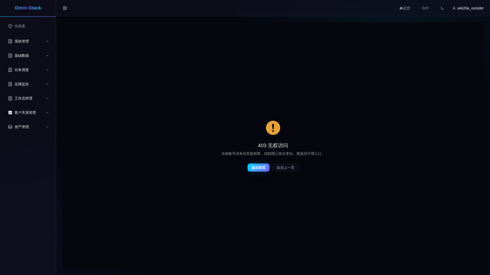

自动取证入口见[真实负向页面测试](../../omni-frontend/e2e-docs/flows/workflow-negative-teaching.flows.spec.ts)。历史校验弹层的后端错误详情仍为中文，四语原图保留原样；这是已记录的界面限制，不以语言回退代替文档翻译。

## 8. 失败、断点与恢复

| 现象或验证 | 应看到什么 | 下一步 |
|---|---|---|
| 无审批权限 | 403 | 补最小权限、重新登录，不用超级管理员代签 |
| 有权限但不是受理人 | 表单和提交均为 403 | 核对实际 taskId 与 assignee |
| `simulateUserId` 指定他人 | 403、不产生实例 | 使用本人认证上下文 |
| 无候选且 fallback 为 ERROR | 当前业务码 500，事务回滚 | 核对发起人、组织、角色和作用域；查副作用后再重试 |
| 审批提交时任务已处理、不存在或租户不可见 | 业务码 409 | 刷新待办并查历史，不盲目重复提交 |
| 跨租户读取进度或审批记录 | 业务码 404，与不存在一致 | 使用本人租户会话；不猜测其他租户实例 |
| 模型标识与 process id 不一致 | 校验失败，不能发布 | 修草稿，不改历史部署 |
| 保存、启动或审批响应中断 | 结果未知 | 先查版本、业务键、待办和历史是否已提交 |

在隔离 Docker 环境设置以下断点，不把令牌、身份请求头或密钥贴进截图。

| 单元 | 断点与变量 | 对应问题 |
|---|---|---|
| [ModelDesigner.handleSave](../../omni-frontend/src/components/workflow/ModelDesigner.vue) | `saveXML`、`modelKey`、`bpmnXml` | 空画布、标识不匹配、草稿内容 |
| [writeAssignment](../../omni-frontend/src/composables/useBpmnExtension.ts) | assignment、小写 executionListener、collection、assignee | 预览有人，运行却没有待办 |
| [ProcessInstanceServiceImpl.start](../../omni-backend/omni-workflow/src/main/java/com/omni/workflow/service/impl/ProcessInstanceServiceImpl.java) | 引擎调用前的 `safeVariables.initiator` 和认证用户 | 发起人上级组织解析失败 |
| [ScopedRoleAssignmentListener.notify](../../omni-backend/omni-workflow/src/main/java/com/omni/workflow/listener/ScopedRoleAssignmentListener.java) | ExecutionListener start、candidateUserIds、计数器 | 分派与会签阈值 |
| [WorkflowModelServiceImpl.publishModel](../../omni-backend/omni-workflow/src/main/java/com/omni/workflow/service/impl/WorkflowModelServiceImpl.java) | 行锁、校验结果、两个版本号 | 并发发布、旧实例隔离 |
| [ApprovalServiceImpl](../../omni-backend/omni-common-workflow/src/main/java/com/omni/common/workflow/approval/ApprovalServiceImpl.java) | MI 根执行、approvedCount、requiredApprovals、deleteReason | ALL/ANY、拒绝与加减签 |

设计器的 ExecutionListener 在多实例集合求值前分派候选。旧 `ScopedRoleAssignmentListener.notify(DelegateTask)` 是兼容空实现；预置业务模型还可使用 `${candidateResolver.resolve(execution)}` 集合表达式，不能混写两条模型路径。保存直接持久化浏览器导出的 XML，`BpmnXmlBuilder` 不在当前保存链路。

回归入口：[XML 往返测试](../../omni-frontend/tests/workflow/bpmn-assignment.test.ts)、[启动身份测试](../../omni-backend/omni-workflow/src/test/java/com/omni/workflow/service/impl/ProcessInstanceStartIdentityTest.java)、[真实设计与审批](../../omni-frontend/e2e-docs/flows/workflow-teaching-ui.flows.spec.ts)、[历史只读取证](../../omni-frontend/e2e-docs/flows/workflow-teaching.flows.spec.ts)。全部在本机 Docker 执行；截图测试需仓库外回执、短时普通身份和隔离项目授权，缺输入不能冒充通过。

来源与逐图字段见[2026-10-10 证据登记](../reference/evidence/workflow-2026-10-10.json)。早期 9 组 API 补例使用 ABSOLUTE_UNIT，不能证明普通 PARENT 启动；后续 UI 007/008 对账中文已提交结果并执行其余三语新旅程。中途失败、草稿修复和各图运行版本保留，后来的源码聚合摘要不能归给早期 5 张图。

本轮[文档与原图检查记录](../reference/evidence/workflow-guide-review-2026-10-17.json)核对全部 84 图的路径、语言、哈希和采集版本，并逐张抽查其中 20 张原图。其余 64 图沿用原视觉记录：原正向/历史 72 图此前使用 18 张按原图分辨率排布的四语汇总图检查，原负向 12 图逐张检查；不冒称本轮重新拍摄或重新逐张查看全部图片。

分类字典可能显示中文、版本状态为英文协议值；日/韩待办、审批表单及历史表仍可能有 `Approve`、`Reject`、`Comment`。人员和长节点名称换行，流程图颜色不能替代任务和历史接口的实际票数。保留终态历史；重做用新业务键，不清库、不改已发布版本。事实约束见[工作流](../workflow.md)，调试见[源码调试](../wiki/source-debugging.md)。

四语文档按[已授权 AI 复核政策](../adr/0003-authorized-ai-translation-review.md)验收，真实 `AI_REVIEW` 即可，不要求人工复核，也不标为 `HUMAN_REVIEW`。当前有效内容哈希和状态以[复核队列](../i18n-review-queue.md)为准。
