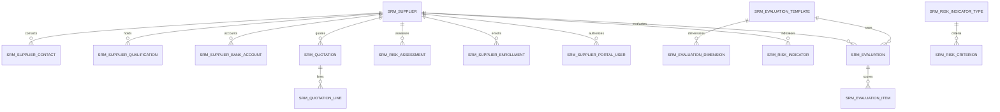

# SRM Supplier Relationship Management

> This document records current SRM boundaries, data contracts and implementation constraints; Chinese is the factual source. Before changing SRM, read this page, [architecture](architecture.en.md), [API contracts](api-contract.en.md), [backend patterns](backend-patterns.en.md) and [frontend patterns](frontend-patterns.en.md).
> The [original design and historical acceptance](design/srm-design.en.md) retain their original scope and do not replace current source or runtime evidence. Operations and real screenshots are in the [SRM Wiki](guides/srm-flow.en.md); extensions and container tests are in the [development Wiki](guides/scaffold-development.en.md#9-srm-extension-and-container-tests).

[中文](srm.md) · [English](srm.en.md) · [日本語](srm.jp.md) · [한국어](srm.kr.md)

SRM is the independent `omni-srm` service for supplier admission, classification/grading, performance, risk and portal self-service. The existing `omni-procurement` and `omni-asset` services own procurement execution and asset management. SRM participates in quotations through internal contracts; it does not own purchase orders or asset disposal.

## 1. Service Boundaries

| Item | Value |
|---|---|
| Maven module | `omni-srm` |
| Service port | `8105` |
| Management port | `19905` |
| XXL-JOB executor | `omni-srm / 9905` |
| Database | `omni_srm` |
| Gateway | `/api/srm/**` → `lb://omni-srm` |
| Redis | DB 0; shared Auth XSS cache keys |

Dependencies: `omni-common-service`, `omni-common-core`, `omni-common`, `omni-common-mybatis`, `omni-common-redis`, `omni-common-operlog`, `omni-common-job`, `omni-common-mqlog`. SRM does not depend on `omni-common-workflow` or embed Flowable; approval runtime and tables belong to the independent Workflow service. Cross-service calls use OpenFeign with `X-Internal-Token` and `X-Tenant-Id`; SRM never reads Auth across databases. Ports above are source defaults, not evidence that a deployment is healthy.

## 2. Domain Model

### 2.1 Aggregates and Tables

| Aggregate | Tables | Responsibility |
|---|---|---|
| Supplier | `srm_supplier`, `srm_supplier_contact`, `srm_supplier_qualification`, `srm_supplier_bank_account` | Supplier master and children |
| Evaluation | `srm_evaluation_template`, `srm_evaluation_dimension`, `srm_evaluation`, `srm_evaluation_item` | Templates, dimensions, evaluations and items |
| Risk | `srm_risk_indicator`, `srm_risk_assessment`, `srm_risk_indicator_type`, `srm_risk_criterion`, `srm_risk_score_threshold` | Indicators, assessment history and dynamic configuration |
| Portal | `srm_supplier_invite`, `srm_supplier_enrollment`, `srm_supplier_portal_user` | Invitations, role Saga and account links |
| Quotation | `srm_quotation`, `srm_quotation_line`, `srm_quotation_request` | Quotation snapshots, lines and permanent request ledger |
| Inbox | `srm_event_inbox` | Consumer idempotency records |

These are principal logical associations, not cross-database foreign keys or a requirement to draw every table.



### 2.2 Fields and Ownership

- Every `srm_*` table has tenant_id. Only Supplier and Evaluation roots directly use owner_user_id/owner_unit_id. Contacts, qualifications, bank accounts, risk and quotations inherit scope through their parents; evaluation items through Evaluation, quotation lines through Quotation and then Supplier. Never append owner predicates to tables without those columns.
- Authorized roots and mutable business rows use version/deleted and audit fields. Configuration and idempotency ledgers follow their own schemas; not all writes are the same client-version command.
- Auth owns userId/unitId; frontend ownerUnitId is untrusted. supplier_no is generated from database IDs, never MAX+1. Normalized credit_code is tenant-unique and required for portal enrollment.
- Portal user_id is linked through `srm_supplier_portal_user`, never stored as an internal owner. A newly enrolled supplier initially has no internal owner.
- Supplier master fields include number, name/normalized_name, type, industry, credit code, website, phone, email, region, address, category, level, status and assignment/evaluation times, plus process instance, request, business key, model, attempt and start status.
- A supplier has at most one active primary contact and active default bank account, enforced by tenant + primary_supplier_guard uniqueness. Child tables have no internal owner snapshot. Evaluation owner is a mutable permission snapshot taken from Supplier on creation and synchronized transactionally during transfer; historical scores remain unchanged.
- PortalUser is unique by tenant + user_id. Enrollment uses tenant + request_id idempotency and active_user_guard for active applications. Raw invitation tokens are returned only on creation; the database stores SHA-256 hashes and increments usage atomically with version conditions.
- Date-times use `yyyy-MM-dd HH:mm:ss`. See section 9 for decimal-string quotation JSON and precision.

## 3. Security Architecture

### 3.1 Six-Layer Trust Chain

Gateway verifies RS256 JWT and overwrites trusted identity headers → shared GatewayPreAuthenticationFilter builds Authentication → ServiceIdentityFilter validates/binds user and tenant → Controller functional permission → scope resolution and MyBatis filtering → explicit row-level write authorization.

Invalid identity returns 401; missing effective scope fails closed in SQL (id=-1). Auth permission denial returns 403, other dependency failures 503. Never fall back to unrestricted queries.

### 3.2 Persistence and Scope

Shared `ServicePersistenceAutoConfiguration` assembles the interceptors; SRM supplies `SrmTenantTablePolicy` and `SrmDataPermissionHandler`:

```text
TenantLineInnerInterceptor → DataPermissionInterceptor → OptimisticLockerInnerInterceptor → PaginationInnerInterceptor
```

TenantLine processes only srm_*. sys_mq_message is outside these domain permission filters: Relay intentionally scans pending messages across tenants, while user message queries still need explicit tenant filtering. DataPermission precedes pagination so COUNT and records use the same scope.

| dataScope | Root predicate |
|---|---|
| `SELF` | `owner_user_id = currentUserId` |
| `DEPT` | `owner_unit_id = primaryUnitId` |
| `DEPT_AND_BELOW / CUSTOM` | `owner_unit_id IN accessibleUnitIds` |
| `TENANT / ALL` | No owner predicate; retain TenantLine |

These are root predicates. Child resources inherit with parent EXISTS/JOIN conditions. Templates, dimensions and risk configuration are tenant-shared rather than internally owner-filtered.

### 3.3 Write Authorization and Context

Existing business mutations first query a visible tenant-local row and validate state/relations; actual updates use id/version/deleted and affected-row checks. DataPermission does not replace AccessGuard; dedicated SQL may bypass owner filtering. Number completion, cascades, ledgers and tenant-shared configuration have separate paths; not every command accepts a client version.

Internal owner resources use the same full permission in `@PreAuthorize` and `@ServiceDataScope`. Portal authorization uses role, permission and current-account association; risk configuration uses tenant identity and configuration permission. Do not mechanically apply owner aspects to both. Business mutations use `@OperLog`.

Nested SrmPermissionScopeExecutor/SrmPortalScope restore the previous scope in finally; outer aspects/identity filters perform final cleanup. Both ServiceIdentityContext and ServiceDataScopeContext exist; there is tenant-related thread context.

### 3.4 Permissions and Roles

| Resource | API permissions |
|---|---|
| Overview | `srm:overview:list` |
| Supplier | `srm:supplier:list/create/update/delete/withdraw/cancel/suspend/resume/blacklist/restore/eliminate/transfer` |
| Contact | `srm:contact:list/create/update/delete` |
| Qualification | `srm:qualification:list/create/update/delete` |
| Bank account | `srm:bank-account:list/create/update/delete` |
| Evaluation | `srm:evaluation:list/create/view` |
| Risk | `srm:risk:list/update/assess` |
| Risk configuration | `srm:risk:config:list/update` |
| Invitation | `srm:invite:list/create/revoke · srm:portal:invite` |
| Owner candidates | `srm:owner:list` |
| PII | `srm:pii:view` |
| Portal | `srm:portal:enroll/profile/evaluation/quotation` |

Slashes abbreviate multiple full codes, not one stored permission. submit uses srm:supplier:create. Workflow handles approval tasks; the current SRM Controller has no approve/reject endpoints.

| Role | Seed scope | Capabilities |
|---|---|---|
| `SRM_ADMIN` | `TENANT` | Tenant management; no supplier self-service quoting |
| `PROCUREMENT_MANAGER` | `DEPT_AND_BELOW` | Department/subordinates, evaluation and risk |
| `PROCUREMENT_STAFF` | `SELF` | Own business and routine work; configuration is tenant-shared by permission |
| `SUPPLIER` | `SELF` | Portal profile, performance and quotes; ACTIVE association still required |
| `SUPER_ADMIN` | `ALL` | Full permission tree; current-tenant data, no portal impersonation |

These are formal auth.sql default-tenant seed examples, not proof that every new tenant already has these roles. USER receives only portal enroll. profile/evaluation/quotation additionally require SUPPLIER, the specific permission and an ACTIVE PortalUser for the current tenant/user. Internal administrators cannot quote for suppliers; SUPER_ADMIN alone cannot impersonate a portal identity. Multi-role accounts use their actual combined permissions for management access.

### 3.5 PII, XSS and Logs

Dedicated supplier lists always use masked VOs. Supplier details/360 and contact/bank lists/details use srm:pii:view for phone, email and account fields. Not all lists are always masked. Unmasked fields such as address do not acquire a generic sanitization guarantee. Portal profile returns its own phone/email after role, permission and ACTIVE association checks; the old portal contacts/qualifications/bank-accounts APIs do not currently exist.

`omni.service.xss.enabled=true` uses shared CachedServiceXssConfigProvider and Redis DB 0 xss:enabled:{tenantId}/xss:rules:{tenantId}. Cache errors resolve through Auth; resolution failures use a security baseline while authoritative enabled values remain respected. SRM has no separate SPI implementation or established srm: business-cache prefix. Notes are plain text; do not use v-html.

OperLog sanitizes explicit field rules, not arbitrary PII. Enrollment disables snapshots and excludes inviteToken/creditCode/phone/email; invitation creation tokens must stay out of logs. Asynchronous generic logs cannot replace domain state, evaluation or Inbox facts.

## 4. Lifecycle and Core Flows

### 4.1 Admission and Workflow

SupplierStatus has nine values: REGISTERING, REGISTERING_FAILED, PENDING_REVIEW, APPROVING, REJECTED, APPROVED, SUSPENDED, BLACKLISTED, ELIMINATED. Current principal paths:

```text
Portal: REGISTERING → role Saga succeeds → PENDING_REVIEW
Admin creation / REJECTED resubmission → prepare/call Workflow → confirmed STARTED, then APPROVING
Workflow completion → APPROVED / REJECTED
APPROVING withdrawal/cancellation → PENDING_REVIEW + NOT_STARTED
APPROVED → SUSPENDED → APPROVED
APPROVED → BLACKLISTED → APPROVED
APPROVED/SUSPENDED → ELIMINATED (terminal)
```

Admin create, resubmission after rejection and portal role-success handling synchronously invoke SupplierWorkflowCoordinator within the local transaction. Model resolution precedes the start-error catch; missing/unpublished models or query failure can roll back local creation/Saga results. Start-call failures attempt FAILED marking and can commit PENDING_REVIEW/FAILED. markStarted/markFailed use REQUIRED; this is neither post-commit startup nor distributed atomicity.

Startup stores requestId, businessKey (supplierId:attempt), modelVersionId, attempt and start status/instance. startUser comes from current identity, not a persisted Supplier starter column. The server selects the model; Workflow response uses replayed. Default model initialization does not guarantee models for every tenant.

submit/profile-submit accept only REJECTED and create a new attempt. There is no generic same-snapshot start-retry API for PENDING_REVIEW/FAILED. Withdrawal/cancellation terminate remotely before the versioned local update; they do not guarantee distributed rollback or imply an available resubmit entry.

Completion events use tenant/eventId Inbox and intent idempotency, matching business key, instance and state. A valid early completion requests message retry; not all out-of-order events are ignored. Admission completion supports APPROVED/REJECTED. Procurement references must check APPROVED; blacklist restoration uses its own restore permission. Deletion also checks lifecycle and portal/evaluation/risk history.

### 4.2 Performance Evaluation

Only visible APPROVED suppliers with complete internal owners are eligible. Creation accepts supplierId/evaluationPeriod/items, not a client supplier version; the service locks the row and uses its database version.

Initialization maintains one default template and Quality/Delivery/Price/Service weights 30/30/20/20. Reading the template can repair local configuration and is not zero-write. Items must uniquely and completely cover enabled dimensions, scores are 1–5 (stored as DECIMAL(3,1)) and positive weights sum to 100. `SUM(score / 5 × weight)` rounds HALF_UP to two decimals, range 20–100: ≥90 STRATEGIC, ≥75 PREFERRED, ≥60 QUALIFIED, otherwise ELIMINATED. This level_code does not eliminate the supplier lifecycle.

The transaction writes Evaluation/Items, supplier level/latest-evaluation time and the srm.evaluation.completed.v1 Outbox. Items are append-only; the default evaluation template has no dynamic management UI. Standalone evaluation history returns at most 100 entries; 360 takes the latest five.

### 4.3 Risk

Indicator types, criteria and total-score thresholds are database-configured. Current overall level sums nonnull indicator.score and matches threshold ranges; it does not take the highest indicator color. Endpoints are inclusive and the first returned matching range wins. No thresholds gives GREEN; unmatched scores above all upper bounds use the level of the largest upper bound, otherwise GREEN. Configuration does not guarantee complete, nonoverlapping ranges.

The formal srm.sql default-tenant examples include FINANCIAL, COMPLIANCE, SUPPLY, COOPERATION, QUALITY and CERTIFICATE. Creation idempotently fills missing GREEN indicators from currently enabled types, with score=null for automatic types and 1 otherwise. No enabled configuration means no indicators are added; these seeds are not guaranteed for every tenant.

Manual updates reject autoCalc=1 only when an enabled indicator type is found; a missing or disabled type skips this check. The criterionId branch reads a tenant-local existing criterion and copies its score/level/label; it currently has no same-type guard, so frontend options are not a backend guarantee. Legacy indicatorValue/riskLevel input remains. Recalculation inserts a new assessment history row; only first/non-red-to-RED transitions write an event, which does not prove external notification delivery.

Missing certificate expiry is GREEN, 0–30 days is YELLOW and expired is RED. Multiple qualifications select the worst level and earliest date at the same level; certificate scores are 1/2/3. Manual assessment, indicator changes and qualification creation/update/deletion for APPROVED/SUSPENDED/BLACKLISTED suppliers recalculate risk. Current SRM Java has no dedicated @XxlJob/@Scheduled risk scanner; external job configuration requires separate verification.

### 4.4 Portal Accounts and Role Saga

Public Auth register creates accounts using a real CAPTCHA, tenant-local username uniqueness and password hashing; see Core Flow 1 for default USER assignment failure boundaries. SRM enroll handles authenticated existing users and never receives passwords.

Enrollment carries requestId and a tenant invitation, checking expiry/status/usage. It creates a REGISTERING supplier, initial risk data, PENDING_ROLE_ASSIGN enrollment and role-request Outbox. requestId replay compares applicant and normalized credit_code, not a full-body hash; an existing active application can return its original result without consuming another invite.

Auth atomically writes the SUPPLIER role, request ledger and result Outbox; completed replay republishes a result with a deterministic event ID. SRM success creates/activates PortalUser, sets COMPLETED/PENDING_REVIEW and attempts Workflow startup in the same local transaction. Auth role assignment may already be committed when SRM model resolution rolls back. A blanket “no partial authorization” promise is false: inspect real states/message redelivery. Saga COMPLETED is not admission APPROVED or Workflow health.

Role failure becomes ROLE_ASSIGN_FAILED/REGISTERING_FAILED. enrollment/retry reuses the requestId after failure/backoff to write a new Outbox without consuming an invite; it is not approval-start retry. The client polls enrollment state and prompts relogin on completion; a database role grant does not mutate an existing JWT. See reviewed [Core Flows 15/18](core-flows.en.md).

## 5. External APIs

### 5.1 Common Contract

Responses use `R<T>`; paginated endpoints use `R<PageResult<T>>`, default page=1/size=10 and maximum size=100. Ordinary lists may return `R<List<T>>`. Entities are not external requests/responses; follow actual DTOs. Date-time parameters use the common format. State/existing-record updates generally carry version; evaluation creation, risk assessment creation and configuration follow separate contracts.

### 5.2 Current Paths

These 77 method/path combinations include current aliases, are relative to /api/srm and do not inherit preceding path fragments.

| Controller | Methods and paths |
|---|---|
| Supplier insights (SupplierInsightController) | `GET /supplier/{supplierId}/evaluation/history` · `GET /supplier/{supplierId}/risk` |
| Suppliers (SupplierController) | `GET /supplier/list` · `GET /supplier/{id}` · `GET /supplier/{id}/overview` · `POST /supplier` · `PUT /supplier/{id}` · `POST /supplier/{id}/transfer` · `DELETE /supplier/{id}` · `POST /supplier/{id}/submit` · `POST /supplier/{id}/withdraw` · `POST /supplier/{id}/cancel` · `POST /supplier/{id}/suspend` · `POST /supplier/{id}/resume` · `POST /supplier/{id}/restore-from-blacklist` · `POST /supplier/{id}/restore` · `POST /supplier/{id}/blacklist` · `POST /supplier/{id}/eliminate` |
| Risk configuration (RiskIndicatorConfigController) | `GET /risk/config/types` · `POST /risk/config/types` · `PUT /risk/config/types/{id}` · `DELETE /risk/config/types/{id}` · `POST /risk/config/criteria` · `PUT /risk/config/criteria/{id}` · `DELETE /risk/config/criteria/{id}` · `GET /risk/config/thresholds` · `PUT /risk/config/thresholds` |
| Risk (RiskController) | `GET /risk/list` · `GET /risk/indicators/{supplierId}` · `PUT /risk/indicator/{id}` · `POST /risk/assessment/{supplierId}` · `GET /risk/assessment/history/{supplierId}` |
| Qualifications (QualificationController) | `GET /supplier/{supplierId}/qualification` · `GET /supplier/{supplierId}/qualification/list` · `GET /supplier/{supplierId}/qualification/{id}` · `POST /supplier/{supplierId}/qualification` · `PUT /supplier/{supplierId}/qualification/{id}` · `DELETE /supplier/{supplierId}/qualification/{id}` |
| Portal quotations (PortalQuotationController) | `GET /portal/quotation/invitations` · `GET /portal/quotation/invitations/{rfqId}` · `POST /portal/quotation` |
| Invitations including aliases (PortalInviteController) | `GET /portal/invite` · `GET /portal/invite/list` · `GET /invite` · `GET /invite/list` · `POST /portal/invite` · `POST /invite` · `POST /portal/invite/{inviteId}/revoke` · `POST /invite/{inviteId}/revoke` |
| Portal evaluation (PortalEvaluationController) | `GET /portal/evaluations` · `GET /portal/evaluations/history` |
| Portal enrollment/profile (PortalController) | `POST /portal/enroll` · `GET /portal/enrollment` · `POST /portal/enrollment/retry` · `GET /portal/profile` · `PUT /portal/profile` · `POST /portal/profile/submit` |
| Overview (OverviewController) | `GET /overview/summary` · `GET /overview/risk-dashboard` |
| Owner candidates (OptionsController) | `GET /options/owners` |
| Evaluation (EvaluationController) | `GET /evaluation/list` · `GET /evaluation/{id}` · `GET /evaluation/supplier/{supplierId}` · `GET /evaluation/template/default/dimensions` · `POST /evaluation` |
| Contacts (ContactController) | `GET /supplier/{supplierId}/contact` · `GET /supplier/{supplierId}/contact/list` · `GET /supplier/{supplierId}/contact/{id}` · `POST /supplier/{supplierId}/contact` · `PUT /supplier/{supplierId}/contact/{id}` · `DELETE /supplier/{supplierId}/contact/{id}` |
| Bank accounts (BankAccountController) | `GET /supplier/{supplierId}/bank-account` · `GET /supplier/{supplierId}/bank-account/list` · `GET /supplier/{supplierId}/bank-account/{id}` · `POST /supplier/{supplierId}/bank-account` · `PUT /supplier/{supplierId}/bank-account/{id}` · `DELETE /supplier/{supplierId}/bank-account/{id}` |

### 5.3 Supplier 360

Supplier visibility does not grant every child permission. Details/overview independently resolve contact, qualification, bank, evaluation and risk permissions; ungranted chunks are not queried. overview includes the latest five evaluations, risk indicators and the latest assessment. PII follows 3.5. SrmPermissionScopeExecutor restores the previous scope; chunks do not share one owner authorization.

## 6. Cross-Service Calls and Events

DomainEventEnvelope fields include eventId/eventType/occurredAt/tenantId/producer, aggregateType/aggregateId/aggregateVersion and actorUserId/correlationId/payload; each event populates them according to its contract.

On creation/transfer, OwnerResolver validates enabled tenant-local Auth users, primary units and assignable scope; selecting others additionally requires transfer permission. OwnerEnricher deduplicates and separately batches users and organizations. Errors can leave IDs/empty names without widening access; not every Feign call is outside a database transaction.

An internal owner must not have any portal association with `deleted=0` in the current tenant, including `ACTIVE` and `INACTIVE` associations. `OwnerOptionServiceImpl` removes portal accounts in a batch before limiting the candidate count. `SrmOwnerResolver` checks creation/transfer targets again: a portal association returns 403, and a null portal-identity count returns 503. A valid internal transfer still updates the supplier and its evaluations' owners in the formal business transaction.

Transactions explicitly call `ReliableMessageRelay.send("srm-domain-out-0", envelope, tenantId, eventId)` for local Outbox insertion with default REQUIRED propagation. Relay later sends to the Broker; stopping Relay does not stop Outbox writes. eventId is top-level in DomainEventEnvelope and passed as msgKey; Outbox msgId is separate. Consumers still need atomic event/intent processing. Payloads may contain explicit ID, version, state, score or amount snapshots, never full account/contact details or invitation tokens.

`srm.supplier.registered.v1` · `srm.supplier.approved.v1` · `srm.supplier.rejected.v1` · `srm.supplier.suspended.v1` · `srm.supplier.blacklisted.v1` · `srm.supplier.eliminated.v1` · `srm.portal-role.assign-requested.v1` · `auth.portal-role.assigned.v1` · `auth.portal-role.assign-failed.v1` · `srm.evaluation.completed.v1` · `srm.risk.level-changed.v1` · `srm.quotation.submitted.v1`

These are current event types; Outbox insertion and stage completion do not prove Broker delivery.

### 6.1 Internal APIs

These four paths require X-Internal-Token and X-Tenant-Id, matching query/body tenant, and are not exposed through Gateway:

| Controller | Methods and paths |
|---|---|
| Internal suppliers (InternalSupplierController) | `GET /api/internal/supplier/{supplierId}` · `GET /api/internal/supplier/search` · `POST /api/internal/supplier/batch` |
| Internal quotations (InternalQuotationController) | `GET /api/internal/quotation/batch` |

Supplier get/batch return nondeleted tenant-local summaries without an automatic APPROVED filter; consumers must validate business status. search supports status/category/keyword and a clamped limit of 1–100. batch preserves first occurrence order after deduplication, accepts at most 100 unique positive IDs and omits missing rows. Summaries contain only ID/number/name/status/level/category, no contacts or bank accounts.

SRM calls Procurement /api/internal/procurement/rfq/invitations and /rfq/{rfqId}/invitation for portal RFQs. supplierId comes from current ACTIVE PortalUser, never a client-supplied identity, and tenant travels in trusted headers. Internal quotation batch returns only SUBMITTED, unexpired quotations whose suppliers are APPROVED.

## 7. Change Constraints

Preserve tenant isolation, explicit write authorization, state commands, required version checks, explicit Outbox tenantId, finally cleanup and backend field masking. Separate portal accounts from internal owners; never add nonexistent owner predicates to children. Ordinary PUT cannot change lifecycle/owner. Avoid LocalDateTime.MIN/MAX in MySQL queries. Migrations are forward-only; formal seed hashes/assertions stay synchronized and legacy init-all.sql stays untouched. Evaluation templates, risk configuration, portal and internal APIs have the distinct boundaries in sections 3–6.

## 8. Frontend Entry Points

| Area | Entries | Purpose |
|---|---|---|
| API | [src/api/srm-overview.ts](../omni-frontend/src/api/srm-overview.ts) · [src/api/srm-supplier.ts](../omni-frontend/src/api/srm-supplier.ts) · [src/api/srm-evaluation.ts](../omni-frontend/src/api/srm-evaluation.ts) · [src/api/srm-risk.ts](../omni-frontend/src/api/srm-risk.ts) · [src/api/srm-risk-config.ts](../omni-frontend/src/api/srm-risk-config.ts) · [src/api/srm-portal.ts](../omni-frontend/src/api/srm-portal.ts) | Overview, supplier/children, evaluation, risk/configuration and portal contracts |
| Management views | [src/views/srm/overview/index.vue](../omni-frontend/src/views/srm/overview/index.vue) · [src/views/srm/supplier/index.vue](../omni-frontend/src/views/srm/supplier/index.vue) · [src/views/srm/evaluation/index.vue](../omni-frontend/src/views/srm/evaluation/index.vue) · [src/views/srm/risk/index.vue](../omni-frontend/src/views/srm/risk/index.vue) · [src/views/srm/risk/config/index.vue](../omni-frontend/src/views/srm/risk/config/index.vue) · [src/views/srm/invite/index.vue](../omni-frontend/src/views/srm/invite/index.vue) | 360, evaluation, risk configuration and invitations |
| Supplier portal | [src/views/supplier-portal/index.vue](../omni-frontend/src/views/supplier-portal/index.vue) | Single-page workspace |
| Shared components | [src/components/srm/SupplierOverview.vue](../omni-frontend/src/components/srm/SupplierOverview.vue) · [src/components/srm/SupplierResourcesDrawer.vue](../omni-frontend/src/components/srm/SupplierResourcesDrawer.vue) · [src/components/srm/EvaluationScorecard.vue](../omni-frontend/src/components/srm/EvaluationScorecard.vue) · [src/components/srm/RiskIndicator.vue](../omni-frontend/src/components/srm/RiskIndicator.vue) · [src/components/srm/RiskDashboard.vue](../omni-frontend/src/components/srm/RiskDashboard.vue) | 360, resources, scorecard and risk |

Shared ApiResponse/PageResult come only from src/types/api.ts. Buttons use matching v-permission; backend authorization is final. 360 uses a Drawer, and the risk dashboard filters by level. SUPPLIER accounts without management access are redirected from admin routes to the portal; multi-role accounts with management access are not categorically portal-only.

## 9. Portal Quotation Contract

Requests bind only requestId/rfqId/version/validUntil/lines[{rfqLineId,unitPrice,deliveryDays,remark}]. Tenant, supplier, names, RFQ number, materials, units, quantities, currency and amounts come from identity/associations/invitations or server calculations.

New writes lock an APPROVED supplier and require RFQ=SENT, invitation INVITED/QUOTED and a future deadline. validUntil must be future and at least the deadline. One to 200 unique lines must completely match the RFQ snapshot; deliveryDays is 0–3650 and remark at most 500 characters. unitPrice JSON must be a decimal string. Positive unit prices/quantities fit DECIMAL(19,6) without rounding excessive precision; positive line amounts round HALF_UP to four decimals, totals sum those lines and fit DECIMAL(19,4). Returned prices, quantities, line/total amounts and event amounts are strings.

The permanent tenant/requestId ledger stores SHA-256 intent and quotationId/targetVersion, linked by (tenant_id, quotation_id, target_version). Intent includes rfqId, version, validUntil and line-ID-sorted normalized prices/delivery/remarks. Creation uses version=0 and stores version 1; updates require the current version. One transaction writes quotation, lines, COMPLETED ledger and event; active_supplier_guard ensures one nondeleted quotation per supplier/RFQ.

Successful replay precedes new APPROVED/RFQ checks, but still requires DTO/hash validation and portal association. It checks original supplier/rfq/intent, COMPLETED status and current quotation version at least the target, returning the current rather than old target snapshot without republishing. Historical replay does not prove the quote remains editable or eligible for internal batch; conflicting intent under the same requestId returns 409.

Extension steps are in the [development Wiki](guides/scaffold-development.en.md#9-srm-extension-and-container-tests). UI references and historical quote images are in the [image index](wiki/interface-reference.en.md#srm), not new execution evidence.

## 10. Verification Boundaries

Retained Docker Reactor artifacts from 2026-10-24, each matched by digest, contain 29 SRM JUnit reports and 135 passing cases, with zero failures/errors/skips. Each test proves its own state/score, authorization/isolation, invitation/role-result, quotation replay/version/money assertions. The old highest-color helper test is not verification of the current risk-service algorithm.

These reports do not prove real CAPTCHA registration, external accounts, live Workflow/MQ delivery, MySQL concurrency or tutorial execution; those behaviors require separate runtime evidence. Language review uses authorized AI_REVIEW, never mislabelled HUMAN_REVIEW; runtime/screenshot evidence keeps its actual scope.

## 11. Current Source Entry Points

[Migrations](../database/changelog/srm/0001-srm-schema.yaml) · [State](../omni-backend/omni-srm/src/main/java/com/omni/srm/domain/SrmStateMachine.java) · [Scope](../omni-backend/omni-srm/src/main/java/com/omni/srm/security/SrmDataPermissionHandler.java) · [DTOs](../omni-backend/omni-srm/src/main/java/com/omni/srm/dto/SrmRequests.java) · [Approval start](../omni-backend/omni-srm/src/main/java/com/omni/srm/workflow/SupplierWorkflowCoordinator.java) · [Approval completion](../omni-backend/omni-srm/src/main/java/com/omni/srm/service/impl/SupplierWorkflowCompletionServiceImpl.java) · [Portal](../omni-backend/omni-srm/src/main/java/com/omni/srm/service/impl/SupplierPortalServiceImpl.java) · [Role result](../omni-backend/omni-srm/src/main/java/com/omni/srm/service/impl/PortalRoleResultServiceImpl.java) · [Evaluation](../omni-backend/omni-srm/src/main/java/com/omni/srm/service/impl/EvaluationServiceImpl.java) · [Risk](../omni-backend/omni-srm/src/main/java/com/omni/srm/service/impl/RiskServiceImpl.java) · [Risk configuration](../omni-backend/omni-srm/src/main/java/com/omni/srm/service/impl/RiskIndicatorConfigServiceImpl.java) · [Quotations](../omni-backend/omni-srm/src/main/java/com/omni/srm/service/impl/QuotationServiceImpl.java) · [JSON request](../omni-backend/omni-srm/src/main/java/com/omni/srm/dto/quotation/QuotationLineRequest.java) · [Frontend router](../omni-frontend/src/router/index.ts)
