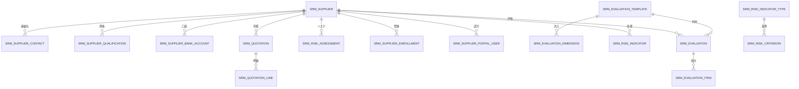

# SRM サプライヤー関係管理

> 本文書は現行 SRM の境界、データ契約、実装制約を記録し、中国語版を事実の原本とします。変更前に本文と[アーキテクチャ](architecture.jp.md)、[API 契約](api-contract.jp.md)、[バックエンド規約](backend-patterns.jp.md)、[フロントエンド規約](frontend-patterns.jp.md)を読んでください。
> [原設計と過去の検収](design/srm-design.jp.md)は当時の適用範囲を保持し、現行ソースや実行証拠の代わりにはなりません。操作と実画面は [SRM Wiki](guides/srm-flow.jp.md)、拡張とコンテナテストは[開発 Wiki](guides/scaffold-development.jp.md#9-srm-拡張とコンテナテスト)を参照してください。

[中文](srm.md) · [English](srm.en.md) · [日本語](srm.jp.md) · [한국어](srm.kr.md)

SRM はサプライヤーの登録審査、分類・等級、業績評価、リスク、ポータルを扱う独立サービス `omni-srm` です。調達実行と資産管理は既存の `omni-procurement`、`omni-asset` が担当します。SRM は内部契約で見積に参加しますが、発注や資産処分を所有しません。

## 1. サービス境界

| 項目 | 値 |
|---|---|
| Maven モジュール | `omni-srm` |
| サービスポート | `8105` |
| 管理ポート | `19905` |
| XXL-JOB 実行器 | `omni-srm / 9905` |
| DB | `omni_srm` |
| Gateway | `/api/srm/**` → `lb://omni-srm` |
| Redis | DB 0、Auth 共通 XSS キャッシュキー |

依存：`omni-common-service`、`omni-common-core`、`omni-common`、`omni-common-mybatis`、`omni-common-redis`、`omni-common-operlog`、`omni-common-job`、`omni-common-mqlog`。`omni-common-workflow` に依存せず、Flowable を組み込みません。承認ランタイムとテーブルは独立 Workflow に属します。サービス間通信は OpenFeign と `X-Internal-Token`、`X-Tenant-Id` を使い、Auth DB を直接読みません。表のポートはソースの既定値であり、現在の稼働健全性の証明ではありません。

## 2. ドメインモデル

### 2.1 集約とテーブル

| 集約 | テーブル | 責務 |
|---|---|---|
| Supplier | `srm_supplier`、`srm_supplier_contact`、`srm_supplier_qualification`、`srm_supplier_bank_account` | 基本データと子資源 |
| Evaluation | `srm_evaluation_template`、`srm_evaluation_dimension`、`srm_evaluation`、`srm_evaluation_item` | テンプレート、次元、評価と項目 |
| Risk | `srm_risk_indicator`、`srm_risk_assessment`、`srm_risk_indicator_type`、`srm_risk_criterion`、`srm_risk_score_threshold` | 指標、総合履歴、動的設定 |
| Portal | `srm_supplier_invite`、`srm_supplier_enrollment`、`srm_supplier_portal_user` | 招待、ロール Saga、アカウント関連 |
| Quotation | `srm_quotation`、`srm_quotation_line`、`srm_quotation_request` | 見積スナップショット、明細、永続要求台帳 |
| Inbox | `srm_event_inbox` | 消費の冪等記録 |

図は主な論理関連です。クロス DB 外部キーを示すものでも、全テーブルを描く要件でもありません。



### 2.2 フィールドと担当

- 全 `srm_*` に tenant_id があります。owner_user_id/owner_unit_id を直接使う認可ルートは Supplier と Evaluation のみです。連絡先、資格、銀行口座、リスク、見積は親経由、評価項目は Evaluation 経由、見積明細は Quotation→Supplier 経由でスコープを継承します。存在しない owner 列を SQL に追加しません。
- 認可ルートと可変業務行は version/deleted と監査列を使います。設定表と冪等台帳は個別 schema に従い、全書込みを同じクライアント version コマンドとみなしません。
- userId/unitId は Auth が管理し、クライアント ownerUnitId は信頼しません。supplier_no は DB ID から生成し MAX+1 は禁止です。正規化 credit_code はテナント内一意で、ポータル登録では必須です。
- ポータル user_id は `srm_supplier_portal_user` で関連付け、内部 owner に入れません。新規ポータルサプライヤーの内部 owner は初期状態で空です。
- Supplier は番号、名称/normalized_name、種類、業種、信用コード、Web、電話、メール、地域、住所、分類、等級、状態、割当/評価時刻に加え、インスタンス、要求、業務キー、モデル、試行番号、開始状態を保持します。
- 有効な主要連絡先と既定銀行口座は各一件で、tenant + primary_supplier_guard 一意制約で保証します。子表に内部 owner スナップショットはありません。Evaluation owner は作成時に Supplier から取得し、担当移管時に同一トランザクションで同期する可変権限スナップショットで、過去の点数は変えません。
- PortalUser は tenant + user_id で一意です。Enrollment は tenant + request_id で冪等、active_user_guard で活動中の申請を制限します。招待の生トークンは作成時だけ返し、DB は SHA-256 摘要を保存し、version 条件付き SQL で利用数を原子的に増やします。
- 日時は `yyyy-MM-dd HH:mm:ss`。見積の十進文字列 JSON と精度は第 9 節に従います。

## 3. セキュリティ

### 3.1 六段階の信頼チェーン

Gateway の RS256 JWT 検証と信頼済み識別ヘッダー上書き → 共通 GatewayPreAuthenticationFilter の Authentication 構築 → ServiceIdentityFilter のユーザー/テナント検証・設定 → Controller 機能権限 → スコープ解決と MyBatis 条件 → 明示的な行レベル書込認可。

不正な識別情報は 401、有効スコープ欠落は SQL で拒否します（id=-1）。Auth の権限拒否は 403、他の依存障害は 503 で、無制限検索に切り替えません。

### 3.2 永続化とスコープ

共通 `ServicePersistenceAutoConfiguration` がインターセプタを組み立て、SRM は `SrmTenantTablePolicy` と `SrmDataPermissionHandler` を提供します。

```text
TenantLineInnerInterceptor → DataPermissionInterceptor → OptimisticLockerInnerInterceptor → PaginationInnerInterceptor
```

TenantLine は srm_* のみを処理します。sys_mq_message は二種類のドメイン権限条件の対象外で、Relay は設計どおり全テナントの送信待ちを走査します。ユーザーのメッセージ検索には明示的 tenant 条件が必要です。DataPermission はページングより前に置き、COUNT と行の範囲を一致させます。

| dataScope | ルート条件 |
|---|---|
| `SELF` | `owner_user_id = currentUserId` |
| `DEPT` | `owner_unit_id = primaryUnitId` |
| `DEPT_AND_BELOW / CUSTOM` | `owner_unit_id IN accessibleUnitIds` |
| `TENANT / ALL` | owner 条件なし、TenantLine 保持 |

表は認可ルートの条件で、子は親の EXISTS/JOIN で継承します。テンプレート、ディメンション、リスク設定はテナント共有で、内部 owner 条件を使いません。

### 3.3 書込認可とコンテキスト

既存業務行の変更は可視なテナント行を読み、状態/関連を確認して、実更新に id/version/deleted と更新行数確認を使います。DataPermission は AccessGuard を代替せず、専用 SQL は owner 条件を除外し得ます。番号補完、連鎖更新、台帳、共有設定は別経路で、全コマンドがクライアント version を受けるわけではありません。

内部 owner 資源は同じ完全コードの `@PreAuthorize` と `@ServiceDataScope` を使います。ポータルはロール・権限・現在アカウント関連、リスク設定はテナント識別と設定権限で認可し、owner アスペクトを機械的に適用しません。業務変更は `@OperLog` を記録します。

入れ子の SrmPermissionScopeExecutor/SrmPortalScope は finally で元の範囲を復元し、外側アスペクト/識別フィルターが最後に消去します。ServiceIdentityContext と ServiceDataScopeContext は両方存在し、テナント関連のスレッドコンテキストがないとは言えません。

### 3.4 権限とロール

| 資源 | API 権限 |
|---|---|
| 概要 | `srm:overview:list` |
| サプライヤー | `srm:supplier:list/create/update/delete/withdraw/cancel/suspend/resume/blacklist/restore/eliminate/transfer` |
| 連絡先 | `srm:contact:list/create/update/delete` |
| 資格 | `srm:qualification:list/create/update/delete` |
| 銀行口座 | `srm:bank-account:list/create/update/delete` |
| 評価 | `srm:evaluation:list/create/view` |
| リスク | `srm:risk:list/update/assess` |
| リスク設定 | `srm:risk:config:list/update` |
| 招待 | `srm:invite:list/create/revoke · srm:portal:invite` |
| 担当候補 | `srm:owner:list` |
| PII | `srm:pii:view` |
| ポータル | `srm:portal:enroll/profile/evaluation/quotation` |

斜線は複数の完全コードの略記で、一個の権限ではありません。submit は srm:supplier:create を使います。承認タスクは Workflow が処理し、現行 SRM Controller に approve/reject エンドポイントはありません。

| ロール | シード範囲 | 機能 |
|---|---|---|
| `SRM_ADMIN` | `TENANT` | テナント内管理、代理のセルフサービス見積は含まない |
| `PROCUREMENT_MANAGER` | `DEPT_AND_BELOW` | 部門・下位部門、評価とリスク |
| `PROCUREMENT_STAFF` | `SELF` | 担当業務と日常操作。設定は機能権限によるテナント共有 |
| `SUPPLIER` | `SELF` | ポータル資料、業績、見積。ACTIVE 関連も必要 |
| `SUPER_ADMIN` | `ALL` | 全権限ツリー、データは現テナント、ポータルなりすまし不可 |

正式 auth.sql の既定テナント用シード例で、全新規テナントにこれらのロールがある証拠ではありません。USER は portal enroll のみです。profile/evaluation/quotation は SUPPLIER、対応権限、現在のテナント/ユーザーの ACTIVE PortalUser も必要です。内部管理者は代理見積できず、SUPER_ADMIN だけでもポータル主体になりすませません。複数ロールは実際の権限集合で管理入口を判定します。

### 3.5 PII、XSS、ログ

サプライヤー専用一覧は常にマスク VO を使います。サプライヤー詳細/360、連絡先・銀行口座の一覧/詳細は srm:pii:view で電話、メール、口座番号を扱い、全一覧が常時マスクとは限りません。住所など未マスク項目に汎用秘匿化の保証はありません。ポータル profile はロール/権限/ACTIVE 関連を確認して自身の電話/メールを返します。旧文書の portal contacts/qualifications/bank-accounts API は現行にありません。

`omni.service.xss.enabled=true` は共通 CachedServiceXssConfigProvider と Redis DB 0 の xss:enabled:{tenantId}/xss:rules:{tenantId} を使います。キャッシュ異常は Auth に照会し、失敗時は安全基準を使いつつ権威設定の enabled を尊重します。SRM 独自 SPI や確認済み srm: 業務キャッシュ接頭辞はありません。備考はプレーンテキストで v-html を使いません。

OperLog は明示的なフィールド規則に従い、任意 PII の認識保証はありません。登録はスナップショットを無効化し inviteToken/creditCode/phone/email を除外します。作成時の招待トークンもログに残しません。非同期汎用ログはドメイン状態、評価、Inbox の事実を代替しません。

## 4. ライフサイクルと主要フロー

### 4.1 登録審査と Workflow

SupplierStatus は REGISTERING、REGISTERING_FAILED、PENDING_REVIEW、APPROVING、REJECTED、APPROVED、SUSPENDED、BLACKLISTED、ELIMINATED の九値です。主経路：

```text
ポータル：REGISTERING → ロール Saga 成功 → PENDING_REVIEW
管理者作成 / REJECTED 再提出 → Workflow 準備・呼出し → STARTED 確認後 APPROVING
Workflow 完了 → APPROVED / REJECTED
APPROVING 取下げ/取消 → PENDING_REVIEW + NOT_STARTED
APPROVED → SUSPENDED → APPROVED
APPROVED → BLACKLISTED → APPROVED
APPROVED/SUSPENDED → ELIMINATED（終端）
```

管理者 create、却下後 submit、ポータルロール成功処理はローカルトランザクション内で SupplierWorkflowCoordinator を同期呼出しします。モデル解決は開始例外捕捉より先で、不在/未公開/照会失敗は作成や Saga 結果をロールバックし得ます。開始呼出し失敗では FAILED 記録を試み、PENDING_REVIEW/FAILED がコミットされ得ます。markStarted/markFailed は REQUIRED で、コミット後開始や分散原子性ではありません。

requestId、businessKey（supplierId:attempt）、modelVersionId、attempt、開始状態/インスタンスを保存します。startUser は現在識別情報から取得し、Supplier の永続化開始者列ではありません。モデルはサーバー選択で Workflow 応答は replayed です。既定モデル初期化は全テナント分を保証しません。

submit/profile-submit は REJECTED のみで新試行を作ります。PENDING_REVIEW/FAILED の汎用同一スナップショット再試行 API はありません。取下げ/取消は遠隔停止後にローカル version 更新をするため分散ロールバックを保証せず、再提出入口の存在も意味しません。

完了は tenant/eventId Inbox と業務意図で冪等化し、業務キー・インスタンス・状態を照合します。有効な早着イベントは再配信を要求し、乱序を一律無視しません。登録審査結果は APPROVED/REJECTED です。調達参照は APPROVED を確認し、ブラックリスト解除は専用 restore 権限を使います。削除には状態とポータル/評価/リスク履歴の制限もあります。

### 4.2 業績評価

可視な APPROVED サプライヤーと完全な内部 owner が必要です。要求は supplierId/evaluationPeriod/items で、クライアント supplier version は受けず、ロック行の DB version を使います。

初期化は既定テンプレート一個と品質/納期/価格/サービスの 30/30/20/20 を維持します。テンプレート読込も設定修復を行い得るため書込みゼロではありません。項目は有効ディメンションを重複なく完全網羅し、点数 1–5（保存 DECIMAL(3,1)）、正の重み合計 100 です。`SUM(score / 5 × weight)` を HALF_UP 二桁に丸め、範囲 20–100、≥90 STRATEGIC、≥75 PREFERRED、≥60 QUALIFIED、その他 ELIMINATED です。この level_code は Supplier のライフサイクルを直接終了させません。

同一トランザクションで Evaluation/Items、等級/直近評価時刻、srm.evaluation.completed.v1 Outbox を保存します。評価項目は追加のみで、既定テンプレートの動的管理 UI はありません。独立履歴は最大 100 件、360 は直近五件です。

### 4.3 リスク

指標種類、採点基準、総得点閾値は DB 設定です。現行総合等級は非 null indicator.score の合計を閾値に照合し、指標の最高色を取りません。区間端点は含み、返却順の最初の一致を採用します。閾値なしは GREEN、全上界を超える未一致点は最大上界の等級、それ以外は GREEN です。設定は区間の完全網羅/非重複を保証しません。

正式 srm.sql の既定テナント例は FINANCIAL、COMPLIANCE、SUPPLY、COOPERATION、QUALITY、CERTIFICATE です。作成時は現在有効な種類から不足する GREEN 指標を冪等に補い、自動種類の score は null、それ以外は 1 にします。有効設定なしでは追加せず、全テナントにシードがあるとは保証しません。

手動更新は有効な指標種類が見つかった場合のみ autoCalc=1 を拒否し、種類不在・無効時はこの検査を省略します。criterionId 経路はテナント内の既存基準から点数/等級/ラベルをコピーし、現在同種別の強制検証はないため画面候補をサーバー保証と見なしません。旧 indicatorValue/riskLevel 入力も残ります。再計算は新しい評価履歴を挿入し、初回または非赤→RED のみイベントを書きますが、外部通知配送は証明しません。

期限なしは GREEN、残日数 0–30 は YELLOW、期限切れは RED。複数資格は最重大等級、同等級は最早日を使い、点数は 1/2/3 です。手動評価、指標更新、APPROVED/SUSPENDED/BLACKLISTED の資格作成/更新/削除で再計算します。現行 SRM Java に専用 @XxlJob/@Scheduled リスク走査実装はなく、外部タスク設定は別途検証します。

### 4.4 ポータルアカウントとロール Saga

公開 Auth register は実 CAPTCHA、テナント内ユーザー名一意、パスワードハッシュを使います。既定 USER 割当の失敗境界は Core Flow 1 に従います。SRM enroll は認証済み既存ユーザーを扱い、パスワードを受けません。

requestId とテナント招待の期限/状態/利用数を検証し、REGISTERING Supplier、初期リスク、PENDING_ROLE_ASSIGN Enrollment、ロール要求 Outbox を作ります。requestId 再実行は申請者と正規化 credit_code を比較し、全本文ハッシュではありません。活動中申請は元結果を返し、招待を再消費しません。

Auth は SUPPLIER、要求台帳、結果 Outbox を原子的に保存し、完了再実行は決定的イベント ID の結果を再送します。SRM 成功は PortalUser を作成/有効化し COMPLETED/PENDING_REVIEW として同じローカルトランザクションで Workflow を開始します。Auth ロールがコミット済みでも SRM モデル照会でロールバックし得るため、部分成功認可がないとの保証は不正確です。実状態とメッセージ再配信を確認し、Saga COMPLETED を APPROVED/Workflow 健全性と同一視しません。

失敗は ROLE_ASSIGN_FAILED/REGISTERING_FAILED です。enrollment/retry は失敗/待機期限後に元 requestId で新 Outbox を書き、招待を消費しません。承認開始再試行ではありません。画面は状態をポーリングし完了時に再ログインを案内し、DB ロール追加は既存 JWT を変更しません。[Core Flows 15/18](core-flows.jp.md) を参照してください。

## 5. 外部 API

### 5.1 共通契約

応答は `R<T>`、ページ応答は `R<PageResult<T>>`、page=1/size=10、size 最大 100。通常一覧は `R<List<T>>` の場合もあります。Entity を外部要求/応答にせず実 DTO に従います。日時は共通形式。状態/既存行更新は通常 version を持ちますが、評価作成、リスク評価作成、設定は個別契約です。

### 5.2 現行パス

77 個のメソッド/パスは現行別名を含み、/api/srm からの相対パスを各項に完全記載しています。

| Controller | メソッドとパス |
|---|---|
| サプライヤー分析 (SupplierInsightController) | `GET /supplier/{supplierId}/evaluation/history` · `GET /supplier/{supplierId}/risk` |
| サプライヤー (SupplierController) | `GET /supplier/list` · `GET /supplier/{id}` · `GET /supplier/{id}/overview` · `POST /supplier` · `PUT /supplier/{id}` · `POST /supplier/{id}/transfer` · `DELETE /supplier/{id}` · `POST /supplier/{id}/submit` · `POST /supplier/{id}/withdraw` · `POST /supplier/{id}/cancel` · `POST /supplier/{id}/suspend` · `POST /supplier/{id}/resume` · `POST /supplier/{id}/restore-from-blacklist` · `POST /supplier/{id}/restore` · `POST /supplier/{id}/blacklist` · `POST /supplier/{id}/eliminate` |
| リスク設定 (RiskIndicatorConfigController) | `GET /risk/config/types` · `POST /risk/config/types` · `PUT /risk/config/types/{id}` · `DELETE /risk/config/types/{id}` · `POST /risk/config/criteria` · `PUT /risk/config/criteria/{id}` · `DELETE /risk/config/criteria/{id}` · `GET /risk/config/thresholds` · `PUT /risk/config/thresholds` |
| リスク (RiskController) | `GET /risk/list` · `GET /risk/indicators/{supplierId}` · `PUT /risk/indicator/{id}` · `POST /risk/assessment/{supplierId}` · `GET /risk/assessment/history/{supplierId}` |
| 資格 (QualificationController) | `GET /supplier/{supplierId}/qualification` · `GET /supplier/{supplierId}/qualification/list` · `GET /supplier/{supplierId}/qualification/{id}` · `POST /supplier/{supplierId}/qualification` · `PUT /supplier/{supplierId}/qualification/{id}` · `DELETE /supplier/{supplierId}/qualification/{id}` |
| ポータル見積 (PortalQuotationController) | `GET /portal/quotation/invitations` · `GET /portal/quotation/invitations/{rfqId}` · `POST /portal/quotation` |
| 招待・別名 (PortalInviteController) | `GET /portal/invite` · `GET /portal/invite/list` · `GET /invite` · `GET /invite/list` · `POST /portal/invite` · `POST /invite` · `POST /portal/invite/{inviteId}/revoke` · `POST /invite/{inviteId}/revoke` |
| ポータル評価 (PortalEvaluationController) | `GET /portal/evaluations` · `GET /portal/evaluations/history` |
| ポータル登録/資料 (PortalController) | `POST /portal/enroll` · `GET /portal/enrollment` · `POST /portal/enrollment/retry` · `GET /portal/profile` · `PUT /portal/profile` · `POST /portal/profile/submit` |
| 概要 (OverviewController) | `GET /overview/summary` · `GET /overview/risk-dashboard` |
| 担当候補 (OptionsController) | `GET /options/owners` |
| 評価 (EvaluationController) | `GET /evaluation/list` · `GET /evaluation/{id}` · `GET /evaluation/supplier/{supplierId}` · `GET /evaluation/template/default/dimensions` · `POST /evaluation` |
| 連絡先 (ContactController) | `GET /supplier/{supplierId}/contact` · `GET /supplier/{supplierId}/contact/list` · `GET /supplier/{supplierId}/contact/{id}` · `POST /supplier/{supplierId}/contact` · `PUT /supplier/{supplierId}/contact/{id}` · `DELETE /supplier/{supplierId}/contact/{id}` |
| 銀行口座 (BankAccountController) | `GET /supplier/{supplierId}/bank-account` · `GET /supplier/{supplierId}/bank-account/list` · `GET /supplier/{supplierId}/bank-account/{id}` · `POST /supplier/{supplierId}/bank-account` · `PUT /supplier/{supplierId}/bank-account/{id}` · `DELETE /supplier/{supplierId}/bank-account/{id}` |

### 5.3 サプライヤー360

サプライヤー可視性は全子権限を与えません。詳細/overview は連絡先、資格、銀行、評価、リスクの権限ごとにスコープを解決し、未許可ブロックは照会しません。overview は直近五評価、リスク指標、最新評価を取得します。PII は 3.5、SrmPermissionScopeExecutor は元の scope を復元し、全ブロックが一つの owner 認可を共有するわけではありません。

## 6. サービス連携とイベント

DomainEventEnvelope は eventId/eventType/occurredAt/tenantId/producer、aggregateType/aggregateId/aggregateVersion、actorUserId/correlationId/payload を持ち、各イベント契約に従い設定します。

作成/移管の OwnerResolver は Auth の有効な同テナントユーザー、主組織、割当範囲を確認し、他者指定には transfer 権限も必要です。OwnerEnricher は重複除去後ユーザー/組織を別バッチで照会します。例外時は ID/空名称を保ち得ますが権限を広げず、全 Feign が DB トランザクション外とは保証しません。

`ReliableMessageRelay.send("srm-domain-out-0", envelope, tenantId, eventId)` は明示的 tenantId と既定 REQUIRED でローカル Outbox を書き、Relay が後から Broker に送ります。Relay 停止は Outbox 停止ではありません。eventId は DomainEventEnvelope 最上位の msgKey、Outbox msgId は別生成です。消費者はイベント/意図を原子的に処理します。payload は明示的 ID、版、状態、点数、金額スナップショットを含められますが、完全口座/連絡情報/招待トークンは含めません。

`srm.supplier.registered.v1` · `srm.supplier.approved.v1` · `srm.supplier.rejected.v1` · `srm.supplier.suspended.v1` · `srm.supplier.blacklisted.v1` · `srm.supplier.eliminated.v1` · `srm.portal-role.assign-requested.v1` · `auth.portal-role.assigned.v1` · `auth.portal-role.assign-failed.v1` · `srm.evaluation.completed.v1` · `srm.risk.level-changed.v1` · `srm.quotation.submitted.v1`

上記は現行イベント種別で、Outbox 挿入や段階完了は Broker 配送を証明しません。

### 6.1 内部 API

四パスは X-Internal-Token/X-Tenant-Id と query/body tenant 一致が必要で、Gateway 公開はしません。

| Controller | メソッドとパス |
|---|---|
| 内部サプライヤー (InternalSupplierController) | `GET /api/internal/supplier/{supplierId}` · `GET /api/internal/supplier/search` · `POST /api/internal/supplier/batch` |
| 内部見積 (InternalQuotationController) | `GET /api/internal/quotation/batch` |

Supplier get/batch はテナント内未削除概要を返し、APPROVED を自動条件にはしません。呼出し側が業務状態を確認します。search は status/category/keyword と 1–100 に制限した limit、batch は重複除去後の初出順・最大 100 正 ID・欠損省略です。概要は ID/番号/名称/状態/等級/分類のみで、連絡先/口座は含みません。

SRM は Procurement /api/internal/procurement/rfq/invitations と /rfq/{rfqId}/invitation を呼びます。supplierId は現在の ACTIVE PortalUser から取り、クライアント主体を使わずテナントを信頼ヘッダーで渡します。内部見積 batch は SUBMITTED、有効期限内、Supplier APPROVED の見積のみ返します。

## 7. 変更時の制約

テナント分離、明示的書込認可、専用状態コマンド、必要 version、明示的 Outbox tenantId、finally 消去、サーバーのフィールドマスクを維持します。ポータルと内部 owner を分離し、子に不存在列を足しません。通常 PUT は状態/owner を変えず、MySQL に LocalDateTime.MIN/MAX を使いません。移行は forward-only、正式シードの摘要/検証条件を同期し init-all.sql は変えません。評価テンプレート、リスク設定、ポータル、内部 API の認可差は第 3–6 節に従います。

## 8. フロントエンド入口

| 領域 | 入口 | 役割 |
|---|---|---|
| API | [src/api/srm-overview.ts](../omni-frontend/src/api/srm-overview.ts) · [src/api/srm-supplier.ts](../omni-frontend/src/api/srm-supplier.ts) · [src/api/srm-evaluation.ts](../omni-frontend/src/api/srm-evaluation.ts) · [src/api/srm-risk.ts](../omni-frontend/src/api/srm-risk.ts) · [src/api/srm-risk-config.ts](../omni-frontend/src/api/srm-risk-config.ts) · [src/api/srm-portal.ts](../omni-frontend/src/api/srm-portal.ts) | 概要、Supplier/子、評価、リスク/設定、ポータル契約 |
| 管理画面 | [src/views/srm/overview/index.vue](../omni-frontend/src/views/srm/overview/index.vue) · [src/views/srm/supplier/index.vue](../omni-frontend/src/views/srm/supplier/index.vue) · [src/views/srm/evaluation/index.vue](../omni-frontend/src/views/srm/evaluation/index.vue) · [src/views/srm/risk/index.vue](../omni-frontend/src/views/srm/risk/index.vue) · [src/views/srm/risk/config/index.vue](../omni-frontend/src/views/srm/risk/config/index.vue) · [src/views/srm/invite/index.vue](../omni-frontend/src/views/srm/invite/index.vue) | 360、評価、リスク設定、招待 |
| サプライヤーポータル | [src/views/supplier-portal/index.vue](../omni-frontend/src/views/supplier-portal/index.vue) | 単一ページの作業画面 |
| 共通部品 | [src/components/srm/SupplierOverview.vue](../omni-frontend/src/components/srm/SupplierOverview.vue) · [src/components/srm/SupplierPicker.vue](../omni-frontend/src/components/srm/SupplierPicker.vue) · [src/components/srm/SupplierResourcesDrawer.vue](../omni-frontend/src/components/srm/SupplierResourcesDrawer.vue) · [src/components/srm/EvaluationScorecard.vue](../omni-frontend/src/components/srm/EvaluationScorecard.vue) · [src/components/srm/RiskIndicator.vue](../omni-frontend/src/components/srm/RiskIndicator.vue) · [src/components/srm/RiskDashboard.vue](../omni-frontend/src/components/srm/RiskDashboard.vue) | 360、選択、子資源、採点、リスク |

ApiResponse/PageResult は src/types/api.ts のみから取得します。ボタンは対応 v-permission、最終境界はサーバーです。360 は Drawer、リスク画面は等級フィルターを使います。管理権限のない SUPPLIER は管理ルートからポータルに移りますが、管理権限を持つ複数ロールを一律ポータル専用にはしません。

## 9. ポータル見積契約

要求は requestId/rfqId/version/validUntil/lines[{rfqLineId,unitPrice,deliveryDays,remark}] をバインドします。テナント、Supplier、名称、RFQ 番号、品目、単位、数量、通貨、金額は識別/関連/招待/サーバー計算から得ます。

新規書込は APPROVED Supplier をロックし RFQ=SENT、招待 INVITED/QUOTED、将来の締切を要求します。validUntil は現在より後で締切以降です。1–200 の一意行が RFQ 全行を網羅し、deliveryDays は 0–3650、remark は最大 500 字。unitPrice JSON は十進文字列のみ。正の単価/数量は DECIMAL(19,6) に無丸めで収まり、正の行金額は HALF_UP 四桁、総額はその合計で DECIMAL(19,4) に収まります。価格、数量、行/総額、イベント金額は文字列です。

永続 tenant/requestId 台帳は SHA-256 意図と quotationId/targetVersion を保持し、(tenant_id, quotation_id, target_version) で結果版を関連付けます。意図は rfqId、version、validUntil と行 ID 順の正規化単価/納期/備考です。初回 version=0 から保存版 1、更新は現在版を要求します。同一トランザクションで見積/明細/COMPLETED 台帳/イベントを保存し active_supplier_guard は Supplier/RFQ ごとに未削除一件を保証します。

成功再実行は新たな APPROVED/RFQ 確認より先ですが、DTO/ハッシュ/ポータル関連は必要です。元 Supplier/rfq/意図、COMPLETED、現在版≥目標版を照合して過去目標版でなく現在スナップショットを返し、イベントは再発行しません。履歴再実行は現在の編集可能性や内部 batch 採用を証明せず、同 requestId の異意図は 409 です。

拡張手順は[開発 Wiki](guides/scaffold-development.jp.md#9-srm-拡張とコンテナテスト)、画面/過去画像は[画像索引](wiki/interface-reference.jp.md#srm)を参照し、新実行証拠とは見なしません。

## 10. 検証範囲

個別摘要が一致した既存 Docker Reactor 産物は SRM JUnit 報告 27、成功 119、失敗/エラー/スキップ 0 です。各状態/点数、権限/分離、招待/ロール結果、見積再実行/版/金額の実際のアサーション範囲を証明します。旧最高色ヘルパーのテストは現行リスクサービス算法の検証ではありません。

実 CAPTCHA 登録、外部アカウント、実時間 Workflow/MQ、MySQL 並行性、教程実行はこの報告で証明せず、個別の実行証拠が必要です。言語は承認済み AI_REVIEW として記録し HUMAN_REVIEW と偽称せず、実行/画像証拠は固有範囲を保ちます。

## 11. 現行ソース入口

[移行](../database/changelog/srm/0001-srm-schema.yaml) · [状態](../omni-backend/omni-srm/src/main/java/com/omni/srm/domain/SrmStateMachine.java) · [範囲](../omni-backend/omni-srm/src/main/java/com/omni/srm/security/SrmDataPermissionHandler.java) · [DTO](../omni-backend/omni-srm/src/main/java/com/omni/srm/dto/SrmRequests.java) · [承認開始](../omni-backend/omni-srm/src/main/java/com/omni/srm/workflow/SupplierWorkflowCoordinator.java) · [承認完了](../omni-backend/omni-srm/src/main/java/com/omni/srm/service/impl/SupplierWorkflowCompletionServiceImpl.java) · [ポータル](../omni-backend/omni-srm/src/main/java/com/omni/srm/service/impl/SupplierPortalServiceImpl.java) · [ロール結果](../omni-backend/omni-srm/src/main/java/com/omni/srm/service/impl/PortalRoleResultServiceImpl.java) · [評価](../omni-backend/omni-srm/src/main/java/com/omni/srm/service/impl/EvaluationServiceImpl.java) · [リスク](../omni-backend/omni-srm/src/main/java/com/omni/srm/service/impl/RiskServiceImpl.java) · [リスク設定](../omni-backend/omni-srm/src/main/java/com/omni/srm/service/impl/RiskIndicatorConfigServiceImpl.java) · [見積](../omni-backend/omni-srm/src/main/java/com/omni/srm/service/impl/QuotationServiceImpl.java) · [JSON 要求](../omni-backend/omni-srm/src/main/java/com/omni/srm/dto/quotation/QuotationLineRequest.java) · [フロントルーター](../omni-frontend/src/router/index.ts)
