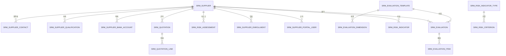

# SRM 공급업체 관계 관리

> 이 문서는 현재 SRM의 경계, 데이터 계약, 구현 제약을 기록하며 중국어를 사실 원문으로 삼습니다. 변경 전에 본문과 [아키텍처](architecture.kr.md), [API 계약](api-contract.kr.md), [백엔드 규칙](backend-patterns.kr.md), [프론트엔드 규칙](frontend-patterns.kr.md)을 읽으세요.
> [초기 설계와 과거 검수](design/srm-design.kr.md)는 당시 적용 범위를 유지하며 현재 소스나 실행 증거를 대신하지 않습니다. 실제 사용과 화면은 [SRM Wiki](guides/srm-flow.kr.md), 확장과 컨테이너 테스트는 [개발 Wiki](guides/scaffold-development.kr.md#9-srm-확장-및-컨테이너-테스트)를 참고하세요.

[中文](srm.md) · [English](srm.en.md) · [日本語](srm.jp.md) · [한국어](srm.kr.md)

SRM은 공급업체 입점 심사, 분류/등급, 성과, 리스크, 포털을 담당하는 독립 서비스 `omni-srm`입니다. 조달 실행과 자산 관리는 기존 `omni-procurement`, `omni-asset`에 속합니다. SRM은 내부 계약으로 견적에 참여하지만 발주나 자산 처분을 소유하지 않습니다.

## 1. 서비스 경계

| 항목 | 값 |
|---|---|
| Maven 모듈 | `omni-srm` |
| 서비스 포트 | `8105` |
| 관리 포트 | `19905` |
| XXL-JOB 실행기 | `omni-srm / 9905` |
| DB | `omni_srm` |
| Gateway | `/api/srm/**` → `lb://omni-srm` |
| Redis | DB 0, Auth 공통 XSS 캐시 키 |

의존성: `omni-common-service`, `omni-common-core`, `omni-common`, `omni-common-mybatis`, `omni-common-redis`, `omni-common-operlog`, `omni-common-job`, `omni-common-mqlog`. `omni-common-workflow`에 의존하거나 Flowable을 내장하지 않습니다. 승인 런타임과 테이블은 독립 Workflow 소유입니다. OpenFeign과 `X-Internal-Token`, `X-Tenant-Id`로 통신하며 Auth DB를 직접 읽지 않습니다. 표의 포트는 소스 기본값이며 현재 배포 정상 작동의 증거가 아닙니다.

## 2. 도메인 모델

### 2.1 애그리거트와 테이블

| 애그리거트 | 테이블 | 책임 |
|---|---|---|
| Supplier | `srm_supplier`, `srm_supplier_contact`, `srm_supplier_qualification`, `srm_supplier_bank_account` | 기본 데이터와 자식 리소스 |
| Evaluation | `srm_evaluation_template`, `srm_evaluation_dimension`, `srm_evaluation`, `srm_evaluation_item` | 템플릿, 차원, 평가 및 항목 |
| Risk | `srm_risk_indicator`, `srm_risk_assessment`, `srm_risk_indicator_type`, `srm_risk_criterion`, `srm_risk_score_threshold` | 지표, 종합 이력, 동적 설정 |
| Portal | `srm_supplier_invite`, `srm_supplier_enrollment`, `srm_supplier_portal_user` | 초대, 역할 Saga, 계정 연결 |
| Quotation | `srm_quotation`, `srm_quotation_line`, `srm_quotation_request` | 견적 스냅샷, 명세, 영구 요청 장부 |
| Inbox | `srm_event_inbox` | 소비 멱등 기록 |

그림은 주요 논리 관계이며 교차 DB 외래 키나 모든 테이블을 그려야 한다는 뜻이 아닙니다.



### 2.2 필드와 담당자

- 모든 `srm_*` 테이블에 tenant_id가 있습니다. owner_user_id/owner_unit_id를 직접 쓰는 권한 루트는 Supplier와 Evaluation뿐입니다. 연락처, 자격, 은행 계좌, 리스크, 견적은 부모를 통해, 평가 항목은 Evaluation을 통해, 견적 행은 Quotation→Supplier를 통해 범위를 상속합니다. 없는 owner 열을 SQL에 추가하면 안 됩니다.
- 권한 루트와 변경 가능한 업무 행은 version/deleted 및 감사 필드를 사용합니다. 설정과 멱등 장부는 별도 schema를 따르므로 모든 쓰기가 같은 클라이언트 version 명령은 아닙니다.
- Auth가 userId/unitId를 관리하며 클라이언트 ownerUnitId는 신뢰하지 않습니다. supplier_no는 DB ID에서 만들고 MAX+1은 금지합니다. 정규화 credit_code는 테넌트 내 고유하며 포털 입점 시 필수입니다.
- 포털 user_id는 `srm_supplier_portal_user`로 연결하고 내부 owner에 넣지 않습니다. 새 포털 공급업체는 처음에 내부 담당자가 없습니다.
- Supplier는 번호, 이름/normalized_name, 유형, 업종, 신용 코드, 웹, 전화, 이메일, 지역, 주소, 분류, 등급, 상태, 할당/평가 시각과 프로세스 인스턴스, 요청, 업무 키, 모델, 시도, 시작 상태를 보관합니다.
- 활성 주요 연락처와 기본 은행 계좌는 각각 최대 하나이며 tenant + primary_supplier_guard 고유 제약으로 보장합니다. 자식 테이블에는 내부 owner 스냅샷이 없습니다. Evaluation owner는 생성 시 Supplier에서 가져오고 이관 시 같은 트랜잭션에서 동기화하는 변경 가능한 권한 스냅샷이며 과거 점수는 바꾸지 않습니다.
- PortalUser는 tenant + user_id로 고유합니다. Enrollment는 tenant + request_id 멱등성과 active_user_guard로 활성 신청을 제한합니다. 원본 초대 토큰은 생성 시만 반환하고 DB에는 SHA-256을 저장하며 version 조건 SQL로 사용량을 원자적으로 올립니다.
- 일시는 `yyyy-MM-dd HH:mm:ss`입니다. 견적의 십진 문자열 JSON과 정밀도는 9절을 따릅니다.

## 3. 보안 구조

### 3.1 여섯 단계 신뢰 체인

Gateway의 RS256 JWT 검증/신뢰 식별 헤더 덮어쓰기 → 공통 GatewayPreAuthenticationFilter의 Authentication 생성 → ServiceIdentityFilter의 사용자/테넌트 검증·설정 → Controller 기능 권한 → 범위 해석과 MyBatis 필터 → 명시적 행 수준 쓰기 권한 검사.

잘못된 식별 정보는 401, 유효 범위 누락은 SQL에서 차단합니다(id=-1). Auth 권한 거부는 403, 다른 의존성 실패는 503이며 무제한 조회로 대체하지 않습니다.

### 3.2 영속성과 범위

공통 `ServicePersistenceAutoConfiguration`이 인터셉터를 구성하고 SRM은 `SrmTenantTablePolicy`와 `SrmDataPermissionHandler`를 제공합니다.

```text
TenantLineInnerInterceptor → DataPermissionInterceptor → OptimisticLockerInnerInterceptor → PaginationInnerInterceptor
```

TenantLine은 srm_*만 처리합니다. sys_mq_message는 두 도메인 권한 필터 밖이며 Relay는 설계대로 모든 테넌트의 대기 메시지를 조회합니다. 사용자 메시지 조회는 tenant를 명시적으로 제한해야 합니다. DataPermission이 페이지 처리보다 앞서 COUNT와 행의 범위를 맞춥니다.

| dataScope | 루트 조건 |
|---|---|
| `SELF` | `owner_user_id = currentUserId` |
| `DEPT` | `owner_unit_id = primaryUnitId` |
| `DEPT_AND_BELOW / CUSTOM` | `owner_unit_id IN accessibleUnitIds` |
| `TENANT / ALL` | owner 조건 없음, TenantLine 유지 |

표는 권한 루트 조건이며 자식은 부모 EXISTS/JOIN으로 상속합니다. 템플릿, 차원, 리스크 설정은 테넌트 공유이며 내부 owner 필터가 아닙니다.

### 3.3 쓰기 권한과 컨텍스트

기존 업무 변경은 보이는 테넌트 행을 조회하고 상태/관계를 확인하며 실제 업데이트에 id/version/deleted 및 영향 행 검사를 씁니다. DataPermission이 AccessGuard를 대신하지 않고 전용 SQL은 owner 필터를 제외할 수 있습니다. 번호 보완, 연쇄 변경, 장부, 공유 설정은 별도 경로이며 모든 명령이 클라이언트 version을 받지는 않습니다.

내부 owner 리소스는 동일한 전체 코드의 `@PreAuthorize`와 `@ServiceDataScope`를 씁니다. 포털은 역할·권한·현재 계정 연결, 리스크 설정은 테넌트 식별과 설정 권한으로 인가하므로 owner AOP를 기계적으로 적용하지 않습니다. 업무 변경은 `@OperLog`를 기록합니다.

중첩 SrmPermissionScopeExecutor/SrmPortalScope는 finally에서 이전 범위를 복원하고 외부 AOP/식별 필터가 최종 정리합니다. ServiceIdentityContext와 ServiceDataScopeContext가 모두 있으므로 테넌트 관련 스레드 컨텍스트가 없다고 하면 안 됩니다.

### 3.4 권한과 역할

| 리소스 | API 권한 |
|---|---|
| 개요 | `srm:overview:list` |
| 공급업체 | `srm:supplier:list/create/update/delete/withdraw/cancel/suspend/resume/blacklist/restore/eliminate/transfer` |
| 연락처 | `srm:contact:list/create/update/delete` |
| 자격 | `srm:qualification:list/create/update/delete` |
| 은행 계좌 | `srm:bank-account:list/create/update/delete` |
| 평가 | `srm:evaluation:list/create/view` |
| 리스크 | `srm:risk:list/update/assess` |
| 리스크 설정 | `srm:risk:config:list/update` |
| 초대 | `srm:invite:list/create/revoke · srm:portal:invite` |
| 담당자 후보 | `srm:owner:list` |
| PII | `srm:pii:view` |
| 포털 | `srm:portal:enroll/profile/evaluation/quotation` |

슬래시는 여러 전체 코드의 축약이며 하나의 저장 권한이 아닙니다. submit은 srm:supplier:create를 사용합니다. 승인 작업은 Workflow가 처리하며 현재 SRM Controller에 approve/reject 엔드포인트는 없습니다.

| 역할 | 시드 범위 | 기능 |
|---|---|---|
| `SRM_ADMIN` | `TENANT` | 테넌트 관리, 공급업체 셀프 견적 제외 |
| `PROCUREMENT_MANAGER` | `DEPT_AND_BELOW` | 부서/하위, 성과 평가와 리스크 |
| `PROCUREMENT_STAFF` | `SELF` | 자신의 업무와 일상 작업. 설정은 기능 권한에 따른 테넌트 공유 |
| `SUPPLIER` | `SELF` | 포털 자료, 성과, 견적. ACTIVE 연결도 필요 |
| `SUPER_ADMIN` | `ALL` | 전체 권한 트리, 현재 테넌트 데이터, 포털 사칭 불가 |

정식 auth.sql의 기본 테넌트 시드 예시이며 모든 새 테넌트가 이 역할을 갖는다는 증거는 아닙니다. USER에는 포털 enroll만 부여합니다. profile/evaluation/quotation은 SUPPLIER, 해당 권한, 현재 테넌트/사용자의 ACTIVE PortalUser도 필요합니다. 내부 관리자가 공급업체를 대신해 견적을 제출할 수 없고 SUPER_ADMIN만으로도 포털 주체를 사칭할 수 없습니다. 여러 역할의 계정은 실제 권한 집합으로 관리 접근을 판단합니다.

### 3.5 PII, XSS, 로그

공급업체 전용 목록은 항상 마스킹 VO를 사용합니다. 공급업체 상세/360, 연락처·은행 계좌 목록/상세는 srm:pii:view로 전화·이메일·계좌를 처리하므로 모든 목록이 항상 마스킹되지는 않습니다. 주소 등 마스킹되지 않는 필드에 일반적인 비식별화 보장은 없습니다. 포털 profile은 역할/권한/ACTIVE 연결 검증 후 자신의 전화·이메일을 반환하며 과거 문서의 portal contacts/qualifications/bank-accounts API는 현재 없습니다.

`omni.service.xss.enabled=true`는 공통 CachedServiceXssConfigProvider와 Redis DB 0의 xss:enabled:{tenantId}/xss:rules:{tenantId}를 사용합니다. 캐시 오류는 Auth에 조회하고 실패하면 보안 기본값을 사용하되 권위 있는 enabled 값은 존중합니다. SRM 전용 SPI나 확인된 srm: 업무 캐시 접두사는 없습니다. 비고는 일반 텍스트이며 v-html을 쓰지 않습니다.

OperLog는 명시적 필드 규칙을 적용하고 임의의 모든 PII 인식을 보장하지 않습니다. 입점은 스냅샷을 끄고 inviteToken/creditCode/phone/email을 제외하며 초대 생성 토큰도 로그에 남기지 않습니다. 비동기 공통 로그가 도메인 상태, 평가, Inbox 사실을 대신하지 않습니다.

## 4. 수명주기와 주요 흐름

### 4.1 입점 심사와 Workflow

SupplierStatus는 REGISTERING, REGISTERING_FAILED, PENDING_REVIEW, APPROVING, REJECTED, APPROVED, SUSPENDED, BLACKLISTED, ELIMINATED의 아홉 값입니다. 주요 경로:

```text
포털: REGISTERING → 역할 Saga 성공 → PENDING_REVIEW
관리자 생성 / REJECTED 재제출 → Workflow 준비·호출 → STARTED 확인 후 APPROVING
Workflow 완료 → APPROVED / REJECTED
APPROVING 철회/취소 → PENDING_REVIEW + NOT_STARTED
APPROVED → SUSPENDED → APPROVED
APPROVED → BLACKLISTED → APPROVED
APPROVED/SUSPENDED → ELIMINATED(최종)
```

관리자 create, 반려 후 submit, 포털 역할 성공 처리는 로컬 트랜잭션 안에서 SupplierWorkflowCoordinator를 동기 호출합니다. 모델 해석은 시작 오류 catch보다 앞서므로 누락/미발행/조회 실패가 로컬 생성이나 Saga 결과를 롤백할 수 있습니다. 시작 호출 실패는 FAILED 기록을 시도하며 PENDING_REVIEW/FAILED로 커밋될 수 있습니다. markStarted/markFailed는 REQUIRED이므로 커밋 후 시작이나 분산 원자성이 아닙니다.

requestId, businessKey(supplierId:attempt), modelVersionId, attempt, 시작 상태/인스턴스를 저장합니다. startUser는 현재 식별 정보이며 Supplier에 저장된 시작자 열이 아닙니다. 서버가 모델을 선택하고 Workflow 응답 필드는 replayed입니다. 기본 모델 초기화가 모든 테넌트 모델을 보장하지는 않습니다.

submit/profile-submit은 REJECTED만 허용하고 새 시도를 만듭니다. PENDING_REVIEW/FAILED의 일반적인 동일 스냅샷 재시도 API는 없습니다. 철회/취소는 원격 종료 후 로컬 version을 갱신하므로 분산 롤백이나 재제출 진입점 존재를 보장하지 않습니다.

완료 이벤트는 tenant/eventId Inbox와 업무 의도로 멱등 처리하고 업무 키/인스턴스/상태를 맞춥니다. 유효한 조기 이벤트는 메시지 재시도를 요구하므로 모든 순서 역전이 무시되지는 않습니다. 입점 결과는 APPROVED/REJECTED입니다. 조달 참조는 APPROVED, 블랙리스트 복원은 전용 restore 권한을 확인합니다. 삭제도 수명주기와 포털/평가/리스크 이력 제약을 받습니다.

### 4.2 성과 평가

보이는 APPROVED 공급업체와 완전한 내부 owner가 필요합니다. 요청은 supplierId/evaluationPeriod/items이며 클라이언트 supplier version을 받지 않고 잠근 행의 DB version을 씁니다.

초기화는 기본 템플릿 하나와 품질/납기/가격/서비스 30/30/20/20을 유지합니다. 템플릿 읽기도 로컬 설정을 복구할 수 있어 쓰기 0이 아닙니다. 항목은 활성 차원을 중복 없이 완전히 포함하고 점수 1–5(저장 DECIMAL(3,1)), 양의 가중치 합계 100입니다. `SUM(score / 5 × weight)`를 HALF_UP 소수 2자리로 반올림해 범위 20–100, ≥90 STRATEGIC, ≥75 PREFERRED, ≥60 QUALIFIED, 나머지 ELIMINATED로 정합니다. 이 level_code는 Supplier 수명주기를 직접 종료시키지 않습니다.

같은 트랜잭션에서 Evaluation/Items, 등급/최근 평가 시각, srm.evaluation.completed.v1 Outbox를 기록합니다. 항목은 추가 전용이며 기본 템플릿 동적 관리 UI는 없습니다. 별도 이력은 최대 100개, 360은 최근 5개입니다.

### 4.3 리스크

지표 유형, 채점 기준, 총점 임계값은 DB 설정입니다. 현재 종합 등급은 null이 아닌 indicator.score 합계를 임계 구간과 비교하며 최고 색상을 고르지 않습니다. 양 끝을 포함하고 반환 순서의 첫 일치를 사용합니다. 임계값이 없으면 GREEN, 모든 상한보다 큰 미일치 점수는 가장 큰 상한의 등급, 나머지는 GREEN입니다. 설정은 구간 전체 포함/비중복을 보장하지 않습니다.

정식 srm.sql의 기본 테넌트 예시는 FINANCIAL, COMPLIANCE, SUPPLY, COOPERATION, QUALITY, CERTIFICATE입니다. 생성 시 현재 활성 유형을 읽어 누락된 GREEN 지표를 멱등하게 보완하고 자동 유형 score는 null, 나머지는 1로 둡니다. 활성 설정이 없으면 추가하지 않으며 모든 테넌트에 시드가 있다고 보장하지 않습니다.

수동 갱신은 활성 지표 유형이 있을 때만 autoCalc=1을 거부하며 유형이 없거나 비활성이면 이 검사를 건너뜁니다. criterionId 경로는 테넌트 내 존재하는 기준의 점수/등급/라벨을 복사하지만 현재 동일 유형 검사가 없으므로 화면 후보가 서버 보장은 아닙니다. 기존 indicatorValue/riskLevel 입력도 남아 있습니다. 재계산은 새 평가 이력을 삽입하고 최초/비적색→RED만 이벤트를 기록하나 외부 알림 전달을 증명하지 않습니다.

만료일 없음은 GREEN, 0–30일 남음은 YELLOW, 만료됨은 RED입니다. 여러 자격은 가장 심한 등급, 같은 등급이면 빠른 날짜를 사용하고 점수는 1/2/3입니다. 수동 평가, 지표 수정, APPROVED/SUSPENDED/BLACKLISTED의 자격 생성/수정/삭제가 재계산합니다. 현재 SRM Java에는 전용 @XxlJob/@Scheduled 리스크 스캐너가 없으며 외부 작업 설정은 별도 검증합니다.

### 4.4 포털 계정과 역할 Saga

공개 Auth register는 실제 CAPTCHA, 테넌트 내 사용자명 고유성과 비밀번호 해시를 사용합니다. 기본 USER 할당의 실패 경계는 Core Flow 1을 따릅니다. SRM enroll은 인증된 기존 사용자만 처리하고 비밀번호를 받지 않습니다.

requestId와 테넌트 초대의 만료/상태/횟수를 확인하고 REGISTERING Supplier, 초기 리스크, PENDING_ROLE_ASSIGN Enrollment, 역할 요청 Outbox를 만듭니다. requestId 재실행은 신청자와 정규화 credit_code를 검사하며 전체 본문 해시는 아닙니다. 활성 신청은 원래 결과를 반환하고 초대를 다시 소비하지 않습니다.

Auth는 SUPPLIER 역할, 요청 장부, 결과 Outbox를 원자 기록하며 완료 재실행은 결정적 이벤트 ID 결과를 재발행합니다. SRM 성공은 PortalUser를 생성/활성화하고 COMPLETED/PENDING_REVIEW로 바꾼 뒤 같은 로컬 트랜잭션에서 Workflow 시작을 시도합니다. Auth 역할이 이미 커밋됐어도 SRM 모델 조회가 롤백할 수 있어 부분 성공 권한이 없다는 보장은 틀립니다. 실제 상태/재전달을 확인하며 Saga COMPLETED를 APPROVED나 Workflow 정상 작동과 동일시하지 않습니다.

실패는 ROLE_ASSIGN_FAILED/REGISTERING_FAILED입니다. enrollment/retry는 실패 및 대기 만료 후 원 requestId로 새 Outbox를 쓰고 초대를 소비하지 않으며 승인 시작 재시도가 아닙니다. 화면은 입점 상태를 폴링하고 완료 후 재로그인을 안내합니다. DB 역할 추가가 기존 JWT를 바꾸지 않습니다. [Core Flows 15/18](core-flows.kr.md)을 참고하세요.

## 5. 외부 API

### 5.1 공통 계약

응답은 `R<T>`, 페이지는 `R<PageResult<T>>`, 기본 page=1/size=10, 최대 size=100입니다. 일반 목록은 `R<List<T>>`일 수도 있습니다. Entity를 외부 요청/응답으로 쓰지 않고 실제 DTO를 따르며 일시는 공통 형식입니다. 상태/기존 행 수정은 보통 version을 받지만 평가 생성, 리스크 평가 생성, 설정은 별도 계약입니다.

### 5.2 현재 경로

현재 별명을 포함한 77개 메서드/경로는 /api/srm 기준이며 앞 경로를 보충하지 않고 각각 완전히 표시합니다.

| Controller | 메서드와 경로 |
|---|---|
| 공급업체 분석 (SupplierInsightController) | `GET /supplier/{supplierId}/evaluation/history` · `GET /supplier/{supplierId}/risk` |
| 공급업체 (SupplierController) | `GET /supplier/list` · `GET /supplier/{id}` · `GET /supplier/{id}/overview` · `POST /supplier` · `PUT /supplier/{id}` · `POST /supplier/{id}/transfer` · `DELETE /supplier/{id}` · `POST /supplier/{id}/submit` · `POST /supplier/{id}/withdraw` · `POST /supplier/{id}/cancel` · `POST /supplier/{id}/suspend` · `POST /supplier/{id}/resume` · `POST /supplier/{id}/restore-from-blacklist` · `POST /supplier/{id}/restore` · `POST /supplier/{id}/blacklist` · `POST /supplier/{id}/eliminate` |
| 리스크 설정 (RiskIndicatorConfigController) | `GET /risk/config/types` · `POST /risk/config/types` · `PUT /risk/config/types/{id}` · `DELETE /risk/config/types/{id}` · `POST /risk/config/criteria` · `PUT /risk/config/criteria/{id}` · `DELETE /risk/config/criteria/{id}` · `GET /risk/config/thresholds` · `PUT /risk/config/thresholds` |
| 리스크 (RiskController) | `GET /risk/list` · `GET /risk/indicators/{supplierId}` · `PUT /risk/indicator/{id}` · `POST /risk/assessment/{supplierId}` · `GET /risk/assessment/history/{supplierId}` |
| 자격 (QualificationController) | `GET /supplier/{supplierId}/qualification` · `GET /supplier/{supplierId}/qualification/list` · `GET /supplier/{supplierId}/qualification/{id}` · `POST /supplier/{supplierId}/qualification` · `PUT /supplier/{supplierId}/qualification/{id}` · `DELETE /supplier/{supplierId}/qualification/{id}` |
| 포털 견적 (PortalQuotationController) | `GET /portal/quotation/invitations` · `GET /portal/quotation/invitations/{rfqId}` · `POST /portal/quotation` |
| 초대와 별명 (PortalInviteController) | `GET /portal/invite` · `GET /portal/invite/list` · `GET /invite` · `GET /invite/list` · `POST /portal/invite` · `POST /invite` · `POST /portal/invite/{inviteId}/revoke` · `POST /invite/{inviteId}/revoke` |
| 포털 평가 (PortalEvaluationController) | `GET /portal/evaluations` · `GET /portal/evaluations/history` |
| 포털 입점/자료 (PortalController) | `POST /portal/enroll` · `GET /portal/enrollment` · `POST /portal/enrollment/retry` · `GET /portal/profile` · `PUT /portal/profile` · `POST /portal/profile/submit` |
| 개요 (OverviewController) | `GET /overview/summary` · `GET /overview/risk-dashboard` |
| 담당자 후보 (OptionsController) | `GET /options/owners` |
| 평가 (EvaluationController) | `GET /evaluation/list` · `GET /evaluation/{id}` · `GET /evaluation/supplier/{supplierId}` · `GET /evaluation/template/default/dimensions` · `POST /evaluation` |
| 연락처 (ContactController) | `GET /supplier/{supplierId}/contact` · `GET /supplier/{supplierId}/contact/list` · `GET /supplier/{supplierId}/contact/{id}` · `POST /supplier/{supplierId}/contact` · `PUT /supplier/{supplierId}/contact/{id}` · `DELETE /supplier/{supplierId}/contact/{id}` |
| 은행 계좌 (BankAccountController) | `GET /supplier/{supplierId}/bank-account` · `GET /supplier/{supplierId}/bank-account/list` · `GET /supplier/{supplierId}/bank-account/{id}` · `POST /supplier/{supplierId}/bank-account` · `PUT /supplier/{supplierId}/bank-account/{id}` · `DELETE /supplier/{supplierId}/bank-account/{id}` |

### 5.3 공급업체 360

공급업체가 보인다고 모든 자식 권한이 생기지는 않습니다. 상세/overview는 연락처, 자격, 은행, 평가, 리스크 권한별로 범위를 해석하고 미허용 블록은 조회하지 않습니다. overview는 최근 5개 평가, 리스크 지표, 최신 평가를 가져옵니다. PII는 3.5, SrmPermissionScopeExecutor는 이전 scope를 복원하므로 모든 블록이 한 owner 권한을 공유하지 않습니다.

## 6. 서비스 통합과 이벤트

DomainEventEnvelope 필드는 eventId/eventType/occurredAt/tenantId/producer, aggregateType/aggregateId/aggregateVersion, actorUserId/correlationId/payload이며 각 이벤트 계약에 따라 채웁니다.

생성/이관의 OwnerResolver는 활성·동일 테넌트 Auth 사용자, 주 조직, 할당 범위를 검사하고 다른 사용자 지정에는 transfer 권한도 필요합니다. OwnerEnricher는 중복 제거 후 사용자/조직을 따로 일괄 조회합니다. 오류 시 ID/빈 이름을 유지할 수 있지만 권한을 확대하거나 모든 Feign이 DB 트랜잭션 외부라고 보장하지 않습니다.

내부 담당자에게는 현재 테넌트의 `deleted=0` 포털 연결이 없어야 하며, `ACTIVE`와 `INACTIVE`를 모두 제외합니다. `OwnerOptionServiceImpl`은 후보 수를 제한하기 전에 포털 계정을 일괄 제외합니다. `SrmOwnerResolver`는 생성/이관 대상을 다시 검사하여 포털 연결이 있으면 403, 포털 신원 조회 건수가 null이면 503을 반환합니다. 정상적인 내부 이관은 정식 업무 트랜잭션에서 공급업체와 관련 평가의 담당자를 함께 갱신합니다.

`ReliableMessageRelay.send("srm-domain-out-0", envelope, tenantId, eventId)`는 명시적 tenantId와 기본 REQUIRED로 로컬 Outbox를 쓰고 Relay가 나중에 Broker로 전송합니다. Relay 중지는 Outbox 중지가 아닙니다. eventId는 DomainEventEnvelope 최상위로 msgKey에 전달되고 Outbox msgId는 별도 생성됩니다. 소비자는 이벤트/의도를 원자 처리해야 합니다. payload에는 명시적 ID·버전·상태·점수·금액 스냅샷을 넣을 수 있지만 전체 계좌/연락 정보/초대 토큰은 넣지 않습니다.

`srm.supplier.registered.v1` · `srm.supplier.approved.v1` · `srm.supplier.rejected.v1` · `srm.supplier.suspended.v1` · `srm.supplier.blacklisted.v1` · `srm.supplier.eliminated.v1` · `srm.portal-role.assign-requested.v1` · `auth.portal-role.assigned.v1` · `auth.portal-role.assign-failed.v1` · `srm.evaluation.completed.v1` · `srm.risk.level-changed.v1` · `srm.quotation.submitted.v1`

위는 현재 이벤트 유형이며 Outbox 삽입이나 단계 완료가 Broker 전달을 증명하지 않습니다.

### 6.1 내부 API

4개 경로는 X-Internal-Token/X-Tenant-Id와 query/body tenant 일치가 필요하며 Gateway에 노출하지 않습니다.

| Controller | 메서드와 경로 |
|---|---|
| 내부 공급업체 (InternalSupplierController) | `GET /api/internal/supplier/{supplierId}` · `GET /api/internal/supplier/search` · `POST /api/internal/supplier/batch` |
| 내부 견적 (InternalQuotationController) | `GET /api/internal/quotation/batch` |

Supplier get/batch는 테넌트 미삭제 요약을 반환하며 자동 APPROVED 필터는 없습니다. 호출자가 업무 상태를 검사합니다. search는 status/category/keyword와 1–100 제한 limit, batch는 중복 제거 최초 순서·최대 100개 고유 양수 ID·누락 생략입니다. 요약에는 ID/번호/이름/상태/등급/분류만 있고 연락처/계좌는 없습니다.

SRM은 Procurement /api/internal/procurement/rfq/invitations 및 /rfq/{rfqId}/invitation을 호출합니다. supplierId는 현재 ACTIVE PortalUser에서 가져오고 클라이언트 주체를 받지 않으며 tenant를 신뢰 헤더에 넣습니다. 내부 견적 batch는 SUBMITTED, 유효 기간 내, 공급업체 APPROVED인 견적만 반환합니다.

## 7. 변경 제약

테넌트 격리, 명시적 쓰기 권한, 전용 상태 명령, 필요한 version 검사, 명시적 Outbox tenantId, finally 정리, 백엔드 필드 마스킹을 유지합니다. 포털 계정과 내부 owner를 분리하고 자식에 없는 owner 조건을 붙이지 않습니다. 일반 PUT은 수명주기/owner를 바꾸지 않으며 MySQL에 LocalDateTime.MIN/MAX를 쓰지 않습니다. 마이그레이션은 forward-only이고 정식 시드 해시/검증을 맞추며 init-all.sql은 바꾸지 않습니다. 템플릿, 리스크 설정, 포털, 내부 API의 서로 다른 권한 경계는 3–6절을 따릅니다.

## 8. 프론트엔드 진입점

| 영역 | 진입점 | 역할 |
|---|---|---|
| API | [src/api/srm-overview.ts](../omni-frontend/src/api/srm-overview.ts) · [src/api/srm-supplier.ts](../omni-frontend/src/api/srm-supplier.ts) · [src/api/srm-evaluation.ts](../omni-frontend/src/api/srm-evaluation.ts) · [src/api/srm-risk.ts](../omni-frontend/src/api/srm-risk.ts) · [src/api/srm-risk-config.ts](../omni-frontend/src/api/srm-risk-config.ts) · [src/api/srm-portal.ts](../omni-frontend/src/api/srm-portal.ts) | 개요, Supplier/자식, 평가, 리스크/설정, 포털 계약 |
| 관리 화면 | [src/views/srm/overview/index.vue](../omni-frontend/src/views/srm/overview/index.vue) · [src/views/srm/supplier/index.vue](../omni-frontend/src/views/srm/supplier/index.vue) · [src/views/srm/evaluation/index.vue](../omni-frontend/src/views/srm/evaluation/index.vue) · [src/views/srm/risk/index.vue](../omni-frontend/src/views/srm/risk/index.vue) · [src/views/srm/risk/config/index.vue](../omni-frontend/src/views/srm/risk/config/index.vue) · [src/views/srm/invite/index.vue](../omni-frontend/src/views/srm/invite/index.vue) | 360, 평가, 리스크 설정, 초대 |
| 공급업체 포털 | [src/views/supplier-portal/index.vue](../omni-frontend/src/views/supplier-portal/index.vue) | 단일 페이지 작업대 |
| 공통 컴포넌트 | [src/components/srm/SupplierOverview.vue](../omni-frontend/src/components/srm/SupplierOverview.vue) · [src/components/srm/SupplierPicker.vue](../omni-frontend/src/components/srm/SupplierPicker.vue) · [src/components/srm/SupplierResourcesDrawer.vue](../omni-frontend/src/components/srm/SupplierResourcesDrawer.vue) · [src/components/srm/EvaluationScorecard.vue](../omni-frontend/src/components/srm/EvaluationScorecard.vue) · [src/components/srm/RiskIndicator.vue](../omni-frontend/src/components/srm/RiskIndicator.vue) · [src/components/srm/RiskDashboard.vue](../omni-frontend/src/components/srm/RiskDashboard.vue) | 360, 선택기, 자식 리소스, 점수, 리스크 |

ApiResponse/PageResult는 src/types/api.ts에서만 가져옵니다. 버튼은 대응 v-permission을 사용하고 최종 경계는 서버입니다. 360은 Drawer, 리스크 화면은 등급 필터를 사용합니다. 관리 권한 없는 SUPPLIER는 관리 경로에서 포털로 이동하지만 관리 권한 있는 다중 역할 계정을 무조건 포털 전용으로 제한하지 않습니다.

## 9. 포털 견적 계약

요청은 requestId/rfqId/version/validUntil/lines[{rfqLineId,unitPrice,deliveryDays,remark}]만 바인딩합니다. 테넌트, 공급업체, 이름, RFQ 번호, 자재, 단위, 수량, 통화, 금액은 식별/연결/초대/서버 계산에서 얻습니다.

새 쓰기는 APPROVED 공급업체를 잠그고 RFQ=SENT, 초대 INVITED/QUOTED, 미래 마감을 요구합니다. validUntil은 현재보다 뒤이며 마감 이상이어야 합니다. 고유 1–200개 행이 RFQ 전체와 일치하고 deliveryDays는 0–3650, remark는 최대 500자입니다. unitPrice JSON은 십진 문자열만 허용합니다. 양의 단가/수량은 반올림 없이 DECIMAL(19,6)에 맞고 양의 행 금액은 HALF_UP 소수 4자리, 총액은 그 합이며 DECIMAL(19,4)에 맞아야 합니다. 응답 단가·수량·행/총액과 이벤트 금액은 문자열입니다.

영구 tenant/requestId 장부는 SHA-256 의도와 quotationId/targetVersion을 저장하고 (tenant_id, quotation_id, target_version)으로 결과 버전을 연결합니다. 의도는 rfqId, version, validUntil과 행 ID순 정규화 단가/납기/비고입니다. 최초 version=0에서 저장 버전 1, 수정은 현재 버전을 요구합니다. 한 트랜잭션에서 견적/명세/COMPLETED 장부/이벤트를 쓰고 active_supplier_guard는 공급업체/RFQ별 미삭제 한 건을 보장합니다.

성공 재실행은 새 APPROVED/RFQ 검사보다 앞서지만 DTO/해시/포털 연결은 필요합니다. 원 supplier/rfq/의도, COMPLETED, 현재 버전≥목표를 확인하고 과거 목표 스냅샷 대신 현재 스냅샷을 반환하며 이벤트를 재발행하지 않습니다. 과거 재실행이 현재 수정 가능성이나 내부 batch 채택을 증명하지 않으며 동일 requestId의 다른 의도는 409입니다.

확장은 [개발 Wiki](guides/scaffold-development.kr.md#9-srm-확장-및-컨테이너-테스트), 화면/과거 이미지는 [이미지 색인](wiki/interface-reference.kr.md#srm)을 참고하며 새 실행 증거로 간주하지 않습니다.

## 10. 검증 경계

2026-10-24에 보관하고 개별 해시를 대조한 Docker Reactor 산출물은 SRM JUnit 보고 29개, 135개 통과, 실패/오류/건너뜀 0입니다. 상태/점수, 권한/격리, 초대/역할 결과, 견적 재실행/버전/금액의 각 실제 단언 범위를 증명합니다. 과거 최고 색상 도우미 테스트를 현재 리스크 서비스 알고리즘 검증으로 보지 않습니다.

실제 CAPTCHA 등록, 외부 계정, 실시간 Workflow/MQ, MySQL 동시성, 안내 절차 실행은 이 보고로 증명하지 않으며 별도 실행 증거가 필요합니다. 언어 검토는 승인된 AI_REVIEW로 기록하고 HUMAN_REVIEW로 위장하지 않으며 실행/이미지 증거는 각각의 실제 범위를 유지합니다.

## 11. 현재 소스 진입점

[마이그레이션](../database/changelog/srm/0001-srm-schema.yaml) · [상태](../omni-backend/omni-srm/src/main/java/com/omni/srm/domain/SrmStateMachine.java) · [범위](../omni-backend/omni-srm/src/main/java/com/omni/srm/security/SrmDataPermissionHandler.java) · [DTO](../omni-backend/omni-srm/src/main/java/com/omni/srm/dto/SrmRequests.java) · [승인 시작](../omni-backend/omni-srm/src/main/java/com/omni/srm/workflow/SupplierWorkflowCoordinator.java) · [승인 완료](../omni-backend/omni-srm/src/main/java/com/omni/srm/service/impl/SupplierWorkflowCompletionServiceImpl.java) · [포털](../omni-backend/omni-srm/src/main/java/com/omni/srm/service/impl/SupplierPortalServiceImpl.java) · [역할 결과](../omni-backend/omni-srm/src/main/java/com/omni/srm/service/impl/PortalRoleResultServiceImpl.java) · [평가](../omni-backend/omni-srm/src/main/java/com/omni/srm/service/impl/EvaluationServiceImpl.java) · [리스크](../omni-backend/omni-srm/src/main/java/com/omni/srm/service/impl/RiskServiceImpl.java) · [리스크 설정](../omni-backend/omni-srm/src/main/java/com/omni/srm/service/impl/RiskIndicatorConfigServiceImpl.java) · [견적](../omni-backend/omni-srm/src/main/java/com/omni/srm/service/impl/QuotationServiceImpl.java) · [JSON 요청](../omni-backend/omni-srm/src/main/java/com/omni/srm/dto/quotation/QuotationLineRequest.java) · [프론트 라우터](../omni-frontend/src/router/index.ts)
