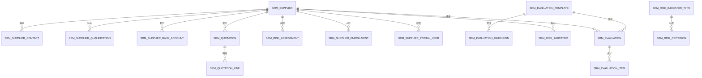

# SRM 供应商关系管理

> 本文记录当前 SRM 的服务边界、数据契约和实现约束；中文为事实源。修改 SRM 前先读本文及[架构](architecture.md)、[API 契约](api-contract.md)、[后端规范](backend-patterns.md)、[前端规范](frontend-patterns.md)。
> [原设计与历史验收](design/srm-design.md) 保留其原适用范围，不能替代当前源码和运行证据。操作与真实截图见 [SRM Wiki](guides/srm-flow.md)，扩展和容器测试见[开发 Wiki](guides/scaffold-development.md#9-srm-扩展与容器测试)。

[中文](srm.md) · [English](srm.en.md) · [日本語](srm.jp.md) · [한국어](srm.kr.md)

SRM 是独立微服务 `omni-srm`，负责供应商准入、分类分级、绩效、风险和门户自助。采购执行与资产管理分别属于现有 `omni-procurement`、`omni-asset`；SRM 通过内部契约参与报价，不拥有采购订单或资产处置。

## 1. 服务边界

| 项目 | 值 |
|---|---|
| Maven 模块 | `omni-srm` |
| 服务端口 | `8105` |
| 管理端口 | `19905` |
| XXL-JOB 执行器 | `omni-srm / 9905` |
| 数据库 | `omni_srm` |
| Gateway | `/api/srm/**` → `lb://omni-srm` |
| Redis | DB 0；Auth XSS 公共缓存键 |

依赖：`omni-common-service`、`omni-common-core`、`omni-common`、`omni-common-mybatis`、`omni-common-redis`、`omni-common-operlog`、`omni-common-job`、`omni-common-mqlog`。不依赖 `omni-common-workflow`，不内嵌 Flowable；审批运行时和表属于独立 Workflow。跨服务通过 OpenFeign 与 `X-Internal-Token`、`X-Tenant-Id` 调用，SRM 不跨库读取 Auth。表中端口是源码默认值，不是当前部署健康证明。

## 2. 领域模型

### 2.1 聚合与表

| 聚合 | 表 | 职责 |
|---|---|---|
| Supplier | `srm_supplier`、`srm_supplier_contact`、`srm_supplier_qualification`、`srm_supplier_bank_account` | 供应商主数据和子资源 |
| Evaluation | `srm_evaluation_template`、`srm_evaluation_dimension`、`srm_evaluation`、`srm_evaluation_item` | 模板、维度、评估及评分项 |
| Risk | `srm_risk_indicator`、`srm_risk_assessment`、`srm_risk_indicator_type`、`srm_risk_criterion`、`srm_risk_score_threshold` | 指标、综合历史及动态配置 |
| Portal | `srm_supplier_invite`、`srm_supplier_enrollment`、`srm_supplier_portal_user` | 邀请、角色 Saga、账号关联 |
| Quotation | `srm_quotation`、`srm_quotation_line`、`srm_quotation_request` | 报价快照、明细、永久请求账本 |
| Inbox | `srm_event_inbox` | 消费幂等记录 |

下面是主要逻辑关联，不表示跨库外键，也不要求每张表都画入图中。



### 2.2 字段与归属

- 所有 `srm_*` 表有 tenant_id；只有 Supplier、Evaluation 两类授权根直接使用 owner_user_id/owner_unit_id。联系人、资质、银行账户、风险、报价经父关系继承范围，评估项经 Evaluation，报价行经 Quotation 再到 Supplier；不能给不存在 owner 列的表追加 owner SQL。
- 授权根及可变业务行使用 version/deleted 和审计字段；配置表、幂等账本按各自 schema 处理，不把所有写入概括为同一种客户端版本命令。
- userId/unitId 由 Auth 管理；不信任客户端 ownerUnitId。supplier_no 按数据库 ID 生成，禁止 MAX+1；credit_code 规范化后在租户内唯一，门户入驻必填。
- 门户 user_id 通过 `srm_supplier_portal_user` 关联，不能填入内部 owner 列。门户新供应商的内部 owner 初始为空。
- Supplier 主数据包含编号、名称/normalized_name、类型、行业、信用代码、网站、电话、邮箱、地区、地址、类别、等级、状态及分配/评估时间，并保存流程实例、请求、业务键、模型、轮次和启动状态。
- 同一供应商最多一个有效主要联系人、一个有效默认银行账户，以 tenant + primary_supplier_guard 唯一约束保证；子表没有内部 owner 快照。Evaluation 的 owner 是可变权限快照，创建时取 Supplier，转移负责人时同事务同步，并不改变历史评分内容。
- PortalUser 的 tenant + user_id 唯一；Enrollment 的 tenant + request_id 幂等，active_user_guard 限制同一账号的活动申请。邀请原始令牌只在创建时返回，数据库保存 SHA-256 摘要；使用量由带 version 的条件 SQL 原子递增。
- 日期时间统一 `yyyy-MM-dd HH:mm:ss`。报价金额的 JSON 字符串及精度见第 9 节。

## 3. 安全架构

### 3.1 六层信任链

Gateway 验证 RS256 JWT 并覆盖注入可信身份头 → 公共 GatewayPreAuthenticationFilter 构建 Authentication → ServiceIdentityFilter 校验、绑定用户/租户 → Controller 功能权限 → 数据范围解析及 MyBatis 过滤 → 显式行级写授权。

缺合法身份返回 401；缺有效范围时 SQL 失败关闭（id=-1）；Auth 权限拒绝返回 403，其他依赖故障返回 503，不能降级为全量查询。

### 3.2 持久化与范围

公共 `ServicePersistenceAutoConfiguration` 装配拦截器，SRM 提供 `SrmTenantTablePolicy` 与 `SrmDataPermissionHandler`：

```text
TenantLineInnerInterceptor → DataPermissionInterceptor → OptimisticLockerInnerInterceptor → PaginationInnerInterceptor
```

TenantLine 只处理 srm_*，sys_mq_message 不进入这两种领域权限过滤；Relay 按设计扫描跨租户待发送行，用户消息查询仍必须显式筛选 tenant。DataPermission 在分页前，COUNT 与 records 使用同一范围。

| dataScope | 授权根条件 |
|---|---|
| `SELF` | `owner_user_id = currentUserId` |
| `DEPT` | `owner_unit_id = primaryUnitId` |
| `DEPT_AND_BELOW / CUSTOM` | `owner_unit_id IN accessibleUnitIds` |
| `TENANT / ALL` | 不加 owner 条件；保留 TenantLine |

上表是授权根条件，子资源使用父表 EXISTS/JOIN 继承。模板、维度和风险配置是租户共享资源，不按内部 owner 过滤。

### 3.3 写授权与上下文

已有业务记录的变更先查询当前租户可见行，再检查状态/关系，实际更新使用 id/version/deleted 条件及影响行数检查。DataPermission 不能替代 AccessGuard；专用 SQL 可以排除 owner 过滤。创建编号补全、级联、幂等账本和租户共享配置有各自路径，不声称所有命令都接受客户端 version。

内部 owner 资源使用完整同码的 `@PreAuthorize` 与 `@ServiceDataScope`。门户以角色、权限和当前账号关联授权；风险配置以租户身份和配置功能权限授权，二者不能机械套用 owner 切面。业务写操作记录 `@OperLog`。

嵌套 SrmPermissionScopeExecutor/SrmPortalScope 在 finally 恢复原范围；外层切面/身份过滤器负责最终清理。ServiceIdentityContext 和 ServiceDataScopeContext 都存在，不能声称没有租户相关线程上下文。

### 3.4 权限与角色

| 资源 | API 权限 |
|---|---|
| 概览 | `srm:overview:list` |
| 供应商 | `srm:supplier:list/create/update/delete/withdraw/cancel/suspend/resume/blacklist/restore/eliminate/transfer` |
| 联系人 | `srm:contact:list/create/update/delete` |
| 资质 | `srm:qualification:list/create/update/delete` |
| 银行账户 | `srm:bank-account:list/create/update/delete` |
| 评估 | `srm:evaluation:list/create/view` |
| 风险 | `srm:risk:list/update/assess` |
| 风险配置 | `srm:risk:config:list/update` |
| 邀请 | `srm:invite:list/create/revoke · srm:portal:invite` |
| 负责人候选 | `srm:owner:list` |
| PII | `srm:pii:view` |
| 门户 | `srm:portal:enroll/profile/evaluation/quotation` |

斜线是多个完整 code 的简写，不是实际存储的一个权限。submit 使用 srm:supplier:create；审批任务由 Workflow 处理，当前 SRM Controller 没有 approve/reject 端点。

| 角色 | 种子范围 | 能力 |
|---|---|---|
| `SRM_ADMIN` | `TENANT` | 租户内管理，不含供应商自助报价 |
| `PROCUREMENT_MANAGER` | `DEPT_AND_BELOW` | 部门及下级、绩效与风险管理 |
| `PROCUREMENT_STAFF` | `SELF` | 自身业务与日常操作；配置按功能权限租户共享 |
| `SUPPLIER` | `SELF` | 门户资料、绩效、报价，仍需 ACTIVE 关联 |
| `SUPER_ADMIN` | `ALL` | 完整功能树；数据限当前租户，不能冒充门户身份 |

这些是正式 auth.sql 默认租户种子示例，不证明每个新租户已有这些角色。USER 只获门户 enroll；profile/evaluation/quotation 还要求 SUPPLIER、对应权限及当前租户/用户的 ACTIVE PortalUser。内部管理员不能代供应商报价，SUPER_ADMIN 单独也不能冒充门户身份。拥有多种角色的账号仍按实际权限集合判定管理入口。

### 3.5 PII、XSS 与日志

供应商专用列表恒用脱敏 VO；供应商详情/360、联系人和银行账户列表/详情按 srm:pii:view 处理电话、邮箱、账号。不能概括为所有列表恒脱敏。地址等未被该组装器掩码的字段不因此获得通用脱敏保证。门户 profile 在角色/权限/ACTIVE 关联校验后返回自身电话和邮箱；当前没有文档旧列出的门户 contacts/qualifications/bank-accounts API。

`omni.service.xss.enabled=true` 使用共享 CachedServiceXssConfigProvider，读 Redis DB 0 的 xss:enabled:{tenantId}/xss:rules:{tenantId}，缓存异常回源 Auth，回源失败用安全基线，同时尊重权威 enabled 值。SRM 没有独立 SPI 实现或已证实的 srm:业务缓存前缀。备注按纯文本处理，不用 v-html。

OperLog 仅按显式字段规则脱敏，不保证任意 PII 识别。入驻接口关闭快照并排除 inviteToken/creditCode/phone/email；邀请创建的令牌不能写日志。领域状态、评估和 Inbox 事实不能由异步通用日志代替。

## 4. 生命周期与核心流程

### 4.1 准入与 Workflow

SupplierStatus 有 9 个值：REGISTERING、REGISTERING_FAILED、PENDING_REVIEW、APPROVING、REJECTED、APPROVED、SUSPENDED、BLACKLISTED、ELIMINATED。当前主路径：

```text
门户：REGISTERING → 角色 Saga 成功 → PENDING_REVIEW
管理员创建 / REJECTED 重新提交 → 准备并调用 Workflow → 确认 STARTED 后 APPROVING
Workflow 完成 → APPROVED / REJECTED
APPROVING 撤回/取消 → PENDING_REVIEW + NOT_STARTED
APPROVED → SUSPENDED → APPROVED
APPROVED → BLACKLISTED → APPROVED
APPROVED/SUSPENDED → ELIMINATED（终态）
```

管理员 create、驳回后 submit 和门户角色成功处理都在本地事务内同步调用 SupplierWorkflowCoordinator。模型解析在启动异常捕获之前，缺失/未发布/查询失败可回滚本地创建或 Saga 结果；启动调用失败则尝试标记 FAILED，可能提交 PENDING_REVIEW/FAILED。markStarted/markFailed 使用 REQUIRED，不能写成“提交后启动且全链路原子”。

启动保存 requestId、businessKey（supplierId:attempt）、modelVersionId、attempt、startStatus/实例；startUser 来自当前身份，不是 Supplier 的持久化启动人列。服务端选择模型，Workflow 响应字段是 replayed。默认模型初始化不保证所有租户自动拥有模型。

submit/profile-submit 只允许 REJECTED 并开启新轮次；当前没有 PENDING_REVIEW/FAILED 的通用同快照启动重试 API。撤回/取消先远程终止再做本地版本更新，不能保证分布式回滚，也不能因此假定有重新提交入口。

完成事件按租户/eventId Inbox 和业务意图幂等，匹配业务键/实例/当前状态；早到的有效完成事件会要求消息重试，不能笼统写成乱序全忽略。准入完成支持 APPROVED/REJECTED。采购引用须检查 APPROVED；黑名单恢复使用专用 restore 权限。删除还受生命周期及门户/评估/风险历史限制。

### 4.2 绩效

只对 APPROVED 且有完整内部 owner 的可见供应商发起。创建请求为 supplierId/evaluationPeriod/items，不携带客户端 supplier version；服务锁行后使用数据库版本更新供应商。

默认模板由初始化器保持一个默认项及质量/交期/价格/服务四维 30/30/20/20，读取模板也可能修复本地配置，不等于零写入。评分项必须唯一、完整对应启用维度，分数 1–5（存储 DECIMAL(3,1)），正权重合计 100。`SUM(score / 5 × weight)` 以 HALF_UP 保留 2 位，总分 20–100；≥90 STRATEGIC、≥75 PREFERRED、≥60 QUALIFIED、其余 ELIMINATED。这里的 level_code 不会把 Supplier 生命周期直接淘汰。

同事务写 Evaluation/Items、供应商等级/最近评估时间和 srm.evaluation.completed.v1 Outbox。评分项只追加；默认评估模板没有动态管理 UI。独立评估历史查询最多 100 条，360 只取最近 5 条。

### 4.3 风险

指标类型、评分标准、总分阈值由数据库配置。当前综合等级为非空 indicator.score 之和，再用阈值区间匹配；不是取所有指标最高颜色。区间端点包含，取查询结果中的首个匹配；无阈值返回 GREEN，未命中且超过所有最大上界时取最大上界对应等级，其余返回 GREEN。配置接口没有提供完整区间覆盖/不重叠的验证保证。

正式 srm.sql 的默认租户示例含 FINANCIAL、COMPLIANCE、SUPPLY、COOPERATION、QUALITY、CERTIFICATE。创建初始化按当前启用类型幂等补齐 GREEN 指标，自动类型 score=null，其余为 1；没有启用配置则不补齐，不保证每个租户已有这些种子。

手工更新只在查到启用的指标类型时检查 autoCalc=1 并拒绝编辑；类型缺失或停用时跳过这项检查。criterionId 分支读取当前租户存在的评分标准并复制分数/等级/标签；当前没有同类型强校验，不把前端候选过滤当作后端保证。旧 indicatorValue/riskLevel 输入分支仍存在。修改后插入新的综合评估历史，只有首次/非红转 RED 才写风险事件，不证明外部通知送达。

证书到期日缺失为 GREEN，距今天 0–30 天为 YELLOW，已过期为 RED；多份资质取最严重、同等级取更早日期，证书分数为 1/2/3。手动风险评估、指标更新及 APPROVED/SUSPENDED/BLACKLISTED 供应商的资质增改删触发重算。当前 SRM Java 源码没有专用 @XxlJob/@Scheduled 风险扫描实现；外部任务配置另行验证。

### 4.4 门户账号与角色 Saga

账号创建使用公开 Auth register，要求真实验证码、租户内用户名唯一和密码哈希；默认 USER 分配的具体失败边界见 Core Flow 1。SRM enroll 仅处理已认证现有用户，不传密码。

入驻携带 requestId + 租户邀请令牌，检查有效期、状态、次数；新建 REGISTERING 供应商、风险基础数据、PENDING_ROLE_ASSIGN Enrollment 和角色请求 Outbox。requestId 重放核对申请人和规范化 credit_code，不是整包请求哈希；已有活动申请可以返回原结果，不再次消耗邀请。

Auth 原子增加 SUPPLIER 角色、请求账本和结果 Outbox；完成重放会再发确定事件 ID 的结果。SRM 成功结果创建/激活 PortalUser，置 COMPLETED/PENDING_REVIEW 后在同一本地事务尝试启动 Workflow。Auth 角色可能已经提交而 SRM 模型解析失败回滚，因此“不出现半成功授权”不成立，需按真实状态/消息重投处理；Saga COMPLETED 不等于准入 APPROVED 或 Workflow 健康。

角色失败进入 ROLE_ASSIGN_FAILED/REGISTERING_FAILED。enrollment/retry 只在失败及退避到期后复用原 requestId 发新 Outbox，不消耗邀请；它不是审批启动重试。客户端按当前入驻状态轮询并在完成后提示重新登录，数据库角色增加不会改写现有 JWT。详情见已核对的 [Core Flows 15/18](core-flows.md)。

## 5. 外部 API

### 5.1 通用契约

返回 `R<T>`，分页端点返回 `R<PageResult<T>>`，page=1/size=10、size 上限 100；普通列表也可能返回 `R<List<T>>`。Entity 不作为外部请求/响应，按实际 DTO 处理。日期时间参数使用统一格式。状态和既有记录更新通常携带 version，评估创建、风险评估创建和配置接口按各自契约，不能统一概括。

### 5.2 当前路径

以下 77 个方法/路径包含当前别名，均相对 /api/srm，不从前一项补全路径。

| Controller | 方法与路径 |
|---|---|
| 供应商洞察 (SupplierInsightController) | `GET /supplier/{supplierId}/evaluation/history` · `GET /supplier/{supplierId}/risk` |
| 供应商 (SupplierController) | `GET /supplier/list` · `GET /supplier/{id}` · `GET /supplier/{id}/overview` · `POST /supplier` · `PUT /supplier/{id}` · `POST /supplier/{id}/transfer` · `DELETE /supplier/{id}` · `POST /supplier/{id}/submit` · `POST /supplier/{id}/withdraw` · `POST /supplier/{id}/cancel` · `POST /supplier/{id}/suspend` · `POST /supplier/{id}/resume` · `POST /supplier/{id}/restore-from-blacklist` · `POST /supplier/{id}/restore` · `POST /supplier/{id}/blacklist` · `POST /supplier/{id}/eliminate` |
| 风险配置 (RiskIndicatorConfigController) | `GET /risk/config/types` · `POST /risk/config/types` · `PUT /risk/config/types/{id}` · `DELETE /risk/config/types/{id}` · `POST /risk/config/criteria` · `PUT /risk/config/criteria/{id}` · `DELETE /risk/config/criteria/{id}` · `GET /risk/config/thresholds` · `PUT /risk/config/thresholds` |
| 风险 (RiskController) | `GET /risk/list` · `GET /risk/indicators/{supplierId}` · `PUT /risk/indicator/{id}` · `POST /risk/assessment/{supplierId}` · `GET /risk/assessment/history/{supplierId}` |
| 资质 (QualificationController) | `GET /supplier/{supplierId}/qualification` · `GET /supplier/{supplierId}/qualification/list` · `GET /supplier/{supplierId}/qualification/{id}` · `POST /supplier/{supplierId}/qualification` · `PUT /supplier/{supplierId}/qualification/{id}` · `DELETE /supplier/{supplierId}/qualification/{id}` |
| 门户报价 (PortalQuotationController) | `GET /portal/quotation/invitations` · `GET /portal/quotation/invitations/{rfqId}` · `POST /portal/quotation` |
| 邀请（含别名） (PortalInviteController) | `GET /portal/invite` · `GET /portal/invite/list` · `GET /invite` · `GET /invite/list` · `POST /portal/invite` · `POST /invite` · `POST /portal/invite/{inviteId}/revoke` · `POST /invite/{inviteId}/revoke` |
| 门户评估 (PortalEvaluationController) | `GET /portal/evaluations` · `GET /portal/evaluations/history` |
| 门户入驻/资料 (PortalController) | `POST /portal/enroll` · `GET /portal/enrollment` · `POST /portal/enrollment/retry` · `GET /portal/profile` · `PUT /portal/profile` · `POST /portal/profile/submit` |
| 概览 (OverviewController) | `GET /overview/summary` · `GET /overview/risk-dashboard` |
| 负责人候选 (OptionsController) | `GET /options/owners` |
| 评估 (EvaluationController) | `GET /evaluation/list` · `GET /evaluation/{id}` · `GET /evaluation/supplier/{supplierId}` · `GET /evaluation/template/default/dimensions` · `POST /evaluation` |
| 联系人 (ContactController) | `GET /supplier/{supplierId}/contact` · `GET /supplier/{supplierId}/contact/list` · `GET /supplier/{supplierId}/contact/{id}` · `POST /supplier/{supplierId}/contact` · `PUT /supplier/{supplierId}/contact/{id}` · `DELETE /supplier/{supplierId}/contact/{id}` |
| 银行账户 (BankAccountController) | `GET /supplier/{supplierId}/bank-account` · `GET /supplier/{supplierId}/bank-account/list` · `GET /supplier/{supplierId}/bank-account/{id}` · `POST /supplier/{supplierId}/bank-account` · `PUT /supplier/{supplierId}/bank-account/{id}` · `DELETE /supplier/{supplierId}/bank-account/{id}` |

### 5.3 Supplier 360

供应商可见性不能代替子资源权限。Supplier 详情/overview 分别按联系人、资质、银行账户、评估、风险的权限解析范围；没有权限的块不查询。overview 取最近 5 个评估、风险指标和最新评估；PII 标志按 3.5。SrmPermissionScopeExecutor 恢复先前 scope，不能把块查询说成共享同一个 owner 授权。

## 6. 跨服务与事件

DomainEventEnvelope 字段包括 eventId/eventType/occurredAt/tenantId/producer、aggregateType/aggregateId/aggregateVersion、actorUserId/correlationId/payload；各事件按其契约填充。

OwnerResolver 在创建/转移时校验 Auth 用户启用、同租户、主组织及可分配范围，指定他人还需 transfer 权限。OwnerEnricher 去重后分别批量查用户与组织，异常可保留 ID/空名称，不扩权，不保证全部 Feign 在数据库事务外。

内部负责人不得关联当前租户任何 `deleted=0` 的门户关系，`ACTIVE` / `INACTIVE` 均排除。`OwnerOptionServiceImpl` 在截取候选数量前批量剔除门户账号；`SrmOwnerResolver` 再校验创建/转移目标，命中返回 403，门户身份计数为空返回 503。合法内部转移仍在正式业务事务中同步供应商与关联评估的负责人。

事务显式调用 `ReliableMessageRelay.send("srm-domain-out-0", envelope, tenantId, eventId)` 写本地 Outbox；默认 REQUIRED 传播，Relay 后续发送 Broker。停 Relay 不等于停 Outbox 写入。eventId 在 DomainEventEnvelope 顶层，作为 msgKey 传递；Outbox msgId 独立生成，消费者仍须原子处理事件/业务意图。payload 可含明确的 ID、版本、状态、评分或金额快照，不含完整账户、手机、邮箱、邀请令牌。

`srm.supplier.registered.v1` · `srm.supplier.approved.v1` · `srm.supplier.rejected.v1` · `srm.supplier.suspended.v1` · `srm.supplier.blacklisted.v1` · `srm.supplier.eliminated.v1` · `srm.portal-role.assign-requested.v1` · `auth.portal-role.assigned.v1` · `auth.portal-role.assign-failed.v1` · `srm.evaluation.completed.v1` · `srm.risk.level-changed.v1` · `srm.quotation.submitted.v1`

以上是当前事件类型；Outbox 插入与阶段完成均不证明 Broker 投递成功。

### 6.1 内部 API

以下 4 条路径使用 X-Internal-Token 与 X-Tenant-Id，query/body tenant 必须一致，不经 Gateway 暴露：

| Controller | 方法与路径 |
|---|---|
| 内部供应商 (InternalSupplierController) | `GET /api/internal/supplier/{supplierId}` · `GET /api/internal/supplier/search` · `POST /api/internal/supplier/batch` |
| 内部报价 (InternalQuotationController) | `GET /api/internal/quotation/batch` |

供应商 get/batch 返回当前租户未删除摘要，未自动限制 APPROVED；调用方按业务再次检查状态。search 可按 status/category/keyword 筛选，limit 限 1–100；batch 去重保持首次顺序、最多 100 个唯一正 ID、缺失省略。摘要仅有 id/编号/名称/状态/等级/类别，不包含联系人或银行账号。

SRM 查询门户 RFQ 调用 Procurement 的 /api/internal/procurement/rfq/invitations 和 /rfq/{rfqId}/invitation，supplierId 取当前 ACTIVE PortalUser，不接收客户端主体伪造；tenant 同时放可信头。内部报价 batch 只返回 SUBMITTED、未过有效期且所属供应商 APPROVED 的报价。

## 7. 修改约束

保持租户隔离、显式写授权、状态专用命令、必要版本检查、显式 Outbox tenantId、上下文 finally 清理和后端字段脱敏；不混用门户账号与内部 owner，不向子表拼不存在的 owner 列。普通 PUT 不改生命周期/owner。MySQL 日期查询不用 LocalDateTime.MIN/MAX。迁移 forward-only，正式种子与 SHA/断言同步，不改遗留 init-all.sql。评估模板、风险配置、门户及内部 API 的不同授权边界见第 3–6 节。

## 8. 前端入口

| 区域 | 入口 | 作用 |
|---|---|---|
| API | [src/api/srm-overview.ts](../omni-frontend/src/api/srm-overview.ts) · [src/api/srm-supplier.ts](../omni-frontend/src/api/srm-supplier.ts) · [src/api/srm-evaluation.ts](../omni-frontend/src/api/srm-evaluation.ts) · [src/api/srm-risk.ts](../omni-frontend/src/api/srm-risk.ts) · [src/api/srm-risk-config.ts](../omni-frontend/src/api/srm-risk-config.ts) · [src/api/srm-portal.ts](../omni-frontend/src/api/srm-portal.ts) | 概览、供应商/子资源、评估、风险/配置、门户契约 |
| 管理界面 | [src/views/srm/overview/index.vue](../omni-frontend/src/views/srm/overview/index.vue) · [src/views/srm/supplier/index.vue](../omni-frontend/src/views/srm/supplier/index.vue) · [src/views/srm/evaluation/index.vue](../omni-frontend/src/views/srm/evaluation/index.vue) · [src/views/srm/risk/index.vue](../omni-frontend/src/views/srm/risk/index.vue) · [src/views/srm/risk/config/index.vue](../omni-frontend/src/views/srm/risk/config/index.vue) · [src/views/srm/invite/index.vue](../omni-frontend/src/views/srm/invite/index.vue) | 360、评估、风险配置与邀请 |
| 供应商门户 | [src/views/supplier-portal/index.vue](../omni-frontend/src/views/supplier-portal/index.vue) | 单页面工作台 |
| 共享组件 | [src/components/srm/SupplierOverview.vue](../omni-frontend/src/components/srm/SupplierOverview.vue) · [src/components/srm/SupplierResourcesDrawer.vue](../omni-frontend/src/components/srm/SupplierResourcesDrawer.vue) · [src/components/srm/EvaluationScorecard.vue](../omni-frontend/src/components/srm/EvaluationScorecard.vue) · [src/components/srm/RiskIndicator.vue](../omni-frontend/src/components/srm/RiskIndicator.vue) · [src/components/srm/RiskDashboard.vue](../omni-frontend/src/components/srm/RiskDashboard.vue) | 360、子资源、评分及风险组件 |

共享 ApiResponse/PageResult 仅来自 src/types/api.ts；按钮用对应 v-permission，后端是最终边界。360 用 Drawer，风险看板按等级筛选。SUPPLIER 且无管理权限时管理路由跳门户；拥有管理权限的多角色账号不受“只能看门户”的绝对限制。

## 9. 门户报价契约

请求仅绑定 requestId/rfqId/version/validUntil/lines[{rfqLineId,unitPrice,deliveryDays,remark}]；租户、供应商、名称、RFQ 编号、物料、单位、数量、币种和金额来自身份/关联/邀请或服务端计算。

新写入锁定 APPROVED 供应商，要求 RFQ=SENT、邀请 INVITED/QUOTED、截止时间晚于当前时间；validUntil 晚于当前且不早于截止时间。1–200 行必须唯一且完整覆盖 RFQ 快照；deliveryDays 为 0–3650，remark 最多 500 字。单价 JSON 必须是十进制字符串，单价/数量正数且满足 DECIMAL(19,6)，不接受超额小数舍入；行金额 HALF_UP 到 4 位，总金额逐行相加，均为正 DECIMAL(19,4)。返回单价、数量、行金额、总金额及事件金额用字符串。

永久 request 账本按 tenant/requestId 保存 SHA-256 意图及 quotationId/targetVersion，并以 (tenant_id, quotation_id, target_version) 关联结果版本；意图包含 rfqId、version、validUntil 和按行 ID 排序的规范化单价、交期、备注。首建 version=0、存储首版 1；更新要求当前版本。同事务写报价、明细、账本 COMPLETED 和报价事件；active_supplier_guard 保证同供应商/RFQ 一条未删除报价。

成功重放在新的 APPROVED/RFQ 校验之前，仍需通过 DTO/哈希和门户关联，核对原 supplier/rfq/意图、COMPLETED 状态及当前报价版本不小于目标版本；返回当前报价快照而非旧目标快照，不重发事件。历史重放不证明报价当前仍可更新或内部 batch 仍会采用它；同 requestId 异意图返回 409。

扩展步骤见[开发 Wiki](guides/scaffold-development.md#9-srm-扩展与容器测试)。界面说明与历史报价图片见[图片索引](wiki/interface-reference.md#srm)，不作为本次新执行证据。

## 10. 验证边界

2026-10-24 留存且逐个摘要匹配的 Docker Reactor 产物中，SRM 为 29 份 JUnit 报告、135 例通过、0 失败/错误/跳过。断言范围包含状态/评分、权限与隔离、邀请/角色结果、报价重放/版本/金额等各测试实际分支，不把旧“取最高颜色”辅助方法测试当作当前风险服务算法验证。

该报告不证明真实验证码注册、外部账号、实时 Workflow/MQ 投递、MySQL 并发或新教程步骤；这些行为需要独立运行证据。四语审校按授权 AI_REVIEW 记录，不冒称 HUMAN_REVIEW；运行/截图证据以各自实际范围为准。

## 11. 当前源码入口

[迁移](../database/changelog/srm/0001-srm-schema.yaml) · [状态](../omni-backend/omni-srm/src/main/java/com/omni/srm/domain/SrmStateMachine.java) · [范围](../omni-backend/omni-srm/src/main/java/com/omni/srm/security/SrmDataPermissionHandler.java) · [DTO](../omni-backend/omni-srm/src/main/java/com/omni/srm/dto/SrmRequests.java) · [审批启动](../omni-backend/omni-srm/src/main/java/com/omni/srm/workflow/SupplierWorkflowCoordinator.java) · [审批完成](../omni-backend/omni-srm/src/main/java/com/omni/srm/service/impl/SupplierWorkflowCompletionServiceImpl.java) · [门户](../omni-backend/omni-srm/src/main/java/com/omni/srm/service/impl/SupplierPortalServiceImpl.java) · [角色结果](../omni-backend/omni-srm/src/main/java/com/omni/srm/service/impl/PortalRoleResultServiceImpl.java) · [评估](../omni-backend/omni-srm/src/main/java/com/omni/srm/service/impl/EvaluationServiceImpl.java) · [风险](../omni-backend/omni-srm/src/main/java/com/omni/srm/service/impl/RiskServiceImpl.java) · [风险配置](../omni-backend/omni-srm/src/main/java/com/omni/srm/service/impl/RiskIndicatorConfigServiceImpl.java) · [报价](../omni-backend/omni-srm/src/main/java/com/omni/srm/service/impl/QuotationServiceImpl.java) · [JSON 请求](../omni-backend/omni-srm/src/main/java/com/omni/srm/dto/quotation/QuotationLineRequest.java) · [前端路由](../omni-frontend/src/router/index.ts)
