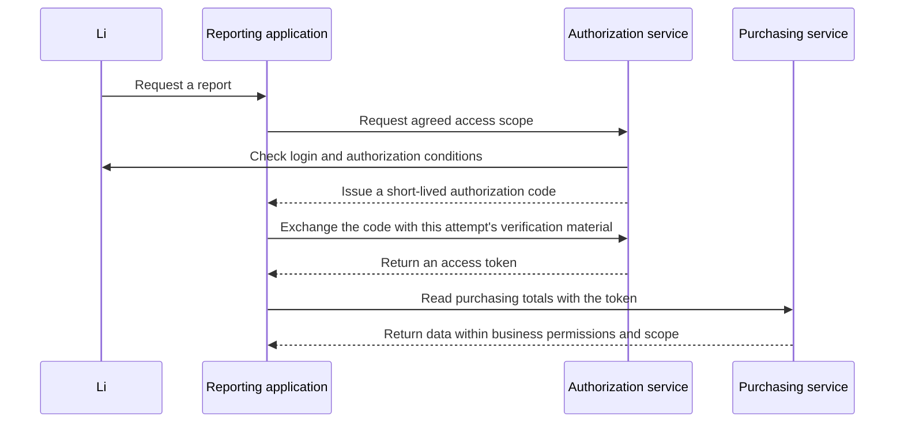

# 2. Design: let an application act without giving it your password

The previous page separated identity from permission. Now consider the next question: what should another application receive when it needs to act for you?

## Start with a concrete problem

Suppose the company adds a reporting application to read purchasing totals for Li. Keeping Li's username and password in that application might seem easiest.

But a leaked password could let the reporting application impersonate Li elsewhere. Stopping its access would require changing his password and affect his normal login. A password shared across systems would make the damage wider.

A better approach is a separate pass with a defined scope and lifetime: allow the reporting application to read the agreed data without giving it the password. This is the starting point for understanding OAuth2.

OAuth2 defines how an application receives limited access. It does not prescribe the appearance of a login page or require access tokens to use JWT.

## Meet the four participants

| Role | In the example | Responsibility |
|---|---|---|
| Resource owner | Li | Decides whether the application may use his access |
| Client | Reporting application | Requests authorization and uses a token within the permitted scope |
| Authorization server | Company authentication and authorization service | Checks the identity, client, and authorization conditions; issues tokens |
| Resource server | Service providing purchasing totals | Validates credentials and still enforces business permissions and data scope |

A client is an application, not an employee account. Registering an OAuth2 client neither creates a user nor automatically grants administrator privileges.

This is a conceptual authorization-code diagram. Client settings decide whether an additional consent page appears; an “Agree” button is not required on every attempt. The project practice page explains the default client.

## Why use an intermediate authorization code?

Browser redirects pass through places such as the address bar and history. A short-lived, one-use code returns first, then the application exchanges it at the token endpoint. Business APIs use the resulting access token.

“One-use and short-lived” leaves another question: could someone intercept the code and exchange it first? PKCE protects this binding.

At the start, the application generates random material, keeps the original, and sends its digest to the authorization server. At exchange time it presents the original. The server calculates the digest again and compares it. Someone with only the code lacks the original needed for the same exchange.

The protocol calls the original code_verifier and the digest code_challenge. S256 means SHA-256 followed by encoding suitable for a URL. A digest is not an encrypted password, and the server does not decrypt it back into the original.

PKCE binds an authorization-code exchange. Browser script security, callback restrictions, state checks, transport protection, and business authorization still have separate responsibilities.

## How these mechanisms developed

| Year | Mechanism | Main problem addressed |
|---|---|---|
| 2012 | OAuth 2.0, RFC 6749 | Defines roles, flows, and token interactions for limited application access |
| 2015 | PKCE, RFC 7636 | Binds a code exchange to verification material held by the initiating application |
| 2019 | Device authorization, RFC 8628 | Lets an input-constrained device obtain user confirmation on another device |
| 2025 | OAuth Security Best Current Practice, RFC 9700 | Tightens flows based on real threats, including stopping use of the resource owner password credentials grant |

Historically, the resource owner password credentials grant let an application submit the user's password. Do not choose it as the default for new integrations. Omni-Stack's own account/password API does not thereby become that OAuth grant.

This does not prohibit a login page from accepting a password. Users may authenticate on an identity service page they trust. The issue is another application retaining their password to request access. A first-party login API still needs password, transport, session, and permission protection; renaming an endpoint solves none of those automatically.

“Sign in with a third-party account” also involves identity. OpenID Connect adds an identity layer to OAuth2, so access tokens, identity tokens, and login sessions must be distinguished. The following pages describe which settings the project actually uses.

## Why this project has two kinds of login path

Omni-Stack keeps its own account/password login and also provides Spring authorization-server protocol endpoints.

The ordinary password entry checks the account, password, and CAPTCHA, then issues a JWT for project requests. Enterprise SSO first establishes a session the authorization server recognizes, then follows authorization code and PKCE. Success on one path does not prove the other is ready.

With social login, Omni-Stack instead requests authorization from an external provider. After receiving external profile data and binding a local account, it issues local credentials. The direction of the roles differs from the local authorization server issuing codes to applications.

These distinctions explain current responsibilities. They do not claim that every external account has been tested with a real provider. Real third-party account authorization remains separately recorded as unverified.

Continue with [how the framework handles the protocol](authentication-framework.en.md). Subsequent practice pages explain each real entry and its code.

## Optional primary references

This page explains the concepts needed for the source below. For the original specifications, see the [OAuth2 framework](https://www.rfc-editor.org/rfc/rfc6749.html), [PKCE](https://www.rfc-editor.org/rfc/rfc7636.html), [device authorization](https://www.rfc-editor.org/rfc/rfc8628.html), [security best practice](https://www.rfc-editor.org/rfc/rfc9700.html), and [OpenID Connect Core](https://openid.net/specs/openid-connect-core-1_0.html).
