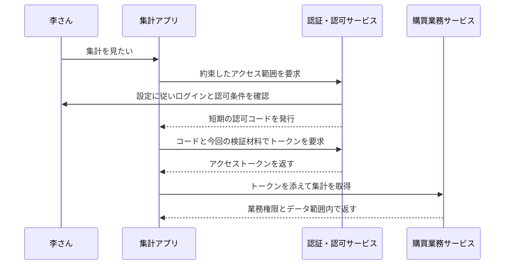

# 2. 設計の考え方：アプリに仕事を頼むためにパスワードまで渡すのか

前のページで、本人確認と操作の許可を分けました。次は、別のアプリに代わりに仕事を頼むとき、何を渡すべきか考えます。

## 具体的な困りごとから始める

会社が集計アプリを追加し、李さんに代わって購買集計を読みたいとします。アプリに李さんのユーザー名とパスワードを保存させれば、簡単に見えるかもしれません。

しかし漏えいすれば、他の操作でも李さんになりすまされる可能性があります。集計のアクセスを止めるためにパスワードを変更すると、本人の通常ログインにも影響します。複数システムで同じパスワードなら、影響はさらに広がります。

そこで、範囲と期限を決めた別の通行証を発行します。集計アプリには約束したデータだけを読ませ、パスワードは渡しません。これが OAuth2 を理解する出発点です。

OAuth2 は、アプリに限られたアクセス能力を渡すための協力ルールです。ログイン画面の見た目や、アクセストークンに必ず JWT を使うことは定めていません。

## 四つの参加者を知る

| 役割 | 例では誰か | 担当 |
|---|---|---|
| リソース所有者 | 李さん | アプリにアクセス能力を使わせるか決める |
| クライアント | 集計アプリ | 認可を要求し、許可範囲のトークンで仕事をする |
| 認可サーバー | 会社の認証・認可サービス | 身元、クライアント、認可条件を確認してトークンを発行する |
| リソースサーバー | 購買集計を提供する業務サービス | 資格情報を検証し、業務権限とデータ範囲も確認する |

ここでのクライアントはアプリであり、従業員アカウントではありません。OAuth2 クライアントを登録しても、利用者が作成されたり管理者権限が付いたりはしません。

これは認可コード方式の概念図です。追加の同意画面を表示するかはクライアント設定によります。毎回「同意」ボタンが必要なわけではありません。プロジェクトの実践ページで既定クライアントを説明します。

## 間に認可コードを置く理由

ブラウザーのリダイレクトはアドレス欄や履歴などを通ります。まず短期・一回限りの交換用コードを返し、アプリがトークンエンドポイントで交換します。業務 API が使うのは交換後のアクセストークンです。

ただし短期・一回限りでも、コードを横取りした人が先に交換する可能性は残ります。その結び付きを保護するのが PKCE です。

アプリは最初にランダムな材料を作り、原本を保存してダイジェストを認可サーバーへ渡します。交換時に原本を提示し、サーバーが再計算して比較します。コードだけを横取りしても、原本がなければ同じ交換を完了できません。

原本は code_verifier、ダイジェストは code_challenge と呼びます。S256 は SHA-256 の後に URL に適した符号化を行う方式です。ダイジェストは暗号化したパスワードではなく、サーバーが復号して原本に戻す処理でもありません。

PKCE の担当は認可コード交換の結び付きです。画面のスクリプト安全性、コールバック制限、state、通信保護、業務認可には別の責任があります。

## 仕組みが発展した流れ

| 年 | 仕組み | 主に解決する問題 |
|---|---|---|
| 2012 年 | OAuth 2.0、RFC 6749 | アプリが限定的アクセスを得る役割・フロー・トークン交換を定義 |
| 2015 年 | PKCE、RFC 7636 | 開始したアプリが持つ検証材料をコード交換に結び付ける |
| 2019 年 | デバイス認可、RFC 8628 | 入力しづらい機器が別の機器で利用者の確認を得る |
| 2025 年 | OAuth セキュリティのベストプラクティス、RFC 9700 | 実際の脅威を踏まえてフローを厳格化し、リソース所有者パスワード資格情報グラントなどの停止を要求 |

以前は、アプリが利用者のパスワードを送るリソース所有者パスワード資格情報グラントもありました。新しい連携の既定方式にはしないでください。Omni-Stack 自身のアカウント・パスワード API は、それだけでこの OAuth グラントになるわけではありません。

ログイン画面でパスワードを入力してはいけない、という意味ではありません。利用者は信頼する身元確認サービスの画面で認証できます。問題は別のアプリがパスワードを預かり続けてアクセスを要求することです。独自のログイン API でもパスワード、通信、セッション、権限の保護が必要で、名前を変えても自動では解決しません。

外部アカウントでのログインには身元情報も関わります。OpenID Connect は OAuth2 に身元確認の層を加えます。アクセストークン、ID トークン、ログインセッションを区別する必要があります。以降で実際のプロジェクト設定を説明します。

## このプロジェクトに二種類のログイン経路がある理由

Omni-Stack は独自のパスワードログインを持ち、Spring 認可サーバーのプロトコルエンドポイントも提供します。

通常の入口はアカウント、パスワード、画像認証を確認して、プロジェクトのリクエストに使う JWT を発行します。企業 SSO は、認可サーバーが識別できるセッションを作ってから認可コードと PKCE に進みます。一方の成功で他方の準備まで証明できません。

ソーシャルログインでは、Omni-Stack が外部プラットフォームに認可を要求する側になります。外部情報を得てローカルアカウントを関連付けた後、ローカルの資格情報を発行します。ローカル認可サーバーが他アプリへコードを発行する場合とは、役割の向きが異なります。

これは現在の責任分担の説明で、すべての外部アカウントとの実接続を主張するものではありません。実アカウント認可の未検証範囲は別途残します。

次は[フレームワークによるプロトコル処理](authentication-framework.jp.md)です。実際の入口の操作とソースは、各実践ページで扱います。

## 必要に応じて読む一次資料

後続のソースを理解する概念は本文で説明しています。規範原文を確認する場合は [OAuth2](https://www.rfc-editor.org/rfc/rfc6749.html)、[PKCE](https://www.rfc-editor.org/rfc/rfc7636.html)、[デバイス認可](https://www.rfc-editor.org/rfc/rfc8628.html)、[セキュリティのベストプラクティス](https://www.rfc-editor.org/rfc/rfc9700.html)、[OpenID Connect Core](https://openid.net/specs/openid-connect-core-1_0.html)を参照できます。
