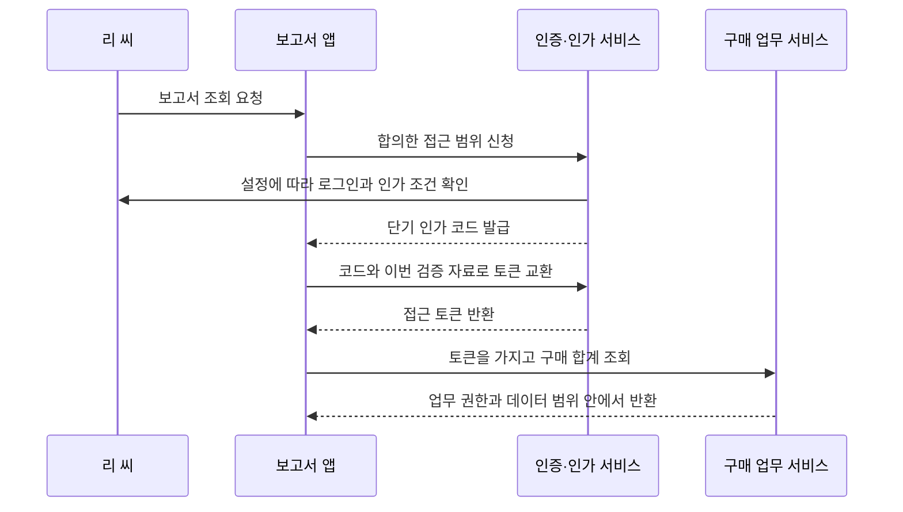

# 2. 설계 생각: 앱에 일을 맡기려고 비밀번호까지 줄 필요가 있을까

앞 글에서는 신원 확인과 작업 허가를 구분했습니다. 이제 다른 앱이 나를 대신해 일을 해야 한다면 무엇을 받아야 하는지 생각해 봅니다.

## 구체적인 문제로 시작하기

회사가 리 씨를 대신해 구매 합계를 조회하는 보고서 앱을 추가한다고 해 봅시다. 앱이 계정과 비밀번호를 저장하고 대신 로그인하면 간단해 보입니다.

하지만 비밀번호가 유출되면 리 씨를 사칭해 다른 작업도 할 수 있습니다. 보고서 앱의 접근만 중단하고 싶어도 비밀번호를 바꿔야 하므로 자신의 정상 로그인에 영향을 줍니다. 여러 시스템이 같은 비밀번호를 쓴다면 피해가 더 커집니다.

더 나은 방법은 범위와 기한이 정해진 별도 통행증을 주는 것입니다. 보고서 앱은 합의한 데이터만 읽고 비밀번호는 받지 않습니다. OAuth2 이해의 출발점입니다.

OAuth2는 앱에 제한된 접근 능력을 넘기는 협업 규칙입니다. 로그인 화면 모양을 정하지 않으며, 접근 토큰이 반드시 JWT여야 한다고 요구하지도 않습니다.

## 네 참여자 알아보기

| 역할 | 예시의 대상 | 담당하는 일 |
|---|---|---|
| 리소스 소유자 | 리 씨 | 앱이 자신의 접근 능력을 사용해도 되는지 결정 |
| 클라이언트 | 보고서 앱 | 인가를 요청하고 허용 범위의 토큰으로 작업 |
| 인가 서버 | 회사 인증·인가 서비스 | 신원, 클라이언트, 인가 조건을 확인하고 토큰 발급 |
| 리소스 서버 | 구매 합계를 제공하는 업무 서비스 | 자격 증명을 검증하고 업무 권한과 데이터 범위를 계속 검사 |

클라이언트는 앱이며 직원 계정이 아닙니다. OAuth2 클라이언트를 등록해도 사용자가 생성되거나 관리자 권한이 자동으로 부여되지 않습니다.

인가 코드 방식의 개념도입니다. 추가 동의 화면의 표시 여부는 클라이언트 설정이 정합니다. 매번 “동의” 버튼이 나와야 하는 것은 아닙니다. 프로젝트 기본 클라이언트는 실습 글에서 설명합니다.

## 중간에 인가 코드를 두는 이유

브라우저 리다이렉트는 주소 표시줄과 방문 기록 등을 거칩니다. 먼저 짧은 시간 동안 한 번만 쓸 교환 코드를 반환한 뒤, 앱이 토큰 엔드포인트에서 교환합니다. 업무 API는 교환으로 얻은 접근 토큰을 사용합니다.

그래도 질문이 남습니다. 코드를 가로챈 사람이 먼저 교환하면 어떨까요? PKCE는 이 연결을 보호합니다.

앱은 시작할 때 무작위 자료를 만들고 원본은 보관한 채 다이제스트를 인가 서버에 보냅니다. 교환할 때 원본을 제시하면 서버가 다시 계산해서 비교합니다. 코드만 가로챈 사람은 원본이 없으므로 같은 교환을 완료할 수 없습니다.

프로토콜에서 원본은 code_verifier, 다이제스트는 code_challenge입니다. S256은 SHA-256 계산 후 URL에 적합하게 인코딩한다는 뜻입니다. 다이제스트는 암호화한 비밀번호가 아니며 서버가 이를 복호화해 원본으로 되돌리는 것도 아닙니다.

PKCE는 인가 코드 교환의 연결을 보호합니다. 웹 스크립트 보안, 콜백 제한, state 확인, 전송 보호, 업무 인가는 각자의 책임이 남습니다.

## 이 장치들이 발전한 과정

| 시기 | 장치 | 해결하려는 주요 문제 |
|---|---|---|
| 2012년 | OAuth 2.0, RFC 6749 | 앱의 제한된 접근을 위한 역할, 흐름, 토큰 상호 작용 정의 |
| 2015년 | PKCE, RFC 7636 | 시작한 앱이 가진 검증 자료를 코드 교환에 연결 |
| 2019년 | 기기 인가, RFC 8628 | 입력이 불편한 기기가 다른 기기에서 사용자의 확인을 받도록 지원 |
| 2025년 | OAuth 보안 모범 사례, RFC 9700 | 실제 위협에 따라 흐름을 강화하고 리소스 소유자 비밀번호 자격 증명 그랜트 등의 사용 중단 요구 |

과거에는 앱이 사용자 비밀번호를 제출하는 리소스 소유자 비밀번호 자격 증명 그랜트가 있었습니다. 새 연동의 기본 방식으로 선택하지 마세요. Omni-Stack 자체 계정·비밀번호 API가 있다는 이유만으로 그 API가 이 OAuth 그랜트가 되는 것은 아닙니다.

로그인 화면에서 비밀번호를 입력할 수 없다는 뜻은 아닙니다. 신뢰하는 신원 서비스 화면에서 사용자가 인증할 수 있습니다. 여기서의 문제는 다른 앱이 비밀번호를 장기간 보관하며 접근을 요청하는 것입니다. 자체 로그인 API도 비밀번호, 전송, 세션, 권한을 보호해야 하며 이름을 바꾼다고 자동 해결되지 않습니다.

외부 계정으로 로그인할 때는 신원 정보도 관련됩니다. OpenID Connect는 OAuth2 위에 신원 계층을 정의합니다. 접근 토큰, ID 토큰, 로그인 세션을 구분해야 합니다. 다음 글에서 프로젝트가 실제 사용하는 설정을 설명합니다.

## 프로젝트에 두 종류의 로그인 경로가 있는 이유

Omni-Stack은 자체 계정·비밀번호 로그인과 Spring 인가 서버의 프로토콜 엔드포인트를 함께 제공합니다.

일반 비밀번호 진입점은 계정, 비밀번호, CAPTCHA를 확인하고 프로젝트 요청용 JWT를 발급합니다. 기업 SSO는 인가 서버가 알아보는 세션을 먼저 만든 다음 인가 코드와 PKCE를 진행합니다. 한 경로의 성공으로 다른 경로의 준비까지 증명할 수는 없습니다.

소셜 로그인에서는 Omni-Stack이 외부 플랫폼에 인가를 요청하는 쪽입니다. 외부 프로필을 받은 뒤 로컬 계정을 연결하고 로컬 자격 증명을 발급합니다. 로컬 인가 서버가 다른 앱에 코드를 주는 경우와 역할의 방향이 다릅니다.

이 구분은 현재 코드의 책임을 설명합니다. 모든 외부 계정의 실제 연결이 검증되었다는 주장은 아닙니다. 실제 외부 계정 인가는 별도의 미검증 범위로 남깁니다.

다음은 [프레임워크가 프로토콜을 처리하는 방식](authentication-framework.kr.md)입니다. 실제 진입점의 사용과 코드는 각 프로젝트 실습 글에서 설명합니다.

## 선택해서 읽을 수 있는 일차 자료

뒤의 소스에 필요한 개념은 본문에서 설명했습니다. 규격 원문이 필요하면 [OAuth2](https://www.rfc-editor.org/rfc/rfc6749.html), [PKCE](https://www.rfc-editor.org/rfc/rfc7636.html), [기기 인가](https://www.rfc-editor.org/rfc/rfc8628.html), [보안 모범 사례](https://www.rfc-editor.org/rfc/rfc9700.html), [OpenID Connect Core](https://openid.net/specs/openid-connect-core-1_0.html)를 읽을 수 있습니다.
