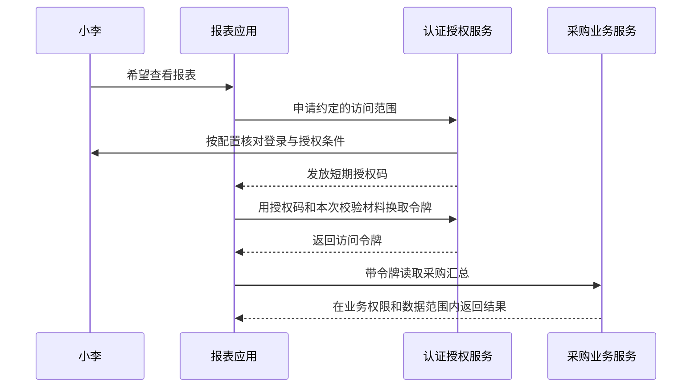

# 2. 设计思路：让应用办事，为什么不把密码交给它

上一页已经分清“登录证明你是谁”和“授权决定你能做什么”。这一页再往前走一步：如果另一个应用需要替你办事，它应该拿到什么？

## 从一个具体问题开始

假设公司增加了一个报表应用，希望替小李读取采购汇总。最省事的做法似乎是让报表应用保存小李的账号密码，每次替他登录。

问题随之出现：报表应用一旦泄露密码，就可能冒充小李做其他事情；小李想停止报表访问时，只能改密码，还会影响自己的正常登录。如果同一密码能访问多个系统，影响范围更大。

更合适的做法是单独发一张有范围、有期限的通行证：它只允许报表应用读取约定的数据，不把密码交给报表应用。这就是理解 OAuth2 的起点。

OAuth2 规定的是这种“把有限访问能力交给应用”的协作规则。它并不规定登录页面长什么样，也不要求访问令牌一定采用 JWT 格式。

## 先认识参与办事的四方

| 角色 | 在例子里是谁 | 负责什么 |
|---|---|---|
| 资源拥有者 | 小李 | 决定是否让应用使用自己的访问能力 |
| 客户端 | 报表应用 | 发起授权请求，拿到允许范围内的令牌后办事 |
| 授权服务器 | 公司的认证授权服务 | 核对身份、客户端及授权条件，签发令牌 |
| 资源服务器 | 提供采购汇总的业务服务 | 验证访问凭据，并继续检查业务权限与数据范围 |

这里的“客户端”是应用，不是某个员工账号。登记一个 OAuth2 客户端，也没有创建一个用户，更没有自动给它管理员权限。

这是授权码模式的概念图。是否展示额外的授权确认页，由客户端设置决定；并不是每次都需要弹出“同意”按钮。稍后会结合项目默认客户端说明。

## 为什么中间还要放一个授权码

浏览器跳转会经过地址栏、历史记录等位置。授权码先作为一个短期、一次性的交换凭据返回，应用再到令牌端点完成交换。业务接口真正使用的是交换后的访问令牌。

但“短期、一次性”还不足以回答一个问题：如果别人截到了授权码，会不会抢先拿去换令牌？PKCE 就是为这一层保护准备的。

应用在开始时生成一份随机材料，自己保存原件，先把它的摘要交给授权服务器。换令牌时再出示原件，服务器重新计算并比较。只截到授权码的人，缺少原件，就不能完成同样的交换。

原件在协议里叫 code_verifier，摘要叫 code_challenge。S256 表示这里使用 SHA-256 再做适合放进网址的编码。摘要不是加密后的密码，服务器也不是把它“解密”回原件。

PKCE 解决的是授权码交换中的绑定问题。网页自身的脚本安全、回调地址限制、state 校验、传输保护和业务授权仍各有职责。

## 这些机制是怎样逐步形成的

| 时间 | 机制 | 解决的主要问题 |
|---|---|---|
| 2012 年 | OAuth 2.0，RFC 6749 | 约定应用获取有限访问能力的角色、流程和令牌交互 |
| 2015 年 | PKCE，RFC 7636 | 为授权码交换增加本次发起应用持有的校验材料 |
| 2019 年 | 设备授权，RFC 8628 | 让输入不便的设备借助另一台设备完成用户确认 |
| 2025 年 | OAuth 安全最佳实践，RFC 9700 | 根据实际威胁收紧授权流程，要求停止使用资源所有者密码凭据许可等不安全做法 |

历史上有一种 OAuth 许可直接让应用提交用户密码，叫资源所有者密码凭据许可。不要拿它作为新接入的默认方案。Omni-Stack 自己的账号密码登录是项目自有接口，并没有因此变成 OAuth 的这种许可。

这不表示登录页从此不能输入密码。用户仍可在自己信任的身份服务页面完成认证；这里讨论的是另一个应用不该长期代持用户密码来申请访问能力。自有登录接口也仍需保护密码、传输、会话和权限，换一个接口名字不会自动解决安全问题。

“用第三方账号登录”还涉及身份信息。OpenID Connect 在 OAuth2 之上定义身份层；访问令牌、身份令牌和登录会话也因此需要分清。后面的框架篇和项目篇会说明这里实际使用了哪些配置。

## 本项目为什么同时存在两类登录链

Omni-Stack 既保留自己的账号密码登录，也提供基于 Spring 授权服务器的协议端点。

普通密码入口核对账号、密码和验证码，签发供本项目后续请求使用的 JWT。企业 SSO 入口则先建立授权服务器能够识别的登录会话，再走授权码和 PKCE。两条链有不同的中间步骤，不能看到其中一条成功，就假定另一条也已经准备好。

第三方社交登录中，Omni-Stack 又是向外部平台申请授权的一方。它拿到外部平台资料并完成本地账号绑定后，再签发本地访问凭据。这与本地授权服务器向别的应用发放授权码，角色方向不同。

这些划分解释了当前代码的职责，不表示所有第三方账号都已真实实联。真实第三方账户授权的未验范围，仍单独保留。

继续阅读：[框架怎样接手协议处理](authentication-framework.md)。关于各条实际登录入口的操作和代码，将分别放在本章的项目实践子篇。

## 可选的一手材料

本文已经解释了理解后续源码所需的概念。需要查看规范原文时，可自行阅读 [OAuth2 框架](https://www.rfc-editor.org/rfc/rfc6749.html)、[PKCE](https://www.rfc-editor.org/rfc/rfc7636.html)、[设备授权](https://www.rfc-editor.org/rfc/rfc8628.html)、[安全最佳实践](https://www.rfc-editor.org/rfc/rfc9700.html)和 [OpenID Connect Core](https://openid.net/specs/openid-connect-core-1_0.html)。
