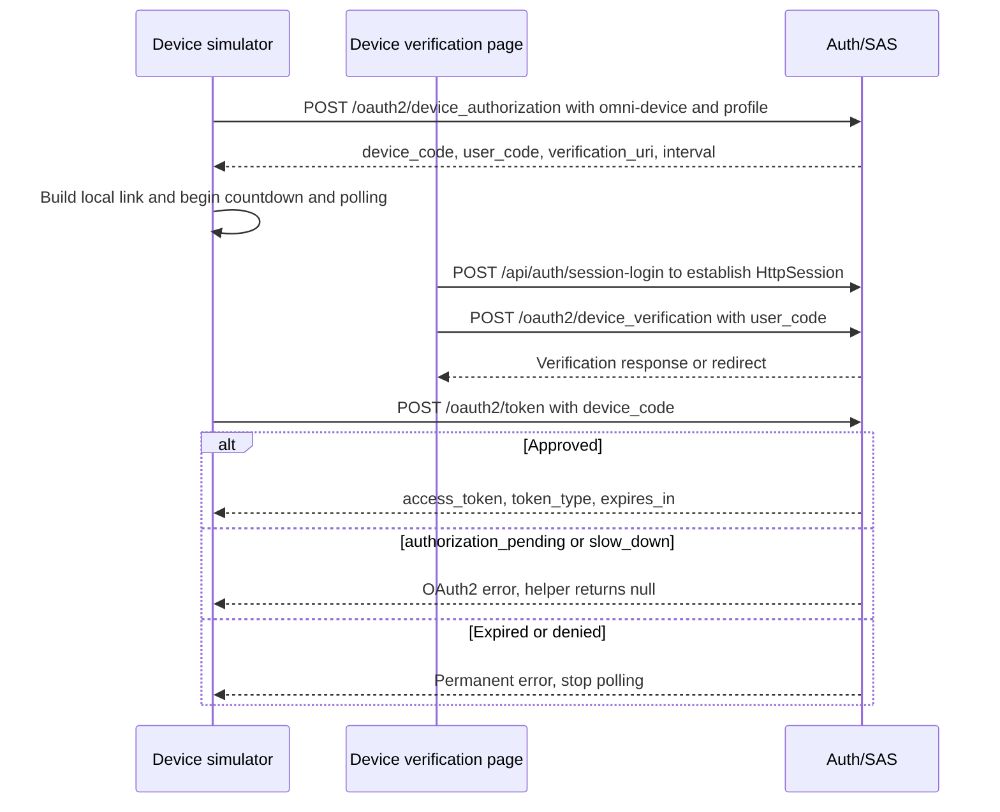
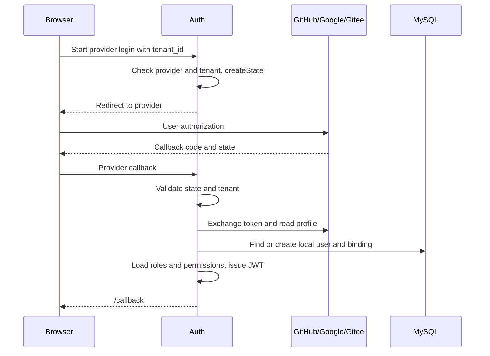

# 6. Project practice: devices, social accounts, registration, and the portal

Not every device is convenient for typing a password, and not every user has the same identity provider. First identify who starts and confirms each path, then follow it to a local account. Different entries need different success criteria.

## When typing is inconvenient: device authorization

An input-constrained device can display a short code. The user confirms it on a phone or another computer instead of entering a long password on the device.

There are two distinct values: device_code is for the device to poll the token endpoint; user_code is shown to the person confirming it. Displaying a code or opening the confirmation page does not mean the device has obtained an access token.

`/device` is the browser device simulator; `/device/verify` is confirmation in another browser. The simulator requests device_code and user_code with client_id=omni-device and scope=profile, builds a same-origin /device/verify?user_code=... link and QR code, and polls at the returned interval.



### Read the current implementation's limits

The frontend polling helper classifies failed responses using this continuous excerpt:

<!-- omni:source path="omni-frontend/src/api/auth.ts" -->
```typescript
  if (!response.ok) {
    const errorJson = await response.json().catch(() => ({})) as { error?: string }
    // authorization_pending: 用户尚未授权，slow_down: 轮询过快
    if (errorJson.error === 'authorization_pending' || errorJson.error === 'slow_down') {
      return null
    }
    throw new Error(`Device token polling failed: ${errorJson.error || response.status}`)
  }
  return response.json() as Promise<OAuth2TokenResponse>
```

Read null as “no token this time”. Both pending approval and polling too quickly return it. Other failures throw; only success returns the token response. The slow_down branch does not change the next interval, which supports the limitation below.

- The simulator always requests scope=profile. The registered client also declares openid, but this request does not use it.
- slow_down is treated as null; the frontend **does not increase the polling interval**. Do not claim RFC 8628 backoff is implemented.
- “Reject” on the verification page only changes local UI state. It neither sends a rejection to SAS nor revokes the device authorization record.
- Project DeviceClientAuthenticationFilter authenticates the device client and restores the prior authentication in finally. It is not the built-in SAS public-client provider.
- A token followed by actual access to a protected resource proves a successful device path. A “Success” label alone does not.

## Enter with an external account: social login

GitHub, Google, or Gitee becomes the identity provider. The user confirms authorization on that provider's own page. Omni-Stack then finds or creates a local account. An external profile does not automatically grant local business roles.

### Follow participants and request direction

This differs from the local authorization-code path. The browser visits /api/auth/oauth2/{provider}?tenant_id=.... Auth checks the provider and tenant, signs state, and redirects to the provider. The callback validates state, exchanges the external token, normalizes profile data, and finds the global binding by provider + provider_user_id. Without a binding, it creates a local user. Finally it issues a local JWT and redirects to /callback#token=...&username=....



### Turn an external account into a local identity

The social-login service uses the provider adapter to exchange a token and read a normalized profile. These calls are consecutive project source:

<!-- omni:source path="omni-backend/omni-auth/src/main/java/com/omni/auth/service/impl/SocialLoginServiceImpl.java" -->
```java
        // 3. 用授权码换取 Access Token
        String accessToken = handler.exchangeCodeForAccessToken(code);

        // 4. 获取归一化的第三方用户资料
        ProviderUser providerUser = handler.fetchUserProfile(accessToken);
```

This accessToken accesses the external provider, not local purchasing APIs. The service must find or create the local user and binding, load local roles and permissions, then issue a local JWT:

<!-- omni:source path="omni-backend/omni-auth/src/main/java/com/omni/auth/service/impl/SocialLoginServiceImpl.java" -->
```java
        // 7. 加载角色和权限
        List<String> roles = userService.getUserRoles(user.getId());
        List<String> permissions = userService.getUserPermissions(user.getId());

        // 8. 生成 JWT
        String jwt = jwtTokenService.generateToken(user, roles, permissions);
```

External authorization and local credentials are therefore separated by account binding. Each of GitHub, Google, and Gitee has an adapter coordinated by this service. A built-in Spring social-login filter does not perform all the project's business work.

| Adapter | Identifier read from the profile | Why keep the provider too? |
|---|---|---|
| GitHub | id | One platform's numeric ID is not a universal ID |
| Google | sub | Bind by external subject, not display name alone |
| Gitee | id | Even an identical number must remain distinct from GitHub |

Provider-specific prefixes are used for new usernames:

<!-- omni:source path="omni-backend/omni-auth/src/main/java/com/omni/auth/service/impl/SocialLoginServiceImpl.java" -->
```java
    private static String getUsernamePrefix(String provider) {
        return switch (provider) {
            case "github" -> "gh_";
            case "google" -> "go_";
            case "gitee" -> "ge_";
            default -> provider + "_";
        };
    }
```

If insertion encounters a username unique-key collision, it retries once with {prefix}{login}_{providerUserId}. A second failure propagates. sys_user_oauth_provider is globally unique on (provider, provider_user_id) and has no tenant_id. An existing binding keeps its original user and tenant; the current state does not migrate that user.

### Understand state protection separately

state contains tenantId|timestamp|hex(HMAC-SHA256(...)). The timestamp is in milliseconds; callbacks reject values older than ten minutes:

<!-- omni:source path="omni-backend/omni-auth/src/main/java/com/omni/auth/util/OAuth2StateUtils.java" -->
```java
    public String createState(Long tenantId) {
        long timestamp = System.currentTimeMillis();
        String payload = tenantId + "|" + timestamp;
        String signature = computeHmac(payload);
        return payload + "|" + signature;
    }
```

The implementation provides signed integrity and a freshness check, but **no one-time consumption marker, random nonce, or browser-session binding**. Do not claim complete replay or CSRF prevention. Provider authorization pages, denial, and callback errors require acceptance against their real environment; local unit tests do not replace that.

### Failure and recovery

| Callback condition | Result | Frontend behavior |
|---|---|---|
| Nonempty error | 302 /login?error=user_denied | Third-party login failure |
| Missing code/state | 302 /login?error=invalid_callback | Generic failure |
| BusinessException from state, API, profile, disabled user, etc. | 302 /login?error=social_login_failed&message=... | Reads the encoded message |
| Unsupported provider or unavailable tenant | Business exception while starting | Ordinary error response, not the callback redirect |

## Where accounts come from: registration, administrators, and portal entry

Public POST /api/auth/register requires a tenant, CAPTCHA, and a username unique in that tenant. It returns `R<Void>` without signing in. Administrator POST /api/auth/user requires system:user:create. New users also attempt to receive the default USER role; a missing role logs a warning without blocking creation. First social login has its own createNewUser() path, with the collision rule above.

Supplier /portal-login **reuses LoginForm and /api/auth/login**. There is no separate SRM credential endpoint. Portal authorization is an additional layer after login: profile, evaluation, and quotation access need SUPPLIER and an ACTIVE srm_supplier_portal_user association for the current tenant/user. An administrator or an account with only SUPER_ADMIN cannot quote on a supplier's behalf.

| Path | Entry | Required material | Successful result | Common failure |
|---|---|---|---|---|
| Self-registration | /register, /portal-register | Tenant, CAPTCHA, username, password | `R<Void>` | Invalid CAPTCHA or duplicate username |
| Administrator creation | Administrative user page | JWT + system:user:create | `R<Void>` | No permission or duplicate within tenant |
| Portal login | /portal-login | Ordinary password-login material | JWT and portal landing | Portal APIs deny without SUPPLIER/ACTIVE association |
