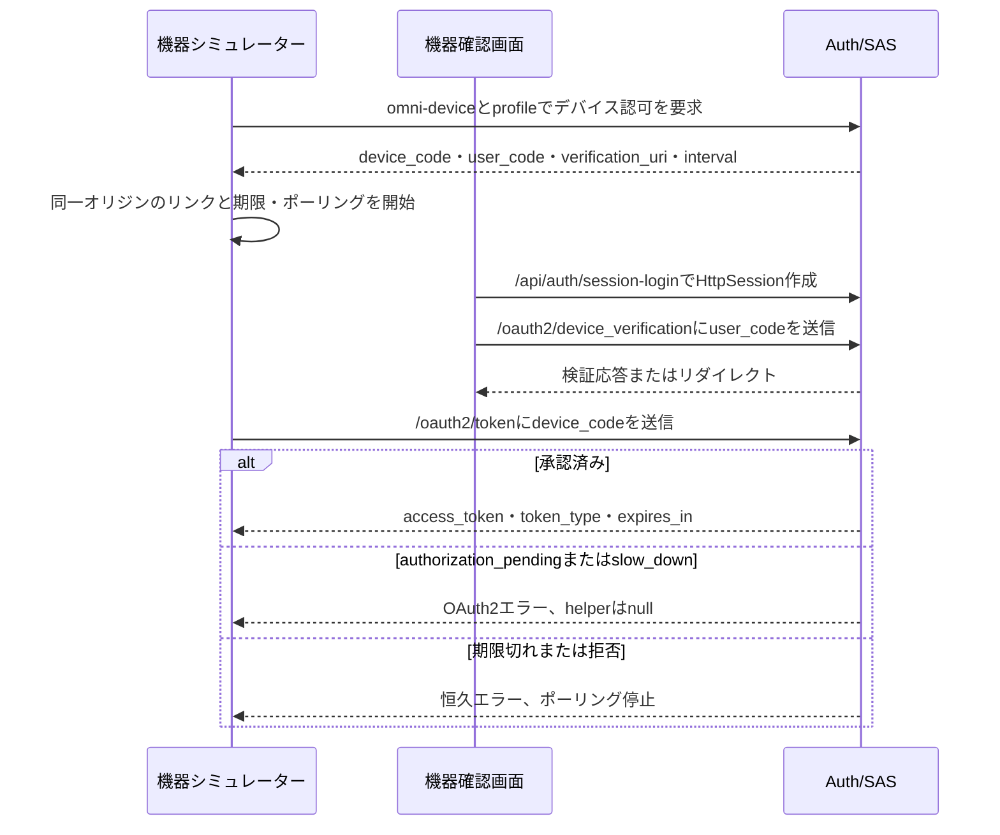
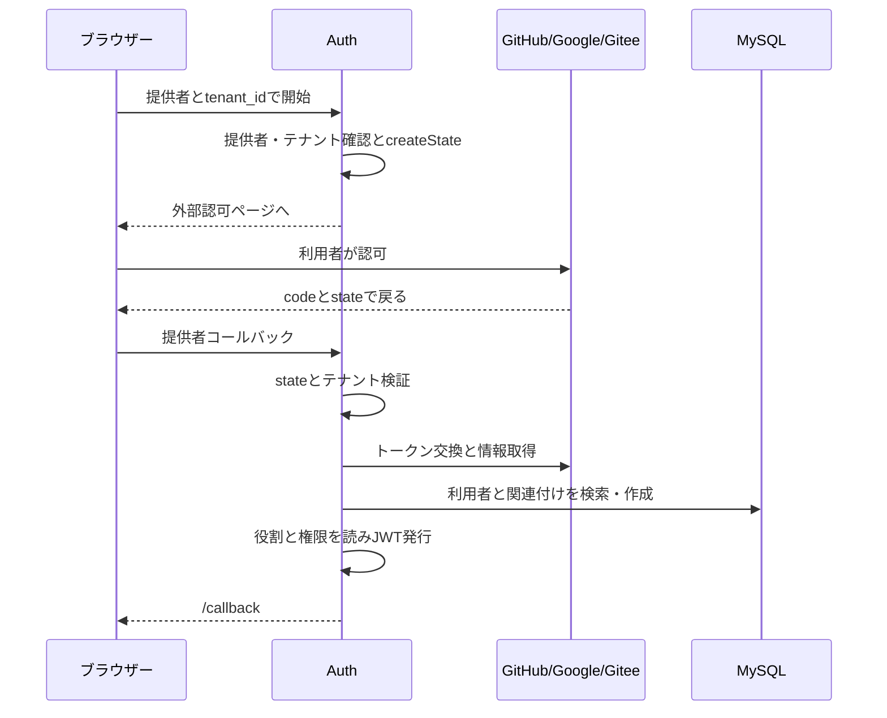

# 6. プロジェクトでの実践：機器・外部アカウント・登録・ポータル

すべての機器でパスワード入力が簡単とは限らず、利用者の身元の取得元も同じではありません。誰が開始し、誰が確認し、ローカルアカウントへどうつながるかを見ます。入口によって成功の判断も異なります。

## 入力しづらい機器：デバイス認可

機器が短いコードを表示し、利用者がスマートフォンや別のパソコンで確認できます。機器へ長いパスワードを入力する必要を減らせます。

材料は二つです。device_code は機器がトークンをポーリングするため、user_code は人が確認するための短いコードです。コードの表示や確認ページを開いた段階では、機器はまだアクセストークンを得ていません。

`/device` はブラウザー上の機器シミュレーター、`/device/verify` は別ブラウザーでの確認画面です。client_id=omni-device、scope=profile で device_code と user_code を要求し、同一オリジンの /device/verify?user_code=... と QR コードを作り、応答の interval でポーリングします。



### 現在の実装の境界

フロントのポーリング helper は失敗応答を次の連続原文で分類します。

<!-- omni:source path="omni-frontend/src/api/auth.ts" -->
```typescript
  if (!response.ok) {
    const errorJson = await response.json().catch(() => ({})) as { error?: string }
    // authorization_pending: 用户尚未授权，slow_down: 轮询过快
    if (errorJson.error === 'authorization_pending' || errorJson.error === 'slow_down') {
      return null
    }
    throw new Error(`Device token polling failed: ${errorJson.error || response.status}`)
  }
  return response.json() as Promise<OAuth2TokenResponse>
```

null は「今回はまだトークンがない」です。確認待ちも頻度超過も同じ戻り値です。他の失敗は例外となり、成功時だけトークン応答を返します。slow_down で次の間隔を変更しておらず、以下の制約の根拠になります。

- シミュレーターは scope=profile を固定使用します。登録クライアントは openid も宣言しますが、この要求では使いません。
- slow_down は null として扱い、**ポーリング間隔を増やしません**。RFC 8628 の待機延長を実装済みとはいえません。
- 確認画面の「拒否」はローカル表示のみ変え、SAS へ拒否を送らず、認可記録も取り消しません。
- クライアント認証はプロジェクトの DeviceClientAuthenticationFilter が行い、finally で元の認証を戻します。SAS 内蔵の公開クライアント処理器ではありません。
- トークンを取得し、保護されたリソースへ実際にアクセスできて初めて機器の成功証拠になります。画面の「成功」だけでは不十分です。

## 外部アカウントを使う：ソーシャルログイン

身元提供者は GitHub、Google、Gitee です。利用者が提供者自身の画面で認可し、Omni-Stack がローカルアカウントを検索または作成します。外部プロフィールが業務の役割を自動で与えることはありません。

### 参加者と向きを追う

ローカル認可コードとは別の経路です。ブラウザーは /api/auth/oauth2/{provider}?tenant_id=... を開きます。Auth は提供者とテナントを確認し、署名 state を作り、外部へリダイレクトします。戻りで state を検査し、外部トークンへ交換して情報を正規化し、provider + provider_user_id の全体共通バインディングを探します。なければローカル利用者を作成し、最後にローカル JWT を発行して /callback#token=...&username=... へ戻します。



### 外部アカウントをローカルの身元へ変える

サービスは提供者アダプターでトークンを交換し、共通形式の情報を取得します。同じ箇所からの連続原文です。

<!-- omni:source path="omni-backend/omni-auth/src/main/java/com/omni/auth/service/impl/SocialLoginServiceImpl.java" -->
```java
        // 3. 用授权码换取 Access Token
        String accessToken = handler.exchangeCodeForAccessToken(code);

        // 4. 获取归一化的第三方用户资料
        ProviderUser providerUser = handler.fetchUserProfile(accessToken);
```

この accessToken は外部プラットフォーム用で、購買 API などのローカル資格情報にはできません。利用者と関連付けを検索・作成し、ローカルの役割と権限を読んでから JWT を発行します。

<!-- omni:source path="omni-backend/omni-auth/src/main/java/com/omni/auth/service/impl/SocialLoginServiceImpl.java" -->
```java
        // 7. 加载角色和权限
        List<String> roles = userService.getUserRoles(user.getId());
        List<String> permissions = userService.getUserPermissions(user.getId());

        // 8. 生成 JWT
        String jwt = jwtTokenService.generateToken(user, roles, permissions);
```

外部の認可とローカルで使える身元の間には、アカウント関連付けがあります。GitHub、Google、Gitee の各アダプターをこのサービスがまとめます。Spring のソーシャルフィルター一つで業務処理まで全部済むわけではありません。

| アダプター | 読み取る識別子 | 提供者も保存する理由 |
|---|---|---|
| GitHub | id | 一つのプラットフォームの番号は全体共通ではない |
| Google | sub | 表示名だけではなく外部主体で対応させる |
| Gitee | id | 同じ数字でも GitHub の利用者と区別する |

新しいユーザー名には提供者別の接頭辞を使います。

<!-- omni:source path="omni-backend/omni-auth/src/main/java/com/omni/auth/service/impl/SocialLoginServiceImpl.java" -->
```java
    private static String getUsernamePrefix(String provider) {
        return switch (provider) {
            case "github" -> "gh_";
            case "google" -> "go_";
            case "gitee" -> "ge_";
            default -> provider + "_";
        };
    }
```

挿入時にユーザー名の一意制約へ衝突すると、{prefix}{login}_{providerUserId} で一回だけ再試行し、二回目の失敗は伝播します。sys_user_oauth_provider は (provider, provider_user_id) が全体で一意で、tenant_id はありません。既存の関連付けは元の利用者とテナントを使い、今回の state で移動しません。

### state の保護範囲を別に確認する

state は tenantId|timestamp|hex(HMAC-SHA256(...)) で、時刻はミリ秒です。10 分を超えたものはコールバックで拒否します。

<!-- omni:source path="omni-backend/omni-auth/src/main/java/com/omni/auth/util/OAuth2StateUtils.java" -->
```java
    public String createState(Long tenantId) {
        long timestamp = System.currentTimeMillis();
        String payload = tenantId + "|" + timestamp;
        String signature = computeHmac(payload);
        return payload + "|" + signature;
    }
```

署名による完全性と時刻確認はありますが、**一回消費の印、ランダム nonce、ブラウザーセッションとの結び付きはありません**。再送や CSRF を完全防止したとはいえません。外部の認可画面、拒否、コールバックエラーは実環境で確認する必要があり、ローカル単体テストは代替しません。

### 失敗と復旧

| 条件 | 結果 | フロント |
|---|---|---|
| 空でない error | 302 /login?error=user_denied | 外部ログイン失敗を表示 |
| code/state 不足 | 302 /login?error=invalid_callback | 汎用の失敗表示 |
| state/API/情報/無効利用者などの BusinessException | 302 /login?error=social_login_failed&message=... | 符号化された message を読む |
| 未対応の提供者・ログイン不可のテナント | 開始時に業務例外 | 通常のエラー応答で、戻りのリダイレクトではない |

## アカウントの作成元：登録・管理者作成・ポータル

公開 POST /api/auth/register はテナント、画像認証、テナント内で一意の名前を必要とします。`R<Void>` を返し、自動ログインしません。管理者の POST /api/auth/user は system:user:create が必要です。新規利用者には既定 USER 役割の割当も試み、役割不足は警告にとどめて作成を止めません。初回ソーシャル作成は専用 createNewUser() を使い、名前衝突は前述の規則です。

供給者の /portal-login は **同じ LoginForm と /api/auth/login を再利用**し、SRM 専用の資格情報入口はありません。ポータルの情報・評価・見積には、ログイン後も SUPPLIER と現在のテナント・利用者に対する ACTIVE な srm_supplier_portal_user 関連付けが必要です。管理者や SUPER_ADMIN のみの利用者は供給者の代わりに見積できません。

| 経路 | 入口 | 必要な材料 | 成功結果 | よくある失敗 |
|---|---|---|---|---|
| 自己登録 | /register、/portal-register | テナント・画像認証・名前・パスワード | `R<Void>` | 画像認証無効、名前重複 |
| 管理者作成 | 管理側の利用者ページ | JWT + system:user:create | `R<Void>` | 権限不足、テナント内重複 |
| ポータルログイン | /portal-login | 通常のパスワード材料 | JWT とポータルへの移動 | SUPPLIER/ACTIVE 関連付け不足で API 拒否 |
