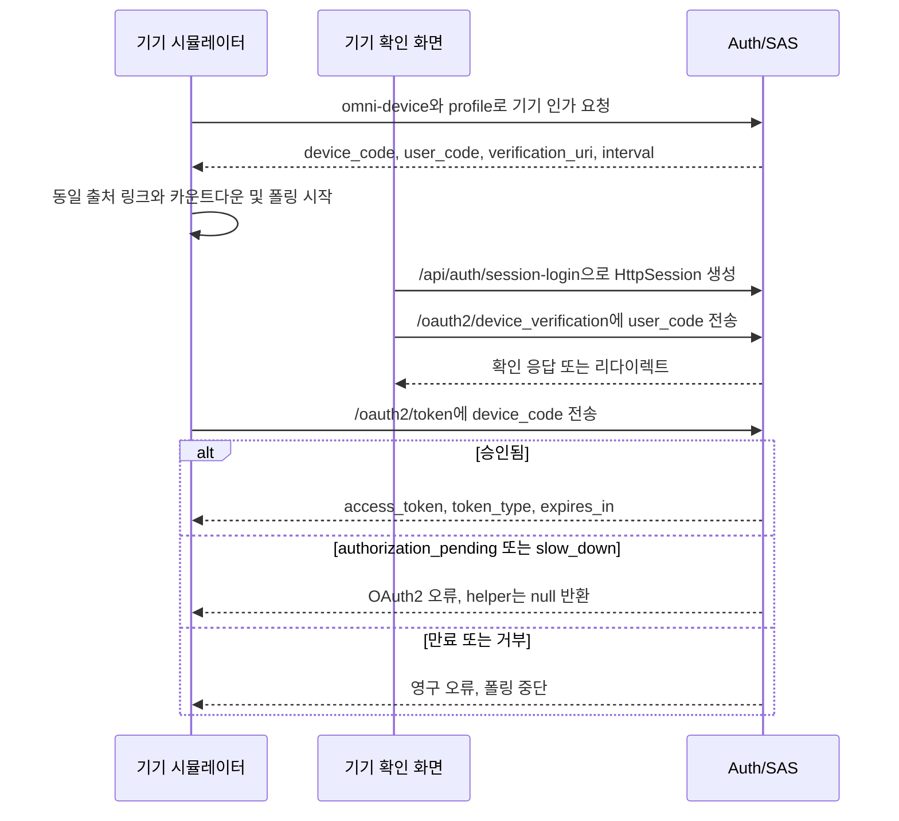
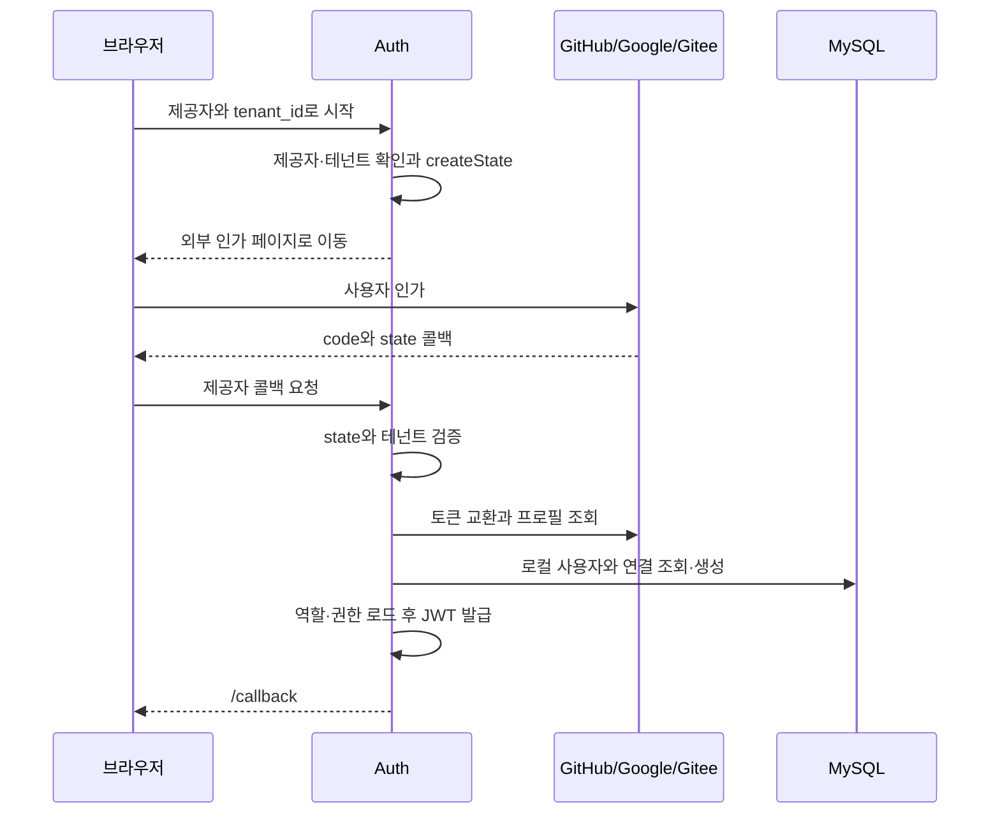

# 6. 프로젝트 실습: 기기·소셜 계정·가입·포털

모든 기기에서 비밀번호 입력이 편한 것은 아니며 사용자의 신원 출처도 다릅니다. 누가 시작하고 확인하는지 먼저 보고, 로컬 계정으로 어떻게 이어지는지 살펴봅니다. 진입점마다 성공 기준이 다릅니다.

## 입력이 불편할 때: 기기 인가

기기가 짧은 코드를 보여 주면 사용자는 휴대전화나 다른 컴퓨터에서 확인할 수 있습니다. 기기에 긴 비밀번호를 입력하는 불편을 줄입니다.

device_code는 기기가 토큰 엔드포인트를 폴링할 때 사용하고, user_code는 사람이 확인하는 데 쓰는 짧은 코드입니다. 코드를 표시하거나 확인 페이지를 열었다고 접근 토큰을 받은 것은 아닙니다.

`/device`는 브라우저 기기 시뮬레이터이고 `/device/verify`는 다른 브라우저의 확인 화면입니다. client_id=omni-device와 scope=profile로 device_code·user_code를 요청하고, 동일 출처 /device/verify?user_code=... 링크와 QR 코드를 구성하며 응답의 interval에 따라 폴링합니다.



### 현재 구현의 경계

프런트 폴링 helper는 아래 연속 원문으로 실패 응답을 분류합니다.

<!-- omni:source path="omni-frontend/src/api/auth.ts" -->
```typescript
  if (!response.ok) {
    const errorJson = await response.json().catch(() => ({})) as { error?: string }
    // authorization_pending: 用户尚未授权，slow_down: 轮询过快
    if (errorJson.error === 'authorization_pending' || errorJson.error === 'slow_down') {
      return null
    }
    throw new Error(`Device token polling failed: ${errorJson.error || response.status}`)
  }
  return response.json() as Promise<OAuth2TokenResponse>
```

null은 “이번에는 아직 토큰 없음”입니다. 인가 대기와 과도한 폴링 모두 이 값입니다. 다른 실패는 오류를 던지고 성공만 토큰 응답을 반환합니다. slow_down 분기에서 다음 간격을 변경하지 않는 것이 아래 제한의 근거입니다.

- 시뮬레이터는 scope=profile만 요청합니다. 등록 클라이언트에 openid도 있지만 이 요청은 쓰지 않습니다.
- slow_down을 null로 취급하며 **폴링 간격을 늘리지 않습니다**. RFC 8628의 대기 연장을 구현했다고 주장할 수 없습니다.
- 확인 화면의 “거부”는 로컬 표시 상태만 바꾸며 SAS에 거부를 보내거나 기기 인가 기록을 취소하지 않습니다.
- 프로젝트 DeviceClientAuthenticationFilter가 기기 클라이언트를 인증하고 finally에서 원래 인증을 복원합니다. SAS 내장 공개 클라이언트 처리기가 아닙니다.
- 토큰을 얻고 실제 보호 리소스를 사용하는 것이 기기 경로의 성공 증거입니다. 화면의 “성공”만으로 판단하지 않습니다.

## 외부 계정으로 들어오기: 소셜 로그인

신원 제공자는 GitHub·Google·Gitee입니다. 사용자는 제공자 자신의 페이지에서 인가하고 Omni-Stack은 결과로 로컬 계정을 찾거나 만듭니다. 외부 프로필이 로컬 업무 역할을 자동 부여하지는 않습니다.

### 참여자와 요청 방향

로컬 인가 코드와 다른 경로입니다. 브라우저가 /api/auth/oauth2/{provider}?tenant_id=...에 접근하면 Auth가 제공자·테넌트를 검사하고 서명 state를 생성해 외부로 리다이렉트합니다. 콜백에서 state를 확인하고 외부 토큰으로 교환하여 프로필을 정규화합니다. provider + provider_user_id로 전역 연결을 찾고, 없으면 로컬 사용자를 만듭니다. 마지막에 로컬 JWT를 발급하고 /callback#token=...&username=...으로 이동합니다.



### 외부 계정을 로컬 신원으로 바꾸기

소셜 로그인 서비스는 제공자 어댑터로 외부 토큰을 교환하고 정규화된 프로필을 읽습니다. 같은 위치의 연속 원문입니다.

<!-- omni:source path="omni-backend/omni-auth/src/main/java/com/omni/auth/service/impl/SocialLoginServiceImpl.java" -->
```java
        // 3. 用授权码换取 Access Token
        String accessToken = handler.exchangeCodeForAccessToken(code);

        // 4. 获取归一化的第三方用户资料
        ProviderUser providerUser = handler.fetchUserProfile(accessToken);
```

이 accessToken은 외부 플랫폼용이며 로컬 구매 API의 자격 증명이 아닙니다. 로컬 사용자와 연결을 찾거나 만든 뒤 로컬 역할·권한을 읽고 JWT를 발급해야 합니다.

<!-- omni:source path="omni-backend/omni-auth/src/main/java/com/omni/auth/service/impl/SocialLoginServiceImpl.java" -->
```java
        // 7. 加载角色和权限
        List<String> roles = userService.getUserRoles(user.getId());
        List<String> permissions = userService.getUserPermissions(user.getId());

        // 8. 生成 JWT
        String jwt = jwtTokenService.generateToken(user, roles, permissions);
```

외부 인가와 로컬에서 쓸 신원 사이에는 계정 연결 단계가 있습니다. GitHub·Google·Gitee별 어댑터를 이 서비스가 조정합니다. Spring의 소셜 로그인 필터 하나가 모든 업무 처리를 해 주는 것은 아닙니다.

| 어댑터 | 프로필 식별자 | 제공자와 함께 저장하는 이유 |
|---|---|---|
| GitHub | id | 한 플랫폼의 사용자 번호는 전역 공통 번호가 아님 |
| Google | sub | 표시 이름 대신 외부 주체 식별자로 연결 |
| Gitee | id | 숫자가 같아도 GitHub 사용자와 구분 |

새 사용자명의 접두사는 제공자별로 정합니다.

<!-- omni:source path="omni-backend/omni-auth/src/main/java/com/omni/auth/service/impl/SocialLoginServiceImpl.java" -->
```java
    private static String getUsernamePrefix(String provider) {
        return switch (provider) {
            case "github" -> "gh_";
            case "google" -> "go_";
            case "gitee" -> "ge_";
            default -> provider + "_";
        };
    }
```

사용자명 고유키 충돌이면 {prefix}{login}_{providerUserId}로 한 번만 재시도하고, 두 번째 실패는 그대로 전파합니다. sys_user_oauth_provider는 (provider, provider_user_id)가 전역 고유하며 tenant_id가 없습니다. 기존 연결은 원래 사용자와 테넌트를 유지하고 이번 state로 사용자를 옮기지 않습니다.

### state 보호 범위를 따로 보기

state는 tenantId|timestamp|hex(HMAC-SHA256(...))이며 시간은 밀리초입니다. 10분이 지난 값은 콜백에서 거부합니다.

<!-- omni:source path="omni-backend/omni-auth/src/main/java/com/omni/auth/util/OAuth2StateUtils.java" -->
```java
    public String createState(Long tenantId) {
        long timestamp = System.currentTimeMillis();
        String payload = tenantId + "|" + timestamp;
        String signature = computeHmac(payload);
        return payload + "|" + signature;
    }
```

서명 무결성과 유효 시간 검사는 있지만 **일회 소비 표시, 무작위 nonce, 브라우저 세션 연결은 없습니다**. 재전송이나 CSRF를 완전히 방지한다고 주장할 수 없습니다. 제공자 인가 페이지·거부·콜백 오류는 실제 환경에서 검증해야 하며 로컬 단위 테스트가 대신하지 못합니다.

### 실패와 복구

| 콜백 조건 | 결과 | 프런트 표시 |
|---|---|---|
| 비어 있지 않은 error | 302 /login?error=user_denied | 외부 로그인 실패 |
| code/state 누락 | 302 /login?error=invalid_callback | 일반 실패 |
| state/API/프로필/비활성 사용자 등의 BusinessException | 302 /login?error=social_login_failed&message=... | 인코딩된 message 표시 |
| 지원하지 않는 제공자·로그인 불가 테넌트 | 시작 단계의 업무 예외 | 콜백 리다이렉트가 아닌 일반 오류 응답 |

## 계정의 생성: 가입·관리자 생성·포털

공개 POST /api/auth/register는 테넌트·CAPTCHA·테넌트 내 고유 사용자명이 필요합니다. `R<Void>`를 반환하며 자동 로그인하지 않습니다. 관리자의 POST /api/auth/user는 system:user:create가 필요합니다. 새 사용자는 기본 USER 역할 할당도 시도하며 역할 누락은 경고만 기록하고 생성을 막지 않습니다. 첫 소셜 생성은 별도 createNewUser() 경로이며 이름 충돌은 위 규칙을 따릅니다.

공급업체 /portal-login은 **동일한 LoginForm과 /api/auth/login을 재사용**하며 SRM 전용 자격 증명 엔드포인트는 없습니다. 포털의 프로필·평가·견적은 로그인 후에도 SUPPLIER 및 현재 테넌트·사용자의 ACTIVE srm_supplier_portal_user 연결이 필요합니다. 관리자나 SUPER_ADMIN만 가진 계정이 공급업체 대신 견적을 낼 수 없습니다.

| 경로 | 진입점 | 자료 | 성공 결과 | 흔한 실패 |
|---|---|---|---|---|
| 자가 가입 | /register, /portal-register | 테넌트·CAPTCHA·사용자명·비밀번호 | `R<Void>` | CAPTCHA 오류, 사용자명 중복 |
| 관리자 생성 | 관리 사용자 페이지 | JWT + system:user:create | `R<Void>` | 권한 부족, 테넌트 내 중복 |
| 포털 로그인 | /portal-login | 일반 비밀번호 로그인 자료 | JWT와 포털 진입 | SUPPLIER/ACTIVE 연결 없으면 포털 API 거부 |
