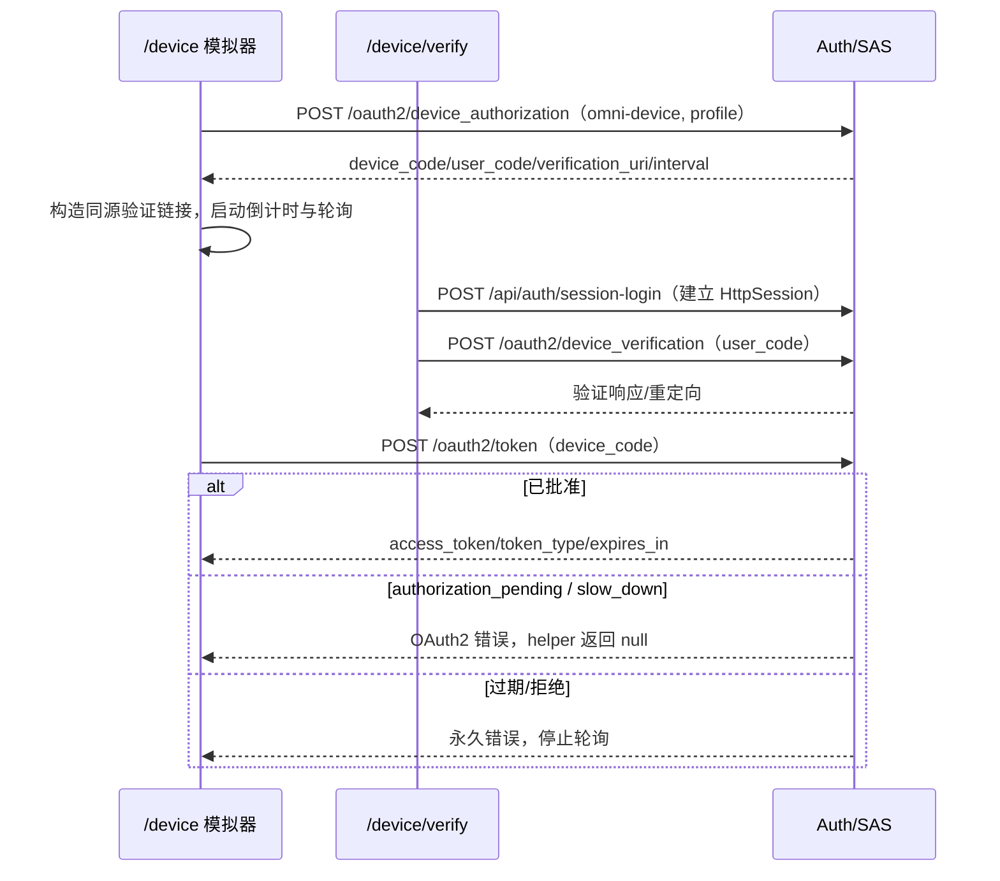
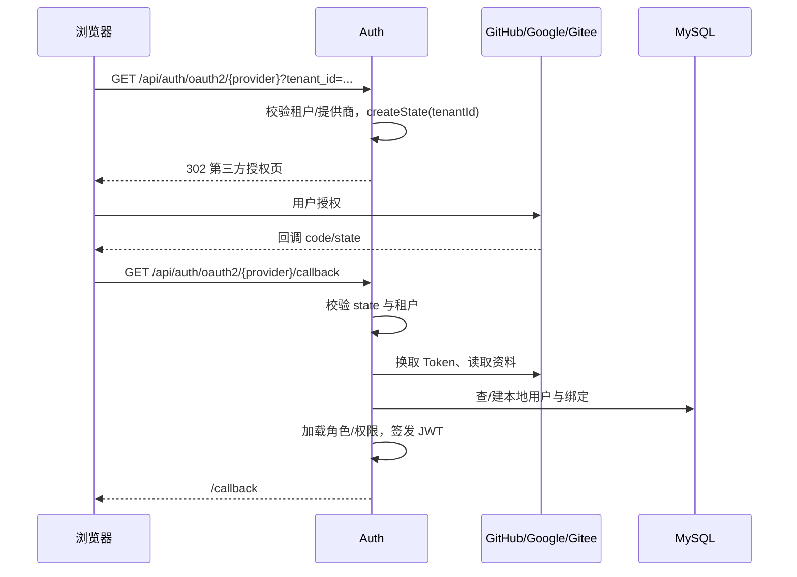

# 6. 项目实践：设备、社交账号、注册与门户

不是所有设备都适合输入密码，也不是所有用户都从同一个身份来源进入。先看每一种入口由谁发起、由谁确认，再看它如何落到本地账号。不同入口不能共用一套成功判断。

## 输入不方便时：设备授权

设想你要让一台输入不方便的设备登录。它可以显示一段短码，让用户拿手机或另一台电脑确认，而不必在设备上艰难地输入长密码。

这里有两份不同的材料：device_code 给设备自己轮询令牌端点使用，user_code 则显示给人完成确认。展示了短码、打开了确认页，都还不是设备已经拿到访问令牌。

`/device` 是浏览器里的设备模拟器；`/device/verify` 是用户在另一浏览器中确认设备码的页面。模拟器用 `client_id=omni-device`、`scope=profile` 请求 `device_code` 与 `user_code`，然后构造同源的 `/device/verify?user_code=...` 链接和二维码，按返回的 `interval` 轮询 Token 端点。



### 读懂本项目当前的实现边界

前端轮询 helper 中，失败响应会被下面这段连续代码分类处理：

<!-- omni:source path="omni-frontend/src/api/auth.ts" -->
```typescript
  if (!response.ok) {
    const errorJson = await response.json().catch(() => ({})) as { error?: string }
    // authorization_pending: 用户尚未授权，slow_down: 轮询过快
    if (errorJson.error === 'authorization_pending' || errorJson.error === 'slow_down') {
      return null
    }
    throw new Error(`Device token polling failed: ${errorJson.error || response.status}`)
  }
  return response.json() as Promise<OAuth2TokenResponse>
```

读这段时，先把 null 理解为“这次还没有拿到令牌”。等待授权和轮询太快，当前都走这个返回值；其他失败会抛出错误，成功才把令牌响应交给调用方。它没有在 slow_down 分支调整下一次间隔，这就是下面限制的源码依据。

- 模拟器固定使用 `scope=profile`；注册客户端还声明了 `openid`，但当前请求没有使用。
- `slow_down` 只被当作 null，前端**不增加轮询间隔**，不能宣称已实现 RFC 8628 的退避建议。
- 验证页的“拒绝”只切换本地界面状态，不向 SAS 发送拒绝，也不撤销设备授权记录。
- 设备客户端认证由项目自定义的 `DeviceClientAuthenticationFilter` 完成，并在 `finally` 还原原认证；它不是 SAS 内置的公有客户端处理器。
- 拿到 access token 并访问受保护资源，才是设备链路的真实成功证据；页面显示“成功”不是。

## 用外部账号进入：社交登录

此时身份提供方换成了 GitHub、Google 或 Gitee。用户在它们自己的页面确认授权，Omni-Stack 再根据返回结果找到或创建本地账号。外部平台的账号资料，并不会自动等于本项目里的业务角色。

### 先看参与方和请求方向

社交登录与本地授权码流程是两条不同的路径。浏览器先访问 `/api/auth/oauth2/{provider}?tenant_id=...`，Auth 校验提供商和租户后生成签名 state，再 302 到第三方。回调校验 state、换取第三方 Token、归一化资料，按 `provider + provider_user_id` 查找全局绑定；没有绑定时创建本地用户，最后签发本地 JWT，并 302 到前端 `/callback#token=...&username=...`。



### 外部账号怎样变成本地身份

社交登录服务先通过对应适配器交换外部令牌，再读取统一格式的用户资料。下面两次调用来自同一段连续工程原文：

<!-- omni:source path="omni-backend/omni-auth/src/main/java/com/omni/auth/service/impl/SocialLoginServiceImpl.java" -->
```java
        // 3. 用授权码换取 Access Token
        String accessToken = handler.exchangeCodeForAccessToken(code);

        // 4. 获取归一化的第三方用户资料
        ProviderUser providerUser = handler.fetchUserProfile(accessToken);
```

这里的 accessToken 用来访问外部平台，不能直接当成采购等本地业务接口的凭据。服务还要根据提供商和外部用户标识查找或创建本地用户，然后加载本地角色、权限，再签发本地 JWT：

<!-- omni:source path="omni-backend/omni-auth/src/main/java/com/omni/auth/service/impl/SocialLoginServiceImpl.java" -->
```java
        // 7. 加载角色和权限
        List<String> roles = userService.getUserRoles(user.getId());
        List<String> permissions = userService.getUserPermissions(user.getId());

        // 8. 生成 JWT
        String jwt = jwtTokenService.generateToken(user, roles, permissions);
```

所以，“外部平台已授权”和“拿到本项目可用的身份与权限”仍隔着本地账号绑定这一步。当前 GitHub、Google、Gitee 各有适配器，统一交给这段编排处理；它不是直接调用 Spring 内置社交登录过滤器就完成全部业务。

| 当前适配器 | 从资料中取什么标识 | 为什么要与提供商一起保存 |
|---|---|---|
| GitHub | id | 某个平台的用户编号不能直接当作所有平台共用的编号 |
| Google | sub | 依据外部主体标识建立关联，而不是只看显示姓名 |
| Gitee | id | 即使数字恰好相同，也要与 GitHub 的用户区分 |

新建用户名时，项目前缀由提供商决定：

<!-- omni:source path="omni-backend/omni-auth/src/main/java/com/omni/auth/service/impl/SocialLoginServiceImpl.java" -->
```java
    private static String getUsernamePrefix(String provider) {
        return switch (provider) {
            case "github" -> "gh_";
            case "google" -> "go_";
            case "gitee" -> "ge_";
            default -> provider + "_";
        };
    }
```

首次插入遇到用户名唯一键冲突时，只重试一次 `{prefix}{login}_{providerUserId}`；第二次仍失败会继续抛出。第三方绑定表 `sys_user_oauth_provider` 以 `(provider, provider_user_id)` 全局唯一，没有 tenant_id；已有绑定复用原用户及其租户，不会按本次 state 迁移用户。

### 为什么仍要单独看 state 的安全边界

state 是 `tenantId|timestamp|hex(HMAC-SHA256(...))`，时间戳使用毫秒，回调拒绝超过 10 分钟的值：

<!-- omni:source path="omni-backend/omni-auth/src/main/java/com/omni/auth/util/OAuth2StateUtils.java" -->
```java
    public String createState(Long tenantId) {
        long timestamp = System.currentTimeMillis();
        String payload = tenantId + "|" + timestamp;
        String signature = computeHmac(payload);
        return payload + "|" + signature;
    }
```

这段实现证明签名完整性与时效检查，但**没有一次消费标记、随机 nonce 或浏览器会话绑定**，不能宣称已完整防止重放或 CSRF。提供商侧的授权页、用户拒绝和回调错误必须按真实环境验收；本地单元测试不能替代。

### 失败与恢复

| 回调条件 | 结果 | 前端表现 |
| --- | --- | --- |
| 非空 `error` | 302 `/login?error=user_denied` | 第三方登录失败提示 |
| 缺少 code/state | 302 `/login?error=invalid_callback` | 通用失败提示 |
| state/API/资料/禁用用户等 `BusinessException` | 302 `/login?error=social_login_failed&message=...` | 读取编码后的 message |
| 提供商不存在或租户不可登录 | 发起阶段抛业务异常 | 普通异常响应，不进入回调重定向 |

## 账号从哪里来：注册、管理员创建与门户

自助注册是公开端点 `POST /api/auth/register`，要求租户、验证码和租户内唯一用户名；成功后返回 `R<Void>`，不自动登录。管理员创建 `POST /api/auth/user` 需要 `system:user:create`，新用户同样尝试分配默认 `USER` 角色；角色缺失只记录警告，不阻塞创建。社交登录首次创建用户也走独立的 `createNewUser()`，用户名冲突处理见上一节。

供应商门户的 `/portal-login` **复用同一个 `LoginForm` 和 `/api/auth/login`**，不存在单独的 SRM 凭证端点。门户授权是登录之后的第二层：门户资料、评估和报价还要求 `SUPPLIER` 角色与当前租户/用户的 ACTIVE `srm_supplier_portal_user` 关联。管理员或仅有 `SUPER_ADMIN` 的账号不能代供应商报价。

| 路径 | 入口 | 关键凭据 | 成功返回 | 常见失败 |
| --- | --- | --- | --- | --- |
| 自助注册 | `/register`、`/portal-register` | 租户、验证码、用户名、密码 | `R<Void>` | 验证码无效、用户名重复 |
| 管理员创建 | 管理端用户页 | JWT + `system:user:create` | `R<Void>` | 无权限、租户内重名 |
| 门户登录 | `/portal-login` | 同上密码登录 | JWT + 门户落地 | 无 SUPPLIER/ACTIVE 关联时门户接口拒绝 |
