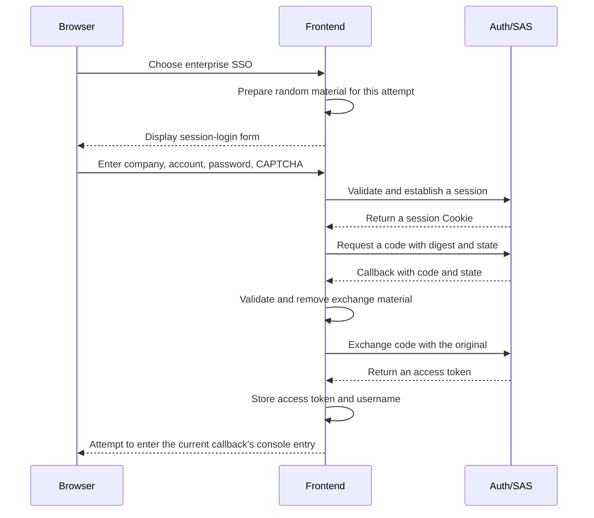

# 5. Project practice: connect enterprise SSO to authorization code and PKCE

This page follows the framework explanation. First the browser establishes an identity the authorization server recognizes; then it exchanges an authorization code. Business requests use the access token afterwards. Treat the session, code, and access token as three separate stages.

## Why an ordinary-login JWT is not enough

`/oauth2/authorize` requires a server-side Auth session in this project. A frontend JWT does not replace HttpSession. Enterprise SSO first brings the user to `Login?oauth2=true`, submits the same password and CAPTCHA to `/api/auth/session-login`, creates and rotates HttpSession, then opens the saved authorization URL.

Think of a session as the authorization desk's record of the person currently there. The desk must identify the person before considering the client's request and issuing a code. The access token belongs to the later business-access stage.

Session login still verifies the account, password, and CAPTCHA. Its successful result first saves server-side authentication state rather than returning the ordinary-login JWT at that point.

## Read the stages in order

The diagram separates browser, frontend, and Auth responsibilities. In the current Docker frontend, same-origin protocol requests pass through Nginx and Gateway to Auth. Those forwarding layers are omitted to keep sessions and token exchange visible.



The default client is omni-frontend, authentication method NONE, PKCE required, scopes openid profile, and no additional consent required by default. pkce.ts generates a 64-character verifier and S256 challenge. callback/index.vue checks state/verifier before exchanging tokens. Exchange uses native fetch('/oauth2/token') with form encoding rather than Axios's project `R<T>` handling.

NONE means the browser client does not store a permanent client password, not that the user need not log in. openid and profile are requested protocol scopes, not all business menus and approval permissions.

state checks that this is the interaction the frontend initiated. verifier is the original required for exchange. They perform different checks and cannot replace each other.

The default client also registers the REFRESH_TOKEN grant. That does not prove browser automatic renewal: the current callback saves only access token and username. Inspect the browser implementation, not just a grant name in configuration.

## How protocol scope meets local business permissions

Two uses of scope need care: the requested openid/profile scopes and project API permission information. For local-user access tokens, the project customizer contains these two original lines:

<!-- omni:source path="omni-backend/omni-auth/src/main/java/com/omni/auth/config/AuthorizationServerConfig.java" -->
```java
                List<String> permissions = sysUserMapper.selectPermissionsByUserId(user.getUserId());
                context.getClaims().claim("scope", String.join(" ", permissions));
```

It reads the local user's permissions and writes them into the access token's scope claim for the project gateway and permission system. This is a project customization, not a rule that every OAuth2 scope is a project permission code. Distinguish registered protocol scopes from final business claims.

This customization currently does not reduce local business permissions according to the client's requested scope. The reporting example explains limited delegation; it does not mean the project already implements a fine-grained business authorization platform for arbitrary third-party applications. That would require scope-to-permission mapping, narrowing, and resource-side checks. This tutorial does not describe those future changes as implemented.

## Connect project source to the framework

The frontend function below turns this attempt's original into a digest. It corresponds to the framework S256 check: encode, hash with SHA-256, then use base64url.

<!-- omni:source path="omni-frontend/src/utils/pkce.ts" -->
```typescript
export async function generateCodeChallenge(verifier: string): Promise<string> {
  const encoder = new TextEncoder()
  const data = encoder.encode(verifier)
  const digest = await crypto.subtle.digest('SHA-256', data)
  return base64UrlEncode(new Uint8Array(digest))
}
```

The generated original uses ASCII-range characters, so the frontend encoding agrees with the framework's ASCII bytes. base64UrlEncode also replaces Base64 characters unsuitable for URLs and removes padding.

The server's authorization filter chain uses this session configuration to load and save the security context through HttpSession:

<!-- omni:source path="omni-backend/omni-auth/src/main/java/com/omni/auth/config/AuthorizationServerConfig.java" -->
```java
        http.securityContext(context -> context
                .requireExplicitSave(false)
                .securityContextRepository(new HttpSessionSecurityContextRepository()));
```

After successful validation, sessionLogin creates a security context, rotates the session ID, and writes the context into the new session. The authorization endpoint can then recognize that browser's login. The ordinary JWT did not replace this step.

On success, the authorization-code callback currently attempts to navigate to Dashboard, the console overview entry. Route and permission guards still decide whether the identity may enter. This differs from ordinary password login returning to the Wiki by default.

## Why failure usually requires a fresh attempt

- Callback error, missing code, mismatched state, or missing verifier returns to login. Early-return branches do not guarantee that all stored parameters are cleared.
- Before token exchange, the four exchange parameters have already been removed. If exchange fails, do not assume the old verifier is reusable; start authorization again.
- A missing/expired session makes /oauth2/authorize redirect to the frontend login instead of accepting a JWT.
- The frontend saves access token and username only. id_token and refresh_token are optional response fields in the type; there is currently no refresh implementation.
