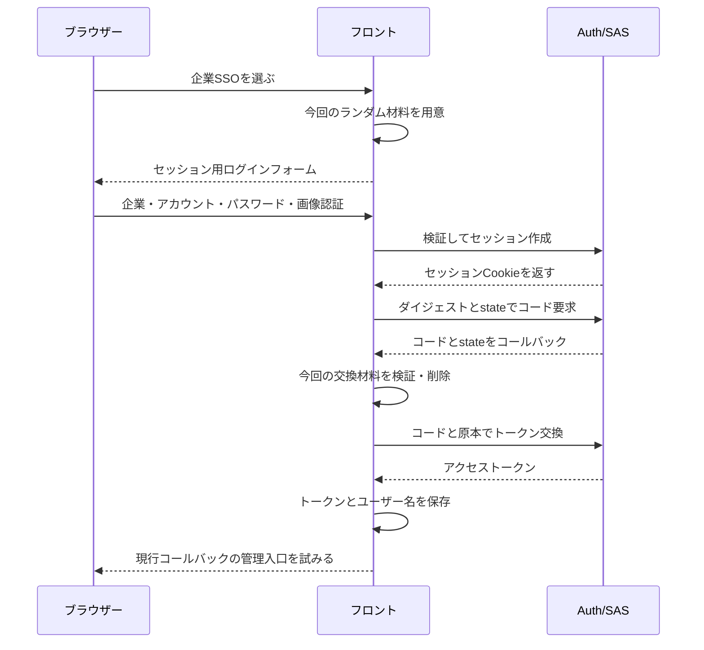

# 5. プロジェクトでの実践：企業 SSO と認可コード・PKCE をつなぐ

フレームワークの説明を実際の流れへつなげます。ブラウザーが認可サーバーに本人を認識させ、次に認可コードを交換し、その後の業務リクエストでアクセストークンを使います。セッション、コード、アクセストークンは別段階の材料です。

## 通常ログインの JWT だけでは足りない理由

このプロジェクトの `/oauth2/authorize` は Auth 上のサーバー側セッションを必要とし、フロントの JWT は HttpSession を代替しません。企業 SSO は先に `Login?oauth2=true` へ進み、同じパスワードと画像認証で `/api/auth/session-login` を呼びます。HttpSession を作って識別子を更新してから、保存した認可 URL を開きます。

セッションは、認可の窓口が保持する「今来ている人」の記録と考えられます。人を確認してからクライアントの要求と合わせてコードを発行します。アクセストークンは、その後の業務アクセスを担当します。

セッション作成でもアカウント、パスワード、画像認証を検証します。省略されるのではなく、成功時に通常ログインの JWT を返す代わりにサーバー側の認証状態を先に保存します。

## 段階に分けて読む

図はブラウザー、フロント、認証サービスの責任を示します。現在の Docker フロントでは同一オリジンのプロトコル要求が Nginx、Gateway を経由して Auth に届きます。図では転送層を省略し、セッションとトークン交換を残しています。



既定クライアントは omni-frontend、認証方式 NONE、PKCE 必須、scope は openid profile、追加同意は既定で不要です。pkce.ts が 64 文字の verifier と S256 challenge を作り、callback/index.vue が state/verifier を確認して交換します。交換は fetch('/oauth2/token') にフォーム形式で送り、Axios の `R<T>` 処理を使いません。

NONE はブラウザーに長期クライアント秘密を保存しない意味で、利用者のログイン不要という意味ではありません。openid と profile はプロトコルの要求範囲であり、全メニューや承認権限ではありません。

state は自分で始めたやり取りの戻りかを確認し、verifier は交換時に提示する原本です。担当が異なるため代替できません。

既定クライアントには REFRESH_TOKEN グラントも登録されていますが、フロントの自動更新実装を意味しません。現行コールバックはトークンとユーザー名だけを保存します。設定名だけでなくブラウザー実装を確認します。

## プロトコルの範囲とローカル業務権限

要求する openid/profile と、業務 API の権限情報には、同じ scope という名前が出ます。プロジェクトはローカル利用者のアクセストークンを次の連続原文でカスタマイズします。

<!-- omni:source path="omni-backend/omni-auth/src/main/java/com/omni/auth/config/AuthorizationServerConfig.java" -->
```java
                List<String> permissions = sysUserMapper.selectPermissionsByUserId(user.getUserId());
                context.getClaims().claim("scope", String.join(" ", permissions));
```

ローカル権限を取得し、トークンの scope クレームへ書いてゲートウェイと権限制御へ接続します。プロジェクト独自の処理であり、すべての OAuth2 の scope が業務権限コードという意味ではありません。登録したプロトコル範囲と最終的な業務クレームを分けて読みます。

現在、この処理はクライアントの要求範囲に応じてローカル業務権限を絞りません。集計アプリの例は限定的委譲の概念であり、任意の第三者アプリ向けの細かな業務認可基盤が完成しているわけではありません。その場合は範囲と権限の対応、絞り込み、リソース側検証を設計する必要があります。今後の作業を実装済みとは記載しません。

## プロジェクトとフレームワークをソースでつなぐ

フロントが原本をダイジェストへ変換する関数です。前ページの S256 検証と対応し、バイト化、SHA-256、base64url の順で処理します。

<!-- omni:source path="omni-frontend/src/utils/pkce.ts" -->
```typescript
export async function generateCodeChallenge(verifier: string): Promise<string> {
  const encoder = new TextEncoder()
  const data = encoder.encode(verifier)
  const digest = await crypto.subtle.digest('SHA-256', data)
  return base64UrlEncode(new Uint8Array(digest))
}
```

生成する原本は ASCII 範囲の文字なので、フレームワークの ASCII バイトと対応します。base64UrlEncode は URL に不向きな Base64 文字を変え、パディングも除きます。

認可フィルターチェーンの次の設定で、HttpSession から認証コンテキストを読み書きします。

<!-- omni:source path="omni-backend/omni-auth/src/main/java/com/omni/auth/config/AuthorizationServerConfig.java" -->
```java
        http.securityContext(context -> context
                .requireExplicitSave(false)
                .securityContextRepository(new HttpSessionSecurityContextRepository()));
```

sessionLogin は検証成功後にコンテキストを作り、セッション識別子を更新して新しいセッションへ保存します。同じブラウザーを認可エンドポイントが認識できるようになり、通常の JWT がこの段階を代替するわけではありません。

現行の認可コードコールバックは成功後に Dashboard、つまり管理コンソールの概要を試みます。入場可否はルートと権限ガードが判断します。通常のパスワードログインが既定で Wiki に戻る処理とは異なります。

## 失敗するとやり直しが必要な理由

- コールバックの error、code 不足、state 不一致、verifier 不足はログインへ戻ります。早期 return で全保存値の削除は保証されません。
- 交換前に四つの交換材料を削除済みです。交換失敗時に古い verifier を再利用できると考えず、最初から認可を始めます。
- セッション不足・期限切れなら /oauth2/authorize は JWT を受け入れずフロントのログインへリダイレクトします。
- フロントが保存するのは access token とユーザー名だけです。id_token、refresh_token は型では任意ですが、更新処理はありません。
