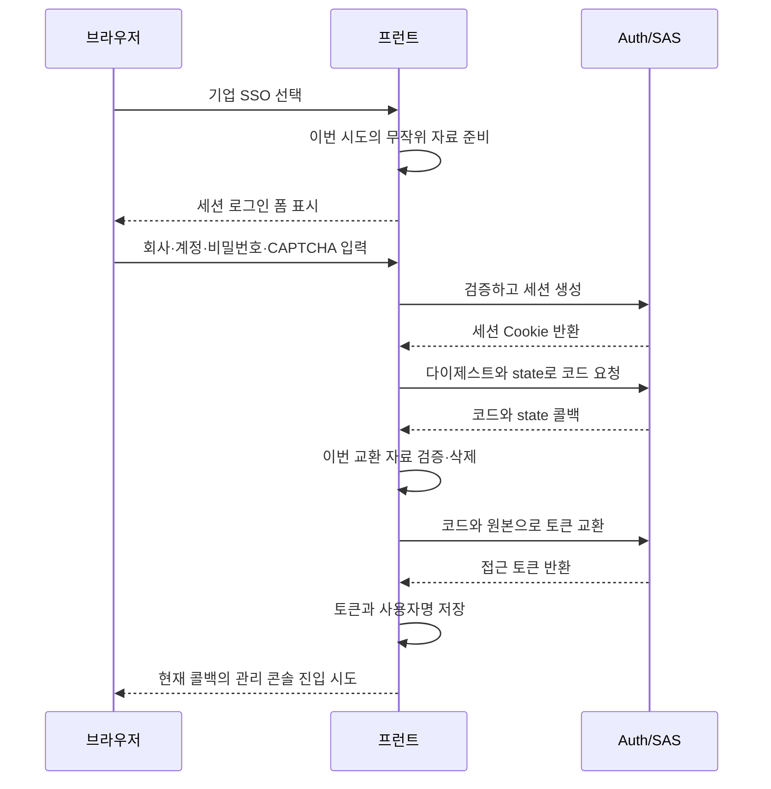

# 5. 프로젝트 실습: 기업 SSO와 인가 코드·PKCE 연결하기

프레임워크 설명을 실제 흐름에 연결합니다. 브라우저가 인가 서버에 현재 신원을 알린 다음 인가 코드를 교환합니다. 업무 요청은 이후 접근 토큰을 사용합니다. 세션, 코드, 접근 토큰을 서로 다른 단계의 자료로 보세요.

## 일반 로그인 JWT만으로 부족한 이유

이 프로젝트의 `/oauth2/authorize`는 Auth의 서버 측 세션이 필요합니다. 프런트의 JWT는 HttpSession을 대신하지 못합니다. 기업 SSO는 먼저 `Login?oauth2=true`로 보내 같은 비밀번호와 CAPTCHA로 `/api/auth/session-login`을 호출합니다. HttpSession을 만들고 식별자를 교체한 뒤 저장해 둔 인가 URL을 엽니다.

세션은 인가 창구가 보관하는 “지금 찾아온 사람”의 기록입니다. 창구가 사람을 확인한 다음 클라이언트 요청에 따라 코드를 발급합니다. 접근 토큰은 이후 업무 리소스에 접근하는 단계의 자격 증명입니다.

세션 로그인도 계정, 비밀번호, CAPTCHA를 검증합니다. 검사를 생략하는 것이 아니라, 성공 후 일반 로그인 JWT를 즉시 반환하는 대신 서버의 인증 상태를 먼저 저장합니다.

## 단계별 전체 흐름

그림은 브라우저·프런트·인증 서비스의 책임을 보여 줍니다. 현재 Docker 프런트의 동일 출처 프로토콜 요청은 Nginx와 Gateway를 거쳐 Auth로 갑니다. 전달 계층은 생략하고 세션과 토큰 교환을 표시했습니다.



기본 클라이언트는 omni-frontend, 인증 방식 NONE, PKCE 필수, scope는 openid profile이며 기본적으로 추가 동의를 요구하지 않습니다. pkce.ts는 64자 verifier와 S256 challenge를 생성하고 callback/index.vue는 state/verifier 검사 후 교환합니다. 네이티브 fetch('/oauth2/token')에 폼 인코딩으로 보내며 Axios의 `R<T>` 규칙은 사용하지 않습니다.

NONE은 브라우저에 장기 클라이언트 비밀번호를 두지 않는다는 뜻이며 사용자가 로그인할 필요가 없다는 뜻은 아닙니다. openid와 profile은 요청한 프로토콜 범위로, 모든 메뉴나 승인 권한을 뜻하지 않습니다.

state는 프런트가 시작한 상호 작용의 응답인지 확인하고, verifier는 교환 시 제시할 원본입니다. 다른 검사를 하므로 서로 대신할 수 없습니다.

기본 클라이언트는 REFRESH_TOKEN 그랜트도 등록하지만 자동 갱신이 구현되었다는 뜻은 아닙니다. 현재 콜백은 접근 토큰과 사용자명만 저장합니다. 설정의 이름만 보고 브라우저 구현 확인을 생략하면 안 됩니다.

## 프로토콜 범위와 로컬 업무 권한의 연결

요청한 openid/profile과 업무 API의 권한 정보가 모두 scope로 불릴 수 있습니다. 프로젝트는 로컬 사용자 접근 토큰을 아래 연속 원문으로 커스터마이즈합니다.

<!-- omni:source path="omni-backend/omni-auth/src/main/java/com/omni/auth/config/AuthorizationServerConfig.java" -->
```java
                List<String> permissions = sysUserMapper.selectPermissionsByUserId(user.getUserId());
                context.getClaims().claim("scope", String.join(" ", permissions));
```

로컬 사용자 권한을 조회해 접근 토큰의 scope 클레임에 기록하고, 게이트웨이 및 권한 체계와 연결합니다. 자체 커스터마이징이며 모든 OAuth2 scope가 프로젝트 업무 권한 코드라는 뜻은 아닙니다. 등록한 프로토콜 범위와 최종 업무 클레임을 구분해야 합니다.

현재 이 처리는 클라이언트의 요청 범위에 따라 로컬 업무 권한을 축소하지 않습니다. 보고서 예시는 제한된 위임의 개념이며, 임의의 외부 앱을 위한 세분화된 업무 인가 플랫폼이 완성되었다는 뜻이 아닙니다. 그런 기능에는 범위와 권한의 매핑, 축소, 리소스 측 검증이 더 필요합니다. 이 글은 후속 작업을 이미 구현했다고 쓰지 않습니다.

## 프로젝트와 프레임워크를 소스로 연결하기

프런트가 원본을 다이제스트로 바꾸는 함수입니다. 앞 글의 S256 검사와 대응하며 바이트 변환, SHA-256, base64url 순서입니다.

<!-- omni:source path="omni-frontend/src/utils/pkce.ts" -->
```typescript
export async function generateCodeChallenge(verifier: string): Promise<string> {
  const encoder = new TextEncoder()
  const data = encoder.encode(verifier)
  const digest = await crypto.subtle.digest('SHA-256', data)
  return base64UrlEncode(new Uint8Array(digest))
}
```

생성된 원본은 ASCII 범위의 문자를 사용하므로 프레임워크의 ASCII 바이트와 대응합니다. base64UrlEncode는 URL에 맞지 않는 Base64 문자를 바꾸고 패딩을 제거합니다.

서버 인가 필터 체인의 세션 설정입니다. HttpSession으로 인증 컨텍스트를 읽고 저장하게 합니다.

<!-- omni:source path="omni-backend/omni-auth/src/main/java/com/omni/auth/config/AuthorizationServerConfig.java" -->
```java
        http.securityContext(context -> context
                .requireExplicitSave(false)
                .securityContextRepository(new HttpSessionSecurityContextRepository()));
```

sessionLogin은 검증 성공 후 컨텍스트를 만들고 세션 식별자를 교체하여 새 세션에 기록합니다. 이후 같은 브라우저의 로그인을 인가 엔드포인트가 알아봅니다. 일반 JWT가 이 단계를 대체하지 않습니다.

현재 인가 코드 콜백은 성공 후 Dashboard, 즉 관리 콘솔 개요로 이동을 시도합니다. 실제 진입 여부는 라우트·권한 가드가 판단합니다. 일반 비밀번호 로그인의 기본 Wiki 복귀와 다른 분기입니다.

## 실패하면 다시 시작해야 하는 이유

- 콜백 error, code 누락, state 불일치, verifier 누락은 로그인으로 돌아갑니다. 조기 반환에서 저장된 모든 값의 삭제를 보장하지는 않습니다.
- 토큰 교환 전에 네 교환 매개변수는 이미 삭제됩니다. 실패 후 이전 verifier를 재사용할 수 있다고 가정하지 말고 인가를 다시 시작합니다.
- 세션이 없거나 만료되면 /oauth2/authorize는 JWT를 받는 대신 프런트 로그인으로 리다이렉트합니다.
- 저장하는 것은 access token과 사용자명뿐입니다. id_token, refresh_token은 응답 타입에서 선택 필드지만 현재 갱신 구현은 없습니다.
