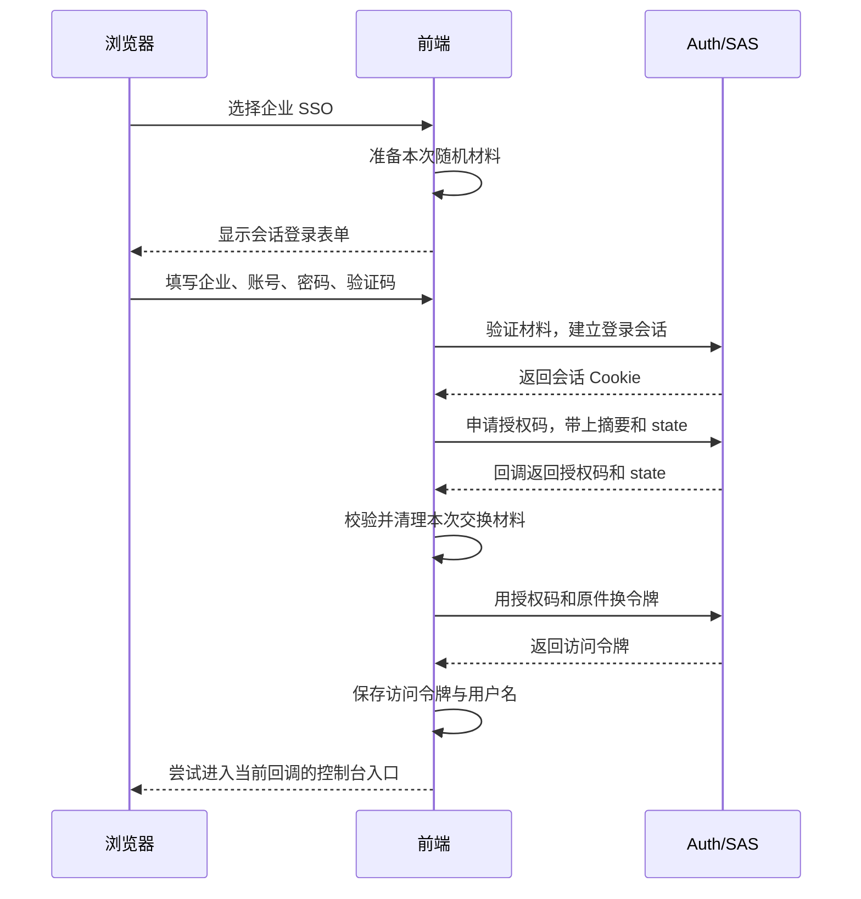

# 5. 项目实践：企业 SSO 怎样接上授权码与 PKCE

这一篇承接框架原理。浏览器先让授权服务器认识当前用户，再完成授权码交换；业务请求之后才使用访问令牌。请把服务端会话、授权码和访问令牌当作三个不同阶段的材料。

## 为什么普通登录拿到 JWT 还不够

授权码流程的 `/oauth2/authorize` 需要浏览器在 Auth 上已有服务端会话。前端持有的 JWT 不能替代 HttpSession。因此企业 SSO 入口先把用户带到 `Login?oauth2=true`，用同样的密码与验证码调用 `/api/auth/session-login`，建立并轮换 `HttpSession`，再打开之前保存的授权 URL。

可以把会话看成授权办理窗口保存的“当前来办事的人”。窗口需要先确认这个人，再结合客户端申请发放授权码。业务请求携带的访问令牌，承担的是之后访问业务资源的职责。

建立会话这个步骤仍然验证账号、密码和验证码，并没有省略登录检查。它与普通密码入口的区别在于成功后先保存服务端认证状态，而不是在这一步直接把普通登录 JWT 返回给前端。

## 把整个过程按阶段读一遍

图中按职责画出浏览器、前端和认证服务。页面发出的同源协议请求，在当前 Docker 前端中经 Nginx 和 Gateway 代理后到 Auth；图里省略这些转发层，保留需要理解的会话和令牌交互。



默认客户端是 `omni-frontend`，认证方式 `NONE`，要求 PKCE，作用域 `openid profile`，默认不要求额外授权确认。前端 `pkce.ts` 生成 64 字符 verifier 与 `S256` challenge；`callback/index.vue` 校验 state/verifier 后才交换 Token。Token 交换是原生 `fetch('/oauth2/token')`，使用表单编码，不走 Axios 的 `R<T>` 规则。

上面的 NONE 说的是客户端不用在浏览器里保存长期客户端密码，不是说用户不需要登录。openid 和 profile 是这次协议申请的作用域，也不能直接读成所有业务菜单和审批权限。

state 帮前端确认回来的是自己发起的这次交互；verifier 是换令牌时要出示的原件。它们解决的检查不同，不能互相代替。回调收到授权码后，先核对本次材料，再去令牌端点交换。

项目的默认客户端配置还登记了 REFRESH_TOKEN 许可，但这不能推出前端已经实现自动续期。当前回调实际只保存访问令牌和用户名；不能看到配置里有一个许可名称，就省略对浏览器实现的检查。

## 协议申请的范围，怎样接上本地业务权限

这里容易遇到两个都叫 scope 的地方：发起授权时申请的 openid、profile，以及项目业务接口使用的权限信息。当前工程对本地用户的访问令牌做了定制，在对应分支里有下面两行原文：

<!-- omni:source path="omni-backend/omni-auth/src/main/java/com/omni/auth/config/AuthorizationServerConfig.java" -->
```java
                List<String> permissions = sysUserMapper.selectPermissionsByUserId(user.getUserId());
                context.getClaims().claim("scope", String.join(" ", permissions));
```

它先查本地用户的权限，再写入访问令牌中的 scope 声明，供本项目网关与权限体系衔接。这是工程自己的定制，不能反过来认为任何 OAuth2 系统中的 scope 都是本项目这种业务权限码。注册客户端的协议作用域和最终令牌里的业务声明，要分别读清楚。

当前这段定制没有按客户端申请范围裁剪本地用户的业务权限。本章的报表例子用于解释有限授权的思想，不代表项目已经完成面向任意第三方应用的细粒度业务授权平台。若要对外开放这种能力，还需要设计客户端范围与业务权限的映射、裁剪和资源端验证；本次讲解不把这些后续工作写成已有实现。

## 工程源码怎样接上框架

先看前端把本次原件变成摘要的函数。它与上一页框架中的 S256 校验正好对应：先得到字节，再计算 SHA-256，最后做 base64url 编码。

<!-- omni:source path="omni-frontend/src/utils/pkce.ts" -->
```typescript
export async function generateCodeChallenge(verifier: string): Promise<string> {
  const encoder = new TextEncoder()
  const data = encoder.encode(verifier)
  const digest = await crypto.subtle.digest('SHA-256', data)
  return base64UrlEncode(new Uint8Array(digest))
}
```

项目生成的原件使用 ASCII 范围内的字符，因此这里的编码与框架按 ASCII 取字节能够对应起来。base64UrlEncode 还会把普通 Base64 中不适合直接放进网址的字符转换掉，并去掉填充符。

再看服务端授权过滤链中的会话配置。它告诉安全框架，从 HttpSession 读取和保存认证上下文。

<!-- omni:source path="omni-backend/omni-auth/src/main/java/com/omni/auth/config/AuthorizationServerConfig.java" -->
```java
        http.securityContext(context -> context
                .requireExplicitSave(false)
                .securityContextRepository(new HttpSessionSecurityContextRepository()));
```

项目的 sessionLogin 验证成功后，创建认证上下文、轮换会话标识，并把上下文写入新会话。随后授权端点才能在同一个浏览器会话里识别这次登录；普通登录 JWT 没有替代这一段。

当前授权码回调成功后，代码尝试跳转到 Dashboard，也就是控制台概览入口；路由与权限守卫仍会决定该身份能否进入。它与普通密码登录默认回官网 Wiki 的分支不同，不能把不同入口的落点写成同一个结果。

## 失败后为什么通常需要重新开始

- 回调带 `error`、缺少 code、state 不匹配或缺少 verifier：返回登录页。提前返回分支不保证清理全部已存参数。
- Token 交换失败：四个交换参数已经删除，不能假定旧 verifier 仍可复用，需要重新发起授权。
- 会话缺失或过期：`/oauth2/authorize` 会把用户重定向到前端登录页，而不是接受 JWT。
- 前端只保存 access token 与用户名；`id_token`、`refresh_token` 在响应类型里是可选字段，但当前没有刷新实现。
