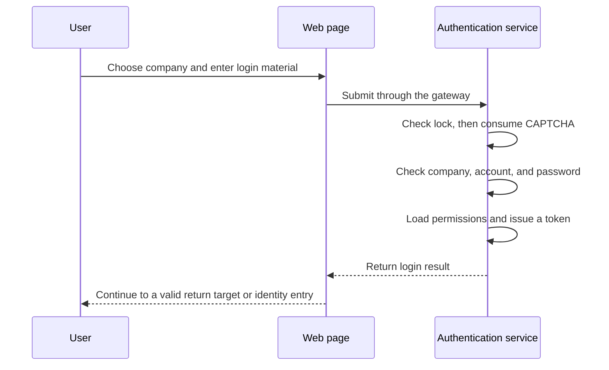

# 4. Project practice: one ordinary password login

Follow Li's ordinary login from start to finish. You now know the roles of authentication, sessions, and tokens; this page shows where the project places them. Read the actions in order before trying to remember class names.

## The actions in a login

At `/login`, the user selects a tenant and enters a username, password, and CAPTCHA. The frontend first obtains tenants and a CAPTCHA. The server then checks: account lock → one-time CAPTCHA consumption → tenant availability → user within that tenant → BCrypt password → roles/permissions → JWT issuance → online record → security audit.

Read these as three groups. First, may the attempt continue: lock, CAPTCHA, tenant state. Second, is this the person: find the account in that company and check the password. Third, issue credentials and record the login.

A tenant here is the chosen company space. The same username may exist in different companies, so identify the company first. Password verification does not retrieve plaintext from the database: an encoder checks the supplied password against the stored BCrypt hash.



## Read real project source

This continuous excerpt comes from ordinary login in AuthController. Check the order: a locked account does not consume the CAPTCHA. Otherwise this attempt's CAPTCHA is actually checked.

R.fail is the project's failure result. Focus on the failed condition; this branch does not continue to issue a new access token.

<!-- omni:source path="omni-backend/omni-auth/src/main/java/com/omni/auth/controller/AuthController.java" -->
```java
        // 第一步：检查账号是否被锁定
        if (accountLockoutService.isLocked(request.getTenantId(), request.getUsername())) {
            publishLoginFailed(request.getTenantId(), request.getUsername(), ip, ua, "account_locked",
                    "账号已被锁定，请稍后重试", "password");
            return R.fail(423, lockMessage(request.getTenantId(), request.getUsername()));
        }

        // 第二步：校验验证码（一次性使用，存储在 Redis 中，带 TTL 自动过期）
        try {
            captchaService.validate(request.getCaptchaKey(), request.getCaptchaCode());
        } catch (Exception e) {
            publishLoginFailed(request.getTenantId(), request.getUsername(), ip, ua, "invalid_captcha",
                    "验证码校验失败", "password");
            throw e;
        }

        tenantService.requireLoginAvailable(request.getTenantId());
```

CaptchaServiceImpl reads the CAPTCHA with Redis `GETDEL`. Missing or consumed records fail. **Do not retry a password with the same CAPTCHA.** The lock check runs before consumption: a locked request consumes no CAPTCHA but does not reach password verification either.

GETDEL means “read and delete”, allowing that record to be consumed once. A wrong password cannot restore the consumed CAPTCHA. Obtain a new image and its corresponding material for another attempt.

After ordinary login, the page first uses a validated internal return address. Otherwise it chooses an entry by identity: internal accounts currently return to the Wiki home, while portal-only identities return to the portal. Reading documentation and entering the workspace are separate; use the home account area when you need business functions.

Success returns `accessToken`, `tokenType=Bearer`, and `expiresIn`, without a refresh token. Current repository application.yml sets auth.token.access-token-ttl to 7200 seconds; the code fallback is 900 seconds. Troubleshooting must consider configuration rather than only the fallback.

## How the stored password is checked

UserServiceImpl has a short method. rawPassword is the submitted value; encodedPassword is the stored encoding. The configured BCrypt encoder performs the comparison.

<!-- omni:source path="omni-backend/omni-auth/src/main/java/com/omni/auth/service/impl/UserServiceImpl.java" -->
```java
    @Override
    public boolean verifyPassword(String rawPassword, String encodedPassword) {
        return passwordEncoder.matches(rawPassword, encodedPassword);
    }
```

The application does not decrypt the database record back into the original password. Do not replace this with simple string equality. Password matching is authentication; signing the later token is another stage.

## Find the group where the attempt stopped

| Condition | Actual result | Recovery |
|---|---|---|
| Locked account | R.fail(423, ...) | Wait for the lock window or have an administrator handle it |
| Wrong/expired CAPTCHA | Validation exception, business code 400 | Load a new CAPTCHA; do not reuse the old key |
| Tenant cannot log in | tenantService.requireLoginAvailable throws | Select an available tenant |
| User absent | R.fail(401, ...), failed-attempt count recorded | Check company and username |
| Wrong password | R.fail(401, "密码错误"), failed-attempt count recorded | Correct the input; repeated failures trigger locking |
| Online-record failure | WARN only; the issued JWT remains usable | The online-user list may lack the session; this neither disproves login nor proves a missing security audit |
