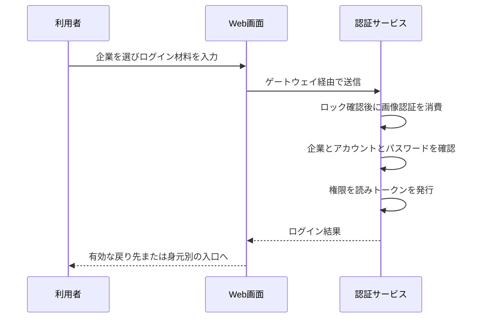

# 4. プロジェクトでの実践：通常のパスワードログイン

李さんの通常ログインを最後まで追います。認証、セッション、トークンの分担が分かったところで、プロジェクトが処理をどこに置くかを見ます。クラス名より動作の順番を先に読みましょう。

## ログインを構成する動作

利用者は `/login` でテナントを選び、ユーザー名、パスワード、画像認証を入力します。フロントがテナント一覧と画像を取得した後に送信します。サーバー側の順番は、アカウントロック → 画像認証の一回消費 → テナントのログイン可否 → テナント内の利用者検索 → BCrypt によるパスワード確認 → 役割・権限の読込 → JWT 発行 → オンライン状態記録 → セキュリティ監査です。

三つのまとまりに分けられます。まず試行を続けてよいかをロック・画像認証・企業状態で確認します。次に選んだ企業内のアカウントとパスワードで本人を確かめます。最後に資格情報と記録を用意します。

テナントとは今回選んだ企業の空間です。同名の利用者が別企業に存在し得るため、企業を先に決めます。パスワードはデータベースから平文を取り出すのではなく、保存した BCrypt ハッシュに対して検証器で照合します。



## 実際のプロジェクトソースを読む

AuthController の通常ログインからの連続原文です。順番に注目してください。既にロックされていれば画像認証を消費せず、ロックされていない場合に今回の材料を確認します。

R.fail はプロジェクトの失敗応答です。どの条件に失敗したかを読みます。この分岐で新しいアクセストークンは発行されません。

<!-- omni:source path="omni-backend/omni-auth/src/main/java/com/omni/auth/controller/AuthController.java" -->
```java
        // 第一步：检查账号是否被锁定
        if (accountLockoutService.isLocked(request.getTenantId(), request.getUsername())) {
            publishLoginFailed(request.getTenantId(), request.getUsername(), ip, ua, "account_locked",
                    "账号已被锁定，请稍后重试", "password");
            return R.fail(423, lockMessage(request.getTenantId(), request.getUsername()));
        }

        // 第二步：校验验证码（一次性使用，存储在 Redis 中，带 TTL 自动过期）
        try {
            captchaService.validate(request.getCaptchaKey(), request.getCaptchaCode());
        } catch (Exception e) {
            publishLoginFailed(request.getTenantId(), request.getUsername(), ip, ua, "invalid_captcha",
                    "验证码校验失败", "password");
            throw e;
        }

        tenantService.requireLoginAvailable(request.getTenantId());
```

CaptchaServiceImpl は Redis の `GETDEL` で画像認証を取得します。存在しない、または消費済みなら失敗します。**同じ画像認証でパスワードを再試行できません。** ロック検査は消費より前で、ロック中は画像認証を消費しませんがパスワード検証へも進みません。

GETDEL は「取り出して直ちに削除する」操作です。パスワードが違っても消費済みの記録は戻りません。次は新しい画像と対応する材料を取得します。

通常ログイン後は、検証済みのサイト内戻り先が優先されます。なければ身元ごとの既定入口へ進みます。現在、内部アカウントは Wiki ホーム、ポータル専用の身元はポータルへ戻ります。文書閲覧とワークスペースへの入場は別で、業務にはホームのアカウント領域の入口を使います。

成功時は `accessToken`、`tokenType=Bearer`、`expiresIn` を返し、refresh token は返しません。現在の application.yml は auth.token.access-token-ttl を 7200 秒に設定し、コードのフォールバックは 900 秒です。問題調査では既定コードだけでなく設定を確認します。

## 保存したパスワードとの照合

UserServiceImpl の短いメソッドです。rawPassword が今回の入力、encodedPassword が保存した値で、設定した BCrypt エンコーダーに照合を任せます。

<!-- omni:source path="omni-backend/omni-auth/src/main/java/com/omni/auth/service/impl/UserServiceImpl.java" -->
```java
    @Override
    public boolean verifyPassword(String rawPassword, String encodedPassword) {
        return passwordEncoder.matches(rawPassword, encodedPassword);
    }
```

保存値を元のパスワードへ復号する必要はありません。単なる文字列比較へ置き換えるべきでもありません。パスワード照合は認証であり、後からトークンへ署名する処理は別段階です。

## どの検査で止まったかを確認する

| 条件 | 実際の結果 | 復旧 |
|---|---|---|
| アカウントロック | R.fail(423, ...) | ロック期間を待つか管理者が対応 |
| 画像認証の誤り・期限切れ | 検証例外、業務コード 400 | 画像を再取得し、古い key は再利用しない |
| テナントがログイン不可 | tenantService.requireLoginAvailable が例外 | 利用できるテナントを選ぶ |
| 利用者がいない | R.fail(401, ...)、失敗回数を記録 | 企業と利用者名を確認 |
| パスワード不一致 | R.fail(401, "密码错误")、失敗回数を記録 | 入力を直す。連続失敗はロックにつながる |
| オンライン記録の失敗 | WARN のみで発行済み JWT に影響しない | 一覧にセッションが出ない場合がある。ログイン失敗やセキュリティ監査欠落の証拠にはならない |
