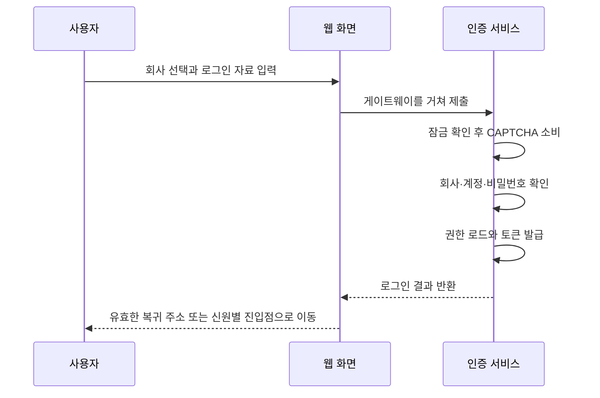

# 4. 프로젝트 실습: 일반 비밀번호 로그인 한 번 따라가기

리 씨의 일반 로그인을 끝까지 따라갑니다. 인증·세션·토큰의 역할을 이해했다면 프로젝트가 이를 어디에 배치했는지 봅니다. 클래스 이름보다 동작 순서를 먼저 읽으세요.

## 로그인을 구성하는 동작

사용자는 `/login`에서 테넌트를 선택하고 사용자명, 비밀번호, CAPTCHA를 입력합니다. 프런트는 먼저 테넌트 목록과 CAPTCHA를 가져옵니다. 서버 순서는 계정 잠금 → CAPTCHA 일회 소비 → 테넌트 로그인 가능 여부 → 테넌트 내 사용자 조회 → BCrypt 비밀번호 검사 → 역할·권한 로드 → JWT 발급 → 온라인 기록 → 보안 감사입니다.

세 묶음으로 이해하세요. 첫째는 계속 시도해도 되는지 판단하는 잠금·CAPTCHA·회사 상태입니다. 둘째는 선택한 회사에서 계정을 찾아 비밀번호로 본인을 확인하는 단계입니다. 셋째는 이후 자격 증명을 발급하고 기록을 남기는 단계입니다.

테넌트는 선택한 회사 공간입니다. 다른 회사에 같은 사용자명이 있을 수 있으므로 회사를 먼저 정합니다. 비밀번호는 DB에서 평문을 꺼내 비교하지 않고 저장된 BCrypt 해시에 대해 검증기로 확인합니다.



## 실제 프로젝트 소스 읽기

AuthController 일반 로그인의 연속된 원문입니다. 순서를 보세요. 잠긴 계정이면 CAPTCHA를 소비하지 않으며, 잠기지 않았을 때 이번 CAPTCHA를 확인합니다.

R.fail은 프로젝트의 실패 응답입니다. 어떤 조건이 실패했는지 보세요. 이 분기에서는 새 접근 토큰을 발급하지 않습니다.

<!-- omni:source path="omni-backend/omni-auth/src/main/java/com/omni/auth/controller/AuthController.java" -->
```java
        // 第一步：检查账号是否被锁定
        if (accountLockoutService.isLocked(request.getTenantId(), request.getUsername())) {
            publishLoginFailed(request.getTenantId(), request.getUsername(), ip, ua, "account_locked",
                    "账号已被锁定，请稍后重试", "password");
            return R.fail(423, lockMessage(request.getTenantId(), request.getUsername()));
        }

        // 第二步：校验验证码（一次性使用，存储在 Redis 中，带 TTL 自动过期）
        try {
            captchaService.validate(request.getCaptchaKey(), request.getCaptchaCode());
        } catch (Exception e) {
            publishLoginFailed(request.getTenantId(), request.getUsername(), ip, ua, "invalid_captcha",
                    "验证码校验失败", "password");
            throw e;
        }

        tenantService.requireLoginAvailable(request.getTenantId());
```

CaptchaServiceImpl은 Redis `GETDEL`로 CAPTCHA를 읽습니다. 없거나 이미 소비되면 실패합니다. **같은 CAPTCHA로 비밀번호를 다시 시도할 수 없습니다.** 계정 잠금 검사는 소비보다 먼저이므로 잠긴 요청은 CAPTCHA를 쓰지 않지만 비밀번호 검사에도 도달하지 않습니다.

GETDEL은 “읽은 뒤 바로 삭제”하는 뜻으로 기록을 한 번만 소비하게 합니다. 비밀번호가 틀려도 소비된 CAPTCHA를 복구하지 않습니다. 다음 시도에는 새 이미지와 그에 맞는 자료가 필요합니다.

일반 로그인 후 검증한 내부 복귀 주소를 먼저 사용합니다. 없다면 신원별 기본 진입점을 선택합니다. 현재 내부 계정은 Wiki 홈으로, 포털 전용 신원은 포털로 돌아갑니다. 문서 읽기와 작업 공간 입장은 별개이며 업무에는 홈 계정 영역의 진입점을 사용합니다.

성공 응답은 `accessToken`, `tokenType=Bearer`, `expiresIn`이며 refresh token은 없습니다. 현재 application.yml의 auth.token.access-token-ttl은 7200초, 코드 폴백은 900초입니다. 조사할 때 코드 기본값만 봐서는 안 됩니다.

## 저장된 비밀번호 확인 방식

UserServiceImpl의 메서드는 짧습니다. rawPassword는 이번 입력, encodedPassword는 저장된 인코딩 값입니다. 설정된 BCrypt 인코더가 비교합니다.

<!-- omni:source path="omni-backend/omni-auth/src/main/java/com/omni/auth/service/impl/UserServiceImpl.java" -->
```java
    @Override
    public boolean verifyPassword(String rawPassword, String encodedPassword) {
        return passwordEncoder.matches(rawPassword, encodedPassword);
    }
```

DB 기록을 원래 비밀번호로 복호화하지 않으며 단순 문자열 비교로 바꿔서도 안 됩니다. 비밀번호 확인은 인증 단계이고, 나중에 토큰에 서명하는 것은 별도 단계입니다.

## 어느 검사 묶음에서 멈췄는지 찾기

| 조건 | 실제 결과 | 복구 |
|---|---|---|
| 계정 잠김 | R.fail(423, ...) | 잠금 기간을 기다리거나 관리자 처리 |
| CAPTCHA 오류·만료 | 검증 예외, 업무 코드 400 | 새 CAPTCHA를 받고 이전 key는 재사용하지 않음 |
| 테넌트 로그인 불가 | tenantService.requireLoginAvailable 예외 | 이용 가능한 테넌트 선택 |
| 사용자 없음 | R.fail(401, ...), 실패 횟수 기록 | 회사와 사용자명 확인 |
| 비밀번호 오류 | R.fail(401, "密码错误"), 실패 횟수 기록 | 입력 수정, 연속 실패는 잠금 유발 |
| 온라인 기록 실패 | WARN만 남기며 발급된 JWT에는 영향 없음 | 온라인 목록에 세션이 없을 수 있음. 로그인 실패나 보안 감사 누락으로 단정할 수 없음 |
