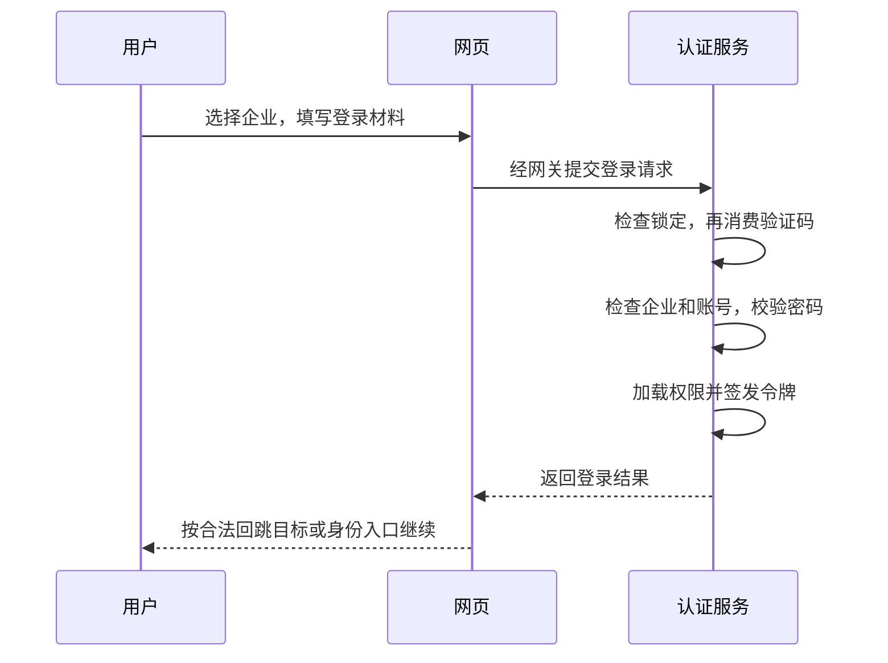

# 4. 项目实践：一次普通密码登录

先把小李的一次普通登录走完整。你已经知道认证、会话和令牌的分工，这里再看项目把这些责任放在了哪里。读源码时先跟动作顺序，不必先记类名。

## 一次登录分成哪些动作

用户在 `/login` 选择租户，填写用户名、密码和验证码。前端先取得租户列表与验证码，再提交登录。服务端的顺序是：账号锁定检查 → 验证码一次性消费 → 租户可登录校验 → 租户内用户查询 → BCrypt 密码校验 → 角色/权限加载 → JWT 签发 → 在线状态记录 → 安全审计。

可以把这串步骤分成三组来读。第一组是允许不允许继续尝试：账号锁定、验证码和租户状态。第二组是核对本人：在选定企业中找账号，再比较密码。第三组才是发放后续凭据并留下登录记录。

这里的租户就是这次选择的企业空间。同样的用户名可能属于不同企业，先明确企业，才能查对用户。密码也不是从数据库取出一段明文来比较，而是交给密码校验器与保存的 BCrypt 哈希核对。



## 读一段真实工程源码

下面截取 AuthController 普通登录中的连续原文。先看注释和两个检查的先后关系：账号已经被锁定，就不继续消费验证码；没有被锁定，才真正核对这一次验证码。

R.fail 是本项目返回失败结果的写法。读到它时，重点看什么条件没通过；这条分支不会继续为本次请求签发新的访问令牌。

<!-- omni:source path="omni-backend/omni-auth/src/main/java/com/omni/auth/controller/AuthController.java" -->
```java
        // 第一步：检查账号是否被锁定
        if (accountLockoutService.isLocked(request.getTenantId(), request.getUsername())) {
            publishLoginFailed(request.getTenantId(), request.getUsername(), ip, ua, "account_locked",
                    "账号已被锁定，请稍后重试", "password");
            return R.fail(423, lockMessage(request.getTenantId(), request.getUsername()));
        }

        // 第二步：校验验证码（一次性使用，存储在 Redis 中，带 TTL 自动过期）
        try {
            captchaService.validate(request.getCaptchaKey(), request.getCaptchaCode());
        } catch (Exception e) {
            publishLoginFailed(request.getTenantId(), request.getUsername(), ip, ua, "invalid_captcha",
                    "验证码校验失败", "password");
            throw e;
        }

        tenantService.requireLoginAvailable(request.getTenantId());
```

验证码在 `CaptchaServiceImpl` 中以 Redis `GETDEL` 读取，键不存在或已消费都返回失败；因此**不能用同一验证码重试密码**。账号锁定检查发生在验证码消费之前，被锁定请求不会消耗验证码，但也不会进入密码校验。

GETDEL 的意思可以理解为“取出后随即删除”，从而让同一条验证码记录只被消费一次。密码不正确时，也不能倒回去恢复已经消费的验证码；下一次尝试要取得新的图片和对应材料。

普通登录成功后，登录页面先使用经过校验的站内回跳地址；没有这样的地址时，按身份选择默认入口。当前内部账号默认回官网 Wiki，仅门户身份回门户。读文档与进入工作台是两件事，需要处理业务时再使用首页账户区的入口。

登录成功后返回 `accessToken`、`tokenType=Bearer` 和 `expiresIn`，不返回 refresh token。当前仓库 `application.yml` 的 `auth.token.access-token-ttl` 为 7200 秒；代码回退值为 900 秒。这个区别决定了排障时不能只看源码默认值。

## 密码怎样与数据库中的记录核对

UserServiceImpl 中的核对方法很短。rawPassword 是本次输入，encodedPassword 是保存的编码值；具体比较交给项目配置的 BCrypt 密码编码器。

<!-- omni:source path="omni-backend/omni-auth/src/main/java/com/omni/auth/service/impl/UserServiceImpl.java" -->
```java
    @Override
    public boolean verifyPassword(String rawPassword, String encodedPassword) {
        return passwordEncoder.matches(rawPassword, encodedPassword);
    }
```

应用不需要先把数据库里的记录“解密成原密码”，也不应该把比较逻辑随意换成字符串相等。密码核对发生在认证阶段；后面为访问令牌签名，是另一个阶段的工作。

## 失败时先确认停在哪一组检查

| 条件 | 实际结果 | 恢复 |
| --- | --- | --- |
| 账号锁定 | `R.fail(423, ...)` | 等待锁定窗口结束，或由管理员处理 |
| 验证码过期/错误 | 验证码校验异常，业务码 400 | 重新加载验证码，不能复用旧 key |
| 租户不可登录 | `tenantService.requireLoginAvailable` 抛错 | 选择可用租户 |
| 用户不存在 | `R.fail(401, ...)`，记录失败计数 | 检查租户与用户名 |
| 密码错误 | `R.fail(401, "密码错误")`，记录失败计数 | 重新输入；连续失败触发锁定 |
| 在线记录失败 | 仅 WARN，不影响已签发 JWT | 在线用户列表可能缺少该会话；不能据此否定登录，也不能据此断言安全审计缺失 |
