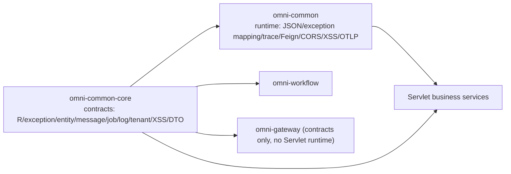

# common-core: contracts shared across services

`omni-common-core` is not a grab bag of utilities. It is a set of **contracts**: the response envelope, business exception, entity base class, plus interfaces and DTOs for messaging, jobs, operation logs, tenants, XSS and internal identity. It has no `AutoConfiguration.imports` and performs no auto-configuration — **depending on it gives you the types, not a running capability**.

This article walks through each function family as "problem → usage → principle → source excerpt → extension and failure recovery". Code is verbatim from the current source; no application was started in this round, so runtime assembly conclusions remain conditional on the source conditions.

> Evidence boundary: `omni-common-core/src/main/java` currently has 18 Java files. This article groups them into 9 function families and does not count getters, Lombok-generated methods or individual DTO fields as separate capabilities.

## First, separate core from common

| | `omni-common-core` | `omni-common` |
| --- | --- | --- |
| Role | contracts and types | Servlet runtime configuration |
| Auto-configuration | none | 7 `AutoConfiguration.imports` entries |
| Dependency direction | almost no third-party dependencies | depends on core, spring-web, security, Jackson, Feign, OTLP |
| What happens on import | you can compile and return `R` | filters, exception mapping and JSON format take effect |

`omni-common` depends on `omni-common-core`, not the other way round. Business services usually depend on both, but **whether a runtime capability exists depends on `omni-common`'s conditional assembly**, not on whether core declares the interface.



## Unified response and pagination

### Problem

If every controller builds `{code, message, data}` by hand, the frontend needs a parser per endpoint; if pagination field names differ, list pages break.

### Usage

```java
@GetMapping("/{id}")
public R<SupplierVO> detail(@PathVariable Long id) {
    return R.ok(supplierService.getDetail(id));
}

@GetMapping("/list")
public R<PageResult<SupplierVO>> list(SupplierQuery query) {
    return R.ok(supplierService.page(query));
}
```

### Source

`R.ok(T)` fixes `code=200` and `message="success"`; `R.fail` preserves the business code:

```java
    public static <T> R<T> ok(T data) {
        R<T> r = new R<>();
        r.setCode(200);
        r.setMessage("success");
        r.setData(data);
        return r;
    }
```

```java
    public static <T> R<T> fail(int code, String message) {
        R<T> r = new R<>();
        r.setCode(code);
        r.setMessage(message);
        r.setData(null);
        return r;
    }
```

`PageResult` computes total pages at construction:

```java
    public PageResult(List<T> records, long total, long size, long current) {
        this.records = records;
        this.total = total;
        this.size = size;
        this.current = current;
        // 向上取整计算总页数
        this.pages = (total + size - 1) / size;
    }
```

### Boundaries

- `R` has only `code/message/data` and **no traceId**; the trace id travels in the `X-Trace-Id` response header.
- `R.code` and the HTTP status are two layers: many business failures still return HTTP 200 with a business code. Check `code`, not only the HTTP status.
- `R` and `PageResult` are shared across services. Check every caller when changing them, rather than verifying only one service.

### Extension and recovery

Adding a response field is a cross-service contract change; evaluate the frontend parser and every service. If the frontend sees `code != 200`, handle it by business code rather than retrying every failure.

## Business exception

### Problem

Business validation failures need an exception carrying a business code; if each service defines its own exception type, the global mapper must know them all.

### Usage

```java
if (!String.valueOf(userId).equals(task.getAssignee())) {
    throw new BusinessException(403, "无权操作该审批任务");
}
```

### Source

```java
    public BusinessException(String message) {
        super(message);
        this.code = 500;
    }

```

```java
    public BusinessException(int code, String message) {
        super(message);
        this.code = code;
    }
```

### Principle and boundaries

- The single-argument constructor defaults to `500`; the two-argument one keeps the business code.
- It is only a `RuntimeException` plus a code and **does not decide the HTTP status**.
- Servlet services map it through `omni-common`'s `GlobalExceptionHandler` (see [common](common.en.md#global-exception-mapping)); the WebFlux gateway does not assemble that handler.

### Extension and recovery

New business codes need no core change. If an exception does not produce the expected response, first check whether the service has the global handler and whether another advice handles the exception type first.

## Entity base class

### Problem

Every business table has `id`, create/update time and create/update user; repeating them invites omissions.

### Usage

An entity extends the base class, and MyBatis-Plus `MetaObjectHandler` fills the time and operator on insert.

### Current fact

The repository contains **two** `BaseEntity` classes:

| File | Package | Fields |
| --- | --- | --- |
| `omni-common-core/.../core/model/BaseEntity.java` | `com.omni.common.core.model` | id, createTime, updateTime, createBy, updateBy |
| `omni-common/.../common/model/BaseEntity.java` | `com.omni.common.model` | same |

Both are in use; which one an entity extends depends on its `import`. Articles must not describe them as one class or assume they stay in sync.

### Boundaries

- The base class only declares fields and serialization; **it contains no auto-fill logic** — that belongs to `omni-common-mybatis`.
- Filling only happens in services that include MyBatis-Plus; without it the fields stay `null` without error.

### Extension and recovery

Adding a common field requires evaluating both base classes and the handler, otherwise some entities will have values and others will not. If time fields are empty, check whether the service includes the mybatis module and handler.

## Reliable message contract

### Problem

A business transaction must write the Outbox, but the implementation depends on `omni-common-mqlog`; putting the `ReliableMessageRelay` interface in core lets business services depend only on the contract.

### Usage

```java
reliableMessageRelay.send(BINDING_NAME, event, tenantId, eventId);
```

### Source

```java
    void send(String bindingName, Object payload, Long tenantId);
```

```java
    void send(String bindingName, Object payload, Long tenantId, String msgKey);
```

### Semantics and boundaries

- The overloads differ by the optional business key `msgKey`, used for operations troubleshooting.
- **The interface does not guarantee delivery**; it only writes the message to the local Outbox. Delivery is asynchronous via the relay.
- `tenantId` must be explicit, **never resolved implicitly from a ThreadLocal**; it is the only basis for tenant isolation of the Outbox row.
- Only services including `omni-common-mqlog` have an implementation bean; depending on core alone provides no sending capability.

### Extension and recovery

A new broker should implement `MessageSender`, not change the interface or callers. If "the message was written but the business never received it", check the Outbox row, then the relay, then dead letters — do not resend the business operation.

## User job contract

### Problem

User-scheduled jobs need a shared message and handler structure so a single XXL-JOB handler can route them.

### Usage

```java
@Component("crmLeadReminder") // Bean 名必须等于 sys_user_job_type.type_code
public class CrmLeadReminderHandler implements UserJobHandler {
    @Override
    public void execute(UserJobMessage message) throws Exception {
        // 读取 message.getJobParams() 执行任务
    }
}
```

### Source

```java
    void execute(UserJobMessage message) throws Exception;
```

### Boundaries

- Message fields: `jobId`, `tenantId`, `jobType`, `jobName`, `jobParams`.
- A normal return means success; a thrown exception means failure.
- **A Bean name that does not equal `type_code` leaves no matching handler**. The registry does not prevent startup; execution records a failure and a missing-handler log.
- Core only defines the contract; the registry and execution entry live in `omni-common-job` and Base.

### Extension and recovery

A new job type = a new `type_code` plus a same-named Bean; never change the shared handler name. When a job does not run, check the Bean name and `jobType` first, then whether the registry scanned it.

## Operation log annotation contract

### Problem

Business methods need to declare "log this operation" via an annotation, while collection and persistence must not live in core.

### Usage

```java
@OperLog(module = "srm", operType = OperType.UPDATE)
@PutMapping("/{id}")
public R<Void> update(@PathVariable Long id, @RequestBody SupplierUpdateRequest request) { ... }
```

### Source

```java
    String module() default "";
```

```java
    OperType operType();
```

```java
    String idExpr() default "";
```

```java
    boolean recordParams() default true;
```

```java
    boolean recordSnapshot() default true;
```

### Boundaries

- The annotation **does not guarantee collection**: the `omni-common-operlog` aspect must be assembled.
- `omni-auth` explicitly **does not include** common-operlog; authentication is recorded in `sys_audit_log`, so do not use `@OperLog` there.
- `recordSnapshot` only applies to entities that have a `tenantId` property matching the request tenant.

### Extension and recovery

New operation types extend the `OperType` enum; new captured fields change the message and aspect. If a log is missing, check the dependency and aspect assembly, then whether the method was proxied (a self-invocation does not trigger the aspect).

## XSS configuration SPI

### Problem

The shared filter needs the current tenant's XSS switch and rules, but the authoritative configuration lives in Auth.

### Usage

A service provides a bean:

```java
@Component
public class XssConfigProviderImpl implements XssConfigProvider {
    @Override
    public XssSettings getXssSettings(Long tenantId) {
        // 从本服务的缓存或权威接口读取开关与规则，不得返回 null
        return settings;
    }
}
```

### Source

```java
    XssSettings getXssSettings(Long tenantId);
```

### Boundaries

- The returned `XssSettings` contains `enabled` and `rules`; implementations **must not return null**.
- The SPI only defines the read contract; storage, caching and tenant checks live in Auth or the service's own implementation.
- Without the bean, neither the XSS filter nor the Jackson modules in `omni-common` are assembled.

### Extension and recovery

Rule-type extensions live in `XssSanitizer`; the SPI signature stays. If a service shows no sanitization, check whether it implements the SPI, then whether the switch and rules are empty.

## Tenant module provisioning contract

### Problem

Provisioning business modules for a new tenant needs a shared request/result event structure and module result enum, otherwise Auth cannot orchestrate it.

### Usage

A module implements `TenantModuleProvisioner`, consumes `tenant.provision-requested.v1` and replies with `tenant.provision-result.v1`:

```java
    public record ProvisionRequestedEvent(
            String eventId,
            String requestId,
            Long tenantId,
            String tenantCode,
            String tenantName,
            List<String> moduleIds,
            Instant occurredAt) implements Serializable {
```

```java
    public record ProvisionResultEvent(
            String eventId,
            String requestId,
            Long tenantId,
            String moduleId,
            ModuleResultStatus status,
            String errorCode,
            String errorMessage,
            Instant occurredAt) implements Serializable {
```

### Boundaries

- Result status is only `SUCCESS` / `FAILED`. Either receipt makes repeated `requestId + moduleId` deliveries skip processing. Auth's formal retry entry creates a new request ID for failed provisioning; it does not resend the old ID.
- `moduleIds` is copied into an immutable list at construction, so later changes to the caller's list do not affect the event.
- The contract contains no provisioning order or retry policy; orchestration is in Auth.

### Extension and recovery

A new module = implement `TenantModuleProvisioner` and register its module ID in Auth's orchestration. Use Auth's formal retry entry after failure: it retries failed modules with a new `requestId`. Do not fabricate requests or delete old receipts. This is the tenant-provisioning rule, not a general rule for other request-ID flows such as starting approvals.

## Internal identity and data-scope DTOs

### Problem

Services querying users, organizations and data scopes need stable JSON structures instead of each copying a DTO that then drifts.

### Current DTOs

| DTO | Key fields |
| --- | --- |
| `InternalUserDTO` | id, username, nickname, tenantId, primaryUnitId, email, phone, avatar, status |
| `InternalOrgDTO` | id, tenantId, parentId, name, type, unitCode, path, status |
| `InternalDataScopeDTO` | userId, tenantId, permissionCode, primaryUnitId, effectiveScope, accessibleUnitIds, securityVersion |
| `InternalUserOptionDTO` | id, username, nickname, tenantId, primaryUnitId, avatar |

Real caller: `omni-asset`'s `AuthInternalClient` receives `/api/internal/user` and `/api/internal/data-scopes` responses with these types.

### Boundaries

- **A DTO is only a transport structure**; trust comes from internal token validation (`X-Internal-Token` + `X-Tenant-Id`), never from client-supplied fields.
- A failed call must not degrade to allow; Asset's `AssetIdentityGuard` and similar treat it as 403/503.
- Extending fields requires changing Auth's response and every consumer — a cross-service contract change.

### Extension and recovery

Before adding an internal field, confirm all consumers tolerate unknown fields. When identity lookup fails, fail closed; never fall back to self-reported headers.

## Appendix: function families and sections

| Function family | Section | Verification |
| --- | --- | --- |
| Unified response and pagination | 1 | controller tests in each service |
| Business exception | 2 | global exception mapping (common article) |
| Entity base class | 3 | MyBatis handler (checked in WP-21) |
| Reliable message contract | 4 | Fw10OutboxAtomicityIT (existing) |
| User job contract | 5 | Base registry tests |
| Operation log contract | 6 | operlog aspect and consumer (WP-22) |
| XSS configuration SPI | 7 | XssJsonDeserializationTest |
| Tenant provisioning contract | 8 | TenantProvisionContractsTest |
| Internal identity DTOs | 9 | AssetIdentityGuardTest |

The next article, [common](common.en.md), explains how these contracts are auto-configured in Servlet services.
