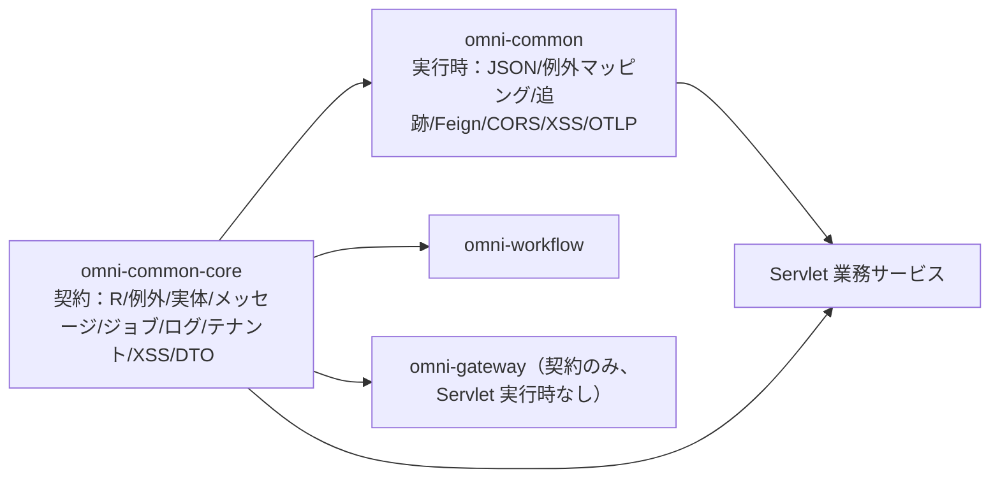

# common-core：サービス間で共有する契約

`omni-common-core` は「ユーティリティ集」ではなく**契約**の集合です。レスポンス封筒、業務例外、エンティティ基底クラス、そしてメッセージ・ジョブ・操作ログ・テナント・XSS・内部身元のインターフェースと DTO を提供します。`AutoConfiguration.imports` を持たず、自動設定も行いません。**依存しても得られるのは型であり、実行時の能力ではありません。**

本稿は「問題 → 使い方 → 原理 → 実装原文 → 拡張と失敗復旧」の順に機能族ごとに説明します。コードは現行ソースの原文です。今回はアプリを起動していないため、実行時の組み込み結論はソース条件に基づくものです。

> 事実境界：`omni-common-core/src/main/java` には現在 18 個の Java ファイルがあります。本稿は 9 つの機能族にまとめ、getter・Lombok 生成メソッド・単一 DTO フィールドを独立した能力としては数えません。

## まず core と common を分ける

| | `omni-common-core` | `omni-common` |
| --- | --- | --- |
| 位置づけ | 契約と型 | Servlet 実行時設定 |
| 自動設定 | なし | `AutoConfiguration.imports` 7 件 |
| 依存方向 | ほぼ第三者依存なし | core、spring-web、security、Jackson、Feign、OTLP に依存 |
| 導入時に起きること | コンパイルでき `R` を返せる | フィルタ・例外マッピング・JSON 形式が有効になる |

`omni-common` が `omni-common-core` に依存し、逆はありません。業務サービスは通常両方に依存しますが、**実行時能力の有無は `omni-common` の条件組み込みで決まり**、core にインターフェースがあるかどうかでは決まりません。



## 統一レスポンスとページング

### 問題

各 Controller が `{code, message, data}` を手組みすると、フロントはエンドポイントごとに解析を書くことになり、ページングのフィールド名が揃わなければ一覧画面が壊れます。

### 使い方

```java
@GetMapping("/{id}")
public R<SupplierVO> detail(@PathVariable Long id) {
    return R.ok(supplierService.getDetail(id));
}

@GetMapping("/list")
public R<PageResult<SupplierVO>> list(SupplierQuery query) {
    return R.ok(supplierService.page(query));
}
```

### 実装原文

`R.ok(T)` は `code=200`、`message="success"` を固定し、`R.fail` は業務コードを保持します。

```java
    public static <T> R<T> ok(T data) {
        R<T> r = new R<>();
        r.setCode(200);
        r.setMessage("success");
        r.setData(data);
        return r;
    }
```

```java
    public static <T> R<T> fail(int code, String message) {
        R<T> r = new R<>();
        r.setCode(code);
        r.setMessage(message);
        r.setData(null);
        return r;
    }
```

`PageResult` は生成時に総ページ数を計算します。

```java
    public PageResult(List<T> records, long total, long size, long current) {
        this.records = records;
        this.total = total;
        this.size = size;
        this.current = current;
        // 向上取整计算总页数
        this.pages = (total + size - 1) / size;
    }
```

### 境界

- `R` は `code/message/data` の 3 フィールドのみで、**traceId を持ちません**。追跡 ID は `X-Trace-Id` レスポンスヘッダです。
- `R.code` と HTTP ステータスは別レイヤです。多くの業務失敗は HTTP 200 + 業務コードで返るため、成功判定は `code` を見ます。
- `R` と `PageResult` はサービス間の共通契約です。変更時は一つのサービスだけでなく、すべての呼び出し元を確認します。

### 拡張と失敗復旧

レスポンスへのフィールド追加はサービス間契約の変更であり、フロントの解析と全サービスを同時に評価します。`code != 200` は業務コードで処理し、すべての失敗を再試行してはいけません。

## 業務例外

### 問題

業務検証の失敗には業務コードを持つ例外が必要です。各サービスが独自例外を定義すると、全体マッピングが全型を認識しなければなりません。

### 使い方

```java
if (!String.valueOf(userId).equals(task.getAssignee())) {
    throw new BusinessException(403, "无权操作该审批任务");
}
```

### 実装原文

```java
    public BusinessException(String message) {
        super(message);
        this.code = 500;
    }

```

```java
    public BusinessException(int code, String message) {
        super(message);
        this.code = code;
    }
```

### 原理と境界

- 単一引数は既定 `500`、二引数は業務コードを保持します。
- `RuntimeException` + 業務コードにすぎず、**HTTP ステータスを決めません**。
- Servlet サービスでは `omni-common` の `GlobalExceptionHandler` が `R` に変換します（[common](common.jp.md#グローバル例外マッピング)）。WebFlux ゲートウェイはこのハンドラを組み込みしません。

### 拡張と失敗復旧

新しい業務コードは core の変更を要しません。期待した応答にならない場合は、グローバルハンドラの組み込みと、より具体的な advice が先に処理していないかを確認します。

## エンティティ基底クラス

### 問題

すべての業務テーブルが `id`、作成/更新時刻、作成/更新者を持つため、重複宣言は漏れを招きます。

### 使い方

エンティティが基底クラスを継承し、挿入時に MyBatis-Plus の `MetaObjectHandler` が時刻と操作者を埋めます。

### 現在の事実

リポジトリには **2 つの** `BaseEntity` が存在します。

| ファイル | パッケージ | フィールド |
| --- | --- | --- |
| `omni-common-core/.../core/model/BaseEntity.java` | `com.omni.common.core.model` | id、createTime、updateTime、createBy、updateBy |
| `omni-common/.../common/model/BaseEntity.java` | `com.omni.common.model` | 同上 |

両方とも使用中で、どちらを使うかは `import` で決まります。同一クラスとして書いたり、自動同期を前提にしたりしてはいけません。

### 境界

- 基底クラスはフィールドとシリアライズのみを宣言し、**自動填充ロジックを含みません**。填充は `omni-common-mybatis` に属します。
- MyBatis-Plus を導入したサービスのみ填充され、未導入なら `null` のままでエラーになりません。

### 拡張と失敗復旧

共通フィールドの追加は 2 つの基底クラスと填充器を同時に評価します。時刻が空なら、mybatis モジュールと填充器の導入を確認します。

## 信頼性メッセージ送信契約

### 問題

業務トランザクション内で Outbox に書きますが、実装は `omni-common-mqlog` に依存します。`ReliableMessageRelay` インターフェースを core に置くことで、業務サービスは契約だけに依存できます。

### 使い方

```java
reliableMessageRelay.send(BINDING_NAME, event, tenantId, eventId);
```

### 実装原文

```java
    void send(String bindingName, Object payload, Long tenantId);
```

```java
    void send(String bindingName, Object payload, Long tenantId, String msgKey);
```

### 意味と境界

- 2 つのオーバーロードの差は任意の業務キー `msgKey` で、運用調査に使います。
- **インターフェースは配送成功を保証せず**、ローカル Outbox への書き込みだけを保証します。配送はリレーが非同期で行います。
- `tenantId` は明示的に渡し、**ThreadLocal で暗黙解決してはいけません**。Outbox 行のテナント分離の唯一の根拠です。
- `omni-common-mqlog` を導入したサービスだけが実装 Bean を持ちます。core だけでは送信能力はありません。

### 拡張と失敗復旧

新しい broker は `MessageSender` を実装し、インターフェースや呼び出し側を変えません。「書けたが届かない」は Outbox 行 → リレー → デッドレターの順に調べ、業務操作を再送しません。

## ユーザータスク契約

### 問題

個人スケジュールタスクのメッセージとハンドラを共通化し、単一の XXL-JOB ハンドラでルーティングする必要があります。

### 使い方

```java
@Component("crmLeadReminder") // Bean 名必须等于 sys_user_job_type.type_code
public class CrmLeadReminderHandler implements UserJobHandler {
    @Override
    public void execute(UserJobMessage message) throws Exception {
        // 读取 message.getJobParams() 执行任务
    }
}
```

### 実装原文

```java
    void execute(UserJobMessage message) throws Exception;
```

### 境界

- メッセージ項目：`jobId`、`tenantId`、`jobType`、`jobName`、`jobParams`。
- 正常復帰は成功、例外は失敗です。
- **Bean 名が `type_code` と一致しない場合、対応するハンドラが見つかりません**。レジストリは起動を止めませんが、そのタスクの実行時に失敗とハンドラ欠落のログを記録します。
- core は契約のみで、レジストリと実行入口は `omni-common-job` と Base にあります。

### 拡張と失敗復旧

新しいタスク種別 = 新しい `type_code` + 同名 Bean で、共有ハンドラ名は変えません。実行されない場合は Bean 名と `jobType`、次にレジストリのスキャンを確認します。

## 操作ログ注釈契約

### 問題

業務メソッドが「この操作を記録する」と注釈で宣言し、収集と保存は core に置かない必要があります。

### 使い方

```java
@OperLog(module = "srm", operType = OperType.UPDATE)
@PutMapping("/{id}")
public R<Void> update(@PathVariable Long id, @RequestBody SupplierUpdateRequest request) { ... }
```

### 実装原文

```java
    String module() default "";
```

```java
    OperType operType();
```

```java
    String idExpr() default "";
```

```java
    boolean recordParams() default true;
```

```java
    boolean recordSnapshot() default true;
```

### 境界

- 注釈があるだけでは**収集されません**。`omni-common-operlog` のアスペクト組み込みが必要です。
- `omni-auth` は common-operlog を**導入しません**。認証は `sys_audit_log` に記録するため、Auth で `@OperLog` を使ってはいけません。
- `recordSnapshot` は `tenantId` 属性を持ち、リクエストテナントと一致するエンティティにのみ有効です。

### 拡張と失敗復旧

操作種別は `OperType` 列挙を拡張し、収集項目はメッセージとアスペクトを変更します。ログ欠落時は依存とアスペクト組み込み、次にメソッドがプロキシ経由か（自己呼び出しは発火しない）を確認します。

## XSS 設定 SPI

### 問題

共有フィルタは現在テナントの XSS スイッチとルールを必要としますが、設定の権威は Auth にあります。

### 使い方

サービスが Bean を実装します。

```java
@Component
public class XssConfigProviderImpl implements XssConfigProvider {
    @Override
    public XssSettings getXssSettings(Long tenantId) {
        // 从本服务的缓存或权威接口读取开关与规则，不得返回 null
        return settings;
    }
}
```

### 実装原文

```java
    XssSettings getXssSettings(Long tenantId);
```

### 境界

- 返す `XssSettings` は `enabled` と `rules` を含み、**null を返してはいけません**。
- SPI は読み取り契約のみを定義し、保存・キャッシュ・テナント検証は Auth または各サービスの実装にあります。
- この Bean が無い場合、`omni-common` の XSS フィルタと Jackson モジュールは組み込みされません。

### 拡張と失敗復旧

ルール種別の拡張は `XssSanitizer` で行い、SPI 署名は変えません。浄化されない場合は SPI 実装の有無、次にスイッチとルールの空否を確認します。

## テナントモジュール供給契約

### 問題

新テナントの各業務モジュール開通には、統一された要求/結果イベント構造とモジュール結果列挙が必要で、Auth が編成できるようにします。

### 使い方

モジュールが `TenantModuleProvisioner` を実装し、`tenant.provision-requested.v1` を消費して `tenant.provision-result.v1` を返します。

```java
    public record ProvisionRequestedEvent(
            String eventId,
            String requestId,
            Long tenantId,
            String tenantCode,
            String tenantName,
            List<String> moduleIds,
            Instant occurredAt) implements Serializable {
```

```java
    public record ProvisionResultEvent(
            String eventId,
            String requestId,
            Long tenantId,
            String moduleId,
            ModuleResultStatus status,
            String errorCode,
            String errorMessage,
            Instant occurredAt) implements Serializable {
```

### 境界

- 結果状態は `SUCCESS` / `FAILED` のみです。どちらかのレシートがあれば、同じ `requestId + moduleId` の再配送はスキップされます。失敗時は Auth の正式な再試行入口が新しい要求 ID を作り、旧 ID の再送とは区別します。
- `moduleIds` は生成時に不変リストへコピーされ、呼び出し側の後続変更はイベントに影響しません。
- 契約は開通順序や再試行方針を含まず、編成は Auth にあります。

### 拡張と失敗復旧

新モジュール = `TenantModuleProvisioner` の実装 + Auth 編成へのモジュール ID 登録です。失敗時は Auth の正式な再試行入口を使い、新しい `requestId` で失敗モジュールだけを再処理します。要求の偽造や旧レシートの削除は行いません。この規則はテナント開通専用で、承認の起動など別の要求 ID を使う処理へ一律に当てはめないでください。

## 内部身元とデータ範囲 DTO

### 問題

サービス間でユーザー・組織・データ範囲を照会するには安定した JSON 構造が必要で、各サービスが DTO を複製するとフィールドがずれます。

### 現在の DTO

| DTO | 主要フィールド |
| --- | --- |
| `InternalUserDTO` | id、username、nickname、tenantId、primaryUnitId、email、phone、avatar、status |
| `InternalOrgDTO` | id、tenantId、parentId、name、type、unitCode、path、status |
| `InternalDataScopeDTO` | userId、tenantId、permissionCode、primaryUnitId、effectiveScope、accessibleUnitIds、securityVersion |
| `InternalUserOptionDTO` | id、username、nickname、tenantId、primaryUnitId、avatar |

実際の呼び出し例：`omni-asset` の `AuthInternalClient` がこれらの型で `/api/internal/user` と `/api/internal/data-scopes` の応答を受け取ります。

### 境界

- **DTO は転送構造にすぎず**、信頼は内部トークン検証（`X-Internal-Token` + `X-Tenant-Id`）から来ます。クライアント自己申告を身元にしてはいけません。
- 呼び出し失敗を許可へ降格してはいけません。Asset の `AssetIdentityGuard` などは 403/503 として扱います。
- フィールド拡張は Auth の応答と全消費者を同時に変更するサービス間契約変更です。

### 拡張と失敗復旧

内部フィールド追加前に全消費者が未知フィールドを許容するか確認します。身元照会の失敗はフェイルクローズで処理し、自己申告ヘッダへ退避しません。

## 付録：機能族と節

| 機能族 | 節 | 検証入口 |
| --- | --- | --- |
| 統一レスポンスとページング | 1 | 各サービス Controller テスト |
| 業務例外 | 2 | グローバル例外マッピング（common 編） |
| エンティティ基底 | 3 | MyBatis 填充器（WP-21 で確認） |
| 信頼性メッセージ契約 | 4 | Fw10OutboxAtomicityIT（既存） |
| ユーザータスク契約 | 5 | Base レジストリテスト |
| 操作ログ契約 | 6 | operlog アスペクトと消費（WP-22） |
| XSS 設定 SPI | 7 | XssJsonDeserializationTest |
| テナント供給契約 | 8 | TenantProvisionContractsTest |
| 内部身元 DTO | 9 | AssetIdentityGuardTest |

次の章 [common](common.jp.md) では、これらの契約が Servlet サービスでどのように自動設定されるかを説明します。
